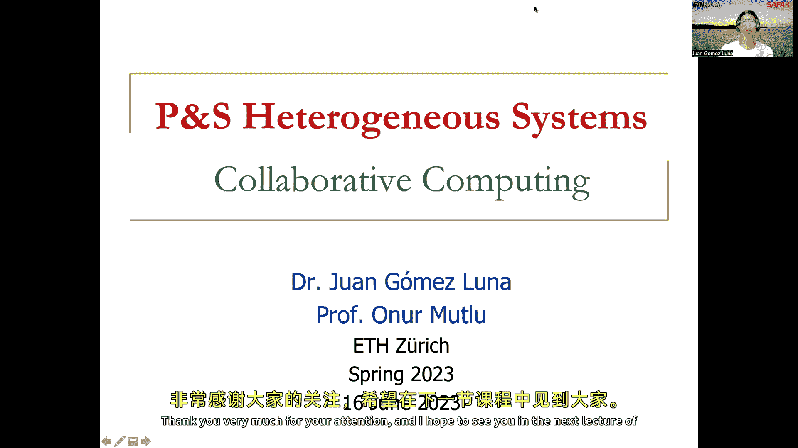

# 014： 协同计算


## 概述

在本节课中，我们将学习异构系统中的协同计算，也称为细粒度协同或异构执行。我们将重点关注如何在包含不同设备（特别是CPU和GPU）的系统中实现协同计算。实现协同计算的一个必要特性是**统一内存**，这是一种可以被多种设备同时访问的虚拟内存系统。

## 统一内存简介

在传统的GPU计算中，我们无法拥有统一的内存视图。通常需要在主机处理器和设备GPU上分别进行内存分配，并使用显式的数据传输操作（如 `cudaMemcpy`）在设备间移动数据。这种方法自然适用于独立GPU的系统。

以下是一段传统方法的示例代码：
```c
// 主机内存分配
float *h_data = (float*)malloc(N * sizeof(float));
// 设备内存分配
float *d_data;
cudaMalloc(&d_data, N * sizeof(float));
// 数据传输：主机到设备
cudaMemcpy(d_data, h_data, N * sizeof(float), cudaMemcpyHostToDevice);
// 启动GPU内核
kernel<<<...>>>(d_data);
// 同步并传回数据
cudaDeviceSynchronize();
cudaMemcpy(h_data, d_data, N * sizeof(float), cudaMemcpyDeviceToHost);
```

然而，通过统一内存，我们可以拥有一个统一的虚拟地址空间，该空间在主机和设备之间共享。这一特性始于CUDA 6和Kepler架构，但最初它只是隐藏了双重内存分配和显式数据传输的层。自CUDA 8和Pascal架构起，GPU开始支持页面错误，这意味着GPU内存可以被超额订阅，GPU可以访问CPU内存来获取数据并继续执行，唯一的限制是系统内存大小。

统一内存不仅支持内存超额订阅，还简化了编程。现在，我们不再需要进行双重内存分配，只需使用 `cudaMallocManaged` 这个新的API在统一内存空间中分配数组。这样，CPU和GPU都可以访问同一块内存，无需进行显式的数据传输。这种方法自然适用于CPU和GPU集成在同一芯片上并共享物理内存的系统，但也可以为独立GPU实现，并且所有新版本的CUDA都支持此功能。

## 协同计算模式与应用案例

上一节我们介绍了统一内存的概念，本节中我们来看看如何利用这些新特性来实现协同应用程序。我们将讨论几个使用CPU和GPU的协同计算用例。

协同计算应用在CPU和GPU系统中一直是可能的，主要是因为从主机端启动内核是异步的。这意味着CPU在GPU上启动内核后可以继续执行其他任务，然后在某个时刻使用 `cudaDeviceSynchronize` 来检查GPU内核是否执行完毕，再复制数据。这在统一内存出现之前就已经可以实现。

但有了统一内存，协同计算变得更加容易，并且支持更细粒度的协作。特别是在Pascal架构之后，统一内存支持CPU和GPU内存一致性以及系统范围的原子操作，使得我们可以编写更复杂的协同代码。

以下是使用统一内存和系统原子操作的代码示例：
```c
// 在统一内存中分配输入和输出
cudaMallocManaged(&input, size);
cudaMallocManaged(&output, size);
// 启动GPU内核
kernel<<<...>>>(input, output);
// CPU可以立即继续计算，甚至可以访问GPU正在使用的数据
// 使用系统范围的原子操作防止数据竞争
atomicAdd_system(&shared_var, value);
```
在GPU端，系统范围的原子操作语法如下，它与普通的原子操作（如 `atomicAdd`）语义相同，但使用 `_system` 后缀来标识其作用范围是整个系统：
```c
atomicAdd_system(&data, increment);
```

现在我们对统一内存及其在细粒度协作中的应用有了更多了解。接下来，我们将简要介绍一些协同模式及其示例。

### 数据分区模式

数据分区模式是指将数据并行任务划分到不同的设备上执行。例如，设备1可以是CPU，设备2可以是GPU。某些任务在一个设备上执行可能比在另一个设备上更快，但另一个设备可能具有更高的并行度。在执行过程中，我们可能需要在继续执行第二个内核之前进行粗粒度同步。

以下是实现数据分区的一种方式：
1.  将任务划分为多个数据并行子任务。
2.  根据设备特性（如CPU擅长小任务，GPU擅长大规模并行任务）静态或动态地将子任务分配给CPU和GPU。
3.  设备并行执行各自分配的任务。
4.  在必要时进行同步，然后继续执行程序的下一个阶段。

### 任务分区模式

任务分区模式是指将不同的任务（或内核）分配给不同的设备执行。这可以实现并发执行，例如通过流水线方式，当设备2正在计算当前任务块时，设备1可以计算前一个任务块。

统一内存和系统范围的原子操作还使我们能够实现**细粒度任务分区**。在这种模式下，我们知道某些子任务在一个设备上运行得更快，因此可以使用细粒度的通信来通知另一个设备上的线程。例如，设备1完成特定子任务（黄色子任务）后，可以通知设备2上的线程，使其可以继续执行任务的第二部分（深绿色子任务）。我们还可以为同一程序中的不同内核应用不同的分区策略。

## 具体应用案例

### 案例一：曲面生成（数据分区）

我们以一个在三维空间中生成曲面的算法为例。该算法使用控制点网格，并基于B样条多项式进行参数化有理公式计算。

在这个例子中，我们将曲面划分为多个图块，并将不同的图块静态分配给CPU或GPU。我们可以预先分析CPU和GPU计算这些图块的速度，从而进行静态分区。即使没有统一内存，也可以通过启动CPU线程和GPU内核来实现，并在最后将GPU计算的部分复制回CPU内存。

使用统一内存后，实现变得更加简单：
1.  使用 `cudaMallocManaged` 分配单个曲面内存。
2.  启动CPU线程和GPU内核。
3.  由于使用统一内存，无需将GPU计算的部分显式复制回CPU内存，这会隐式完成。

在支持系统范围原子操作的更新版本统一内存中，我们甚至可以实施动态图块分配，无需进行离线性能分析。这对于数据依赖性强或不规则、负载不平衡的应用程序效率更高。动态分配需要一个全局变量（图块计数器）来告诉每个GPU线程块或CPU线程下一个要计算的图块，并使用 `atomicAdd_system` 来更新这个原子变量。

在一项测试中，使用这种协作方式，在Ada GPU上结合CPU核心，相比纯GPU版本获得了高达40%的性能提升。

### 案例二：广度优先搜索（协同分区）

广度优先搜索算法包含两个不同的内核：一个用于小规模边界，另一个用于大规模边界。对于小规模边界，即使我们优化了内核，GPU资源也可能利用不足。

在NVIDIA Jetson设备上的测试表明，小规模边界在CPU上运行得更快（对应执行初期的红色条），而大规模边界则适合GPU处理。通过协同实现，我们可以根据边界大小动态选择最合适的设备。

没有统一内存时，我们需要显式地进行内存拷贝，并在主机代码中使用循环来检查边界大小并决定启动CPU线程还是GPU内核。

有了统一内存，编程更简单，无需显式内存拷贝。而有了支持系统范围原子操作的统一内存，我们甚至可以在开始时同时启动CPU线程和GPU内核，让它们持续运行，根据边界大小通过系统原子操作进行通信和同步，共同处理同一个边界。

对于某些图，这种方法的加速比可达34-39%，优于纯GPU版本。当然，对于非常大的图，其边界通常也很大，大部分时间还是会使用GPU。

### 案例三：RANSAC算法（细粒度任务分区）

RANSAC算法用于寻找符合特定观测值的最佳模型，可应用于物体检测等领域。该算法包含多个迭代，直到找到最佳模型。每个迭代包含一个拟合阶段（顺序计算）和一个评估阶段（数据并行计算）。

由于迭代是基于随机采样的，因此各迭代之间相互独立。我们可以并行化所有迭代，在CPU线程和GPU线程块中计算它们，并使用原子操作进行细粒度通信。这样，CPU和GPU可以协作处理不同的迭代，或者协作处理同一迭代的不同部分，从而加速整体计算。

## 总结与资源

本节课我们一起学习了异构系统中的协同计算。我们首先介绍了实现协同计算的关键——统一内存，它简化了内存管理并支持更细粒度的设备协作。接着，我们探讨了数据分区、任务分区和细粒度任务分区等协同模式，并通过曲面生成、广度优先搜索和RANSAC算法三个具体案例，说明了如何在实际应用中实现CPU与GPU的协同工作。

更多示例可以在CHAI基准测试套件中找到，该套件包含了离散和统一内存版本、CUDA/OpenCL实现，甚至GPU模拟器版本。所有课程材料均公开提供。



