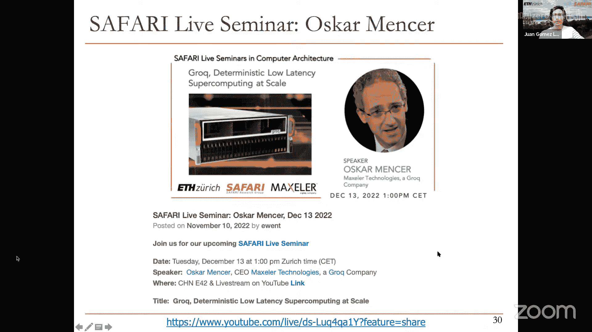
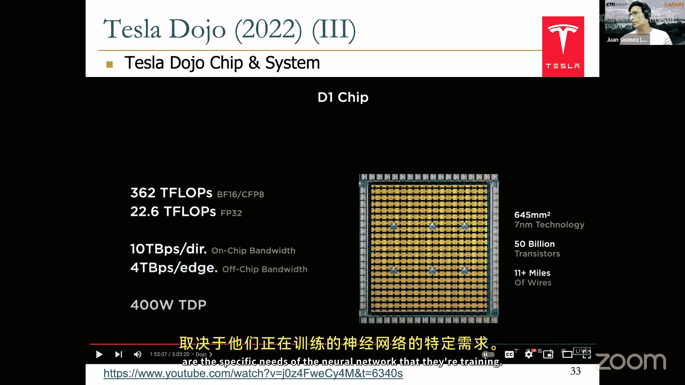
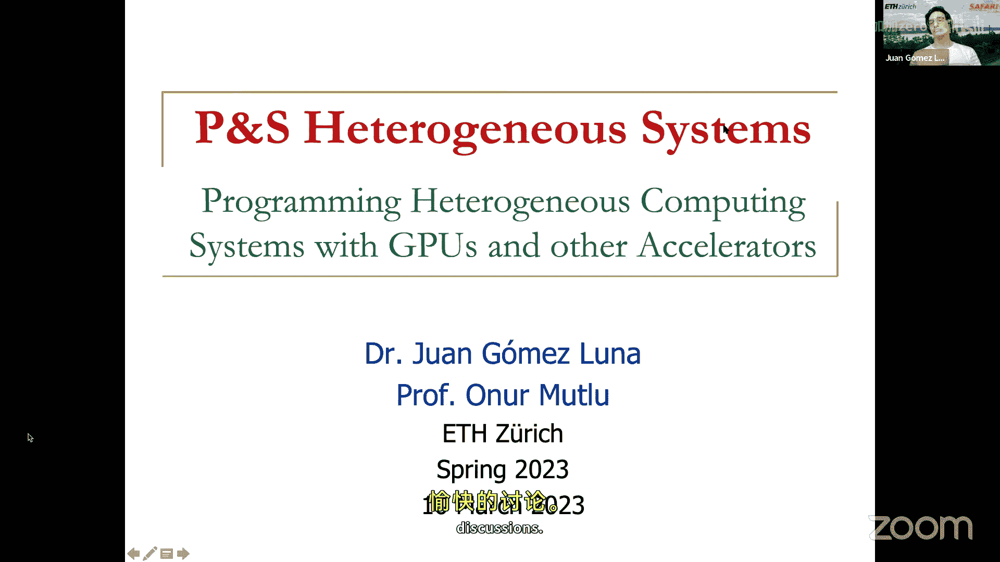

# 【异构系统编程：基于GPU和加速器 2023】苏黎世联邦理工—中英字幕 p01 p1 HetSys Course： Lecture 1： Programming Heterogeneous Computing Sy -BV1jXHZeuEwy_p1-

Okay， I think we are going to start。In a few seconds。He。Or it managed to unmute it。Can you hear？Yes。

 I can hear you now， Can you hear me， Yes， very clearly。Okay， that's very good。 So then。

 I think it's time to start now。So hello guys， welcome and thank you for attending this first lecture of our course on Mediterranean systems。

The title the entire title of this course is programming heterogeneous computing systems with GPUs and other accelerators and that's what we are going to learn in this course。

 how to work with heterogeneous computing systems， especially and with a special focus on GPUs and parallel programming before so basically today what we are going to do is just introducing the main goals of the course。

 we will give also a little bit of background on heterogeneous systems rest and interesting devices that are used for different purposes for example。

 ML and neural network accelerators that we will briefly mention over the course of these first lecture。

 starting from next Friday， we will have more in- depth lectures about architecture of CD processors。

 GPUs GPU programming parallel patterns， etc。I will show you some materials later for your reference because you can already check what is going to be more or less the different collection of also the collection of different lectures that we are going to have in this course。

 you can already check them in the website of the past semester。Feel free to stop me anytime。

 I will eventually ask you as well if you have any questions and also feel free to use the chat here in Zoom。

 if you are attending the lecture in YouTube you can also use the YouTube chat。

 I will keep an eye on it in case that there are any questions there。

So before we go into details about the course， I think it's good to take a look at the contents of the course catalog with respect to these course because there is where the objective of this course is clearly defined。

 I would say。This is the description or this is the objective that our description of the objectives of this course motivate with the difficulty of scaling performance and efficiency of CPUs and these is something that affects many modern important workloads such as machine learning and artificial intelligence that also other domains such as bioinformatics。

 machine learning graph processing medical imaging。

 personalized medicine etc so there is a need for heterogeneous devices and good examples of other devices devices other than CPUs that we can find in computing systems these are graphics processing units。

 FDAs also specialized accelerators， for example the tensor processing units that are used for neural network training and inference and even more new word trends such as neural data processing architectures even though there have been great advances in the adoption。

With their immune systems in the recent years， there are still many challenges to tackle。

 and that's what we are going to try to do in this course， at least partly。

So one possible way of starting the discussion about these different immune systems is to take a look at the Flyn's taxonomy of computers back in 1966 Mike Flynn already proposed a classification of computers where he divides into four different four main groups depending on how the devices operate on the data the first of the example is C single instruction single data where a single instruction operates on a single data element this is like a sequential processor same as we can have in very simple CPUUs with just one core CID is single instruction operating on multiple data and this is where we are going to start indeed today and also in the next lecture discussing these these devices or these architectures。

 CD architecture。Where with a single stream of instructions we compute on multiple data elements we are going to pay special attention to this type because they are one of the basic architectures that compose graphics processing units and I said earlier graphics processing unit are a key device are going to be a key type of device in this course The third type of computer is misbe multiple instructions operate on single data elements it's not that easy to find good examples in the real world the closest form could be syto reprocessors we are going to mention them also in today's lecture lecture and also some other lecture later in this semester and finally the last one is mind multiple instructions multiple data multiple instructions operate on multiple data elements so we have multiple instruction streams examples of these。

Be multi processors， multi core processors or other types of multi thread processors。As I said。

 we are going to start with the example the example of heterogeneous processor or heterogeneous device。

 the example today are going to be CD processors and in particular we are going to start with the CD ISA extensions that we can find in multiple CPUs these days because even though CPUs can be multicho CPUs can be seen as a MinD machine or a MID computer。

 they are also heterogeneous in themselves because they have different types of processing elements and one good example of these are the CD extensions。

So in in the single instruction， multiple data extensions a single instruction act operates on multiple pieces of data at once。

 this is useful in many different applications， for example。

 processing of graphics that many more as we will see and we discuss in this lecture and over the entire course and the basic idea in in the extensions is to perform short arithmetic operations on multiple elements at the same time。

 for example we can add four8 bit numbers with a single instruction the basic idea would be to start using one conventional register 32 bit register for example as we can have in any CPU and divide these register into four parts of8 bit each the basic idea to be able to compute four additions at the same time would be to。

Modify the AL to eliminate cur between8 bit values， for example。

 the carryout of this bit7 won't be propagated to the carrying of this bit8。🤧And this way。

are we would be operating on four elements at the same time without any interference between the four editions so that's the basic idea in the CdiISA extensions that we can find in CPUs and a good example and actually a seminal example of these are the Interpenium MMX operations that were already implemented in the 90s the idea operate one single instruction operating on multiple data elements with graphics in mind when these MMX instructions were proposed and first implemented in the 90s as I said。

 they have multimedia and graphics operations invite and in mind these MMX extensions different ways of operating on 64 bits if you have a 64 bit registered you can divide it what you can just operate on six on 64 bit elements。

64 bit quad word or you can divide it into two parts and operate on 32 bit double words or on4 160 B words or on8。

8 bit bys so it all depends on how you create connections between the carry out and the carrying of the next bit and where that carry stops in order to keep the different operations independent I want to give you an example of how to use MMX instructions this way you can just see one versus example of how to operate with a single machine with a parallel architecture in this example what we are going to do is to overlay the human in one image on top of the background in another image so here we have two images X and Y as you can see on the left hand side we have the image of。

Woman on a blue sorry blue background and what we want to do is replacing the blue background with a blossom background so that the new image is going to look like this on the right hand side performing these operation on a sequential CPU is pretty straightforward we just need to go one by one over all the pixels of the input image of the image X and check if the corresponding pixel is blue or not if it's blue then we are going to replace the pixel in the new image with the corresponding pixel of image Y which is the blossom background as you see if it's not blue that means that the pixel belongs to the woman to the image of the woman so what we do is just copying the pixel from the woman to the final image this new image that we have here on the right because all the computation。

that we are performing here are exactly the same for all pixels That means that we can operate on multiple pixels in Parliament just with a single instruction or with a single stream of instructions so what we can do with the MMmxs extensions is to check several pixels at the same time。

 whether they are blue or not to do so we compare to an array or register that contains many bytes each of them with the value or with the color blue and we are going to compare one by one these pixels here to generate。

Bat mask that we are going to use later to filter the filtering or filter out the elements from the image X and the image Y that we really need to copy really need to transfer to the new image and that's what we do in this part here after having generated this mask that is stored in this MM1 we can filter out those elements of the blosom image that would be where the image of the woman herself is and we filter out those that we don't need and we only keep those that we really need that are those that will appear in the background and we do the same for the woman's image we filter out all the blue pixels and we just maintain the pixels that correspond to the woman's image after that we combine resulting the filter。

Pixels from both original images and then we obtain pixelels from the final image。

 this new image that contains a woman in front of the blossom background so this is more or less how C machine would work you can operate on multiple elements at the same time using a single instruction but this is just an example of theity that we can find in current computing systems as I said it's very common to find Cdi extensions in CPUs and multi CPUs but even in the same system on a chip you can also find other devices like specialized accelerators。

 neural network or accelerators for example， or GPUs or maybe even reconfigurable logic for example FEAs and it's more and more frequent as well that we find ways of performing coherent communication。

cross these different devices with a specialized coherent interfaces or coherent interconnects that allow these different types of devices to have coherent copies of data let's say the most recent values for the data that they need to use regardless of what device is modifying them so all of that will be covered with more or less detail in this course but for sure we will talk about all these different components because they are important in currentgeneous computing systems。

So goals of these course。First of all， we are going to introduce the need for heteroity in current computing systems in order to achieve high performance and energy efficiency。

 you're going to get familiar with some of the differentous devices that are available in computing systems you're going to learn parallel programming and we will focus on GPU programming with kuda or with openCL but even though we are we will mainly target a specific architecture and a specific type of device they most。

Learnings that you will have about parallel computing patterns in this course are applicable to all parallel machines and or too many parallel machines and we will in fact mention other examples when we are discussing and presenting the parallel patterns you are going to learn as well how to do workload distribution and parallelization and strategies are the parallel patterns that I was mentioning and you will work handsz because these are projects and seminar course so here the goal is that each of you develop your own your own hands projects and there might be many different things like programming theous architectures analyzing workloads proposing scheduling of loading mechanisms etc cea these are just like say different potential directions for the projects by the way I will mention that later as well but we are going to discuss the project projects in the next lecture。

We find heterogeneity in many different levels， we have already seen a picture work with an entire system on achieve with three different types of devices。

 CPUU， GPU， FDA， but even if we go and look inside each of these devices independently for example a GPU we will see that there is also a heterogeneity inside for example this is the layout this is the big picture of N BD 100 GPU with 108 cores and 40 megabytes of L2c if you look at all these core here in the image you'll see that they are more or less homogeneous right but if you go inside them you'll see that they have different execution units for for example。

 different data types Integer floating point double precision and we also find these area here the tensor cores that are small。

Coours that are specialized for machine learning and deep learning and they appeared first in the Volta architecture backing 2017 and since then they have evolved this generation of from a100 GPUs integrated new support for sparssity where they can filter zero entries and compress and operate on compressed matrix styles and this way be more efficient because as you can imagine if you are performing multiplications with zero entries that result is going to be zero so we are just wasting energy we don't need to perform that multiplication right and that's something that。

It's more and more common in neural networks these days sparsities more and more common in neural networks these days and that's why these specialized units start support some sort of sparsity in order to make compression and then computation more efficient In summary what I wanted to say is that we see heterogeneity even inside the core of one specific heterogene this is a more recent GPU this is the H100 GPU that was presented in 2022 they keep including innovations inside the tensor cores in the fourth generation they also see more heterogeneity in the data types that are supported these tensor cores support floating point 32it floating point op 16 bit floating point opera in two different formats。

So two different formats of eight beat floating point values。

These tensor cores are specialized for machine learning。

 training and inference neural network or deep learning。

 but they are also not the only devices that have been or in this case execution units in one specific device that have been design for neural networks and for deep learning I think another really interesting devices this as wafer scale engine is the largest ML accelerator chip because in reality it is not one single chip is an entire wafer as you can see in the picture and you can compare it as well with the size of one of the largest Nvidia GPUs in this case N via high you can see the difference in the number of transistors and also the entire area this picture here corresponds to the wafer scale engine from 2019 two years later they announced。

Never larger one with basically twice a number of core。

 twice a number of transy stores and also much larger than the largest GPU at that time the say media a 100。

 this was around 2021 as you see。This is a very interesting device。

 very exciting direction in the design of machine learning accelerators and if you're curious about the Crebras Wier scale Engine I can recommend you this talk。

 this Safari life seminar that Choiong Li， one of the founders of Crebraas delivered last year in our group。

😊，And another very good example of accelerator design for neural network training， inference。

 machine learning and artificial intelligence， pretty prime example are the tensor processing units that were first proposed or were first developed by Google back in 2016-2017 as you can see here and the right hand side。

 this is basically a systolic array， remember that we mentioned systolic array in the beginning of the lecture as an example of misde matching here。

 what we have is's a flow of data coming from the left。

 for example images or input feature maps and with the stolic array basically that is performing a matrix multiplication multiplying and a in these accumulators here at the output matrix。

plication because matrixx multiplication is a key primitive for neuraln networks and many machine learning and artificial intelligence algorithms we are going to talk about matrixx multiplication in detail in discourse and about how to lower convolutions into matrix multiplications。

 which is a very common technique in training and inference of neuraln networks these days and this is why its operation is so important and why there are units that are specialized for these specific operation units and entire accelerators That was the first generation of the Google TPU the second generation one year later they basically multiply the total well the number of chips by4 these also increases the flops floating point operations per second very significantly they also replace the DR3 memory with high band with memory。

to have a higher bandwidth of access to data in order to be able to feed these fast sy arrays with data coming from memory。

And the TPUs keep improving over time the third generation。

Increases the number of matrixs units of systolic arrays from two to4 per chip this here on the left is the version two this one on the right is the version three again they are doubling the teraf flops per chip as well and in the fourth generation even a higher jump from 90 terra flops to 250 teraflops per chip in 2021。

 the goal supporting new ML applications， mosa such as computer vision and natural language processing recommend systems。

 reinforcement learning etc。And this is again the picture of the modern systolic array that I mentioned earlier or that we have seen earlier。

 and here you can see a little bit more detail of these systolic array。

 these matrix multiply unit observe how we have an input coming from the left。

 this systolic data setup， systolic data setup that is feeding input feature maps that might be coming from somewhere else from external memory。

 and also the weights coming from this DDR3 chips or HVM memory。

 the weights of the neural network coming from here performing the matrix multiplication and accumulating the results in these accumulator registers。

So just another example of the heterogene device and as I said earlier we may have the heterogeneity even inside the same chip I gave you the example of GPU course but here you can see another really nice example these ss ver aAP that has three compute engines three types of compute engines inside the same chip it has a scholar processors like regular CPUs they have adaptable hardware that as you'll see is similar to as a can PEA right and they are designed for latency critical workloads while the ver aAP also integrate some vector processing units like CD units that are specialized for signal processing video image processing and other parallel workloads neural networks and material learning can also be good examples for those vector。

Eines are here in this figure called intelligent engines or AIE artificial intelligence engines that are basically vector processors as you see very interesting picture here with the three compute engines color cores on one side in fact two different types of dual core arm CPUs adaptable engines in the middle and F where you can have your custom memory hierarchy with the different eron based memories that FPAs can have and on the right hand side the intelligent engines that are vector or CD units with a more specialized for more parallel and regular workloads。

Okay， do you guys have any questions so far？Okay， I can continue and we can clarify anything that might be needed later。

Okay we were talking about different types of devices。

 many of these devices and accelerators are specialized for important workloads。

 important workloads theses are machine learning and artificial intelligence neural networks another interesting example of such an accelerator such a processor as the growth tensor streaming processor presented in 2020 here as you sees well it's designed for machine learning workloads that exhibit abundant parallelism the good thing with machine learning and for at least many of machine learning workloads is that they are they have quite regular structures so it's relatively easy to create relatively easy it must not be easy but at least it's possible to create a deterministic processor with a producer consumer stream programming model if you are performing matrix multiplications。

performing product operations you know what's the exact sequence of operations that need to happen for that matrix matrix multiplication to be executed right is different from other workloads where you may have irregular memory accesses or indirect accesses that require you to first go to memory fetch some point there and then depending on where this pointer points go into memory and bring another value et cetera。

 that's what happens where we have more indirect access pattern。

 more irregular behavior if you think about the matrix multiplication we are accessing rows we are accessing columns of matrices so the computation and the accesses to memory and the operations that we need to perform at any given point are quite predictable that's why G design a deter deterministic processor where they can orchestrate the flow of data over all different units that the G system integrate。

And here you can see already a pictorial representation of these units with Mag units similar to the systoica array that we have mentioned earlier。

 switch units that are used for communication and shuffling data from the Mag unit to the memory unit there are also vector units similar to the matrix unit but intended to operate on a single vector so they are more similar to a CD unit and so on but these are the different units that you can see inside the Goc tensor screeninging processor and actually you can see here the dipho with with these two hemispheres that the Goc processor is divided into on the left hand side we see memory with C switching unit to move data to shuffle data around and we have the MMX。

It's the magic splplication units and here in the middle there is a vector unit for CinD operations and you can also see like different interfaces and links for communication across chips also for communication with another external device。

 for example， a house CPU via the PC PCC Express pass。And Gop proposes an entire hierarchy。

 a scale up hierarchy from the gr chip to the cardt that may contain more than one chip。

 and inside the one node there will be multiple cards and these different nodes can all be put into the same rack in order to scale out in order to be able to train larger neural networks。

I think GC is a very interesting device as well， we may talk about it in more detail in a later lecture for now。

 what I would recommend you is this Safari Life seminar that Oscar Mener from GO delivered basically two months ago in our group the talk is accessible from the Safari website and also you have here the link to YouTubeT livestream it's still available。

And another prime example is this Tesla Dojo from 2022 Tesla obviously needs very systems。

 large systems to train neural networks and they are very innovative in the design of new devices that can help in these purpose。

 I think it's pretty interesting these Dojo training metrics or these Dojo training system that is composed by different types of processors as well here you can see CPU regular host CPU they will also include these DIP as well see sort of an interface processor to communicate between the CPU and the tiles。

 these tiles probably similar to a sytolic array as well to perform matrix and matrixplication。

 matrix vector multiplications that are。Necessary to train to do neural network training and inference observe also that the different devices have different sort of memories heterogeneous memories as well CU may have conventional DDRx D while this DIP this interface processor has HVM memory that provides significantly higher bandwidth。

And well， here you can see a picture of this Dojo interface processor with its 32 gigabytes of high bandwidth memory。

 a total bandwidth of 800 gigabytes per second。And this is the D1 chip。

 the tile itself that is used for training their neural networks， as you see。

 well really high number of ter flops for different supported data types， 16 bit floating point。

8 beat floating point， 32 bit floating point， depending on what are the specific needs of the network their training。

Okay， more examples of heterogeneous architectures than this is actually a trend that I mentioned in the very beginning。

 Ne data processing or processing in memory that is a trend that tries to alleviate the data movement botling and what's the data movement bottleneck is the frequent need for communication between memory and storage and processing elements and compute units one problem with that and probably all of you are familiar with the phenomena model where we have the process on one side。

 the memory on another side or in the middle we have a communication unit。

 the problem that we have in most current systems these days is that these communication unit is very narrow so because it's very narrow it basically basically behaves like a funnel and that creates a lot of contention when accessing data when moving data from one side to the other side one way to alleviate these data movement bottleneck is called processing in memory and as the name indicates。

Basically consists of placing processors inside the memory and this can happen in many different ways One nice example is this appM processing in Dra engine from 2019 that basically modifies DDR for chips as you can see here these thems in the picture they modify these chips to include small processors called DPUs near each DM band near each memory band and this way the host CPU can of load computation to the processors here inside the pin chips and these processors can access data locally operate on the data in the memory arrays and do it at much higher aggregated bandwidth because you're going to get much more bandwidth if you have many processors operating inside these chips than if you just try to access the data through this database。

Here that is， as I said， behaves like a final。Ame is a French startup as a small company。

 but is not the only company that is exploring and designing， processing in memory devices。

 Samsung is one major D vendor announced already two years ago。

 their first processing in memory architecture targeted at AI and machine learning。

 It's called Dham or HVM P。 It's based on HBM memory。

 What they basically did was modify the design of the HM HBM2 memory layers in order to place a small。

P processorcesors called PCUs， these PCU blocks that you can see here in the di photo inside each two banks。

 every two banks of D cells。These PCU blocks are small CD units that have higher bandwidth access to the nearby band and perform。

 they can perform multiplications and additions pretty fast and these multiplications and additions can be used to execute do product operations or matrix vector multiplication or matrix and matrix multiplication that are needed as I said。

 for machine learning and artificial intelligence。Samsung has other proposal a different type of processing in memory system in this case is Deb what they do here is placing a small FEA on top of the beamm and these FEEA will implement several processing elements that have access to have high bandwidth access to these memory chips on the the and they can exploit rank level parallelism accessing all chips at the same time and this way increasing the overall bandwidth of the system alleviate the data movement bottleneck in that sense and and accelerating workloads that are good be memory bound in the baseline system the example here is a recommendation systems that they tested in their first prototype。

But Samsung is also not the only major vendor that is exploring and designing processing in memory devices。

 SK Hyix is another major DM vendor that announced last year。

 their GDPR6 aim accelerator similar to the HMP proposal from Samsung。

 they also placed processing units near the memory banks and these processing units are also specialized for multiply and accumulate operations that are needed for machine learning artificial intelligence。

So these are just some examples of heterogeneous computing systems and as I said we are going to have many or we potentially will have many different types of devices inside the same system on a or inside the same compute system but it's important as well to find efficient ways of communicating between these different processes。

 different types of processors and also keep coherent data in their caches and in their scratchpads。

 though that's the role of coherent interconnect examples of that are for example copy or open copy or the most recent CXL compute express link。

 in the traditional approach to system with thetergenous devices we need to explicitly move data between the main memory of the host processor of the CPU for example。

To the accelerator， for example， an FPA， right？That's a traditional approach and that's what these coherent interfaces try to optimize and try to make let's say more seamlessly integrated and in summary easier to use by programmers and users so that was the proposal from first copy and copy to that were the first two interfaces that IBM proposed but then open copy was standard that was followed by several vendors providing a coherent interconnect between different types of accelerators or different types of devices in a system it's not only open copy also other vendors Intel for example。

 started to integrate as well these。coherent interconnects between their CPUs and their FEAs in order to provide a unified view of memory and in order to allow tighter integration and finer grain collaboration between different devices in the system。

The most recent trend and most recent standard is the CXL that this industry standard interconnect thats it's been followed by many vendors these days and it's being developed I think cXL is right now in its 3。

0 specification and and I think that there will be more to come and it's really providing or standard to provide and a very interesting range of possibilities for different devices in the system from accelerators。

 accelerators with memory or simply memory buffer in order to extend the effective memory capacity of a system there are different indeed three types of protocols supported depending on what the sort of device and what' the type of communication that we want to have between get these different components in the system like components like。

A network interface card a regular accelerator such as a GPU or an F or simply memory buffers memory extenders that allow a host processor to have access to much larger memory these compute express link as I said is a really promising standard and hopefully will allow much more seamless and close integration between different device and much and much more fi collaboration and in summary more performance more energy efficiency and also better programmability as well。

Okay so we are going to talk about all these types of devices and interconnects more over the course of the semester for now let's summarize a little bit what are the goals of the course。

 what will be key takeaways of this course， the first one this Ps is aimed at improving your knowledge in computer architecture and heterogeneous systems。

 your technical skills in programming heterogeneous architectures。

 for example GPUs or FPAAs we also propose maypro projects about the PA programming you will develop as well your critical thinking analysis and will interact with group of researchers that are the safari research group。

 you will get familiar with keyre directions in your group and in basically in the landscape of heterogeneous computing systems and finally you will improve your technical presentations because you will present your project at the end of the semester。

The key goal of the course is to learn how to take advantage of existing heterogeneous devices by programming them。

 analyzing workloads， proposing ofloading， scheduling techniques， etc。

There are not many prequisites in this course but you are expected to have some good background in the digital design and computer architecture if you want a refresher on these I can recommend you to take a look at contents of our website or Professor Molo's DCA course that is taught every springprint semester we are right now starting the spring 2023 semester but you can find all the materials of the course in the website of the past springprint semester you are expected to have familiarity with CNC++ programming this is important for many different potential projects like programming their Uni architectures doing simulation work etc so we expect that you can program and if you have also some basic knowledge on FPA programming or GPU programming that will be even better。

For sure， what we expect from you is that you have an interest in computer architectures and computing paradigm in discovering why things do work or do not work and solving problems and making systems efficient and usable。

This course is delivered by me by the Safari Research Group。

 the Safari Research Group is led by Professor Reard Mulow。

 who is a professor at PTHUuric since 2015 he has plenty of experience in research and teaching on computer architecture。

 computing systems， hardware security， bioinformatics， etc。

And the rest of the team is me I'm the lead supervisor and I will teach most of the lectures not all。

 but most of the lectures of this course， there are also other supervisors， they will be。

Possibly your supervisors in your own personal project， Dr。 Mohamd Al， Dr。 Baad Salami and Dr。

 Mohammad Saar as well as jewelel and Ly Deger who is a PhD student of our group so you can what you will have a chance to to meet us and to know from us as well。

 that you can also take a look at the entire Safari research group in our website。

 It's a pretty large group around 40 research these days。

 we do a lot of work in research teaching and also dissemination for activities in different ways。

 for example， the newsletters that we publish from time to time。 This is an all edition。

 but a new edition is coming and hopefully will be will be released soon。

And we also organized many other activities I mentioned earlier a couple of Safari La seminars that I would recommend you。

 you have a link here to all the Safari Se series with that we started already in 2021 all the Safari La seminars you can find them in all website as well with links to to the YouTube recordings probably in some cases the slides as well。

 if you want to take a look etc。In our group there we do research in many different things in computing systems。

 but we have a clear focus on computer architecture， hardware software codesign。

 and also bioinformatics applications in computer architecture。

 we cover basically all the different components of the computer architecture and the computing systems from the persistent memory and storage to hybrid main memory at thegen processor and accelerators。

 etc。Okay， I have this slide here for you guys to introduce yourselves。

 but I think that we can skip these for now， we will have a meeting next week where we will discuss the different projects and I think that that can also be a good opportunity for you to introduce yourselfs and also let us know what are your main interests because probably based on that we will find what's the perfect match in terms of handsone project for you to develop this semester。

Do you guys have any questions so far？Okay， so if there are no questions。

 let me continue with course requirements and expectations。

 attendance is required for all meetings but there is a lot of flexibility here。

 in fact this is probably one of the few live meetings that we are going to have as you'll see the lectures are going to be always in this slot Friday at 9 a。

 or most of the times this will be in this slot Friday at 9 a but it's likely that we'll have a pre-recorded lecture that you can watch on Fridays 9 a or sometime later because the lecture is going to be for your own use。

Is going to be there available forever so just feel free to organize your schedule。

 your weekly schedule and your time in the way that you prefer。

 but you are expected to attend the lectures， study the learning materials and for sure carry out your own howundsome project that as I said。

 we will discuss next week we also expect from you that you participate， ask questions。

 contribute thoughts and ideas and also read relevant papers it's important to read papers in order to understand how research works and also to get inspired on how to explore new ideas we will help you a lot in your projects you will have a very tight supervision from us for me or from any of one of the other supervisors in this course and we will push for good work that may。

Eventually get published if you really do a good job and want to and you want to publish it as well。

 of course。So important materials you will find in the course website here， you can find the link。

 information about the course， also all materials of the course， links to the lectures。

 links to the slides， etc， check also your email for announcements that we might make from time to time either via modelle or with a direct email as I already did until now。

 and remember that there is also a Q&A forum and model that you can use for any questions that you may have with respect to the course basically the course lectures because if you have questions about your own project you can directly discuss them with your supervisor you will meet your supervisor or supervisors regularly。

This is the link to the current website of the course。

 the spring 2023 edition and also a link to the YouTubeT live stream where we will have the playlist where we will have all these lectures。

I already provided you with some learning materials over email you can find them also here in this slide they are recommended very much recommended of course but yeah there are for example here some introductory lecture to see processor and GPUs and to GPUs and inter use programming we are going to cover these contents in later lectures in this course as well so I think it would be good that you watch these lectures or take a look at these slides before the lectures of this semester start or continue so that you have already some background and that facilitates your later learning but as I said we will cover all these contents with quite a bit of detail this semester in next week meeting too we are going to announce the projects I already said that we will give you a description about these projects and you will have a chance to select the project we will give you a couple of days to。

think about it and then express what are your preferences based on that we will make a decision on what's the right project for you and after that you'll start having one to one meeting with your supervisor or supervisors in order to start developing the project。

In next meetings， I mentioned these already we are going to have lectures about GPU programming parallel patterns。

 also lectures about recent research works and then individual meetings with your mentors and finally at the end of the semester after you have developed your project presentation of your work。

For the entire view of what's going to be more or less this semester。

 please take a look at the website from fall 2022 there you have。

 as you can see on the right hand side of this slide links to all recordings。

 all slides and also at the very bottom of the website you'll find more recommended materials papers。

 etc。Okay， so that's all about the introduction of the course we are about to wrap up and finish today's lecture if you have any questions right now please guys let me know if not。

I'm going to start introducing what will be the contents of the next lecture lecture number two we will talk about exploiting data parallelism we have already starting we have already started talking about these we started the lecture today with CD processors and that's going to be the main topic of next lecture CD processors and GPUs remember that CD processors are one of the four different types of machines thatmic Fing identified in is 1966 paper a CD machine is a a machine where single instructions operate on multiple data elements at the same time there are two classic examples of CD machines one is the array processor the other one is the vector processor we are going to mention very briefly what are the key differences between these two and we will see that real CD machines like for example GPUs have。

Characteristics of these two types of C processors are ray and vector processors I already gave you the example of C extensions in CPUs the MMmx example for image overlaying the idea that we are going to perform the same computation on every single pixel of an image and because of that we can take advantage of that and we can save instructions basically by having one single instruction operating on multiple data elements and I think。

This example of the image overlame must already be clear。

In CD processing we have a single instruction operating on multiple data elements and we say that this is either in time or in space。

 depending on the type of CD processor that we considered。

 we have multiple processing elements or execution units and these operation in in time or space is called the time space duali。

For example， in an array processor， one instruction operates on different multiple data elements at the same time using different spaces or different processing elements while in a vector processor one instruction operates on multiple data elements in consecutive time stepss using the same space or the same processing elements I think this is clearly represented in this slide observe that on the left hand side you have the instruction string for different instruction load at multiply and store and each of these instructions is a vector instruction is one single instruction that operates on multiple data elements but the way that you can do that is in different ways。

You can have。An array processor where you have multiple processing elements and each of these processing elements is capable of performing different operations like a low ad multiply store。

And in this array processor， we have the same operation happening at the same time different array processors。

 as you see。While we can also have the vector processor where the execution units are specialized for load a。

 multiply or store and here with a single instruction you can operate on multiple data elements。

At different times using the same space as you see， for example。

 this addition here operates on four elements， but it does it on four different cycles and all of that is happening in the same unit these addition units observe how that is different from the array processor But if you look at the internals of an Nvidia GPU for example the GPU core。

 you'll see that they have part of array and part of C part of array and part of vector processor Why is that Because we have many different units。

 you see specializedize for in 32 floating poly 32 load and store have a 64 bit floating point or even these tensor cores。

 but we also have several of these units so we can operate both in time and in space using individual instruction or a single instruction string。

It's not easy to program by the way all these systems hopefully in this course we will help you to learn how to do that that I think is really interesting this reflection from fish share in 1983 where he said that to program a vector machine or in general CD machine the compiler or the hand coder must make the data structure in the code fit nearly exactly the regular structure built into the hardware that's hard to do in first place and just as hard to change so what this means is that if you have a part of the machine such such as these CD processors that are quite static because basically you have a certain number of execution engines right and these execution engines have certain capability but they might not be very flexible you need to adapt your workload to the execution units。

You have so workloads might not be so regular in the real world and even if they are regular they may not have a size that is an exact multiple of the number of units that you have so programming these CD processors in an optimal way is quite challenging sometimes there have been a lot of progress in recent times in recent years on how to program these systems and a good example of that is the cota programming model that we are going to cover extensively in this course but still is not that easy to do and that's why it' important to attend this course so as we will see and we'll start we will continue discussing about these in our next lecture in an the originalous system with a GPU you will typically choose the best device for the different parts of of your computation of your workload so typically。

Sequential or modestly parallel sections of code will run on the CPU while massively parallel sections of code will run on the GPU we're going to have single thread or very few threads of execution running on the serial code on the host processor on the CPUU while we are going to have a parallel kernel running on the device。

 the GPU in this case utilizing multiple threads multiple CD units and n lane at the same time when the parallel kernel finishes control returns to the CPU that may execute more serial code and at some point launch a new parallel kernel onto the device the GPU in this example you will see that writing GPU code coa code or open seal code is not that difficult but we definitely need to learn how to do it and change the mindset here you can see a very simple example of how。

to port a sequential CPU code that operates on3D array to input array AMB and writes the resolve and arrayC in the code what we do is kind of enroll in this entire loop and assigning one iteration of the loop to one individual thread will have thousands or millions of threads running on GP inside the GPU at the same time and each of these thread is going to be do relatively fine grain computation because they are just accessing one element from a one element from the adding them and storing the result in the output array so as you see we need to change the or mindset when it comes to programming the system we need to have these parallel computing mindset in order to be able to map computation onto all these millions or at least thousands of available threads that we have in GPUs and other parallel devices。

So hopefully even though Fisher said that this is hard to do and hard to change。

 we will learn how to do it and we will learn how to optimize code for GPUs and other Eteerogeneous devices as the ones represented in this slide if you want to check some good examples of parallel programs and Eteerogeneous execution and CPUU GPU F。

 you can take a look at the CI benchmark suite for example that we developed a few years ago with different collaboration patterns for as I said these different types of devices。

 different benchmark with different types of collaboration patterns and also different versions of CI benchmarks and Kuda OpenCL for CPUU for GPU for FEA and even for simulator so this is all for today I am done with my part of the lecture so guys。

any question， please let me know right now if not。I send you an email sometime later today or this weekend in order to find a good time for everyone for meeting too so that we can discuss the projects。

Know what are your main interests and based on that sometime next week we will decide what's the right hands on project for you。

He。Will we get a list of the available projects in general beforehand or will this be a surprise？😔。

We will present that in the meeting。And after that， you will get the list in Mole。

My main question is， how much time are you going to have in order to work on this project？😔。

So for the course itself， there is one lecture that shouldn't be longer than this one today。

 basically one hour at the most。The amount of time that you are expected to to spend on the project is。

A fewew hours every week。 I think that this is something that you will discuss directly with your supervisors。

 but a lot of。A lot in this course as well depends on what is your own excitement and how much you want to learn and how far you want to go because if for example。

 you work with me on an implementation of certain algorithm on a GPU you can just reach you know the ground by implementing a basic version with some well optimized or at least reasonably well optimizeimd implementation or you can play more fancier optimizations。

 do more design space exploration and obviously that will require more time but will also allow you to learn more so a lot in this course depends on how excited you are and how much you really want to learn and how far you really want to go。

Thank you and one question when going be the deadline for this submission。There is no deadline。

 the deadline is just the end of the semester that we expect that you complete the project by the end of the semester and after that someday probably in late June or July we'll have a final meeting where you guys will present your different project。

But that also shouldn't be like a very long presentation， maybe just 10。

 50 minute presentation or so。Okay， thank you for the questions， anything else？Sounds good so yeah。

 if there is nothing else I think that we are down for today really appreciate that you attended and I hope to see you next week and have。

诶。

Good discussions。