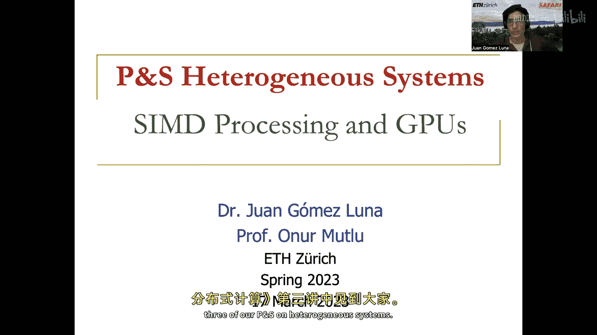

# 【异构系统编程：基于GPU和加速器 2023】苏黎世联邦理工—中英字幕 p02 p2 HetSys Course： Lecture 2： SIMD Processing and GPUs (Spring 2023) -BV1jXHZeuEwy_p2-

Hello everyone， welcomecome to the second lecture of our course on heteroteria System after the introduction that we have last week today we are going to give a brief lecture to introduce the architecture and programming model of Cindy processors and GPUs。

 This is a brief lecture that will later point you to a longer version of this lecture that is also recommended for sure。

So let me very briefly remind you that in current computing systems its more and more frequent to find plethora heterogeneous devices that are specialized for different functions in this pictorial representation here we have CPU cores。

 GP cores and FPAAs or configurable fabric， these can have a unified view of the memory。

And can exchange data through coherent interconnects in this course we are focusing on these type of systems with an emphasis on GPU programming that's why we have started the course with you know classifiedifying the computers on three main classes or three main types according to Flt's taxonomy remember that the other day we highlighted that CD processors that are processors where a single instruction stream operates on multiple data elements and we mentioned that are array processors and vector processors are the classic examples of CD processors we start with CD processors because they are the basic paradigm of GPUs which are let's say the accelerator of choice for many。

 many important applications these days let's talk about CD。

And about the architecture of GPUs first of all， CD processing。

 remember is a single instruction operating on multiple data elements。

 and this can happen in time or in space。 We are going to assume assume that we have multiple processing elements or execution units and these time space duality basically defines the two type of C processors that we can have The first one is the array processor where one instruction operates on multiple data elements at the same time using different spaces and the second one is the vector processor where a single instruction operates on multiple data elements in consecutive time steps using the same space。

Here you have your first example of array processor and vector processor and on the left hand side of the slide you can see all first vector or CD processing program as you can see this is an instruction stream where we first load few elements of an array A into a vector register VR then we perform an addition on the elements on the four elements that we loaded into these VR then perform a multiplication and finally we stored the result in the same array that was the source of the values that we have operated on so let's first see how we execute these instruction stream on an array processor because the four processing elements are the same and they are capable of executing different instructions we can have the four processing elements of the array processor performing one。

Of the four load operations that come with the vector load in the instruction stream。

 so that's why P0 takes care of loading element 0 P1 takes care of loading element1 and so on。

After that， they perform an addition， when the addition is complete。

 they perform a multiplication and finally they can start the result back in memory。

In the case of a vector processor as you can observe we have different processing elements but these processing elements are specialized。

 there is one processing element for load， another one for add another one for multiplication and another one for stores so if we want to load four elements well have to use these LD unit and that's why in the first cycle we start loading LD0 then LD1 then LD2 and then LD3 and observe that as soon as we are done with one specific element LD0 we can start computing the rest of operations at zero mo0 and store zero。

And so on so forth So as we can see there is there is a key difference between the array processor and the vector processor in the array processor we are performing the same operation at the same time while in the vector processor we perform different operations at the same time。

And in terms of a space， in the array processor， we perform different operations in the same space。

 while in the vector processor， we perform the same operation in the same space。As we see。

 they are two different paradigms， but both are CM processors and they are very similar in the fundamental ideas that are behind them。

Let's start talking about vector processors a vector is a onedisal array of numbers and many scientific and commercial problems use vectors in the example this example code that you can see on the slide we are operating on two vectors A and B and we are storing the result in one vector C observe that the three vectors A B and C have in total 50 elements or at least we are operating on 50 elements of these vectors a vector processor is one whose instructions operate on vectors rather than scholar values or single data values but to do so there are some basic requirements first of all we need to load and store vectors so we need to read from memory and put the values that we read into some registers that are called vector registers because they contain vectors right not a single value but a vector of values。

The second requirement is that we need to operate on vectors of different lengths。 In principle。

 there is going to be a maximum length， but we can configure the length that we want to use and that's the vector length register in the example code that we have in this slide。

 the vector length would be 50。And the third requirement is that the elements of a vector might be stored a part of each other in memory。

 so that's why we need to use a vector Str register that defines what's the stride of the accesses load or store accesses when we go to memory and fetch data that we will put into the vector register。

 the str is the distance between in memory between two elements of a vector。

The vector registers hold the size of a vector register is n。

 and that means that the vector register can hold nm bit values， or in other words。

 the size of the vector register n bit is n times times m。

There are also control registers or vector control registers we have already mentioned two of them。

 the first one is the vector length， the second one is the vector stride and there is a third one that is the vector mask that we are going to use for conditional operations We will speak about them later。

The maximum vector length， as I said， can be， I mean there is a maximum value， let's say n。

 but we can configure it depending on the specific needs of our program and the vector mask register is going to indicate whether we operate on a specific element or not。

 we will see an example later。Remember that one of the requirements is that we should be able to load and store multiple elements right and these elements can also be separated by a constant distance that is called this stride for now we are going to assume yes is straight one。

The elements can be loaded in consecutive cycles if we can start the load of one element per cycle。

 but we should be able to sustain this throughput of one element per cycle。

 how can we do that if one single memory axis will likely take more than one cycle？

The solution to that is to use a banked memory or an inter lived memory where we partition the memory into multiple banks or multiple。

Pieces of memory that we can access independently and what we are going to do is to interleave the elements across the banks。

 This is an example of a banked memory with 60 memory banks observed that for each of the banks we have a memory data register and a memory address register what this means is that using the address we can place a different address in each of these MR and we can request some specific value some data from the bank that data or that value will be copied into the MR for it to be moved through these database so memory is divided into banks that can be accessed independently and these banks share the address and database databasees as you can see what we can do here because these buses are shared is that the CPU can issue one。

Access per cycle， because the access to memory itself takes more than one cycle。

 What that means is that after certain number of cycles。

 we will start obtaining one value in this MDR every cycle。So if we have n band。

 we can sustain n concurrent accesses 16 in our example what is necessary for a program to be written for a vector processor or a CD processor it's important that the code is vectorizable。

 for example， what happens if we have a loop a loop is vectorizable if each iteration of the vector is independent of any other。

 for example here， we can compute the addition of AI and DI in a completely independent manner of other values of I that's why these loop is vectorizable and that's why we can instead of writing this sequential program。

 we can write a vectorized program or a CD program observe that the very first two instructions are just the vector length 50 in our example because we have 50 iterations in this loop and the vector stride is just one because we are。

In consecutive elements of array array， A， B， and C or vectors， A， B， and C。

The next thing that we do is loading elements， loading the elements of a into vector to register zero。

 loading the elements of B into vector to register zero， then we add them。Next we shift right one。

 which is the same as dividing by two as you know， and then we store the result in the corresponding addresses of vector C。

 One thing that I would like you to notice here is that some of these instructions take different amount of cycles。

 for example， the first to take just one cycle while the load and store operations take 11 cycles and the addition takes four cycles。

 however because this is a vector processor we can its pipeline as well same as the memory access to the bank memory what that means is that after having paid the latency of the first access to memory or the first addition in this case。

 we will get one result every cycle so that's why the entire vector load operation is going to take 11 cycles that is the latency。

A single memory access plus Vm minus149， which are the remaining elements that we will start obtaining one cycle after the other when executing these vector load instruction。

In total here， we have seven dynamic instructions and we will see how we execute them。

For now we are going to assume there is no chaining in our vector processor that means that we cannot forward one element that was just obtained from a functional unit to the next functional unit so we have to wait until the entire vector register is complete and is ready and we are going to assume just one memory port for now we can just sustain one memory access at a time and we are also going to assume that the memory is a bank memory of 16 banks and it's word interliftved we choose a memory of 16 banks because this way it's a power of two and it's a power of two that is larger than is larger than 11 that is the total latency So what that means is that while we are waiting for the first element to come we are waiting for these 11 cycles we can continue issuing access is to other memory banks and this way we can hide the overall latency of。

Of the accesses to all the different banks。So if we execute our program in a vector processor of this characteristics6 we will first spend two cycles on loading vector length and vector stride then we have these 11 plus 49 cycles that correspond to the first vector load then 11 plus 49 more cycles for the next vector load then 4 plus 49 for the vector add then we have the sheet operation and finally we have this store operation so in total this takes 285 cycles now let's see how we can optimize these and one way of optimizing this is performing chain which is data forwarding from one vector functional unit to another basically if we have obtain both the first element of a and the first element of B at these point in time we can already start executing the first addition that adds a0 plus B0 right。

That's why we can forward the element A0 and the element B0 to the functional unit that executes the additions and start executing the addition。

 and as soon as we are done with the addition of a0 and B0。

 we can forward it to the unit that executes the shift operation and we can start this shifting of one position to the right or1 be to the right in order to perform the division。

If we do so， we can reduceuse the total number of cycles here and it will be from 285 in the previous slide to 182 cycles。

 but we can further optimize this code why because these two loads could be done at the same time while these load and these this store can can also be done at the same time。

 But to do so， we need to increase the number of courts that we have in each memory bank for now we just assume a single part per memory bank。

 now we are going to assume。Two load ports and one store port in each banner。

 That means that we can sustain two loads at the same time， and they can also overlap with one store。

 and that's basically what is happening here observe that the vector load of vector B overlaps with the vector load of vector A。

 and at some point， they also overlap with the store because as soon as we start computing as soon as we read a0 and B0。

 we can perform the addition for these two elements， then the shift。

 and then we can start the corresponding right into C 0。

So we can further optimize this code as you see and or the execution of this code and our vector processor and as you see in total it will take 79 cycles so in total 19 times performance improvement with respect to the execution。

 the sequential execution。Remember as well that we have a vector mask in our CMD processor and this vector mask is used to implement mask operations。

 we will need to use mask operations whenever we have conditions and which means that in some cases some values will satisfy the condition in other cases they want and based on that we will execute the operation on on the vector register or not and here you can see the vectorized code for these sequential loop that you have here。

 we need to check if AI is zero or not because if it's not not zero then we perform this multiplication but if it's zero because it doesn't make any sense to multiply by zero right the result we already know that is zero so we will skip it right and to do so what we have to do is generate in these vector mask we generate the vector mask basically by checking the predicate of the condition and based on。

That we will obtain a mass speed per lane per element of the the in the vector array。

 and we will execute the subsequent operations or not。

 So depending on whats the value of this vector mass， we will execute this mole and this stored。

For some vector for some elements in the vector register or not。

 this is what is called the predicated the execution because the execution is predicated on the mask speed。

There are also some more issues to take into account when using see Cdy processors important issues are the relation between the stride and the banking remember that we have started assuming that we have a bank memory and that the strike is one if the strike is one there is no problem because we can access all banks at the same time because awards are interleaved on the banks but what could happen if we have 16 banks and the strike is2 that means that we have access is to bank0 and bank 2 and bank4 and so on and if in total we have 16 excesses that means that we will have two requests to bank0 for element zero and element 8 two requests to bank2 for element2 and element10 and so on so forth and one problem with that is that。

And one problem with that is that banks may not be able to sustain more than one axis at a time。

 especially if they don't have more than one port， that's that what we call bank conflicts and the only way that we can avoid bank conflicts。

 I mean there are ways of avoiding bank conflicts， but let's say that the only way that we know that there is not going to be a bank conflict is when both a strike and number of banks are relatively prime。

For example， one and 16 are relatively prime or three and 16 are relatively prime。

 but two and 16 are not relatively prime， and these happens sometimes when we access matrices。

 for example， if we are going to perform on matrix multiplication and we need to access AV by row。

 we need to access matrix A by row， but matrix B by columns。

 is a strip between the consecutive accesses to the same column and that means that are there is a strip and if this is strip is not relatively prime to the number of banks。

 we will have bank conflicts。How to minimize bank conflicts。

 the first solution is to have more banks， the second solution is to have more port in each bank we can also change the data layout in order to match the access pattern I just gave you the example of the matrix matrix B so one thing we could do is transpoing matrix B in order that we access the columns horizontally as if they were rows。

But this might not be possible in all cases， and then we can also figure out ways of doing better mapping of addresses to a bank。

 for example， randomized mapping And this is a very good paper。

 seminal paper or on pseudo randomly interleave memory that explains how to do or at least one approach to do this randomized mapping。

Okay， remember that CD processors are almost everywhere these days or are in many places these days I mentioned in the previous lecture。

 CD operations in modern ISAs， we were talking about these example of MMx instructions how to do the overlay of a human on top of a background image and and we were reviewing how to perform these operation using MMx registers and using these MMX instructions。

 the MMX instructions where the first CD extensions of X86 processors they were for so the total width of the MMx registers was 64 bits and for integers and after that there were there have been successive improvements of these CD extensions。

 first one was the streaming CD extensions with registers of 128 bits for integers and single precision floating point。

SSE to include support for double precision computation。 SSE is SSE3。Includes new instructions。

 SSes for again， new instructions and also shuffle operations to move data between different S lanes or different parts of the vector register。

 and later the advanced vector extensions appeared with 256 B floating point computation first。

 then 256 bit with floating point computation with  fu multiply ad that executes one multiplication on one addition in a single cycle。

 then the extension to 5 to2 bit and more recently the advanced advanced matrix extensions that are designed for AI and ML workloads。

But SD operations are not only in modern CPUs， but also in modern machine learning accelerators。

 and I gave you last week the example of the cerebrarous wafer scale engine that is the largest ML accelerator chip。

But if we want to talk about a prime example of CD processors these days。

 these are graphics processing units or GPUs remember this big picture of the or this floor plan of the a100 GPU where we can see a lot of homogeneity because there are many replicated GPU core。

 but if we look at the internals of the GPU cores we will see that they are very similar to the array processor and the vector processor that we explain in the beginning of this lecture remember that the A100 core for an example has multiple different execution units such as these ones for loadten stores or these ones for Integers or for floating point operations or the tensor cores that are also CinD units that are specialized for deep learning but at the same time these are replicated and these are replicated means that we we can operate on multiple instances of the vector registers。

AtThe same time another important commonality between these a100 core and the traditional view of CinD processors is that this one also uses bank memories and these shared memory here is a bank or interleaved memory and in order to be able to sustain multiple accesses to multiple elements that are going to be used by the corresponding CD units that we have in GPUs because GPUs in the end are just CD engines underneath there is an instruction pipeline that operates like a CD pipeline However。

 the key difference is that programming is not done with CD instructions but we using scholar threads we will see how and we are going to talk a lot about that in this course so but to understand this we are going to go back to our parallelizzable example a parallelable call example but first we are going to this。

Between programming model and execution model programming model refers to the software。

 the way we write a program， for example， I just said GPUs are not programmed using SMD instructions。

 but they are programmed using scholar threads。What is different is the execution model that refers to the hardware。

 how instructions are executed onto the existing hardware， as we will see。

 we can write code for threads， but the hardware can later。Can later take these threads。

 put them together， put them all together into a CD unit as if they were SMD instructions and execute them onto the underlying CMD hardware。

So programming just to recap refers to how programmers expresses the code execution model refers to how the hardware executes the code underneath and they can be very different and one example are GPUs let me go back to the previous parallelsable code or Vorizable code that we saw earlier if we execute these on a sequential machine。

 we will first execute the iteration one then iteration to and so on and so forth。

But one thing that we can realize here is that each iteration is independent and because they are independent。

 they can all be executed at the same time and a programmer or a compiler could generate a S instruction to execute the same instruction on multiple data elements at the same time So this is one vector instruction This is another vector instruction another vector load。

 this is a vector ad and this is a vector store。And these can be executed on a in processor。

 either a vector processoror or an reprocessor。But we can also write the program in a different way。

 we can also realize that this is each iteration is independent and now we can generate threads instead of send the instructions we can generate threads such that each thread executes one iteration of these vectorizedable loop。

 this is what we could do for example in a mini machine such as a multicore CPU for example。

 we can assign successive iterations to successive course in more CPU but we can also do that on a GP this particular model is called single program multiple data because we are writing one single program for one single thread but this thread is not just one thread is multiple threads and depending on the thread ID they are going to operate on different data elements。

This program can also be executed on a C machine。 And that's basically what GPSs do。

 That's why this is also called single instruction， multiple threat machine。

But a GPU is just a CT or a CD machine The only exception is that it's not programmed using CD instructions。

 but it's programmed using threads using an SND programming model where each thread executes the same code but operates on different pieces of data and each thread has its own content has the PC they can be treated or them and executed independently but then the hardware are going to put all these or many of these different threads together forming what is called a warp or away from for warp is in video terminology while where from is AMD terminology but the one warp is basically a CD operation form by the hardware so what the hardware is going to do when receives these all these instructions for individual threads is that is going to put them together in a SD instruction that is called a warp instruction so this would be。

X for ver0。 this could be instruction x plus one for verb0。

 This is x plus plus 2 for verb 0 and so on so forth。

So graphics processing units are CD not exposed to programmers while CD is just a sequential instruction stream of CD instructions。

 CD a GPU is multiple instruction streams of scholar instructions that are later grouped threads are later grouped dynamically into warps this has two advantages first that each thread can be treated independently threads can completely go through different data paths control flow paths while the groups threads can be grouped flex or potentially group flex so just to summarize about how GPUs work they have warps。

 these wars are collections of threads all of them execute in the same instruction as if they were a CD instruction but another important。

Characteristic is that the execution of warps is interleaved on the same pipeline This is what is called fine grain multi threadreading and in GPUs we do fine grain multi threadreading of warps so for example we can first start executing an instruction for war zero then we execute an instruction for warb one then another instruction for one warp 20 etc etc。

So in summary， a warp is a set of threads that execute the same instruction and these instructions for these different wars are executed in an interlink manner using the same pipeline。

 this technique is called fine grain multi-threading is used in CPUs as well as as you might know and has the key advantage that it enables to tolerate long latency operations for example。

 accesses to the external of cheap memory you are executing instructions for a warp and at some point this warp needs to go to memory to fetch to fetch data and this is an operation that may take hundreds of cycles while this warp is going to memory to fetch the data other instructions from other warps can be executed on the pipeline and this way take advantage of the existing resources。

So to summarize a comparison between Word based CinD and traditional CinD is that in traditional Cindi we have a single thread and this single thread executes CD instructions。

 the programming model is CD， there is just one thread and bad vector instructions or CD instructions while in Word based CD we have multiple scholar threads。

 they don't have to be the programmer doesn't need to assume that they are going to execute altogether。

 each thread can be treated individually， but。で。Even though the ISA color the GPU will later form the CD instructions using these individual threads so this is in summary the SPMD programming model execute on a CD machine so it's SPMD is a programming model where each processing element executes the same procedure these procedures are called threads and they can these procedures or these threads can synchronize at certain pro programs with using barriers and we are going to talk about barriers starting from the next lecture and these multiple threads or instruction streams execute the same program。

So that's the modern way of programming GPUs of programming CMD hardware that makes it way more efficient in terms of programming while if the programmer is skill enough still take advantage of all the execution parallels and that CMD architectures can provide and that's why in this course we are going to put a lot of emphasis on optimizing code to make the execution efficient on these underlying CMD hardware。

This was just a brief overview of the architecture and programming model of Cindy processors and GPU but I can recommend you this lecture from previous semester where we cover all these ideas and all these concepts in much more detail you can also learn more if you take a look at the book programming massively parallel Pros in its for edition in particular chapter1 and chapter4 that talk about the architecture of GPUs This is all for today thank you very much for your attention。

 please keep an eye on the longer lecture as well and I hope to see you in the next in lecture3 of our Ps on intergenous systems Thank you very much for your attention。

