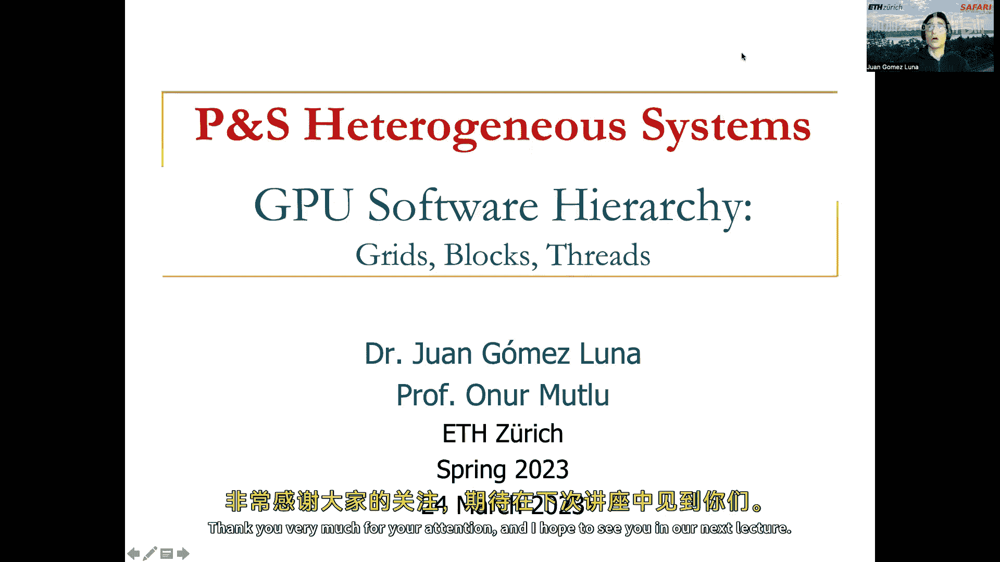

# 【异构系统编程：基于GPU和加速器 2023】苏黎世联邦理工—中英字幕 p03 p3 HetSys Course： Lecture 3： GPU Software Hierarchy (Spring 2023) -BV1jXHZeuEwy_p3-

Hello everyone， welcome to the third lecture of our course on theous systems and today we are going to start talking about GPU programming and we are going to talk about what we call the GPU software hierarchy。

 how the computation is assigned to different threads of execution and how these threats are grouped for more efficient execution and mapping onto the GPU hardware remember that regarding the GPU hardware and also the programming model model。

 we were talking about them for both GPUs and also CinD processors in the previous lecture remember that GPUs are basically Cindy engines underneath for your reference even though this data map or this floor plan or of the NVDA H100 GPU looks。

like pretty homogeneous we can go into details and the GPU core and we will find that there are different execution units and in some sense these reminds a lot to vector processors and rate processors that we explain in the previous lecture as we can see here there are units for 32 bit Inte computation 32 bit floating point or 64 bit floating point operation there are also specialized units for load and store access memory and and there are these specialized tensor cores for neural networks and matching learning there are also different memory spaces that the GPU cores have access to inside each GPU GPU core we have registers that we also have an L1 data cache and other memory space the shared memory。

Is a scratchpa memory and then outside of the GPU core there is an L2 memory and of cheap Dm or the global memory we are going to talk in detail about the GPU memories in our next lecture。

 but for now we will talk about the software hurricane remember as well that GPUs internally execute instructions for warps that are basically see the units and on the pipeline of a GPU core we have fine grain multithread execution which means that in every single cycle we are fetching instructions or one instruction from a different warp and this way the execution of warps is interleaved on the GPU pipeline and these interleding and these fine grain multithread execution enables long latency tolerance we can hide instructions that。

Long latency by executing other instructions in the pipeline as an example of instruction with long latency。

 we have the accesses to of cheap memory， for example。

But now let's start talking about GPU programming remember this is slide from our previous lecture where we mentioned and this we quoted this paper from Fisher in Isca 1983 where Fishcher explains how difficult or reasons about how difficult is to program C processors but GPUs are hopefully easier to program the rise of general purpose programming for GPUs was more than one decade ago and in some sense it represented the democratization of high performance computing because for relatively low cost anyone could have on their commodity PC a powerful GPU with a very high point high throatput floating point operations per second。

AndMany workloads can benefit from these sort of device such as matrix computation， image processing。

 neural networks， etc， but we need to learn to program this system。

 we need to understand and learn any new programming model and we also need to understand what are the key bottlenecks when programming this system and also the ways to alleviate these bottlenecks。

 Let's start from the beginning GP computing basically start or heterogen computing in systems with GPus basically start on the CPU and the CPU memory。

 the main memory of the system。 and there are three main steps。 First of all。

 we need to transfer the input data from the CPU memory to the GPU memory that is called typically global memory Then we need to launch the execution of a kernel or the function that is going to run on the。

And after this function on these or these kernel completes。

 the CPU can fetch the results and move them from the GPU memory to the CPU memory。

These three steps are represented in the typical programming structure in an intraous systems with CPUs and GPUs where we will normally run sequential or modestly parallel sections of the code on the CPU while massively parallel sections of the code will run on the GPU so normally will have something like this first of all。

 we have one single thread or just a P threads running code on the whole CPU and at some point they will overload some computation to the GPU to the device side these computation is called a kernel as I mentioned earlier is a function that runs on the GPU on the device and these kernel uses many different a large number of threads these threads for execution are grouped into sets of threads that are typically called threat block。

InInVD and coa terminologyWhen these kernel finishes， the control returns to the CPU。

 there will be probably some more sequential or serial execution or modestly parallel execution on the CPU and then at some point the CPU may launch another kernel。

Remember that programming GPU uses the single program multiple data programming model where we typically write code for individual threads for scholar threads。

 but these threads will be later grouped into CD units that are called warps in individual terminology and executed onto GPU cores that are kind of CD hardware。

In the SND programming model， each program or each thread works on different data and can execute the different control flow path but they can also synchronize because the underlying hardware is indeed as you can imagine when we group many of these threads or procedures into the same workp we want them to do basically the same computation that would be the most that would be the fastest execution because if not。

 we will have to use preated execution， we will have to use masks and we will have to first run part of the computation for some of the threads in the work and then for other threads in the work that's not ideal it's doable and it facilitates programming a lot。

 but at the same time we have to be conscious about that in order to write more optimized programs。

So QUDa and OpenCL are programming models that use SPMD or also called CinT single instruction multiple thread。

And they usually they are called both synchronous programming frameworks because the way to synchronize different threads or all threats executing a kernel。

 is terminating a kernel。 This is what is called a global or brain synchronization。

The host that is typically a CPU allocates memory copies data and launches kernel and the device that is typically the GPU executes the kernel。

How does the kernel execute so how does the GPU execute the kernels well the GPU runs threats。

 but these threads are all of them for a single kernel grouped into something called the that the open seal is called end range。

And then inside the grid， we have multiple threat blocks or simply blocks in video terminology。

 include terminology， war groups in open seal terminology。

And all threads that run inside the same block or inside the same thread block can shared memory and can synchronize。

 and the reason for that is that they will execute all inside the same GPU core。

And then we have the threads that in openCL are called work items。

The typical structure of a program in KUDa is something like this。

 we'll have function prototypes for functions running on the CPU such as these serial function that we see here in the slide and there will be kernel are the functions that run on the GPU observed that the GPU kernels always always start with these global qualifier and then we have the host code。

Where the execution will start， where the computation will start。 And at some point， the host。

 the CPU will upload computation to the GP side。 So in the main function of the host。

 we will first allocate memory on the device on the GPU。

 and we are going to use an API called Ka Malog to do so where we allocate a certain number of bytes for these pointer D in。

We need to transfer data from the host to the device。

 so initially even though we have allocated already some space on the GPU memory。

 the data initially resides in the GPU memory， so we need to copy from this H in array to this D in array this is a copy from the host to the device。

And then we need to define the execution configuration。

 which is basically the number of blocks in the grid and the number of threads per block。

And next we can call the kernel that is the moment where we upload the computation to the GPU and the kernel we have arguments and of course we have the execution configuration that we previously defined。

When the kernel terminates， we can transfer results from the CPU from the GPU memory to the CPU memory。

 we again use this codeda copy operation but in this case the destination is H out that is allocated in the CPU memory and the source of this copy is D out that is allocated in the GPU memory。

This sequence of copy kernel launch and and again copy back to the CPU can be repeated as needed。

 for example， in iterative algorithms that call multiple times the same kernel or simply in other applications where we have multiple kernels of loadeded to the GPU。

Inside the kernel， we can use automatic variables that are transparently assigned to registers to registers in the GPU course。

 we can also use shared memory that is this shared memory space where all threads running inside the same block in the same GPU core can access and they can shared data using this shared memory space we will use this shared qualifier to identify those arrays that are allocated in shared memory and inside the same thread block threads can also synchronize it's what we call the intrab synronization and in particular we use this sync threads instruction。

In order to start understanding more about how to program a system with GPUs。

 we are going to start with a simple code example， a vector addition this code that you see here is the host code is a function called backA assume that this function back add is called from the main function of the host CPUU。

 and as you see first thing that we do in this deck a function is to allocate GPU memory。

 we allocate our memory for as A and B that are the input arrays and array C that is the output array。

 then we copy data from host to device as you can see in this parameter here。

 so we are copying all these bytes from array A that resides in the CPU memory to array A underscore D that resides in the GPU memory。

うん。We do the same for a Ra then we will launch the computation on the GPU this is the kernel call we are going to see it in detail in a later slide and finally when the kernel terminates we copy the results back from the device memory from the GPU memory to the host memory or CPU memory and finally we can free those memory spaces in the GPU memory。

So the vector addition， which is our first programming example here is as simple as performing the elementwise addition of two arrays and in the most straightforward implementation we can just assign one GPU thread to each element in the input and output vectors so each of these threads is going to be in charge of just one single addition so it will have to go to memory read a0 read D0 add them and then write C0 into memory so this is the computation done by thread zero this is by thread one and these are for the rest of threads that run on the GPU。

These whole set of threads as I said earlier is called the。

 but we need a way to assign these threads to the GPU core。

 we have a number of GPU cores that by the way can varyri from GPU to GPU so what we do is grouping the threads into thread blocks so these four threads are block zero block one block2 and block3 and this is the computation done by block zero by block1 by block2 and by block3 in this toy example we have just four threads per block normally we will have at least 32 that is the warp size and Nvi GPUs and more typically we will have a multiple of these 32 of these warp size。

So how do we launch a grid first of all， threads in the same grid execute the same function that is known as the kernel and the grid can be launched by calling a kernel and configuring it with appropriate grid and block sizes。

 remember that we need to first define the execution configuration which is the number of threads per block 512 in this example and the number the total number of blocks and then we can call the kernel using these line here。

So this is what we were missing in our host code example for the vector edition defining the execution configuration and then launching the kernel with the execution configuration here and the arguments here in parentheses Now this is the host code but what about the GPU code in the GPU code we will have something like this in this case it's very simple the vector addition kernel observed that it's a kernel because it just starts with this global qualifier and here we can see the input array input array output arrayC and the total number of elements if the total number of elements is a multiple of the block size we can just write something as simple as this where for each individual thread where each thread has its own thread index and each block has its own block index and block size which is this。

Block D dot dot X。 So for each individual threat， we obtain one index， this I。And using this eye。

 each thread can go to memory， bring the corresponding element from A and B add them and store the result in the outputter AC If the number of elements is not a multiple of the number of threads per block。

 then we need to check the boundary condition so in our kernel code we will have to add something like this if a statement here where we check if the I is less than n that is the total number of elements in the it's a simple as step。

So this is what we call the1D grid where the thread blocks are considered to have a single dimension and because they have a single dimension then we have these dot X when we define the grid dimension that is a number of blocks in the grid and these block dimension that is a number of threads per block and similarly we have block index dot x and thread index dot X because we are using a single dimension and we can apply these thread threat blocks and grid one dimensional thread blocks and grid to also。

Data structures that don't need to be 1 D。 for example。

 we could assign different threads and thread blocks to compute on an image。

 that is a two dimensional data structure。 So as you see。

 this part of the image is assigned to block 0。 This part of the image would be assigned to block 1。

 this part to block 2 and so on so forth。And then for each block we are going to have a number of threads for in this toy example。

 so in order to access any element in the image， we need to use this two dimensional data structure。

 we need to use block index block dimension and thread index as you can see So for example。

 this element here is an element 25 or a pixel 25 of the image and we calculate that and we obtain the exact address by using the block index that is6 the block dimension that is4 remember that we have only four threads in this simple example and thread index equal one because this is the beat the pixel that is assigned to thread one in these block6。

But theyre also because they might be more convenient when we have two dimensions or three dimensions or maybe even more in or data structures。

 so it makes sense to also use 2D blocks or maybe even 3D blocks and grids so in the case of 2D blocks we will have a grid dimension x and a grid dimension y as you can see in this toy example is4 and4 the value of both gridD and gridD X and gridD y is4 and this block here will well also have a 2D index。

 we have block ID x dot x and block ID X do Y in this particular for this particular block x is 2 y is1。

And then again， we have the same ps and y indices for the individual threads in each thread block。

 and now the way that we calculate the specific position of a pixel in the image is by obtaining its row and column using the corresponding indices and dimensions of block and thread in the y dimension and in the x dimension。

For example， the same pixel that we checked earlier in the previous slide。

 now we see that this pixel is in row3 and column one。Okay， so this is all for now。

 you can read more， you can learn more by going to the book， programming massively processors。

 recommended chapters corresponding to this lecture or chapter one， two and three。

 but you can also rewatch this lecture， but a longer version of it。

 if you access the link that is in this slide。In the next lecture we will continue talking about GPU programming and we are going to focus this time on the memory hierarchy of the GPU and how it's different memory spaces inside the GPU or handle when programming using QUDa or OpenCL and how threads in different thread blockss can access data in the global memory the of chip memory or threads inside the same thread block and share data using the shared memory this is all today I hope you found the lecture interesting。

 thank you very much for your attention and I hope to see you in our next lecture。

