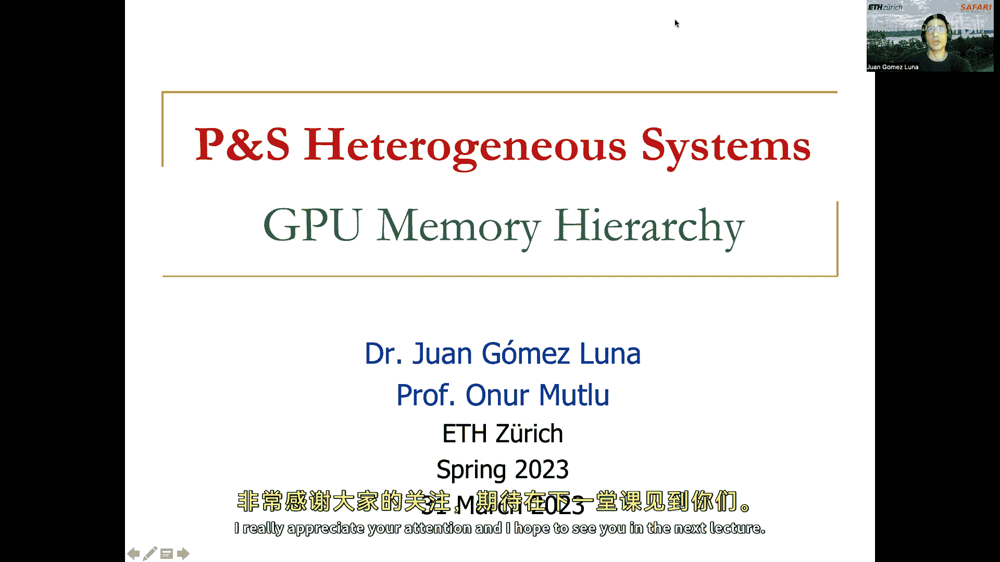

# 【异构系统编程：基于GPU和加速器 2023】苏黎世联邦理工—中英字幕 p04 p4 HetSys Course： Lecture 4： GPU Memory Hierarchy (Spring 2023) -BV1jXHZeuEwy_p4-

Hello everyone， welcome to one more lecture of our course on Mediterraneanter systems and today we continue talking about GPU programming now we are going to focus on the GPU memory hierarchy。

 the different memory spaces that threads can use when programming a GPU。

We are going to go into the details very quickly， but first of all。

 let me very briefly recap on what we covered about GPU programming our previous lecture let me remind you as well that the reference book for this course is the book programming programming massively parallel processors remember that when programming a GPU or a material immune system with CPUs and GPUs we are typically going to use CPU threads that will run on the CPU and GPU kernels CPU threads will execute sequential or modestly parallel sections that will run on on the CPU course while massively parallel sections of code will run on the GPU so we will normally start the execution on the host or the CPU running some serial code or modestly parallel code by using one single thread or just a few threads and at some point we will offload computation。

To the GPU by calling launching and GPU kernel remember that when launching a GPU current。

 we need to first define what CS execution configuration， typically the number of blocks per grid。

 so the total number of blocks and the number of threats per block when the execution on the GPU when the kernel terminates the control returns to the cost that may execute some more serial or modestly parallel code and eventually we may launch a different kernel or maybe the same one in iterative algorithms。

Remember that our first example was the vector edition。

 this is the code for the cost of the vector edition where we first allocate GPU memory。

 then we copy data from the CPU memory to the GPU memory。

 then we perform computation on the GPU we first define the execution configuration here is the number of threads per block 512 in this example and the total number of blocks。

And we launch the current when the execution of the current terminates。

 we copy results from the GPU memory to the CPU memory from the device to host。

 and we can finish your program by freeing or delocating any memory array that was allocated in GPU memory。

 So remember the software the GPU software hereerarchy consists of threads at the lower level。

 these threads are group into threat blocks that are mapped onto the different GPU core and the total collection of threat blocks represents the grid。

There is some novelty in the most recent architecture of MBmbdia that is the H100 that was announced basically one year ago and between the thread block and the grid the new H 100 architecture defines the thread block clusters。

 so now instead of having a grid composed by thread blocks now we can have a grid composed by thread block clusters and these thread block clusters are composed at the same time by by thread blocks so now the hiarch is at the lower level then we have thread blocks。

 then we have thread block clusters and finally grid and the interesting thing of the thread block clusters is that the threads the thread blocks inside the thread block cluster can directly communicate。

With a new network that these H100 architecture will introduce。

After this refresh on the GPU software hierarchy let's go and talk about the GPU memories remember the floor plan of any N media GPUs in particular these one is the H100 remember as well that here we observe the GPU core inside the GPU core。

 there are different memory spaces like registers L1 or the scratchpa memory that's called shared memory N media terminology these the GPU core or streaming multiprocessor processors or SM as they are called via mediadia have access to the L2 cache and then they also have access to the external the of chip memory in the H100 will be HVN3 memory and as you can see there will be up to three6 stack3 on each size of HVN3 memory access by the corresponding。

Conts。But we can first check a more simplified presentation of the memories in the GPU architecture Each of these SMs or GPU course have some control hardware and they have the CD units themselves where we are going to execute instructions from different workss and from these small CD lanes we can access registers each individual thread will have access to its own registers and the access to these registers is super fast basically one cycle。

 but threads can also access data in the L1 data cache or the nearby shared memory the shared memory is a scratchpa memory as a software managed cache that can be used to share data between threads belonging to the same threat the access to both share memory and。

Ugan cash takes more or less the same amount of cycles。

 we could say something like five cycles and similar latency we would also have to access the constant cache。

 this is another cache for constant data。If we go off cheap。

 we need to go of shape to read from the of cheap Dor that is called the global memory。

 now the latency will be hundreds of cycles， for example around 500 cycles and in between the global memory and the SMs or the GPU course we have the L2 cache。

As novelties in the H100 GPU， we will see the possibility of doing direct copy from global memory to the share memory without having to go through the the lanes in the GPU cores and the registers。

 and there will also be possible to communicate directly from SM to SM inside the same thread block cluster。

In this H100 GPU well have a pretty large L2 of about 50 megabytes and also a pretty large global memory HvN3 memory of 80 giggaytes and also a very interesting global memory bandwidth of three terabytes per second that will be basically twice as high as the bandwidth of the previous generation。

 the a100 GPU there are not so many details so far about these new architecture。

 but hopefully in later editions of this course， we will tell you more and we will even have some experience with these different features such as the direct copy or the SM to SM communication。

Now we know that there are different memory spaces， registers， constant cache， share memory。

 L1 cache， L2 cache， global memory， and there are different ways of using them in our program we will use qualifiers to define where one specific value or one specific array is allocated automatic variables that will go directly to registers they will be allocated in registers by the compiler and if we define inside the GPU kernel we define an array like this it will be a private array for each individual threat and the compiler if possible will allocated in registers as well if not if there are not enough the registers maybe because this N is too high then it will have to be allocated in the of chip D。

When we want to allocate something in the shared memory。

 we will use this shared qualifier here and if we want it to be in the constant memory for it its access from the constant cache we will use this constant qualifier if we want to allocate something in global memory we can use this device qualifier and this device option how we use with shared and constant。

So from the point of view of a GPU thread running on a GPU core。

 it has access to its own registers that can use privately。

Threreads that belong to the same threat block can access the same data in shared memory and threads in different threat blockss can access the same data or different data from the external of chip memory that is called the global memory and also from the constant memory that is allocated also in of chip memory but can be cached inside each SM as we have seen in previous slide。

So how are we going to use these different memory spaces for now we are going to talk about the shared memory and we are going to see how different threads can share data allocated in this shared memory and can communicate using this shared memory。

The shared memory is going to be especially useful when we have data reuse inside the same thread block。

 for example， if we have to apply one filter to one image and we assign one pixel of the image to each thread in the GPU when applying the filter what we normally do is reading pixels that surround the specific pixel that we are focused on and we do some calculation using these nearby pixels and one thing that you can observe here is that if this pixel is assigned to one thread and these other pixel is assigned to another thread in the same thread block。

 they are going to share some values that they both will need to read this is what we call data reuse so these six pixels here we be used by both these thread operating here and these thread operating here。

This is what we call the data reuse。In the most straightforward implementation of this code we would do just something like this。

 this is the code here corresponds to Gaussian filtering where we am applying we are applying one filter this gas here on top of each pixel of the image right and these two four loops allow us to go over all nine elements that are under the filter the Gaus filter that we are applying to every pixel in the image but as I said here there is a lot of data reus because these six elements for these six pixel cells will will be used by two different threads so what we can do here is take advantage of these data reuse and use one technique that is called tiling sometimes also called blocking that consists of defining tiles of data。

That are going to be reused by many different workers or many different threats in the particular case of the GPU。

 what we are going to do is placing this tile into the shared memory because the shared memory can be accessed by all the threads belonging to the same threat block。

 So that's what we do。We define some space in shared memory。

Then we load the entire tile from the global memory of chip memory into the shared memory。

And then threads will simply access the pixels that they need for their own computation or applying the filter。

 they will access these pixels from these arrayL data that is in shared memory observe as well that between loading the T to share memory and the actual computation we need to use these。

Sync threads， instruction here or syn threads function here that allows us to synchronize all threads in a block。

This is a way of avoiding hazards like read after write right after read or right after write when accessing shared memory or global memory from threads inside the same block the same thread block and it's important to use because threat blockss will typically have more than 32 threads that are that is the number of threads that belong to the same war is 32 if we have 64 threads for example in or thread block that means that we have two wars and now remember that the execution on the GPU core pipeline is by issuing instructions from different wars so what that means is that instructions form different wars even if they are the same instruction are executing at different times so if we have two wars loading data from the global memory to the shared memory we need to make sure that。

All the desired data is loaded。 The entire tile is loaded before we start using the data in that tile。

 So that's why after loading， we will use these sync threads。

 exactly as we did in this example code here。So in order to better understand how to take advantage of data we use。

 we are going to go with a very important kernel that is matrix multiplication in matrix multiplication。

 what we do is performing the multiplication row by column of two matrixes A and B and we' obtain one output matrix C。

 this is our matrix C of size M by N this simple example。

 this is our matrix v and A and this is our matrix B。

 so when we want to compute one individual pixel， will we will have to read an entire row a and an entire column of B。

The most straightforward parallelization approach is to assign one thread to each element of the output Mag C。

I remember that in the GPPU， these threads。Are grouped into threat blocks。

 so we are already partitioning the matrix， the output matrix C into several tiles。

 several parts that are assigned to different threat blocks So all these pixels here will be computed by one threat block let's call it threat block zero0 these pixels here will be these outputs of element of C will be computed by the next threat block and so on so forth。

 So one thread these specific thread here will read these entire row and these entire column will perform the dot product cooperation of these two and accumulate results finally in this output element of C。

So this is the actual code because the matrix is a two dimensionionalal organization we are using two dimensional blocks。

 remember that we talk about them in the previous lecture。

 so by using the block index block dimensions and threat indices。

 we can calculate the row and the column for each element of the matrix C and then we access the entire row of a and the entire column of B in order to multiply and accumulate and obtain some final result that will be storing the corresponding row1 column of matrix C。

But。The observation here is that there is a lot of reuse Why is that Because if we have four threads computing these four elements of C here。

 all these four threads need to access all values， all elements of these specific row of matrix A and if we think about these four elements and the corresponding four threads all the four threads will have to access the same column of matrix B so we can take advantage of these data reuse by doing a tile matrix multiplplication and the tile matrix multiplication we divide the input matrixes A and B into tiles and step by step we are going to load tiles into the shared memory and then use the data in shared memory to perform the computation faster because accessing shared memory as you know is significantly faster basically。

two orders of magnitude faster than accessing global memory。So the threats of these。

 the thread block that is in charge of this tile of C will go to memory will read the tile of a will read the title of B will place them into share memory and then they will perform the partial matrix and duplication to obtain this values here and then we continue repeating the same thing for the next style and then for the next tile and this way we'll obtain the final results for these elements of matrix C。

So this is the code of the matrix multiplication as you can see we first declare arrays in shared memory and one tile of a and one tile of B will be placed there。

 we have these indices for row and column we initialize the accumulator for each individual thread and then for each of the tiles we first have the threads go to the global memory read the correspondingent tile from a。

 the correspondent tiles from B and placing them into the shared memory and we need to synchronize because remember we are running likely thread blocks with multiple vers。

 so we need to synchronize in order to make sure that all the data the tile using the shared memory and then we can compute using the tiles in shared memory accumulating in this some variable for each element of the output matrix and at some point we will write the results when。

We go through all the tiles， we will write the result in the final matrix。

 observe as well that we need to have these S threads also after these inner for loop because threads will have to wait in order to make sure that all the data in the tile has been used as much as needed before replacing that data with the contents of the next tile。

Okay this is all for today you can read more in the book programming music Para Pros in chapter5。

 but I would also recommend you to watch the long version of this lecture where you can find more details about the GPU memory hierarchy about how to perform a basic tile matrix matrix notplication and also a few more details about the new H100 architecture this is all for today I really appreciate your attention and I hope to see you in the next lecture。

