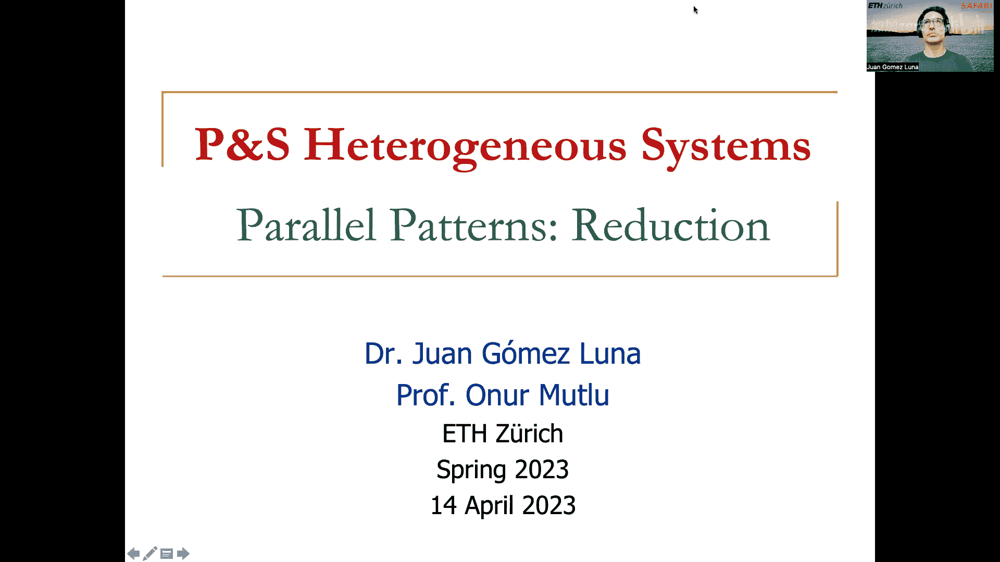

# 【异构系统编程：基于GPU和加速器 2023】苏黎世联邦理工—中英字幕 p06 p6 HetSys Course： Lecture 6： Parallel Patterns： Reduction (Spring 2 -BV1jXHZeuEwy_p6-

Hello， everyone， welcomelcome to a new lecturer for course on heterogene systems Today。

 we continue talking about parallel programming and about GPU programming。

 and we are going to start a new series of lectures about important parallel patterns in particular today we start with the parallel reduction but before we go into the because of the parallel reduction。

 let me very briefly remind you what we covered the previous lecture。

 We were talking about GPU performance considerations We discuss what are the main considerations to take into account when we are optimizing code for GPUus remember that one key performance consideration is memory calling how we access global memory in order to utilize the bandwidth as good as possible。

Remember that coalesce memory accesses that are the way of utilizing the bandwidth in the best way happen when consecutive threats accessed consecutive or nearby memory locations or when all threads access threats in our word access data that resides in the same cacheline or in several consecutive cache liness here in the slide you can see a very good example of what is at uncoesce or not coalesce memory access and coalesce memory access in the uncoesce memory access we have a stride between consecutive between the addresses that are accessed by consecutive threats while in the coalesce access we have consecutive threats accessing consecutive memory locations remember as well that we talk about shared memory as a way of improving coalescing because we can for example for these mattresses we can load tiles of these mattresses into the shared memory we can do these accesses to global memory in a coalesce manner。

Then write to the scratch pad or shared memory and later access from the shared memory。 And this way。

 we are avoiding the unclecholess accesses to the global memory。

Another important consideration is in the utilization remember that we talk about intrawarp divergence when we have threats in the same war following different control flow paths for example here imagine that we have two wars from zero to 60 threads sorry threats from zero to 63 and we have even number threads doing something and odd number threads doing something different what would happen here is that because the way threads in a GPU or in the same work are executing lockstep and we use a math in order to enable predication and enable control flow divergence what will end up happening here is that we will have first all the even number threads executing the instructions in the E and the statement and then the rest of threats executing instructions after the L statement so what we。

We are basically duplicating how we execute instructions here。

What we could do is changing the way that we assign the computation to the different threads and for example。

 we can have threats in the firstp threads with a threat ID less than 32 doing this part of the computation while others will be doing that part of the computation and this way we have Warp one executing the if part while Warp2 would be executing the else part and there is no intra war divergence。

This S utilization or increasing the S utilization is important for the reduction operation。

 as we are going to see in a few slides， but before that。

 let me very briefly introduce what the reduction operation is。

A reduction is an operation that reduces a set of values to a single value。 It can be a sum product。

 maximum minimum。Important thing is that these operations have certain properties。

 the properties of reduction， sociivity， commutivity and an identity value， which is for example。

 in the case of the addition or do sum is zero reduction is a key primitive for parallel computing it's using many different parallel programs map reduce programming model is a good example of that but we can also find reductions in neural networks for example。

 or in other machine learning workloads these days。

Let's start with the sequential reduction and a sequential reduction what we are doing basically is executing a for loop that goes through a whole input array if the array has n elements。

 we will need n iterations of these for loop as you see we start by initializing the sum to the identity value but these sum is the accumulator where we are going to accumulate the final reduction result。

 we we initialize it with the identity value and then we go one by one over the elements of the array and accumulating and the sum accumulator however observe that there are many independent operations here because in these parallel implementation we can so we can write parallel implementation where we can we compute first multiple partial sums and then we reduce them and that's what we normally do in the classical way of parallellyzing the reduction which is the threeb reduction imagine that we have。

inputmput array A with n elements in the first iteration。

 what we are going to do is assigning different threads or different workers to pairs of elements in these RAA。

 we perform the addition of these elements and we store partial results in some temporary storage in the next iteration we will probably half of the workers or the threats would require and we continue doing the reduction of these partial results。

 we obtain new partial results that it store in the temporary storage and we continue this way until we end up with a single value that is the reduction result。

As you can see in total here， we have long n iterations。

 for an array of n elements instead of doing the serial reduction where we have n iterations。

If we map these threeb reduction on a GPU， what we will normally do is first of all dividing the input array into different chunks that are assigned to different threat blocks and then internally inside each thread block we do the same as9 parts of the chunk of the array to the different war this would be for War0 Warp1 and these in block1 now we are going to have threads in these wars performing the partial reductions or the partial sums that are going to result in some partial results that we need to continue the reducing later here in the GPU。

 the temporary storage is typically going to be in the shared memory or scratchpa or in the registers that each thread has been assigned。

Another important thing to take into account is because threads or war in the same thread block execute in lockstep。

 but different works inside the same thread block do not execute at the same time simultaneouslyously they need to synchronize in some way so we would use an intrablock synchronization or a syn thread that we already know from previous lectures so we continue with the next iteration and again we need to use a sync threads to synchronize and make sure that all the partial results are visible to all threads in the block in order to continue with the later iterations then we end up having a single partial result per thread block and after that we may need to use some sort of interb synchronization before we perform the final reduction of all these pair block partial results。

The way that we can do this inter blocks synchronization。

 there are many different ways or several different ways。

 the first of them is that we can move all these partial results to the CPU and then do the final reduction on the CPU。

Another possibility is that we launch a new reduction kernel on the GPU and we start from the beginning。

 performing all the iterations that we need to do until we have we end up having a single value。

 that is a final reduction result or the last possibilities is to use atomic operations in global memory。

 basically we would have one thread in each block， which would take these partial per block result and then accumulating it to some atomic variable in global memory using atomic operations that any of these three possibilities would end up resulting in the final reduction result。

Now the question is how do we map the computation internally inside each thread block and inside each work Imagine that this is our input array and one possibility because in the end what we start doing is taking pers of elements of the input array and calculating their sum what we could do is signing even number threads threat 024 and so on two consecutive elements and they will start performing the reduction in the first iteration threat zero adds element zero and element1 and it obtains one result after that we would synchronized half of the threats retire and then the remaining threads continue doing the reduction until we obtain the final result the problem with this implementation that you can see take basic code for the three-based reduction you can see it here the problem with this implementation is that it achieves low C utilization is that。

Because if this one here is our input array and we assign the parts of the array to different wars in this way。

 what will happen is that when a strip is equal one in the first iteration only half of the threats work only those even number threats are working and now observe that there is inwar divergence or load in beauization because half of the threats are working。

 but the other half of the threats are not working these turns even worse in the next iteration when strip is equal to because now more threats in each word retire but there are still threats that keep working。

 keep active in all wars。And with this is with the Str for and so on So how can we avoid these warp under utilization we can do a different mapping a divergence three mapping in this case we try to keep active threats that belong to the same warp so instead of assigning even number of threats to the different elements of the array to perform the partial reductions what we do is that we assign consecutive threats two different elements in the array and then we start performing the partial operations the partial reductions this could be iteration one in iteration to half of the threats required but observe that the threats that continue working are consecutive and that means that they belong to the same warp and so on so forth Now we end up having a program with higher S utilization observed that the way that we are assigning the computation to threats and the way that we are going over the different straight values is。

Different in a way that now when we start， we have all threads active in these four war。

 then half of the threats retire， but the all threads that keep working in the second iteration are they belong all to the same workp。

 So there is no underut inside each warp。 and we continue these day this way。

 So war utilization is maximize in this case。There is one more thing to take into account here what happens when we are in the last warp。

 when we are in the last warp， one thing that we can do in order to avoid to save some of these accesses to the shared memory observe that this array of partial sums is in the shared memory one thing that we can do is for these last warp is using some instructions that allow us to move data between or across the different threads of the same workp。

 these instructions are called workshuffle and we can use it for communication internally inside one workp this way we would be saving accesses。

 at least for these last warp we would be saving accesses to these array in shared memory that is usually it takes longer latency to access shared memory than accessing rays。

So these warp shuffle instructions they were introduced with the Kepler architecture a few years ago and they are extremely useful because they enable threads to share data with other threads in the same warp it's faster than using shared memory and then sync threads that's why we are going to use it in the last warp of the parallel reduction and they have different variants。

 for example， the default one is shuffle sync where we do a direct copy from the index lane this is the source lane and whatever thread that executes the shuffle sync will be reading one variable from one specific source lane another thread in the same warp。

There is also a shuffle up sync where we are copying from a lane with a lower Id。

 There is the shuffle dancing where we are copying from a higher I D。 And there is these X using。

The bitwise x are on the own length I。So now with warshuffle， one thing that we could do is。

First of all， performing reduction inside the same warp and communicating partial results across different threats in the warp using the warshale instruction。

And then we could continue was after we have a single value in each workp。

 we would do an intrab synchronization with sync threads and so on so forth and finally remember inter synchronization either final reduction on the CPU a new kernel launch or atomic operations in global memory So now let's take a look at the code using reduction with work shuffle in this a specific code and there might be different ways of writing the reduction。

 but I'm going to give you an example here in this a specific kernel for the parallel reduction we are going to use war shuffle only in the last workp So the very first thing that we do is clearing some array for temporary results for partial results in the shared memory these input S and the first thing to do is to for each thread we go to the input array in the global memory。

We take two elements from this input array， we perform the addition of these two。

 and then we start the result in E。Input as in the shared memory after that we synchronize remember because every time we update the shared memory and we want all threads in the word in the thread block to see the same results。

 we need to use the thing thread and then we start the reduction tree in shared memory this code is exactly the same or very similar to the one we have seen in a previous slide that avoids the intrawar divergence is is a divergence3 reduction tree So we perform several iterations here until we accumulate all the partial results input as in just one single element after each of these iterations we need to synchronize and just after that we just keep the last work in the thread block performing the reduction tree but in this case with shuffle instruction just for the last 32 threads we can。

Basically the same is a reduction tree again， but now we are using just this shuffle down sink in order to move partial results over different over different threats in the same warp after we are done with that we would have the living thread。

 let's say thread zero in this threat block storing the partial per block reduction into some array called partial sums in global memory。

So this is the reduction with wordshuffle in recent GPUs since the compute capability 8。0。

 there is a new type of instruction that allows us to get rid of these tree using shuffle instructions and do it directly in hardware and in a more efficient manner。

 this is these are these word reducing intrinsics that。

 as I said appeared with the compute capability 8。0 and we can just replace that final for loop with just this reduce at sync instruction。

Now， let me explain you very beautifully One more optimization that we can apply here and observe that it's something that we are going to do in the very beginning of the kernel。

 observe as well that here this is the after this thread。

 we have the reduction tree in shared memory which is basically what we have here in the original code So reduction tree in shared memory and after that reduction with work reduce user or work shuffle as we have seen in the previous slide So let's see what we can do before the reduction tree what we can do is applying threat coering threat coeringing means basically that we are assigning to one individual thread the computation of multiple threads So instead of launching as many threat blocks as we need to cover the entire input array。

 imagine an input array of tens or hundreds of millions of elements we would need probably thousands or tens of thousands of threat blocks。

Instead of using so many threat blockss， we can use a smaller number of threat blocks but something that is enough to keep the entire GPUVC and the threats in these threat blocks are going to perform the computation of those other those other threads of threat blocks that are not anymore more launch so imagine that now we are launching a reduced set of threat blocks that keeps the entire GPUVC but not more than that and we are assigning the entire the computation of the entire reduction of the whole array to only those threat blocks one advantage of doing that is that we are going to save a lot of sync threads because we don't have so many threat blocks performing the three-base reduction and using sync threads from time to time so in the end we can accelerate the performance we still need to use an array in shared memory but now。

嗯。What we do is that for each individual threat， we have a global threat index observed that we calculated using the block dimensions。

 the block index and the threat index inside the same same block。

 And now we also use the total number of threads。 That is a grid dimension times the block dimensions。

 So the total number of threat blocks times the number of threads per threat blocks。

 So now these grid size contains the number of the total number of threads that we are using in our program。

For each thread， we have a local or per sum that we initialize to the identity value 0 in the case of the addition。

 and then we have this while loop could also be a full loop where all threads go to the input array。

 fetch one element from the input array and accumulate in there own local sum after that。

 we update the index by adding the total number of threads。 So if one thread read this element Now。

 it will go somewhere later after all threads of the entire grid。

TheThe way so the good thing of doing this is that as you see all threads work in an independent manner in an embarrassingly parallel manner and there is no need to synchronize across threads we would only need to synchronize after we have gone over the entire input array we have calculated all these local sums and then each thread writes the local sum into the shared memory and they synchronize using synch thread and N next we can start with the reduction tree in shared memory as we did earlier so as you see there are many different combinations that we can use different instructions like work with use workshopshuffle different techniques like the tree based reduction or like the thread coercen into compute partial sums and in each individual thread。

There is a huge search space for the parallel reduction and that's something that different libraries and compilers as well explore automatically in order to find the version of for different architectures。

 that's something that we did in a recentcent paper where we compare up to 85 different versions of the parallel reduction。

This is all for now， if you want to learn more about the parallel reduction I recommend you to take a look at Cha 6 and Cha 10 in the group programming Ma parallel processors and for sure the longer lecture you can find the link at the bottom of the slide where we give a few more details about the parallel reduction and also more details about the shuffle operations as well so this is all for today thank you very much for your attention I hope you found the lecture interesting and I hope to see you as well in the next lecture。

