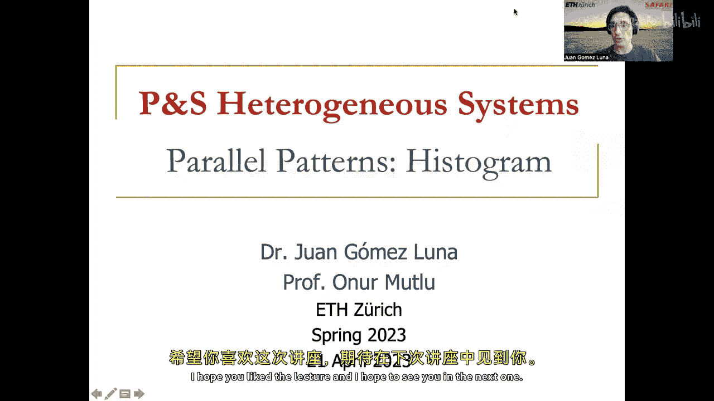

# 【异构系统编程：基于GPU和加速器 2023】苏黎世联邦理工—中英字幕 p07 p7 HetSys Course： Lecture 7： Parallel Patterns： Histogram (Spring 2 -BV1jXHZeuEwy_p7-

Hello everyone， welcome to a new lecturer for course on at the Reg System Today we are going to cover a new parallel pattern histogram calculation。

Before we go into the details let's very quickly recap what we cover in the previous lecture the reduction operation a reduction is an operation that reduces a set of values to a single value。

 it has certain properties sociivity commutivity and an identity value remember that we explain how to implement a three- based reduction on GPU we typically what we typically do is dividing the input array into different chunks that are assigned to different thread blocks and inside each thread block we assign different parts to different wars each warp will obtain partial reduction result that will be further reduced into a per block partial result after some interblock synchronization we will end up having the final reduction result。

There are a naive way of implementing the vector reduction that may end up having a lot of warp divergence or C underut which is not good for performance for that reason we also explain a divergence free mapping where the active threats belong all to the same warp or two multiple different warps while the reduction is making progress this way we have higher C utilization and in the end higher performance。

Yeah。Remember as well that we talk about atomic operations as a way of implementing reduction。

 or at least the final reduction atomic operations are very useful because they perform read modify right operations atomically and they can be applied to shared memory or global memory locations there are arithmetic functions like for example。

 add and sub and here you can see the syntax of an atomic a。

 This is the pointer to shared memory or global memory This is the value to add and it will be returned the old value there are also Bway functions like add or an Xor and different data types。

 you can check all the details in the Quta programming guide。

Atomic operations are very useful because they guarantee correct execution but they serialize the execution when there are atomic conflicts。

 for example， if we have two threads in the same warp that need to update two different memory locations using an atomic operation then we will be fine it will be just a certain latency but if these two threads need to update the same memory location。

 the accesses will be serialized and the latency will be longer because we have basically an atomic conflict atomic operations are useful for different purposes。

 for example， for computation when we use them on the array that is the output of the kernel for example in reduction as we discussed in the previous lecture or in user calculation as we are going to do today。

And they can be used for synchization or coordination across different threads or threat blocks。

 for example， using counters or logs or flags， in the end。

 they are very useful to prevent data races when more than one thread need to update the same memory location。

We are going to use them today for the histogram computation。

A histogram is a data structure that is used for reducing the dimensionality and instructing notable features and patterns from large data sets it's used in image processing in fraud detection and in other fields as well in a basic histogram what we basically do is that for each value in the possible value in the input elements we identify a bin and this being has an counter associated that we increment every time that we find that corresponding value in the input so basically what we do is divide in the input value range into bins and then we associate a counter to each bin and then for each input element we check its value and we determine what's the bin that it falls into and increment the corresponding counter。

The sequential histogram computation is pretty simple。

 we just need to go one by one over the elements of the input and update the corresponding histograms hosting histogram beam。

 for example， if this is our input and this is the histogram and we have a single thread because it's a sequential computation。

 the thread will go one by one iteration by iteration。

 reading one element of the input and updating increment in the corresponding counter。

 the corresponding beam， it will go to the next element， then the next element and so on so forth。

And the code for the hisogram， the sequential histogram computation will be something like this。

 we just have a while loop， it could be also a for loop to go over all the elements of the input。

 the thread reads each input value and then increments the corresponding being of the histogram。

How should we do a parallel histogram computation that it's good to try a parallel implementation here because there are many elements of process at the same time。

 but we should be careful when we have more than one worker or more one than one thread trying to update the same histogram bins let's see how we would do this with。

 for example four threads observe that the good thing is that when the threads start reading from the input array。

 the accesses are going to be coalesced because consecutive threads are going to access consecutive memory locations of the input and then they will go to the corresponding bin and increment the corresponding counter。

We could write this parallel histogram kernel in Kuta and first of all we are going to have a global threat index that is function of the block index and the threat index inside the thread block and then we also have a strip that is the total number of threats disease in case we are not using as many threads as pixel cellss or values we have in the input array so and then again we have a while loop and we go one by one over all the threads go over these chunks of consecutive elements reading the input values and then update the corresponding histogram beam then we will increment in the index bias strip in order for the threads to go to the next chunk of the input but there is a problem with this code with this kernel that's why is's wrong and we can see it in this example what would happen here。

Here is that we have two of the threads in this case。

 thread zero and thread3 that want to update the same histogram being at the same time。

 The problem is that this occurss in a data race and that's why we will get a wrong or we may get a wrong result and that's why we need to use atomic operations here。

So the way of writing this code， this kernel code correctly is replacing this instruction with the corresponding atomic operation。

 this way the execution might be serialized but there is a guarantee that the corresponding histogrambins will be updated atomically and we are preventing these data races。

Instaograms are very much used in different fields， for example， in image processing。

 if we have an image with hundreds of thousands or maybe even millions of pixels。

 we will have consecutive threads accessing consecutive pixels and then updating the corresponding hisogram bins in the same way we have seen in the previous slide。

But when we are processing natural images it might turn out that we will end up having frequent atomic conflicts one reason for that is the special similarity of the pixel value distribution in natural images for example。

 if we look at the phase of these monkey we will see that many of the pixel values are pretty similar and in fact some of them might be exactly the same so these will end up in atomic conflicts when these two threads try to update the same histogram beam so we need ways or we need to come up with ways of optimizing these execution and one idea is to use privatization which basically consists of using multiple soup histograms in order to reduce the frequency of atomic conflicts by the way in the past I use a different image here that might not be so appropriate these days I apologize about that if you see it in a previous。

And I hope that you like the new image now。So let's talk about privatization privatization is an optimization technique where multiple private copies of an output are maintained and then the global copy is updated on completion。

 the requirement for privatization to work is that the operation needs to be sociative and commutative but that's the case of the addition that we need to use when we create a histogram when we update the counter the histogram beam advantages are that privatization reduces the contention of the global copy and if the output is a small enough we can place it in on cheap memories in the shared memory which in the end will reduce the latency of the atomic operation。

Let's take another let's take a look at this example of privatization on this toy image here what we are going to do is dividing the image into multiple chunks and each of them is assigned to a different thread block and then each thread block will have its own soup histogram in the shared memory after the thread blocks have grown over the entire image and we have the soup histograms completed。

 then we perform a parallel reduction in order to obtain the final histogram that will be in global memory we can combine privatization with coercening coercing we have each block processing several image chunks。

 for example block zero is going to process these and this chunk of the image the advantage of combining privatization with coercening is that the parallel reduction will have to reduce a lower number of soup histograms because we are not using。

so many thread blocks and we will be fine as long as we are occupying GP the entire GPU。

 all GPU course， and another advantage as well is that we also don't have to initialize so many histoogram so we can see a performance improvement as well from using histogram parameterrivatization with coering in the implementations on GPUs。

So if you want to take a look at the parallel histogram kernel with privatization and coering it looks like this first of all we declared the thread index and the total number of threads then the private per block sub histogram that we need to initialize first synchronized after the initialization is done and then we go to the main loop where the threads of each thread block compute the per block sub histogram they read input values and they update the corresponding histogram being in the shared memory after they are done with the sub histogram then they synchronize and we do the final reduction observed that in this case the final reduction is using atomic operations in global memory even though atomic operations to global memory are more costly than atomic operations in shared memory this should still be fine because in the end this last part is only going to be a negligible part of the entire execution time most of the time。

Will be spent in this main loop。There are more ways of optimizing the use of atomic operationss。

 for example， using warp synchronous programming or warp synchronous primitives。

 we have already presented some of these， the warp shuffled functions that allow threads inside the same warp to exchange data and we saw that there are different variants of these shuffle functions。

 but there are other warp synchronous primitives for example for to synchronize the threads that belong to the same warp to obtain a mask of the threads that are active at a certain point or to evaluate a certain predicate and see if the different threads of the warp they predicate or not。

 there are even more for example， these ballot returns a mask of threats that have passed through the predicate here and there are also these match all seeing and match anything that are true for when participating threads are passing the same value。

いす。This is the code the simplified it not simplified this is the divide code for the coales atomic operations。

 the basic idea I will leave this here for your own study but the basic idea in these coales atomic operations is that different threads in the warp might need to update the same memory locations either in shared memory or in global memory imagine that we have a warp with 32 threads and there are four of these threads that need to update being zero of the histogram so what we are going to do with these coal atomic operations is basically perform a local reduction among these four threads obtain just a single value that will be the value to add for the update of the corresponding histogram being and in the end just a single thread of the warp will do the atomic operation on that specific。

Being where a conflict would have happened， it's a way of optimizing a little bit further the use of atomic operations。

This is all for today if you want to read more， I recommend you chapter9 in the book programming massively parallel processors。

 and you can also watch longer lectures that I have delivered in the past in this one， for example。

 you can also find longer explanation about atomic operations and how they have evolved over time。

 atomic operations to shared memory and atomic operations to global memory as well as a couple more optimizations for histogram calculation。

This is all for today， I hope you liked the lecture and I hope to see you in the next one thank you very much for your attention。

