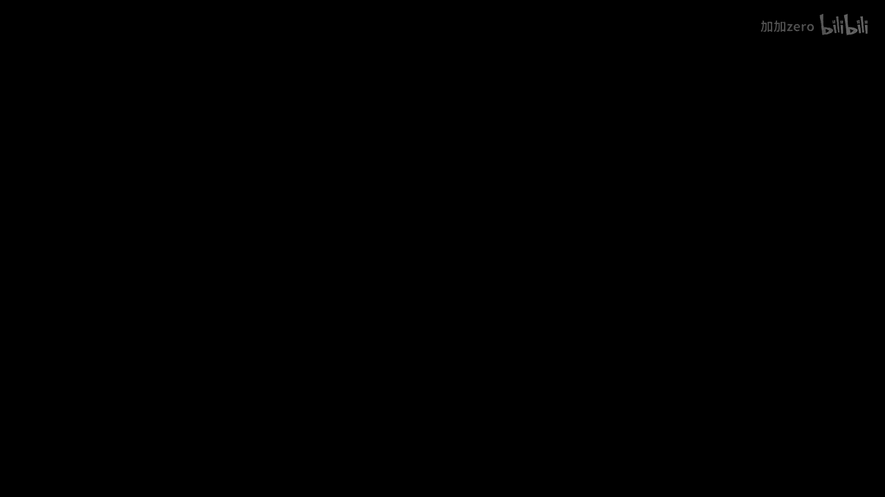
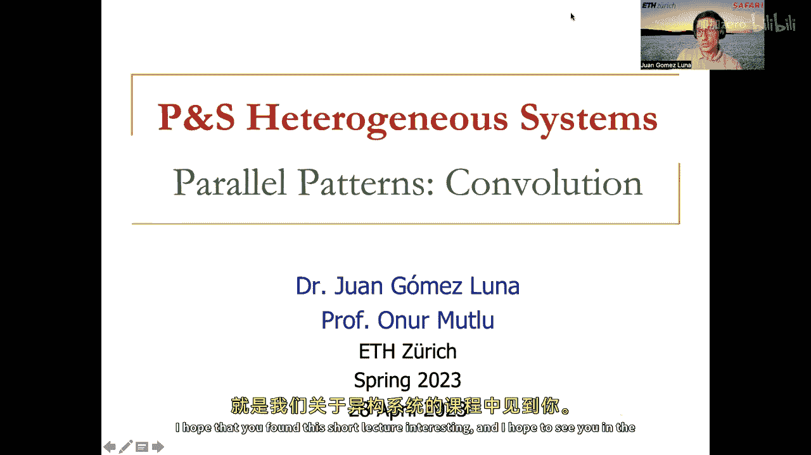

# 【异构系统编程：基于GPU和加速器 2023】苏黎世联邦理工—中英字幕 p08 p8 HetSys Course： Lecture 8： Parallel Patterns： Convolution (Spring -BV1jXHZeuEwy_p8-

Hello， everyone， welcomel to a new lecture of our course on engineering assistant。 Today。

 we are going to have another short lecture about a new parallel pattern convolution。

Remember that in this course we have already covered a couple of parallel patterns。

 the first one was the reduction operation， an operation that reduces a set of values to a single value and it has this operation needs to have certain properties like a sociativity。

 commitutivity and identity value。Then we talk about how to map these nicely onto a GPU and on how to implement it without divergence free mapping。

In the next lecture， the past lecture we talk about histogram computation histograms are frequently used for reducing theality and exact notable features and in large input data sets and the basic idea in a histogram is that we check the value each possible input value and then we update one being in the histogram we add we incr the counter associated to each being the histogram depending on what's the value of the input remember that for histogram calculation we need to use atomic operations and atomic operations realize the execution and one way of optimizing atomic the use of atomic operations is privatization a technique that in the case of the histogram places different sub histograms for each of the threat blocks in the case of the GPUs these difference of histograms are calulating in parallel and finally reduce altogether today we are going to talk about another。

parallel pattern that is convolution convolution has many applications。

 it's a widely used operation in signal processing image processing。

 video processing and computer vision and basically convolution applies a filter or a mask also sometimes called a kernel but here in this course we are going to about this term kernel because it can be confused with kuda or GPU kernels So the idea。

 as I said， is to apply these filter or mask on each element of the input that can be a signal an image or a frame of a video。

To obtain a new value， which is a weighted sum of a set of navoing input elements。

 And this is useful in image processing for a smooth thing。

 sharpening or blueing an image or finding it in an image or removing noise。 These days。

 convolutions are also very much used in matchinging learning and artificial intelligence。

 especially as convolutional layers in convolutional convolutional neural networks or Cs or componentss。

Let's start simple， let's start with one d convolution example that is commonly using audio processing here we have our input imagine that this is an audio record composed by many consecutive elements and we have a mask that we are going to apply the mask is usually a odd number of elements has usually a odd number of elements and in this case in this example is five so in order to calculate one of these elements。

 for example element P2 of the output， we need to put the mask on top of the centered the mask on top of the element for which we want to calculate the output we perform partial product elementwise multiplication these three multiplies these one。

 these four multiplies these two and the partial products are later reduced and the resulting value of 57 in this case is a store in the corresponding element of the output。

When using when computing convolution is important to pay attention to the boundary conditions why is that because we if we are computing the output for elements that are near the boundary we might go outside of the actual input array and so we need to deal with these costt elements and there are different policies on how to deal with these ghost elements one possibilities to considered that they are zero as is the case in this example or replicate boundary values or other approaches so in this case we basically do the same we would be multiplying these three of the mask with the cost zero so the partial product is zero then we perform the final reduction and obtain the output is 38 in this case here you can see a simple one decomvolal kernel with boundary condition there is one index for each。

Element of the output， each of them assigned to a different thread。

 and we need to compute the address of the first neighbor and then go one by one over all the elements over the number of elements that the mask has checking the boundaries in order to not go outside of the boundaries of the input array then perform the partial multiplication with the corresponding element of the mask and the element of the input array and the accumulation in this P value array。

 that P value variable that will be in an register and finally store the output onto the corresponding element of the output array。

Remember the memory in the GPU architecture and then remember that one of the memory spaces and the GPU memory hierarchy is the constant memory and this constant memory is cache there is a specific cache space inside each GPU cord that is called the constant cache and in this case this constant cache can be very useful to store the mask because the mask in the end is constant it doesn't change and it's going to be useful to many threads running on the same essay or on the same GPU core so we can store the mask in the constant memory for several reasons first of all。

 because it's constant also because it's a small and also because it's access by all threads and the good thing of the constant memory is that it is cache inside each GPU core and that's why it's fast and it's particularly when all threads of a war access the same value and that's actually what's going to happen when we execute the code。

For the kernel for the convolution so what we need to do to use the constant memory is to declare the mask as a global variable with the corresponding constant client qualifier and then initialize the mask from the host this is done by using these coa and copy to symbol where we have the destination that is the address of the mask in the GP memory the source or the address of the mask in the CPU memory and the corresponding size of the mask。

And here you can see the code with boundary condition handling and constant cache for M。

 the code itself， the kernel code itself is basically the same as we saw before the key difference is that now the mask is in the constant memory however we have to use this with calciumusing and the reason is that the constant cache is small so it's typically 64 kilobys so we cannot try to fit something that is much larger than that especially because in that case we are not going to have the advantage of the data being cached。

Remember that in this course we have already discussed tiling or blocking as a technique to take advantage of data reuse。

 we talk about tiing in shared memory this is an example of tiling for an image and where we are applying a Gaussian filter。

 these are the of tiling for sure can be applied as well to convolution and for example in the case of the one key 1D convolution where we basically partition the input and the output across the multiple threat blocks that are going to run these computation so there are different tiles。

 these tiles can be in the shared memory can be on cheap， including the hollows。

 including these boundaries that we need to compute the corresponding element those the corresponding the outputs for those elements that are close to the boundaries。

These are the hollows and the first thing that we will have to do is load in the necessary part the tile itself of the input into the shared memory and to do so we have to I mean here you have three consecutive slides explaining how to load first the left hall then how to load the elements in the middle and then how to load the right hall doing the corresponding address calculation and checking the boundaries in order to not go beyond the part of the input that we really need I will leave this here for your own study this slide is about the how to load the left hall into the shared memory。

 these are the internal elements of the of the tile itself and these part here is for the right hollow。

And this is the entire kernel for the tile 1D convolution， as you can see， first of all。

 obtaining the index of the output element that is related to the block ID block dimensions and the thread ID of the corresponding thread that is going to compute each element of the output here we declared the shared memory tile in this part here will load the left hallo into the shared memory then load the internal elements。

 then load the right hall， synchronize in order to make sure that everything。

 all the the entire tile is in the shared memory and after that performing calculating the convolution result using the data previously store in the shared memory and the mask that will likely will be in the constant memory as we said earlier。

Taiin is also very useful into the convolution， and we have discussed this， I mean。

 this specific example of the Gausian filtering。 we already mentioned it in a previous lecture。

And the styling into the convolution is especially useful in the convolutions that are done in machine learning convolutions。

 by the way， machine learning are pretty useful， even though they are having traditionally used for feature detection and image processing。

 they can also be used as neural network layers， as we mentioned already and they have some inherent advantages over other types of layers like fully connected layers that we can find in multilayer percept。

 the one reason is that they use only local weights。

 because they don't need to access weights from the whole image， but just concrete part of the image。

Because they compute only a window around the element of interest as we have seen in the previous examples of convolution and the good thing is that because these weights。

 this total weights that need to be used our relatively small these mask is relatively small it can easily fitting in on chip memory that's why T in techniques are being pretty much useful here either in shared memory or in constant memory as we have also seen and here you can see another example of the 2D convolution basically placing the filter or placing the mask on top of the input element in the case of CNNN this could be the input feature map we compute partial products we perform the final reduction and obtain the element in the output layer。

And here the code is incomplete， but you can see a simplified basic convolution layer forward kernel。

 first of all， obtain the indices of the output feature map and then some overall input channels and here we loop over the K by K filter performing the multiplication and accumulation operation and in the end obtaining one value goes to the output feature map。

Convolutions can be very efficiently executed in GPUs。

 but especially efficient if they are converted into matrix multiplications because they are compute intensive parts and GPUs are very well optimized for matrix multiplication and we already know some of the tiling techniques for matrix multiplication。

 we have explained how to do tiling and share memory in a previous lecture so this idea of converting convolutions of a convolutional layer into a matrix multiplication can help to accelerate the execution and also helps to keep the level of parallelism stable across C layers we will talk in more detail about these in the next lecture but here you can see a very simple example of how to turn one convolutional layer into a matrix multiplication basically we need to unroll the input features and unroll the convol。

alFils and place them in the shape of a matrix。 If you take a look at these row of the of these of these matrix here。

 you can see that these four element here correspond to the first of these filters。

 these four element here correspond to the next filter and so on so forth。

 and regarding the input features， the unroll input features， as you see what we are doing is taking。

Windows of the corresponding input feature map and unrolling there。 So these 1，2，1，1 is 1，2，1。

1 that we see here。 And next to them in the next column。

 we have the same corresponding window in the next input feature map。

So this way we can compute the convolutional layer with a matrix multiplplication。

 make it more efficient and higher performance on GPUs。

 we will talk in more detail in the next lecture about how to do so these matrix multiplplications can also take advantage of the GPU tensor core that you know exist in GPUs since thevol architecture here in this slide you see some details about the tensor core in the more recent H100 architecture。

 these tensor operations are extremely efficient highly optimize for matrix matrix multiplplication in the long version of this lecture you can see a few slides some explanations about how to use in tensor core。

 how to program them in a relatively high levell view so if you are interested you can。

And take a look at the longer version of this lecture。And of course。

 you can also take a look at these chapters in the book programming massively parallel processors。

And here you can see the link to the longer version of this lecture。So this is all for today。

 I hope that you found this short lecture interesting and I hope to see you in the next lecture of our course on E systems thank you very much for your attention。

