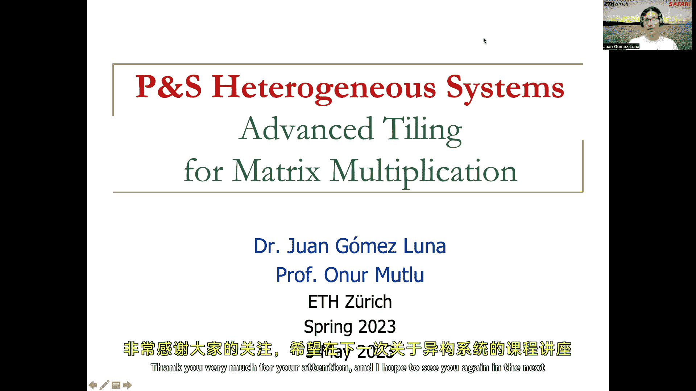

# 【异构系统编程：基于GPU和加速器 2023】苏黎世联邦理工—中英字幕 p09 p9 HetSys Course： Lecture 9： Advanced Tiling for Matrix Multiplicat -BV1jXHZeuEwy_p9-

Hello everyone， welcomel to a lecture of for course from the systems today we are going to talk about advanced styling for matrix multiplication This lecture corresponds to the series of lectures that we are covering about parallel patterns in the last lecture we talk about the convolution1D to the we also mentioned that the convolution can be reduced to matrix multiplication and today's lecture is a followup of the previous lecture but before we go into the details let me very quickly recap on what the parallel patterns that we have covered so far。

 we started with the reduction operation reduction which is an operation that reduces a set of values to a single value it needs to have certain properties like a sociativity。

 commutivity and an identity value remember that in the corresponding lecture we discuss how to map the reduction in a divergence free manner so that all active threats belong to the same warp and this way we maximize the c。

ization on the GPU course， the next parallel pattern that we introduce is a histogram computation。

 which is frequently used for reducing the dimensionality and extracting notable features and patterns of large data sets。

 Remember that in the histogram computation。 The first thing that we do is reading one element from the input checking what's the corresponding bin。

 according to the value range where the value of these input element resides and then we go to the corresponding bin and increment。

 we update one existing counter that is associated to each being。

 remember that in order for histogram calculation to be done correctly on a parallel machine。

 we need to use atomic operations， that atomic operations， serialize the execution。

 So it's good to try to figure out ways of alleviating the cost of the atomic operations。

 and one way is using private。That basically consists in the case of the histogram computation on having multiple soup histograms one at least per threadb so that each threadb computes its own local histogram or soup histograms and these I are finally reduced in order to obtain the final histogram In the last lecture we talk about convolution applications convolution is a widely used operation and signal processing image processing video processing and computer vision remember that in convolution we apply a filter or a mask on each element of the input and we obtain the weighted of a set of na or in input elements convolutions are very important these days because they are very much used in machine learning and artificial intelligence and notably in convolution and neural networks or CNNs or comes we talk about the 1D and the 2D convolution here in the slide you have the example of the one。

The convolution observed that we have an input array N and a mask or a filter M the way to compute each of the elements of the output P is by placing the mask on each element of the input N performing partial products regarding the elementwise multiplication of the value of the input and the corresponding value of the mask and finally we reduce these partial products。

 we arm them all and we obtain the output of the corresponding elements of the output array P。

Now for efficient implementation of CNNs own GPUs is what we are going to discuss briefly today。

 I will also give you at the end of the lecture some pointer to the longer version of this lecture。

 let's start briefly with an example of the forward path of a convolutional layer as you can see at the bottom of the figure we have some input feature maps in this case。

 we have three input feature maps of a certain size in this case。

 three by three in this toy example and what we're do in each convolutional layer is applying the convolutional filters on each of the input feature maps in this case。

 we have， as you can see six different filters and。

And we have six different filters and in order to compute the output what we are doing is placing the corresponding filter on the corresponding input feature map and we move these window on each of the elements of the input and this way we compute the elements of the corresponding output feature map as you can see in this particular example we have two output feature maps and the size of these two output feature maps relates to the size of the inputs and the size of the filters for one possible design of a basic kernel to implement a convolutional layer as the one that we have just seen in the previous slide is to assign one thread block to compute each tile of output pixels so in this case we are going to have tile with pixels in each direction and then in terms of the grid of the entire collection of thread blocks that we launched with the kernel。

We would use a two dimensional grid such that the X dimension maps to the M output feature maps remember that in the previous slide M was equal to two and the Y dimension maps to the tiles in the output feature maps in each of the output feature maps so what we are doing is a linearization of the input because we are using a single dimension to compute the tiles of a two dimensional output。

In these kind of implementations we can point to several observations first of all。

 the amount of parallelism is quite high as long as the total number of pixels across all output feature maps is large and one thing that we observe here is that for early stages in our typical convolutional neural network we are going to have fewer but larger output feature maps and we have a large y dimension however for later stages there are more but smaller output feature maps so we have a large x dimension so in these scheme observe that we more or less due to these two characteristics keep the total number of threads stable across these stages。

More observations is that each input tile needs to be loaded from global memory multiple times by multiple blocks because each block calculates the output tile that for each block that calculates an output tile requires the same input tile and this is not very efficient in terms of global memory bandwidth because we have to go multiple times to read the input tiles and it might become a problem when the output feature maps becomes small and increasing number so one way of dealing with these。

 on the one hand taking advantage of the observations in the previous slide and on the other hand dealing with these drawback that we going to here is reducing convolutional layers to matrix and implicationsplication as you know convolution layers are compute intensive parts of the ENs and and GPUs at the same time are。

Very good atperform management implication， And we know tiing techniques for managementplication management implication that naturally reuse the input features across output feature map。

 That's the gist of using the management implication。

So the idea is to convert convolutions in a convolutional layer to matrix multiplication and this way we can take advantage of these stable level of parallelism across C layers so the first thing to do when implementing a convolution layer with a matrix multiplication is kind of unroll the computation observe that we can convert these input feature maps and this convolution filters into two mates that will be multiplied in order to obtain the output feature maps and if you observe here each row in these matrix of output features corresponds to each output feature map in the convolution style of computation so first thing to do is to unroll the input features note that we are converting this part of these input feature map into part of a row of a column of these matrix。

input features the next part of the same column corresponds to the next the first window here in the second output input feature map and the last one corresponds to the third input feature map so this is what we do for all different parts of the input feature maps that we can enroll we place them as columns in this matrix and for the convolution filters we also unroll them and place them as the horizontal matrix here for your own study you can see here on the right hand side they code to perform the unrolling of the input feature maps。

And here you have some numbers about the C， which is a number of input feature maps。

 the size of the convolution filters， and the size of the output feature maps。

So if we want to implement and execute this matrix multiplication on a parallel machine， for example。

 a GPU， what we are going to do is assigning one output element one element of the output to a different thread and this thread each of these threads is going to go over the rows of the convolution filter matrix and over the column of the input feature maps matrix and performing a dot product operation grow and column we will obtain each element of the output matrix with the output feature maps normally as we have already discussed in this course we would apply tiny tiling techniques in shared memory in order to compute tiles of the output feature maps so each of these tiles each of these two tiles would be assigned to a different thread block and what these thread block is going to do is go into these matrix。

And loading this red tile into the share memory， go to these other matrix and load these orange tile into the share memory and then perform the partial matrix multiplication using the data that resides in shared memory this way we can take advantage of the data reuse and perform it in an official manner you can reup on the previous lecture on how to do these tile matrix multiplication we have already cover these in the beginning of the course if we have for two matrixes A and B that are going to be multiplied to obtain a matrix C。

 the first thing is to load tiles of both matrixes into the share memory once we have them。

We perform the partial multiplications in the shared memory using the data from the shared memory and storing in the corresponding tile of our。

 but we can go further and we can propose and we can use more advanced tailling techniques for maximum duplication that can provide even higher performance and the technique。

 the particular technique that we are going to talk about today's the joint registered and shared memory time。

As you already know registers are accessed are extremely high throatput but they are private with each thread and in order to do register tiling we need to use thread coercing。

 we are going to see how to do it in today's lecture shared memory at the same time is access at the relatively lower throatput than registers but much higher than global memory that's for sure has another advantage that is visible to all threads in a thread block it does not need thread coercing but still we need to load to the shared memory going through the registers at least in the traditional in the traditional GPU programming framework so we are going to use both for tiling different dimensions of multi-dimensional data and we are going to see how to do these using them for matrix matrix multiplication and also register tiling is pretty useful when it comes。

to using wire programming and and ten course that are introduced in the long version of PriBto for previous lecture but now let's talk about more specific details about how to take advantage of these joint register and share memoryty observed in the screen in this slide we have two matrices M and N that are the input matrices and we are going to compute the elements of an output matrix P so。

They observe as well that we are considering two tiles of different sizes， one for matrix M。

 That is a tile is a vertical tile of size4 and one for n is our horizontal tile of size2 What we are going to do is we are going to store the input tile of M and the output tile of P in registers and we are going to store the input tile of n in the shared memory。

 So this is how we are going to do the joint register and shared memory tile observe that we are decoupling the size of the input tile of M and the input tile of n of n they are of different sizes in this example。

And some key quantities to consider when implementing this is that we are going to use a number of threads that is equal to the size of the tile of M tile with M and the size of the output tile。

 as you can see， is the result of multiplying tile with M times tile with n。

 So those are the elements that one specific thread block is is going to compute of the output or。

 If you observe how we are going to access the data from M and from N from the registers or the shared memory in the case of the the matrix element of the element of n。

 we are going to reuse each of them tile with M times and why is that Because in order to compute these elements here。

 these two first elements here of the tile of P。We will use these element of M。

 but we also need to use the two elements of M so each of these elements is going to be used twice and then how many times do we reuse each element of M we are going to reuse a tile with M so each element of each element of M is going to be reused two times each element of n is going to be reused a tile with M times。

Observe as well that each thread calculates tile with MP elements because each thread is going to be assigned to each row of the tile of P。

 so thread 0 will compute these two elements。 Tread1 will compute these two elements and so on so forth Now observe that we are applying here two optimizations。

 The first one is thread coerening and we are doing thread coercing because because each thread is calculating a horizontal strip of tile with M elements of P So thread 0 will compute in this particular figure。

 thread zero will compute these four elements。 So we are doing coering equal4 in this in this case。

And also， data loaded from M can be reused tile with n times through the register。

 So this element of M that is assigned to the thread that computes this row of the tile of B this element of M is a store into our register and it's going to be used four times in this case and these four is tile with n in this example。

 So we load this element into register one and then we compute or partial。

Product and accumulate for these four elements P0 to p3 by performing multiplication of the content of register error R1 and the corresponding element of the tile of N we perform the multiplication and accumulate in the corresponding element The second optimization that we are using here is share memory tiling In this case。

 we use multiple threads to load the tile with n elements into the share memory so we will need for these toy example we need four threads to read these four elements from the global memory and bring them to the share memory and now we are using them every time we access them and we reuse them we access the share memory that is faster than accessing the global memory so as you in the slide T1 to T4 T30 to t3 whatever name or threads have go to global memory collaboratively load these horizontal。

t of n into the share memory and after that it can be reduced so then in one iteration each thread access is one m element from a register and excesses tile with n and elements from share memory and calculates one step of tile with N elements so that's what's going happen in each iteration we compute one step for these tile with n elements of matrix P for practical numbers that we can apply on a real kernel tile with n is typically 16 or this is kind of our reference value the limit is somehow impose here by the number of variable registers because the elements of P are stored in registers as well and the number of registers is relatively limited the maximum number the maximum number of。

Res that you can use is 256 in current media GPUus so that is going to impose a limit on how many elements of P we can calculate in each iteration and in one iteration as well each thread block has tiedd with M threads the number is in practice 64 or more remember that that's we are signing one thread。

 which of these rows in the output in the tile of output P and the number of threads is equal to the number of rows in this tile which is also the number of elements in the tile of M as I said this is at least 64 in real implementations so each thread block loads one tile of M elements into registers and loads one tile of n elements into the share memory and then。

Number of threads that we are using in the number of threads that we are using to load this tile is basically the thread coering that we are using and to calculate the elements of P so for example this is going to be 16 or more in practice as we mentioned in the previous S slide。

 but there is one problem here is that now we have the threads of the block let's say typically 16 and they are loading a tile of n that we said typically of size 16 so most of the threads of the thread block are going to be inactive when doing these loading of the tile of n into the share memory so we have divergence a way of coming up with a more balanced approach in this situation is to have all threads in a block collaborate to load。

温。One rectangular tile of n into the share memory In this case。

 the size of this style is going to be tile with n times K so that K is is said in a way that K is said in a way that makes this multiplication equal to tile with M。

 which is the total number of threats in the block。

 Remember that in your previous example tile with M was 64 tile with n was 16。

So K good before in this case and this way all threads are loading one element of at least one element of n and this way there is no dirgence so we have a more efficient execution and at the same time。

 we can have also each thread loading multiple elements K elements of M into registers so that this value of K is also going to be limited by the available number of registers now because it each thread is going to need to use tile with n registers or the output elements and k registers for the elements of M and in total in each iteration each thread is going to calculate K steps for tile with n times tile with M elements of P。

So in summary for these join register and share memory tiling each thread block has tiled with M threads。

 each thread is coerced by tile with n times each thread loads one element of n into the share memory the total number so this defines the rectangular tile of both n and M by these variable K that is given by the ratio between tile with M and tile with n right and then we calculate k steps of the tile with n elements of B so this is the join so this is how we would apply the join register and share memory tiling if you want to go more in depth about this technique I can recommend you to check chapter 7。

8 and 16 on the。BookPro massively parallel processors you can also check the longer version of this lecture from our previous semester this is all for today。

 Thank you very much for your attention and I hope to see you again in the next lecture of our course on union systems。

