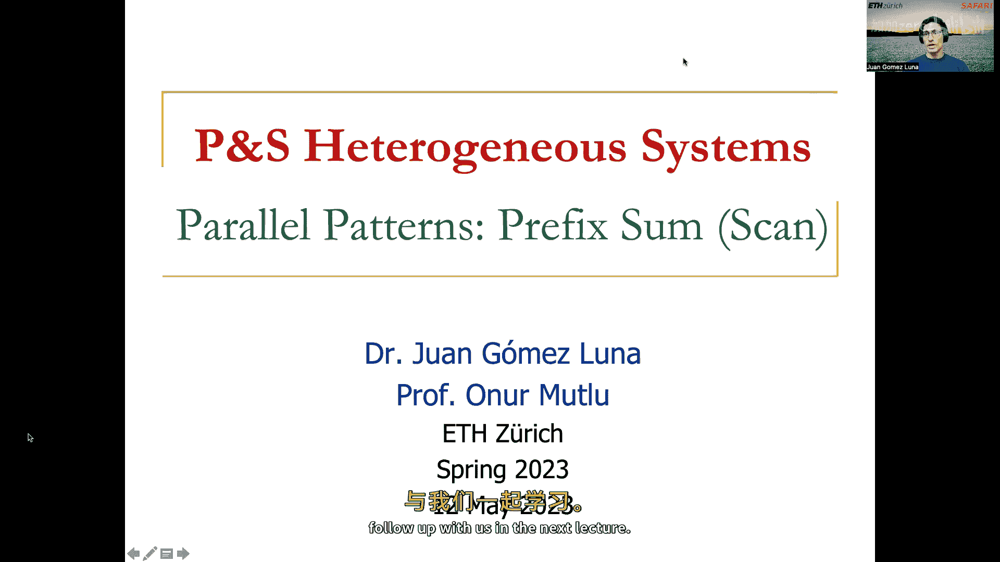

# 【异构系统编程：基于GPU和加速器 2023】苏黎世联邦理工—中英字幕 p10 p10 HetSys Course： Lecture 10： Parallel Patterns： Prefix Sum (Scan) -BV1jXHZeuEwy_p10-

Hello everyone， welcome to a new lecture of our course on the union systems today we are going to introduce another important parallel pattern prefix example core scan in this course we have already introduce some important parallel patterns such as a reduction operation that reduces a set of values to a single value and it's an operation that requires a creativity。

 commivity and an identity value we explain how to implement at the diveence free mapping that can maximize this inut and this way the performance the second parallel pattern was histogram calculation that is a primitive that is frequently used to reduce the dimensionality and extract notable features and patterns from large dataset sets what we basically do here is for each value of input elements we have a beam counter that we increment every time we find a new element with that one。

Because we havecurrent concurrent execution of multiple threads and they might collide when updating the beanss in the soup histogram this requires atomic operations and one way evaluating the cost of using atomic operations that typically serialize the execution whenever are conflicts it's histogram privatization with privatization what we do is using multiple soup histograms at least one per thread block that are calculated independently and later reviews in a copying the global memory the next parallel pattern was convolution which is widely used in image processing video processing and computer vision among other fields and in convolution we apply a filter or a mask on each element of the input and calculate weighted some we introduce the one decomvolution that can be used for example for audio processing but we also talk about2 thecomvolution that is typically using convolutional neural networks these days。

Related to that we also explained in the next lecture how to implement a convolutional layer using matrix duplication this requires to enroll the input feature maps and enroll also the convolutional filters give them the shape of two mattressrices and then perform a matrix implication that is an operation that is typically very well optimize on GPUs using different optimization techniques。

 for example， the joint raised there unsha memory ti that we introduced in the previous lecture today as I said we are going to talk about prefixam also called a scan and this is an operation that takes an input array and an associative operator for example。

 additional multiplication maximum minimum and returns an output array that is the result of recursively applying the associative operator on the elements of the input array this is an example input array that's think about these associative operator for example。

 an addition。We will calculate the output array into two possible ways。

 one is called exclusive s and this is the case where we don't for each index of the output array。

 we don't use the corresponding element corresponding index on the of the input array。

 that's why to calculate Y I we only go in the recursion until from zero to I minus1 and for an inclusive s we are using the corresponding input element in the same index。

Alcan has many applications in parallel programming it's a primitive that can convert recurrences from sequential into parallel and it's a basic building block in many important parallel algorithms。

 string compaction partition select unique Ras sort etc。

 we will talk briefly about some of them at the end of this lecture。

Let's take a look at a couple of examples， one for exclusive and the other one for inclusive scan。

 Let's consider this or input array and to calculate the output in an exclusive scan notice that we initialize the first element of the output array to the identity value。

 and then we start iterating over the element and adding the previous output element to the current input element。

So this would be the output for an exclusive array for an inclusive array。

 we initialized the first element to the first element of the input and this would be the output in this case So now let's discuss about how to implement a scan and in particular we are going to use inclusive scan as the example in a parallel machine with two or more levels of of parallelism in this case we use a hierarchical scan so if we are thinking about the GPU remember as we know in GPUs we compute with rates of threats and these threats are organized into blocks so in the GPU what we would do is partitioning the input array over the different blocks that we are going to use in our program and then first of all we will calculate per block inclusive scan so as we can see these intermediate array here contains the scan values or the Pfi sum。

For the original input array， it's kind of a segmented scan because the scan operation is divided into several segments。

But now if we compare these per block inclusive scan with the output of the final output of the inclusive scan。

 one thing we notice is that we can calculate the elements in each of the segments。

 the final value in each of the segments by using the last element of the previous segment。

 for example in order to calculate these 14， we add these four and these10 and in order to calculate 20。

 we need to use six which is the the actual element in the same position and the previous last elements of the previous blocks in this case four and 10 to compute these 20 so。

One thing that we can do is to first take the last element of that has been calculated by each block in the per block inclusus scan putd in a smaller register and then compute the scan of these partial sums now we take the array with the intermediate results of the per block inclusus scan and we propagate these offsets to each of the blocks that are going to add the corresponding offset to their own elements and this way we end up computing the final output array when we implement these on a GPU we need to have a global synchronization point after having having calculated the per block inclusiveus scan Why is that because we need to have all these four values in this example ready when we start the computation of the scan of partial sums so the way。

Of doing this global synchronization is either by kernel termination and then launching the computation of the scan of partial sums on the CPU or launch a new current kernel on the GPU at the end of this presentation we will also explain another way using atomic operations in share memory after the scan of partial results has been calculated we can launch a second kernel that performs the addition operation to add these offsets to the elements of the corresponding chunks assigned to each block。

So how to implement an efficient per block inclusive As， this is the next thing to ask ourselves。

 we can also apply a hierarchical approach inside a thread block using wires and using threads there are different algorithms to use here。

 for example cogistone or Bren comb today we are going to focus on cogistone in the longer version of this lecture we also explain Bt comb。

So let's take a look at the cogistone parallel inclusive ascan if we have an array of eight elements in this case。

 what we could do is assigning one thread to each of these element and then we are going to perform these operations iteratively in the first in the first iteration each thread takes the previous element of the input array and performs。

 for example， the addition and stores in the output array in the next iteration we increase this strip to2 and then two four and so on and so forth。

How the code look is what we can see in this slide so first of all we need this index for each thread to access the corresponding element and because we are doing an inclusive scan we initialize the output with the own element of the input after that we synchronize the threads in each block and in these for loop we are going to perform as many iterations as necessary log and iterations from a straight one to a straight that will that will be half of the thread block size。

And as you see can we double the thread in every duration so first of all。

 we read the value one of values to add from the output array we sync thread in order to make sure that all threads have read the corresponding element and then we add this element to the current value output I element before synchronizing again and go into the next it at the very end of these kernel we good write these at the corresponding output each thread or the last thread of the thread block will write the corresponding output that contains the reduction result that it's needed that the partial sum that is needed for the second step。

 this kind of partial sums we write it to an array of partial sums that has one input per block。

Now there are some observations that we can make here in order to make the implementation more efficient。

 first of all we observe that all these elements are reused because in each generation we read them again we add them to a new number and then we write so one thing we can do is buffering these arrays into the shared memory。

And this is how they code good look， it's basically exactly the same as the previous code。

 the main difference is that now we have replacing all this computation the output array in global memory with this buffer as in shared memory and these will make the execution faster because we are taking advantage of data reviewsuse and the fastest shared memory。

There is one other observation that we can make is that in this code we need two think threads in order to note overwrite results。

 partial results that have not been used yet so one way of eliminating one of these sync threads is used a technique called double buffer that basically means that we have two buffers in this case in shared memory and we are going to be swapping the input and output buffer in each of the iterations of the loop so instead of synchronizing before writing we can write directly now in the next iteration buffer two would be the input and buffer one would be the output and so on and this way we can eliminate one of the sync threads that we had over here after each iteration or at the end of the iteration we swap the input and output buffer as you can see in this part of the code。

So now that we know how to do this hierarchical approach now that we know the cogistone algorithm let's keep discussing how to implement a hierarchical approach inside each thread block so this could be the let's say the whole picture of the hierarchical inclusive scan where we have partition the input array over the different blocks they perform per block inclusive scan then we have these scan of partial sums even the CPU or in a new scan kernel and finally the addition kernel now we can apply the same idea to a single thread block where we have multiple vers as well see so the whole chunk that has been assigned to each thread block is going to be partitioned into pieces each of them assigned to different vers and now in the first step each of the wars will perform upper work inclusive as scan after that and before doing。

Thiscan of partial sums， we again need to synchronize but because now we are working locally inside the same thread block。

 we can synchronize all these different threads using sync threads that is faster than terminating kernel so then we could have one single war of these thread block performing this scan of partial summs this is something that for sure will be done pretty quickly because it's just a single war and all threads are going to be involved in an efficient implementation as we are going to see next and after doing so we can synchronize again and finally perform the ad operation。

Let's take a look at how to do the scan internally inside a warp first of all。

 we have certain war size and current GPU architectures is 32 threads that is well known and we are going to use a lane ID and a warp ID to identify the part of the work loop。

 the part of the input that is going to be processed by each warp and by each thread inside the same by each lane so this is the device war scan function that for each thread it gets one input that is the own value the input value that we are going to store in this variable x and then we have again a for loop in this case the maximum of these for loop is warp size because we are working internally inside each warp but again what we are doing is increasing this stride here called offset。

From one to the war size。 So and we basically double thisstr in every iteration。

But now instead of using shared memory because we are working inside one warp we can use shuffle operations shuffle operations are very fast and useful primitives that we have introduced in previous lectures that allow threads inside the same warp to exchange data residing in own registers so what we basically do here is going to lowering separated by a certain offset and bring the value of the corresponding X variable that reside in a register and storedied in another variable Y that we will later use to perform the addition operation here and these I will have anabated result in the same way as we have in these intermediate iterations of the Kogistone algorithm。

And after that， we return the value。So now how to integrate these warps scan into the B scan in this hierarchical approach。

 we first of all do the firstsA step per warp inclusive scan using the Warps scan device function that we explain in the previous slide and then after that is done。

 we store in shared memory， the partial production results that we have to ice scan in the next step in this step C。

 one warp scans in shared memory again using Warps scan because we can use exactly the same device function that we use in the firstsA stage。

 and after synchronizing each thread can calculate its final value perform in this final edition。

So now that we know how to implement the hierarchical approach when we first distribute parts of the input array to the different thread blocks and then inside each of the thread block。

 we use different wars to first do ap per scan and then coordinate with the other wars in the thread block to do the the entire per block inclusive scan we' are going to do some analysis about what what's the cause in terms of global memory accesses of these algorithm these algorithm by the way it's called scan can add for the reason that we first do a scan operation。

 the second stage is a scan operation and the final step is an a operation so in the first step in the first scan we are reading the entire input array let's assume it has n elements being very large and we perform the per block。

If it scans， because there is an interb synchronization that requires to terminate the kernel。

 we need to write the output to the global memory， so we would be writing a elements as well。

 corresponding to the per block prefix sums。In the。S scan second step in the scan of partial results。

 we only need to read the partial reductions of each thread block。

 so we are reading something much smaller and in reading and writing and in the last stage we do the add operation where we again need to read the entire input array of I mean in this case the per block prefix sums。

 the intermediate array with n elements we perform the addition operation and finally we write the output elements。

 the N output element that corresponds to the final output inclusive scan。So in total。

 we have four N elements that are read or written being this and very large。

One fastest algorithm or one fastest way of doing the same computation is called reduce scan scan in this case。

 because what we actually need for the second step is only the final reduction result instead of doing a block scan what we do is upper per block reduction to calculate the last element what would be the last element of the per block scan which is the actual partial reduction we use them for the scan of partial results and then we launch a final kernel that performs first the per block scan operation and then the add operation adding the offsets to the corresponding per block scan results。

These RSS reduces scan use scan version has the following number of global memory accesses in the first stage in the reduce stage。

 we are reading the entire input array at these n elements。

 but now we only need to write the per block reduction。

 which is much smaller in the second kernel we read and write only the small size of the per block productions and in the final scan step we read again n elements for the input perform the partial scans and then write an output of n elements。

 So in total here we are writing or reading three n elements and that's why these reduces scan scan algorithm usually results in better performance that the scans can add version when using very large inputs。

 very large input arrays。That can keep occupy the whole GPU。

Now the last thing that we are going to cover is how to do this synchronization these interb synchronization using atomic operations in global memory here we can use a technique known as adjacent blocks synchronization that basically uses atomic operations in global memory to coordinate consecutive thread blocks that are working on consecutive chunks of the input array for the adjacent blocks synchronization we use one auxiliary array of flags that is going to be H flagG is going to be set when the scan of partial results is ready for the next red block to read it so basically what we are going to do with this adjacent blocks synchronization as we will see is and implicit scan operations by coordinating consecutive threat blocks so in order to do so。

We select one thread that is going to be the leader thread， for example。

 thread of the threat block with ID equal to zero and this thread is going to check the previous flag and is going to wait there in this y loop until the flag the previous flag has been set to do so one possible way of doing it in order to read in anatomic way from the global memory from these array of flags in global memory is to use an atomic ad where we are just adding zero So while this flag is0。

 we continue looping here and at some point this will change will be equal to one and in that case the scan value。

 the partial scan value is ready to be read from the global memory so basically the thread block that has being assigned these part this chunk here and has generated these four is waiting for these10 to be ready that。

Will happen when the flag is set and then it can perform these addition adding four plus the result of the previous sum that is 10 that's 14 and we will store in the corresponding place in the array of scan values in this array of partial sums After that。

 we use a threat threat fence in order to just make sure that consistency memory consistency between these two axises is maintained and the thread now can set the own flag for the next thread block threat block working on this part here to read from global memory perform the partial addition and store in the array of scan with partial sums and after that we will synchronize。

So in these adjacent block synchronization， one thing to be kept in mind is that the threat blocks might not be scheduled in accordance to the block ID。

 so we know that each thread block has a block ID block ID X do X that is0，1。

23 until number the total number of threat blocks that the grid has minus1 but there is a certain enddeterminism on how the threat blocks are really scheduled onto the GPU course。

 so we have no certainty about having threat block zero running before threat block1 or threat block1 running before threat block2 so to solve this issue what we can do is using a dynamic block ID so each thread block instead of using its own actual block ID is going to use a dynamic block ID that can be obtained by simply updating a global。

Counter this dec in global memory。 and then the resulting value is then shared with all other threads in the same threat block。

 So now all threads can operate as if these B was their actual threat block I we can call it virtual block I。

 for example。 So if we do so problem is solved， we can use this adjacentN blocks synchronization。

 and the good thing of this adjacent blocks synchron adjacent blocks synchronization is that it allows us to merge the three part of the hierarchical scanning operation And in the end。

 reducing the total number of global memory accesses to just2 n。 So as a result。

 this will be faster than scan scan and the original reduce scans scan as well。

As we said in the beginning scan is an extremely useful parallel primitive that is used as a building block and many parallel algorithms there you have a list string compaction partition select unique and we have used some of these in a previous work of us where we implemented highly optimized versions of these and a collection of algorithms called in place data sliding algorithms。

 we can do padding or empadding string compaction， select unique partitioning et cea in place。

 meaning that the output is going to reside in the same physical memory locations then the input which of course will save a lot of memory space in the global memory by using the scan operation and using the adjacent blocks synchronization that we explain and if we do so we can significantly accelerate the performance in these experiment from our paper we compare to。

Trus library and we observed around three times speed which was certainly pretty impressive and we can make by using the adjacent blocks synchronization。

 we can make an operation like select or string compaction to almost achieve the maximum throat that the memory bandwidth can provide for more details I refer you to the paper and the code that is also publicly available。

Okay this is all for today you can read more about the prefix summers or scan operation in the book programming massive parallel processors。

 there is also a longer version of this lecture where we for example introduce the brandcom algorithm as well so I I leave the。

The link to this lecture at the bottom of this slide and this is all for today。

 I hope that you found this lecture interesting prefix exam is an extremely important parallel primitive and I hope that you follow up with us in the next lecture thank you very much for your attention。

