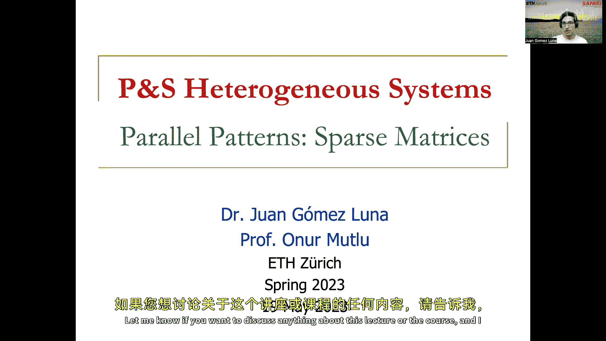

# 【异构系统编程：基于GPU和加速器 2023】苏黎世联邦理工—中英字幕 p11 p11 HetSys Course： Lecture 11： Parallel Patterns： Sparse Matrices ( -BV1jXHZeuEwy_p11-

Hello everyone， welcome to an lecture four course on Inter systems today we are going to talk about the sparse matrixrices and sparse matrixric compression and we will use the sparse matrix spectrum multiplication as an example algorithm。

But let me very quickly recap on the other parallel patterns that we have covered already in this course。

 we started with the reduction operation， which is an operation that reduces a set of values to a single value。

 the reduction needs to have three main properties， a sociivity， commutivity and identity value。

 and it's a key primitive for parallel computing。Remember that we discuss how to implement a divergence free mapping on GPUs in order to maximize in utilization The next parallel pattern was histogram computation that is on operation that is frequently use for reducing the dimensionality of data and extracting notable features in hissterogram calculation what we typically do is reading input elements one by one and incrementing counters or bins in the histogram the problem is that when we have multiple threads updating the histogram we will need to use atomic operations and for the correct result and the atomic operations serialize the execution so we need to figure out ways of alllevating these serialization and one way is called privatization that basically consists of placing multiple soup histograms in the shared memory each of them is going to be created by a different threat block and when also histograms are done。

They will be merge into a final histogram in the next lecture we covered convolution when convolution we apply a filter or a mask on each of the elements of the input and calculate the elements of the output used doing a weighted sum convolutions are extremely very much used in signal processing image processing video processing computer vision and these days are they are very much using machine learning and artificial intelligence in convolution neural networks for examples。

We discuss how to do a convolution 1Dcomvolution applying a mask。

 in this case a mask of a size5 on each of the elements of the input。

 to compute partial products and then final reduction。

 we also discuss how to do a 2Dcomvolution as well and in the next lecture we talk about implementing convolution or layers as matrix multiplplication and operation that basically requires us to unroll the input the matrices of the input feature maps and the convolution filters and place them in the form mathe matrix in this way compute as it was a matrix multiplplication which is a very suitable operation for GPUs。

We indeed discuss more advanced optimization techniques such as register tiling and shared memory tiling and how to combine them to implement matrixplication in a very efficient manner。

And in the previous lecture we talk about prefixam。

 an operation where we take an input and an associateative operator and calculate the elements of the output by recursively applying the Asciative operator on the elements of the input array remember that there is exclusive scan and inclusive scan and we discussed how to implement a hierarchy called inclusive scan that can be adapted to a system where we have two or more levels of parallellist for example in GPUs where we have threat blocks。

 wars and threads the first thing that we would do is partitioning the input over the threat blocks and each of these thread blocks is going to do a block scan。

 but then inside the threat block as well we will use wars and we will use individual threats remember that in this hierarchic scan there are different steps and the one that you see on the slide is the scan scan add implementation where we first respond per block scan then we scan partial。

S and finally we perform the additional operation to add offsets to each of the corresponding elements of the per block scan this is one implementation。

 the other one that we discussed was the reduce scan scan。

Which saveds some memory excesses and is especially more suitable for very large arrays。

Today we talk about the sparse matrixrices and sparse matrix computation。 First of all。

 let's define what's a sparse matrix。 We all know what's dense matrix which is a matrix where the majority of elements are not zero and in a sparse matrix。

 the majority of elements are zero It's a matrix where many elements are zero and this is something that will happen in many real world systems but sparse matrixrices also offer some opportunities First of all there is no need to allocate a space for zeros and that can save memory capacity there is no need to load zeros from memory to the processor and that's going to save memory bandwidth and there is no need to compute with zeros and this will save computation time that what happens for example in a sparse matrix vector multiplication it doesn't make sense to multiply by a zero because we already know that the result will be zero So these are opportunities but taking advantage of these。

This entail some challenges because storing in a compressed format will require more complex way of accessing the data that if we have everything in a dense matrix。

 so we are going to discuss a little bit about this today and you can learn more if you watch the extended version of this lecture。

But lets start with a little bit of motivation the sparse mates are widespread today and you can find them in recommend systems。

 for example， in graph analytics， different algorithms like Patron breath research and in neural networks both in sparse DNs or in graph neural networks and the reality is that real world mattressrices have high sparsity if we take a look at connectivity graphs or for example Facebook or YouTube we will see that they are very sparse so a good sparse mattress compression is essential to enable efficient storage and computation Traly there are many storage formats for sparse mattressrices and most wellknow ones are coordinate format or COO that we are going to briefly discuss today or the compress the sparsetro or CSR that we are going to also introduce today。

 but there are other more sophisticated。can probably result in better performance for some kernels for some algorithms on GPU such as the LPAac format or ELL or the jack diagonal storage or JDS。

 but there are many more for example， based on beat mapps that are also very efficient in storage at least for certain mattressrices when choosing one storage format there are some design considerations to take into account first of all is space efficiency how much memory they consume second one is the flexibility meaning the ease of adding or reoring elements。

Then there is also the accessibility or the ease of finding the desired data。

 we are going to see a couple of examples of these and there is the memory access pattern as well。

 whether in parallel system like a GPU they enable coalesce memory accesses and finally load balance。

 how much they can minimize controlled dirgence because the fact that mattressricesRXs will make that they don't have the same number of elements。

 for example in each row and that might be a source of divergence if we have different threats working in different roles as we are going to see some。

So we are going to use SPMV as an example， the choice of the best storage format depends on the computation and the matrix characteristics。

 the sparsity basically， and as I said we are going to use a sparse matrix vector multiplication as an example to study different formats in matrix vector multiplication we have a sparse matrix that you can see on the left hand side of the figure and we have a dense vector and the result will be an output dense vector as well。

So let's start with the coordinate format or CO observed that here we have the original matrix and here we are restoring the matrix in the S spaRS compression format and notice that for every element of the spase matrix we store the nonzero element along with its row index and its column index。

 for example these element here of value1 has indices0 and zero。

 so this is what we store in the S spase matrix format。

When it comes to performing a matrix vector as spa matrix spectrum application using COO one typical parallelization approach is to assign one thread per non-zero element same as we are doing here in the image and then each thread will have to go to the corresponding element of the input vector perform the multiplication and then accumulate and the problem is that we have multiple threads right into the same output to the same element of the output vector and that it's going as to it's going to require us to use atomic operations for an example code you can see it in this slide in this SPnB COO kernel first of all is to define what's the index of the element that each thread is going to work on and using this index we first access the row and the column indice is in the。

In the matrix in the as spaRS compress matrix as we see for row and column and then we read the value of that specific element using that value and using the corresponding element given by the column index in the input vector we perform these partial multiplication and then we need to accumulate as I said earlier because we have multiple threads or we may have multiple threads working on the same row and updating the same element of the output vector we need to use atomic additions to avoid reddator races CO has certain tradeoffs it has advantages and disadvantages in terms of advantages it's flexible because it's easy to add new elements to the matrix non no zeros can be stored in any order because each nonze is accompanied with its row index and its column index so it's very easy to add a new one you just put it at the end。

In terms of accessibility， given a known zero it's easy to find the row and the column。

And it has coalesce memory accesses when we are using SbnB because consecutive threads are accessing consecutive elements of the matrix and these guarantees coalesce memory accesses and at the same time there's no controlled divergence and that's something that you can check in the previous code however it has its advantages first of all。

 if we are given a role or a column and we are asked to find all known zero elements of the role or the column that won't be easy we'll have to scan through the entire entire sparsse matrix。

Unless they are sorted， of course or we do pre sorting before searching and also the second disadvantages is that the SPMV version using CO requires the use of atomic operations as we have seen。

We are going to briefly discuss another important spars matrixs format which is probably even more widely used is a compresses sparse row in this case as CSR has one key advantage that is usually provides a high compression ratio and its use very much many libraries and frameworks or CPUs and for GPUs so in compresses sparse row or CSR the key is to have an array of row pointers so we are going to start the no zeros of the same row adjacently and we will have an index or a pointer to the first element of each row so instead of now storing for each value the row and the column we are still storing the column index but because we are implementing these CSR format based on the assumption that all values in the same row are going to be adjacent we can。

Use's this array of row pointers that indicates what's the index of the column and value array where the corresponding elements of each row start。

Now when it comes to implementing a parallelization approach for SVMB。

 the normal thing here is to assign different threads to different rows。

 so this way each thread is going to be in charge of computing the partial product and accumulation of the elements of one row and the input vector so for example if the vectors the threads start here in every iteration they will go to the matrix read one element of the matrix then go to the vector read the corresponding element of the vector perform the partial implication and accumulate and in the next iteration they will go to the next element and so on and so forth。

 observe that one thing that we can see here already is that there is some it's likely that there will be threat divergence。

 there will be interwarb divergence why is that because different threads are working on different roles。

Different rows may have different number of known zero elements。

And that's going to be one of the disadvantages of the CSR format and here you can see the code first of all we find what's the row to work on given by the block index and block dimensions and thread index basically each thread works on one row and then we go over all the elements of that row read the column index then read the value and perform the multiplication of the corresponding element of the vector given the column index and the value of the adjac symmetry matrix and after that we accumulate this sum variable that is at the very end written to the output vector。

CSR has also some tradeoffs versus CO and has advantages and disadvantages， for example。

 in terms of advantages is space efficient because row pointer are smaller than row indices notice that now we don't need to keep the row index for every single thread we just keep one pointer to the beginning of each row in the a matrix。

In terms of accessibility， giving a row is easy to find all known zeros， if we are giving one row。

 all known zeros will be right after each other in the same row adjacently。

In terms of advantages as well， the implementation of SVMB。

 as we have just seen about its atomic operations because every thread owns its own output and is assigning one element of the output and then in terms of disadvantages in terms of flexibility is not that good because it's hard to add new elements to the metrics。

 we will need to rearrange or reorganize the data in the different rows。In terms of accessibility。

 giving a nonzero is hard to find a row and giving economies is hard to find all known zeros will have to go over all row sections finding which elements are in the specific column that we are looking for and as we have seen as well SV andB implementation the memory accesses are not coalesce and the reason for that is that we have one row of the other in the compressed format and we are assigning different rows to different threads so one thread is accessing here another thread is accessing here is that's a certain distance so not coalesce accesses and finally it has control divergence as we mentioned earlier as well because the number of nonze elements in each row is different so the number of iterations that every thread will have to do will be different as well。

SBMV is typically regular， it's typically。That's a challenging algorithm for efficient implementations on parallel machines。

 but it has the additional disadvantage that is a memory bound computation and memory bound means that it requires many axises it's very memory intensive in the axises observe that as we have just seen in the implementations of spnb we need to access not only the nonzero value but we also in then CSR for example we have to use the array of row pointers and we have to access as well the array of columningtices so there are many memory axises and not so much computation because it's just one multiplication and one addition per element yeah in that sense it's a memory bound operation and if we analyze it for example using the roof lane model we will see that spnB falls in the memory bound area of the roof line so because that's the case。

Consider as an important primitive and suitable primitive for processing in memory systems in processing in memory systems we typically have a memory called P enable memory where DM banks or memory arrays are are together with some sort of compute units or processing elements or PM course that allow us to compute near the memory and that this way this course enjoy low level low memory access latency and large memory bandwidth and these PI systems are becoming a reality with the advent of upMM but also prototype from Samsung or S hiding among others in all research we have done an extensive analysis of SVMB and we have created an SPMV library for real processing in memory systems these libraries composed of 25 SPM。

Clonnels for different compressed formats， data types， data partitioning techniques。

 load balancing techniques and synchronization approaches and we provide as well a comprehensive analysis of the SPnB implementations on the first real world processing in memory system from aM using up to 26 as parrsse matrices as you will see in this work we explored different partitioning techniques for example 1D partitioning or 2D partitioning in 1D partitioning we can perform the complete computation and the individual pin course in 2D partition we will need to merge results on the CPU but at the same time we are saving data movement between the main memory and the pinval memory so there are interesting trades here this is here you can find the link to the repository that contains the library with all the different 1D 2D versions using different spase matrices using different load balance。

schronization approaches and different data types this week as well in order course。

 the P course we deliver a short lecture， a short introduction to thisPARSP library and here you can find the link if you are interested in learning more about SPMB and about what are their key limitations and how they can be overcome with processing in memory systems。

And if you are in general more interested in learning more about the spars matrix computation I refer you to Cha 14 of programming massive parallel processors and for sure the longer version of this lecture where we discuss more compression format also some new ones using bitmaps for example that are very efficient and also allow faster computation on SPMB or SPVMM and other spars matrix corporations this is all today thank you very much for your attention let me know if you want to discuss anything about this lecture or the course and I hope to see you in the next one。

