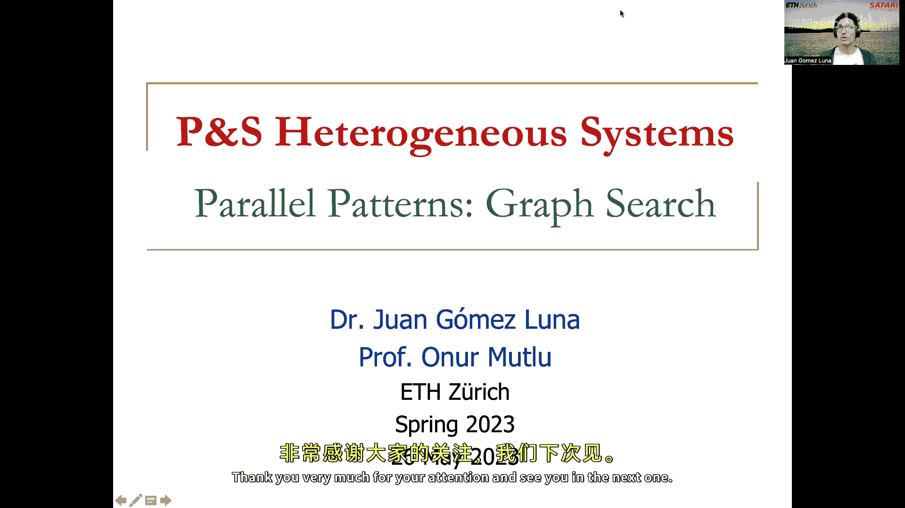

# 【异构系统编程：基于GPU和加速器 2023】苏黎世联邦理工—中英字幕 p12 p12 HetSys Course： Lecture 12： Parallel Patterns： Graph Search (Spr -BV1jXHZeuEwy_p12-

Hello everyone welcome to a new lecture for course on material union systems today we are going to introduce another parallel pattern graph search This is going to be one more after a few parallel patterns we started with reduction and operation that reduces a set of values to a single value and we discuss ways of implementing reduction with a divergence pre mapping in order to maximize R utilizationization Next we covered histogram computation it's a computation use for reducing the dimensionality and extracting the features of large data sets in histogram computation we have to compute a histogram that is composed by beam or counters that we increment every time we find a value in the input that corresponds to the value of the beam in histogram calculation we have to typically use atomic operations and because they cause a realizationization we discuss a way of all。

Because of deization that's the privatization today we are going to talk about privatization again in the context of graph search Next we talk about the convolution。

 which is an operation where we apply a filter or mask on each of the elements of an input in order to compute a weighted sum and that it's going to be the output convolutions are very much used today machine learning artificial intelligence for example as convolutional layers but they can also be implemented for 1D or 2D or 3D inputs in the case of 1D commonly used for audiopro as you can see in this example we are applying a mask M on each element of the input N in order to compute partial product then reduce them and stored in the output or。

The convolutional layers are typically reduced to matrix multiplication that requires unrolling the input feature maps as well as the combvolution filters。

 and this way we can perform a maximum implication that is very well optimized for GPUs using techniques such as these join。

 register and shared memory tiling that we introduce in another lecture。

The next pattern that we covered was a prefix sum and operation where we are computing the output recursively based on the previous outputs and that can be either computed in the exclusive or inclusive manner depending on whether we are including the input value corresponding to the same index we discussed a way of implementing scan in a perioderarchical manner with pair war scan。

 then per block scan， then these sum of partial sums that these scan or partial sums can be done typically in the whole or in another kernel and then the final a step that was the SSA version of the scan operation we also discussed the reduced scan scan version of this scan operation and in the last lecture we talk about the spars matrices we discussed different compression formats。

For example， these TSR which consists of an array of row pointers and each row pointer points to a column array where we store the column indices of the non-zero values and then we also have another array that is the value array that contains the actual values of the non-zero elements as spars mat are very important in today's lecture as well and we are going to use them in graph search because graphs are usually very sparse so we will need to use compression formats as well to store the information about the graph as we are going to see graphs are very much use in problems where we need to do dynamic data extraction because the data needs to be processed in multiple phases and in each phase the amount of computation might change this happens in graph algorithms that are used。

 for example， in many different field for example electronic design information optimization problems。

Eteta， and in this lecture， we are going to use B for search or BFS as an example。

Paralyzing dynamic data structure has important challenges because the data is not going to be so easily laid out for locality coalescing and contention avoidance and that's something that we will have to figure out how to do it and we are going to discuss some ways in this lecture and the other challenge is that the amount of parallelism。

 the amount of work grows any shrink in each phase of the computation。 if you think。

 for example about the graph from a social network there will be many different vertices and each of the vertices will have a number of neighbors or a number of friends in the social network and there are people who have very few friends。

 well there are many the other people who have a lot of friends So depending on that we are going to depending on which node or what vertex we are processing at a time we will have to exploit more or less parallelism。

As I said， graph and sparse matrix seeds are closely related because graphs are represented as an adjacency matrix and the way to compress this adjacency matrix is going to be using one sparse matrix format。

 for example， they compress the sparse row that we are using as an example here for these adjacency matrix same as in we have in the previous slide for CSR here we have an array of row pointers that contains the source vertices and then these array of row pointers points to the array of column indices and that are the destinations of each edge and finally the array of nonzero elements in this case。

 all elements are one because these is an unweighted graph so all edgeGs value the same。

Okay let's start with breath research the goal in breath research is to determine what's the minimum number of hops that is required to go from a source node to a destination node or all destination nodes for example if we have this graph and or source node these node zero as you can see there will be different distances or hops to each of the other vertices of the plot。

 for example， these two vertices are at distance one hop these five vertices are at distance two hop and these vertex8 is at distance three hops There are different approaches to parallellyzing graph processing in this computation that we have just seen for BFS one of them is the vertexcentric approach in the verexcentric approach we assign one thread to do something for each vertex so we are assigning one thread per vertex and we will typically use CSR or CST compression formats for the graph there reason。

That given a vertex with these format it' easy to find all its neighbors and that's what we need to do when we are computing BFS。

But there are two different ways of applying the vertexcentric approach One of them is called top down and the other one is bottom up there is a difference in the in both cases we assign one thread per vertex。

 but in the top down approach what we do is that we start with a single vertex which is a source and we create a frontier which are the next vertices to be visited the vertices the vertices to be visited in the next iteration of the algorithm for example for vertex zero。

 the first two neighbors are the two neighbors are vertices one and two so we will put these two in a queue and we will process them in the next iteration they will be in our input queue for the next iteration where we are going to discover the neighbors of these two This top down approach is the one that we are going to explain in more detail in this lecture in later slides for the bottom up approach the approach is different in this case we also have one thread per node。

But what each thread is going to do in each iteration。

 the thread is going to see if for the own node or vertex。

 any of the surrounding neighboring nodes or vertices has been visited in the previous iteration。

 if that's the case， this one is marked as belonging to the current iteration。

So those are the two approaches top down and bottom up as you can see there is more constant work in the bottom up approach because all threads are active in all iterations。

 at least in the beginning， while in the top down approach we will see how the amount of work grows or strings depending on the exact phase or exact iteration of the computation the other approach to paralyzing graph processing is edge centric in the edgecentric approach we assign one thread per edge and we do some calculations for that edge like finding what are the source and destination vertices。

 for example， they typically use the centric approach typically use COO compression format because giving an edge is easy to find what's the source and the destination verex and then there are also high grid approaches for example。

 giving an edge we need to find both neighbors so for each edge both the neighbors of the source vertices and the neighbors of the destination vertices。

And in this case， it will be good to use both CO and CSR or CSE。Okay so let's put the focus on BFS。

 the ver cent approach top down approach， we start with the source node in this case is node zero and we are going to identify and mark all nodes that can be reaching one2 three hopes those are the nodes that are going to be discovered in in each success iteration of the VFS algorithm so then the first iteration we find vertices one and two and we put them in the output queue and they are going to be used for the input queue as the input queue for the next iteration and the second frontier we find the neighbors of one and two in this case our nodes three to seven we in queue them in the output queue and then we go to the next iteration and the last frontier is going to be only node8 so that will be the final outcome the final solution for breakfast search with node zero as a source we could also have other nodes of the source for example node。

Two in this case the frontiers are going to be different but in the end after several iteration we will reach to all nodes in the graph now when it comes to processing a frontier we have to visit the source array the destination array and finally an array of labels where we are going to mark what's the iteration of what's a phase of the algorithm where one specific node was discovered so imagine that we have two nodes in the frontier in the current input frontier these nodes zero and a first of all is going into the source array where we find what's the pointer that corresponds to each of the two node in the frontier in this case for node zero we know that we'll have to go until element two in the array of destinations while for node eight this one doesn't have any node because。

AnyNeighing notes because this is a directed graph so there are no neighbors of note8 in the destination array or those neighbors could be around here。

 but they don't really exist so for node zero we visit nodes one and two and we are going to put them in the corresponding output queue and we can mark them as visited in this iteration in this case one of them was node node two that was the source so that one was at zero hops from the source which is the same one while node one is at distance three or three hops。

We can parallelize these naively， let's say with a complexity of O V plus E being B and E the number of edgeGs and the number of veres and the number of edges and assuming that we have three nodes in the front T 567 one thing that we can do is assigning different threads to different nodes in the queue the queue them in parallel and now we check with our neighbors observed that node5 doesn't have any neighbors node6 has one neighbor which is node8 and node 7 has one neighbor which is node zero so these two need to in Q the neighbors in the output queue but in order to do so and in order to avoid a conflict we will have to or a data race we will have to use anatomic operation update one global counter this will give us an index where both threads need to write the corresponding element and if they do that the result will be correct or the output that。

In queue in process will be correct but because we are using atomic operations。

 we have serialization and this really heartstep performance we have already seen how to deal with atomic operations and one way is called privatization we already explain it in the hisogram the lecture about histogram calculation here we are going to use it in a different way instead of having a single queue for a single output queue or all threads running on the GPU and processing one in specific iteration of the graph algorithm what we are going to have is local cues these local cus as you will see are going to be in the shared memory and every time that threads in one thread block find new neighbors and need to include in queue in the frontier these notes they will do it in the private queue and at some point they will find when the private queue is when the computer the dateeration has finished or when the private queue。

Its complete， we will have to find what's the location to write in the global queue by basically updating a global counter that is accessible by all threat blocks。

 we could also do a scan operation here if we know the exact number of elements。

 the exact number of node that each of the local queuees have。

So that's the way of building the next frontier hierarchically we first create a local queue。

 we then create the global queue and this is what we call the twolel hierarchy with the block queue that is typically residing in shared memory and the global queue that resides in global memory and where we will normally insert the elements or the notes in the block queue only when the block is complete when the computation of each block finishes still we will have collision in the BQs it won't be so harmful as the collision in the global queue because now we are using privatization and because shared memory is faster but still there might be heavy convention in some cases still we could also add additional levels to this hierarchy we could have warp queuees。

 for example， or even thread level cues that will always depend on the amount of memory that you have。

Among of registers that you have， cheap memory in general and a specific complexity of the algorithm and the graph。

We are going to launch so by default we will launch multiple iterations and for each iteration we will launch a new kernel so we need to create that global barrier to do so and the way of creating a global barrier as you know is to terminate one kernel and then the next kernel call for the next iteration of the algorithm we terminate a kernel a new kernel call etc these kernel terminational relaunch might have too much overhead so there are some solutions that have been proposed like for example using a hereerarchical a multilayer kernel arrangement where we have different types of kernels depending on the specific characteristics of the frontier as we are going to see basically depending on the size of the frontier but there are other solutions such as dynamic parallel system that we are not going to talk about today。

 but we will cover in a later lecture and persistent threats with global barriers that we are going to briefly。

Mention at the end of this lecture so in the hierarchical kernel arrangement we are going to have different kernels based on the size of the frontier we for example。

 can have one kernel that uses intrab synchronization only for very small frontiers we don't need to use all GPU cores or many GPU cores we can just use one GPU core and one thread block and these red block can use syn threads for the threads to synchronize but at some point we will have larger frontiers remember that here the amount of parallelm is very dynamic so we will have a larger frontier and we will need to。

Launch a bigger kernel that we will have to finish when the frontier。

 the auto frontier is complete and relaunch a new kernel。

 So those are basically the two approaches in this arrangement in the first one as I said the small sized frontiers we just have a single thread block when these thread blocks create the block queue they synchronize using syncch thread and then we can go to the next level and then again new queue this propagates through multiple levels and it will be pretty fast because we are only using accesses to shared memory accesses to the global memory and because in the end the atomic operations in shared memory are also faster and we need to use them to in queue in these Bq but at some point well have to use the current termination relaunch to implement the global synchronization for big sized frontiers in many cases these current launch over。

head will be acceptable if there is more or less significant amount of computation inside the kernel。

 but if it's something as simple as VFS where we are just checking some values from simply accessing memory and maybe updating some labels eventually we may not have so much computation and these kernel launch overhead might be still significant overhead with dynamic parallelism as we will discuss in the corresponding lecture。

 there will be there might also be overhead， but at least we won't have to terminate the kernel we can launch new kernels for the children or for the neighbors of each existing node。

And the last solution is to use persistent threads and interblock synchronization In this case it's like combining kernel1 and kernelnel2。

 we are going to avoid the kernel relaunch by doing global synchronization that we are not cover it indeed in this lecture but you can you can learn about it in the longer version of this lecture that I will share in one of the final slides basically the idea here for persistent thread blocks is that instead of using as many thread blocks as we need to cover the entire input frontier in this case we are talking about M thread blocks we are going to launch only as many thread blocks that can run concurrently on the existing GPU cores。

 for example in these two GPU core Sm0 and SN1 they can only fit one block or two blocks at a time so only four thread blocks so what these four thread blocks are going to do is processing the frontier and then when。

done with the first channel they go to the next gen that is available or to process in the frontierer how block zero first starts here when it's done with this part of different tier goes to this part of the frontierer and so on good thing is that now we need to synchronize by termating in the kernel because the four thread blocksy this example are active at the same time so they can synchronize using atomic operations to global memory in the longer lecture as I said。

 we explain a way of doing this global synchronization this is just one way of doing so there might be other different ways but with similar period there is also minor back in this code there is a thread lens that is needed here but it's removed for simplicity but if you're going to use it please keep that in mind and if you want to learn more about graph search graph traersal or graph。

Processing in general， you can check chapter 15 of the book programming massive parallel processors that's all for today I hope that you found the lecture interesting thank you very much for your attention and see you in the next one。

