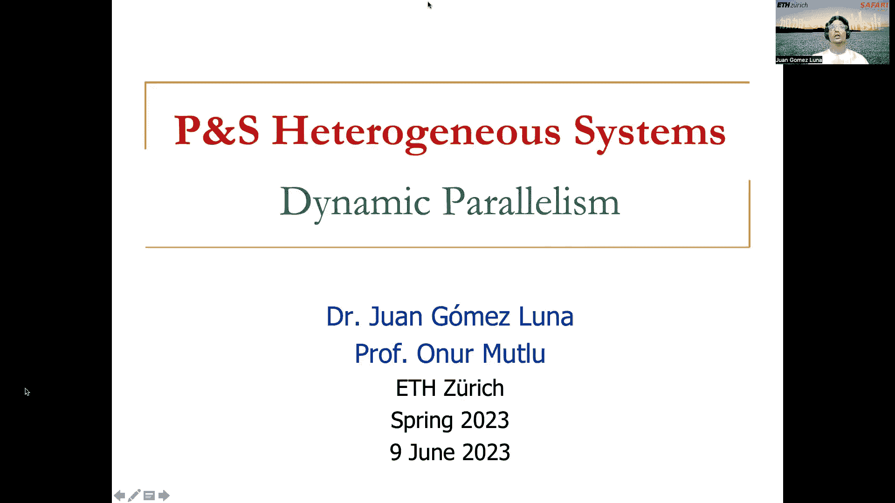

# 【异构系统编程：基于GPU和加速器 2023】苏黎世联邦理工—中英字幕 p13 p14 HetSys Course： Lecture 14： Dynamic Parallelism (Spring 2023) -BV1jXHZeuEwy_p13-

Hello everyone， welcome to an new lecture for Co on Inter Union System today after having covered several parallel patterns in previous lectures。

 we are going to discuss an interesting feature of GPU programming frameworks， dynamicy parallelism。

So dynamic parallelism provides an interface to express dynamic refinement algorithms in a more natural way and these dynamic parallelism interface allows GPU threads to launch GPU kernels when new work is dynamically discovered you might remember the example of PFS that we covered in one of the parallel patterns lectures where each node in the frontier has a different number of neighbors and due to that we will need different number of iterations for each of the nodes in the frontiers。

We found or we explained different ways of dealing with these irregularity in the parallelization。

 but these could also be solved probably in programming in an easier way by using dynamic parallelism。

 however， as we will see， it has also some performance implications that we have to take into account。

Dynamic parallelism as I mentioned are allows GPU threads to launch kernels from within GPU threads that's what we call device side kernels kernel launches and it appeared with the Ke architecture until then it was only possible to launch kernels from the host processor since then it's also possible to launch kernels from the GPU itself and typical use cases for the dynamic parallelism interface are workloads with dynamic load balancing or workloads that have datadepend execution or those that require recurion for the implementation and they are also useful for library calls but the biggest advantage is that dynamic parallelism is good for programmability and maintainability remember how we launch a kernel or we launch kernels without dynamic parallelism we always need to involve the host processor to perform the kernel launches and this is relatively painful to program。

With dynamic parallelism， it's possible to launch neo kernelnals pro within the GPU as soon as some new work is discovered。

 so we would only need to launch one kernel in the beginning from the house and then after that the threats running in the device will be able to launch their child kernels to deal with the dynamically discovered work and parallellyze the execution of that work。

One important consideration when launching child kernels from a parent kernel is the synchronization and the need for memory consistency。

 there are two things to take into account here， the first one is that from the parent to the child memory consistency is guaranteed and that means that when the child kernel starts running all data that needs to be written to the global memory from the parent kernel will be already in global memory that's guaranteed however in the opposite direction from the child to the parent。

 we will need to use coa device synchronized in order to make sure that after that point the kernel will continue the execution once the child kernels have finished。

In order to see how to use gooddynamic parallelism， let's start with a simple example first of all。

 some kernel code， this is a synthetic kernel that needs to do certain amount of war per thread in these for loop that we see here from line seven to9 and and this is basically an implementational without dynamic parallelism as long as these start and end are the same for all threads。

 the number of iterations will be the same so the total amount of war performed by each thread will be the same so in this case there are no issues with load balancing however it might turn out that these start and end values are different for each thread and in that case we will have different number of iterations for each thread and that causes load imbalance and the end hampers the performance with dynamic parallelism in this case what we would do is launching a child kernel per parent thread and the number of threads in this child kernel。

Is going to be the same as the number of iterations in the for loop of the previous slide。

 and this would be the child kernel performing the same computation that was previously done in the for loop in this case。

 the number of iterations per GPU threat of the parent kernel is the same。

 but now these iterations have been assigned to child threats and even though we may have different amount of war per parent thread in the end。

 the amount of war per per child threat will be the same And this way we obtain a better load balance across coa threads。

As we mentioned earlier， dynamic parallelism is also useful to implement recursive programs and today we are going to see one example the quad tree quad3 is a useful technique to partition the data in a non-uniform phase and in order to cluster coins in a way that they are later more better place for coalescing and for further computation so in these quad3 we are going to partition at2D phase by recursively dividing it into four quadrants until the number of atoms or these points that you can see in the slide in each quadrant is less than a threshold we are going to consider that the threshold is equal2 this is a recursive example we are going to create a quad3 to cluster all these points in the corresponding quadrants in the beginning in depth zero of the three what we have is the entire2D phase with all。

Atoms with all the points When we go to the next level to the next steps。

 we would have already partitioned the entire 2D phase into four quadrants and in this case we have already clustered some of the atoms some of these quadrants like these two here will not proceed further in the partitioning because as you can see the number of atoms is two which is exactly the same as our threshold in depth two will continue doing the same for those two quadrants that had more than two atoms and we partition them further and finally in depth three it's only these little quadrant here that is still being processed because it originally had more than two atoms how to implement these on a GPU the first thing that we are going to do is launching one simple well not that simple indeed。

 but it's simple in the sense that it only has one thread block that is。Launch from the host。

 and we assign the entire toD space to that threat block。

 Then what the threads in this thread block are going to do is to identify what are the points that are in the different quadrants in order to do the further partitioning。

 So after assigning the block to a note and this note is the root note in depth0 that encompasses the entire the entire2D space。

 First thing to check is the threshold。 And also if we have reached the maximum depth of our algorithm or not。

 And next， in this case， we continue the execution here。 we compute the center of the bonding box。

 The bonding box is a box that contains all the points and the center of that bonding box is going to be the point that tells us where to partition where the four quadrants are going to be。

 And based on that find whats the number of points in each quadrant because those points are going to be later process by the children of。

Tread block that is running the algorithm Now that we know the number of points in each quadrant。

 number of points for each children， we can perform a scan operation in order to find the offsets where the different points in each quadrant need to be written in the output array Nx we are going to place them in the right place reorder the points so we have two buffers one is the input buffer where we have all the points in the original positions and then we have an output buffer that will have the order points and in these output buffer we will have precise limits for the points that are contained in each quadrant so this is this is the top left quadrant this is the top right quadrant。

 this is the bottom left quadrant and this is the bottom right quadrant。In the next level。

 in depth one， the threat block zero has launched the children and now each of the four children repeats exactly the same algorithm for the specific quadrant that they have two of them will retire early these block 00 and block 01 that have been or actually is block 00 and block 02 that have been assigned these two quadrants with only two points because remember the threshold is two。

 the other two，0，1 and 03 will proceed further and they will launch their own children to process the soup quadrants of their quadrant and in the end we will have one single threat block of these that is launching its own children。

 its own children threat blocks to go over these small quadrants here and that will give。

as the exact output with the different atoms in the 2D space cluster according to the specific quadrants they belong to so in summary the execution starts with the host launching one threat block and at each recursion if the number of atoms in the quadrant is less than or equal to the threshold the threat block exits if not in each recursion。

 the threads in each thread block that do not exit first determining what's the number of atoms that belong to each quadrant。

 they need to find the center of the bonding box remember that to identify the points in each quadrant and then the performance can to determine the starting point of each quadrant in the output buffer next they reorder the atoms so that all atoms in the same quadrant are placed consecutively in the output that buffer and finally one representative thread threat zero of the threat block will launch a kernel with four child blocks。

This is how we would implement the qua reconstruction using dynamic parallelism and these can also be applied to other data structures。

 for example of trees that could be for 3D states， but there are some performance limitations even though dynamic parallel ensures better workbalance and offers advantages for sure in terms of programmability and maintainability as we mentioned。

 however there are certain challenges that we may face when implementing or codes with dynamic parallelism because if we launch grids with a very small number of threats that these might lead to underinization of the GPU resources so the general recommendation is to launch child grids with a large number of threat blocks as many as we can in order to occupy as many of the GP GPU resources GPU course as possible。

 or at least if the child grids don't have many，T blocks at least make sure that these thread blocks have hundreds of threads if the number of blocks is as small。

Regarding parallelism that we can implement with dynamic parallelism with recursion。

 the one limitation here is that the maximum nesting depth is limited by the hardware so only relatively shallow trees can be implemented efficiently and then for each of the node of the tree and the recursion it will be preferable to use thick tree nodes those are node that deploy many threads or at least that the branch degree is large so that each parent node has many children so these two are in line with the general recommendation that we have in this slide。

So one optimization for dynamic parallelism， there are different optimizations that we can apply。

 we are going to very briefly introduce one optimization that allows us to reduce the kernel launch overhead and increase the utilization of GPU resources because we are going to make sure that we will have wider childca larger childcaness with more threat blocks and with more threats in total to make better use of the GPU resources and also remove part of the lounge overhead because every single kernel launch entails a certain amount of overhead that is in the critical path if we are indeed this optimization consists of which is aggregating different kernel launches in a single one so that we don't have so many kernel launches。

 we will be able to see some performance improvement for sure so observe that in the original kernel we will have。

Different threads or many threats launching their own child kernels。

 we can apply different aggregation techniques， for example。

 that warp kernelularity or block kernelnularity or even kernelnal granularity in order to reduce the number of threats that are launching。

 for example in the warp kernelularity is yes one kernel launch per warp and this is something that we can easily achieve by communicating between threats of the same warp each of these are is first going to decide how many child threat blocks need how many threats per threat block and these information is passed to a single leader thread of the warp that will launch a larger kernel with as many child threat blocks that are as are needed by other threats in the warp and we can do that at the warp kernelularity or block kernelularity or maybe simply have a single kernel launch。

From the house processor。 But if you want to learn all the details about this technique。

 please take a look at this paper that you can find here or also watch the longer version of this lecture。

 You can also find many more about goodta dynamic parallelism in Cha 21 of the programming massive processors book。

 This is offered today。 Thank you very much for your attention。

