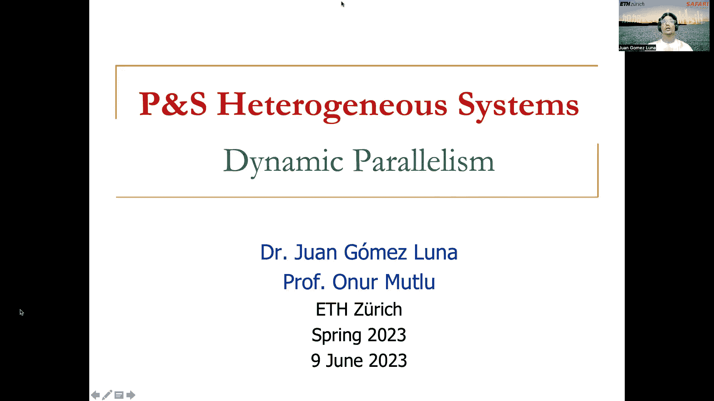

# 异构系统编程：14：动态并行性


## 概述

在本节课中，我们将学习GPU编程框架中的一个有趣特性：动态并行性。动态并行性提供了一种接口，能以更自然的方式表达动态细化算法。它允许GPU线程在动态发现新工作时启动新的GPU内核。

## 动态并行性简介

在之前的课程中，我们介绍了多种并行模式。本节中，我们将讨论动态并行性。动态并行性允许GPU线程从设备端启动内核，这被称为设备端内核启动。该特性随Kepler架构出现，在此之前，只能从主机处理器启动内核。

动态并行性的典型用例包括：具有动态负载均衡的工作负载、具有数据依赖执行的工作负载，以及需要递归实现的工作负载。它对于库调用也很有用。动态并行性的最大优势在于提高了程序的可编程性和可维护性。

回想一下，在没有动态并行性的情况下启动内核，总是需要主机处理器的参与来执行内核启动，这在编程上相对繁琐。使用动态并行性，一旦在GPU内部发现新工作，就可以直接启动新的内核。这样，我们只需从主机启动一个初始内核，之后，设备中运行的线程将能够启动其子内核来处理动态发现的工作并并行执行。

## 同步与内存一致性

从父内核启动子内核时，一个重要的考虑因素是同步和内存一致性的需求。这里需要注意两点：

1.  从父内核到子内核的内存一致性是有保证的。这意味着当子内核开始运行时，父内核需要写入全局内存的所有数据都已就绪。
2.  从子内核到父内核的方向，我们需要使用 `cudaDeviceSynchronize` 来确保在子内核完成后，父内核才会继续执行。

## 一个简单示例

为了了解如何使用动态并行性，让我们从一个简单的示例开始。首先看一段没有使用动态并行性的内核代码：

```cuda
__global__ void kernelWithoutDP(int start, int end) {
    for (int i = start + threadIdx.x; i < end; i += blockDim.x) {
        // 执行某些工作
    }
}
```

只要所有线程的 `start` 和 `end` 值相同，每个线程的迭代次数就相同，负载是均衡的。然而，如果每个线程的 `start` 和 `end` 值不同，就会导致负载不均衡，影响性能。

使用动态并行性，我们可以为每个父线程启动一个子内核。子内核中的线程数等于父线程中for循环的迭代次数。这样，即使每个父线程的工作量不同，每个子线程的工作量却是相同的，从而实现了更好的负载均衡。

```cuda
__global__ void parentKernel() {
    int my_start = ...; // 每个线程自己的起始值
    int my_end = ...;   // 每个线程自己的结束值
    int iterations = my_end - my_start;

    // 启动子内核，线程数等于迭代次数
    childKernel<<<1, iterations>>>(my_start);
}

__global__ void childKernel(int start) {
    int i = start + threadIdx.x;
    // 执行原本在for循环中的工作
}
```

## 递归应用：四叉树构建

动态并行性对于实现递归程序也很有用。本节我们来看一个四叉树的例子。四叉树是一种用于在非均匀平面中划分数据的技术，目的是将点聚类，以便后续更好地进行合并访问和计算。

在四叉树中，我们通过递归地将一个2D平面划分为四个象限来分割它，直到每个象限中的点数少于一个阈值（假设阈值为2）。这是一个递归过程。

以下是如何在GPU上实现它的步骤：

1.  主机启动一个仅包含一个线程块的内核，并将整个2D空间分配给该线程块。
2.  该线程块中的线程首先检查当前节点（象限）中的点数是否小于等于阈值，或者是否已达到最大递归深度。如果是，则线程块退出。
3.  否则，线程计算包含所有点的包围盒的中心点，该中心点定义了四个象限的分界。
4.  接着，确定每个象限中的点数。
5.  执行扫描操作，以确定每个象限的点在输出数组中的起始偏移量。
6.  根据计算出的偏移量，将输入缓冲区中的点重新排序到输出缓冲区中，使得属于同一象限的点连续存放。
7.  最后，由线程块中的一个代表线程（例如线程0）启动一个包含四个子线程块的新内核，每个子线程块处理一个象限。

这个过程会递归进行，直到所有象限都满足退出条件。通过动态并行性，每个递归层级的线程块都可以自主启动处理其子象限的新内核。

## 性能考量与优化

尽管动态并行性可以带来更好的负载均衡，并在可编程性和可维护性方面具有优势，但在实现时也面临一些性能挑战。

主要挑战包括：
*   如果启动的网格包含的线程数量很少，可能导致GPU资源利用不足。一般建议是，子网格应包含尽可能多的线程块，以充分利用GPU资源。
*   对于递归实现的并行性，最大嵌套深度受硬件限制，因此只能高效实现相对浅的树结构。此外，建议使用“粗粒度”的树节点，即每个节点部署大量线程，或者分支因子较大（每个父节点有许多子节点），这与本页的一般建议是一致的。

为了优化动态并行性，减少内核启动开销并提高GPU资源利用率，可以采用**内核启动聚合**技术。

其核心思想是将多个小的内核启动合并为单个更大的内核启动。例如：
*   **Warp级聚合**：每个Warp只启动一个内核，由Warp内的线程通信，将各自需要的工作量汇总，然后由一个领导线程启动一个包含足够多线程块的大内核。
*   **Block级聚合**：类似地，在线程块级别进行聚合。
*   **内核级聚合**：甚至可以从主机端直接启动一个大的内核。

这种方法可以减少内核启动的总次数，从而降低开销，并有可能生成更高效、能更好利用GPU资源的工作负载。

## 总结

本节课我们一起学习了GPU编程中的动态并行性。我们了解了它的基本概念、如何用于改进负载均衡和实现递归算法（如四叉树构建）。同时，我们也讨论了使用动态并行性时需要注意的性能挑战，并简要介绍了一种通过聚合内核启动来优化性能的技术。动态并行性是一个强大的工具，能够简化某些复杂并行模式的编程，但在使用时需仔细考虑其对性能的影响。



