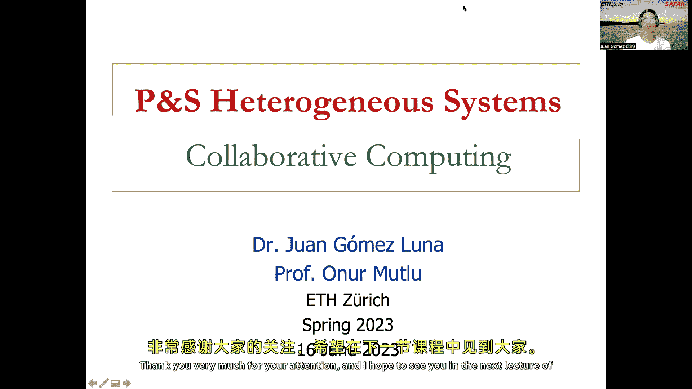

# 【异构系统编程：基于GPU和加速器 2023】苏黎世联邦理工—中英字幕 p14 p15 HetSys Course： Lecture 15： Collaborative Computing (Spring 2023 -BV1jXHZeuEwy_p14-

Hello everyone， welcome to a new lecture for course on E systems today we are also going to cover an important and interesting topic for E system。

 which is collaborative computing or fine collaborative or E use execution with systems with different devices we are going to focus today on CPU and GPU buttting the longer version of this lecture。

 you can also see some examples of how to do collaborative computings in system with CPUs and FDAs One necessary feature that was recently provided by GPU programming frameworks necessary feature for collaborative computing is unified memory。

 basically memory a virtual memory system that can be seen at the same time by both or different types of devices or in particular in this lecture we are going to focus on CPU and GPU in the past or in the beginning of the GPU computing here it wasn't possible to have these。

Unified view of memory in the traditional approach。

 we had to do double memory allocation in the host processor and in the device GPU typically and also use CPU GPU or GPU CPUU data transfers in order to move data from one device to another device this is a mobile that naturally match assistance with discrete GPUs and you can see here some sample code you will be familiar with all these different APIs Ka Malog or KamM copy and then also for the output malllo on the host processor kuda Malog on the device processor launch the GPU kernel and then at some point synchronize and bring the data back using mem copy operations or coamin copy operations with the unified view or with the unified memory is possible to have a unified view a unified virtual addresses space where the same addresses space is shared across the host。

and the device these already started in KudDa6， a unified memory in the Keplular architecture。

 but back then was basically a layer that was hiding the double memory allocation and explicit data transfers of kuda and copies that we had to use after QudDai and the vs architecture。

 the GPU can support or GPU supports page wallss and this means that the GPU memory can be oversubscribed and GPU can go to the CPU memory to bring data and keep and continue executing and the only limit is the system memory size。

And not only that， not only the possibility of oversubcribing memory but also easier programming with unified memory because now it's no longer necessary to do double allocation。

 double memory allocation with Malo in the house and Kuda Malo on the device now we can simply use kuda Malog manage a new API that simply allocates an array in the unified memory space and these way it can be access at the same time and with no explicit data transfers from the different devices from the CPU and the GPU there's no need for double allocation。

 or explicit data data transfers and these naturally matches physically integrated systems with CPUUs and GPUs in the same chip that have access to the same physical memory but it can also be implemented for discrete GPUs and these is supported in all recent versions of kuda now how to make use of these new features or relative。

New features to implement collaborative applications we are going to discuss a few use cases。

 a few case studies using CPUUs and GPUs in this lecture you will find more in the longer version of this lecture but yeah in the end the re execution where the collaborative computing applications have always been possible assistance with CPUs and GPUs basically due to the fact that the kernel lounge from the host site is as synchronous so what that means is that the CPUU gets free after it launches the kernel on the GPU so it can continue doing things it can continue computing and at some point using a coUa device synchronize to to check whether the execution of the GPU kernels has finished and then copy data so this was already possible before the existence of the unified。

Memory， but now with the unified memory is much easier as we will see and also it enables more fine grain collaboration。

And this is especially possible after the Pascal architecture that now supports the unified memory with CPU and GPU memory coherence and system wide atomic operations so we could write code like these using code manage allocate the input on the output launch the kernel and right after that the CPUU can continue computing but actually can even access data that is being used or being accessed at the same time by the GPU for example。

 these two lines here that you can see even using atomic operations on data that might be also being accessed by the GPU but with atomic operations we would prevent data races from CPU threads and GP threads accessing the same data on the GPU side the system wide atomics look like these it's the same semantics of the system。

ああ。The same syntax as the atomic operations used to be， for example， atomic app。

 but with these underscore system to identify the business system by atomic operation。

 so it might also affect to data that resides or is physically reiding on the CPU memory。

So now we are a little bit more familiar with these unified memory and the possibilities of using it for fine grain collaboration and we are going to present briefly some collaborative patterns and also some examples of these let's start with the definition of what would be the information program structure where we have some tasks that can be divided into sequential subtts and we will typically have many of these tasks。

 many data parallel tasks。At some point， if we have a processor computing these data parallel tasks。

 we might need a course re synchronization before continuing the execution if we were executing this program on a GPU。

 the first bunch of data parallel tasks would be would represent a GPU kernel and the course re synchronization。

 the current termination before the second kernel starts if we have a system with CPUUs and GPUs that can collaborate in a fine grain manner。

 we can implement different data different partitioning the schemes。

 how to distribute these different tasks over the different devices that we have in the system。

 for example， device one could be a CPUU device to a GPU and it turns out that some devices better for some tasks than other device we might。

We will likely see that these tests are shorter， take shorter to execute on one device than the other device。

 but the other device at the same time might have more parallelism。

And for other sequential tasks might be different at some。

 we might also need to synchronize and then we will compute the execution of the second kernel but observe that we are basically partitioning the data parallel tasks over the two device。

 the CPU and the GPU we can also do task partitioning in this case we are going to have one device doing some tasks and another device doing other tasks and we can talk about course green task partitioning in this case we are basically partitioning the kernels and one entire kernel is going to run on one device on the GPU for example and after the corresponding green synchronization the other kernel the other part of the program will be run on the other device these corresponding green task partitioning scheme also enables or allows concurrent execution because we could have a pipeline and while the device two is computing these tasks we can have device one computing tasks that correspond to the。

Previous chunk of tasks that were computed by the device too。

The unified memory and the system wideattomic operations also enable us to implement fine grain task partitioning in this case because we know that some data suit tasks are run faster on one device than the other device we could use fine grain communication from device one to device two for example。

 to signal threads in device to wing some specific soup tasks。

 these yellow suit tasks are completed on the device one and in and at that point threads in device to get notified and can continue the execution of the second part of the task or these dark green suit tasks and yeah this could be the same also after the co grain synchronization if that's really needed in our program and we continue with the fine grain task partitioning in the next kernel we can continue because we could also apply different partitioning strategies for different kernels in the same program now let's see some examples for example。

For data partitioning， we are going to use this surface as an example。

 this is an application an algorithm that generates a surface in a three dimensional space。

 for example， by using a net of control points in this toy representation that you see here we are using a four by four net of control points to generate these light blue surface that we can see and we can do this with a parametricic and rational formulation based on burst polynomials with this expressions using this expressions we can compute the X Y and z in a 3D space of the points of the surface and observe that here in this picture we have partition these surface into tiles and different tiles have been assigned to different processor the CPU or the GPU in particular we are doing here a static distribution we can profile or devices CPU and GPU in advance and know how fast they can run or they can compute。

these tiles and based on that dual a static partitioning and then we could even implement these use without unified memory we would simply launch CPU threads and a GPU kernel and at some point they will synchronize because the execution of the kernel and GPU is as synchronous that CPU threads can continue running on the CPU course and so on and at some point and at the end we would copy the part of the surface that has been compute generated on the GPU we would move it to the main memory of the CPU and these approaches indeed good in terms of performance and in one Nvidia jettson we test that this experiments and via jettson has four CPU cores and two GPU cores and we could observe up to 17% speed up over the GPU onlyversion when we assign 20% of the tiles to the CPU but with unified memory this can be implemented。

That much more easily first of all， because we don't need to do double the allocation of the surface。

 for example， with Code Ma managedage we can have just a single surface and then again we can launch the CPU threads and GPU kernel but because we are using unified memory we don't even need to copy the part of the or the part of the tiles computed by the GPU to the CPU memory this would be done implicitly and with the unified memory more recent version of the unified memory that supports Cs and whiteomicomic operations we could even do a dynamic distribution of the tiles that would say the need for doing some offline profiling of the application to know what's the best percentage for each specific application and even for applications that are data dependent or more ir regularular or might have more loading balance we could be even more efficient so in these dynamic distribution。

We need to have some global variable that is a counter of tiles that basically tells to every thread block in the GPU or threads on the CPU threads on the host site what's the next tile to compute and that these atomic variable will be updated with an atomic ad system obviously if one thread of the thread block is using the atomic a system after that we need some synchronization for the other threads to see these my pile that in this specific example resides in shared memory so it can be access by all threads of the thread block after the sync thread and after that we will have the kernel body eventually when we have consumed all the tiles we break this loop and the execution finishes by using these type of collaboration we could observe on an AD ca up to 40% improvement over the GP。

Only version when using the GPU1 for CPU force。Data partitioning is just one type of partitioning we can also do co partitioning and one good example is breath research which is an algorithm that we have covered in this course remember that we discuss two different kernels kernel one on kernel2 one for small size frontiers and the other one for big size frontiers and we even mentioned briefly the interb synchronization。

 atomic based interblock synchronization to avoid kernel launch that you can watch in the long version of the BFS lecture but it's still for the small size frontiers they underutilized GPU resources even though we explain kernel1 by just launching a single threat block that doesn't really make a lot of sense if you have many GPU course in your system in these kind of cases when we really have a small size frontiers at some point in the exhibition of the breath algorithm it might make sense to have a collaborative implementation for example。

On Nviia jettum， we observed that the small size frontiers because the underutilized GPU resources run faster on the CPU。

 this corresponds to the red bars that you can see here in the beginning of the execution this would be the initial iterations and also the final iterations of the algorithm and this is very much related with the size of the frontier as you can see so with a collaborative implementation。

 we can simply choose the most appropriate device and at some in switch to the other device。

 for example large frontiers process on the GPU when we've suddenly defined short frontier。

 the execution would go back to the CPUU and this can be implemented as well without unified memory but we need to do explicit memory copies we would have a while loop for the entire execution while the frontier size is not zero that means that there is still notes to be in the BFS algorithm。

The frontier size is less than a certain threshold we launch CPU threads。

 if not we launch GPU threads， of course we need to the corresponding copies from the host device and back。

With unified memory easier programming because we don't need explicit memory copies。

 we simply launch the CPUU kernel CPU threads when we need them or we launch the GPU kernel when we need it。

 but with the most advanced version of the unified memory supporting system wide atomic operations we are able to simply launch CPU threads and GPU kernels at the beginning of the exhibition and then just keep them running and computing the frontier computing the specific iteration depending on what's the frontier size。

 in fact we wouldn't even need to have these Y loopbe in the host code because these Y loop can be directly inside the code of the CPU threads or the GPU kernel because they are running all the time persistently and communicating synchronizing using system wideatomic operations and it's even possible to have both CPU threads and GPU threads working on。

Sa frontier so by using this sort of approach， we could see some interesting speedups up to 34 39% faster than the GPU only version for certain graphs。

 of course， when the graphs tend to be much larger this means that their frontiers are going to be very very large so most of the time we're going to be using the GPU or the GPU only so。

But for graphs that may have， let's say， more balanced volunteer sizes。

 this is definitely a good solution。Finding grade task partitioning is the last example of partitioning of task partitioning that we can do here we use as an example。

 the Rasack algorithm， it's an algorithm pretty useful one to find models that adapt to certain observations and and this can be used in many different domains for example in object detection and in the Rasack algorithm we basically do multiple iterations until we find what's the best model there is a fitting stage fitting stage phase which is when we compute the model and this is an inherenterly sequential computation and then there is an evaluation stage where we take all the observations and compare them to the corresponding results generated by the model and we see if they are good or bad。

 we compare model based on what's the rank， the score that。

We compare it to the best model and decide we replace the current model or not as you see there are C and CDfaces here。

 so one thing that we could do is because here the iteration are based so the generation of the model is based on obtaining some random samples so iterations are independent so we can paralyze all iterations and compute them in CPU threads and GPU blocks and have them communicating in a fine grain manner using a operations so this is summary slide of the collaborative patterns that I have just explained and provided a few examples as I said you will find more examples in the longer version of this lecture and you can find all these examples and in fact all these codes in the chi benchmark suite which has discrete and unified versions say for unified memory and preunified memory coa openCL and and even for GPU simulators。

You can find a link to the website and the repository and here this is the slide about the longer version of this lecture at the bottom of the slide you can access the recording。

And let me remind you that all the contents of this course are publicly available in the website and also in the GT playlist this slide corresponds to discourse。

 the E union systems course but is' not the only projects and seminars course that we delivering the Safari research group we also have an interesting one about processing in memory systems is tightly related with the systems because systems with processing memory capabilities are also E union systems but we have many more about SSDs memory bioinformatics etc and all the materials are available in our website and also in our GT channel that you can access from the link at the bottom of this slide this is offered today thank you very much for your attention and I hope to see you in the next lecture of this course。

