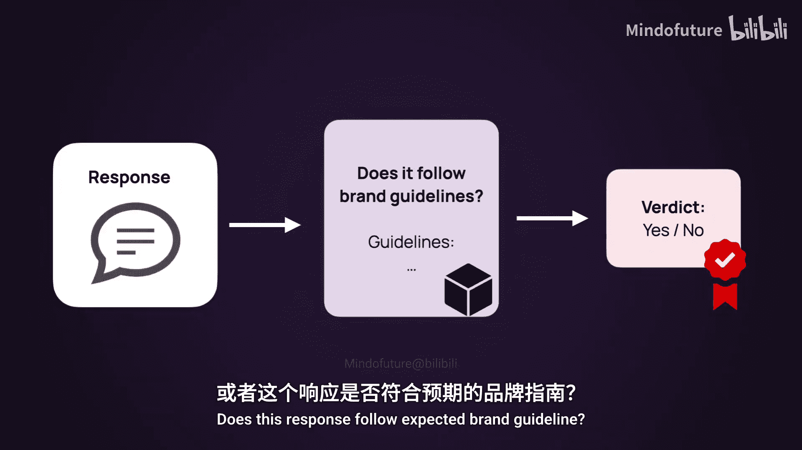
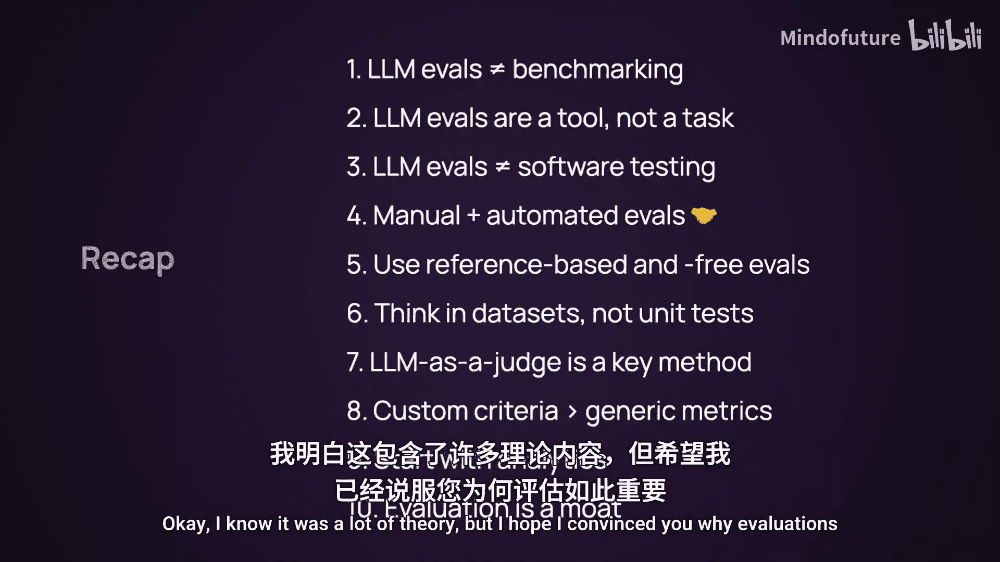

# 【Evidently Ai】面向构建者的Llm评估 ｜ Llm Evaluation For Builders p01 P01_1._大语言模型评估十大核心概念介绍 -BV11ABiB6EZQ_p1-

Hi and welcome to the course on LLM relations In this video we're going to talk about what LLM relations are and when you need them in 10 key ideas。

This will be the one theoretical we do in this course， everything else will be hands on。Now。

LM relations is the process of assessing whether your AI system works well。

Which brings us to the first point。Vating LLM systems is not the same as e evaluatingolating LLM models。

 which is usually done through benchmarks， but these public benchmarks help you figure out for example which model is better in coding and mathematics。

 but they al school exams they test general skills and if you are building a specifically application like a chatbot or even a simple prompt chain you need to test it on the task that it is meant to solve and it will consist not just from the model but the prompts。

 the application logic and everything else that you add on top of it So if you are building a rock system don't search for a rock benchmark build your own that's what we're going to talk about in the course。

One more thing to be clear， evaluation is not some standalone activity like doing EVs。

 it is a tool that helps you answer questions and make decisions about your product and depending where you are in your product life cycle it can fit into different workflows。

If you are just building your product， it is often about experiments。

 maybe you're comparing different models or different problems or you are trying to fix a particular error mode that you observed。

Evis help you objectively decide， for example， which prompt is better prompt A or prompt B。

You can also run stress testing or red teaming where you send tricky or adversarial inputs to your system to see if you can provoke it to do something unsafe for example。

 what if you ask your chatbot to do something inappropriate， will it comply or not。

Once the system isnt production， it is all about monitoring you want to make sure that your users are getting good experience like are they getting stuck are their hallucinations Thus the chatbot deny to respond any questions that it should not so you need continuous online evaluations and finally there is regression testing if you change something like fix a prompt try to fix a bug before you roll out these changes you need to make sure that they don't break anything else so you need regression testing In each of these cases evaluations will look slightly differently and they will evolve with your product or just like your product itself。

If you are coming from software background， some of these things can sound very familiar like regression testing。

 however， dealing with LLMs brings a whole new set of issues。 Yes。

 you still need to test your software， but now you also need to relate the contents of your interactions the inputs and outputs that your system gets。

 and that's quite different。First of all， LLms are known asmin。

 which means that even for the exact same input， you can get different outputs and that's sort of a k。

 You're also dealing with prawns， which are very brittle。

 sometimes changing something very small like punctuaation can actually alter the behavior of the system。

You are also often solving very openended tasks like for example generating emails。

 how to even define what a good email is there are many answers to that and finally because youre working with probabilistic systems that generate language you also now face new risks like hallucinations。

 the model can make things up， gelL breaks， users can try bypass the safety measures or data leaks where LLMs can expose sensitive data。

So with LMs， it's not enough to just test functionality。

 you also need a way to evaluate the safety and quality of responses。

The first obvious solution to this complexity is manual evaluations。 And honestly。

 that's where you should start。 you should read the outputs you get。

 and this will help you build intuition spot patterns and also understand what good means in your use case。

 If you can ask subject matter experts to label some data， This is priceless， especially early on。

 However， this doesn't scale， you cannot continue manually labeling everything forever。

 So you need automations。 And here is one important point I want to make。

 Autoated evaluations are there to scale your judgment not to replace it。

 If you don't know yet what you have relating manually there is nothing to automate。

 you first need to figure it out。 but once you do， you can build very useful proxiymetrics and signals both for experiments and for production monitoring。

 You should still continue looking at the logs。 manual evaluations and automated evaluations go hand in hand one will inform another。

Now let's talk about the how ofs， there are two main types here。At the very high level。

 the anatomy of a single vow is simple。 you get an input， you run a re application。

 you capture the output and you evaluate it。 but here is one difference。

 You can also add a reference answer in the mix。 So if you have this reference answer or so-called ground truth response。

 you can run reference based e violation there， the goal is to compare the answers you get against some expected answers。

 So， for example， if you have a chatbot， you can design a set of test questions and expected answers to these questions and then evaluateva if your system is actually getting them correct。

 This is useful for regression testing and for experiments。

And then the second way to run evaluations is open ended or reference free violations。

That's where you don't have a correct answer in advance。 For example。

 this applies to monitoring in production or to very complex open ended or conversational scenarios where it's difficult to come up with an ideal response。

 In this case， you might be measuring the specific qualities of the outputs you get， for example。

 the safety， politeness， correctness， length and so on。

In both cases we are talking about dataset sets and this is another important point with LLMs you can adjust test that 2 plus2 equals4 and call it a day。

 you actually need to run evaluation across a range of possible outputs。

 which also means that you need to prepare them so you need to design the test data set that represents your use case you can actually have several data sets for example。

 one will include so-called heavy path queries so some expected normal inputs another one would have some H cases which are important to you and you need to make sure that you get them right。

And you can also have some sort of adversarial data set which will test your system for potential weak spots。

You can design these test cases manually or source them from real logs or some past history or even generate synthetically。

 but you need to invest in actually designing that。When it comes to relation methods。

 there are quite a few options out there from the deterministic ones。

 like verifying that the codes that was generated by the LLM can actually run two machine learning based violations。

 but one of the most popular methods that I want to highlight is called LLM as a judge。

The idea is very simple。 You take the output that was generated by your system and you pass it through another LLM or to the same LLM for this matter。

 But with an evaluationation prompt inside this prompt。

 you ask an LLM to assess a specific quality of the response autograded For example。

 is this response based on the retreat context or does this response follow expected brand guideline and so on。

 effectively you are using an LLM to replace a human labeler for a specific narrow constrained task and it works surprisingly well。

 Just remember that your LLM judge is like a small machine learning project in itself and it also requires some tuning an aation。

 we will have a separate session about that。

One of the reasons why LLM judges are so popular is because they let you implement the custom criteria。

 and this is a query and LLM regulationss。 you actually need to figure out this criteria。

 not just pick some random metrics。 Of course not all metrics are bad if you are e relatingating something objective like classification quality or ranking quality。

 there are established metrics like precision， recall and DCG and so on。

 but here I'm talking about subjective qualities， you can adjust steal someone else's criteria and expect to apply them to your product。

 you can of course borrow implementations like for example。

 if detecting personal data in outputs is important to you you can reduceuse a P detector but you can adjust apply the criteria from some other project to your project。

 you need to figure out what matters in your use case。For example， take criteria like coherence。

 Most modern LMs can already generate very fluent and coherent output。

 There is no point in measuring it。 you will just always pass。 However。

 if you are working with smaller LMs or self-hosting small open source models。

 you might actually want to test for it。 if this is the problem that you observe in the output。

 or take another example。 Open AI recently published one of their model cards。

 and there they share a specific test that they use for the model to make sure that it follows negative instructions like for example。

 don't contact customer support。 Clearly， the need for this test comes from a specific failure mode that they observed。

 so they implemented a way to evaluateva for it。 would this apply to your product， maybe maybe not。

 but this is a good example of how you can implement evaluations。

 which are informed by absorbing specific errors in production。

By now you probably figured out that LLM evaluations are not just engineering。

 you start with qualitative analysis and then you turn it quantitative。 In fact。

 it's probably closer to product analytics than it is to software absorbservability in software you usually have an initial set of metrics to start with like latency and memory usage and sound so you don't have to think too much about that but with LLM evaluations you first need to figure out what you're actually measuring so you need to look at the data and understand what type of behaviors you want to detect what type of errors you see and then figure out how you can design experiments around that and to enable this you also need logging this is very important you need to capture all the inputs and outputs you get you may first start with synthetic data but once you have real users you need to capture everything to make use of these data in your evaluations and your product improvements。

If it sounds like building a solid evaluation system takes time， well， it's because it does。

 but as time well spent， a good evaluation system is actually a competitive advantage。

It is like a living products spec which implements what good is for your use case in code and dataset sets。

 And this lets you do a lot of great things。 First of all， you can move faster。

 You can run experiments。 you can compare different prompts。

 you can test new models as they come out in hours， not days。 Second， you can ship with confidence。

 you know if something will be broken after you make a change， and lastly。

 it helps you build trust with your users， especially if youre operating in high stakes in high risk domains。

😊，This also creates a continuous improvement loop where every stage from early experiments to life monitoring helps you get better。

 for example， as you learn from real users you can expand your tests with new edge cases。

And over time， this can become a mo。Everyone has access to the same models。

 but you can have access to good label data， sharp tests。

 which actually help you discriminate between good and bad and product insights that not everyone has。

Okay， I know it was a lot of theory， but I hope I convinced you why evaluation matter without evaluation your product is just a prototype and if you want to dig into any of these ideas we have a separate YouTube playlist with introduction to the Evas。

In the following videos， we will get hands on and we will start with implementing different LLmaval methods on the toy dataset and see how it works See you in the next videos。

