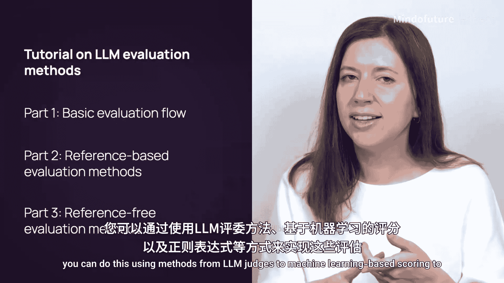
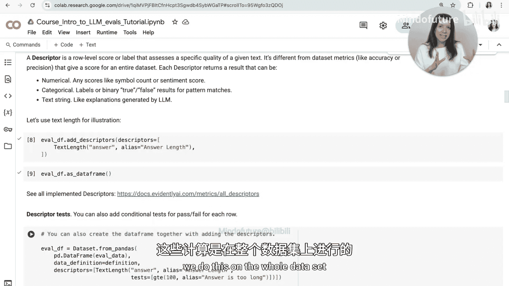
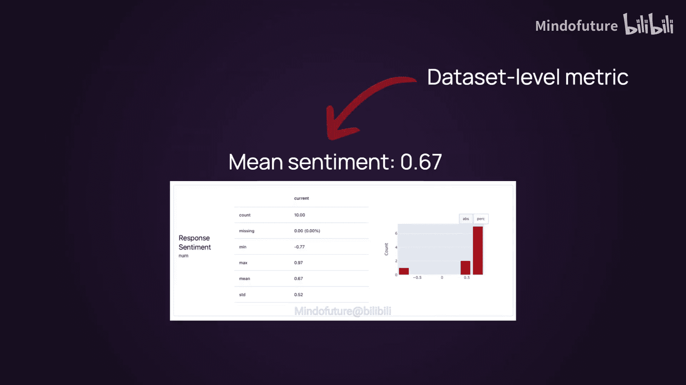
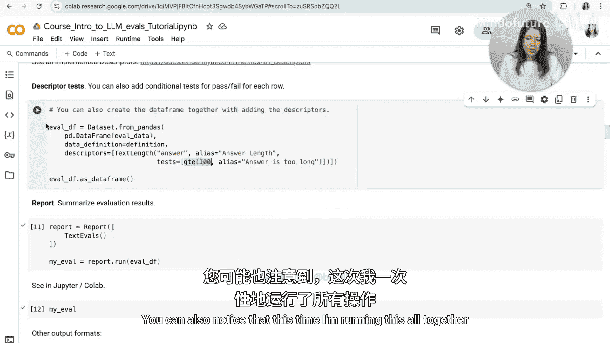
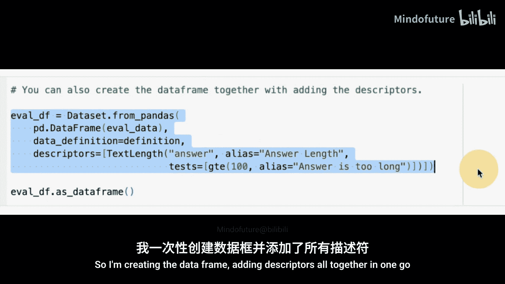
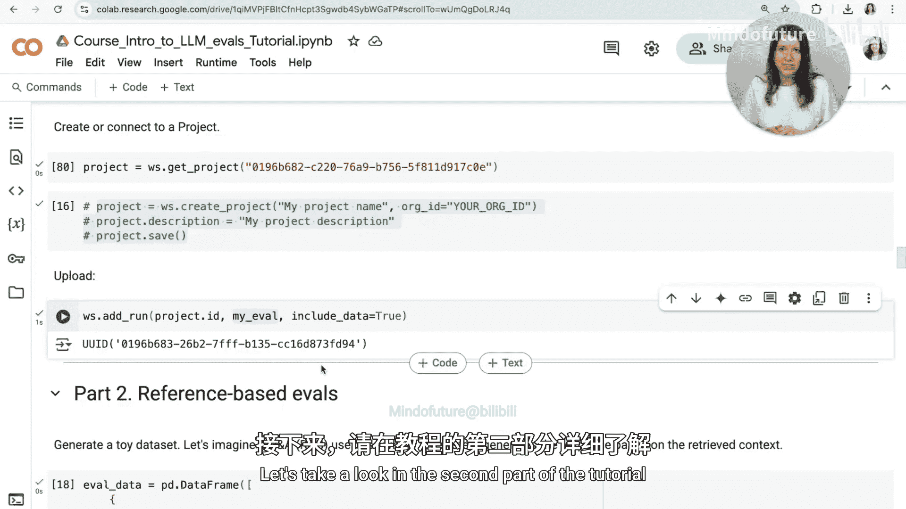

# 【Evidently Ai】面向构建者的Llm评估 ｜ Llm Evaluation For Builders p02 P02_2.1._大语言模型评估方法教程_概览与基础API -BV11ABiB6EZQ_p2-

Hi and welcome to the first practical tutorial in the LLM evaluation course。

 The goal is to show you different LLM evaluation methods and how you can implement them using a simple to example This tutorial will be split into three parts First we will show you a single evaluation end to end so that you understand the base API that we're going to be using every time we are on all the other es then we're going to look at the reference based evaluation methods where you compare the answers you get against the ground truth and different ways how you can do that。

 Third， we will look at the reference pres where you judge the responses as they come and show you different ways how you can do this using methods from LLM judges to machine learning based scoring to regular expressions and we'll implement a bunch of different criteria to show you how we can do this。

Let's dive in。I will be running this tutorial in Google Callll up。

 but you can run it in any other poisonon environment or Jupyter notebook。

The first step is to install Ely， which is an open source Python library。

 so normally you can install it by running P style evidently。

 however in this case I'm installing it also with the LLM Xs because we're going to use a lot of different LLM a methods and I need a few additional dependencies。

Here's the structure of the tutorial it's going to be pretty long for now let's start with the first part。

 which is the anatomy of a single eV。We also need to run a bunch of imports in this case we need to import everything we're going to use until the very end of tutorial。

 so you will see how we use each of the components down the line。To run our basic evaluation。

 we need to first prepare the data in this case， we are directly generating this data right here and we include some questions and answers Let's take a look at the dataset right here。

So here it is， we can come up with a few things that we can evaluate， but for illustration。

 we can look at something very simple like text length。

To be able to run the evaluation on top of this data set。

 we first need to prepare an evidently data set object。

This basically converts it in a way that we can further process。

To create this data set we also need to pass something called the data definition In this case。

 the data definition is something that lets you point to specific columns in your data and explain their role and type For now we're just specifying that we have text columns in the dataset which is question and answer。

This is useful because sometimes you might also have numerical or categorical metadata or maybe you have specific roles within your columns like prediction and target。

 but now we're just going to go with that。The next step is to create this evidencey data set object。

 we do that by passing this data frame that we just generated and passing this data definition。

 so here it is。Now here is an important part to run evaluations within the E library。

 we need to create something called descriptor。A descriptor is a row level evaluation。

 which adds an additional score or label to each row in your dataset。 In this case。

 it can refer either to input or output and assign a specific quality starting from simple things like text length to maybe a categorgogical judgments which are provided by the LLmma to judge This is a universal interface that we're going to re use to implement all sorts of relations。

We use this as a separate thing from metrics in which case a metric is a dataset set level evaluation。

 for example， we can compute our accuracy of precision or recall over classification。

 and we do this on the whole dataset。

Whereas when we compute descriptors， we actually do this on the row level。

 we can still aggregate the overall results and you will see how what for now let's make this distinction。

As a simple evaluation we're going to run the text length of。

 in this case we're going to use the at descriptors and then actually pass the list of descriptors that we want to implement。

We have a bunch of descriptures already implemented it evidently and if you go to a documentation。

 you can actually see well， quite a few。This span from these deterministic revelations to LLM judges。

 So it's all the same interface。 For now， we just pick one very simple called text length。

When you include the descriptor you also need to specify to which column you want to apply to in this case we want to compute the length of the answer and we give it a name。

 so answer length。So here it is。And you can see we can preview the results almost immediately。

 so we got this additional column that was added to our dataset， which says answer links。

So here it this。There is one more thing I want to show you in many cases you not just evaluate the number。

 you also want to get some sort of a pass fail decision on top of this number。

 so maybe there are some responses which are too long and you want to detect if there are such responses to do this you need to add additional tests to the de scriptor that you're computing。

So in this case we are specifying that our condition is if the text length is greater than or equal to 100。

 we consider it to be too long， so in this case we will get a true for our test condition and we will see all the responses which satisfy this condition。

We will call it the answer is the long descriptor。You can also notice that this time I'm running this all。

 so I'm creating the data frame， adding the scriptures。

Altogether in one go。And here it is， we can notice that we added now two columns。

 so what was the original descriptor with text length and the other one which is the test result which basically says us through a false for this condition that we specified。

Now after were on evaluation evaluation we might want to summarize the result。

 for now we just looked at data frame which is fine if you have a few inputs。

 but if it's a very big data frame it's probably not very convenient to look at this just with your nakedI so evidently we have a thing that is called a report which lets you summarize or compute additional metrics on top of the complete data frame in this case we're going create a report and past something that is called text evolves which is a preset that lets us summarize all the distributions on top of these columns that we just compute it。

Then we need to run this report on the data frame that we have。

 in this case this is a data frame with all the edit scriptures that we already computed。

So let's run it and let's preview the result。The fun part is that you can actually look at it directly in your Jupyter notebook or callL environment。

 in this case you can see that we generates the visualization with the distribution of the score as we computed in this case the text length and we also see the distribution of the pass field result on top of these is the answer to long check。

You can also see a bunch of additional metrics which can be useful like the minimum。

 maximum mean value and so on。Now， there are other oddperers that you might want to use if you're running an automated check of you might want to generate a JSO or maybe a Python dictionary。

So that it's easy to consume the results in some other pipeline beyond that。

You can also store the evaluation as an HTML file。In this case。

 you will be able to just store it somewhere and then open in your browser。

So I just did download this HTML file and here it is， you can open and look at it。

Now there is one more thing we can do if you run a lot of revelations and you want to store the results or compare them over time or monitor if yourovping or not。

 you can also send them to evidently cloud and drag them there In this case。

 you first need to create an evidently cloud account that is free to sign up。

Once you have the account， you can go to Ely cloud and you can get a token so that you can interact with the evidently cloud from your Python environment I already have it all set up so I can just directly connect from here。

The next step is to create a project。 You can actually do this directly in the UI。

 So if you come here， you can create a new project， call it on something and then。

Have one new project right away。Now we just created this project if you open this project。

 you can also copy the ID and then use it to connect from Python environmentron， but as I tell。

 as I just said alternatively， you can also create the project from Python。

Now we already connected so all we can do is now send the results to Ely cloud。

 in this case we are sending this exact report object that we just generated and looked at。

 but we are ploting its Ely cloud。So if we go to evidencely cloudout。

You can open here the report section and you will be able to see the report that we just generated。

 you can see the same visualizations that we just looked at and below that you can also see the data sets and you can for example explore or sort the results or somehow interact with this。

One more thing you may want to do is to add the dashboard in this case if you go directly to the main dashboard。

 you can enter the edit mode and then add stop and choose column stop these columns basically summarizes all the deors or column summaries that we have in the dataset right now we have only one single evaluation so each of these have a single data point but if you for example run and rerun these evaluation you will see how you progress over time and if you come here you can always go down and open the original report to explore。

In the end， if you're running a bunch of simulations。

 you can get something like this where you will be able to track different metrics over time to see if you're improving or not and analyze how in general are you doing across your quality dimensions？

Now this is all I wanted to show in terms of a basic relation workflow。

 you can reuse the same descriptor interface to run all sorts of relations not just text length but something very complex like LLM judges2 let's take a look in the second part of the tutorial。

