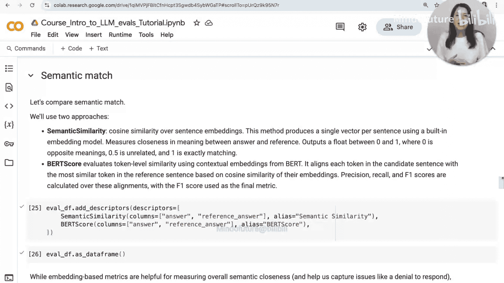
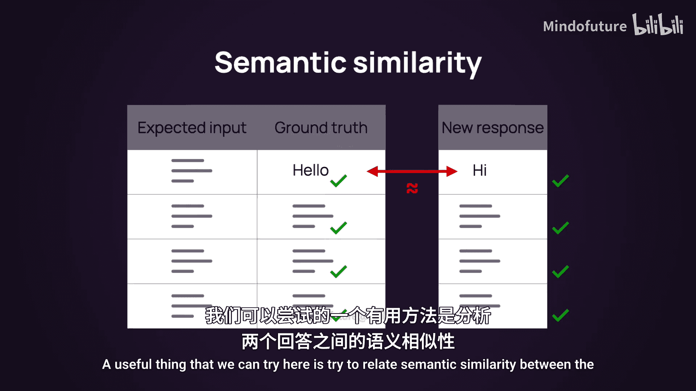
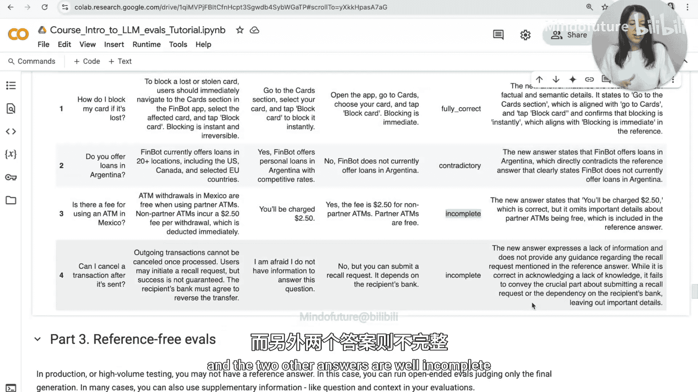

# 【Evidently Ai】面向构建者的Llm评估 ｜ Llm Evaluation For Builders p03 P03_2.2._大语言模型评估方法教程_基于参考答案的评估 -BV11ABiB6EZQ_p3-

🎼Hi and welcome to the part two of our tutorial on LLM evaluation methods this time we're going to look at reference based evaluation where you compare the answers you get against the expected ground truth answers and different ways how you can do that。

Let's take a look。The first thing we need to do is to prepare our test dataset set this time we'll have a test dataset which imitates some sort of a customer support logs from a payment app where users ask certain questions and hopefully get the correct responses。

Let's generate this data set here。And first we can preview what it is a golden data set in our case。

 which is sort of a set of expected questions and answers which we consider to be ideal answers to this question here we have expected answers that we want to get if this question is being asked。

You need to prepare something similar for your use case if you are running this reference based des。

 you can generate it synthetically or curate it manually。

 but for now let's just assume that we can trust it as it is。

 so these are the answers which we consider to be golden answers and we want the new answers that we' get to match them。

Now， let's pretend that we ran our test questions through our application and got something that is now a new answer in addition to the reference answer we had。

We also got a column with context because we are imitating a rock application。

 and we expect that before the system generates the response。

 it goes through the knowledge base and retrieves relevant parts of the context to generate the answer。

So we can also use it in our future revelation。But for now our task is the following。

 we have the answer that we got and we have the reference answer that we have and we need to match if they align to decide if our chatbot is answering correctly。

So let's see how we can do this。 The first thing that we can try is looking at something very simple like exact match。

 let's use it for illustration。You're already familiar with the core evidence API。

 so we are using the same descriptor idea， but this time we are using a descriptor that is called exact match。

 and we are passing the answer column and the reference answer to perform an exact match between them。

But of course， you could guess that in this case， nothing matches because we deal with open ended text generation and there is no way how we can expect the answers much precisely because some words can be slightly different。

A useful thing that we can try here is try to evaluate semantic similarity between the two responses there are different ways how you can implement it but we will look at two of them the first one is by implementing straightforward semantic similarity using embeddings in this case we pass both texts and we use an embedding model to create a vector representation of each and then we measure coine similarity between the two responses。

Another metric we can use is called BRTs score， in this case it also uses semantic similarity。

 but it looks first at alignment between individual toins in each response and at the end computes an E score based on the overlapping correctness between the two responses。

 so they both use semantic similarity but implemented slightly differently。

Let's try to run it in this case it might take some time to run because we' are actually using the embeddings model that we are downloading locally and turning our responses into vectors。

Now let's see what we got We added these descripts to our existing data set so you can compare all them together so what we can see is we actually get a pretty high semantic similarity for many responses in this case the semantic similarity goes between 0 and1 in which case1 means identical meanings。

 0 means opposite and 0。5 means unrelated。But what we can also notice is that there are two responses which have pretty low semantic similarity if you look at them more closely you will see that well first of all they have different lengths and the reference answer in this case have some additional information so probably it makes sense and then we have another answer which has very low semantic similarity and it is because the answer that we got is pretty much a denial of response so the chat just says I'm afraid I don't have information whereas the reference answer well at least provided some information。

And if we look at B score， you can notice something similar。

 so basically these are the two responses that got a low score。

 so if you define some sort of threshold， actually looking at semantic similarity would be a pretty good option。

However， this semantic similarity is not perfect， it looks at the overall semantic closeness of the two sentences and it's not always exactly what you want to get so sometimes you have like a small thing that changes the whole meaning。

 but the semantic similarity will not react to this as much。

So another thing we can try is using LLM as a judge。To make this match between the two responses。

 the way it works is we prompt an external LOm to look at the two responses and pretty much say if the new response matches the original reference。

Let's see how it works。In this case， we're going to use open EI as an external evalator。

 so you need to have an API key， you can also use other LLMs。

 I will provide some links how you can use an alternative LLM judges。

Now we are passing a descripture which is called correctness LLM Eva What is hiding behind this is a prompt that we wrote which basically asks the LLM to look at the responses and detect if there is any contradictions。

 emissions or additions compared to the original answer。

In this case we need to specify that we are eulating the answer。

 and we also have a target output with the column that will be passed directly in the front。

Let's see what happens。So right now we're actually literally scoring the responses and we already got them back。

So here it is。What we got now is a new column which basically has a label correct or incorrect。

 this is the label that is provided by the LLM judge。And there is also a reasoning that is provided。

 This reasoning is very helpful for us to interpret the result because it might point to specific contradiction or mission that it picked up。

And if you go down， we can actually notice w there is actually more incorrect answers than it was before with semantic similarity。

 let's take a look at this one， so we have an answer which El and judge says is correct。

Because it literally contradicts the reference， it actually uses very similar words。

 but the reference answer was that no Fiinot doesn't offer loans in Argentina and the answer we got was that yes。

 we do offer in this case semantic similarity was not so useful because actually the words in both sentences are pretty similar。

And then you can see that there is another incorrect thing that the judge picked up in this case it was that the reference answer had some additional information about the partner ATM fees whereas the answer that we got was just saying to 50 and I would say it is。

Very interesting that it picks it up， you can say maybe it's correct， maybe it'st correct。

 but it's definitely not complete。And similarly， it picked up on the answer。

 which was actually a refusal answer。Now this LLM judge is already pretty useful。

 I would say I agree with the results by having read each of them individually。

 but what I see is that there are different types of errors right so one error was a little contradiction and that was probably the most interesting type of error we never wanted to happen and the other type of errors for more like an emission or like not complete answer。

So what we can try to do is don to create our own judge that will incorporate this criteria that we just came up with。

Now this time we are using a template， in this case the template that we have inside evidently already has a few useful things like for example。

 it knows how to process the data to put it in the correct columns。

 it already asks for chain of thought reasoning， it already has a few things prepared All we need is now to write our instructions of what we want to judge。

I will create a fresh data set so that we just have now one single column as we compute it。

We're going to use a multiclass classification templates。

 multiclass because we want now to ask the judge to classify the responses into four classes。

 and I'm going to specify these classes one is fully correct when the answer matches completely。

Another one is incomplete when the answer is correct but it may be ams some details。

 third one is when the answered claims this actually did not happen but I thought it could be useful because sometimes the answer does not contradict the reference but say something that was not in the reference maybe we want to highlight it and then finally the most important category is contradictory and we just literally explain it in plain language here。

Let's see how it works。Now because we implemented a custom LLM charge。

 we actually need to pass it here using the specified template。Inside this judge。

 we also used an additional column because we needed to point the reference answer that we'll be passing inside it。

 and in this case we're also using the mapping to specify where this reference answer is in our data frame in this case I use the same name but you get the idea。

You can also choose a different model I normally default to using GT4 mini， but again。

 you can use a different model from a different provider So let's apply it。

And here' is the result we got。I would say it matches exactly because I already reads all the outputs right so the two answers are fully correct。

 the one answer about the Argentina laws of contradictory and the two other answers are well incomplete。

So here it is， we just ran a few different ways how you can evaluate the correctness of the responses against ground truth and we even created a custom LLM judge that helps us make this comparison now in the third part of this tutorial we're going to go through reference free evaluation methods。

