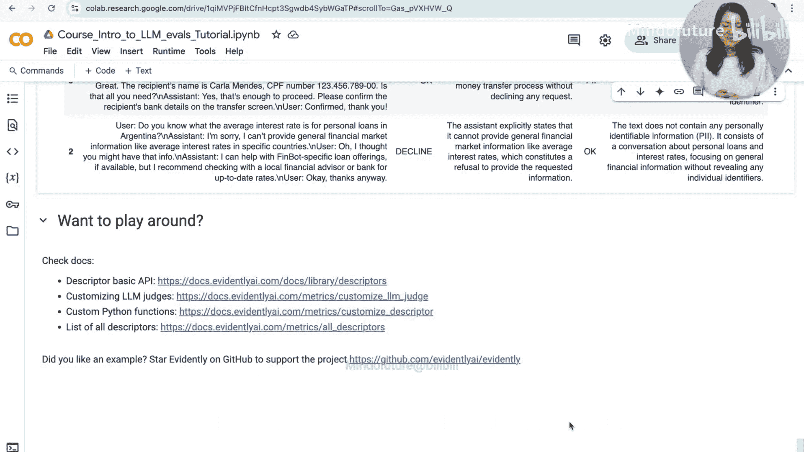

# 【Evidently Ai】面向构建者的Llm评估 ｜ Llm Evaluation For Builders p04 P04_2.3._大语言模型评估方法教程_无参考答案的评估 -BV11ABiB6EZQ_p4-

Hi there， and welcome to the third part of our tutorial on different LM methods。 This time。

 we are looking at reference free evaluations when we are judging the responses without any example。

 we are just trying to identify specific qualities and make sure it complies with our expectations。

 Let's take a look。 There are a lot of different methods that we can use here。

 It's going to be quite fun。😊，So we run these type of relations in different scenarios。

 first is when you do not have an ideal answer or it's very hard to prepare one。

 and second when you are in production and you're just trying to lead the responses online without of course having the expected response for each of them。

Let's try to imitate something like this and in this case we're going to deal with this same financial chatbot example that we did before。

 but we will only have the question， the answer and the context。

Let's see what we can evaluate in this case。There are a lot of simple things that can actually be quite useful if you know what to look for For example。

 let's say that we are expecting our chatbot will always be polite and say hi and hello to the user so in this case we can just check if these words are present in the response so we can use a scripture that is called includes words we apply it to the answer column and we passse the list of words in this case we just wrote a very simple example。

Where we test， if any of these words is present。 In this case， we use the as says hi。Similarly。

 we can test for some other situations like for example， when the chatbot denies to respond。

 usually when this happen， it can use words like sorry apologies cannot phrase and so on so maybe this can happen and in this case you can detect these denials without any sophisticated methods there are other examples when regular expressions could be useful maybe you expect the responses to always include a certain disclaimer like this chatbot was generated by a bot or something like this or you know that there are some specific error mode like as an add language model you can just check if this exact phrase appears in the responses or something like certainly。

Let's see how it works in this case which is going to apply this simple check and in our case well the interesting part we can find is that we have actually a refusal because our chatbot says I'm afraid I do not have information and it picked up because one of our words that we had here in the list was pretty much I。

Afra right so afraid is the sign of a denial。Right so another thing that we can look at is some simple text statistics again by itself it probably doesn't tell you a lot about the response。

 but if there is like a spike or an answer that is too long or the short this can be useful Also sometimes you have a specific requirement right inside your prompt so maybe you say you should answer in one sentence so you can check if the answers that have been generated I actually one sentence you can also pick up if there is a sudden shift in the length of responses in production sometimes this happens if there's like some change in the underlying behavior。

So for now we can just look at something simple like sentence count， in our case。

 we have one sentence and all responses， sounds good。

I know that I keep using a lot of descriptors which are built inly and you are probably wondering what if there is something that there is not inside evidently。

 you can actually implement it as a simple Python function。

 I can just show it here as like a very straightforward example where we're testing if the response is not empty。

 we implement it as a function that takes the panda series in this case we are working with columns。

 and then it returns a transform series which tells us if the column is empty or not， if it's empty。

 say empty， if it's not empty， say not empty。So that's pretty much it and after we implement this descriptor we are referring to it as a custom column descriptor because it's being applied to a single column。

 you can also actually create descriptors that use multiple columns and we run it on our data and here we go none of the columns empty well that's what we see but this is the idea if you have like a more sophisticated population that is not covered inside the library。

 you can implement it as a Python function。Now we can also use semantic similarity again。

 we've already seen it when we were eating the responses against reference。

 but in production sometimes it can also be useful。

 so what we can do here is we can look at the semantic similarity between the answer and the context remember in this case we' imitating raw application and what can happen if the answer that is being given by the system is not semantically similar to the context it was retrieved。

 chances are the response is either unrelated or alternateated or something else happens so we might want to signal if there is this low similarity another proxisymmetric we can look at is semantic similarity between the answer and the question in this case it's more about the relevant So basically if you're asking the question about a certain topic the response is likely to have some of these words and be semantically similar So if this doesn't happen again this can be a signal that something is wrong with the quality of the response。

Let's take a look。Actually in this case we can already notice so first of all we have like low semantic similarity between both the response and the context and response in the question in this example。

 and in this example we are asking like can we cancel the transaction。

 the context the context say something about it， but the answer is I'm afraid I can it answer。

So in this case it's clear there's a misalignment and it's not exactly hallucination。

 but it's something that is worth looking into so and then we have again our answer where the answer was like too short and actually not fully representative of the context and again there is a very low semantic similarity。

 we can pick this up and take a look at what's going on。All the other answers look well， pretty good。

We can also use machine learning based models to score specific properties of the response。

Sometimes you can pick up an offtheshe model， which will be already useful for your scenarios。

 This usually things like testing for toxicity or sentiment or emotion or the presence of personal identifiable information So some things that are pretty generic and which can be trained on external data to work across different use cases and maybe yours as well So here we have a couple of examples let's take a look one is using a very simple sentiment model which basically classifies the responses between-1 not classifies it actually returns the score between-1 and1 where minus-1 is negative0 is neutral and one is a positive sentiment It is a wordbased model which basically picks up from the meaning of certain words。

If we take a look here what we got， we actually get。

 well one response which has pretty negative sentiment because it's about blocking cards。

 which I guess is a negative emotion and the charged is also has a negative sentiment。

 so maybe it's not especially useful in this scenario but it's something that you could apply if you deal with more like open text analysis。

And here's another example I want to show you can actually download quite a lot of models that are publicly available。

 for example， on the Higing F H and use them to your application so here I picked up a model which is a zeroshot classifier again this is not an LLM we're not calling openai anything which is downloading and running a local model and in this case this model can work as the following you pass the candidate label which in this case could be like a candidate class to your text and then ask the model to classify between these classes that you just provided in this case I'm importing this model so I'm using a descriptionure that is called Higing face which lets me select identified models from the Hiface H。

And also need to pass a couple of parameters in this case I need to pass the candidate labels and the candidate labels I picked is finance and other。

 so basically the idea is to see if the responses that we have or the answers or the questions that we have are related to finance or maybe something else it could be like a useful proxy。

 let's see how it works。Again， it can take a few moments if you're running it for the first time because you need to actually download the model and score your data。

Here just finished and we can see that what we got in this case we are scoring the answers right to see if the answers are related to finance and this answer is about transaction。

 but this answer about the cards section while actually not precisely finance right and the answer where I say can answer well definitely not finance So again this is something like a useful proxy and I'm not telling you that you can just find a model that will works for your use case but the point that I want to make is that you can actually use smaller specific models for some types of evaluation and you can even train these models yourself often tune the models it's not about using LLMs it's about implementing a specific score once you know what you're looking for。

Now let's come to my favorite LLM as a judge in this case we are doing openend of judging so we are not passing the two responses like we did before。

 but we are passing one response and we ask to judge it on some merits。

Let's try to write a custom letter for diversity and in this case I already looked at the responses and I picked up on something so remember we had this response where you just said like you'll be charged to 50 I'd say this response is incomplete。

 not just because it doesn't use some of the useful information but because on its own it's not very helpful right you don't say what is about what you're being charged for and so on so I prefer my chatbo responses to be more complete。

So here I'm creating a judge， again， this is like a tiny illustration which classifies my responses between complete and to short。

In this case， I basically want to differentiate between the responses which have some substance and responses which are。

Overly。Short and not very useful or actionable。So I'm creating this judge and I'm running this judge on my data。

And here's what we get， so we can notice that some of the answers that we generated are too short。

 well first of all， this answer that is probably the check is too short and also the answer that was not giving it information is too short。

This is a quick illustration of how you can customize a chat。

 and we are going to have a whole session which will be dedicated to creating and tuning LLM judges and what's more important aligning it with our own human labels。

Now， I have one more thing I wanted to show， which is a bit of a bonus。

In all these examples we were looking at a single response like a single response or maybe a questioned response and so on。

 but sometimes you have a longer conversation so you might have a whole sequence of questions and outputs。

 questions and outputs like a exchange between your user and the chatbot or something else and in this case you can actually apply the relations on top of the complete session too so let's see how it can work。

We're going to imitate the dialogueog， which follows the same topics which we did。

 but this time we have an exchange， right so user ask something， assistant， ask something and so on。

So let's create a data set。And now we can run the evaluation in this case we created a data set where we basically squished the whole conversation inside a single cell in our data frame and we are asking LLM to judge this complete conversation we're going use a couple of built in descriptors just to make it quicker one descriptor is looking at declines so if at any point there is a denial to respond or to provide something This might be interesting for us to review and then we can also look at the PII LLM Eval so this is a check which checks if there are any personal identifiable information like names。

 addresses， card numbers and so on inside the conversation Both could be useful proxiymetric if youre monitoring something in production in this case we might want to f the responses like this for manual review if there was some refusal or there was some personal information。

 we might want to review what happens。So now I'm running this complete evaluation and I'm also sending the results to Ely cloud because this time the responses are pretty long so it might be more interesting to look at them in the UI which allows to browse them So now if we go back to our project that we already created we can see in your report that was being edit and we can see that first of all we actually had the declines inside our conversation and second we even have a PII instance inside our conversation So now we can look at the data set to explore what happens I'm going to hide here the actual distributions and now we can look at the specific course that we get so we can for example。

 sort by declines and we can find a conversation where the assistance basically said sorry I can provide this information that's interesting to look at and then we can similarly sort by PII and we can notice the conversation where this PII review happens and this is exactly the same that the judge picked up on。

Of course， you can also do the similar relation in your Python environment。

Where you would basically just post process you upon this data frame and search for the specific instances that you want to look at。

Now if you want to look around I'm linking more examples to how you can try different descriptors。

 customize LM judges， create custom Python functions and so on。

 but in the following videos we're going to show a lot more interesting stuff the next video will going to be all about customizing LLM judges and after that it will be all about building and evaluatingviating specific LLM applications see you there。

