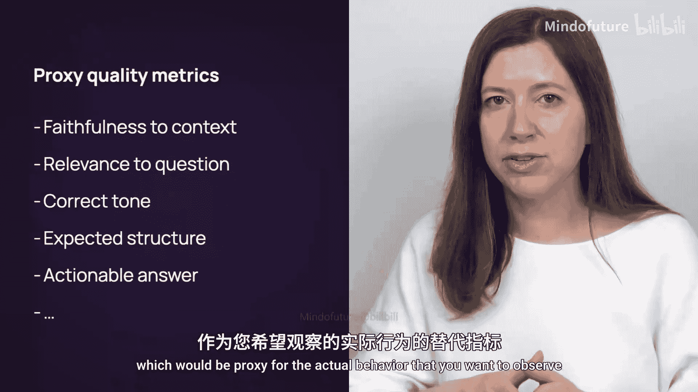
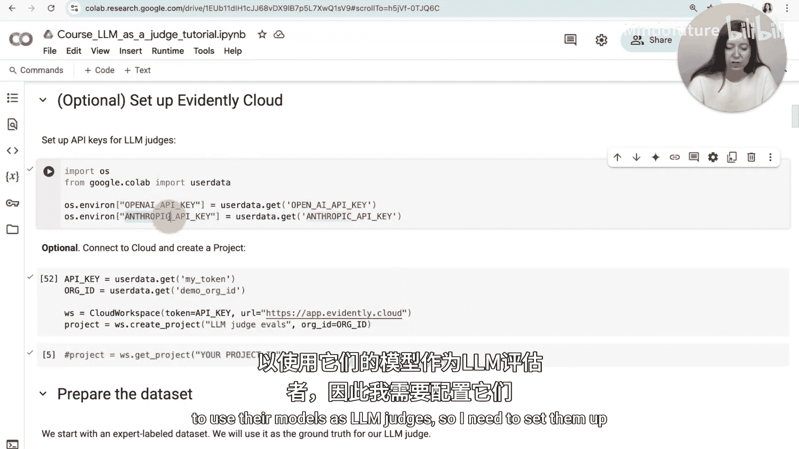
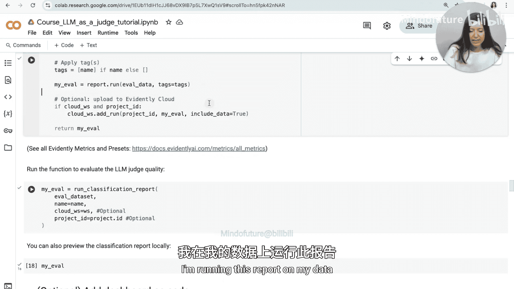
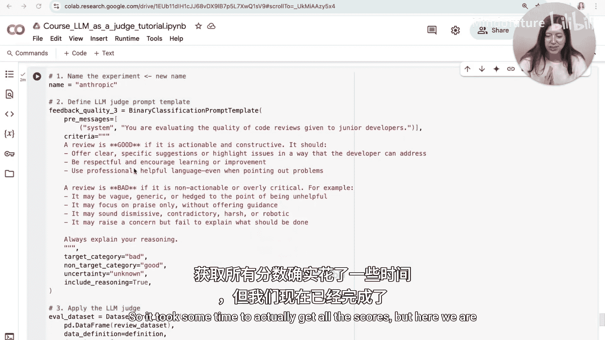
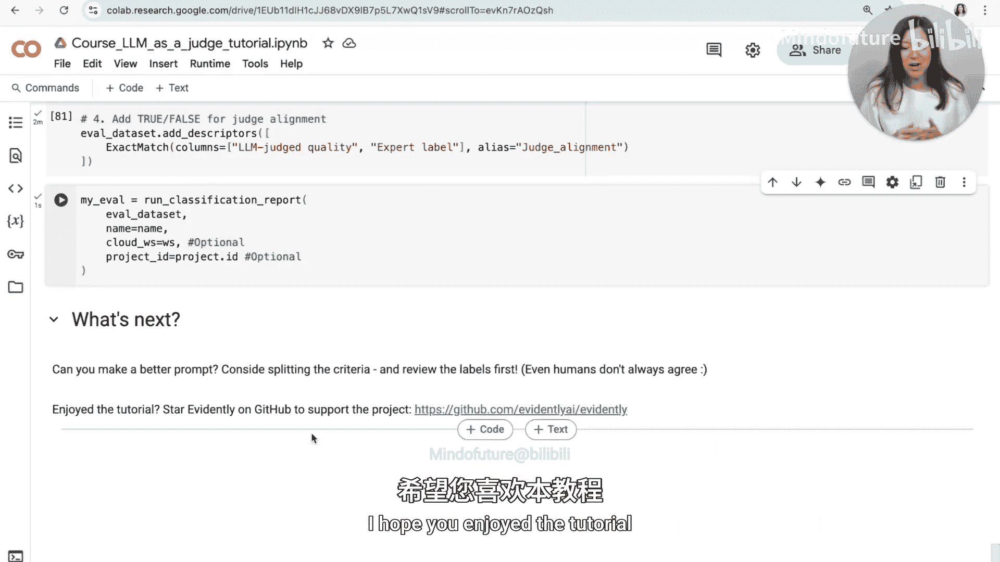

# 【Evidently Ai】面向构建者的Llm评估 ｜ Llm Evaluation For Builders p05 P05_3._教程_如何创建大语言模型裁判器并与人工标注对齐 -BV11ABiB6EZQ_p5-

Hi and welcome In this tutorial， we will show how you can create an LLM judge and align it with your human preferences。

 First， we will explain the process and end and as a little spoiler。

 it looks a little bit like a small machine learning project in itself and second。

 we will apply this process on real prompts with real data and create an LM judge that helps us evaluatevate the quality of code reviews in the process we will also compare different models so stick around if you want to figure out e Anthropic or open AI does better。

The first step in creating an LLM judge is figuring out what you are judging Sometimes you already know this。

 for example you observed a particular failure mode and now you want to be able to detect it if you don't know it yet the best move is to start by labeling your data so that you can figure out some patterns and come up with generalizable criteria。

One thing to keep in mind is that you don't need to create an overall judge for your product。

 you can actually create multiple small judges where each of them evaluates one specific thing。

You might want to catch specific failure modes like refusals or repetitions。

 or maybe you can flip it around and try to come up with quality metrics which will be proxy for the actual behavior that you want to observe Of course there are limits to what you can ask。

 you cannot sayI this answer medically correct and expect a reliable answer but you can ask is this answer based on the context or is this answer formulated in the tone that is easy to understand and so on？

You can also come up with more test specific judges so if you are working through a particular scenario。

 you can actually attach a judge to this scenario， say you are sending prompts that probe your LLM to talk about competitors and then you have a judge that evades if the responses are safe for your brand you can also have more analytical judges like for example。

 classifiedify the responses by intent or topic just understand what's going on in your product I know that some people are skeptical about LLM judges but this is often because you think that we are creating a judge that blindly sorts all good from all bad。

 but that's not what we are doing here we're actually giving them very small scoped welldefined tasks and LLMs are quite good for that。

The next step is to create a dataset set before you create a judge you have to be the judge there are two ways how you can go about it first you can just manually label some responses that you selected or you can create a simple judge the best you can and then review and correct its responses either way you want to get to a data set where you have ground truth judgments。

Once you start labeling the responses， you will very quickly notice that it's much easier to stick to binary of few classes instead of something like a grade of1 to 10。

 It may sound appealing at first， but it's actually very hard to be consistent。

 Your goal is to get to a point where another human can follow your criteria and label responses similarly。

 If you start labeling and want to adjust the criteria that's perfect。

 you want to learn and you want to come up with very good grading。Once you have this label data set。

 you have the ground truth that you can use to relate your charge。The next step is to create a judge。

 which basically means writing a prompt effectively we are prompt engineering a classifier。 And yes。

 you should write this prompts yourself。 even a little bit of domain main knowledge can improve the results greatly。

 And if you are using a tool with built in prompts。

 you should always test them against your own labels。 Also。

 do not assume that some more sophisticated method because it was covered in some research paper is necessarily better。

 Always test against the more simple baseline models and prompting techniques I evolvinging rapidly and everything will depend on the model you use。

 for example， simple models must require more prompt engineering and more examples and more sophisticated models can do better out of the box。

 In general， all the usual prompting techniques apply。

 you should think about writing these judge prompt as if you are given instructions to inter that don't have all your context So you have to explain it。

 and all the usual things like chain of thought。 More examples， clarity and so on obvious apply。

The next step is to evaluate your prompt so after you written your first prompt version。

 you can run it through your dataset set and then compare the responses you get from your judge against the human labels。

 There are different metrics you can use there， you can use correlation metrics like coins Ka that is usually used to evaluate the agreement between human labelers or you can use classification metrics like accuracy precision recall personally I prefer this metrics because there are intuitive and you can also focus on what matters to you。

 for example， sometimes precision is more important sometimes recall is more important because you want to catch more bad examples even if sometimes you are incorrect and so on。

And of course， once you create the judge， you might need to it a little bit on this so that can be like a continuous process where you change the judge and then re it and then try to make it better。

And the last step of course is now you can go and apply your judge， for example。

 let's say that you created a judge that can reliably detect a certain failure mode。

 now you can go back to working on your main product。

 experiment with problems with models and use this judge to evaluate the results and understand if you are getting better or worse。

Now let's try and apply everything that we've just walked through on a real example where we create a judge that helps us navigate the quality of code reviews。

Now， let's start with the code part of our tutorial。

What we're going to do now is we're going to look at the dataset set that I've prepared that contains the reviews that are being generated by our imaginary LLM product and then the reviews that are being given by the human expert as to whether these reviews are good and bad。

 and then we're going to use it as a base to create an LLM judge to pretty much replicate these labels so that our LLM can also create our reviews。

Now， let's start。The first step is install evidently。

 which already have installed in my environment and run all the imports that we're going to use throughout the example。

Now we also need to pass some A keys in this case I'm going to use two model providers。

 open AI and Antroic to use their models as LLM judges， so I need to set them up。

Now I'm also going to connect to Ely cloud and create a project this is optional。

 but this is useful if we want to track the results of our evaluation and compare them over time。

This time I'm doing a through Python API and。I'm passing the name of the project here。

 it's LLM Judge Es。Now let's take a look at the dataset， actually prepared this data for us already。

 so it's just available on GitHub and we can download the CSC file and create bundle's data frame in our environment。

Let's take a look at what it contains。I'm only previewing the first1 rows here。

Basically what it has is we have a generated review in this case the generated review is what we assume our LLM product has given and this review is related to the code so we imagine that the use case is that we have some tool that allows to comment on the pull requests that the developers are submitting to some repository in this case we' are not focusing on the code part itself but on the tone and quality of the verbal review。

And you can see that there are expert labels that pretty much give these labels， right。

 so they say that the generated to view is either bad or good。

There is also an expert comment which gives some insight as to why it is good or bad and this is actually the critical part because by itself pattern good says us nothing。

 but these comments actually contain the criteria that the person was using when giving this review and if you pay attention you will notice that the pattern is that most of the comments are related as to whether the review is actionable like does it give any actual guidance to the user or what about the tone of the review so sometimes the tone is slightly condescending or too harsh and so on so basically you can notice that the comments actually relates to the substance in their review and also to the tone of the review that is given。

Now next I'm going to create an evidently dataset set in this case， I'm passing the data definition。

 which also contains the categorical columns in this case that's our expert judgment。

 and I'm creating the dataset object。We can also quickly generate the reports that will show us the preview of classes in this case I'm using the metric that is called value stats and I'm passing the name of the column that I want to summarize。

You can see that this is the distribution of classes we have actually it's pretty even so it's 27 are bad examples and 23 are good examples。

 this is good because this way when we use this data set for L andG we can expect that it's well balanced so we will cover both the ability to detect good and bad examples。

Now it an optional step， I'm also going to upload this to Ely cloud。

 I'm just doing this because I want to store my dataset to be able to maybe comment on it a bit more or change something if I wish you can see that I'm using here the a dataset I'm passing the data set object that I just created and give it a name and also give it a description。

Now if we go to Ely cloud。We will be able to see the new project that we created LLM Che Es。

And if I go to the datasets， we can see that we just uploaded its data。

You can see that if we want to change something like for example。

 we might want to add something else to the comment or change the label。

 we can actually do this here。But I'm not going to do it now because we expect that our label link is already quite good。

Now let's review our goals so we know that we have this task of being able to identify if the review was good or bad。

We can try to figure out what our criteria are if we go through and actually read through all the comments。

 we can notice some patterns right so there was like actionable， not actionable and so on。

We can try to either split it into several different criteria or can try to generalize them into one。

I'm going to go with the easy option and try to generalize them as one single criteria in this case。

 pretty much the same as the original labeler did， good or bad。

 but I will try to explain to the L and judge what we want to achieve。So in this tutorial。

 I'm going to just repeat myself a few times for us to see how exactly we create this process and end。

So let's have the first attempt to create our church。

I'm going to give a name to this experiment because I'm going to use this as a tag for my report。

Then I'm going to define the LLM judge prompt。In this case， I'm starting with a very simple prompt。

s basically saying a review is good when it's actionable and constructive， a review is bad。

 when it's non actionable or overly critical。And I ask the Lmmpclass responses into bad are good。

Now it's not very sophisticated but it's already given me some substance right so I also have here like an In message which explains that we are assessing culture reviews。

So the next step I can go and apply this LM judge， I'm using the descriptor interface passing our data frame。

Passing the data definition， and running white。LLM judge in this case。

 using this feedback quality prongs that we have using Open EI GP 4 minii。

 and I'm giving the name to this column as LLM judge quality。Now I'm going to do one more thing here。

 which is to add an additional descriptor after I run the original LM judge， in this case。

 I'm adding a descriptor which says exact match。This will let me understand if there is a match between the L M judgment and the human judgment by basically adding an additional column true or false。

 And I'm going to call this column judge alignment。 Now， let's run and see what we get。

So now we are scoring all the responses in our example。

 we have5 responses so it can take a few moments。Let's preview the results in this case I'm actually opening the whole data frame and as you can notice it's actually not very convenient to analyze it this way right so we have 50 judgments yes we can look at the judge alignment and we can see that some of them say trueru or some of them say false but it's not very convenient to understand right so if our judge is doing well or not。

So instead， what we're going to do is we can generate a report。Here's what we see， right。

 So first of all， the distribution of labels that have been given by our judge。

 it already looks quite different， right， so we can see that we have much fewer。

Bad labels compared to what the human said， we also had a couple of unknowns。

 so let's see what it is。And here is the judge alignment。

 so essentially what it says us is that we got a 64% accuracy。

 which means that 32 of the labels that were given by the LLM judge match the label that was given by a human。

However， this pretty much tells us only the accuracy。

 there are some additional metrics that I want to look at in this case if we treat it as a classification problem。

 there are other metrics like precision or recall。So what we can do is we can actually create a classification quality report using these data sets that we have。

Now I'm going to create a function that pretty much creates this report because I'm going to be reusing these throughs the other examples as well。

So what this function does is first it takes the data frame that we have with the human labels and the LLM judge labels。

And it also filters the unknowns here， in this case I'm doing it because I have a binary classification problem and these unknown labels actually don't fit。

And I'm going to set up a data definition that fits the classification problem remember until now we only use it for mapping text columns。

 but actually if we deal with a problem like a classification problem。

 we can use a binary classification mapping where we specify the column that contains the target value in this case the target is the expert label so the human label that we have and then we have prediction labels in this case this is our LMje quality so we're going compare how well our prediction matches our target。

We also have here a parameter that's called positive label and we basically want to specify which。

Of the two classes， we consider our target class and will'll be evaluating the precision and record for this class specifically。

Now then we create the evidently dataset object and we run the report in this case we include not the text evolve that we already familiar with。

 but we include something in a school classification preset this is already including a lot of data set level metrics that help us evaluate the quality or classification I'm also throwing a few other metrics in this case just to summarize the distribution of the L and judge quality and expert label just for the ease of exploration。

Now I'm also adding the tag to this report， which will let me differentiate between different LM judge versions and I'm running this report on my data Now optionally if we set up Ely cloud。

 I'm also uploading these reports to Ely cloud。

Now let's run it on our data。😊，If you want， you can preview the results locally。

 so what you see here is that we generated a new report which actually contains the classification quality summary。

 but you can also go to Evily Cloud and explore it there。

Now let's understand what this is telling us。In this case。

 we are looking at the classification quality metrics。

We dropped the two unknown labels right so the accuracy is slightly different。

 but what's important is that we have 100% precision precisioncision in this case tells us that whenever the LLM gave a labeled that。

 it was correct。However， the recall is only 36%， which means that we only found 36% of our bad reviews。

Right， an F score is a balanced measure of this。If you're interested。

 you can go through all the other metrics just understand how the report looks。 Okay。

 I'm not very happy with this results right so we can probably try and do better。

 So let's go and try to write a better judge。Before we do， there is one more thing I want to add。

 which is to create a dashboard which will allow us to track the results of different evaluations over time。

You already seen that we can do it directly in the E UI。

 but this time I'm going to create it using the Python API。

 which lets me pretty much add a panel to the dashboard directly from Prion。

 So now if we go back to our project。We will be able to see that we just edit the new panel and this panel shows us these three metrics that we care about accuracy precision and recall in this case again we only have one single run。

 but after we try something else we'll be able to see if we are improving or not。

Now let's try another prompt。Maybe we will be able to improve the accuracy and the recallco of our LLM judge。

I'm going to call this prompt detailed prompt。And indeed， I' am adding quite a few more details。

 So this time， I'm specifying a bit more what I mean by good。

 So I specify that it has to offer clear suggestions， be respectful， be professional and so on。

 And I'm also being much more clear on what bad is。

 I'm saying that if it focuses on praise only is bad。 If it's dismissive， it is bad and so on。

To be able to formulate a prompt like this， you need to actually go and read through the commentary。

 or you can actually cheat a bits and send all these comments to the LM and ask it to come up with a better prompt。

 In this case， you might still need to review it， but that's a quick way to actually bootsstrrap the idea。

What's important is to not overfi in this prompt by overfitting I mean the well-known concept in machine learning where essentially the model can memorize the training data instead of discerning the patterns in terms of prompt writing it means that if we just put the specific examples in our prompt chances are that LLM will score them correctly but will not generalize outside this examples so instead of putting like the exact if these judge that we need to try to explain it more generally and honestly I believe that if you read through this prompt。

 you will be able to actually give judgments yourself so it's already looks to me as something good enough。

Now we're going to repeat the exact same things that we did before。

 we just passing the new prompt version and giving it a go。

And the second step is evaluatingating the judge quality。

Now I'm going to go again to the Ely cloud and here we see the second report that was generated。

 which contains the detailed prompt。Wow， it already looks much better right so basically what we have here is now 95% accuracy and 92% recall basically it hits a lot of things right？

Here is the confusion matrix， pretty much we see that there are only two errors altogether。

If you want to explore the errors， we can actually go directly to the data and use our judge alignment label to find the two errors we have。

So these are the two errors we got right， so we had one label where the person said it's bad because it's not very concrete。

At the same time， Lm judge considereded that refactoring is already a suggestion。我没变。

And here we had another example related to the tone where the person said that the tone is too harsh。

 but the LLM agreed that it's good enough。Now， but just to errors I think it's pretty acceptable so maybe we can even stop here and just continue with our main products。

 we can see here on the monitoring panel as well that we actually improved so all the metrics went up。

 However， I want to try if we can make it even better， let's see。

There are a few tricks that you can try which do not even change the substance of the prompt。

Sometimes they work sometimes they don't because that is just the LM behavior So what I'm doing here I'm keeping the exact same prompt。

 but I'm adding one line which is says always explain your reasoning actually we are already asking for reasoning but it never hurts to ask twice so let's see where it leads us。

Now here we are， and we got the final report as well。Now， let me go and see what we got。Actually。

 we improved even slightly more， right， not so much， but we got 98% accuracy。If we take a look。

 it means that we now have only one error， right， so whatever we did may the judge behave a little bit better。

 So now if we sort by alignment。Let's find the false one。So it fixed the one that was non actionable。

 but it still agrees that this comment is。Constructive。Honestly， if I look at it as a person。

 maybe I would even agree with LLM right， so this is the reality that often when we talk about subjective qualities。

 even humans would not exactly agree on the details right so we shouldn't expect 1 hundred00% alignment as long as useful for our main goal。

Okay， now I think that I have a very good prompt right so however we are using the model which is G4 O minii which is not the most expensive but slightly more expensive that for example Tpo so let's see if the same prompt is going to work with the Sr model just as well as it did before。

So this time I'm creating an experiment with the Toba name and I'm passing the corresponding model from Open eye。

Let's run it。And run theclassification report。Now we're going to go back to the Cloud and see the new report that we just got。

Okay， that is much， much worse， right？So we got only 48% recall。

 72% accuracy well and lots of errors right I don't even have to look at them so it's much closer to the original results that we got with the G for mini and the bed prompt。

What it tells us is that it's not just the prompt right。

 it's a combination of prompt and model and whatever you are doing if you are using。

 for example open source model as a judge， if you are using reasoning model as a judge。

 you would actually end up with slightly different prompts。

 What doesn't change is the process right so we can always re whatever we get against our labels and know where we are right if it works。

 it works。Now just for fun， I also want to try a different provider I used open AI before right now so I'm going to try and use Antroic I'm also going to import here the antropic options because I know that I need to specify the rate limit with the key that I'm using。

Also I'm creating a new experiment that is called en Tropic。

 I'm using the exact same prompt right so the version number three that we were happy with。

And I'm choosing this model from Anttroic， so it's cloud onnet。Now let's run it。

So it took some time to actually get all this scores， but here we are。

 and we can now also create the classification quality report。

Let's go to Evily Cloud and see how we are doing。So this time we have the fifth report。

 which is in tro。And actually， it's very close to the one that we got with GbD4 minii and the best prompt we have。

So if we want， we can actually go and compare the actual data set。

To understand if they made the same errors or not。So in this case， they are。

And tropic made two errors。And actually one of them was the same right。

 so probably this could be a sign that maybe we need to actually re our label。

And another one was considered to be good because it had some substance whereas for the human judge was not enough。

 once again， when you look at these results， you could probably say that's okay there is like a very thin line。

 so in the end these specific examples could be swayed either way at the same time。

 the overall results are pretty good so either of the judges can work right so we can also look at the cost or computation speed and in this case。

 the opening eye was actually much faster。So here we go that is the end of the tutorial let me know if you can figure out how to write even a better prompt if I were to go this route I would actually try to split the criteria I think because I think the actionability and tone can be two different but it's up to you I hope you enjoy the tutorial let me know how it works in your workflow。

