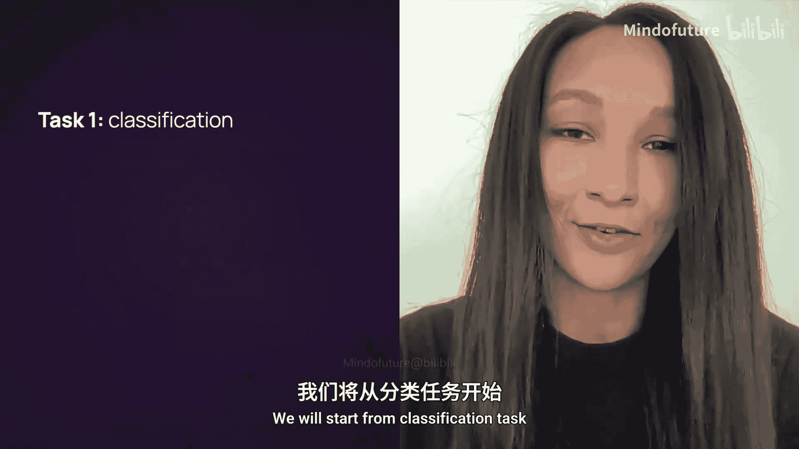
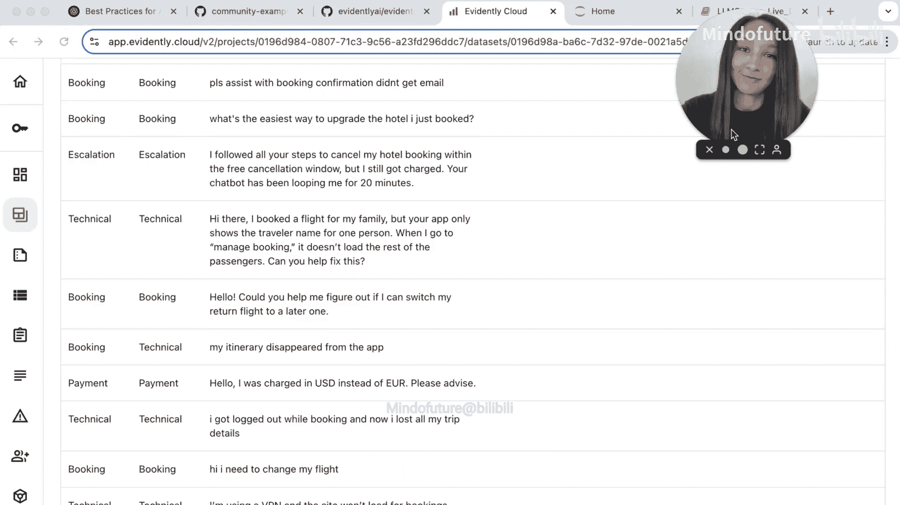

# 【Evidently Ai】面向构建者的Llm评估 ｜ Llm Evaluation For Builders p06 P06_4._教程_评估大语言模型在分类任务上的表现 -BV11ABiB6EZQ_p6-

🎼Hello and welcome to this practical tutorial on building and Aating LLM Mats。😊，In this video series。

 we will show how to build different apps with LLM and evaluate them。

You'll start from classification task。

Imagine you need to build a chatbo for a travel company where users send tons of different messages on bookings and cancellations。

 your task is to classify them by topic。In fact， this task can be solved with LLs and generally even in complexityI agents。

 the first step is to classify the user's intent and then decide what prompt or what tool is the best to do the job。

Such kind of tasks are often solved by elementsNs， but to make it more fun in this video。

 we will also train the traditional machine learning model and you'll see whos。Let's get started。

As you can see now， I work from my local Ge notebookbook。During this tutorial。

 you are going to use Open AI as well as evidently for both tools you would need to have your API keys。

I already get my and I set it up as En variable and I suggest you do the same if you work in Jabiro notebookbook or you can use secrets if you go for a call op。

😊，First of all， let's get started from a couple of imports。

I'm going to use Sps and Skykagi La and also have very interesting classification problem its multiclass classification we are going to classify text inputs into different groups this is the booking problem statement we already have this data set uploaded to evidently course Github。

And I'm going to access it through pandas。Yeah， I just got it。And let's preview our dataset set。

So we have short queries， you can preview it right there and they have different labels。

 basically you have five labels there and the task is to glify them correctly。😊。

Let us take a look at the size of our dataset well it's not huge right we have two columns。

 the input text and the label and it's 200 rows， so I would like to start from more like traditional approach and throw train logistic regression model so that we can see the quality of a baseline and then we are going to apply zerosh learning so that we can compare which approach works the best and maybe decide site which suits more to our use case。

So let me start from thequeezing data into two parts， training and testing。

I'm doing this help of Skyca on trend test state and I believe for our case it would be enough if just set like 10% hour data to test and all the rest you'll be training and I use random states so that you can do reproducible experiments basically if you would need to train in the real classification model you would need to use some cross validation and hyperparmeter tu so that you can get the best possible models but here you're just doing it for the experimental purpose so it's not tutorial trial on training classification models。

😊，Having this in mind， I'm just split my data into two parts and I will train a single g regression model on top of training data and then apply it to the testing data。

So that's more or less my plan in order to trainlingistic regression I would need to repro my text a little bit because I cannot just train model on top of the old text data。

 so for doing that I'm going to use count vectorizer from skyc and feature instruction text it will help me to calculate some statistics over words presence in my short queries and then use those statistics like how many times this were presented in my text in order to like train the model on top of numerical vectors。

So yes。 and also I'm going to import the logistic regression model itself so that I can use it and and accuracy score to。

Shortly and quickly assess the quality of my models。

Here we go and let's create the vectorizer object that's basically a preprocessor which help us to transform raw text into numerical vectors first I would need to fit it on top of my training data and then transform my training data into vectors and then I'm also going to transform my testing data so that I can use both model。

Here we go and let's create a model， it's basiclingistic regression with the random states so that we can have reproducible results and I also limit mark situations。

😊，Yeah， now I have an object， then well let's feed it。

 so I applied it to vector train and I'm going to use labels as well。And after I trade my model。

 I'm going to generate some prediction， so first for trillion data and then for testing data as well。

This should be super fast and you can see that well， it's extremely fast and no tokens involved。

 so it's also cheap。😊，So now I have my predictions。

 I also got labels and I can calculate accuracy and it's fine to use accuracy score here because it's not like binary classification。

 it's multiclass， it's well balanced， I would say so we can apply the accuracy score here and be safest that。

😊，And you can see that it's perfectly done on training data。

 well it's expected kinda let's see on testing data， well they can see that the score is like 80%。

 so in 80% of cases we had the label correctly， which might be a good form multi-class classification buts to understand it better。

 you would need to build like a proper report so that they can see other classification quality metrics like precision recall or F score else it would be nice to see confusion metrics so that you understand how good we are for each particular class。

So let's do that。For helping us to build a proper report。

 we're going to use evidently in order to use evidently。

 we would need to import a couple of things from evidently， but I believe you already。

No the basic API So it's data， data definition report and multiclass classification。

 I believe we touched this point in previous videos， so probably I do not need to stop here。

 I'm important that and now let's build up our data frame because for evidently we need to set up a data and well data frame will be basis for this dataset set So I would create depend data frame is the label equal to our test labels then I'm going to use test predictions we just generated this help of a gtic regression model and the queries itself which are in ex test and I use dot values in both cases here just because I do not want to store original indexes I just don't need it。

Yep， let's preview our data frame。And here it is。 so we can see queries， predicted labels and labels。

 and well in most cases， it's similar， but sometimes you have some errors。 So yeah like here。

But I would say that actually it's a good question what is our expectations for ideal model because queries are pretty short and it's all related to booking right so it's not a big deal to like mistake something to a booking but yeah it needs to be properly analyzed this type of report and the raw data analysis so let's continue with our report。

😊，As promised we would need to start from the data set and data definition in our case。

 data definition helps to understand how to parse data correctly and well we have a single text columns with query and then we need to tell evidently that we are working with multiclass classification problem and target and predicted labels are not just columns its target and prediction in our case。

 so itss market like this， this help of multipl classification， let me run it。😊，And yeah。

 now I have my data definition ready so I can create data set and I'm going to create it from data frame and data definition。

Here we go， so now I have everything to build up a report for doing that。

 I use report objectives here， I need to specify some metrics。As promised in this case。

 we are going to go for a classification preset。Here we go and in order to get some values。

 we need to run this。Yeah， it's ready， so I'm intrigued why not to preview it right there inside the Opyyro notebook。

And here is our report so we can see the accuracy exactly as it was calculated before 80% and also you can see precision recall and F score well looks actually not bad for multiclass classification problem here's your confusion matrix and if you're interested you can see and compare the models's mistakes for different class well interesting right and also you can have the。

Metrics calculated for each class independently。Well here we have our baseline is pretty nice。

 let's load those results to Ely cloud so that we can store it and attach it later and then we'll try to apply large language model to solve the same problem。

😊，In order to load my report to Ely Cloud， I would need to create a client。

So let me import Cloud workspace and then I'm going to create a client and you can see that there is no information about identity API key。

 this is like that because I have it set up as my environment variable so if you did not do that you would need to specify it right there as well。

Yeah， so evidently we organize our work in projects。

 so first of all I would need to create a project or access one if already created it but I did not。

 so I would call it classification task LLM course and I would store it in my personal organization here is an organization ID in order to get your organization ID you're going need to access evidently in the UI and just copy it from there。

😊，So let me create the project。 And now as I already have project。

 so let me access the cloud and see whether。It's created。

Yes so here it is exactly as we call it so far it's empty。

 but yeah now it's time to go back to our Jepy notebook and it' help comment Ed Run。

 load our report there and I'm also going to use includelude data through so that we also load our dataset set。

Here we go。Let's quickly see if it's loaded correctly。I do not expect any problems there。

 but let's see， yeah， here we go， here is a single report if I hit explore button。

I will be able to see the same results。Very nice。And here is my dataset set as well。

 so if I need to understand some particular cases better， I can read label。

 predicted label and the text itself， so it's very useful for the analysis。Okay。

 looks like it' done in our baseline and you can move on to the short classification。For doing that。

 I'm going to import Open AI。And create a client， well the name client is already occupied。

 so it's going to be O A client。So now in order to apply threshold learning I'm going to use OpenaiI respond as create API。

 let me quickly check the syntax so that later I can build a function based on that and syntax is pretty nice and simple so I have instructions that's the place where I can write something that we called system pro before so in the general instruction for our model I can select the model itself here I go for GT for O mini and the input data right so it's my test question I'm just asking what is the latest version of GT4 model。

Let us check this index I think it's very useful if you're going to apply something for the whole data first preview if you have it correctly。

Yeah I'm happy with the output。 Yeah， well it doesn't have an access to internet。

 so that's the output， but it's kind of okay。 So now I'm going to implement very similar function based on this response API I'm going add some system prompt instructions and I will apply this query to the whole data sets to the label queries so that it uses every single role as the input and generate the prediction label for me。

 So my instruction will be pretty straightforward So I tell that it's a customer support assistant trained to classify in and booking related support messages and then I just have information about every single class like booking payment policy technical and escalation and even based on those descriptions you can see that it's kind of intersecting because well technical can be as well related to booking which can be kind of escalation right so it's going be hard to come up with the ideal model but let's try I think those。

Conions makes a total sense。Right and yeah I think it'm going to be nice if you just apply this prompt to our data。

 so again I'm going to first apply it to a single row。

 so our first query in our test data is please assist with booking confirmation didn't get email well pretty rough。

I'm interested if you can get kind of guest in the class。I would say it's Elsa。

Technical hours collection or booking。 I mean， well， yeah， it's not that clear。 Yeah， it's booking。

 Okay， so now let's try and see what our model will tell us。😊，So I'm going to apply it。

To the same inquiry and see the output booking。 So at least on top of this case it's correct。

 So I like the format of my output and let me wrap this code into function。

I'm going to use client model and inputs as input parameters right and here is the same response so I'll place here instruction model and input and return an output so pretty straightforward implementation and again it's not like production rate we are just experimenting。

Here we go， now let's generate some output here。I'm using list comprehension。

 so I'm just generating the list with predictions。And well。

 it does take some time because we apply large language model to every single input。

 let's wait a bit。I almost lost my patient there。😔，Okay。

 so let's see the list of the predicted labels。Yeah， looks fine。

 and let's quickly assess the quality because I just can wait them to see the numbers。

 and yeah it's already better than the。I guesstic regression， nice。

 so I not to create a data frame with the result I'm going to have here label。

Quries and new predicted labels generated this。Hello。Here we go。

 so here I can reuse my existing data definition because the structure of the data set is quite same。

And that's how I can start working with the experiments I mean I have a baseline now I created like the second approach and in order to like understand and compare the quality maybe be later decide on the best approach for the problem statement what I need is to create a report and now I need tech because actually I have more than a single run in this case I used open AI for0 mini so let be tech。

And instead of browsing my report here， I'm going to send it to Ely as well。You want to pull。Elsa。

 actually we can explore different models in Open eye because it also have now GT4。1。

 why not to add one more iteration because it might be who knows。

 maybe we will be able to achieve even better quality。Anyway， it's very fast。Well， it is not。

It's an experiment which you can call it really fast。

 so let me add it as well because I'm just curious to see how good it is。😊，Yeah。It's done。

 So let's quickly assess the numbers。Well， similar， but it's just accuracy。

 we have much more metrics， so let me generate a data frame with prediction， label， label and query。

😊，I'm also going to create the data set for evidently so that you can generate the report now stack Open theI 4。

1。And other cells areended to evidently。Now I have everything loaded to Ely so let's access our project。

I'm going to go back to reports to check if you have everything and yeah， it's all loaded。

 it's all here。So now I suggest to take a look at comparison option and evidently and if we hit all the check boxeses for our reports to compare。

 and here I'm going to compare all reports because it's all related to the same problem statement。

 I can hit button compare here。And here we go。 So basically， now we can。

Compare all our reports in terms of metrics like pure numbers and see what approach looks better for our problem statement for instance here let us start from accuracy score right so we remember that for our baseline logistic regression we had 80% 0。

8 here it is and then had same for0 shot learning with different models。

We also have precision and recall， and you can see that。

Most or even all of metrics are actually the same， so you can conclude that the upgrade from GPT 40 mini to GPT4。

1 didn't really helped a lot。So this is convenient interface where you can compare all the metrics and decide what approach you like better。

And basically after you selected one， for instance， GpT4 dot0 mini looks really good here。

You can go back to reports。😔，And explore the single report in more details。

So actually here we have confusion matrix， right， you can understand where we made a mistake。

And what has happened？And also， if you're interested， you can go directly to the dataset。

And assess all the。Examples so that you can understand what has happened and maybe agree or disagree with the results maybe add some comment for future experiments and share it with developers That all I wanted to share with you in this tutorial and we know how you can create the report with help of evidently send it to the cloud and access comparison tab so that you can compare results quickly and understand which approach looks better at least from the quality matrix point of view。

