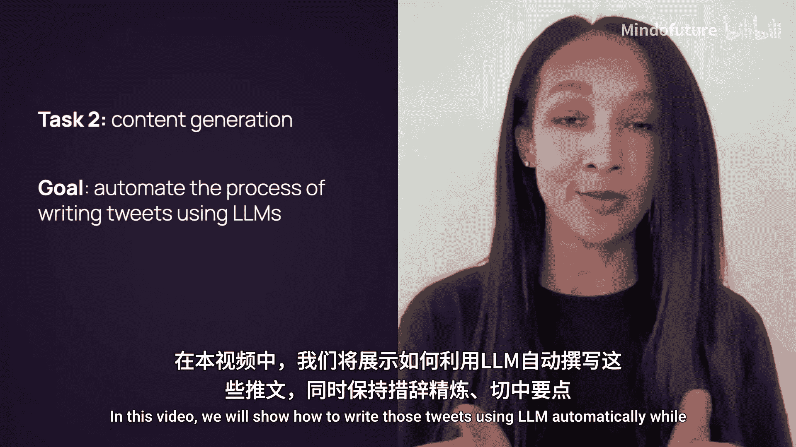
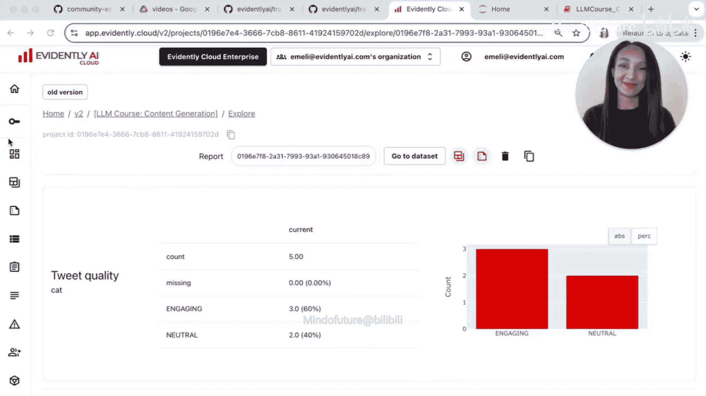

# 【Evidently Ai】面向构建者的Llm评估 ｜ Llm Evaluation For Builders p07 P07_5._教程_评估大语言模型在内容生成任务上的表现_追踪与实验设计 -BV11ABiB6EZQ_p7-

Hi and welcome back。Imagine you work in a product team and the part of your job is to write Ts so that you can share updates and explain features。

 and you actually want those tis to be clear and fun and worth reading。In this video。

 we will show how to write those threads using LLM automatically while still keeping the tone sharp and on point。

It will also show how you can evaluate outputs on the goal so that you can iterate until you actually get what you need。

Let's dive in。I'm going to use much better notebook to run this tutorial。

 you can do the same or go for Google Colll Op。Let me start from a couple of invers。

 its open Air and pandas。And well， as maybe a future blogger。

 I prefer to first come up with the topics I want to tweet on and then ask LLM to write the full like blog post or tweet for me。

So I selected something close to me like technical related to software engineering。

 testing and evaluationviation so what you'll be like testing in AI engineering is as important as in development well good point actually CICD is applicable and AI and so on I have five topics so you can read it right here。

😊，Basically that's it and I need to create my open eye line so that I can call it and generate my tweets and as you can see there is no secret right here so I do not have here Open eye API key and this is because I actually have my set as environment variable。

 you can do the same。Well， now it's done let's try to do some basic generation and for doing this I'm going to use responses API so I'm going to just create a tweet and my input will be write a paragraph about my topic right so that's just a preview I want to see how it works and actually I want to check whether I can then wrap this code into function and apply to all my topics so that's just like the testing So yeah no system prompt。

 no instructions just write a paragraph about my topic。Here we go。

Mjoic happening and let's see the text。You see that there are a lot of things and features。

 so actually to see the output that would need to go for output text。😊，So here is my output。

 well let's spend a couple of seconds to read through it。Yet has a point， testing is critical。 Yeah。

 it is。Yeah， I like it， so I think it makes sense to apply this prompt to all of my topics and see whether it's nice。

 engaging and worth tweeting。I would wrap my instruction into the function。

 so basically it took as an argument client model topic and well， I'm not to ensure that。

I should ask client like that， let me quickly update it。So I think I would better do like this。

 I don't really want to pass the client。😔，As's the variable here， So yeah。Well。

 a little bit of refactoring right here。Now I can call it live demo。

 so let's see whether it works still。Now I took the last topic with minus one index。 Yeah。

 it's about evidently。 And yeah， evidently indeed is a powerful tool for conducting LM testing。 Yeah。

 nice， nice。 So I'm happy with the outcome。 So now let me run a proper experiments。

 I'm going do a couple of iterations to write in my tweets。

 and in order to evaluate how engaging how nice how positive it is。

 I'm going to use evidently report。 So the steps would be the following。

 I'm going to generate tweets on my topics that I'm going to generate evidently report and score all the tweets。

 and as soon as I am happy I'm potentially can go and tweet them in evidently account。

 if thenna let me do that。😊，For doing an experiment I wanted to introduce to you new topic which is tracing actually tracing is very interesting and I would say helpful in order to lock down everything is happening in your function or your bigger code module so that you can later read through traces and understand every single detail you logged into the system。

For doing that we are going to use not only evidently but also Cha the Library and let me quickly show it to you。

Traceley is a library introduced by Evily and it's the tool designed to trace and monitor AI models so that you can understand everything happening during the AI interactions。

I'm going to use it here in my experiments， so in order to repeat those steps you need to install Traly as well。

 the instruction should be very similar， just go for P install or con install so you can use the same structure to install this package as used for evidently。

So。From Traley， I'm going to import in a Tracing and trace event。

And I'm going to also import a lot of standard things from evidently which we touched before。

 its' cloud workspace so that I can initiate my client and things like data data definition report and a lot of descriptors。

 presets and templates so that I can build up my report nicely。

So I have it now let's create Ely client so that I can connect to the cloud and my organization。

 I will be able to create a report and load some data there。😊，And let us create new project。

 this one should be called content generation， well that makes sense。Here is my project。

 let us quickly go and see whether we have it immediately。It's not like I have some depths。

 but just wants to see it。 Yeah here it is， let me start it。Yeah。

 it will be right here and I can close up demo so that you have this project first。Okay。

 now let us initiate tracing and this is actually a very interesting thing so basically what I'm doing here is I'm telling that I'm going to use traces here and I need to set where to trace my data so basically I need to specify the project it will be this project so I'm going to use project ID here and I need to set up an expert name because I can trace different things in my project and have several tracing datasets there I will introduce to you this tracing dataset concept a bit later as soon as we trace something so that you can go and see how it basically looks like。

So yeah in order to initiate our tracing we need to specify project AG and expert name in tracing Elsa needs API key。

 I set it as En variable and you would need to specify the cloud address but as we use the default one we can just keep it。

Here we go。 If you go now to Ely Cloud navigategate tower project and go for traces。

 you will be able to see this data set generated。 It's empty， of course。

 because we did not lock anything there， but you already have an expert ID name and you can see that it's here。

Okay， so let's move on， remember our previous function， basically generation。Here we go again。

 so now I recrafted it a little bit， now we have three arguments， its topic。

 model and instructions and we still use basis respond this API so that we can pass the instructions。

 model input and generate the output and now I'm going to output only the thread itself just because I want to start from the very simple tracing。

There will be only few values， all input values and the output。

 so basically in order to wrap my function by tracing。

 I'm just going to use this decorator tra event without any arguments so we just started。

 but actually you can customize it quite a lot。There are quite a lot of instructions how you can do that。

The full illustration instructions are here and you can read how you can customize tracecing these different parameters like fan name。

 track arcs， ignore arcs， track outputs， bars output。

 so that's quite a lot but I'm going to start from Bas here we go and now let's generate all this tweets for our topics。

Oh， we need to actually run the cell before so that you have the new implementation of basic2 generation function。

Here we go。 Yeah， now let's actually generate those threes。You can see that I'm using model GPT3。

5 tubo so I'm trying to save some tos here and maybe it will be enough for my pretty simple tasks and I did not use any instructions so now it's ready I think I can just print it out。

Oh。Those are pretty long and I'm not going to bore you guys by reading all this out loud and actually that's not what I would do myself。

I would prefer to implement some report with some descriptors so that they can help me to judge my tweets without reading them myself so that I understand whether they are good。

 engaging and actually positive。So let us do that。 But before， actually， I would like to。

Aess those tweets， those tweets in the format of data 100% I could construct the data frame and data set myself from this list because well it's already like a column of ts。

 but I just wanted to introduce to you how we can load data from tracing so let's access our traces。

Now I can actually hit the view button and you can see that， well， we have all these five tweets。

There are different ways how we can browse it。Actually， we can view them one by one。

 so let me start from the。First one， I guess。I just hit the view button and let us see the parameters。

 so basically you have general statistics like the duration， child spans， etc。

 but you have only single function without any child function etc。

 so the structure is very plain like a single call。Here we have some attributes， its topic。

 its model instructions with to those attributes from the input arguments or the function right and yeah this is why instruction is empty。

 we didn't have any and the models' result so if you do use trace event without any specified parameters。

 we automatically get all the input argument from the function and the return。That's it。Ilse。

 I can browse this data in format of dataset。Let me quickly go there and in this case remember the dataset near Eless report。

 it's very similar， so now you have the column for every single value right and you can just scroll and read everything down and if you need to go back to the tracing view you can just hit the button go the trace and you'll be able to see the trace right here it is。

So again， actually we are here for a pretty important reason because you need to access the ID of our data set。

 let me go to traces and here is my expert ID， let me copy from here and I'm going to go back to the code。

And in order to load this from Aly cloud， I would need to specify this ID here。

And that's actually pretty convenient， especially if you work in a team and one engineer is responsible for tracing and the other engineer or data scientist or product manager is responsible for doing some analysis。

In my case， it all goes down to myself， so I just copy the data strategy and load data back here。

Actuallyction now below not just pure data but the whole dataset set object。

 and you have pretty lots of nice things here， for instance you can go for a data definition。

And you see that is already created for us， so we understand quite a lot of things about our dataset we have the categorical columns like model or instructions。

 well in our case it is categorical because there no chances to guess that it's raw text right also we have information about the topic and the result and the data understands that it's text columns very nice。

So great， let's use this data definition later and LC we how data cost and if I go for data set as data frame command。

I can see it in the form of data frame， right， so I have quite a lot of。Additional columns， but Elsa。

 I have all my data like topic， model， empty instructions and the do as well。 So nice。

 I have everything to actually build my report。I mentioned before that those tweets should be worth reading。

 so I think it's good to keep them quite engaging。To make sure my tweets are engaging。

 I created my binary re classificationification template。

 so basically I'm later going to create LM judge based on this template to check whether my tweets are engaging or neutral so let us formulate the criteria in a way that there some specific points that should be hit if the tweet is engaging and all the opposite things will be neutral so we can read through that。

I'm going to run it so via my target category would be engaging。

 my non targetar category will be neutral and whenever a model is uncertain about the label。

 I would ask it to return neutral right so that I cannot mistake my neutral tweets by engaging and to post it somewhere so that's safer strategy for me。

Now let's create these scriptures and together with LLM evaluation for engagementness。

 if I can say so I'm going also measure our text lens and sentiment lens because I consider a two to be them so I need to like。

😊，Be indeed with limitations in terms of length and sentiment。

 because I just want to keep them neutral or positive， but definitely not negative。

 so that's our myscriptures。I'm going to run command and descriptors。

Yeah let's wait done and now if I call data set as data frame。

 I should be able to see some additional columns related to those descriptors。

 so I expect to have like four more columns。Let's check if it's here yeah it's land sentiment to equality and reason reasoning。

 this is why for three descriptors you have like four more accounts great and ouch I can see no engagement feeds actually but yeah let's keep iterating maybe at the end of this tutorial I will be able to get at least like a couple of engagement feeds but I'm not sure because well it's not my strand definitely I'm not good at writing。

😊，So yeah， let's generate report now。And what I'm going to do is to add a couple of text to my report so that I can later understand the connection between the experiment result and the parameters I had。

 in this case I'm going to say that I used GT through the 5 Trbo and basic generation without any instructions。

And I'm going to send this data to the project。It's now there。 I even see the I of this runrine。

 Good， so now let's move on to the better generation。 In this case， actually。

 I would add some instructions， So I would tell that the Lm is the chief editor with 10 years of experience in technical writing。

 and I will also say that it specializes in great and concise and engaging and to the point content for engineers。

 I think that's pretty nice。😊，Okay， and now let me use the same function to actually generate those tweets。

 but with this instruction and with better model， now I'm going to use GT for Omi in hope that maybe it will be able to generate for me better tweets。

So lets me do that。While we are generating， let's go to Cloud and see the new updates in our traces。

Let me go back to traceview。 Wow， now you see much more to it。 Let's take a look at dataset set。

 view。Yeah， you can see that now we have both these from the previous interaction from the current interaction。

 so that's quite nice。Let me copy the data set ID again。

 and I'm going to load it back to the code and analyze it a little bit。So yeah。

 now if I pull this data from the cloud， I will actually get not only data from this current experiment iteration but the whole tracing data for some cases that's exactly what you need because you might want to play around with all the experiments you had or maybe for some other cases。

 you would prefer actually to store those data in separate data sets。

In the next experiment iteration， I'm going through this exactly so that you can decide whether you want to create the separate data set or continue to write your data in the same one。

To me personally， both works quite nice so you can go for any strategy you want。In my case。

 I get dataset for all the experiments previous and the current so you see that I have like much longer on this data frame but it's so simple to parse on the current experiment and I'm going next is I'm going to create the data frame out of my data so basically I just use data as data frame command and then I'm going to use simple filtering I know that in my new experiment I use GT for all mini so if I just select my data by this parameter I'm going to get on the new experiment。

That's it。Those are my bar tweets。Perfect， else I have five only。Nice。

 so what you're going to do next is somehow calculate our descriptors and generate a report and this is fairly simple in this case I decided to create the new dataset set object from pandas so I can use my better to data frame I also going to reuse the data definition from the previous situation why so because my data definition statement the same which is great and I'm going to reuse descriptors list which I already created because again I need to keep the same descriptors so you see that's very fast and I would say pretty convenient。

😊，Now I generate my new data set and you can preview it quickly。

To check whether we have our descriptors there presented。And he， here we are。My gosh。

 no engagement to it。 Well， you definitely need to do better。

So let me quickly summarize it as a report。And send it to the project。

Now we need to come up with the better strategy and I believe change generation is exactly what we need。

 so I'm not going to create my tweets from scratching again。

 but what I'm going to do here is to like update or rewrite existing tweet making them more like engaging and fun I guess。

So here I promise to show you how you can trace your data but send it to the new data set and that's exactly what's happening here so in order to do that I need to initiate new tracing that's exactly what's happening here but I'm going to send this traced data to the same project this is why I keep the same project A here the new name for my expert content generation chain but I believe you guys can come up with the better name and I'm going also to mention parameter as global false so that I can like。

Have nutrition in the same environment where I had the previous one。So let me do that。Okay。

 let us quickly check if you have new tracing data。Yep， we have a new data set。 it should be empty。

 of course it is。Now let's go back to the code and let's update our strategy to regeneration or regeneration in this case first of all。

 I want to create new instruction， let's be more positive so I'm trying to say that we are writing from the evidently engineer like persona and again a lot of experience in technical writing but now let me emphasize then the text should be engaging maybe positive fun I don't know let me start from word fun so I'm really you know I'm trying I'm trying to make it nice。

So， okay。And yeah， now we have the other function， I call it change to generation and basically this function takes is an input the tweet。

 not just a topic， and what I ask to do here is to make this tweet more engaging。

 maybe more personal， maybe I would need two to mention fine here as well。

I also want these tweets to fit under the X limitations and I made a couple of more instructions to use a persuasive tone and do not use any motion and hashtags。

 but that's my personal preferences。😊，Yeah I think it's a good function so now let's generate tweets and just take a look what I'm doing here instead of taking my topics as the input I just take the previous iteration better tweets and I use the result which is basically the output from the previous iteration it's not like I'm recommending you to build your prompt chains like this but in our case the goal is not like to show how you can write production grade code for prompt chain right it's rather to set some experiments and if I already have this data I just not want to regenerate it again so I would better just reuse it。

It's generating and while it's generating， let me go and access the dataset ID for my new dataset。

It's already traces。 Let me go here because I need to copy this IDd。And specified here。

It's done so like us。Loload this data here。And my God， I just， I hope for the best。

 let me quickly show you data definition。😊，Here we go。Yeah pretty similar structure。

 but now the names of columns are different because the function is called differently right so now it's not just better tos or basic its generation it's changed with generation but I just wanted to draw your attention here so that you do not reuse the previous data definition because it just doesn't fit here it doesn't suit it because well the column names are different。

So yeah， let us know。Regenerate thescriptures because now we need to specify this new name for our columns。

Yeah， now let's add thescriptors to the data set again it's pretty similar command to what we do in our first iteration。

Oh， I hope so much to have it least one engaging in kids， so wish me a good luck here。

 I'm generating my report。And let's send it to the cloud。So yeah。

 now let's go and preview whether you have any successful kids or not。In this case。

 I'm going to go to the report。And it's so easy to find my last report here it is。

 so it's change Gene GPT 4。1。At least one engage in these， please， please， please， soance is correct。

 all yeah， less than x limitations。Yeah， I have engagement it。😊，I have three， actually。 For fact。

 I have something to eat。😊，Yeah， let us take a look at those tweets。 So I'm going to go to the。

Dude quality column。Yeah， and oh， why it's that actually？Oh， what's happening here。

 Let me just read through that。Oh， yeah， I see why it's negative。

Fix and Bro AI models is not positive at all。Oh， I like the second one。Startt of guesswork with LMs。

Yeah， and like actually it's quite similar to what I would have said myself。

 but I'm not able to write those nice tweets myself， so yeah， I'm happy with the results。😊，Finally。

 let me quickly go to the dashboard。😊，And show how I can review the experiment results in a dashboard so that we understand what is the most successful strategy In this case。

 I'm just going to use like the pre tab， which is called columns and I'm going to submit it here So yeah here have all the statistics for all the scriptures in our reports first is the lens so we can see that。

At the very last experiment， we had finally like shorter tweets， which is great。😊，Also the sentiment。

 wow， that's quite interesting only in the last experiment you had some negative results， well yeah。

😊，But here is my favorite plot because here we have statistics over neutral or an engaging its。

 and I can see that here in the very last experiment finally I have three engagement tweets so I can go to the report and enjoy the statistics。

😊，I believe in this point I wants to stop the tutorial because I shared everything I wanted with you guys here。

 I hope you enjoyed it， I hope you enjoyed tracing。

 I hope you enjoyed making re this custom LM judge to evaluate to its quality and in case you need to use your LM to content generation or anything where you do not have any reference data and need to come up with some let's say custom discretes to understand the quality of your experiments on your outputs now you know how to do that。

😊，开咪。

