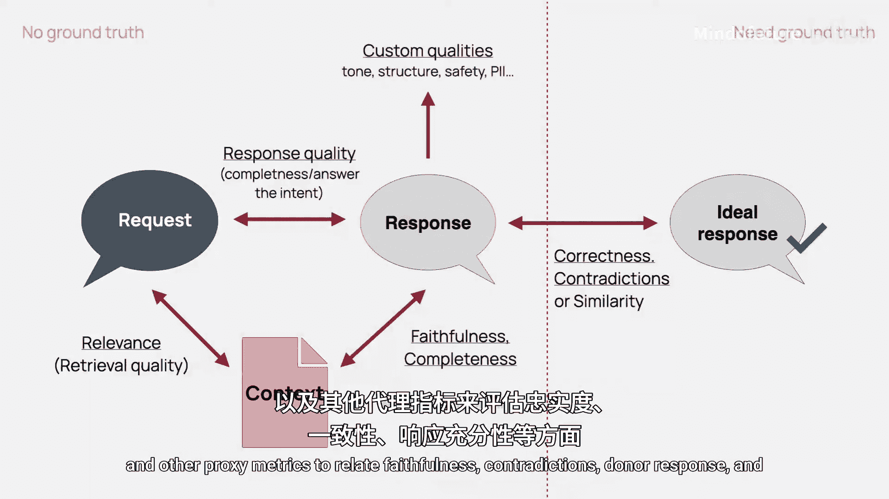

# 【Evidently Ai】面向构建者的Llm评估 ｜ Llm Evaluation For Builders p08 P08_6.1_检索增强生成系统评估方法与指标详解 -BV11ABiB6EZQ_p8-

Hi and welcome In this video we're going to talk about how to relate retrieval augmented generation systems better known as rock。

😊，We will talk whatR is， how to relate both retrieval and generation parts of it。

 and how to use synthetic data effectively， this will be a theoretical introduction of the core concepts。

 but we also have a separate practical tutorial。

The core idea behind drag is to give an LLM access to the knowledge beyond what it learned during training。

 for example， if you are creating a customer support chatbot。

 you will give access to your help articles so that the system can use them to formulate the response。

Rock consists of two parts， the R stands for retrieval。

 that's where research for the answer and the G stands for generation。

 that's where the LM processes the information it found to formulate the final response Of course it can get more complicated you can rewrite the queries。

 you can provide additional sources， you can do it multi step but in essence this is a two step workflow first find then generate。

And to evaluate a system it often makes sense to look at the both sides first you want to make sure that the search works and you can find the information that you should find and second that you can formulate the response that fits your standard。

 of course you can also look only at the final result and judge it by its correctness。

 but sometimes it's useful to look at both sides so that you can do debugging effectively。

 for example you can notice that the LM is hallinating the response because actually you can't find the information that helps you answer the query or maybe you can find it。

 but then the LM doesn't process it correctly。Let's start with a search violation。

 this is not a new problem， information trival has been around for decades and there are standard approaches to how you evaluate the search results to do that you typically create a ground truth data set in this case for each query you can provide a set of documents that contain the answers to this query and then you can test if you can actually find them using metrics like precision at K or recall as K。

And if you create such dataset that is actually very reusable so once you have it in place you co run violations without any additional costs or setup。

 however creating this data can be very time consuming so imagine if you have a question and you need to find all the documents that contain the answers to this question Great if you can。

 but sometimes you cannot especially if you're experimenting for example with checking strategiesateg and even the definition of what you're looking for can be changing。

So another approach is manual labeling in this case instead of preparing the data setup front you can just evaluate the results you get and this is what many companies do even Google they have serious guidelines 150 plus pages long that explain to human readers how to evaluate the search results well and you can do something similar you could look at every retrieve chunk for a given query and give it a label like relevant not relevant or partially relevant and then you can aggregate results across multiple queries however this is manual so you need to spend some time when actually doing this review。

But here is a fun twist， you can actually ask LLMs to display the link for you。

 basically you'd create an LLM judge that relates the relevance of the chance that you retrieve。

Search engines have been doing this lately too， for example here is a paper from Microsoft on how Bing does it if you do it this way you can run a lot of automated as and then aggregate the results across multiple queries。

 for example to check the share of queries where you had at least one relevant result retrieved。

It is useful when you run experiments for example as you compare different vector databases or search strategies。

 but it's also useful during monitoring， for example you can look if there are any queries where you have low relevance。

 then this can point to the gaps in your knowledge base。

And also if your rock system returns just one context and maybe a few small chunks。

 you can evaluate them together， basically you can ask LLM to look at the context and ask。

Is there enough information in this context to answer the question that is being asked by the user。

 that would be a context quality judge。So now let's look at the second part which is the generation let's say that you found some relevant context and you pass it over to LLM to formulate the final response to the user's query now you need to evaluatete if this final response is good there are two ways to go about it depending on whether you're on your evaluations offline or online when you're running experiments or before regression testing you can use the usual groundro data in this case you create data which includes the expected questions and non good answers to this questions and then you compare the answers that your rock system gives you against these expected ones you can do this using semantic similarity or create an LLM judge for correctness or maybe create an LM judge specifically for contradictions it depends on how you construct your groundro dataset。

Creating these test datasets can be time consuming。

 but with rock you actually have a shortcut In this case you already have a knowledge base that you're planning to use to create your rock system in the first place you can actually use the same knowledge base to create your golden data sets。

 In this case you flip the process and you first extract chunks from this knowledge base and then you ask LM to formulate questions answerable from this context This way you create answer question fairs that you can then later review and create your golden data Of course it still needs some manual curation but it's much faster than writing everything by hand。

Now let's talk about what happens when the system is in production in this case you don't have the reference answers。

 but you can still evaluate quite a few things actually more than in many other LM applications with rock you have not just the final answer but you also have the context that was used to formulate this answer so the first thing that you can look at is faithfulness or roundness essentially you can check if the final answer does not contradict the context that was retrieved you can create an LLM judge or look at semantic similarity as a proxy。

There are a few other qualities that you might want to look at like completeness。

 did the answer use all the information from the context， helpfulfulness。

 did it answer the ultimate user intent， o maybe aone does it match your corporate guidelines and expected use case you can also look at structural checks for example verify that your answer is within the expected length that it has all the necessary disclaimers that it always includes the link and so on。

 these are the domin checks so they are very easy to verify。Side note。

 since a rock systems out in external facing it makes sense to do some stress testing or adversarial testing。

 you can focus on quality for example throw in questions when you know that there is no answer in your knowledge base and then check that the LLM response I don't know instead of hallinating the answer。

 or you can throw a few known gachas like for example information about discontinued products or some past product versions。

You can also test for jail breaks and if your system is dealing with sensitive data or potentially has access through the rock system to some sensitive of information。

 you can definitely test for that。If you put it all together here's what you get to evaluate a rock system you can look at both retrieval and generation quality and evaluate them separately it makes sense for you in both cases you can evaluate against ground truth or you can use LLM judges and other proxymetric to relate faithfulness。

 contradictions， toneor response and so on。

So now we've covered some theory， let's take a look at how you can apply this in practice in the following tutorial。

