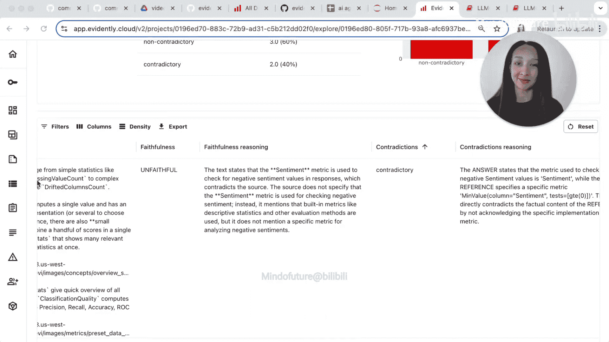

# 【Evidently Ai】面向构建者的Llm评估 ｜ Llm Evaluation For Builders p09 P09_6.2._教程_构建与评估检索增强生成系统 -BV11ABiB6EZQ_p9-

Hi and welcome back。Imagine you are building a product that answers questions based on routine documents like company policies or support guides。

You're using Iraq， a system that generates answers based on re documents。But here is the challenge。

 how to make sure that answers are correct or if it stays faithful to the retreat context。

In this tutorial， we are going to show how to evaluate rock system both in terms faithfulness and correctness。

We are going to set up more correct system， then we are going to generate In test data set and see how we can build the report which tackles both correctness and faithfulness so that you can evaluate the quality of your system before it reach real users。

Let's dive in。And evidently we believe in test dream development。

 this is why we will start from project generation and it will be the place where we are going to generate and store our test data as well as quality reports。

Let's quickly do it in interface。I'm going to call it。Girs。Let's answer in it。And here we go。

In this project， we will generate test synthetic data to use it for a RE system evaluation。

I will open up the project。Then navigate dataset。And here I can hit button generate dataset set。

Here we have plenty of options and I'm going to go for Q& day from documents。

 thats because we are building Re system， I'm going to ask evidently to generate for us pairs of questions and answers and in this case we are sure that answers will be correct because it's the way how we build those dataset and we will be able to use this datasets to test our future Re system。

Let me hit this button and I would need to create the datasetname and upload the file。

I would call my dataset。Dest think Q。Stesting questions and answers and let me drag and drop my file here。

It's done。 So I'm going to use a small part of aly documentation related to Llms。

 I believe that's quite interesting。 And well actually I don't need really big data set because I want to keep it brief。

 but let me do the following。 I'm going to ask evidently to generate for me 10 pairs of questions and answers and then I will select。

Maybe five which I likes best。And here is also a chat box to include context。

 but in my case I don't really need that it will be enough for my metrics to just have pairs of questions and reference answers。

 so I'm not going to hit it。Now I would need to create my secret because I'm going to use LLM to generate these things。

 let me quickly do that。My secret is here， so I can press it now。

You can see that it instantated a task。And as soon as data set ready， we can hit the button。

 open the dataset set， and here is our draft。Let me quickly go through questions and answers one by one as an expert so that I can select which pairs of questions and answers will be a good match for my re system so that I can only att testest it against。

Selected pairs。I don't really like first question and I'm going to drop it。

I don't really want the second one。And the third one， actually。Yeah， this one is okay。

I like this as well。No， I don't want this。It it。Yeah， I like the one about express preet。

Next the方 si mean。呀。And I'm going to drop this one， I think I selected five best questions。

Let me like now drop。Select one。And I think now I'm happy with my dataset。

 but again I would recommend you to invest your time into co this data so that you are happy with the pairs of questions and answers and actually maybe you want to add something yourself in this case you can just row and formal late question and answer yourself。

 I else you can edit every part of the dataset but in order to keep things brief。

 I will just finish here。And now my dataset is ready。Now it's not draft anymore。

 it's dataset set and I have dataset set I， I will copy it to use in my Python and let me go to the code part。

Now now we have testing dataset and here are set up to build our more correct system first of all in order to build the rack I would need to import quite a lot of things and I'm going to need to install my libraries I already installed mind but to make it easier for you I want to mention that we are going to use Lchain as well as Lnk community and Lnk Open A because we are going to use it to create our vector star as well as F it's Facebook AI semantic search so make sure that you have all those libraries installed。

I already have my installs， let us try to invert everything。Yeah， looks like we are good。

So yeah I'm going to use a couple of standard libraries like random requests， timeme， O and Pos。

 as well as things from evidently like a client and a lot of things to generate in data sets of scriptures and the report。

 and of course I need open AI to have an access to an L。

But Nelson instantiateed my clients for open eye and evidently。

And here we go with our testing dataset。 So even before I started to build my mock rack system。

 I want to load my dataset and make sure I have a basis for quality variation。

 That's pretty important when you build。A complex system because there are so many different parameters and strategies to tweak。

 like what is your ranking strategy， what is your chain strategy like chain size and over 11 so there are a lot of things to tweak and optimize for your system so it's always good strategy to start from a testing set。

Let me access it by ID。And here's the preview of my dataset。

 so that's exactly what we had in Ely right squares of questions and answers。Okay。

 so now let's create our more correct system。I will start from implementing a couple of functions。

 first of all， I would need to write a function which access my data through the link。

 I'm going to use part of evidence documentation which is available openly by a link so I'm going to pass here link then this help of response request get download the content of this link and parse the text then I'm going to use character text split in order to build a chunks over my data and then I'm going to。

Generate embeddings this help of open AI embeddings so that I can have a vector for every single chunk and then I will create a vector store so that I can easily by similarity through my vectors。

 That's more or less the plan。So it's my first helper。

 my second helper will be actually search because the first function will return the vector vector store object itself。

 and then it needs to have a function that helps me to like find relevant documents in my vector store bike query that's exactly what's happening here I'm going to use similarity search。

From P as well， here is the query， I'm going to。P as an input variable， right。

 and I'm going to extract five most similar。Chunks of my data that I'm going to combine all these chunks in a single string and return a context。

 This context will be used in the next function。The next function is actually a generation of my response with help of open AI。

 basically this function。Receives question retrieved context and here is the parameter which is model version right。

 and basically what I'm doing here is I'm asking my open eye model to answer the provided question based on the retrieved context。

Here is the input， so you should just say hey， here is the context and the question and the expect to receive a response。

Prety trivial， so that's how you can build your mock rack system。Basically that's it。

 so let us try to see whether it works or not。In order for doing that。

 I'm going to access my documentation and a text format。And let me build vector star on top of that。

So I consider there are plenty of chunks。 This document is pretty long actually。Yep。

And let me now generate my testing in dataset with generated answers as well so that I can have a dataset which includes questions。

 reference answers， those things I generated as help of evidently dataset generation。

 then I have retrieved context and I have generated answers I once to put a all together in a single dataset and then build my report based on this dataset。

So here are my questions。Now my context and I generated the help of search documents function。Yeah。

 I have a context， and now let's create generated answersrs with help of generate response function。

혈람 이으 듯。So I have to gather my questions and contexts。Let's wait until my date is generated。

Yeah is done。And now you have also a list of generated answers and from here you have two strategies to go with first is to read through the generated answers context and questions carefully yourself and decide whether you are happy or not with the results if you are happy then great if not maybe you can generate some hypothesis of what is the problem and how to fix that but actually I personally do not。

Kind of like do that in the first place。 I prefer first have my re so that I can see some summary statistics and then maybe explore only failed cases one by one so that I understand what's going on much faster。

 And that's actually the second strategy your second strategy is to go some tests or metrics for every combination of your parameters like or relating strategy chunking size or whatever you can pick for your egg system and then see what our statistics。

 Then you can go with the best option and still do some manual analysis to understand what's going on for our case we have only one option so far right it's our。

More correct system。 So let us generate。The evaluation data set。

 in this case I'm going to have my question reference answer， of course。

 this we have from evidently else we are going to have a generated answer and generated context。

That's my data frame， let us quickly preview it。Here we go， Soya。Reference。

 answer and generated answer。而。Well， not extremely long。

 but you need to read it through and the context is long of course。

 because we retrieve like five most relevant chunks， so it's quite long。

But luckily we can create our custom LM judge， we can import quite a lot of the full judges from evidently and build our report with a lot of useful metrics。

 let's do this exactly。And I will start from my custom judge。

 which is contradictions check The idea here is to compare my reference answer with generated ones and see whether there are any contradiction between those two things。

 if there are no contradictions then it's great， my generated answer is kind of similar in a semantic sense to my reference answer。

 but if there are some contradictions then I would need to read through it and understand what has happened。

I'm using my binary e classificationification prompt template here， here is the grid here。

Right and my categories， so the target is contradictory， non target non contradictory。

 and if my judge is unable to decide whether it's one or the other， let me have unknown。It's done。

And together with this contradiction check， I'm going to use to fold faithfulness El lamb a well。

 which I can just expert from evidently。 So basically here I would need to say that hey。

 here is my generated answer， here is my context， then you please check if my generated answer stays faithful to the retrieved context。

 In this case， if you have a very nice ranking， so we always retrieve frame and context。

 but your L is hallucinating and kind of ignores the context。 you will be able to see these things。

I think to start its good combination of metrics， let us go for it。

Now I'm going to upgrade the data set from my testing data frame。

And I'm going to include to these descriptors， faithfulfulness LM evaluation and my contradiction check。

Let's evaluate them。And we will see what's going on。So yeah it's ready。

 my next step will be preview my dataset set so that I can see that all my descriptors are here。

Here I can see faithfulness with reasoning， great and contradictions with reading。Oh。

 and the first one is both unfaithful and contradictory。So it definitely makes sense to。Actually。

 load it to evidently so that I can see the visual report and understand what's going on with my。

Questions and answers。Let me go for textexables report。Yep， it's here。Yeah。

 I can tell but preview some statistics is faithfulness it's not that bad。

 I have only one unfaithful answer。With contradictions， so so， three are good and two are non good。

 Let me load it to the cloud。And in order to do that， I would need to have a project。

 the already created one， it's the project where we store our synthetic test data set。Here it is。

 and let me copy the project I from here so that I can go back to the code， specify it。

And load my results there。It's done， let us see the results in the cloud。And let me browse my report。

I hit explore and here it is。😔，Here is our report， it starts from faithfulness and you already know that you have one unpaithful answer and else you have contradictions and in this case we have two contradictory answers。

😊，Luckily we have our data right here so we can order our data by faithfulness by contradictions and understand what's going on。

 it is super helpful because you have so many options。

 parameters and strategies to build up your re system and if you really invest it in generating really nice testing dataset you can trust it then you can find optimal parameters by evaluating quality on top of your test dataset and make sure that you build the best possible option for your users。

Thank you for watching。