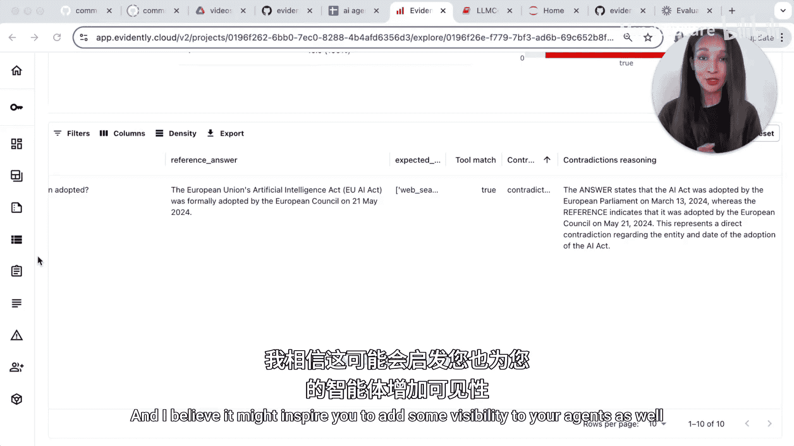

# 【Evidently Ai】面向构建者的Llm评估 ｜ Llm Evaluation For Builders p10 P10_7._教程_构建与评估人工智能体 -BV11ABiB6EZQ_p10-

🎼Hi， in this video， we will explore how to evaluate an AI agent that uses tools like file storage。

 web storage or computer use。You will build the mock EI agent。

 generate a small test and walk through how to evaluate the quality of EI agent answers。

You'll also measure what AI agent actually does， like how many steps it takes。

 what tools it uses and how much content it consumes。Generally。

 it's all about making a behavior reasonable and measurable。 Let's dive into it。

To build an engine I'm going to use Open Air Engines library if you did not use it before。

 please install it before you proceed。I already have it installed， so to with the other libraries。

 I'm going to import agent runner and web search tool from agents。

Else I'm going to trace every single step our agent does， so I'm going to import trace it。

And we will do quite what the ailiation is have of evidently。

 so let's import things from evidently mouth。Here we go Now let's create a couple of clients like Evily client and Open eye client for having an open client I would need to import Open eye as well。

Yeah， all done， and now I can proceed for our agent。

I'm going to do something very brief and simple because our main purpose is evaluation。

 so my agent will be the following， I can give a name here， it will be assistant， Ela instructions。

 it will be very short like you're a helpful assistant and the model will be GPT 4。1。Elsa。

 I'll allow my agent to use some tools and in our case it's going to be only a web search tool。

 it doesn't necessarily mean that agent is going to use web search tool every single time I ask something。

 but now the engine knows that this tool is accessible and in case it needs it， it can use it。

Now I have my agent and let us go with a trial run。

I'm going to just ask a very simple question like what the weather in London is like today but actually to answer it properly an agent needs to access web search to YISO because it doesn't know what is today and what is the weather today right so it needs this tool and please be careful with synchronous mode in Jupyter notebook or Calllab it's important because Jupiter notebook has its own even loop already started right and in case I would try to run my runner in a sync mode it will try to allocate one more Even loop and crash。

Well， I'm going to do it in a S mode so you can see it with help of a await word and it's going to be okay。

It's done， and my result object is generated。 The subject has a lot of fields and I will start from final output so that you can check what's the answer。

Inherit is。It's pretty nice。 It knows that it's Wednesday， May 221t， 2025。 So it's nice。 Yeah。

 I like it。 The weather is。😊，Definitely cloudy， so everything is correct。

Now let's explore our responds because it contains a lot of useful information。

 I'm going to print it step by step so that we can easily read it。😊，Oh， it's only single step。

 well it does make sense because the question is not that tricky and you can see that there are a lot of useful information。

You can see that our agent used web sew， which makes sense it's completed successfully， right。

 and there are a lot of things else available like。What is the answer。

 what tools were used and also has some information about usage it's right there right。

 so we can see input tokens， output tokens， total tokens。

 a lot of things to track to measure and to trace and guess。Now we are happy with our agent， yes。

 it's brief， but it's nice。And let's proceed with testing dataset set。

They already prepared some nice questions and answers and the trick here is that to answer for some of those questions。

 an engine actually needs to use web search for others it doesn't。

 so we will assess not only an answers for our agent but also the correct use of tools and maybe you will see some input output plugins just to add more visibility。

Here is a question list。😊，Reference answers。You can see that to answer a question like what is hugging face。

 agent doesn't need to search anything it probably already knows what it is。

 but like to answer question what is the latest version of Chaity it needs to web search。

Here is our reference answers， correct ones， and actually having those questions I like an expert can kind of assume whether it needs to use web search call or not and I can create LC list of expected tools that's the work you should do when you evaluate the quality of your AI agent it can come up with some expectations of tool usage or reference answers then generate it as a data and use it for validation。

That's exactly what is happening now。 So here is my assumption on expected tools。

If I have emptytuable， not all are suspected， if I have web search。

 then web search is expected for this question。Let me generate it。

 and I will quickly create my data frame is my expectations。

 I call it validation frame and let me quickly show it to you。😊，The structure is very plain， right。

 question， answer and expect it to， and I really like it。Now let's proceed this humation。

First of all， I'm going to need to create a project。

 a place where we are going to start everything related to our task。

I call it a LaC agent evaluation and let me also initiate tracing because in order to generate some evaluations I'm going to ask those questions to my agent。

 then I'm going to trace what is happening and then I'm going to run some evaluations with help of descriptors and reports。

So I am here's my dressing， I will call it just agent testing。Project I D。 Yeah。

 it's needed to be adopted here。Yeah， now let's go and see what is the project and。Oh。

 I guess we don't need it。Here is a project。And let's a see dressing。Yep， number it empty。

 but I just want to copy export ID from here。And let's go back。

We have everything and in order to keep our traces quite nice and go to implement a couple of functions。

I will start from ask question function as an entry point。

 This function basically generates the answers for questions with help of agent。

 Its Els a sync because we are going to use a sync Ch， and it uses question as an input argument。

 Then we try to generate the response， and also calculateulate some statistics on the way。

 says trick a moment and I will comment on it on this next step。

 So we calculateulate some statistics with help of extract agent style function。

 we will explore it next。 and also we try to return on the final output and those calculatedulated statistics。

 And if it's not possible for some reason， we。Raise and error。That's our main function ask question。

Also some statistics are here， so let's explore what happens here in extract Age status function。

It's there。We also trace it so you can see that both functions has this decorator trace event。

 and here I would ask to ignore my responses because I didn't need it twice。

So what's happening here previously， if so how many data we have for every single step our agent takes。

 It's very valuable information。 It's interesting to analyze it to see what's agent behavior， right。

 and what we are going to do here is to decide whether we are going to lock everything to passse and understand it later。

 or we are going to derive some specific statistics to analyze this exactly。

 So there are two option you can follow， I would go for the second one and select what statistics to trace and to track。

😊，I'm going to use input tokens， output tokens， and tool types。Basically。

 what I'm going to do is to aggregate all this information from all steps my agent takes to answer a single question so that I have already aggregated statistics。

That's whats happening now， so I go through responsess and summarize my input tokens output tokens and create a list of tools which were used on the way right El I aggregate how many iterations there were。

 so basically it' the land of my responds。That's nice statistics。Okay。

 so we have very brief statistics， but it's already very useful。

 and now we can proceed with our evaluations。The next step would be to generate answers with help of our ask question function。

Let us do that。And， I guess， I would。Just paste here our expert ID so that later we can download our tracing dataset set from E project。

It's done。 Let's take a look at traces from the project。You are already here。So let's view。

Yeah we have all our1 questions there， let's check a random one。

That's how it looks like we have our main function and one more function which generate some statistics。

And here we have some span attributes， its question responses and you can go to our child's pan here and here is information about tokens input and output iterations and tools in this case we didn't use any tool。

 so quite nice。Okay， going back to our code。Let's load these traces。And get the tracing data frame。

Now what I'm going to do is come up with my final data frame to evaluation。

 Remember previously we had validation data frame which included。What it included expected tools。

 and it included reference answers。 So now in order to be able to run validations。

 we need to combine those expected tools。 Ref answers is actually generated answers with help of agent and all other statistics we collected during our experiment run。

 Let's do that。 I am just going to merge our tracing dataset set with validation dataset set。

I'm going to use question as the column to merge， we have asked question question from our tracing frame and we had question from our validation frame。

 and it's going to be in left merge。Let me show you a result。 So yeah。

 it's actually quite long because we have a lot of columns here。 But still。

 it's important to understand that we do have everything we need its question， its response。

Some statistics。Well， let me turn it like this。Yeah， the question about tag and place。

And our reference answer and expected tools so we do have everything to run our checks。

Now let's proceed with our checks。And remember this nice binary classification prompt template related to contradictions。

 we created it previously for our rack， and now I'm going to reuse it because here else we have a reference answer。

 you have generated answer and you can check whether there are some contradiction between those answers。

And as I'm going to use the same contradiction check certain times it makes sense to save it。

 it looks pretty useful。Let me copy my criteria from here。And x is cloud again。

You can see that here I can create a new prompt。Let me call it。Contradiction， check。

Or contradictions check。I think like this。So I have it。 And this is a very nice place where I can。

I think store my criteria。I don't need this product definitely and yeah that's a very nice way how I can save it。

 it has some version and we can access it later by this prompt ID if we need it。😊，Okay good。

 and let's go back to our code。Let's actually create this contradiction check。

And here is one more descriptor I would like to introduce to you now。

This descriptor is called item match The G here is that we are going to check whether our string has all the items listed in the second column and that's exactly used to our case is expected tools so we have a string with all tools which we are used during answering the question for every single question that's what we collected with help of our status function right and else we have a column with the list of expected tools to use。

So we're going to ask evidently to check whether expected tools were presented in the list of used tools。

That's what's happening here in itemM。So here is the place to search for tools。

 here is the place where related expected tools mode all， so we check for all tools we expected。

 and here is an and tool match。Let's implement list of our descriptors。

 we're going to have only two checks here， correct tools and non contradicttraory answer。

I think it's a really great start。😊，Now let's create our evaluation data set。

 we are doing it from panndas Nrch data frame， data definition。

 let's go for default one and our descriptors。It's done and let me just preview a couple of things because I wanted to show you how this too much thing looks like。

I think it's pretty interesting。 So that's column which includes list of tools used。

 This is expected tools， and we see that toom is like correct everywhere。

 but it was pretty simple dataset set right So it's kind of expected。 That's what has happened。Okay。

 wrapping up， our last step would be generate a report。It includes text ailis。

Right here it is too much perfect contradictions。Mostly nice。

 but you do have two contradictory answers。Let's upload it to the cloud， to the project。

And let's see how it looks like。Let's new gates to report。Find our report see it single one。

And here it is too much perfect。Contradictions， non perfectect。Let's see what you have now here。

I'm going to go to the dataset and you can see that there are quite a lot of useful information in the data。

 its idea of our question timestamp linked to trace's question。Generated response。

Some statistics related to tokens， like， let us see。I guess it's input tokens， Yeah。

 then the next is output tokens。Right。Steps。Question again and reference answers。 So it's very nice。

 Let us go for our contradictions because we know that there is some issues there。

Contradictions and let's see what has happened here。So to analyze it deeply。

 I would go to trace itself。Because it's very convenient and let me explore everything here。

So I think I don need it。 Yeah， and let me go to the question directly。 When has the。

AI Act being adapted。 Okay， here is the response， which includes wing， noise。Well。

 looks pretty good to me。Let's go back to the data set and see why we had some contradictions。

Here it is。So， reasoning。The answer states that it was adapted。In March 2024。And then contradict it。

 yeah， it has adopted in May 2024。I believe it's interesting enough to raise a flag here and share it with your expert。

 maybe together we will be able to create some hypothesis of what's going on and check whether you need to update something in your agent。

 and I'm going to wrap it up here。 You just checked how we can make agent behavior more visible and measurable and I believe it might inspire you to add some visibility to your agents as well。

Thank you for watching。