# Jeremy Howard《给码农的深度学习实践课程1｜Practical Deep Learning for Coders2022》中英字幕 p01 -1-Practical Deep Learning for Coders_ Lesson 1.zh_en -BV15Z421H7zj_p1-

Welcome to practical deep Learn for coders lessons1。

 this is version5 of this course and it's the first gear one we've done in two years so we've got a lot of cool things to cover。

It's amazing how much has changed。😊，Here is a XKCD from the end of 2015。

Who hears saying XK CDD comics before， pretty much everybody not surprising。

So the basic joke here is。I'll let you read it and then I'll come back to it。

So it can be hard to tell what's easy and what's nearly impossible and in 2015 or at the end of 2015。

 the idea of checking whether something as a photo of a bird was considered nearly impossible。

 so impossible it was the basic idea of a joke because everybody knows that that's nearly impossible we're now going to build exactly that system for free in about two minutes。

😊，So let's build， is it a bird system？😊，So we're got to use Python and so I'm going to run through this really quickly。

 You're not expected to run through it with me because we're going to come back to it Okay， but。😊。

Let's go ahead and run that cell。Okay， so what we're doing is we're searchingduct go for images of bird photos and we're just going to grab one。

😊，And so here is the URL of the bird that we grabbed。Okay， we' download it。😊，Okay， so there it is。

 so we've grabbed a bird and so okay， we've now got something that can download pictures of birds。

Now we're going to need to build a system that can recognize things that are birds versus things that aren't birds from photos now of course computers need numbers to work with。

 but luckily images are made of numbers I actually found this really nice。Website。Call it Ps by。

Where I can grab a bird。And if I were going over it， let's pick， it's big。

You'll see here that that part of the bakeak was。251。Brightness of red， 48 of green and 21 of blue。

 so that's G B。And so you can see as they wave around。😊，Those colors。They're changing those numbers。

And so this， this picture， the thing that we recognize as a picture is actually 256 by 171 by three。

😊，Numbers between Noraught and255 representing the amount of red， green and blue on each pixel。😊。

So that's going to be an input to our program that's going to try and figure out whether this is a picture of a bird or not。

Okay。So let's go ahead and run this cell。Which is going to go through and I needed bird and non bird。

 but you can't really search。gooogle images or dap dacker images for not a bird This doesn't work that way so I just decided to use forest I thought okay。

 pictures of forest versus pictures of bird sounds like a good starting point。😊。

So I go through each of forest and bird。And I search for forest photo and bird photo。Download images。

And then resize them to being no bigger than 400 pixels on a side。

Just because we don't need particularly big ones and it takes a surprisingly large amount of time just a computer opener an image Okay。

 so we've now got 200 of each。I find when I download images I often get a few broken ones and if you try and train a model with broken images。

 it will not work。 So here's something which just verifies each image and unlinks so deletes the ones that don't work。

Okay， so now we can create what's called a data block。So after I run this cell。嗯。

You'll see that I basically， I'll go through the details of this later， but a data block。

Gives fast AI the library all the information it needs to create a computer vision model。

 And so in this case， we're basically telling it get all the image files that we just downloaded。

And then we so show me a few up to six。 and let's see， yeah， so we've got some birds， forest。

 bird bird forest。 Okay， so one of the nice things about doing computer vision models is it's really easy to check your data because you can just look at it。

 which is not the case for a lot of kinds of models。😊，Okay。

So we've now downloaded 200 pictures of birds， 200 pictures of forests。So we' now。Press run。

And this model' is actually running on my laptop。 So it's just not using a vast data center。

 It's running on my。Presentation laptop， and it's doing it at the same time as my laptop is。

Streaming video， which is possibly a bad idea。😊，And so what it's going to do is it's going to run through every photo out of those 400 and for the ones that are forest。

 it's going to learn a bit more about what forest looks like and for the ones that a bird。

 it'll learn a bit more about what bird looks like。😊，So overall， it took under 30 seconds。

 and believe it or not， that's enough to。Finish doing the thing， which was in that XKCD comic。

 Let's check。By passing in that bird that we downloaded at the start。This is a bird。

Probability it's a bird。1。Grounded to the nearest four de small places。

So something pretty extraordinary has happened。😊，Since late 2015。

 which is literally something that has gone from so impossible。

 it's a joke to so easy that I can run it on my laptop computer in。

 I don't know how long it was about two minutes。😊，Um。And so hopefully。

 that gives you a sense that creating really。Interesting， you know。

 real working programs with deep learning is something that it doesn't take a lot of code didn't take any math。

Didn't take more than my laptop computer。😊，It's it's it's pretty accessible in fact。

 so that's really what we're going to be learning about。😊，Over the next seven weeks。

So where have we got to now with deep learning well？😊，It moves so fast。

 but even in the last few weeks， we've taken it up another notch as a community。

 he might have seen that something called Darley too has been released。

 which uses deep learning to generate new pictures。

 and I thought this was an amazing thing that this guy Nick did。

 where he took his friend's Twitter bioos。😊，And typed them into the Dali to input。

 And it generated these pictures。 So this guy's， he typed in commitments， sympathetic， psychedelic。

 philosophical， and it generated。These pictures。 So I'll just show you a few of these。

 I'll let you read them。I love that。That one's pretty amazing， I reckon。😊，Actually。

I love this happy Susyus has actually got a happy rock。😊，To move around。So this is like。Yeah。

 I don't know。 when I look at these， I still get pretty blown away that this is a。

Computer algorithm using nothing but this text input to generate。

These arbitrary pictures in this case are fairly， you know， complex and creative things。

So the guy who made those points out， this is likeum。😊，He spends about two minutes or so， you know。

 creating each of these like he tries a few different prompts and he tries a few different pictures。

 you know， and so he's given an example here of like when he types something into the system like here's an example of like。

😊，10 different things he gets back when he puts in expressive painting of a man shining rays of justice and transparency on a blue bird Twitter logo。

So it's not just you know， Da too to be clear， there's you know a lot of different systems doing something like this now there's something called midjoney。

 which this Twitter account posted a female scientist with a laptop writing code in a symbolic。

 meaningful and vibrant style。This one here is an HD photo of a rare psychedelic pink elephant。

And this  one， I think， is the second one here。 I never know how to actually。Pronounce this。

This one's pretty cool， a blind bat with big sunglasses holding a walking stick in his hand。

And so when actual artists， you know， so so this， for example。

 this guy said he knows nothing about art， you know， he's got no artistic talent or something。

 you know he threw together， this guy is an artist who actually writes his own software based on deep learning and spends。

 you know， months。😊，On building stuff and as you can see， you can really take it to the next level。

It's been really great actually to see how a lot of fast AI alumni with backgrounds as artists have gone on to bring deep learning and art together and it's a very exciting direction。

😊，And it's not just images to be clear， you know， one of another interesting things that's popped up in the last couple of weeks is Google's Pathways language model。

 which can take any arbitrary English as text question and can create an answer。

 which not only answers the question but also explains。😊，It's thinking。

Whatever it means for a language model to be thinking。U。

One of the ones I found pretty amazing was that it can explain a joke， I'll let you read this。So。

This is actually a joke that probably needs explanations for anybody whos not familiar with TPUs。

 so though this model just took the text as input and created this text as output。😊。

And so you can see again， deep learningning models doing things which I think very few。

 if any of us would have believed， would be maybe possible to do by computers even in our lifetime。嗯。

This means that there is a lot of。Practical and ethical considerations we will touch on them during this course but can't possibly hope to do them justice。

 so I would certainly encourage you to check out ethics。

faster AI to see our whole data ethics course taught by my cofounder， Dr。 Rachel Thomas。

Which goes into these issues in。A lot more detail。U。All right。

 so as well as being an AI researcher at the University of Queensland and fast at AI。

 I am also a homeschooling primary school teacher and for that reason I study education a lot and one of people who are live in education is a guy named Dylan Williams and he has this great approach in his classrooms of figuring out how his students are getting along。

 which is to put a colored cup on their desk green to mean that they're doing fine yellow cup to mean I'm not quite sure in a red cup to mean。

😊，I have no idea what's going on Now， since most of you are watching this remotely。

 I can't look at your caps and I don't think anybody bought coloured caps with them today。

 So instead。We have an online version of this。So what I want you to do。😊，Is go to。

Cps stop fast at AI， slash fast。That's cups。 do't fast， do't AI slash fast。

And don't do this if you're like a fast AI expert who's done the course five times because if you're following along。

 that doesn't really mean much Over， this is really for people who are。You know。

 not already fast experts and so click one of these colored buttons。😊，And what I will do。

I I will go to the teacher version。And see what buttons you're pressing。All right。

 so so far people are feeling we're not going too fast on the whole， we've got one， no。

 not one brief read。Okay。So hey， Nick， this， this URL the same thing with teacher on the end。😊。

If you can you keep that open as well and let me know if it？Suddenly， it gets covered in red。

If you are somebody who's。Red。嗯。I'm not going to come to you now because it's not enough for you to stop the class。

 so it's up to you to ask on the forum or on the YouTube live chat and there's a lot of folks luckily who will be able to help you who hope。

😊，All right。I wanted to do a big shout out to Radock Radick created cups。fa@ AI for me。

 I said to him last week I'd eat a way of seeing colored cups on the internet and he wrote it in。

One evening。U。And I also wanted to shout out that Radick just announced today that he got a job at NVIDdia AI。

 and I wanted to say， you know that fast AI alumni around the world very， very frequently。

 like every day or two email me to say that they've got their dream job。And yeah。

 if you're looking for inspiration of how to get into the field， I couldn't recommend nothing。

Nothing would be better than checking out Redex's work and he's actually written a book about his journey。

 It's got a lot of tips in particular about how to take advantage of fast AI make the most of these lessons and so I would certainly say check that out as well And if you're here live he's one of our TAs as well so you can say hello to him afterwards。

 he looks exactly like this picture here。😊，So I mentioned I spent a lot of time studying education。

 both for my homeschooling duties and also for my courses and you'll see that there's something a bit different that very different about this course which is that we started by training a model we didn't start by doing a in- depthth review of linear algebra and calculus that's because two of my favorite writers and researchers on education called Lockhart and David Perkins and many others talk about how much better people learn when they learn with a context in place。

 so the way we learn math at school where we do like。

Counting and then adding and then factions and then decimals。 and then blah， blah， blah， and。

 you know。15 years later， we start doing the really interesting stuff at grad school。

That is not the way most people learn effectively， the way most people learn effectively is from the way we teach sports。

 for example， where we show you a whole game of sports。

 we show you how much fun it is you go and start playing sports simple versions of them you're not very good right and then you gradually put more and more pieces together so that's how we do deep learning。

You will go into as much depth。As the most。Sophisticated， technically detailed classes you'll find。

Um， later。😊，But first， you'll learn to be very， very good at actually building and deploying models。

And you will learn。😔，Why and how things work as you need to to get to the next level For those of you that have spent a lot of time in technical education。

 like if you've done a PhD or something， will find this deeply uncomfortable because you'll be wanting to understand why everything works from the start just do your best to go along with it Those of you who haven't will find this very natural Oh and this is Dylan Williams who I mentioned before the guy who came up with the really cool cutsing。

😊，There'll be a lot of。Um。Tricks that have come out of the educational research literature scattered through this course on the whole they won't call them out。

 they'll just be there， but maybe from time to time we'll talk about them。Alright。

 so before we start talking about how we actually built that model and how it works。

 I guess I should convince you that I'm worth listening to。

 I'll try to do that reasonably quickly because I don't like tuing my own horn but I know it's important So the first thing I mentioned about me is that me and my friend Xgva wrote this extremely popular book deep learning for codes and that book is what this course is quite heavily based on we're not going to be using any material from the book directly and you might be surprised by that。

 but the reason actually is that the educational research literature shows that people learn things best when they hear the same thing in multiple different ways So I want you to read the book。

And you'll also see the same information presented in a different way in these videos。

 so one of the bits of homework after each lesson will be to read a chapter of the book。😊。

A lot of people like the book， Peter Norvivic， Director of research loves the book。

 in fact his one's here。😊，Why are the best sources for a program to become proficient deep learning？

U。Eric Tople loves the book， Calvariarian， emeritus professor at Berkeley Chief comes at Google likes the book。

Jerome Poni， who is the head of AI at Facebook likes the book a lot of people like the book。

 so hopefully you'll find that you lack this material as well I've spent about 30 years of my life working in and around machine learning including building a number of companies that relied on it and became the highest ranked competitor in the world on CAle in machine learning competitions。

😊。

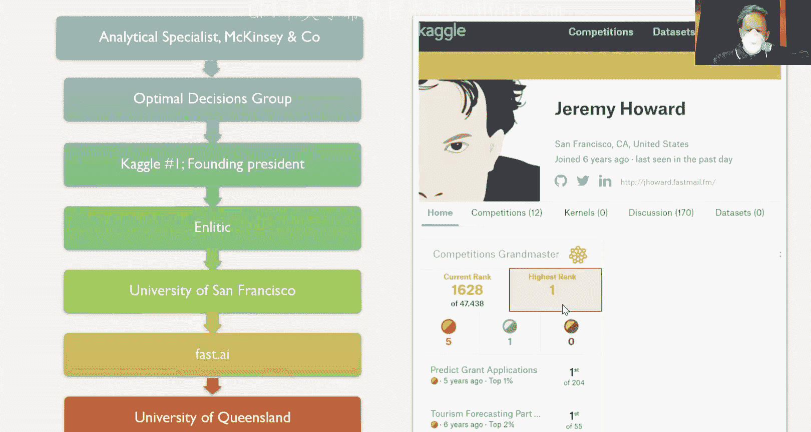

My company in Lytic， which I founded， was the first company to specialise in deep learning for medicine。

 and MIT voted at one of the 50 smartest companies in 2016， just above Facebook and SpaceX。

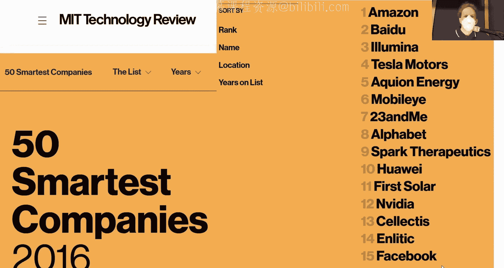

U。I started fast AI with Rachel Thomas and that was quite a few years ago now。

 but it's had a big impact on the world already。Including work we've done with our students has been globally recognized such as our wind in the Dabech competition。

Which showed how we could train。Big neural networks faster than anybody in the world and cheaper than anybody in the world。

And so that was a really big step in 2018。Which actually made a big difference。

 so Google started using our special approaches。In their models NVdia started optimizing their stuff using our approaches。

 so it made quite a big difference there。I'm the inventor of the ULM Fi algorithm。

 which according to the Transformers's book， was one of the two key foundations behind the modern NLP revolution。

This is the。嗯。Paper here and actually， you know， interesting point about that。

 It was actually invented for for a fast A course。 So the first time it appeared was not actually in。

Um。The journal was actually in lesson4 of the course。 I think the 20。16， course。

 if I remember correctly。And you know， most importantly， of course。

 I've been teaching this course since version 1 and this is actually I think this is the very first version of it。

 which even back then was getting HR's attention。😊，嗯。

A lot of people have been watching the course and it's been you know really widely used。

 YouTube doesn't show likes anymore， so I have to show you our likes for you。😊。

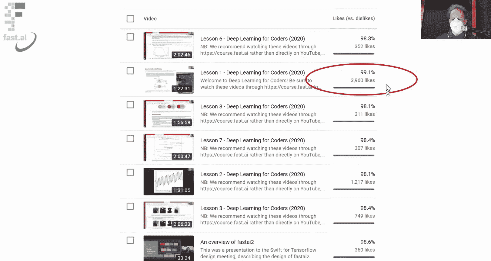

You know， it's it's been amazing to see how。Yeah， how many alumni have gone from this to。To you know。

 really doing amazing things， you know。So for example， Andrea Apathy told me that Tesla。

 I think you said pretty much everybody who joins Tesla in AI is meant to do this course。

 I believe it Open AI， they told me that all the residents joining there first do this course so all this course is really widely used in industry and research for people and they have a lot of success。

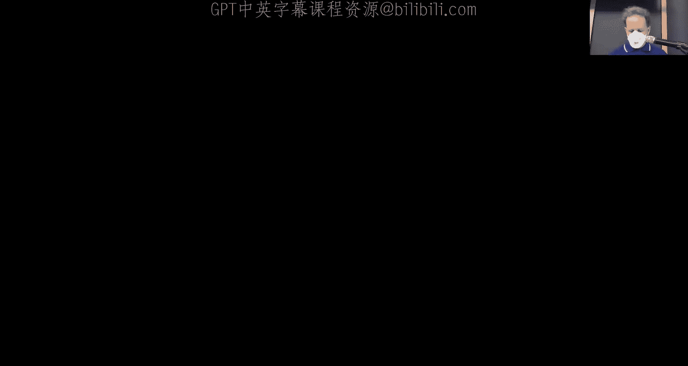

Okay， so there's a bit of brief information about why you should， hopefully。😊，Keep going with this。

All right， so let's get back to what's， what's happened here。

 Why are we able to create a bird recognizer in。😊，A minute or two。And why couldn't we do it before？

So I'm going to go back to 2012。😊，And in 2012， this was how image recognition was done。 This is。

The computational pathologist， it was a a project done at Stanford， a very successful。

 very famous project that was looking at the five year survival of breast cancer patients by looking at their histopathology images slides。

Now， so this was like what I would call a classic machine learning approach。

 and I spoke to the senior author of this， Daphne Coler。

 and I asked her why they didn't use deep learning and she said， well， it' just。😊，You know。

 it wasn't really on the radar at that point， so this is like a free deep learning approach。😊。

And so the way they did this was they got a big team of mathematicians and computer scientists and pathologists and so forth to get together and build these ideas for features like relationships between epitheal or nuclear neighbors。

 thousands and thousands actually they created a features and each one required a lot of expertise from a cross disciplinary group of experts at Stanford。

So this project took years and a lot of people and a lot of code and a lot of math。😊。

And then once they had all these features， they then fed them into a machine learning model in this case logistic regression。

😊，To predict survival， as I say， it was very successful。

 but it's not something that I could create for you in a minute at the start of a course。

The difference with neural networks is neural networks don't require us to build these features。

 They build them for us。And so what actually happened was in， I think it was 2015。😊。

Matt Zeailer and Rob Fergus took a trained neural network。

 and they looked inside it to see what it had learned。 So we don't give it features。

 We ask it to learn features。 So when Ziller and Fergus looked inside a neural network。

 they looked at。The actual。The weights in the model， and they draw a picture of them。

 and this was nine of the sets of weights they found。And this set of weights， for example。

 finds diagonal edges。 This set of weights finds yellow to blue gradients and this set of weights fines。

Readed to green gradients。And so forth， right。 And then down here are examples of some bits of photos which closely matched。

 for example， this。Feture detector。And deep learning mean it's deep because we can then take these features and combine them to create more advanced features。

So these are some layer two features， so there's a feature， for example， that finds corners。

And a feature that finds curves and a feature that finds circles。

 And here are some examples of bits of pictures that the the circle finder found。 And so remember。

With a neural net， which is the basic function used in deep learning。

 we don't have to hand code any of these or come up with any of these ideas。

You just start with actually a random neural network and you feed it examples and you have a learn to recognize things。

And it turns out that these are the things that it creates for itself。So you can then combine。

These featuress。And when you combine these features， it creates a feature detector， for example。

 that finds kind of repeating geometric shapes。And it creates a feature detector， for example。

 that finds kind of really little things， which it looks like is finding the edges of flowers。😊。

And this feature detector here seems to be finding。😊，Words。And so the deeper you get。😊。

The more sophisticated the features it can find are。

 And so you could imagine that trying to code these things by hand would be。You know。

 insanely difficult and you wouldn't know even what to encode by hand right So what we're going to learn is how neural networks do this automatically right。

 But this is the key difference of why we can now do things that previously we just didn't even conceive of as possible because now we don't have to hand code the features we look for。

 they can all be learned。Now。Build， it important to recognize we're going to be spending some time learning about building。

Image based algorithms。And image based algorithms are not just for images。 And， in fact。

 this is going to be a general theme。 We're going to show you some。Foundational techniques。

 But with creativity， these foundational techniques can be used very widely。 So， for example。

An image recognizer。😊，Can also be used to。嗯。Classify sounds so this was an example from one of our students who posted on the forum and said for their project。

 they would try classifying sounds and so they basically took sounds and created pictures from their waveforms。

And then they used an image recogniser on that， and they've got a state of the art result。

 by the way。😊，And other of our students on the forum said that they did something very similar to T time series。

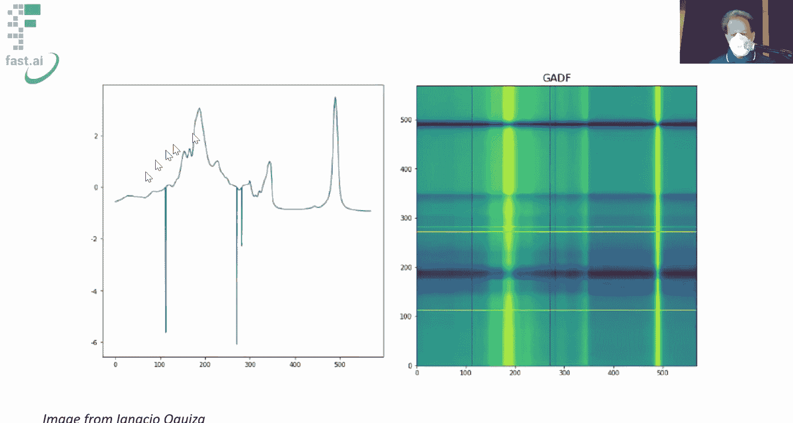

And turn them into pictures and then use image classifiers。Another of our students。

Created pictures from mouse movements from from users of a computer system。

 So the clicks became dots， and the movements became lines。

 and the speed of the movement became colours。

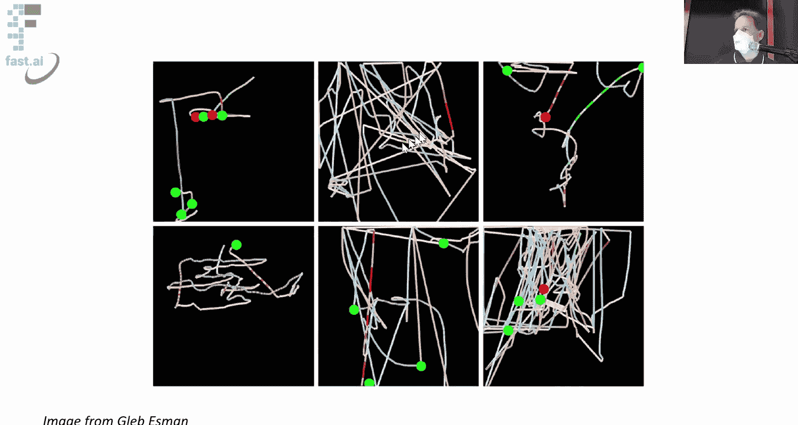

And then use that to create an image classifier。 So you can see with， with some。

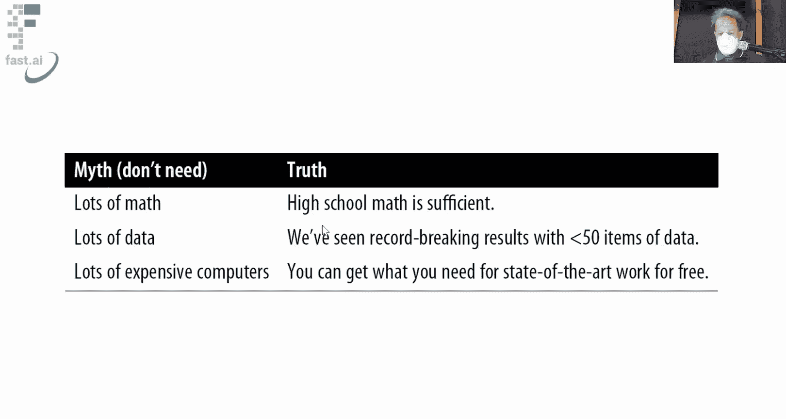

Creativity， there's a lot of things you can do。With images。

There's something else I wanted to point out， which is that。

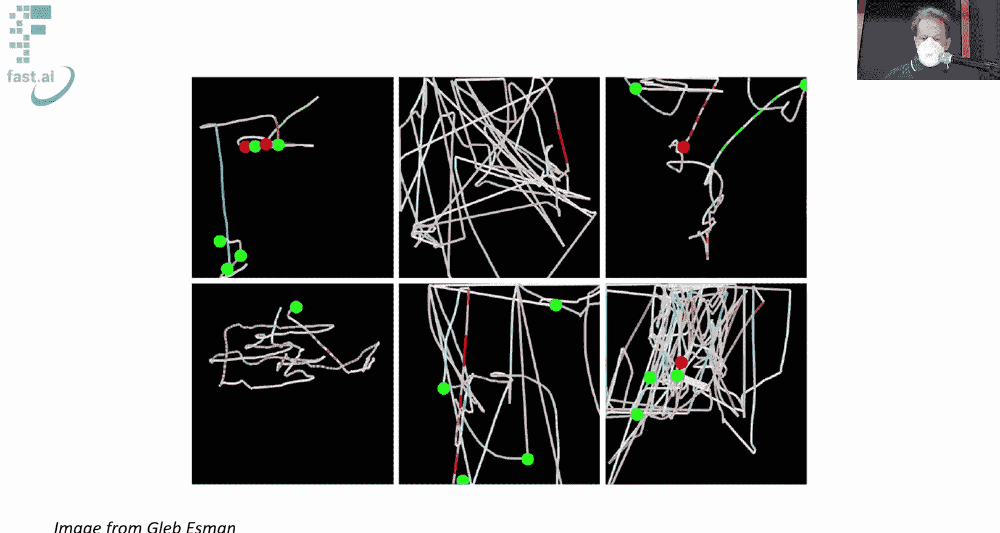

As you saw， when we trained a。Real working bird recognise image model。 We didn't need lots of math。

 There wasn't any。We didn't need lots of data。 We had 200 pictures。

 We didn't need lots of expensive computers。 We just used my laptop。

This is generally the case for the vast majority of deep learning that you'll need in real life。Um。

There will be some math that pops up during this course。

 but we will teach it to you as needed or we'll refer you to external resources as needed。

 but it'll just be the little bits that you actually need。U。You know。

 the myth that deep learning needs lots of data， I think。

 is mainly passed along by big companies that want to sell you computers to store lots of data and to process it。

 We find that most real world projects。Don't need extraordinary amounts of data at all。

And as you'll see， there's actually a lot of fantastic。😊。

Places you can do state of the artwork for free nowadays， which is great news。U。

One of the key reasons for this is because of something called transfer learning。

 which we'll be learning about a lot during this course， and it's something which。

Very few people are aware of the pair of。In this course we'll be using Ptororch for those of you who are not particularly close to the deep learning world。

 you might have heard of Tensorflow not of Pytorch you might be surprised to hear that Tensorflow has been dying in popularity in recent years and Pytororch is actually growing rapidly and in recent in。

Research repositories amongst the top papers Tensorflowlow is a tiny minority now compared to Pytorch this is also in great research that's come out from Roan O'connor。

 he also discovered that。The majority of people that were doing TensorFlow in。2018 researchers。

 the majority of now shifted to pay toch， and I mentioned this because。

While people using research is a very strong leading indicator of what's going to happen in industry because this is where all the new algorithms are going to come out。

 this is where other papers are going to be written about。

 it's going to be increasingly difficult to use Tensorflow。

We've been using Ptorrch since before it came out before the initial release。

 because we knew just from technical fundamentals， it was far better。

 so this course has been using Ptorrch for a long time。

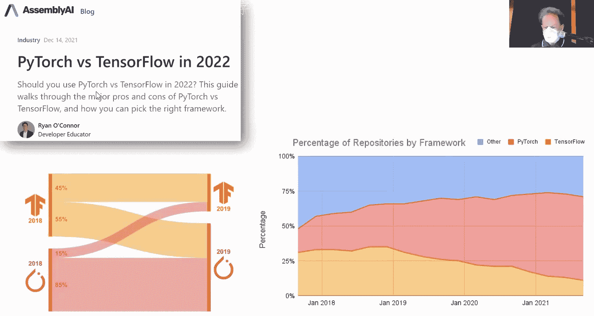

I will say， however， that Pytorrch requires a lot of hairy code for relatively simple things。

 this is the code required to implement a particular optimizer called Adam W in plain Pytorrch I actually copied this code from the Piytorrch repository。

So as you can see， there's a lot of it。😊。

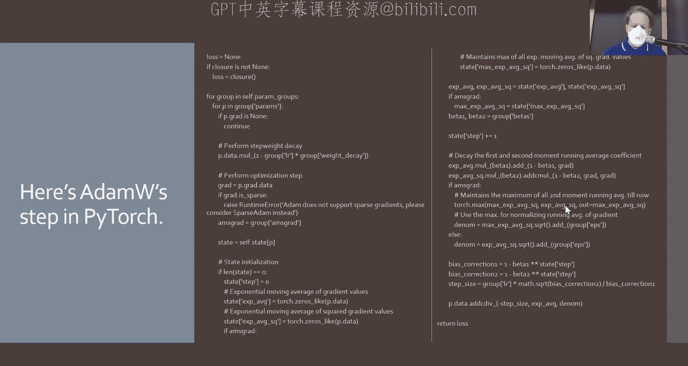

This。😊，Grape bit here。Is the code required to do the same thing with fast AI。

 Fast AI is a library we built on top of Ptorrch。 This huge difference is not because Pytorrch is bad。

 It's because Ptorrch is designed to be a strong foundation to build things on top of。

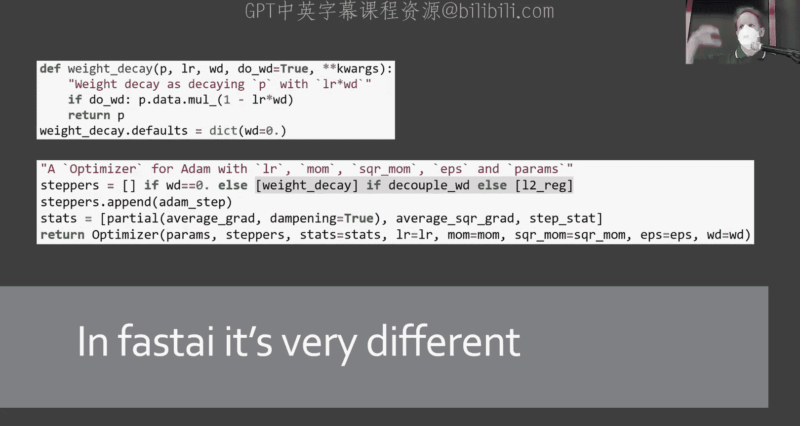

Like fast AI。So。嗯。When you use FA AI， the library， you get access to all the power of Ptorrch as well。

But you shouldn't be writing all this code。

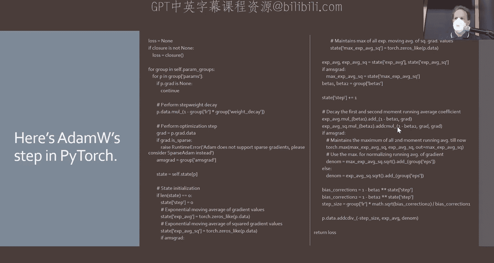

If you only need to write this much code， right， the problem of writing lots of code is that that's lots of things to make mistakes with。

 lots of things to， you know， not have best practices in， lots of things to maintain in general。

 we found， particularly with deep learning less code is better， particularly。With fast a eye。

The code you don't write is code that we've basically found kind of best practices for you。

 so when you use the code that we've provided for you， you know you're generally fine you get。

Better results。So so fast AI has been a really popular library and it's very widely used in industry。

 in academia and in teaching， and as we go through this course。

 we'll be seeing more and more pure pie torch as we get deeper and deeper underneath to see exactly how things work。

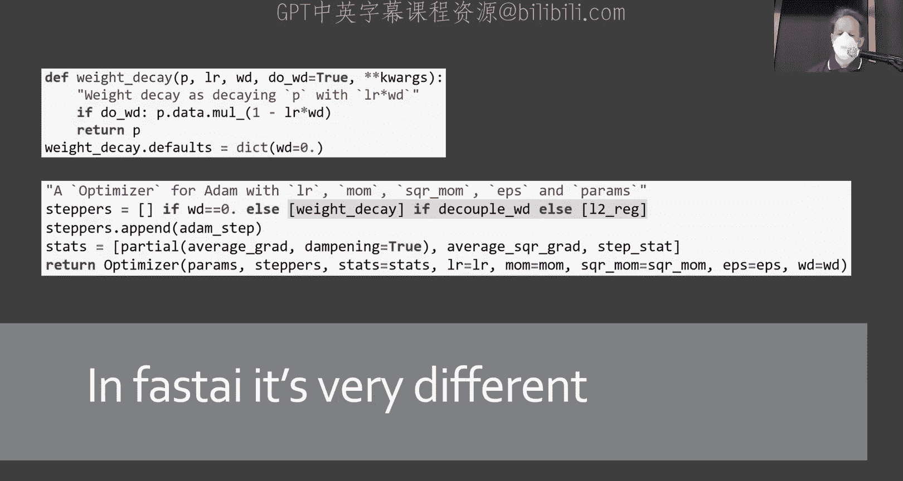

The Fast DA Library just won the 2020 best paper award or the paper about it in information so again you can see it。

Very well regarded library。Okay， so。Okay， it's still green， that's good。

So you may have noticed something interesting， which is that I'm actually running code in these slides。

 that's because these slides are not in PowerPoint。 these slides are in。J in a notebook。

Jupiter Note is the environment in which you will be doing。Most of your computing。

It's a web based application。Which。Is extremely popular and widely used in industry and in academia and in teaching and is a very。

 very， very powerful way to experiment and explore and to build。U。Nowadays， I would say most people。

 at least most students。Run Jupyter notebooks not on their own computers。

 particularly for data science， but on a cloud server。

Of which there's quite a few and as I mentioned earlier， if you go to course。 faster at AI。😊。

You can see how to use。Various different cloud servers。One， I'm going to show an example of。Is Cagle。

 so Caal doesn't just have competitions， but it also has a cloud notebooks server and。

I've got quite a few examples there。So let me give you a quick example of how we use Jupyter notebooks to build stuff to experiment。

 to explore So on Kagel if you start with somebody else's notebook so why did you start with this one Jupiter Note 101？

If it's your own notebook， you'll see a button called Edit。

 if it's somebody else's that button will say copy and edit。

If you use somebody's notebook that you like， make sure you click the up foot button to we encourage them and to help other people find it before you go ahead and copy and edit。

😊，And once we're in edit mode， we can now。Use this。Notebook。And to use it。😊。

We can type in any arbitrary expression in Python and click Run。And the very first time we do that。

 it says session is starting， it's basically launching a virtual computer for us to run our code this is all free。

😊，In a sense， it's like the world's most powerful calculator。

It's a calculator where you have all of the capabilities of the world's I think most popular programming language。

 certainly it and JavaScript would be the top two directly at your disposal so Python does know how to do one plus one and so you can see here it spits out the answer。

I hate clicking， I always use keyboard shortcuts， so instead of clicking this little arrow。

 you just press shift enter to do the same thing。😊，But as you can see。

 there's not just calculations here， there's also。😊，Pros。

 and so Jupyter notebooks are great for explain to the version of yourself in six months time。

 what on earth you are doing or to your co-s or are people in the open source community。

 what the people you're blogging for， etc。😊，And so you just type prose。And as you can see。

 when we create a new cell， you can create a code cell。😊，Which is a cell that lets you。😔。

Type calculations。Or a markdown cell。Which is a cell that lets you create prose。

And the prose uses formatting in a little mini language called backdown there's so many tutorials around。

 I won't explain it to you， but it lets you do things like。Links。And so forth。嗯。

So I'll let you follow through。The tutorial in your own time because it really explains to you。

What to do， one thing to point out is that sometimes you'll see me use cells with an exclamation mark at the start。

That's not Python。 That's a bash shell command。 Okay， so that's what the exclamation mark means。

As you can see， you can put images into notebooks and so the image I popped in here was the one showing that Juputter won the 2017 Software System Award。

 which is pretty much the biggest award there is。For this kind of software。Okay。

 so that's the basic idea of how we use notebooks。So let's have a look at how we do our bird or not bird model。

One thing I always like to do when I'm using something like collab or Kagle cloud cloud platforms that I'm not controlling is make sure that I'm using the most recent version of any software。

 so my first cell here is exclamation mark Pip install minus U that means upgrade Q for quiet fast D。

So that makes sure that we have the latest version of fast AI。

 And if you always have that at the start of your notebooks， you're never going to have those。😊。

Akward foreign threads where you say， whyhy isn't this working and somebody says to you oh。

 you're using an old version of some software？😊，So you'll see here。This notebook。

Is the exact thing that I was showing you at the start of this lesson？So。嗯。

If you haven't done much playythhen。You might be surprised about how little code there is here。

And so Python is a。Concise but not too concise language。

 you'll see that there's less boilerplate than some other languages you might be familiar with。

And I'm also taking advantage of a lot of libraries。

 so fast A I provides a lot of convenient things for you。😊，U。So I forgot to import。嗯。So。

To use a external library we use。Import to import a symbol from a library。

Fast AI has a lot of libraries we provide， they generally start with fast something， so for example。

 to make it easy to download a URL， fast download has download URL。😊。

To make it easy to create a thumbnail。We have image to thumb。And so forth。😊，So we， I always like to。

😊，View as I'm building a model， my data at every step， so that's why I first of all grab one bird。

And then I grab one forest photo and I look at them to make sure they look reasonable。

And once I think， okay， they look okay。😊，Then I go ahead and。Download。

And so you can see fast AI has a download images。Where you just provide a list of URLls。

So that's how easy it is and it does that in parallel， so it does that。You know。

 surprisingly quickly。One other fast I think I'm using here is resize images。

You generally will find that for computer vision algorithms， you don't need particularly big images。

 so I'm resizing these to a maximum side length of 400。'Cause it just。

 it's actually much faster because GPUs are so quick。For big images。

 most of the time can be taken up just opening it the neural net itself often takes less time。

 so that's another good reason to make them smaller。Um okay。

So it' the main thing I wanted to tell you about。😊，Was this data block command。 So the data block。

Is the key thing that you're going to want to get familiar with as deep learning practitioners at the start of your journey。

Because。The main thing you're going to be trying to figure out is how do I get this data into my model？

😊，Now that might surprise you， you might be thinking we should be spending all of our time talking about neural network architectures and。

Matrix multiplication and gradients and stuff like that。

 The truth is very little of that comes up in practice。And the reason is that at this point。

 the deep learningers community has found a reasonably small number of。Types of model。The work。

For nearly all the main applications you'll need。And firstly。

 I will create the right type of model for you the vast majority of the time。

So all of that stuff about tweaking neural network architectures and stuff， I mean。

 we'll get to it eventually in this course。But you might be surprised to discover that it almost never comes up kind of like if you ever did like a computer science course or something。

 and they spent all this time on the。Details of compilers and operating systems。

 and then you get to the real world and you never use it again。

So this course is called practical deep learning， and so we're going to focus on the stuff that is practically important。

😊，Okay， so our images are finished downloading。😊，And。Two of them were broken。

 so we just deleted them。U。Another thing you'll note by the way。

 if you're a keene software engineer is I tend to use a lot of。

Functional style in my programs I find for。Kin of the kind of work I do that a functional style works very well if you're。

You know a lot of people in Python are less familiar with that it' more maybe comes more from other things。

 so yeah that's why you'll see me using stuff like map and stuff quite a lot。😊，All right。

 so a data block is the key thing you need to know about if you're going to know how to use different kinds of data sets。

And so these are all of the things basically that you'll be providing。

 And so what we did when we designed the data block was we actually looked and said， okay， over。

Hundreds of projects。What are all the things that change from project to project to get the data into the right shape。

 And we realized we could basically split it down into these five things。

So the first thing that we tell FA AI is， what kind of input do we have？

And so so there are lots of blocks in Fast AI for different kinds of input so he said， oh。

 the input is an image。😊，What kind of output is there， what kind of label， the output's a category。

 so that means it's one of a number of possibilities。

So that's enough for fast AI to know what kind of model to build for you。

So what are the items in this model， what am I actually going to be looking at look to train from？😊。

This is a function。In fact， you might have noticed if you were looking carefully that we use this function here。

It's a function which returns a list of all of the image files in a path based on extension。

So every time it's going to try and find out what things to train from。

 it's going to use that function， which in this case we'll get a list of image files。Now。

 something we'll talk about shortly is that it's critical that you put aside some data for testing the accuracy of your model。

 and that's called a validation set。It's so critical that fast AI won't let you train a model without that one。

😊，So you actually have to tell it how to create a validation set， how to set aside some data。

 and in this case， we say randomly set aside。20% of the data。Okay。Next question。

 then you have to tell fast AI is。How do we know the correct label of a photo。

 how do we know if it's a bird photo or a forest photo？And this。Is another function。

And this function simply returns the parent folder。Of of a path。And so in this case。

 we saved our images into。Either forest or bird。 So that's where the labels are going to come from。

And then， finally。Most computer vision architectures need all of your inputs as you train to be the same size。

So item transforms。😊，A all of the bits of code that are going to run on every item。

On every image in this case。 And we' are saying， okay， we want you to resize each of them。

To being 192 by 192 pixels。There's two ways you can resize。

 you can either crop out a piece in the middle or you can squish it。😊，And so we're saying。

It question。So that's the data block， that's all that you need and from there we create。😊。

An important class called data loaders， data loaders are the things that actually Pytorrch iterates through to grab a bunch of your data at a time。

The way it can do it so fast is by using a GPU， which is something that can do thousands of things at the same time。

And that means it needs thousands of things to do at the same time。

So a data loader will feed the training algorithm with a bunch of your images at once。

 in fact we don't call it a bunch， we call it a batch or a mini batch。嗯。And so。

When we say show batch。That's actually a very specific word in deep learning， it's saying。

 show me an example of a batch of data that you would be passing into the model。😊。

And so you can see show batchch gives you tells you two things， the input。

Which is the picture and the label。And remember， the label came by calling。That function。So。

When you come to building your own models。You'll be wanting to know。

What kind of splitters are there and what kinds of labeling functions are there and so forth。

 what wrong button？You'll be wanting to know what kind of labeling functions are there and what kind of splitters are there and so forth and so Doc stop faster at AI is where you go to get that information。

 often the best place to go is you the tutorials，😊，So for example。

 here's a whole data block tutorial。And there's lots and lots of examples。

 So hopefully you can start out by finding something that's similar to what you want to do。

And see how we did it。But then of course， there's also。😊，The underlying。APpiI information。

 so here's data blocks。O。How are we doing？It'sStill doing good， all right。So at the end of all this。

 we've got an object called DLs， it stands for data looters。

 and that contains iterators that Pytorrch can run through to grab batches of randomly split out。

Training images to between the model with and validation images to test the model with。

So now we need a model。😊，The critical concept here in FADA is called a learner a learner is something which combines a model which is that is the actual neural network function we'll be training and the data we use to train it with。

And that's why you have to pass in two things。😊，The data， which is the data loaders object。

And a muddle。And so the model。😊，Is going to be the actual neural network function that you want to pass in。

 And as I said， there's a relatively small number。That basically work。

For the vast majority of things， you do。U，If you pass in just a bare symbol like this。

 it's going to be one of FA A's built in models。But what's particularly interesting？

Is that we integrate a wonderful library by Ross Whiteman called Tim， the Pytorch Im Model。

 which is the largest collection of computer vision models in the world。And at this point。

 FA AI is the first and only framework to integrate this so you can use any one of the paytorrch image models。

And one of our students themanaorra was kind enough to create this fantastic documentation。

Where you can find out。All about the different models。And if we click on here。😊。

You can get lots and lots of information about all the different models that。Ross is provided。

Having said that。😊，The model family called Resnet。Are probably going to be fine for nearly all the things you want to do。

 but it is fun to try different models out。 so you can type in。😊。

Any string here to use any one of those other models。Okay， so if we run that。Let's see what happens。

 Okay， so this is interesting。 So when I ran this。 So remember on kgle。

 it's creating a new virtual computer for us。 So it doesn't really have anything ready to go。

 So when I ran this， the first thing it did was it said downloading。😊，Resnet 18 dot PH。What's that。

 Well， the reason we can do this so fast is because somebody else has already trained this model to recognize over 1 million images of over 1000 different types。

Something called the imageNe data set。And they then made those weights available。

 those parameters available on the internet for anybody to download。😊，By default on Fast A I。

 when you asked for a model。We will download those weights for you so that you don't start with a random network that can't do anything。

 you actually start with a network that can do an awful lot。

And so then something that fasti has that's unique is this fine tune method。

 which what it does is it takes those pre trained weights we downloaded for you。

 and it adjusts them in a really carefully controlled way to adjust。😊。

Teach the model the differences between your data set and what it was originally trained for。

That's called fine shning。Hence's the name。So that's why you'll see this downloading happen first。

And so as you can see， at the end of it。This is the error rate here， after a few seconds。

 it's 100% accurate。So we now have a learner。😊，And this learner has been has started with a pre trained model that's been fine tuned for the purpose of recognizing bird pictures from forest pictures。

So you could now call。Do't predict on it。And dot predict you pass in。An image。

And so this is how you would then。😊，Deploy。Your model。 So in the code。

 you have whatever it needs to do。 So in this particular case。

This person had some reason that he needs。The app to check whether they're in a national park and whether it's a photo of a bird。

 So at the vet where they need to know if it's a photo of a bird， Yeah we' just call。😊。

Here's one line of code。Blanddo predict。And so that's going to return。Whether it's a bird or not。

 as a string， whether it's a bird or not as an integer。

 and the probability that it's a non bird or a bird。And so that's why we can print these things out。

Okay。So。That's how we can create a computer vision model。What about other kinds of models。

 there's lot more in the world than just computer vision。A lot more than just image recognition。

 Well even within computer vision， there's a lot more than just image recognition。For example。😊。

For example。There's segmentation。嗯。So segmentation。

 maybe the best way to explain segmentation is to show you the result of this model。😊。

Spentation is where we。Take photos， in this case of。Rad scenes。

And we colour in every pixel according to what is it？So in this case， we've got Brown as cars。

Blue is fences， I guess， red as buildings or brown。Um。

And so on the left here are some photos that some somebody has already gone through and classifiedified every pixel of every one of these images。

 according to what that pixel is a pixel of。And then on the right。Is what our model is guessing。

And as you can see。It's getting a lot of the pixels correct？And some of them is getting wrong。

It's actually amazing how many it's getting correct because this particular。😊，Moto。I trained in。

About 20 seconds。Using a tiny， tiny， tiny amount of data。 So， you know， again。

 like you would think this would be a particularly challenging。Problem to solve。嗯。

But it took about 20 seconds of training to solve it not amazingly well， but pretty well。

 if I'd trained it for another two minutes， it'd probably be close to perfect。😊。

So this is called segmentation。 Now you'll see that there's very。

 very little data required and sorry， very little code required。😊，And the steps。

Are actually going to look quite familiar。 In fact， in this case。

 we're using an even simpler approach。 Now Earl on， we used data blocks。 Data blocks are a。

Kind of intermediate level， very。Flexible approach that you can take to handling almost any kind of data。

 But for the kinds of data that occur a lot， you can use these special。Data loaders classes。

 which kind of lets you use even less code。 So in this case， to create data loaders for segmentation。

You can just say， okay， I'm going to pass you in a function for labeling。

And you can see here it's got pretty similar。😊，Things that we pass in to what we passed in for data blocks before。

So our file names is get image files again， and then our label function。

Is something that grabs this path？And the codes， so the labels for the segmentation， sorry the codes。

 so like what does each code mean is going to be this text file。But you can see the basics。😊。

Information we're providing is very， very similar regardless of whether we're doing segmentation or object recognition and then the next steps are pretty much the same we create a learner for segmentation。

 we create something got a unit learner which we'll learn about later and then again we call fine tune。

😊，So that is it。And that's how we create a segmentation model。U。

What about stepping away from computer vision， so perhaps the most widely used kind of model used in industry is tabular analysis。

 so taking things like spreadsheets and database tables and trying to predict columns of those。嗯。

So inte analysis。It really looks very similar to what we've seen already。

We grab some data and you'll see when I call this untared data。

 this is the thing in Fast AI that downloads some data and decompresses it for you and there's a whole lot of URLs provided by fastS AI for all the kind of common data sets that you might want to use you know all the ones that are in the book or lots of data sets that are kind of widely used in learning and research。

So that makes life nice and easy for you。So again we're going to create data loaders but this time it tabular data loaders。

 but we provide pretty similar kind of information to what we have before a couple of new things we have to tell it which of the columns are categorical so they can only take one of a few values and which ones are continuous so they can take basically any real number。

😊，And then again， we can use the exact same show batch。😊，That we've seen before to see the data。

And so Fast AI uses a lot of something called type dispatch。

 which is a system that's particularly popular in a language called Julia to basically automatically do the right thing for your data regardless of what kind of data it is So if you call show batchch on something you should get back something useful regardless of what kind of information you provided So for a table。

It shows you the information in that table。This particular data set is a data set of。

Whether people have less than $50，000 or more than $50。

000 in salary for different districts based on demographic information in each district。

So to build a model for that data loaders we do as always something underscore learner。

 in this case it's a tabular learner。😊，Now， this time we don't say fine June。We say fit。

 specifically fit one cycle。That's because for tabular models。

 there's not generally going to be a pre trained model that already does something like what you want because every table of data is very different。

Where else pictures often have a similar theme， you know， they're all pictures。

 they all have the same kind of general idea of what pictures are。

So that's why it generally doesn't make too much sense。To fine sh a tabular model。

 instead you just fit。So there's one difference there。I'll show another example。Okay。

So collaborative filtering。Collaborative filtering is the basis of most recommendation systems today。

 it's a system where we basically take data that says。Which。

Users liked which products or which users used which products。

And then we use that to guess what other products those users might like based on finding similar users and what those similar users liked。

The interesting thing about collaborative filtering is that when we say similar users。

 we're not referring to。Similar demographically。But similar in the sense of。

People who liked the same kinds of。Products。So for example。

 if you use any of the music systems like Spotify or Appleple music or whatever， it'll ask you first。

😊，Like， what's a few。Faces of music you like。And you tell it， and then it says， okay， well。

 maybe let's start playing this music for you。And that's how it works。

 it uses collaborative filtering。So。We can create a collaborative filtering。

Data loaders in exactly the same way that we're used to by downloading and decompressing some data。

Create our collab data loaders in this case we can just see from CSV and pass into a CSV and this is what collaborative filtering data looks like it's going to have generally speaking a user ID。

😊，Some kind of product ID in this case a movie and a rating。So in this case。

 this user gave this movie a rating of 3。5 out of five。And so again。

 you can see show batch right so use show batch， you should get back some useful visualization of your data regardless of what kind of data it is。

😊，And so again， we create a learner。😊，This time's a collaborative filtering learner。 and you pass in。

Your data。in this case， we give it one extra piece of information。

 which is because this is not predicting a category， but it's predicting a real number。

 we tell it what's the possible range。😊，The actual range is one to5。

 but for reasons you'll learn about later， it's a good idea to actually go from a little bit lower than the possible minimum to a little bit higher。

 So that's why I say 0。5 to 5。5。And then fine tune Now again， you know。

 we don't really need to fine tune here because there's not really such a thing as a pre trained collaborative filtering model。

 we could just say fit or fit one cycle， but actually fine tune works fine as well so。😊。

So after we trade it for a while。This here is the mean square error。

 so it's basically that on average， how far off are we for the validation set and you can see as we train and it's literally so fast it's less than a second each epoC。

That  error goes down and down。And for any kind of fast AI model， you can。

And for any kind of fast A model， you can always call show results。

And get something sensible so in this case it's going to show a few examples of users and movies is the actual rating that user gave that movie。

And here's the rating that the model predicted。Okay。

 so apparently a lot of people on the forum are asking how I'm。

Turning this notebook into a presentation。嗯。So I'll be delighted to show you because I'm very pleased that these people made this thing for free for us to use。

 it's called Rise。And all I do is it's a notebook extension。And in your notebook。

 it gives you an extra little。Thing on the side where you say which things are slides or which things are fragments。

And a fragment just being。 so this is a slide that's a fragment。 So if I。嗯。

Do that youll see it starts with a slide and then the fragment gets added in。嗯。Yeah。

 that's about all theories， too。 It actually， it's pretty great。 and it's very well documented。

 You know， I'll just mention like。What do I make with Jupyter notebooks？嗯。This entire book。😊。

Was written entirely in Jupiter notebooks。Here are the notebooks。

So if you go to the Fastti fastbook repo。You can read the whole book。

And because it's all in notebooks， every time we say。

 here's how you create this plot or here's how you train this model。

 you can actually create the plot or you can actually train the model because it's all。My box。嗯。

The entire Fast A library。Is actually written in notebooks。

So you might be surprised to discover that if you go to fast AI slash fast AI。That the source code。

For the entire library is notebooks。And so the nice thing about this is that， you know。

 the source code。😊，For the Fast A Library has actual pictures of the actual things that we're building。

 for example。Um。What else have we done with notebooks？😊，Bgging。I love blogging with notebooks。

 because when I want to explain。Something， I just write the code and you can just see the outputs and it all just works。

嗯。Another thing you might be surprised by。😊，As all of our tests and continuousuous integration are also all in notebooks。

 so every time we change one of our notebooks。Um。Every time we change one of our notebooks。

Hundreds of tests get run automatically。In parallel， and if there's any issues。

 we will find out about it。So yeah， notebooks are great and rise is is a really nice way to。😊。

Do slides in notebooks。All right。So what can deep learning do at present？嗯。

We're still scratching this， the tip of the iceberg， even though it's a pretty well hyped， you know。

 heavily marketed technology。 this point， you know， when we started。In 2014 or so。😔，You know。

 not many people were talking about deep learning and really there was no accessible way to get started with it。

 there were no pre train models you could download， you know， there there there was。

Just starting to appear some of the first open source software that would run on GPUs。嗯。But yeah。

 I mean， but despite the fact that today there's a lot of people talking about deep learning。

 we're just scratching the surface。😊，Every time pretty much somebody says to me。

 I work in domain X and I thought I might try deep learning out to see if I can help。😊。

And I see them a few months later。 And I say， how did it go， they nearly always say， wow。

 we just broke the state of the art results in our field。 So you know。

 but I say these are things that it's currently state of the art for。

These are kind of the ones that people have tried so far， but still most things haven't been tried。

So in NLP， deep learning is a state of the method in。All these kinds of things and a lot more。

Computer vision。Medicine。Biology。Recommendation systems， playing Go games， robotics。I mean。

 it's just。I've tried， I've tried elsewhere to make bigger lists。

 and I just end up with pages and pages and pages。 So， yeah it's it's。Generally speaking， you know。

 if it's something that a human can do。🤢，Reasonably quickly like。😔。

Look at a go board and decide if it looks like a good board go board or not， even if an history an X。

Even if it needs to be an expert human， then that's probably something that。

Deep learning will be pretty good at。If it's something that takes。

A lot of logical thought processes over an extended period of time， you know。

 particularly if it's not based on much。Data， maybe not， you know like。

Who's going to win the next election or something like that that be kind of broadly how I try to aside。

 is your thing useful for deep， you know， good for deep learning or not？

It's been a long time to get to this point。Yes， deep learning is incredibly powerful now。

But it's taken decades of work。 this was the first neural network。

 And remember neural networks are the basis of deep mining。 So this was back in。1957。The basic ideas。

😊，Have not changed much at all。But， you know， we do have。

Things like GPUs now and solid state drives and stuff like that。 and of course。

 much more data just is available now but。😊，This has been decades of really hard work by a lot of people to get to this point。

😊，U。So let's kind of take a step back。And talk about like what's？What's going on。And these models。

And I'm going to describe the basic idea of machine learning。

Largely as it was described by Arthur Samuel in the late 50s when it was invented。U。And。

I'm going to kind of do it with these graphs。Oh， which， by the way， you might find fun。

 These graphs themselves。嗯。Created with Jupiter notebooks。

 So these are graph fz descriptions that are going to get turned into these。

 So there's a little sneak peek behind the scenes for you。

So let's start with kind of a graph of like well what does a normal program look like right so in the pre deep learning machine learning days well you know you you still have inputs and you still have results right and then you code a program in the middle which is you know a bunch of conditionals and loops and setting variables and bh blah。

 blah。😊，Okay。😊，嗯。A machine learning model。Doesn't look that different。But。

The program has been replaced with something called a model， and we don't just have inputs Now。

 we now also have weights， which are also called parameters。And the key thing is this。

 the model is not anymore more a bunch of conditionals and loops and things。

It's a mathematical function in the case of a neural network。

 it's a mathematical function that's takes the inputs。😊。

Multiplies them together by the weights by one set of weights， and adds them up。

 And then it does that again for a second set of weights and adds them up does it again for a third set of weights and adds them up and so forth。

It then takes all the negative numbers。😊，And replaces them with zeros。

And then it takes those its inputs to a next layer， it does the same thing。

 multi it applies them a bunch of times and adds them up， and it does that a few times。😊。

And that's called a neural network。Um， now。The model。Therefore， is not going to do anything useful。

 and this leaves whites to very carefully chosen。And so the way it works is that we actually start out with these weights as being random。

😊，So， initially。This thing doesn't do anything useful at all。

So what we do the way Arthur Samuel described it back in the late 50s。

 the inventor of machine lighting， is he said， okay， let's take the inputs and the weights。

 put them through our model， he wasn't talking particularly about neural networks is just like whatever model you like。

😊，U。Get the results。And then let's decide how good they are。😊，Right so if， for example。

 we're trying to decide， is this a picture of a bird？And the model said， which initially is random。

 says this isn't a bird and actually it is a bird where it'd say，  oh， you're wrong。

So we then calculate the loss。 So the loss is a number that says how good were the results。

So that's all pretty straightforward， you know， we could， for example， say， oh。

 what's the accuracy we could look at 100 photos and say which percentage of them did it get right？😊。

No worries， now the critical step。😊，Is this error。We need a way of updating the weights that is coming up with a new set of weights that are a bit better than the previous set。

Okay， and by a bit better， we mean it should make the loss。Get a little bit better。

 So we've got this number that says how good is our model。 And initially， it's terrible， right。

 It's random。We need some mechanism if making a little bit better。If we can just do that one thing。

Then we just need to iterate this a few times because each time we put in some more inputs and put in our weights and get our loss and use it to make it a little bit better。

Then if we make it a little bit better enough times。😊，Eventually eventually， it's going to get good。

Assuming that our model is flexible enough to represent the thing we want to do。😊，Now。

 remember what I told you earlier about what a neural network is。

 which is basically multiplying things together and adding them up and replacing the negatives with zeros and you do that a few times。

😊，That is proably an infinitely flexible function。So it actually turns out that that incredibly simple sequence of steps。

😊，If you repeat a few times and you do enough of them。😊，Can solve any computable function。

 And something like。Jenner Wright。An artwork work based off somebody's Twitter bio。

Is an example of a computable function。😊，Right or。Translate English to Chinese is an example of a computable function。

So they're not the kinds of normal functions you do in year8 math， right。

 but they are computable functions。😊，And so therefore， if we can just create this step。

Then and use the neural network as a model。Then we're good to go。😊，In theory。

 we can solve anything given enough。Time and enough data。And so that's exactly。What we do。

And so once we finished that training procedure。We don't need the loss anymore。

And even the weights themselves， we can integrate them kind of into the model， right。

 we finished changing them so we can just say that's now fixed。 And so once we've done that。😊。

We now have something which takess inputs， puts them through a model， and gives us results。

It looks exactly like。Our original idea of a programme。And that's why。

We can do what I described earlier that is once we've got that learn dot predict for our bird recogniser。

 we can insert it into any piece of computer code， right Once we've got a trained model。😊。

As just another piece of code， we can call with some inputs and get some outputs。

Deploying machine learning models in practice。Can come with a lot of。You know， little tricky details。

 But the basic idea in your code is that you're just going to have a line of code that says no not predict。

 And then you just fit it in with all the rest of your code in the usual way。 And this is why。

 because a trained model。Is just another thing that maps inputs to results。Okay。All right。

 so as we come to wrap up this first lesson。嗯。For those of you that are already familiar with notebooks and Python。

There's， you know， this is going to be pretty easy for you you're just going to be using some stuff that you're already familiar with and some slightly new libraries for those of you who are not familiar with Python。

You know， you'。You're biting into a big thing here there's obviously a lot you're going to have to learn and to be clear I'm not going to be teaching Python in this course。

 but we do have links to great Python resources in the forum， so check out that thread。

Regardless of where you're at， the most important thing is to experiment。😊。

And so experimenting could be as simple as just running those ca notebooks that I've shown you。

Just to say them run。You could try changing things a little bit。

 I'd really love you to try doing the the bird or forest exercise， but come up with something else。😊。

Maybe try to use three or four categories rather than two。 You know。

 have a think about something that you think will be。F de try。嗯。Depending on where you're at。

 it'll push yourself a little bit。But not too much。

 So make sure you get something finished before the next lesson。Most importantly。

 read chapter1 of the book。It's got much the same stuff that we've seen today。

 but presented in a slightly different way。And then come back to the forums and present what you've done in the sharere your work here。

 thread after the first time we did this from year one of the course。um。

We got over a thousand replies。And of those replies。

 it's amazing how many of them have ended up turning into new startups。😊，Scientific papers。

Job offers， it's been really cool to watch people's journeys and some of them were just plain fun。

 you know， so this person classified different types of Trinidad and Tobago people so you know people do stuff based on where they live and what their interests are I don't know if this person particularly interested in zucchini and cucumber。

 but they meet a zucchiian cucumber classifier I thought this was a really interesting ones classifying satellite imagery into what city it's probably a picture of amazingly accurate actually 85% with 110 classes。

😊，Pama City bus classifier， buttercloth classifier， this one， you know， very practically important。

 you know， recognizing the state of buildings， we've had quite a few students actually move into disaster resilience based on satellite imagery using exactly this kind of work。

We've already actually seen this example， Ethan Suton， the sound classifier， and I mentioned。

There was the state of the art， he actually checked up the data sets website and found that he beat the state of the art for that。

Elena Harley did chairman normal sequencing， so she was at Human longevity International。

 so she actually did three different really interesting。

Pieces of cancer work during that first course， if I remember correctly。

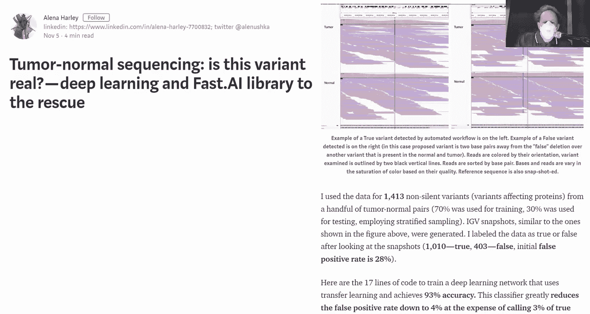

And I showed you this picture before， what I didn't mention is actually this student lab。😊。

Was a software developer at Splunk， big Nasdaq listed company。

 and this student project he did turned into a new patented product at Splunk and a big blog post and the whole thing turned out to be really cool。

 it wass basically something to identify Sreudsters using image recognition with these pictures we discussed。

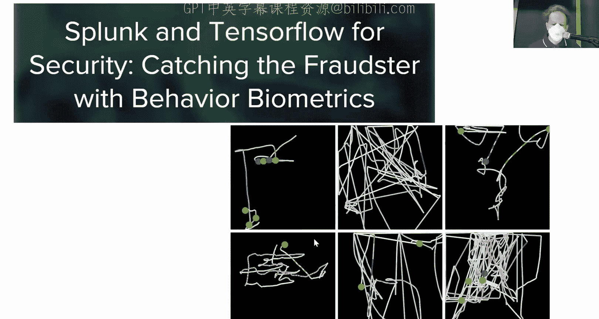

One of our students built this startup， called Invission。Um。Anyway。

 there's been lots and lots of examples。 So all of this is to say， you know， have have a go at。Um。

 you know， starting something， create something you think would be fun or or interesting and share it in the forum if you're a total beginner with Python。

 you know？😊，then start with something simple， but I think you'll find people very encouraging and if you've done this a few times before。

 then try to push yourself a little bit further。😊，UAnd don't forget to look at the quiz questions at the end of the book and see if you can answer them all correctly。

😊，U。嗯。😔，All right， thanks everybody so much for coming， Okay， thanks so much for coming everybody。

 bye。😊。

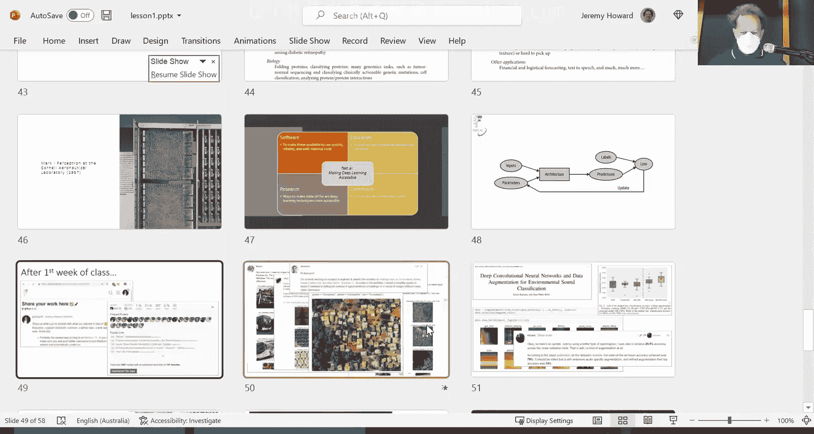