# Jeremy Howard《给码农的深度学习实践课程1｜Practical Deep Learning for Coders2022》中英字幕 p02 -2-Lesson 2_ Practical Deep Learning for Coders 2022.zh_en -BV15Z421H7zj_p2-

Hi everybody welcome to listen to thanks for coming back slight change of environment here we had a bit of an administrative issue at our university。

 somebody booked our room I'm doing this from the study。😊，At home， so。

Sorry about the lack of decorations that behind me。I'm actually really。

 really pumped about this lesson。 it feels like。Going back to what things were like in the very early days because we're doing like some really new。

 really cool stuff which you know stuff that hasn't really been in courses like this before。

 so I'm super super excited。And。So thanks a lot for coming back after lesson one。

 and I hope it's worth you coming back。 I think I think you're going to love it。 I am yeah。

 I am really excited about this。 Now， remember that， you know， the course。😊，Goes with the book。

 So be sure that you're following。 I mean， not following along in the book because we're covering。

Similar things in different directions， but like read the book as well and remember the book is entirely available for free as well you can go to the Fast AI fastbook repo to see the notebooks or through Cos at Fastted AI。

 you can read it there through example through collab。嗯。And also， remember that the book， I mean。

 the book got a lot of stuff that we didn't cover in the course。 Like， you know。

 stuff I find pretty interesting about the history of neural networks， some of which has some really。

Interesting personal stories， actually。As you'll read here and at the end of each chapter there is a quiz and remember it's not a bad idea before you watch the video to read the quiz so if you want to read the chapter 2 quiz。

 you know， and then come back that's not a bad idea and then make sure that you can do the quiz after you've watched the video and you've read chapter2 of the book。

Something I didn't mention last week is there's also a very cool thing that Radak。

 who I mentioned last week has written called AIquizzes。com。

 which is a site specifically for quizzes about the book。

 and it actually uses repetitivebased learning techniques to make sure that you never forget。

So do check out AIquizzes。com it's all brand new questions。

 they're different to the ones in the book and they're really nicely curated and put together so check out AI quizzes。

com as well。Remember as well as course。fataiI there's also forums。fatedaiI， so course。

facetai is where you want to go to get know links to all the notebooks and CAle staff and all that stuff you'll also find on forums。

fatedaiI every lesson has an official topic you know with all the information your' need。

 generally there'll be a bit more info on the forums we try to keep the course。Maine and Ma。

And the forums are a bit more detailed， so if you find on this case you'd want to look at the lesson two official topic。

 but here's the lesson one official topic so far。U。

So from the lesson one official topic already after just a few days since I recorded it and we haven't even launched the course so it's just the people doing it live。

 there's already a lot of replies and that can get pretty overwhelming。

Be aware that there's a button at the bottom of my post that says summarizemar this topic。

 And if you hit that， then you'll just see the most up voted replies。

 and that's a really good way to just make sure that you hit on the main stuff。

So there's the button and here's what it looks like after you hit it。

 you'll just get you'll just get the upverted stuff from。Fast A legends like Sannyam and Tuniche。

 so hopefully you'll find that a useful way to use the forum。

So one of the cool things about this week is I， as promised。

 put up the show us what you've made post and already a lot of people have posted。

I took the screen shot a few days ago。 It's way above 39 replies already。 If I。

 if I remember correctly， I had a lot of trouble deciding which ones to share because they're also good。

 So I've actually decided to kind of。You know went the easy route and I just picked the first so I'm just going to show you the first ones that were posted because they're also good so the first the very。

 very first one to be posted is a damaged car classifier so that worked out pretty well it looks like and I really liked what Matt the creator said about this is that you know。

Wow， it's a bit uncomfortable to run this code I don't really understand yet。

 but I'm just doing it and so I'm like yeah good on you Matt for just for just doing it。

That's the way they gets started， it's all going to make sense， don't worry。

Very nice to see that the next one posted was actually a blog post in fast pages very nice to see。

 so just describing some stuff， some experiments that they ran over the week and what did they find。

Next one was the amazing beard detector， which if I understand correctly。

 was mainly because it's very easy to get from bird to beard by just changing one letter to two。

 and this is doing a very good job of finding gentlemen with beards， so very nice。

And then this one is another level again， it's a whole in production web app to classify food。

 which is kind of like extra credit。😊，Apparently we're up to 80 replies now in that thread。

 thank you Sannyam。Very cool。嗯。😊，So嗯。You know， obviously。

 so this was actually created by Survaash who's been doing the courses for a few years now。

 I believe。And so， you know， one day you too might be able to create your very own web app and put it in production and when I say one day。

 more specifically today， I'm actually going to show you how to do this right now so it's actually quite lucky coincidence that Sveash put this up there because it's exactly the topic that we're going to pick today。

😊，嗯。So how do we go about putting a model in production？Step one。

Is well you've kind of done step one right step one is is is was step 1， two，3。

 four is it's figure out what problem you want to solve， figure out how to find the data for it。

 gather some data and so forth。So what's the kind of first step after you've got your data。

 the next step is data cleaning。And if you go to Cha2 of the book。

 which I'm going to go ahead and open up now。So here is。The book。

 so you can open it in cola directly from the course。

 or if you've cloned it to your computer or whatever， you can， you can do it there。 So remember。

 course up faster today， I will run you through exactly how to。

Run these notebooks and so you can see chapter 2 is all about putting stuff in production。

And so here is Chapt 2。All right， and so remember we hit shift enter to run cells， Okay。

 to execute them。And so we're going to go to the part of the book where we start cleaning the data。

 so I' click on navigate and we'll go down here gathering data。Here we are。U。

So we could do a quick bit of revision first。 Now， by the way， I will mention a lot of people ask me。

What are the little tricks I use for getting around Jupiter Notebook so quickly and easily one of the really nice ones。

 as you'll see is this navigate menu， which actually doesn't appear by default。

 So if you install something called Jupiter notebook extensions， Jupyter notebook extensions。嗯。

And so you just p install them， follow the instructions。嗯。And then restart Jupiter。

Obviously this collaor has a table of contents， by the way。

 this is just if you're using something local， for example。

 then you'll see here that this NB extension scene will appear and if you click on table of contents2。

That gets you this handy navigation， though。 The other thing I really like。

Is this one here called Colllapsible headings？And that's the one which gives me these nice at all。

Things here to close and open up。 And actually， that's not even the best part。

 The best part for me is if I hit right arrow。It goes to the end of a section in if a hit left arrow。

 it goes to the start of a section。 So it's like if I want to move around sections that just press up left。

 down， right， down， right， very handy。 And if you hit left again， when you here， it'll close it up。

 hit right again here。 open it up。 So that's collapible headings。 Anyway。

 A couple of really handy things。And we'll be talking a lot more about getting your notebook set up today at a moment。

😊，One thing you'll notice is in the book。We use the Bing API for searching images。

 I've just kind of had't replaced Bing with DDG because the Bing API requires。

Getting an SDK key which honestly it's like the hardest thing in deep learning is figuring out the Bing Azure website and getting that sorted out DDG doesn't so it's basically exactly the same and you can I'll share this notebook as well on the course website in the forum but all I've basically done is I've replaced Bing with DDG and got rid of the key so then just like we did last week we can search for things and so in the book。

We did a bad detector because at the time I wrote it。

 then Toler was very interested in me helping identify teddy bears。

 and I certainly didn't want her accidentally cuddling a grizzly bear。

So we show here how we can search for grizzly bears just like last week。

 something that loops through grizzly bears， black bears and teddy bears， just like last week。😊。

Get rid of the ones that failed， just like last week。

And one thing a few people have asked on the forum is how do I find out more information about basically any Python or fast AI or Pytorch thing。

 there's a few tips here in the book， one is that if you。

Put a double question mark next to any function name。

 you'll actually get the whole source code for it。And by the same token。

 if you put a single question mark， you'll get a brief。嗯。You know。

 a little bit of information if you've got。NB dev installed， I think it's Nb dev you need。

 then you can type darkc。And that'll give you。Perhaps most importantly。

 are linked straight to the documentation。Where you can find out more information and generally therell be examples as well。

And also a link here to the source code if you want to。Let's do that with a control okay。

 a link to the source code and that way you can jump around and notice that in GitHub in the source code you can click on things and jump to that definition so it's kind of a nice way of skipping around to understand exactly what's going on。

Okay， so lots of great ways we getting help。😊，But what I promised you is that we're going to now clean the data。

I'm going to tell you something that you might find really surprising。Before you clean the data。

He trained a modelddle。Now I know that's going to sound really backwards to what you've probably heard a thousand times。

 which is that first you built you train you plain your data and then you train your model。

 but I'm going to show you something really amazing first we're going to train a model and you'll see why in a moment so to train a model just like before we use a data block to grab our data loaders and there's lots of information here in the book about what's going on here。

嗯。There we go。And so then we can call Shobach to see them as per usual。U。

There's a little sidebar here in the book I'll quickly mention。

 which is about the different ways we can resize。 I think we briefly mentioned it last week。

 we can squish。Last week I used a string， you can use a string or this kind of enum like thing that we have。

 you can see with a squish。You can end up with some very thin bears。Right。

 so this is the real side that's shape of the bear here it' become thin。

 But you can see now we've got all of its。Cbs， they called cubs。 Yeah， bear cubs。

 So it's squished it to make sure we can see the whole picture。 samee one here。

 This one was out of the picture。 We squished it。 This guy now looks weirdly thin that we can see the whole thing。

😊，So that's squishing。 Perhaps else this one here is cropping。

 It's cropped out just the center of the image。 So we get a better aspect ratio。

 but we lose some stuff。 This is so we can get square images。

And the other approach is we can use pad。And so you can pad with various different things if you pad with zeros。

 which is black， you can see here now we've got the whole image and the correct aspect ratio。😊。

So that's another way we can do it。 And， you know， different situations， you know'll result in。

Different quality models。 You can try them all。 It doesn't normally make too big a difference。

 So I wouldn't worry about it too much。I tell you one， though。

 that is very interesting is random resized crops。 So instead of saying resize。

We can see random resed crop and if we do that you'll see we get a different bit of an image every time。

 So during the week this week， somebody asked on the forum， I'm trained to。

 this is a really interesting idea， which it turned out worked slightly。

 was they wanted to recognize pictures of French and German。Texts。

 so obviously this is not the normal way you would do that。

 but just for a bit of a experiment and I love experiments， so they had very big scans of documents。

😊，And they wanted to figure out whether it was French or German just by looking at images。

 And they said the pictures were too big。 What should I do， I said， use random resized crop。

 And that way， you would grab different bits of the image。

 And this is very nice because you could run lots and lots of epochs and get slightly different pictures。

😊，Each time。So this is a very good technique。 And this idea of getting different pictures each time from the same image is called data augmentation。

 And again， I'm not going to go into too much。Detail about data augmentation because it's in the book。

 but I'll just quickly you know point out here that if you use this thing called org transforms。

 so augmentation transforms and here I have multiplied them by two so I've made them super big so you can see them more easily you can see that these tedies are getting turned and squished and warped and recolored and saturated all this stuff to make every picture different and generally speaking if you're training for more than about five or 10 epochs which you'll probably want to do most of the time。

 unless you've got a super easy problem to solve， you'll probably want to use random resized crop and these org transforms don't put the multiples too just leave that empty I just putting it there so you can see them more clearly。

So I've got an interesting question here from Alex in our audience， which is is this？

Is this copying the image multiple times doing something like this or something like this。

 and the answer is no， we're not copying the image。

 What happens is that image so each epoch every image gets read。

And what happens here is though is is kind of in memory， in RA， this， the image is being warped。

It's being we're cropping it and recolouring it and so forth。

 so it's a real time process that's happening during model training。

 so there's no copies being stored on your computer。

 but effectively it's almost like there's infinitely slightly different copies because that's what the model ends up seeing so I hope that makes sense Alex and everybody else。

U。That's a great question。Okay， so we've got， we're going to use random ress crop。

 we're got to use augmentation transforms so that we can get a data loaders from that and then we can go ahead and train our model it takes about a minute。

In this case， we only did four epochs of fine tuning we'll talk about why there's。

5 here later in the course， but four main epoch ofphone tuning。 So we probably didn't really need。

Random resized crop and org transforms because there's so few epochs， but。You know。

 if you want to run more epochs， this， this is a good， good approach under 3% error。 That's good。

 Okay， so remember， I said we're going to train a model before we clean。Okay。

 so let's go ahead and train it。So while that's training， it's running on my laptop。

Which only has a4 gigabyte GPU it's pretty basic but it's enough to get started while that's training we'll take a look at the next one So the first thing we're going to look at is the confusion metrics and the confusion matrix is something that it only is meaningful for when your labels are categories right and what it says is how what category errors are you making and so this is showing that the model that we've got at this point。

There was two times when there was actually a grizzly bear。And it thought it was a black bear。

And there was two times when there was actually a black bear。 and it thought it was a grizzly bear。

 And there was no times that it had got Teedddy's wrong， which makes sense。

 Jacks Teeddyies two look quite different to both。嗯。In a lot of situations， when you look at this。

 it'll kind of give you a real sense of like， okay， well what are the hard ones right。

 So for example， if you use the pets data set that we quite often play within the book and the course。

This classification metric matrix for different breeds of pet you really shows you which ones are difficult to identify and I've actually gone in and like read Wikipedia pages and pet breeding reports about how to identify these particular types because they're so difficult and even experts find it difficult and one of the things I've learned from doing the course actually is black bears and grizzly bears are much harder to pick apart than I had realized so I'm not even going to try but I'll show you the really interesting thing we can do with this model is that now we've created this classification interpretation object which we use for confusion metrics we can say plot top losses。

We can say， plot top losseses。And this is very interesting。

 What it does is it tells us the places where the loss is the highest。 Now。

 if you remember from the last lesson。The loss is that measurement of how good our model is that we take after each time we run through an item of data。

A loss will be bad if we predict wrongly and we're very confident about that prediction。

 So here's an example where we predicted his audio here prediction， actual loss probability。

 where we predicted grizzly。And it was actually a black。

And we were 96 per cent sure our moto was that it's a grizzly。Now。

 I don't know enough about bears to know whether the model made a mistake or whether this actually is a picture。

Of a grizzly bear。 But so an expert would obviously go back and and check those out。 Right。 Now。

 you'll notice a couple here。 It's got grizzly， grizzly， Teddy， Teddy。They're actually correct。Right。

 so why is this loss bad when it was correct， And the reason is because it wasn't very confident。

 It was only 66 per confident。Right so here's a tddy It's only 72% confident so you can have a bad loss either by being wrong and confident or being right and unconfident。

Now， the reason that's really helpful。Is that now we can use something called the Fast A eye image classifier cleaner to clean up the ones that are wrongly labeled in our data set。

So when we use the image classifier cleaner， it actually runs our models。

 that's why we pass it learn。Right， and I mentioned that I don't know much about black bears and grizzly bears。

 but I do know a lot about teddy bears。 I'll pick teddy bears。And if I click Teeddy bears。

 it's now showing me all the things in the training set。

 you can pick training or valid that were marked as Teeddy bears。 And here's what's really important。

 They're ordered by loss。 So they're ordered by confidence， right。

 so I can scroll through just the first few and check their correct， right and oh。Here's a mistake。

 right。 So when I find one that was wrongly gathered。

 I can either put it if it's in the wrong category， I can choose the correct category。

 or if it shouldn't be there at all， I click delete。 So here I'll go ahead and click delete。Right。

 so I can see some reasons that some of these are hard。 Like， for example。

 here's two Teedies which is just， I guess， confusing it doesn't see that often。

 This one here is a bit weird looking。 It looks almost like a wba。This is an awful lot of teddy'ies。

A。This one maybe is just a bit hard to see from the background。 but these other ways they look fine。

F， so we just looked through the first few and if you don't see any problem or problems in the first few。

 you're probably fine， so that's cleaned up our training set。

 let's clean up our validation set as well。So here's that one it had travel with。

 I don't know why it had travel with that one， but so be it and we'll have a quick scroll through。😊。

Okay， I'm not really sure that's a bear。So I'm just going to go ahead and delete it。

 It's a Teedddy something。But， you know。It's a problem。Okay， that's not a Teddy either。😊。

So you see the idea right so after we've done that。

 what that does is the cleaner has now stored a list of the ones that we changed and a list of the ones we deleted so we can now go ahead and run this cell。

And so that's going to go through a list of all of the indexes that we set to delete。

And it will delete those files。And we'll go through all the ones we set to change。

 and it will move them to the new folder。There we go， done。😊。

So this is like not just something for image models。 It's just。

 it's actually a really powerful technique that almost nobody knows about and uses。

 which is before you start data cleaning， always build a model to find out。

What things are difficult to recognize in your data and to find the things that the model can help you find data problems and then as you see them you'll kind of say。

 okay， I see the kinds of problems we're having and you might find better ways to gather the next data set or you might find ways to kind of automate some of the cleaning and so forth。

Okay， so that is。Data cleaning。 And since I only have a 4 GB GP。

 It's very important for me to close and halt because that will free up the memory。

 So it's important to know on your computer， your normal Ram。

Doesn't really get filled up because if you use up。Too much RA。

 What will happen is that instead your computer will start Scott swapping。

 which is basically to save that Ram onto the hard disk to use it later。

GPUus can't swap GPUs when they run out of Ram。That's it。 You're done。

 So you need to make sure that you close any notebooks。

That are using the GPU that you're not using and really only use it one thing at a time on the GPU otherwise you're almost certainly ran out of memory so we've got the first few reds starting to appear so remember to ask and in terms of the yellows it's important to know as you watch the video I'm not asking you to run all this code the idea is to kind of watch it and then go back and pause you know as you go along or you can just stop。

 try， stop， try the approach I really like and a lot of students really like for watching these videos is to actually watch the entire thing。

Without。Touching the keyboard to get a sense of what the video is about。

And then go back to the start and watch it again and， and follow along that way， at every point。

 you know what it is you're doing。 You know what's going to happen next。

 that can actually save you some time。 It's a bit of an unusual way， because， obviously， like。

Real life lectures， you can't do that， you can't rewind the professor and get them to say it again。

 but it's a good way to do it here。So now that we've cleaned our data。

 how are we going to put it into production Well in the book we use something calledvoa and it's pretty good but there's actually something that I think most of you are probably going to find a lot more useful nowadays which is something called hugingface spaces and there's a couple of things you can use with that we're going to look at something called radio today and there isn't a chapter about this in the book。

 but that doesn't matter because Tenniche Abraham who's actually one of the Tas in the course has written a fantastic blog post about really everything we're going to cover today So there's a link to that from the forum and from the course page So this is like the equivalent of the chapter of the book if you like and I would be remiss if I didn't stop for a moment and call out Tennich in a big way for two reasons the first is he is one of the most helpful people in the Fast data。

He's been around quite a few years， incredibly tenacious。

 thoughtful and patient and also because I have this fantastic picture of him a few years ago with Conan and when he was a famous child prodigies so now you know what happens to famous child prodigies when they grow up they became even more famous Fast AI community members and deep learning experts so you should definitely check out this video of him telling jokes to Conan I think he's still only 18 actually。

 this is probably not that many years ago so thank you very much to niche for all your help in the community and sorry for embarrassing you with that picture of you as a nine year old I'm not really now the thing is for doing radioio and huggingface spaces well it's easy enough to start okay we start over here on the huggingface spaces page which we've linked to from the forum in the course。

And we're going to put a model in production where we're going to take the model we trained。

And we are going to basically copy it to this Huging facespaces server and write a user interface for it。

嗯。So that， let's go， create new space。Okay， so you can just go ahead and say， all right。

 so obviously you sign up， the whole thing's free。 and basically everything I'm showing you in this entire course。

You can do for free。 That's the good news。 Okay， so give it a name。 Just create something minimal。😊。

I always use the Apache license because it means other people can use your work really easily。

 but you don't have to worry too much about patents that they say there's a few different products you can use with it。

 we're going to use radio also free。嗯。If you make it public， then you can share it。

 which is always a good idea when you're a student。

 particularly to to really be building up that portfolio Okay， so we're done we've created a space。

Now， what do we do next Well， spaces works through Gt Now most software developers will be very familiar with Gt。

Some data scientists might not be and so gets a very very useful tool I'm not going to talk about it in detail。

 but let's kind of quickly learn about。How to use it， right？

Now Git you can use it through something called GitHub desktoptop。

 which is actually pretty great and even people who use Git through the console should probably be considering using Gitthub desktops as well。

Cause something's just much faster and easier isn't it。In fact。

 I was talking to my friend Hamel today and I was like oh help I've accidentally committed this two things by mistake。

 What's the easiest way to revert it And he used to work at Gitthub And I thought hes going have some fancy console command and he's like。

 oh， you should use Gitthub desktop and you can just click on it and say oh， that's a great idea。

 So that's that's useful。 But most of the time we do use Git。😊，From the console from the terminal。

 if you're a Linux user or a Mac user， you've already got a terminal very straightforward。

 No worries。 If you're a Windows user， I've got good news nowadays， Windows has a terrific terminal。

 It's called Windows terminal。 You get it from the Microsoft door。

So in fact， every time you see me。Using a terminal。

 I'm actually using that Windows terminal works very well。

God knows why he'd wanted to withhel these ridiculous colours， but。

There you go Now what do you want to be running inside your terminal Obviously if you're in Linux or Mac。

 you've already got a shell set up in Windows， you almost certainly want to use Ubutu so Windows believe it or not can actually run a full Linux environment and to do it is right typing a single line which is this。

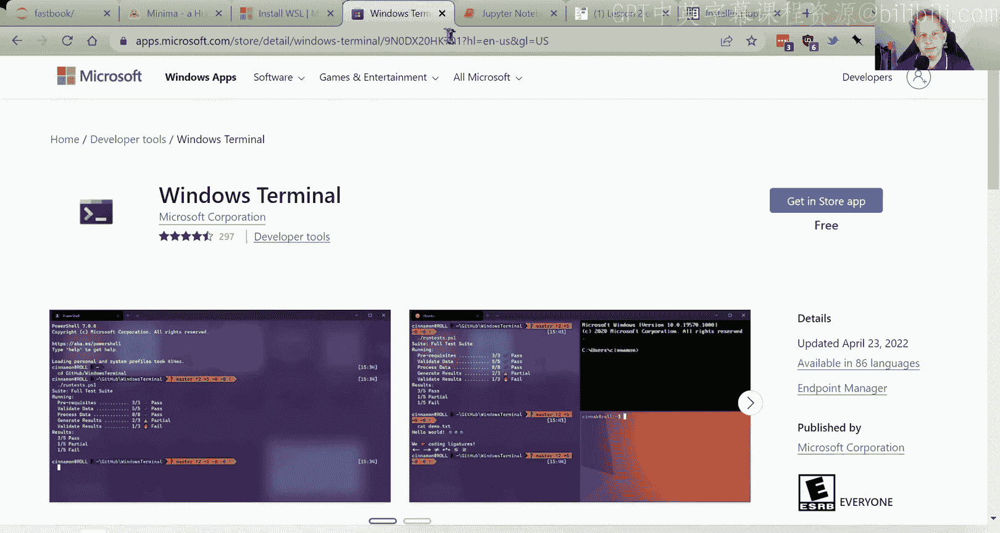

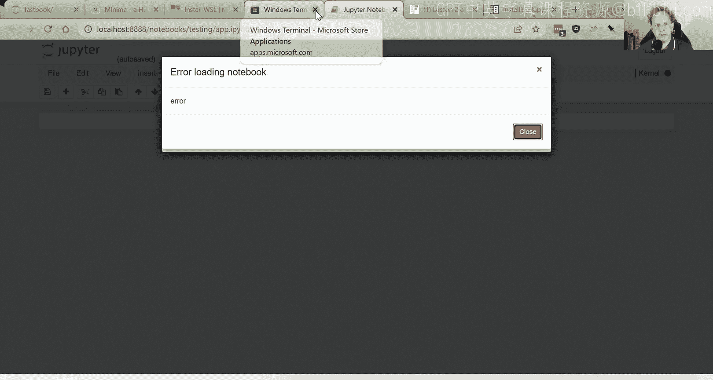

So if you go to just Google for WSL install。

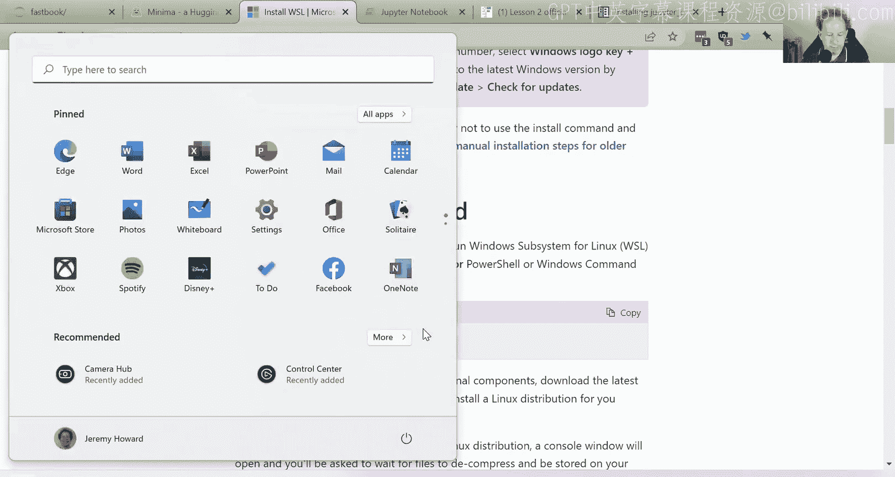

Run Powerhell as administrator。Paste that command， wait about five minutes reboot you're done you now have a complete Linux environment Now one of the reasons I'm mentioning this is I'm going to show you how to do stuff on your own machine now and so this is like going to a bit of an extra level of geekery which some data scientists may be less familiar with so you know don't be worried about the terminal you're going I think you're going to find it really helpful。

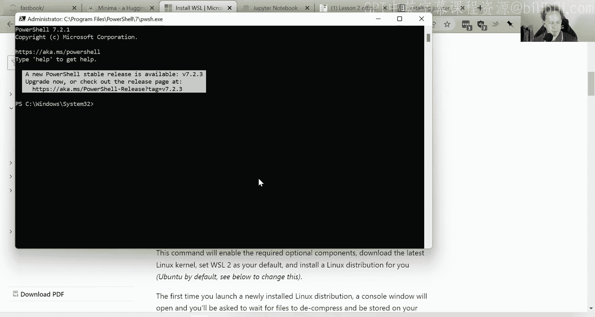

And much less scary than you expect and。I particularly say like for me。

 I choose to use Windows and that's because I get you know all the nice windows goI apps and I can draw on my screen and do presentations and I have a complete Linux environment as well and that Linux environment uses my GPU and everything so for me。

You know， my first choice is to use windows。My second choice。

 but not very much really like it would be to use Linux。 Mac is a little bit harder。

 but it's still usable。So some things are a little bit trickier on Mac， but you should be fine。 Okay。

 so whatever you've got at this point， you've now got a terminal available。And so in your terminal。

 one of the really nice things about using a terminal is you don't have to follow lots of instructions about click here。

 click here， click here， you just copy and past things。 So let's go ahead you just copy this。

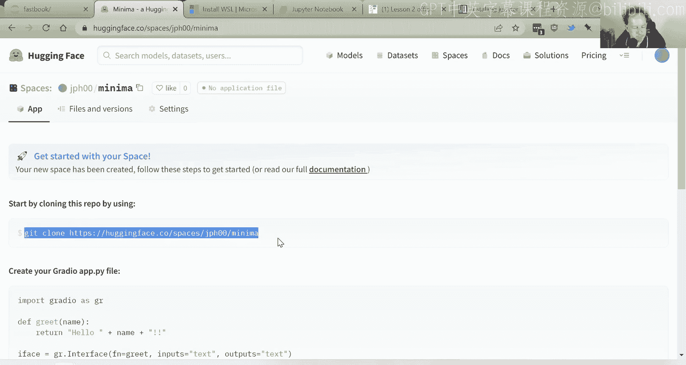

Then you go over to your terminal， and you paste it in， and you ran it。And after you do that。

You'll find that you've now got。At directory。😊。

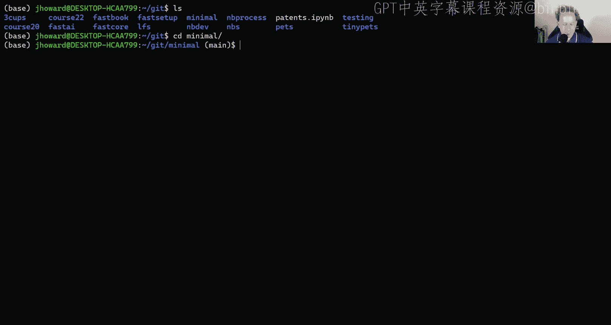

And so that new directory initially is empty。And they tell you， okay。

Go ahead and create a fire with this in it。

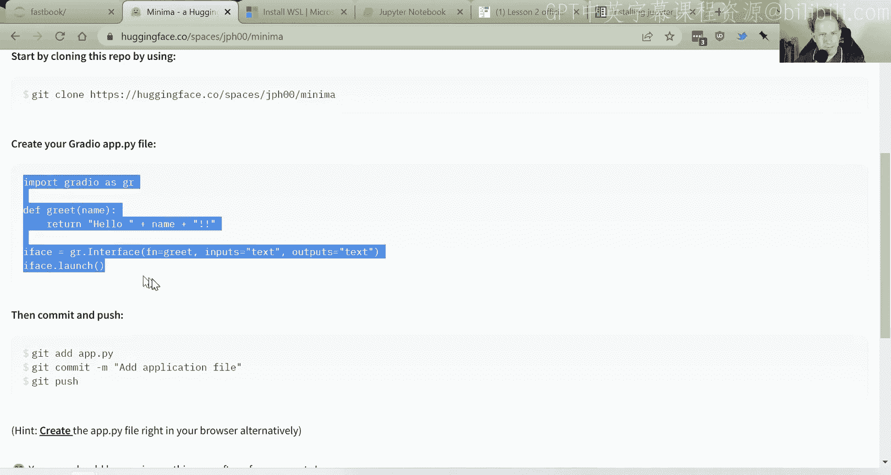

Okay， so how do you create a file with that in it when we're in here in our Linux environment on Windows or in the terminal on Mac or whatever。

 well all you do in Windows if you just type Explorer。ax。t， it'll open upexlorer here。

 or better still on either Mac or Linux or Windows，So yeah。

 so regardless of what computer type of computer on， you can just type code dot。And it will pop up。

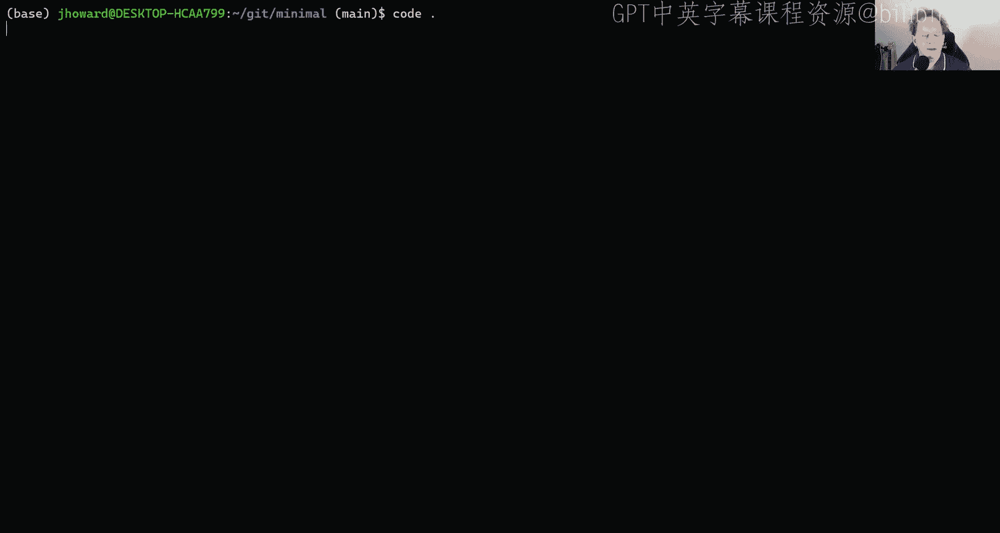

Ficial Studio code and open up。Your photo。And so then you can just go ahead。

 And if you haven't used V S code before， it's really well worth。

Taking a few minutes to read the some tutorials， it's a really great IE。

 And so you can go ahead and create。😊。

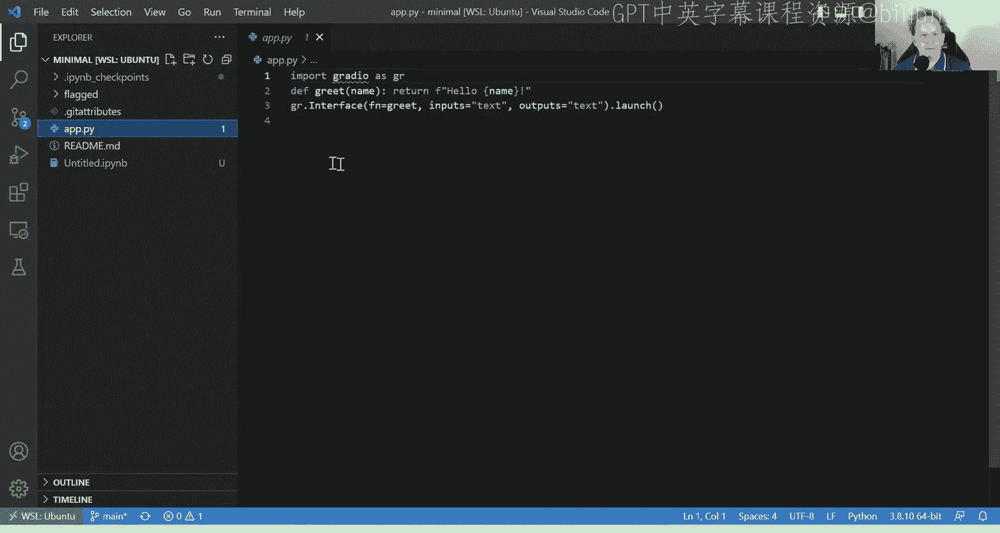

An a dot pi file， like they tell you to， app dot pie file containing what they told you to put in it。

 here it is here。

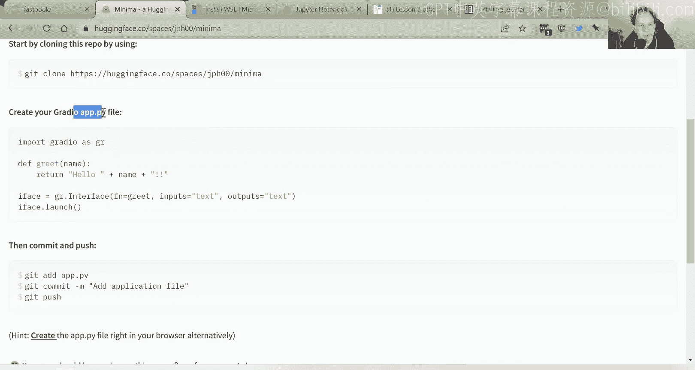

mAll right where。Nearly that。 So you can now。Go ahead and save that。

And then you need to commit it to radio。 That's a radioio to hugging face pieces。

 So one really easy way is just in visual Studio itself， you can just click here。

And that'll give you a place where you type a message and you hit tick and it'll send it off to hikinging face spaces for you。

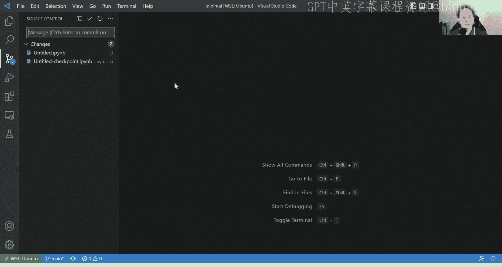

So once you've done that。😊，You can then go to back to the exact same website you on before。

 hikinging spacespaces， JPHOO minimal。And what's your find now is that it'll take about a minute to build your website。

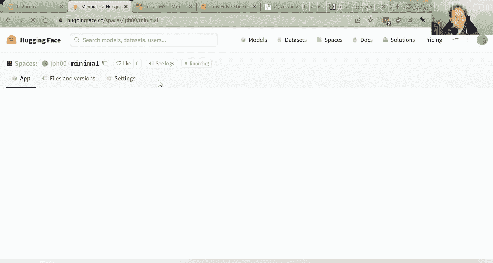

And it's。The website it's building is going to have。A radio interface。With a text input。

A text output。And it's going to run a function called greet on the input and my function called greet or return Hello name。

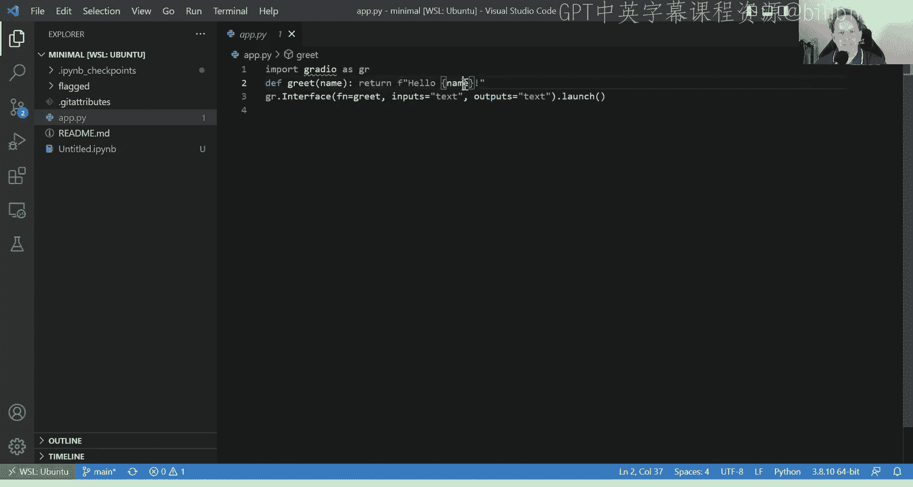

So that's what it's going to do。No there， guys。 Let's try it。We'll say hello to Tishch。

I'm not always very good at remembering out his public's name。 I think it's like that。

And there you goes。 So you can see it's put the output for our input。 So not a very exciting app。

 but we now have。To be fair， an app running in production right now I told you we'd have a deep learning model running in production。

 So now we have to take the next step， which is to turn this into a Dick learning model。😊。

All right so。First， we're going to na a date learning model。

And there's a few different ways we can get ourselves a deep learning model。

 but basically we're going to have to train one。So。I've got a couple of examples。

 I've got a kggal example and a coab example， maybe I'll quickly show you both。

They're going to do the same thing， and I'm just going to create a dog or a cat classifier。😊，Okay。

 so here's our Cale model。I'll click on edit so you can actually see what it looks like。😊，In Ed view。

Now Ka already has FA AI installed， but I always put this first just to make sure we've got the latest version。

And obviously import stuff so we're going to grab the PEs data set。

A function to check whether it's a cat。That's our labeling function for our image data loaders。

 remember this is just another way of doing data blocks。 It's like a little shorthand。

And we create our learner and we fine tune it。 Okay， so that's all stuff we've seen before。

So in Kaggle， every notebook has an edit view， which is what you just saw in a reader of view。

 And so you can share your notebook if you want to， and then anybody can read。The rate of you。

 as you see。And so you can see it shows you what happened when I ran it。And so I trained it at took。

You know，So that the the GPUs on Kaggle are a bit slower than most modern GPs。

 but they' still fast enough， I mean， it takes five minutes。嗯。And there's one bit at the end here。

Which you haven't seen before， which is I I learned on export， and I give it a name。

Now that's going to create a file containing our trained model。

And that's the only thing creating this file is the only thing you need a GPU for so you do that on CAggle or on coLab。

 so here's exactly the same thing on coLab you can see Pip install is CA Un data， image data loaders。

 so I've got to show batch here as well just for fun。Create my learner and then export。

So while we wait， I might go ahead and just run that。

One nice thing about Caggle is once you've run it and saved it， you can then go to the data tab。

And here is basically anything you've saved。 It's going to appear here。 And here it is。

 model dot pickle。so now I can go ahead and download that。😊，And。

That will then be downloaded to my downloads folder。

And then I need to copy it into the same directory that my hugging face space is absent in。

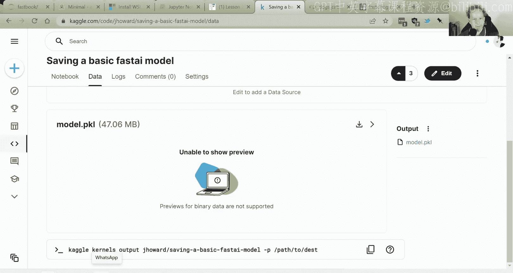

Now my hacking face bases app。Is currently open in my terminal in on Mac， you can type open dot。

Or in Windows， you can type Explor on X dot。

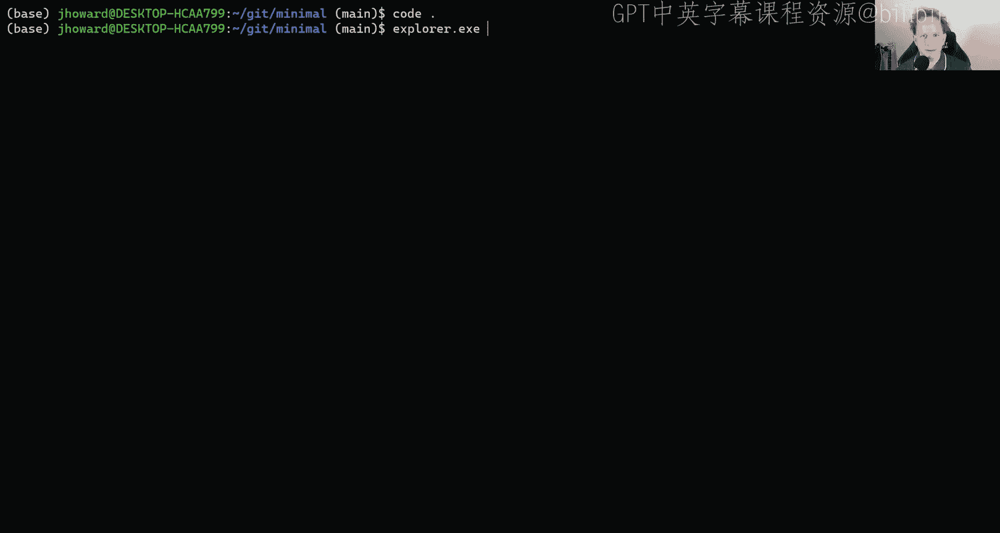

And that'll bring up。Your finder or Expr in that directory and so then you can just paste that that thing you downloaded into this directory。

 something by the way in Windows I do which I find really helpful is I actually grab my home directory in Linux。

And I pin it to my quick access and that way I can always jump in Windows straight to my Linux files。

 not really something you have to worry about on Mac because it's all kind of integrated。

 but on Windows they're like kind of like two separate machines。Okay， so。Let's do。

So I created a space core testing。And I downloaded my model dot pickle， and I pasted it into testing。

So now we need to know how do we do predictions on a safe model？

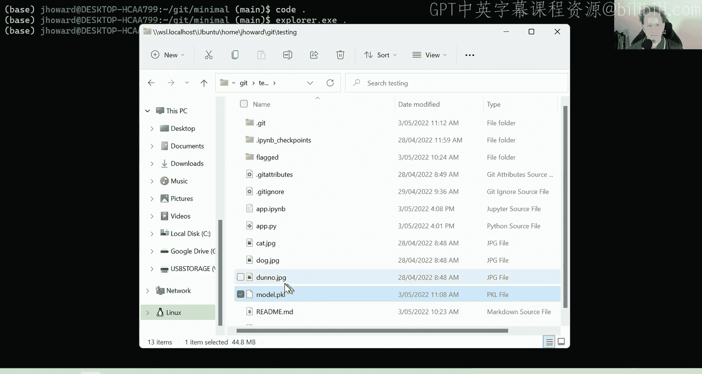

So we've got a notebook for that。Okay， so we've got a notebook for that and so I'm going to take you through how we use a model that we've trained to make predictions。

There's a few funny things with hashpipe which I'll explain in a moment just ignore those for now so we import fast AI as usual we import radio as we did before and we copy in the exact same is CA definition we had before That's important Any external functions that you used in your labeling need to be included here as well because that learner refers to those functions okay it' saved that learners saved everything about your model but it doesn't have the source code to the function so you need to keep those with you。

So let's try running this， So for example。I described grabbed， as you might have seen in my explorer。

 I just popped a dog。

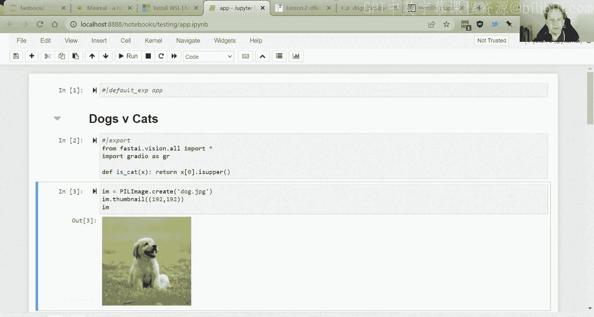

Picture there。

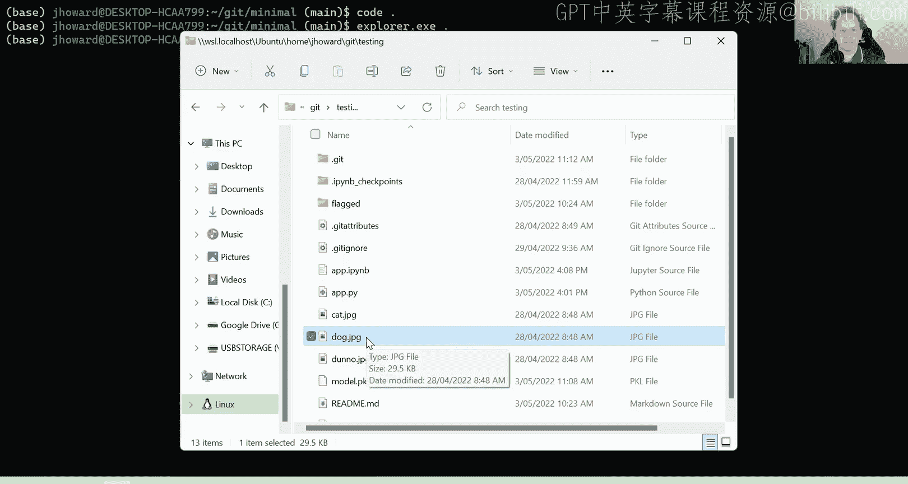

And so we can create a Python image library image from that dog。

 turn it into a slightly smaller one so it doesn't overwhelm my whole screen and there is a picture of a dog。

😊，So how do we make predictions of whether that's a dog or a cat。

 What's very simple All we do is instead of training a learner， we use load learner。

 we pass in the file name that we saved and that returns a learner。

 This learner is exactly the same as the learner you get when you finish training。

 So here we are his collab right， we've just been training a learner。So at the end of that。

 there's a learner that's been chained。 And so we， we kind of froze it in time something called a pickle file。

 which is a Python concept。 It's like a frozen object。 We saved it to disk。

 we transferred it to our computer and we've now loaded it。 and we've now unththought it。 There's。

 here's our unpicickled learner。 And we can now do whatever we like with that。

 So one of the things that the。😊，嗯。One of the methods that a learner has is a dot predict method。

 So if I run it， you can see even on my laptop， it's basically instant instant。

 in fact we can see how long it took。If you in Jupiter things that start with percent are called Mags。

 they're special Jupiter things， so for example， there's a thing to see how long something takes。

There you go。 Okay， so it took 54 milliseconds to figure out that this is。Not a cat。

So it's returning two things， is it a cat？As a as a string。Is it a cat as it a0 or1？

And then the probability that it's a dog and the probability that it's a cat。

 So the probability of0 false and one true a visit a cat。 So definitely a dog。

So we now want to create a radio interface which basically has this information。

So Gio requires us to give it a function that it's going to call。So here's our function。

 So we're going to call predict。And that returns， as we said， three things。

 the prediction is a string， the index of that and the probabilities of whether it's a dog or a cat。

And what Gio wants is it wants to get back a dictionary containing each of the possible categories。

 which in this case is dog or cat and the probability of each one。

So if you haven't done much Python before， a di of a zip may be something you haven't seen very handy little idiom。

 well worth checking out Did know if you haven't seen map before anyway， here it is。

 One slightly annoying thing about radio at the moment is that it doesn't handle。

Pyer torch tensesors， you can see here py torch is not returning normal numbers。

 it's returning tensors， it's not even returning nu p array。In fact。

 radio can't handle on nuy either， so we have to change everything just to a normal float。

 so that's all that this is doing is changing each one to a float。So for example。

 if I now call Classify image。With our doggy image， we get back a dictionary of a dog。 Yes。

 definitely cat。 definitely not。So now we've got all that。

 we can go ahead and create a radio interface。So graio interface is something where we say， well。

 what function do you call to get the output？What is the input in this case， we say。

 oh the input is an image。 And so check out the radio dots It can be all kinds of things like a webcam picture or a text or you know all kinds of things。

 give it a shape that it's going to put it into。 The output's just going to be a label。

 so we're going to create very， very simple interface。嗯。And we can also provide some examples。

 And so there's a dog， a cat and a duno， which I'll talk about in a moment。

 which you'll see here there's a dog and a cat and a duno。

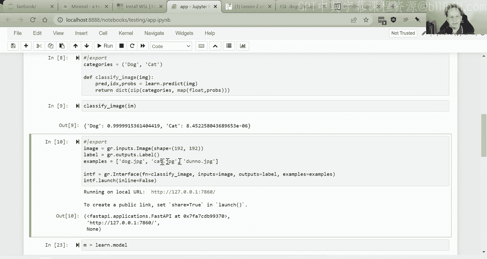

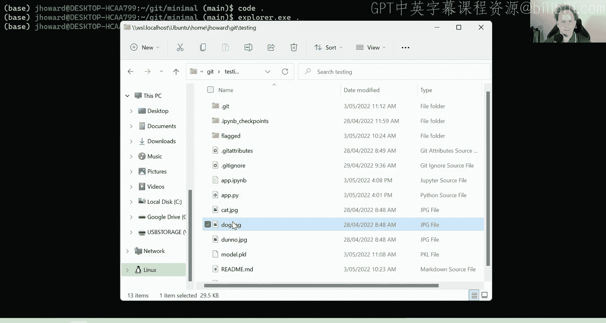

So once I launch it， it says， okay， that's now running on this URL， so if I open that up。

You can see now we have just like Suveash。 we have our own。Not yet in production。

 but running on our own box。Classifier， so let's check Do。

 so you can click and upload one or just choose the examples。Yeah yeah。

 so it's running on my own laptop， basically instant。And I really have to tell you this story about。

This guy here。 This is the duno， said Me。Wait， why is it saying 100，Normally this says like 5050。

 That's a b。 this model's got messed up my whole story。

 So last time I trained this model and I ran it on the duno。

 it said it said like it's almost exactly 5050。 And the way we found this picture is I showed my six year old daughter。

 Shes like， what are you doing， dad' like uncoding。 What are you coding。 Oh， you know。

 dog cat classifier She checks it out。 And her first question is。

Can I take your keyboard for a moment， And she goes to Google。 And she's like。

 what is a dog mixed with a cat called night。There's no such thing as a dog mixed with a cat。 Anyway。

 she goes to the image tab and finds his picture， And she's like， look。

 there's a dog mixed with a cat。 She said， run it on that。 dad， run it on that。 And I ran it。

 And it was like。😊，50，50， it had no idea if it the dog or a cat。Now。

 this model I just retrained today now is sure it's a cat。So there you go。

 I think I used a slightly different training schedule or something， or I gave it an extra epoch。

Anyway， so that's a dog cat。 but apparently it's a cat。I guess it is a cat。It's probably right。

Shouldn't have trained it for as long。 Okay， so there's our interface。 Now that's actually running。

 So you actually have to click the start button to stop it running。

 So otherwise you won't be able to do anything else in your notebook。O。嗯。

So now we have to turn that into a Python script。😊。

So one way to turn it into a Python script would be to copy and paste into a Python script。

 all the things that you need。嗯。😊，I'd be to copy and paste into a Python script All these parts of this that you need。

 So， for example， we wouldn't need this。 It's just to check something out。 We wouldn't need this。

 It was just experimenting。 This was just experimenting。 We'd need this。 right。 So what I did。

As I went through， and I wrote。Hash plate export at the top of each cell that contains information that I'm going to need in my final script。

And then。So there' are the steps， right。 And then at the very bottom here。

I have imported something called notebookbook to script from Nb devev。And if I run that。

And pass in the name of this note。

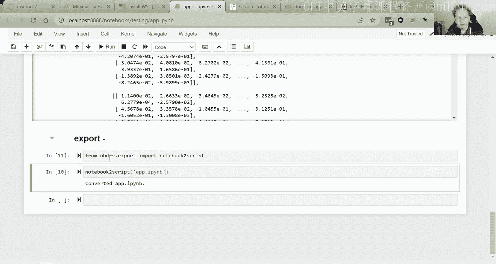

That creates a file for me。Court a up high。Containing。

That script so this is a nice easy way to like when you're working with stuff that's expecting a script and not a notebook like hugging faceSps does。

 it's fine to just copy and past into a text file if you like。

 but I really like this way of doing it because that way I can do all of my experimentation in a notebook。

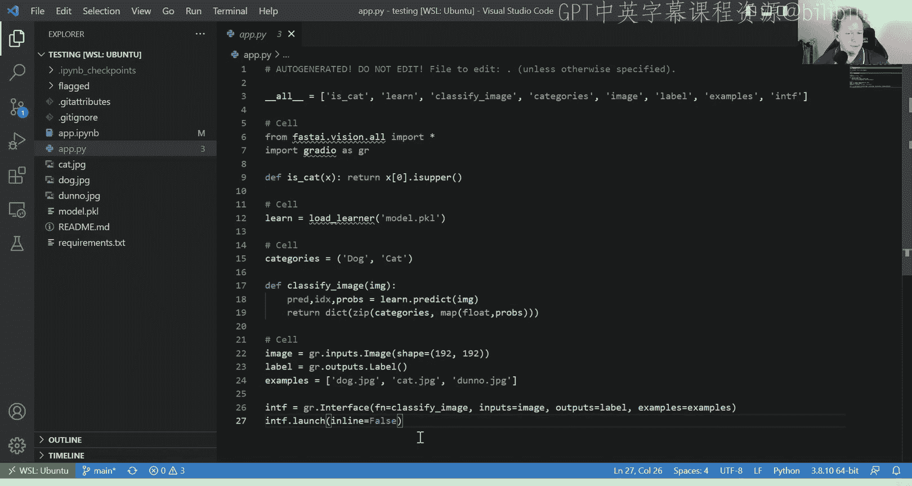

And when I'm done， I just have a cell at the bottom。 I just run and export it。

 How does it know to call it a up pi， That's because there's a special thing at the top default export。

 default X， which says what Python vow name to create。So that's just a little trick that I use。

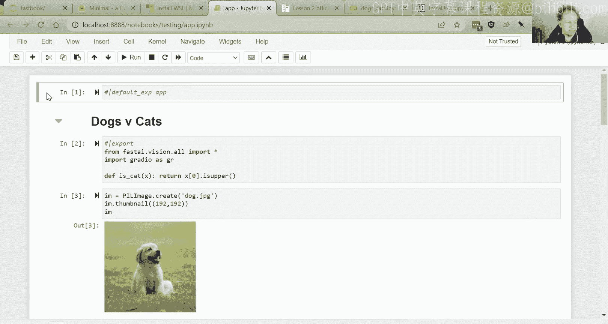

So now we've got an a up pay。😊，🎼We need to upload this to G。 How do we do that， You just。

 you just push it to get。 So in you can either do it with visual studio code or you can type。

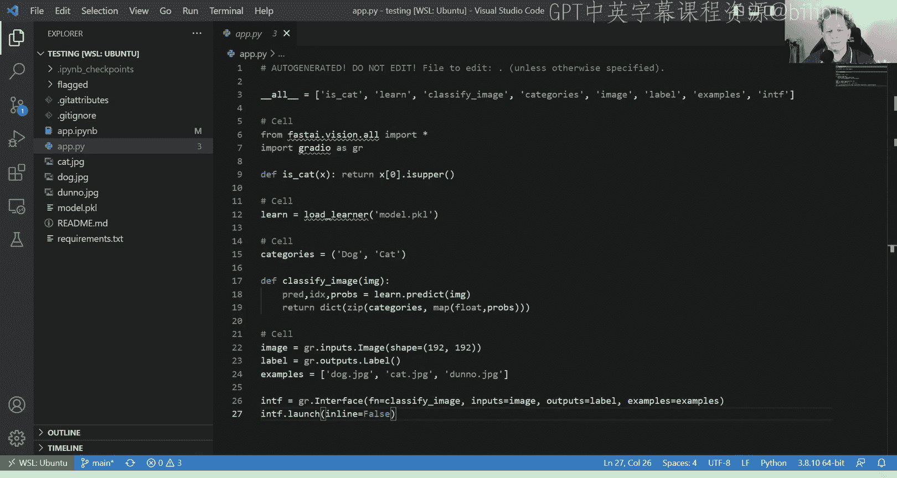

呃。Get commit。And then get push and once you've done that。

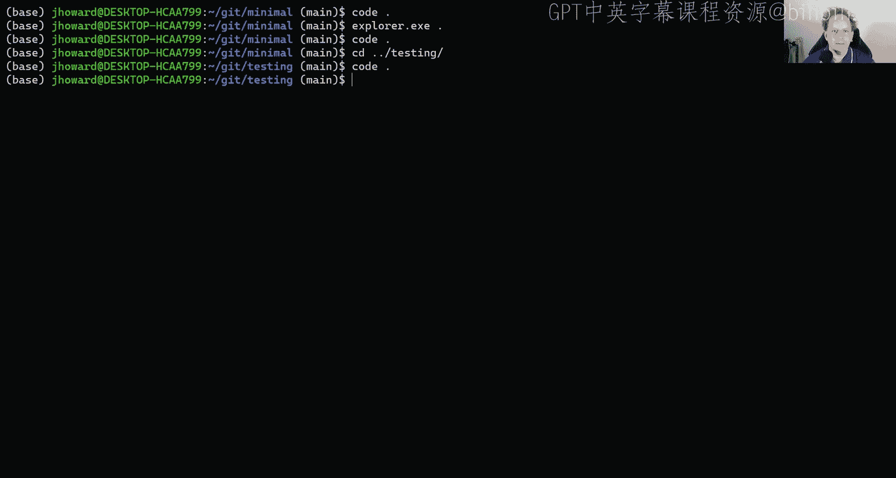

If we change minimal to testing。I think this hopefully might still be running my previous model because I didn't push it。

 And that way， we can see our。Our crazy dog cat。Al right， so here it is。

 You can see it running in production。So now this is something that anybody can。

 if you set it to public， anybody can go here and check out your model， and so they can upload it。

 and so here's Modoki。Yep， definitely a dog。 cat。 Yeah。

 I think I'm better train this for epoch or two less。 So it's less confident。 Yeah， definitely a cat。

Duck hat。Hey， dog cat。H still thinks it's definitely a cat。 are well， so beard。Okay， so。That is。Okay。

 so that is an example of getting a simple model in production。

 there's a couple of questions from the forum from the community。Okay， so one person's asking。

What's the difference between a pieytorrch model and a fast AI learner， Okay， that's fine。

 We will get to that shortly。 Don't know if it' be the lesson。

 It might be this lesson or the next lesson。And then somebody else asked basically is asking how。

 how many epochs do we train for。 So as you train a model。Your error rate， as you can see。

 it improves。And so the question is， should I run more， should I increase the number of epochs。

 This is doing three epochs， right， Here's my three epochs plus one to get started。Look。

 it's up to you， right， I mean， for this is here saying there's a 1% error。I'm okay with a 1% error。

 you know if you want it to be better， then you could use more data augmentation and you could train it for longer。

If you train for long enough， as we'll learn about soon in maybe the next lesson。

 if you train for long enough， your error rate actually starts getting worse。

And you'll see well learn about way。 So basically， yeah。

 you can train until it's good enough or until you've run out of patience or time or run out of compute or until you or until the error rate starts getting worse。

Okay。Oh， and then in CoLab， how do you grab your model。

 all you need to do in collLab is after you've exported it。Is if you go into their file browser。

You'll actually see it here， right， And you can click。Download。It's a bit weird。

It doesn't like pop up a box saying where do you want to download it to？

But instead this kind of progress circle thing pops up and so depending on how big it is and so forth。

 it can take a few minutes and once that circle fills up。

 then it'll browser thing will finally pop up and say， okay。

 you can save it so that's that's how you actually grab your model So as you can see the step where you actually need a GPU。

 you can use these totally free resources， coab， kle there are other ones we'll talk about in future lessons and and then you can do everything else on your own computer。

 including the predictions， the predictions are fast right so you really don't need to use a GPU for that unless you're doing thousands of them Okay here we go so notes asking me to save it。

Okay， so now one big issue is we needed to run it on our computer。

 we needed Python and Jupyter notebooks running on our computer， so how do you do that？

Because this is where often people。Get in all kinds of trouble。

 I'm trying to figure out how to get this all working。

 So the good news is we've actually got something that makes it very， very straightforward。

 Its called fast setup up。 There's really only just one part of it you need。

 So let me show you its it's actually a Git repository on Gitthub Gitthub's the place where most Git repositories live。

😊，So if you go to GitHub Fastt A fast setup， you'll see it。

And so what you can do is you can now grab。This whole repository， just by clicking here on code。

 And if you've got Gitthub desktop installed， click on open with Github desktop。

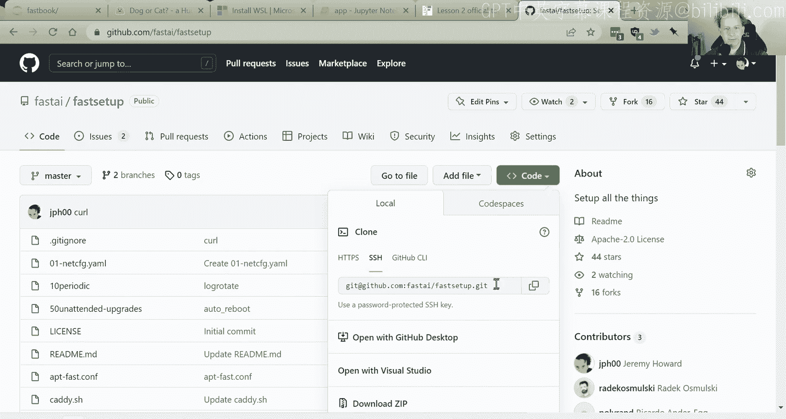

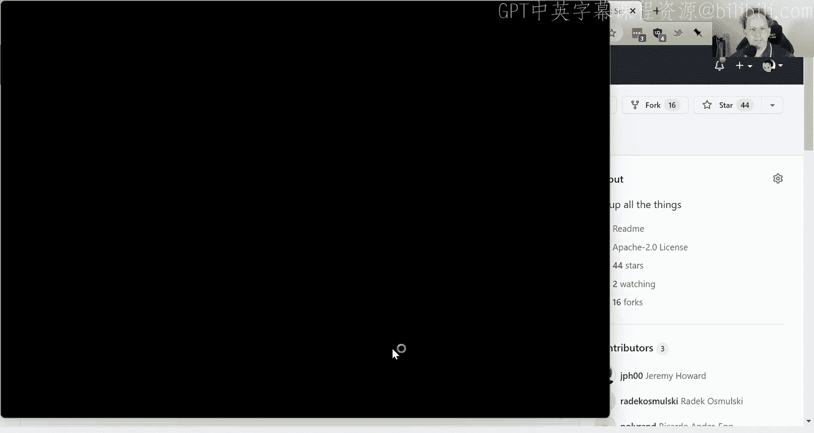

And as you'll see， it brings this up saying， okay， I'm ready to save this for you。 so I click clone。

So it's making a copy of it。There we go。😊，嗯。So basically， once you've cloned it。😊。

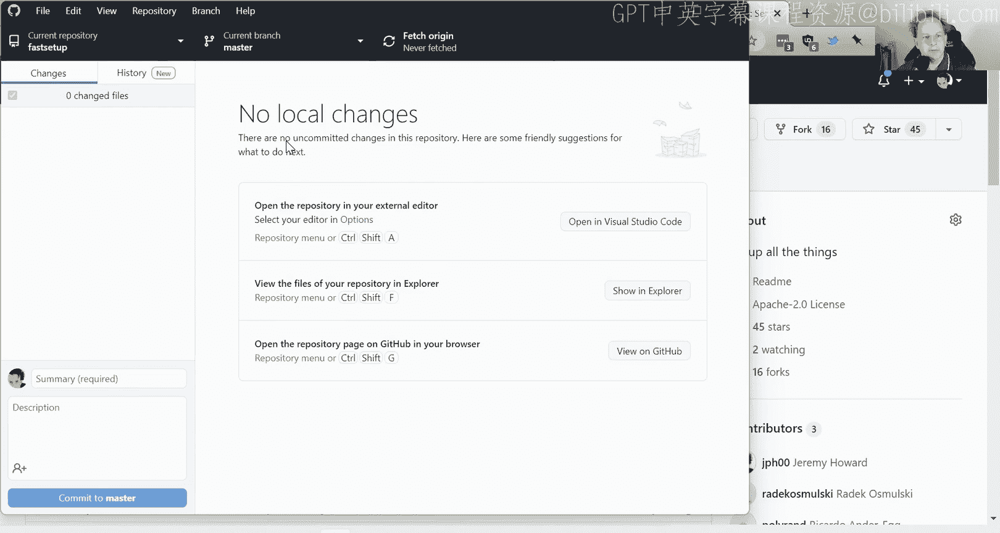

You'll then find。There's a file in there called setupcondo。 S H。Which， you know。

 the details don't really matter。 It's pretty short。

 but that's the thing that's going to install Python for you。 So at that point。

 you can just run dot slash setup up Con， and it'll run。This installer now。

If you've got Linux or Mac， you've already got Python on your machine。Don't use that python。

 And the reason is because that python， it's called the system Python。

 It's used by your computer to do computery stuff， right， It's actually， it's actually needed。

 You don't want to be messing with it。 I promise you， like。It's。

 it always leads to disaster always you want your own development version of Python。

 It's also going to make sure you' got the latest version and all the libraries you want。

🎼And by the by far the best one for you is almost certainly going to be these condo based python distributions so if you run setup Con you'll get the one that we recommend and the one we recommend at the moment is something called Mambaforge so basically once you run it。

You'll find that you've now and you close your terminal and reopen it。

 you'll find you've now got one extra command， which is called Mamba and Mamba lets you install stuff。

So once you've run it， you'll be able to go membermba， install。Fastster out。And that's going to。

Actually， we should probably， I should mention thiss actually more bit more detail about how to install it。

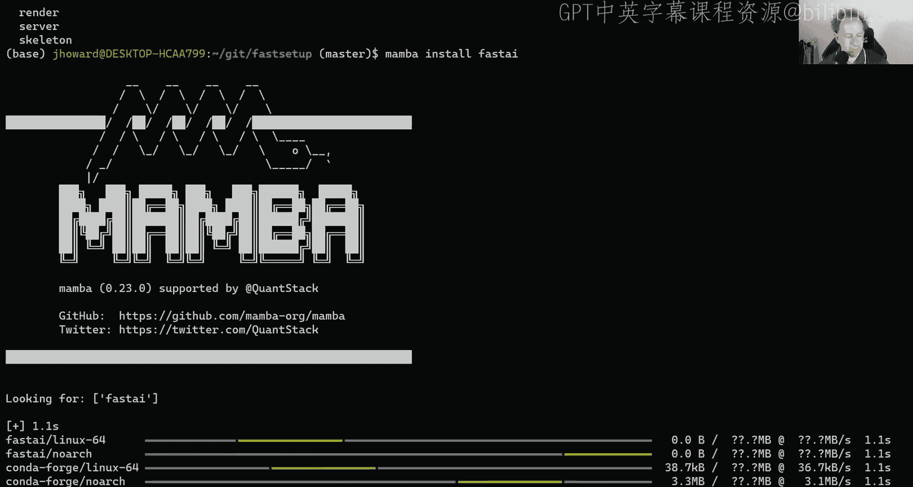

Correctly。If we go to duckucks。fast。aiI。Installing。Yeah， okay。

 we actually want to do Conda install minus C first ch first air， so this is copy and paste。

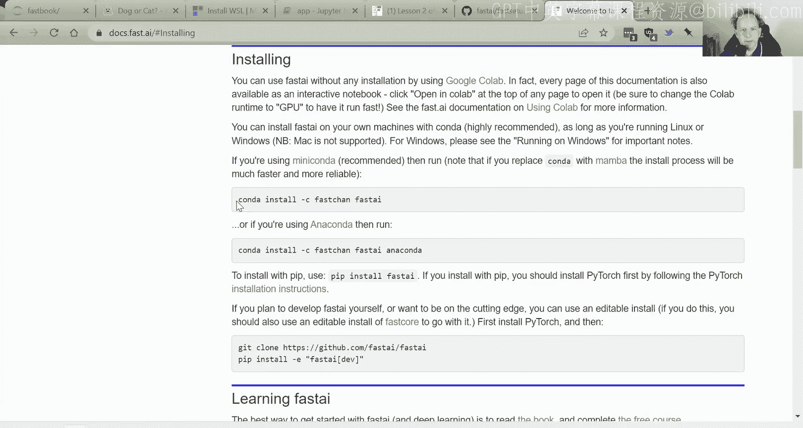

Oh so not actually， and then the other thing I'll say is instead of using Conda。

 replace Conda with Mamber because nowadays it's much faster。 So Mamber install minus C fast ch fast。

Now this is going to install。Everything you need， it's going to install pie torch。

 It's going to install nuy。 It's going to install fast Ai。And so forth， right， and。

So obviously I've already got it。And then the other thing you'll want to do is install。And be deaf。

So you can do exactly the same thing for Nb dev。 you don't have to， right。

's just that but that'll is stored Jupiter for you amongst other things。And so at that point。

 you can now。You can now use Jupiter。 And so the way Jupiter works is。You can see it over here。

 This is by。I'll go ahead and close it so we can start again。So basically to use Jupiter。

 you just type Jupiter Note。Okay。And when you run it， it'll say， okay。

 we're now running a server for you。 And so if you。

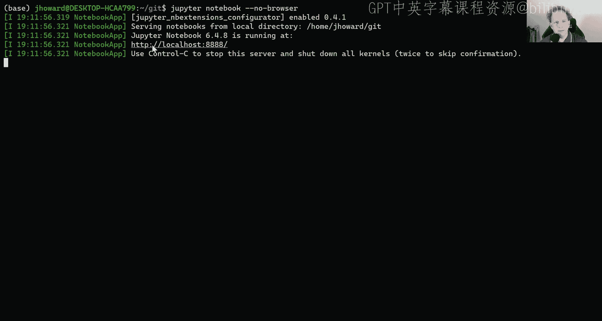

Click on that hyperlink。

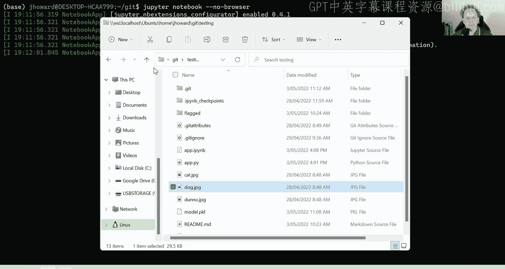

It'll pop up this， okay， which is exactly what you see me use all the time。um。Okay， so， you know。

 that hopefully is enough to kind of get you started with with Python and with Jupyter notebook。嗯。

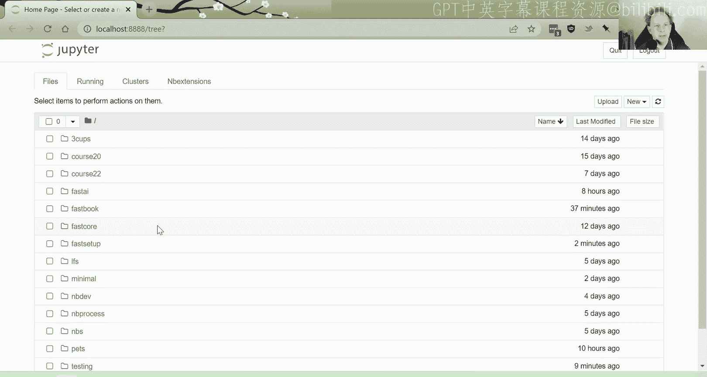

The other way people tend to install software is using something called PEP instead of Manmba。

Pretty much anything you can do with MAM but you can also do with Pip， but if you've got a GPU。

 Pip isn't going to install things generally so that it works on your GPU。

 you have to install lots of other stuff， which is annoying so。

That's why I kind of tell people to use Manmba， but you can use PIip otherwise。

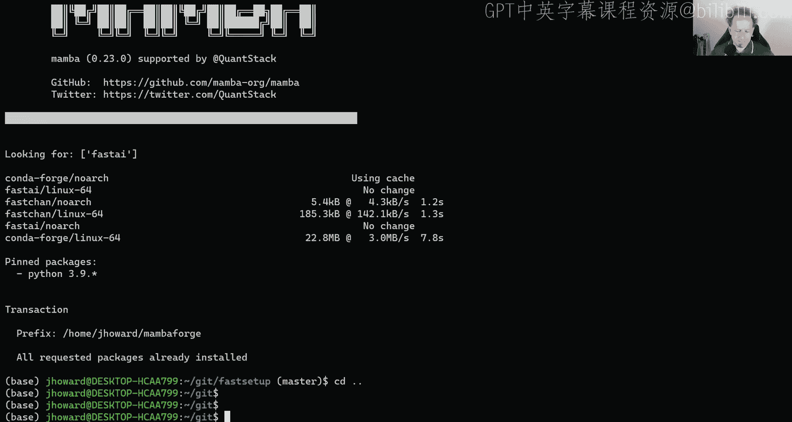

Stillall a little bit of red。Please let us know how we can help you gang。Okay。

 so let's see how are we going with our steps。 I forgot I had these steps here to remind myself。

 we created a space tech。😊，We createded a basic interface tech。Okay， we got Gi set up。

 we got condos set up or mamba so mamba。Mmber and Conr are the same thing。

 Mamber is just a much faster version， and。We'll keep some notes on the course website because at the moment they're actually working on including the speed ups from membermba Inconda。

 so at some point maybe it'll be fine to use Conr again at the moment Conda is way too slow。

 so don't use it。Okay， we've done dogs versus cats。No problem。嗯。是。Yeah。

 so we could also look at pet breeds。 Well， yeah， we'll we'll be briefly look at that。 Okay。

 we've used an exported learner， no problem。 used M B dev， no problem。 Oh， okay， try the API。

 Allright， this is interesting。So I think we can all agree hopefully。

 that this is pretty cool that we can provide to anybody who wants to use it for free。

 a real working model and。😊，You know， with radio。There's actually。You know。

 a reasonable amount of flexibility。Around like how you can make your， your website look， you know。

 using these various different widgets。嗯。It's not amazingly flexible。

 but it's flexible enough to kind of it's really just for prototyping， right？😊。

So Gio has lots of yeah widgets and things that you can use。

The other main platform at the moment that the hugging for space supports is called streamlet。

 streamlit is。More flexible， I would say， than radio。Not quite as easy to get started with， but。

 you know， it's kind of that nice in between， I guess， So also a very good thing Id， you know， again。

 mainly for kind of building prototypes。But at some point you're going to want to build more than a prototype。

 you want to build an app and one of the things I really like about radio in hugging face spaces is there's a button down here。

 view the API。So， we can actually create。嗯。Any app we want。 And the key point is that the thing that。

That does the actual model predictions for us is going to be handled。By hugging face spaces， Gio。

 right。 And then we can write a jascript application that then talks to that。

Now there's going to be two reactions here。Anybody who's done some front end engineering is going to be like。

 oh， great。 I can now literally create。Anything in the world because you just write any code and I can do it and they'll be excited and a lot of data scientists might be going oh oh。

 I have no idea how to use jascript It's not in my you know inventory So this is again where I'm going to say look don't be too afraid of ja I mean。

 obviously one option here is just to kind of say hey。

 I've got a model throw it over to your wall over the wall to your mate who does no ja and say please create a ja interface for me but let me just give you a sense of like。

😊，How really not hard this actually is。So。There's a end point。

 There's now a URL that's running with our model on it。And if you pass it。Some data an image。

 some image data to this， to this URL。 It's going to return back。The dictionary。

 says it's going to do exactly the same thing。That this U I does。But as an。

 as an API as a function we can call。And so it's got like examples here of how to call it。 So。

 for example， I can actually。Let me show you the API as an example using that。Minimal interface。

 we had。Because it's just going to be a bit simpler so if I click curl。And I copy that。

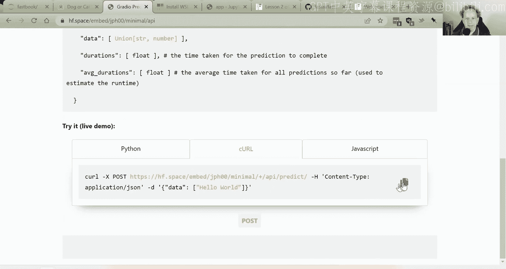

Copy that。And paste。So you can see there， Oh， that's not a great example passing in Ho world。

 if I pass in。Tnik， again， let's see how I'm going with his name， Tennik。

Here you can see and returns back。 Ho， Tuniche。 So this is how these APIs work。 right， so we can use。

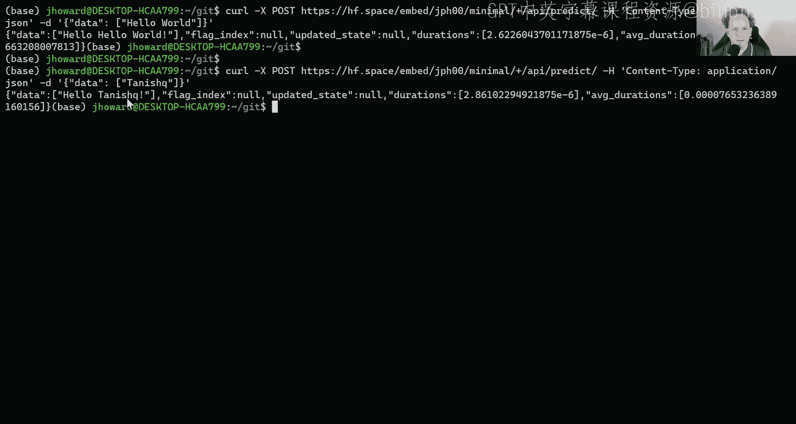

Javascript。To call the API and we've got some examples。So I've created a website。

And here is my website。Tiny pets。And on this website， as you can see。

 it's not the most amazingly beautiful thing， but it's a website。 it's a start right。

 and up here I've got some examples Here we go， single file。😊，Click choose fileile。Click。嗯。

And in this example， I'm actually doing full pet classifications。

 so I actually trained a model to classify breed， which we'll talk about more next week rather than just dog versus cats。

 so let's pick a particular breed。And we ran it。Oh， and there it is。Now。Not very amazing， right。

 but the fact is that this is now a JavaScript app means we have no restrictions about what we can do。

 And let's take a look at that HTML。That's it。It easily fits in a scrap。Right。

 and the basic steps are。Not crazy， right， It's basically。We create an input for our photo。

We add an event listener that says when you change the photo called the read function。

 the read function says create a file reader。Read the file。And when you finished loading call loaded。

 and then loaded says。Fetch that。 Now， that path there。Is。That path there， right。

 except we're doing the four pets one。So this is basically just copied and pasted from there。

From this sample。And then grab the JSO。And then， grab。From the data， the first thing。

 the confidences， the label， and then set。The HTML。 So as you can see， it's like， okay。

 if you haven't used jascript before， these are all new things， right， but they're not。

 it's not harder than Python， right，'s just， it's just another just another language to learn。

 And so from here， you can start to build up， right？ So， for example， we've created。

A multi file version。So with the multi file version， let me show multi file。Choose。😔。

So we can now click a few。So we've got a new fee， and rag doll， a basshound and some kind of cat。

I'm not much a cat person。So we chose four files and。Bang。😊，They've all been classified。 Apparently。

 it's a Bengal。 I wouldn't know。Heres then you found them。 So there's the multi file version。

 And if you look at the code， it's not much more， right， It's now just doing。

 it's getting all the files and mapping them。To read and now appending each one。

 So not much more code atable。嗯。😊，And as you might have seen， on our sight here。

There's a few more examples， which is some of the community during the week has created their own versions。

So。This one here is。

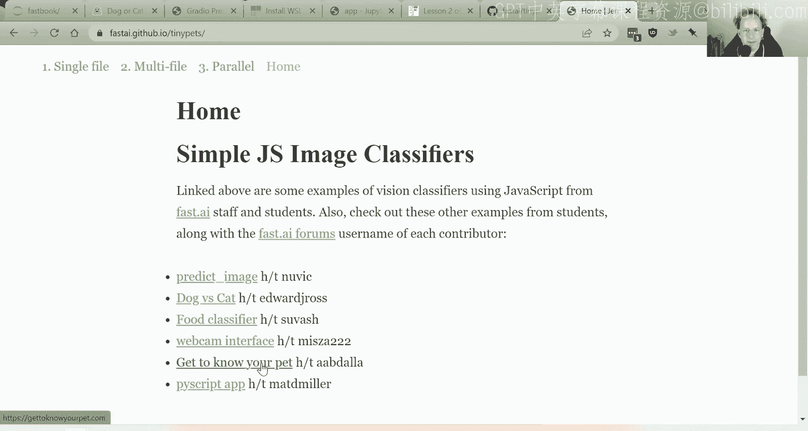

I think this is thought yeah， this is from one of the radio guys。

 they called it get to know Your pet。😊，So if I choose a pet， I kind of。

 I really like this because it actually combines two。Models， so， first of all， it says， oh。

 it's a bassett hound。 And then it lets be type in and ask things about it。 So I could say， oh。

 what kind of tail does it have。Se， and so that's now going to call an NLP model。Which asks about。

Thisis， it's a curved saber tail。 There we go。What maintenance does it need。

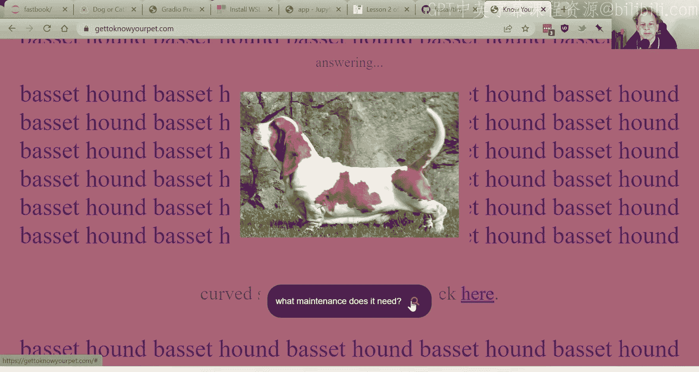

So again， like here you can kind of see how a Baett town's ears must be cleaned inside it out frequently。

 So this is like combining models。 So you can see this is something that you couldn't do with just a kind of a ready to go interface。

😊，And so the next thing I wanted to point out is。How did we create the website that I showed you how to create an HTML file。

 but like。How do you create those and how do you make a website out of them？Well， watch this。Let's。

 here's， here's。嗯。Here's the source code to our most basic version，I could just save this。Here we go。

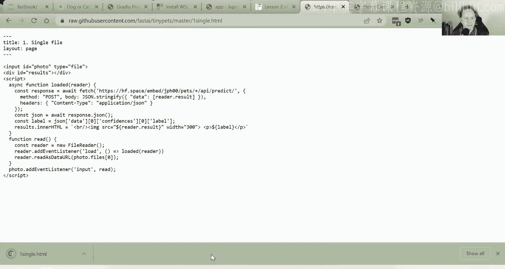

Okay， so we could open that with Visual Studio code。嗯。

And what we could actually do is we could here it just as an Explorer or Mac and finder。

 I could just double click on it。

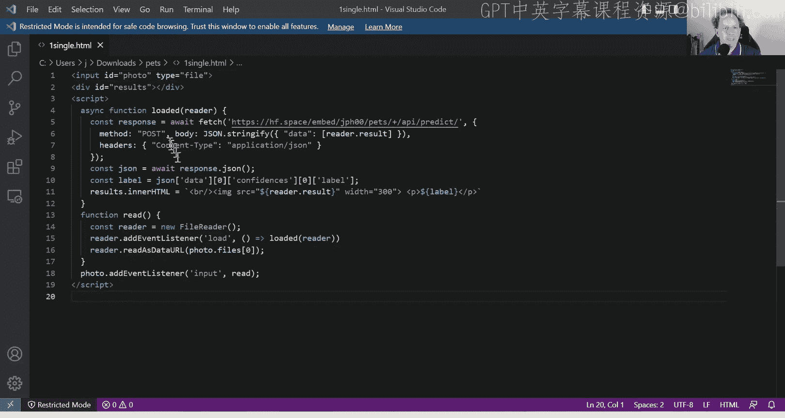

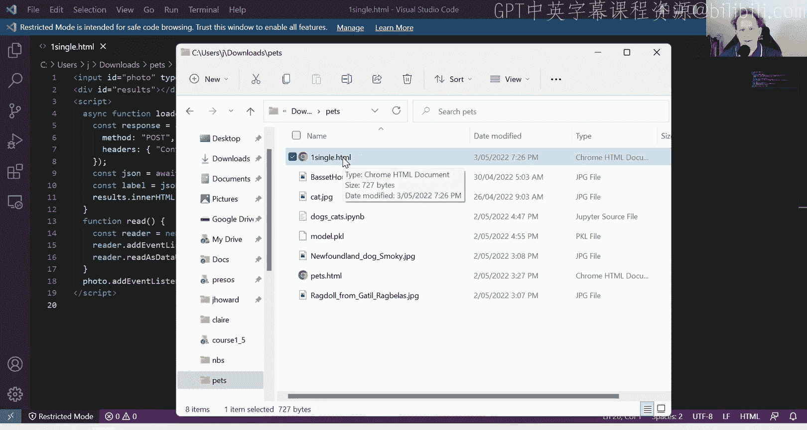

And here it is， it's a working app。So you can see I don't need any software installed on my computer to use a jascript app。

 right， It's a single file。 I just run it in a browser。

 A browser is our complete execution environment。 It's got a debugger， it's got the whole thing。

 So here you can， you know， here you can see it's it's just calling out this external hugging faces endpoint。

 So I can do it all sitting here on my computer。 So once I've got my HTML file。😊。

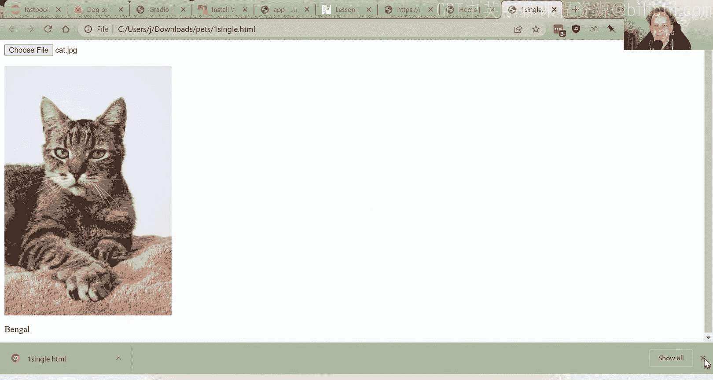

That's working fine on my computer in VS code。How do I then put it on the web so that other people can use it？

Again， the whole thing's free， there's a really cool thing called GitHub pages。😊。

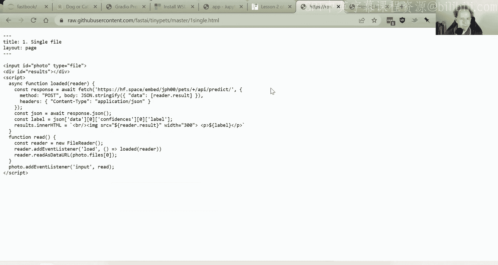

Which basically will host your website for you and because it's just JavaScript， it'll all work。

Just fine。嗯。The easiest way to create a GitHub pages site in my opinion。

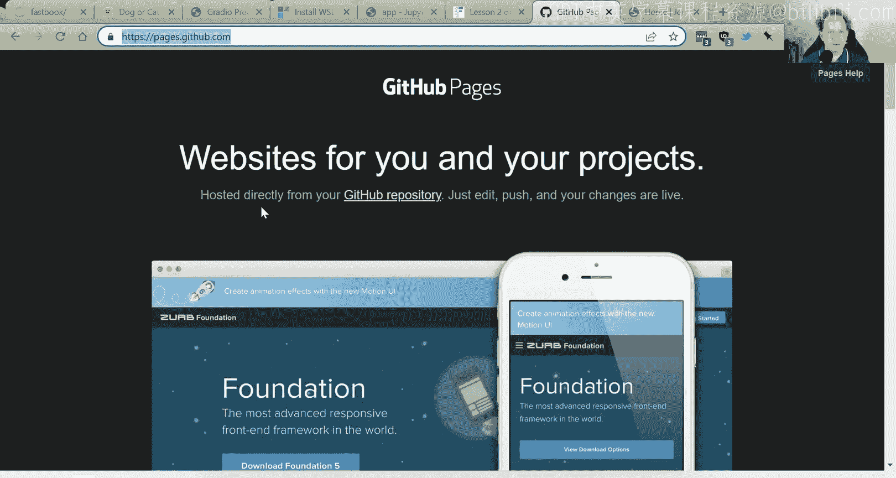

Is to use something called Fast pages， which is a fast AI thing。And。Basically， all you do。

As you follow the setup process。So first it does let's just go through it。

 so it says generate a copy by clicking on this link， so I click the link。All right。Okay。

 give it a name。I try to make everything public。 I always think it's good good practice。

 but you don't have to。😊，Great， Rapower。Generating。Okay。

 and then there's basically two more steps takes about five minutes， we don't have five minutes。

 so I'll show you the one that I've already built。嗯。Which is fast A eye slash tiny pets。

And so once it's done， you'll basically end up with this empty site， which again， you just go code。

Open with Gitthub desktop。Or open with visual Studio， whatever。

 so open with GitHub desktop or you can copy and paste this to your terminal and so any one of those is going to get you this whole thing on your computer。

 you can save your HTML files there， push it back up to GitHub。

And what you'll find is fast pages will show you the link to the website that is created for you。Now。

The website that's created for you， you can make it look。

However you want using something called a theme， so you'll see it's created a file called config。

 yaml where you can pick a theme。😊，So in this case， I picked a theme called。Aamic。

For no particular reason。So Github pages uses something called Jekyal and so any Jekyal theme will basically work so I picked out this theme。

And so as a result， when I now save things into this repo。

They will automatically appear in this website。And the files automatically appear up here。

In this list。 So if you look at my index that's the home page。The entire。File is just this。

The only slightly weird thing is at the top of every Github pages。File。

 you have to have three dashes。Tital and layout And three dashes。 It's called front Me。

And so once you do that。😊，And save it， It will appear。In your website。

 So something else I did then and it wass like， okay， well。

 that's all very well that fast day I has created this website。

 but I don't really like what it looks like。 I would have create a different version。No worries。

 You can go to fasto tiny pets and click fork。And when you click fork。

 it's going to create your own copy， so I did that under my personal account， which is JPH00。😊。

And look， though I've got my own version of it。 And now I can make changes here。

 So I made a few changes。 One change I made was I went to confit at Yamal and I changed the theme。

To Page's them hacker。So once you fork， one thing you have to do which normally fast pages does for you is you do have to go to settings。

And click pages and actually enable GitHub pages so you basically have to by default it's turned off so here you'll just have to turn it on。

 so use the master branch route， save and then it'll say no worries， it's ready to be published。

And so I changed the convictctor Yammal failed to point at a different theme。

 and so if you look at now the JHs tiny pets。It's different。 Okay， so it's got the same info。

 but it's much more hackerish because JPH00 is a serious hacker， as you can tell from his website。嗯。

So anyway， look， it's a very brief taste of this kind of world of。Javascript， websites and so forth。

 But I wanted to give you a sense of like。You know， you don't need any money。You don't need any IDs。

 you know， you don't really need much code to get started with writing your own web apps and thanks to hugging face spaces。

 you know that'll even host your model for you and all you need to do is just have the magic string as a thing to call。

Okay， so。Signing out， Hackcker Jeremy Howard。Thanks very much for watching and in the next lesson we're going to be digging into some natural language processing we're going to be doing some of the same stuff。

 but we're going to be doing it with language rather than pictures and we're going to be diving under the hood to see how these models actually work We're going to learn about things like stochastic gradient descent。

And we might even be having to brush off a little bit of calculus。

 I hope I haven't put you off by saying the sea word。 I will see you next time。 Thanks all， bye。😊。

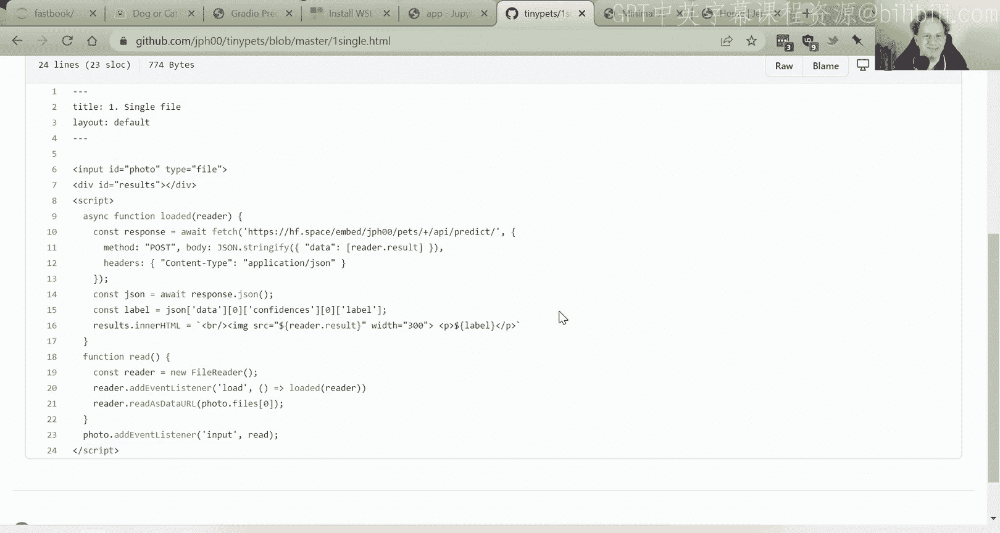