# Jeremy Howard《给码农的深度学习实践课程1｜Practical Deep Learning for Coders2022》中英字幕 p05 -5-Lesson 5_ Practical Deep Learning for Coders 2022.zh_en -BV15Z421H7zj_p5-

Okay， hiy， everybody and welcome to practical deep Learn for Coders Les 5。😊。

We're at a stage now where we're going to be getting deeper and deeper into the details of how these。

Networks actually work。Last week， we。Saw how to use a slightly lower level library than fast Aop in hugging face transformers。

To train a pretty。Nice NLP model。And today， we're going to be。Going back to tabular data。

 and we're going to be trying to build able a tabular model actually from scratch。

 we're going to be able a couple of different types of tabular model from scratch。

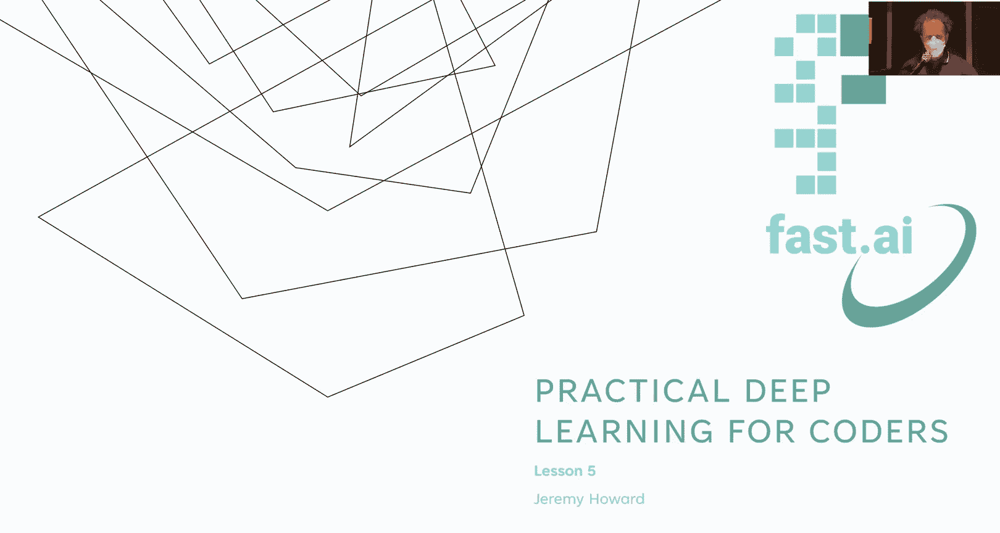

So the problem that I'm going to be working through is the Titanic problem。

 which if you remember back a couple of weeks。

Is the data set that we looked at on Microsoft Excel。

And it has each row is one passenger on the Titanic。 So this is a real world data set。

 historic data set tells you both that that passenger survived。What class they were on in the ship。

 their sex age， How many siblings， how many other family members， how much they spent in the far。

And whereabouts， they embarked one of three different cities。And you might remember that we built。

Aledia model？We then did the same thing， using。Matx multiplication， and we also created a very。

 very simple neural network。嗯。You know， Excel can do。Nearly everything we need， as you saw。

 to build a neural network， but it starts to get unwidy。 And so that's why。People don't use。

ExcL for neural networks and practice， instead we use a programming language like Python。

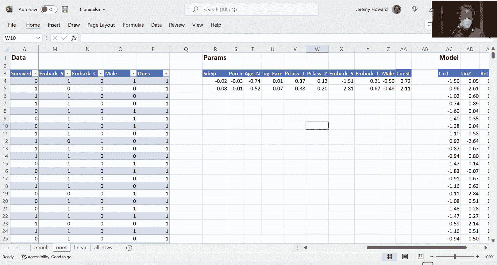

So what we're going to do today is we're going to do。😊，The same thing。With Python。唉。

So we're going to start working through the linear model and neuralNe from scratch Note。

Which you can find on cattle。Or on the course repository and today what we're going to do is we're going to work through the one in the clean folder。

 so both for fast book， the book and course 22 these lessons。The clean folder。

Contains all of our notebooks。

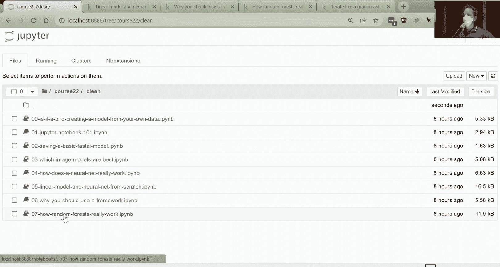

But without。Any pros or any outputs， So here's what it looks like when I open up。

The linear model and neural it from scratch。And Jupiter。What I'm using here is。

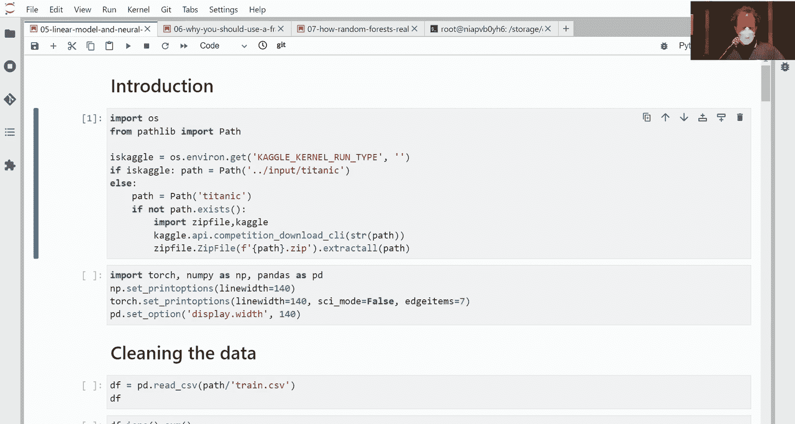

Paper space gradient。As I mentioned a couple of weeks ago is what I'm going to be doing most things in that looks a little bit different to the normal paper space gradient。

Because the。The default view for paper space gradient。At least as I。Do this course。

Is there rather awkward。Notebook editor。Which at first glance has。

The same features as the real Jupyter notebooks and Jupyter lab environments。But in practice。

 we' actually missing lots of things。 So this is the。The normal paper space。

 so remember you have to click this button。and the only reason you might keep this window running is then you might go over here to the machine to remind yourself when you close the other tab to click top machine。

If you're using the free one it doesn't matter too much， and also when I started。

 I make sure I've got something that just set to shut down automatically in case I forget。😊。

So other than that， we're gonna we can stay in this tab。 And because Jupiter。

 this is Jupiter lab that that that runs and you can always switch over。So a classic Jupiter。

Notebook if you want to。嗯。So given that they could have got tabs inside tabs。

 they normally maximize it at this point。

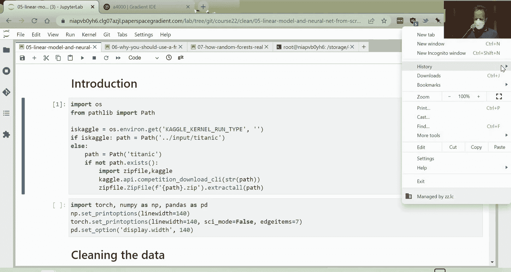

And it's really good really helpful to know the keyboard shortcuts。

 So control shift square bracket right and left switch between tabs。

 that's one of the key things to know about okay。😊，So I've opened up the clean version of the。

Let him model a neural net from scratchniple。And so remember when you go back through the video kind of the second time or through the notebook a second time。

 this is generally what you want to be doing is going through the clean notebook and before you run each cell。

 try to think about like， oh， what did Jeremy say why are we doing this？What output would I expect。

 Make sure you get the output you' would expect。 And if you're not sure why something is the way it is。

Try changing it and see what happens。And then if you're still not sure， well。

 why did that thing not worker I expect？You know， search the forums see if anybody's asked that question before。

 had you can ask the question on the forum yourself if you're still not sure。嗯。

So as I think we've mentioned briefly before， I find it really nice to be able to use the same notebook。

 both on kle and off kle。 So most of my notebooks with basically the same cell。😊。

Which is something that just checks whether we're on kle。 So kggle sets an environment variable。

 so we can just check for it。 that way， we know if we're on kggel。And so then if we are on Kagggle。

 you know， a notebook that's part of a competition will already have the data downloaded and unzipped for you。

Otherwise。If I haven't downloaded the data before， then I need to download it and unziip it。😊。

Cle is a。Pip installsable module。 So you'll type Pip install caggle。嗯。

If you're not sure how to do that， you should check our。Deep dive lessons to see exactly the steps。

 but roughly speaking。You can use your console， pick， install， and whatever you want to install。

Or as we've seen before， you can do it directly in a notebook。😊。

By putting an explanation mark at the start。So that's going to run not Python， but a shell。Command。

Okay， so that's enough to ensure that we have the data downloaded and a variable called path that's pointing at it。

Most of the time we're going to be using at least Pytorrch and numpay。

 so we import those so they're available to Python。 and when we're working with tabular data。

 as we talked about before。We're generally also going to want to use pandas。

 And it's really important that you're somewhat familiar with the kind of basic API of these。

Three libraries， and I've recommended Wes McKinney's book before， particularly for these ones。U。

One thing， just， by the way， is that these things tend to assume you've got a very narrow screen。

 which is really annoying that always wraps things。 So if you want to put these three lines as well。

 then it just make sure that everything is got to use up the screen properly。 Okay。

 so as we've seen before， you can read a common separated values file with pandas。

And you can take a look at the first two lines and the last two lines and how big it is。

And so here's the same thing as our spreadsheet。Okay， so there's our data from the spreadsheet。

 and here it is as the data frame。U。So。If we go。Data frame dot is。And I。That returns。

A new data frame in which every column it tells us whether or not that particular value is。Nan。

 so Nan is not a number。 And most， the most common reason you get that is because it was missing。

 Okay， so a missing value is obviously not a number。So we in the Excel version。

 we did something you should never usually do， we deleted all the rows with missing data。😊，嗯。

Just because in Excel， it's a little bit harder to work with And pandas， it's very easy to work with。

 first of all。Where you can just sum up what I've just showed you。 Now。

 if you call sum on a data frame。It sums up each column。Right。

 so you can see that there's kind of some。Small foundational concepts in pandas。

 which when you put them together， take you a long way。

 So one idea is this idea that you can part you can call a method on a data frame and it calls it on every row。

And then you can call a reduction on that， and it reduces。Each column。

 And so now we've got the total and。In Python and pandas and numpy and Pytorch。

 you can treat a boolean as a number and true will be one。 F will be 0。

 So this is the number of missing values in each column。So we can see that cabin out of 891 rows。

 it's nearly always empty。Age is empty a bit of the time。 embarked is almost never empty。So。

If you're a member from Excel。We need to multiply a coefficient。By each column。

 that's how we create a linear model。 So how would you multiply a coefficient by a missing value。

You can't。There's lots of ways of it's called imputing missing value。

 so replacing missing value with a number。The is which always works is to replace missing values with the mode of a column。

 the mode is the most common value that works both the categorical variables。

 it's the most common category and continuous variables。 that's the most common number。

So you can get the mode。😊，By calling。DF downloadload。

One thing that's a bit awkward is that if there's a tie for the mode。

 so there's more than one thing that's the most common， it's going to return multiple rows。

 so I need to return the zero row。So here is the mode of every column。

 So we can replace the missing values for age with 24 and the missing values for cabin with。

B 96 B98 and embarked with S。I'll just mention in passing。是。

I am not going to describe every single method we call in every single function we use。

And that is not because。You're an idiot if you don't already know them， Nobody knows them all。

 right but I don't know which particular subset of them you don't know， right。

 So let's assume just to pick a number at random that the average fast AI student knows。

80% of the functions we call。Then。I could tell you。Whatever every function is， in which case。

 80% of the time I'm wasting your time know。Or I could pick 20% of them at random。

 in which case I'm still not helping because most of the time it's not the ones you don't know。

 My approach is that for the ones that are pretty common。

 I'm just not going to mention it at all because I'm assuming that you'll Google it。 right。

 So it's really important to know。 So for example， if you don't know what Ioc is。

That's not a problem。 It doesn't mean you're stupid， right。

 It just means you haven't used it yet and you should Google it， right。

So I'll mention in this particular case， you know， this is one of the most important。😊。

Pandas methods because it gives you the row located at this index if index and lock full location。

 So this is a zero throw。But yeah， I do kind of go through things a little bit quickly on the assumption that students。

 fast AI students are， you know， proactive， curious people。And if you're not a proactive。

 curious person， then you could either decide to become one for the purpose of this course or maybe this course isn't for you。

嗯。😊，Alright， so a data frame。Has a very convenient method called fill NA。

 and that's going to replace the knotted numbers with whatever I put here。

And the nice thing about pandas is it kind of has this understanding that columns match to columns。

 So it's going to take the mode from each column and match it to the same column in the data frame and fill in those missing values。

Normally， that would return a new data frame many things。

 including this one in pandas have an in place argument that says actually modify the original one。😊。

And so if I run that。Now， if I call dot is do sum。They're all zero。

So that's like the world's simplest way to get rid of missing values。

Why did we do it the world's simplest way。Because， honestly。

This doesn't make much difference most of the time。

And so I'm not going to spend time the first time I go through and build a baseline model。

Doing complicated things when I don't necessarily know that I。Ned complicated things。

And so imputing missing values is an example of something that most of the time， this dumb way。

 which always works without even thinking about it， will be quite good enough。You know。

 so nearly all the time。So we kept things simple where we can。John， question。Jeremy。

 we've got a question on this topic Javiers。Sort of commenting on the assumption involved in substituting with the mode and he's asking in your experience what are the pros and cons of doing this versus for example。

 discarding cabin or age as fields that we even train the model on Yeah so I would certainly never throw them out right？

ThereThere's just no reason to throw away data， and there's lots of reasons to not throw away data。

 So， for example。When we use the fast DI library， which we'll use later， one of the things it does。

 which is actually a really good idea， is it creates a new column。😊。

For everything that's got missing values， which is Boolean， which is。

 did that column have a missing value for this row。 And so maybe it turns out that。

Cabin being empty is a great predictor。So yeah， I don't throw out rows and I don't throw out columns。

Okay， so。It's helpful to understand a bit more about our data set and a really helpful。😊。

I've already imported this。A really helpful， you know， quick method and again。

 it's kind of nice to know like a few。😊，Quick things you can do to get a picture of what's happening in your data is describe。

And so describe， you can say， okay， describe all the numeric variables。

And that gives me a quick sense。Of what's going on here。

 So we can see survived clearly as just zeros and ones。

Because all of the quartiles are zeros and ones， looks like P class is one，2，3。U。What else do we see。

 Fair's an interesting one， right？Butts of smallish numbers and one really big numbers are probably long tailed。

 so it's yeah good to have a look at this to sees what's going on for your numeric variables。😊。

So as I said， fair looks kind of interesting。To find out what's going on there。

 I would generally go with a histogram。So if you can't quite remember what a histogram is， again。

 Google it， but in short， it shows you for each amount of fare， how often does that fair appear？

And it shows me here that the vast majority of fares are less than $50。

But there's a few right up here to 500。 So this is what we'd call a long tail distribution。

 small number of really big。Values and lots of small ones。Um。

There are some types of model which do not like long tail distributions。

Lenar models are certainly one of them。 and neural nets are generally better behaved without them as well。

 Luckily， there's an almost surerefire way to turn a long tail distribution into a more reasonably centreed distribution。

And that is to take the log。U。We use logs a lot， in machine learning。For those of you that haven't。

Touched them since year 10 math。um。It would be a very good time to like go to Khan Academy or something and remind yourself about what logs are and what they look like because they're actually really。

 really important。嗯。😊，But the basic shape of the log curve causes it to make you know。

 really big numbers less， really big and doesn't change really small numbers very much at all。

So if we take the log， now log of0 is N。So a useful trick is to just do log plus one。And in fact。

 there is a log P1， if you。Want to do that。 This does the same thing。

 So if we look at the histogram of that， you can see it's much more。You know。

 sensible now it's kind of centreed and it doesn't have this big long tail， so that's pretty good so。

We'll be using that column in the future。As a roll of thumb。um。Stuff like money or population。

 things that kind of can grow exponentially。 you very often want to take the log of。

 So if you have a column with a dollar sign on it， that's a good sign。

 It might be something to take the log of。So there was another one here， which is we had a numeric。

 which actually doesn't look numeric at all。 It looks like it's actually categories。😊。

So Pandas gives us a dot unique。And so we can see， yeah， they're just 1，2。

 and 3 are all the levels of。P class， that's their first class， second class or third class。

We can also describe all the nonnumeric variables。And so we can see here that not surprisingly。

 names are unique because the count of names is the same as count unique is two sexes。

691 different tickets。Hundd and47 different cabins and three levels of embarked。So。

We cannot multiply the letter S。By a coefficient。UOr the word male。😊，By a coefficient。So。

What do we do。What we do is we create something called。Dummy variables。Dummy variables。

And we could just go get dummies。😊，A column。That says， for example， is sex female， is sex male。

 is p plus1 is p plus 2 is p plus3。 So for every possible level of every possible categorical variable。

 it's a Boolean column of did that row have that value of that column。

So I think we've briefly talked about this before that there's a couple of different ways we can do this。

 one is that for an n level categorical variable， we could use n minus1 levels。😊，In which case。

 we also need a constant term in our model， pandas by default。Shows all N levels。

 although you can pass an argument。To change that if you want。Oh yeah， drop first。

I kind of like having all of them sometimes because then you don't have to put in a constant term。

 And it's a bit less annoying。 And it can be a bit easier to。Interpret。

 but I don't feel strongly about it either way。Okay， so here's a list of all of the columns。😊，That。

 pandas added。I guess strictly speaking， I probably should have automated that， but never mind。

 I just copied and past them。😊，嗯。And so， here。A few examples of the added columns。In Unis， pandas。

 lots of things like that。 head means the first few rows or the first few lines。

So five by default and pandas， so here you can see。They're never both male and female。

 they're never neither， they're always one or the other。对， so。With that now we've got numbers。

 which we can multiply by coefficients。It's not going to work for。Name。Obviously。

 because wed have 891 columns， and all of them would be unique。 So we all ignore that for now。

 That doesn't mean it's。Have to always ignore it。 And， in fact， something I did do。

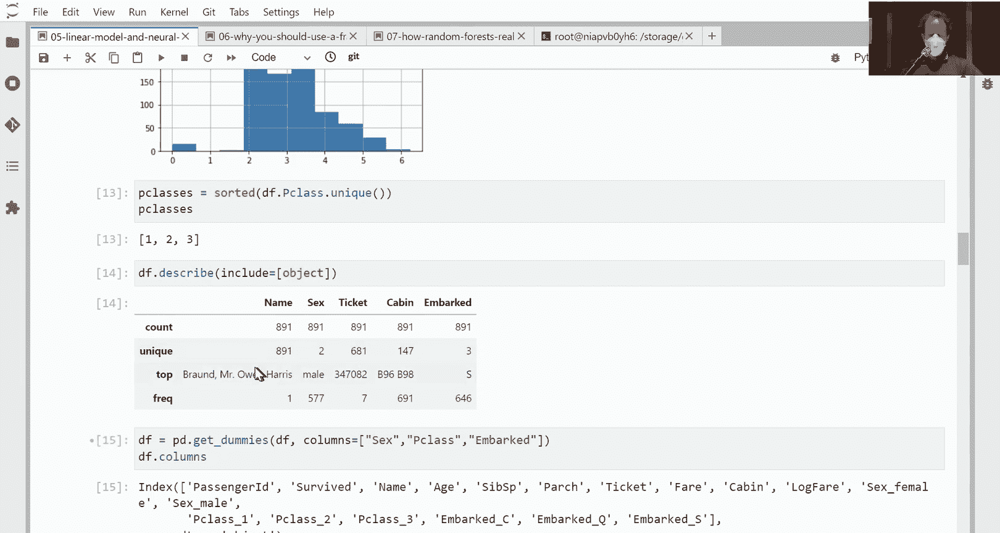

Something I did do on the forum topic because I made a list of some nice Titanic notebooks that I found and quite a few of them。

Really go hard on this name column。 And in fact， one of them。Yeah， this one。And what I believe is。

 yes， Christ Yott's first ever Cackle notebook。 He's now the number one ranked Cale notebook person in the world。

 So this is a very good start。He got a much better score than any model that we're going to create in this course using only that column name and basically。

 yeah， he came up with this。😊，Simple little decision tree by recognizingogni， you know。

 all of the information that's。

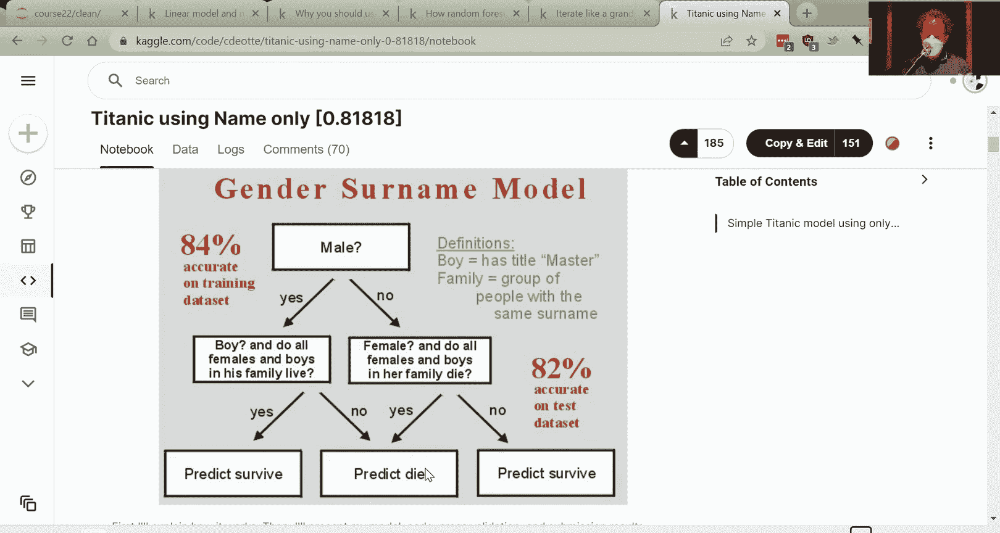

In a name column。So， yeah， we don't have to。

Treat， you know， a big string of letters like this is a random big string of letters。

 We can use our domain expertise to recognize that things like Mr。

Have meaning and that people with the same surname might be in the same family。

And actually figure out quite a lot。From that。 But that's not something I'm going to do。

 I'll let you look at those notebooks if you're interested in the feature engineering。

 And I do I do think that they're very interesting。 So do check them out。A focus today is on。

Building a linear model and a neural net from scratch， not on tabular feature engineering。

 even though that's also a very important subject。Okay， so。

We talked about how matrix modification makes linear models much easier。U。

And the other thing we did in Excel was element wise multiplication。

 Both of those things are much easier if we use pytorrch instead of plain Python or we could use numpy。

 but I tend to stick with Pytorrch when I can because it's easier to learn one library than two so I just do everything in Pytorrch I almost never touch numppy nowadays they're both great。

 but。😊，They do everything each other does， except paytorrch also does differentiation and GPUs。

 so why not just learn paytorrch？So。To turn a column。Into something that I can do。呃。

Py torch calculations on， I have to turn it into a tensor。So， a tenor is just。

Is what Nai calls an array。It's what mathematicians will call either a vector or a matrix。

 or once you've got a higher ranks， mathematicians and physicists just call them tensesors。In fact。

 this idea originally in computer science came from。A notation developed in the 50s called APL。

 which was turned into a programming language in the 60s by a guy called Ken Iverson and Ken Iverson actually came up with this idea from he said his time doing tensor analysis in physics so these。

Areas are very related， so we can turn the survived column into a tensor。

 and we'll call that tensor our dependent variable。 That's the thing we're trying to predict。Okay。

So now we need some independent variables。 So our independent variables are。Age siblings。That one is。

Oh yeah， a number of other family members。The log fair that we've just created。

 plus all of those dummy columns， we added。And so， we can now。嗯。C up those values。

And turn them into a tensor。 And we have to make sure they're floats。

 We want them all to be the same data type。 and Pytorch wants things to be floats。

 if you're going to model play things together。So there we are。😊。

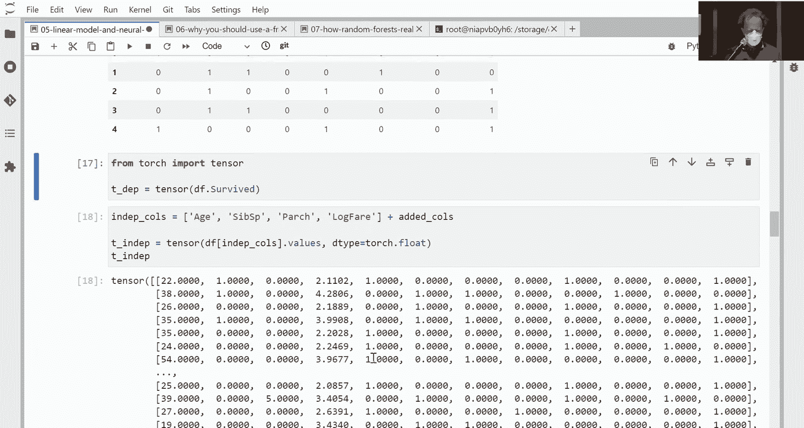

And so one of the most important。

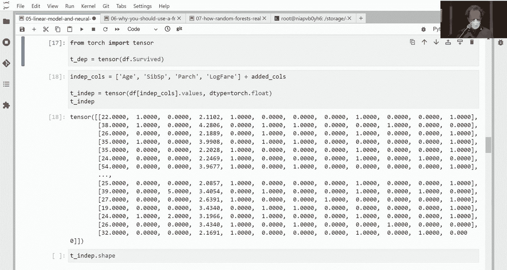

Attributes ever tensor， probably the most important attribute is its shape。

 which is how many rows does it have。And how many columns does it have。The length of the shape。

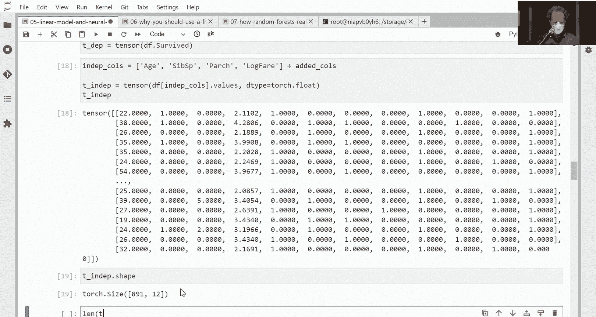

Is called its rank。 That's the rank of the tensor。 It's a number of dimensions。Or axes that it has。

 So a vector is length is rank 1。And matrixes rank 2。A scalar is ranked0。And so forth。

I try not to use too much jargon， but there's some pieces of jargon that are really important becauseuse you。

 like other， you're going to have to see。The length of the shape again and again。

 It's much easier to say rank。 So we'll say we'll use that word a lot。So a table is a rank too。Tensa。

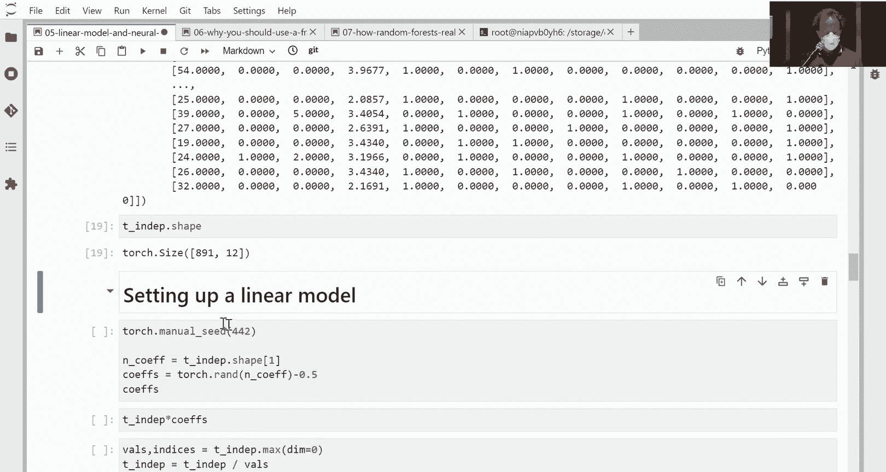

Okay， so we've now got the data。😊。

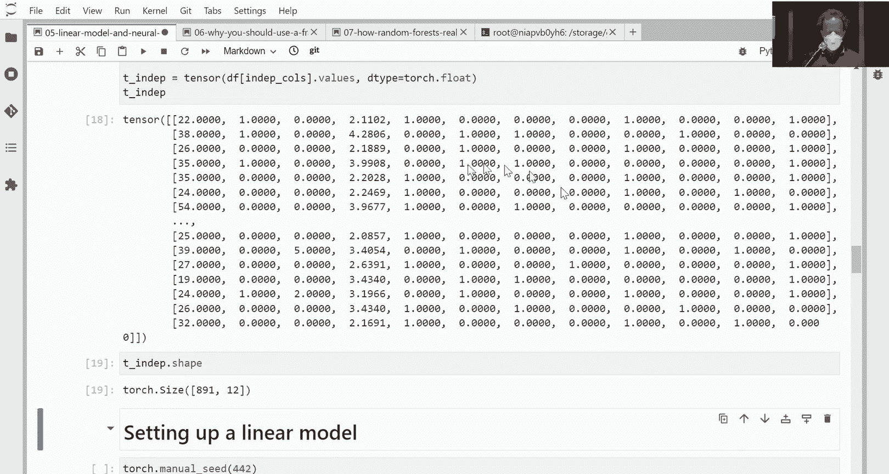

In good shape， here's our independent variables， and we've got our dependent variable。

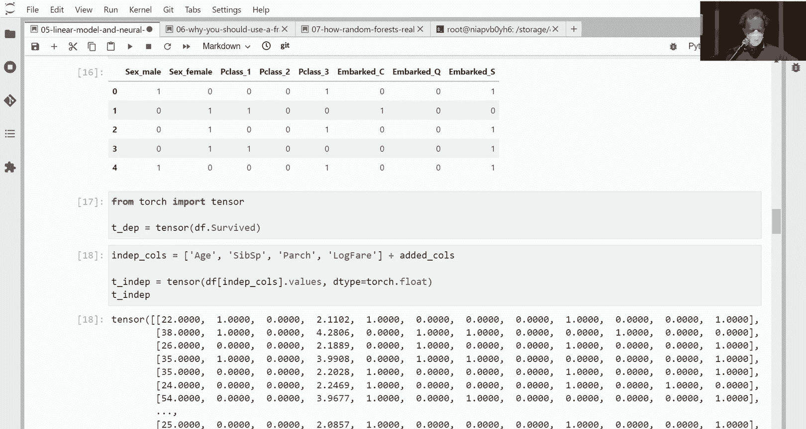

So we can now go ahead and do exactly what we did in Excel。

Which is to multiply our rows of data。Is in coefficients。 And remember to start with， we create。

Random coefficients。So we're going to need one coefficient。For each column now in Excel。

 we also had a constant。 but in our case now we' we've got every column。

 every level in our dummy variable。 So we don't need a constant。

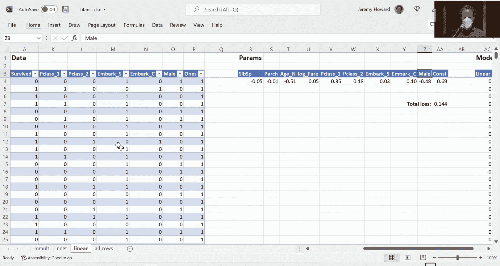

So the number of coefficients we need。Is equal to the shape of the independent variables。

 and it's the。Index 1 element。 that's the number of columns。That's how many coefficients we want。

So we can now askrch pay torch to give us some random numbers and cof of them。They're between 0 and1。

 So if we subtract a half， then they'll be centered。And there we go。😊，Before I do that， I。

Set the seed。 What that means is in。Computers， computers in general cannot create truly random numbers。

Instead， they can calculate a sequence of numbers that behave in a random like way。

That's actually good for us， because often in my teaching， I like to be able to say， you know。

 in the pros， oh， look， that was two。 Now it's three or whatever。

 And if I was using really random numbers， then I couldn't do that because it'd be different each time。

 So this is makes my results reproducible。 That means if you run it。

 you'll get the same random numbers as I do by saying， start the。😊。

Sudoranom sequence with this number。I' mentioned in passing。 a lot of people are very。

 very into reproducible results。 They think it's really important to always do this。

 I strongly disagree with that。 In my opinion， an important part of understanding your data is understanding how much it varies from run to run。

 So if I'm not。Teaching and wanting to be able to write things about these pseudo random numbers。

 I almost never use a manual seed。Instead， I like to run things a few times and get an intuitive sense of like。

 oh， this is like very， very stable。 or oh， this is all over the place。

 I getting an intuitive understanding of how your data behaves and your model behaves is really important。

Now， here's one of the coolest lines of code。You'll have a see。I know it doesn't look like match。

But think about what it's doing。Yeah， that。Okay， so we've multiplied。A matrix。By a vector。 Now。

 that's pretty interesting。 Now， mathematicians amongst you will know that you can certainly do a matrix vector product。

 but that's not what we've done here at all。We've used element wise modification。 So normally。

 if we did the element wise modification of two vectors， that would model play。You know。

 element one with element one， element two with element 2 and so forth and create a vector of the same size output。

😊，But here。We've done a matrix times a vector。 How does that work。

This is using the incredibly powerful technique of broadcasting and broadcasting again comes from APL。

 a notation invented in the 50s and a programming language developed in the 60s。😊，嗯。

And it's got a number of benefits。 Basically， what it's going to do is it's going to take H coefficient。

And what play them in turn by。Every row in our metrics。 So if you look at the shape。

Of our independent variable and the shape。Of our coefficients。

 you can see that each one of these coefficients。Can be multiplied by H of phase 891。Val is， in turn。

And so the reason we call it broadcasting is it's as if if this is 891 columns by rows by 12 columns。

 it's as if this was broadcast。891 times。 it's as if we had a loop looping 891 times and doing coefficients times row 0。

 coefficients times row 1， coefficients times row 0，2 and so forth， which is exactly what we want。😊。

对呀。Reasons to use broadcasting。Obviously， the code is much more concise。

It looks more like math rather than clunky programming with lots of boilerplate。 So that's good。Also。

 that broadcasting all happened。In optimized C code。And if， in fact， if it's being done on a GPU。

 it's being done in optimized GPU asmbler code to code。It's going to run very very fast indeed。

 and this is a trick of why we can use a so called S language like Python to do very fast big models is because a single line of code like this can run very quickly on optimized hardware on lots and lots of data。

😊，The rules of broadcasting are。A little bit subtle and important to know。

 And so I would strongly encourage you。

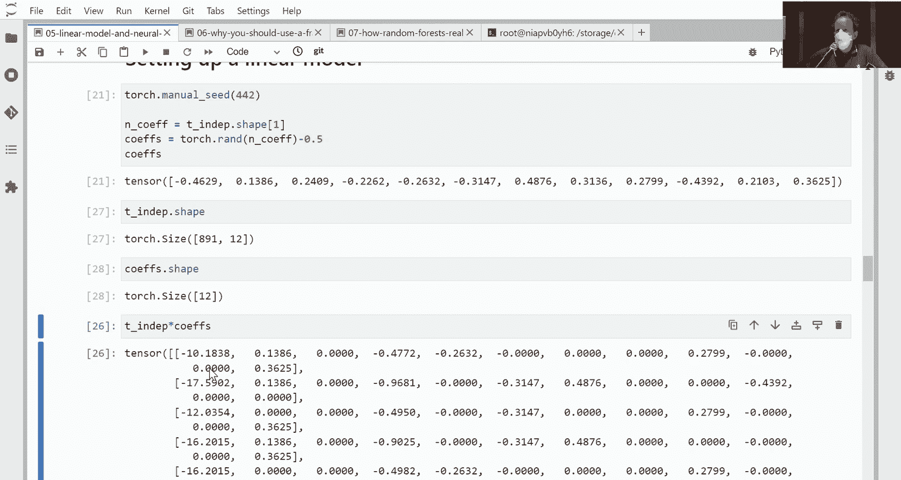

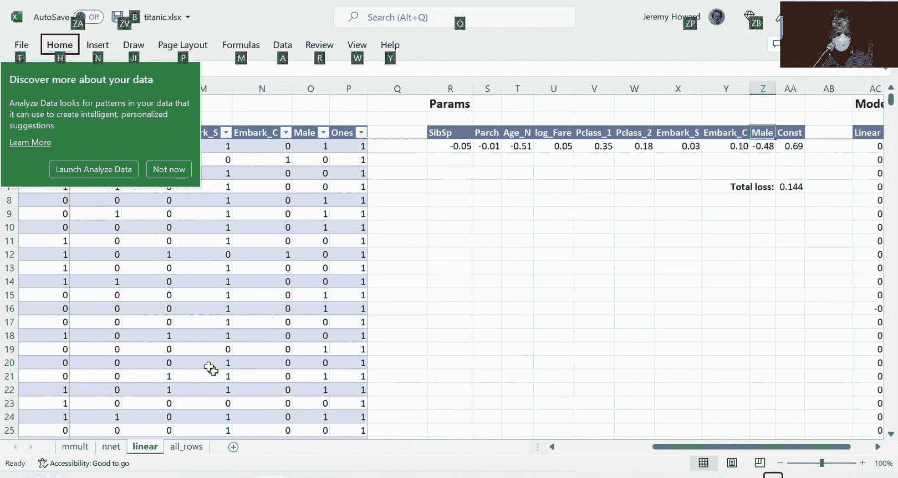

即几个。Nampai broadcasting。Girls。嗯。

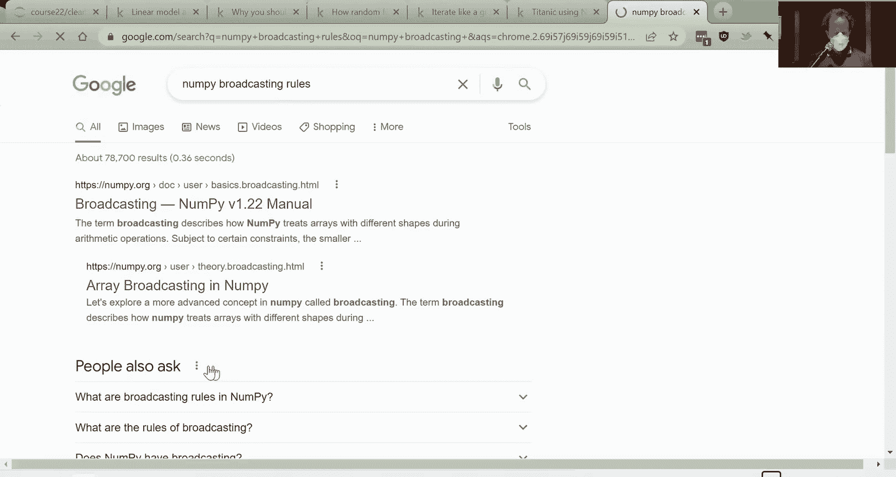

And see exactly how they work。 But， you know， the kind of intuitive understanding of them， hopefully。

 you'll get pretty quickly， which is generally speaking， you can kind of。

 as long as the last axes match。

It'll broadcast over those axes。 You can broadcast a rank three thing with a rank one thing or， or。

 you know， most simple version would be。Tsor。One， two， three。Times too， so broadcaster。Scalar。

Over a vector does exactly what you would expect。 So it's copying effectively that two into each of these butts while playing them together。

 But it doesn't， it doesn't use a any memory to do that。 It's kind of a virtual copying， if you like。

So this line of code independence by coefficient is very， very important。

And it's the key step that we wanted to take， which is now we know exactly how。

What happens when we multi to play the coefficients in。

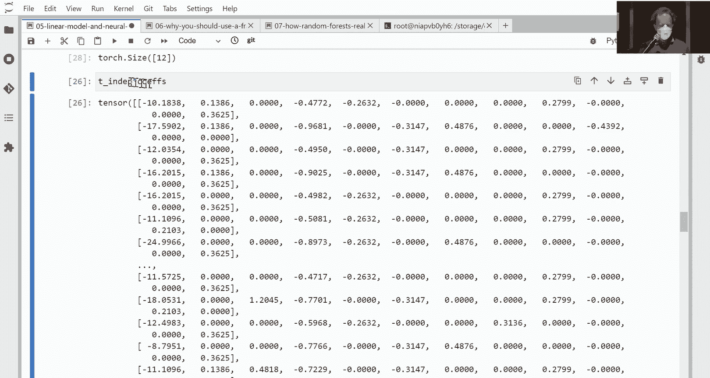

And if you remember back to Excel。嗯。We did that。Product。And then in Excel， there's a sum product。

 We then added it all together。Because that's what a linear model is。

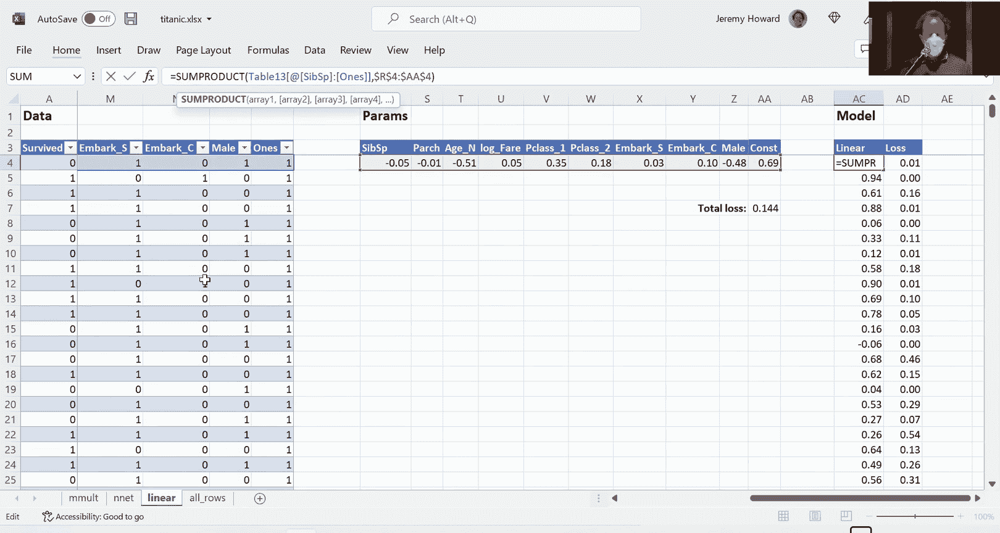

Coefffics times the values added together。So we're now going to to add those together。

But before we do that。If we did add up this row。You can see that the very first value has a very large magnitude。

 and all the other ones are small， same with row 2。

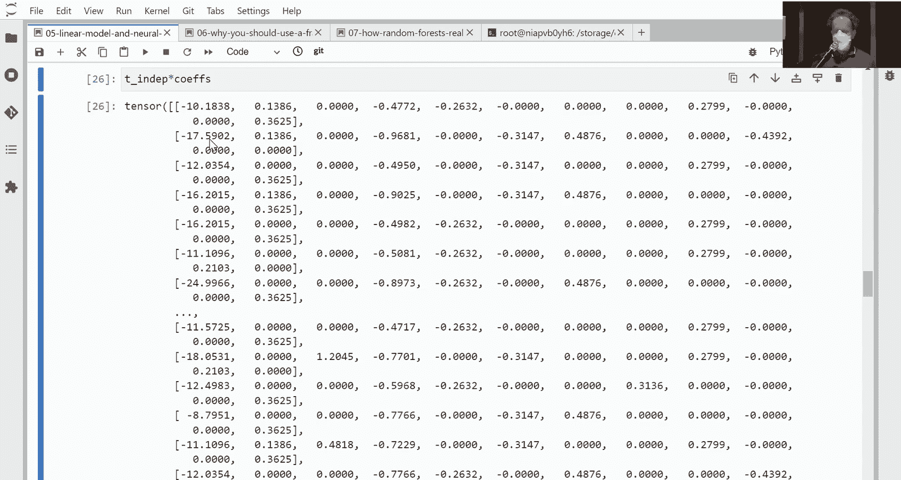

Same with row 3， same with row 4。 What's going on here。 Well。

 what's going on is that the very first column。

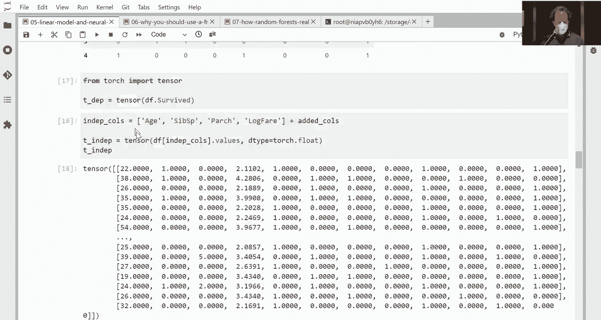

With age。An age is much bigger than any of the other columns。

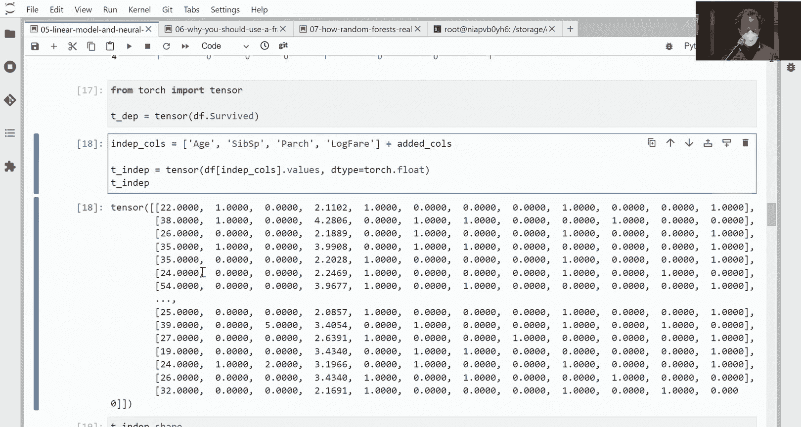

It's not the end of the world， but it's not ideal， right， because that means that a coefficient of。

 say，05 times age means something very different to a coefficient of， say。5 times log faire。 right。

 And that means that that random， coefficient we start with。

 it's going to mean very different things very different columns。

 And that's going to make it really hard to optimize。

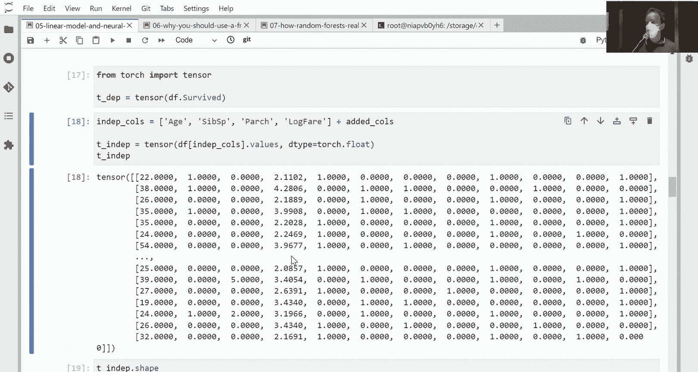

So we would like all the columns to have about the same range。

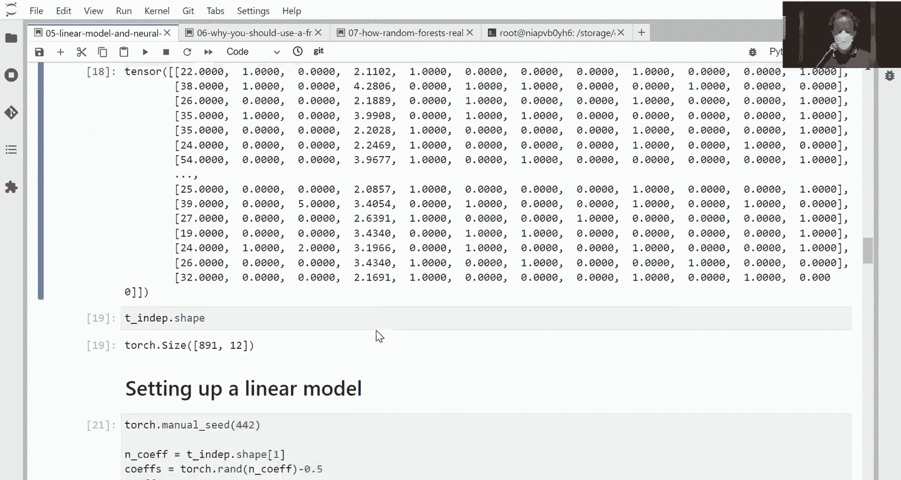

So what we could do。As we did in Excel is to divide them by the maximum。

 so the maximum so we did it for age and we also did it for fair in this case I didn't use log。

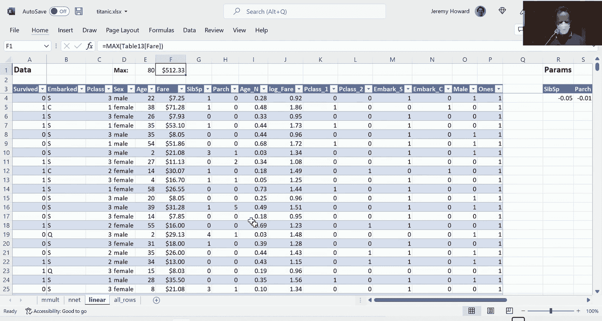

嗯。So we can get the max。Of each row by calling dot max。 And you can pass in a dimension。

 Do you want the maximum of the rows or the maximum of the columns。

Where about the maximum over the rows。So we pass in dimension  zero。

So those different parts of the shape。Aord either axes or dimensions。 pipewach calls some dimensions。

 So that's going to give us。The maximum of each row。

 And if you look at the docks for player tors max function， it'll tell you it returns two things。

 The actual value of each maximum。And the index of where which row it was。We want the values。😊。

So now thanks to broadcasting， we can just say tackle the independent variables。

And divide them by the vector of values。 Again， we've got a matrix。And a vector。

And so this is going to do an element wise division。Of each row of this。Divided by this。Vectctor。

Again， in a very optimized way。So if we now look at our normalized independent variables by the coefficients。

You can see they're all pretty similar values， so that's good。

There's lots of different ways of normalizing that the main ones you'll come across is either dividing by the maximum or subtracting the mean and dividing by the standard deviation。

 it normally doesn't matter too much。😊，Because I'm lazy。

 I just pick the easier one and being lazy and picking the easier one is a very good plan。

 in my opinion。😊，So now that we can see that modeling them together is working pretty well。

 we can now add them up。😊，And now we want to add up over the columns。

And that would give us predictions。 obviously， just like an Excel， when we started out。

 they're not useful predictions because they're random coefficients。

 but they are predictions nonetheless less。And here's the first 10 of them。So then remember。

We want to use gradient descent to try to make these better。So to do gradient descent。

 we need a loss right the loss is the measure of how good or bad are these coefficients。

My favorite loss function， as I kind of like， don't think about it。

 Just chuck something out there is the mean absolute value。 And here it is。

 torch do absolute value of。The error， the difference， take the in。And often stuff like this。

 you'll see people will use。Pray written。Mean absolute error functions， which is also fine。

 but I quite like to write it out because I can see exactly what's going on。No confusion。

No chance of misunderstanding。So those are all the steps I'm going to need to create coefficients。

Run a linear model。And get its loss。So what I like to do in my notebooks， like not just for teaching。

 but all the time is to like do everything step by step manually。

And then just copy and paste the steps into a function。

 So here's my countPtz function is exactly what I just did， right。Here's my c losss function。

Exactly what I just did。And that way， you know， I， a lot of people like go back and delete all their explorations。

Or they like do them in a different notebook or they're like working in an IDE。

 they'll go and do it in some you know， line oriented rapple or whatever。 But if you， you know。

 think about the benefits of keeping it here，When you come back to it in six months。

 you'll see exactly why you did what you did and how you got there or if you're showing it to your boss or your colleague。

 you can see you know exactly what's happening， what does each step look like。

 I think this is really very helpful indeed。I know not many people code that way。

 but I feel strongly that it's。😊，A huge productivity win to individuals and teams。

So remember from our gradient descent from scratch that the one bit we don't want to do from scratch is calculating derivatives because it's just menial and boring。

So to get pie touch to do it for us， you have to say， well。

 what things do you want derivative evidence for， and of course we want it for the coefficients。

So then we have to say requires credit。And remember， very important in Pi to。

 if there's an underscore at the end， that's an in place operation。

 So this is actually got to change coefs。It also returns them， right。

 but it also changes them in place。 So now we've got exactly the same numbers as before。

 but with requires grad turned on so now when we calculate letter our loss。

Matt doesn't do any other calculations， but what it does store。Is a gradient function。

 It's the function that Python has remembered that it would have to do to undo those steps to get back to the gradient and to say。

 oh， please actually。Call that backward gradient function。 you call backward。And at that point。

 it sticks into a dot grad attribute。The coefficient， the coefficients gradients。So this tells us。

That if we increased the age coefficient。The loss would go down。 So therefore， we should do that。哎。

So。Since negative means increasing this would decrease the loss。 That means we need to。

 if you remember back to the gradient descent from scratch Note， we need to subtract。

They're coefficients。Times a learning rate。So we haven't got any。😊。

Particular ideas yet of how to set the learning rate So for now I just pick a trust tray a few and still find out what works best。

 In this case， I found0。1 worked pretty well。嗯。So I now subtract。 So again， this is sub underscore。

 so subtract in place。From the coefficients。Their gradient times the learning rate。

And so the loss has gone down， that's great from 0。54 to 0。52。So there is。One step。

So we've now got everything we need to train a linear model。嗯。So let's do it。 Now。

 as we discussed last week to see whether your model's any good。

 it's important that you split your data into training and validation。For the Titanic data set。

 it's actually pretty much fine to use a random split。

Because back when my friend Mar and I actually created this competition for Call many years ago。

 that's basically what we did if I remember correctly。😊，So we can split them randomly。

Into a training set and a validation set。So we're just going to use fast D I for that。 There's。

 you know， it's very easy to do it manually with nu or pay torch。 You can use psyt learns。

 chain test split。I'm using fastIs here， partly because it's easy just to remember one way to do things and this works everywhere and partly because in the next notebook。

 we're going to be seeing how to do more stuff in fast AI。

 so I want to make sure we have exactly the same split。So， those are。

A list of the indexes of the rows will be， for example， in the validation set。

That's why I call it validation split。 So to create the validation independent variables。

 you have to use those to index into。The independent variables and didto for the dependent variables。

And so now we've got。Our independent variable training set， and our。Validation set。

 and we've also got the same for the dependent variables。So like I said before。

 I normally take stuff that I've already done in a notebook。

 seems to be working and put them into functions， so here's this step which actually updates coefficients so let's chuck that into a function。

And then the steps that go cc loss， stop backward， update coefficients， and then print the loss。

 or'll chuck that in one function that just copying and pasting stuff into cells here。

And then the bit on the very top of the previous section that got the round of numbers minus 0。

5 requires grad， Chuck that in the function。So here we've got something that initializes coefficients。

 something that does one epoch by updating coefficients。

So we can put that into together into something that trains the model for Npos with some learning rate。

😊，By setting the manual seed， initializing the coefficients。Doing one epoch。In a loop。

And then return the coefficients。So let's go ahead and run that function。

So it's printing at the end of each one the loss， and you can see the loss going down from 0。53。

 down， down， down， down， down。To a bid on to 。3。So that's good。

 We have successfully built and trained a linear model on a real data set。 I mean。

 it's a caggle data set， but it's important to like。😊。

Not underestimate how real capital dataset sets are。 they're real data。

This one's a playground data sets。 It's not like anybody actually cares about predicting who survives the Titanic because we already know。

 but it has all the same features of， you know， different data types and missing values and normalization and so forth。

 So， you know it's a good， it's a good playground。😊。

So it' would be nice to see what the coefficients are attached to each variable。

 So if we just zip together the independent variables。😊，And the coefficients。

 and we don't need the regret anymore。And quite addict of that。There we go。😊。

It looks like older people had less chance of surviving。That makes sense。

Males had less chance of surviving。Also， that makes sense。So it's good to kind of eyeball these。

I'm checked that I say reasonable。Now， the metric for this cacal competition is not main absolute error。

 it's accuracy。Now， of course， we can't use accuracy as a loss function because it doesn't have a sensible gradient really。

 but we should measure accuracy to see how we're doing because that's going to tell us。

How are we going against the thing that the ca competition cares about？

So we can calculate our predictions。And we'll just say， okay， well， anytime the predictions over 0。5。

😊，We'll say that's predicting survival。So that's our predictors of survival。

 this is the actual in a validation set， So if they' are the same， then we predicted it correctly。So。

 here's。Are we right or wrong for the first 16 rows？ We're right more often than not。

So if we take the mean of those， remember true equals one。Then that's our accuracy。

 So we were right about 79% of the time。So that's not bad。 Okay。

 so we've successfully created something that's。Actually， predicting。Who survived the Titanic。

 That's cool from scratch。So let's create a function for that。

 an accuracy function that just does what I showed。😊，And there it is。Yeah。

 I'll say another thing like。You know， my weird coding thing for me， you know。

 weird as it not that common is I use less comments than most people。

Because all of my code lives in notebooks。 And， of course， in the real version of this notebook。

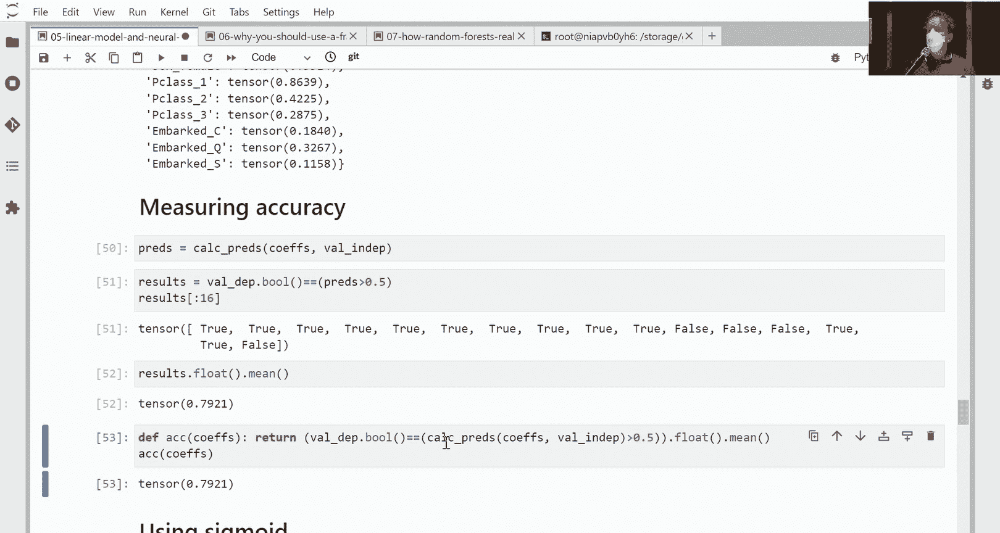

As full of prose。Right。😊。

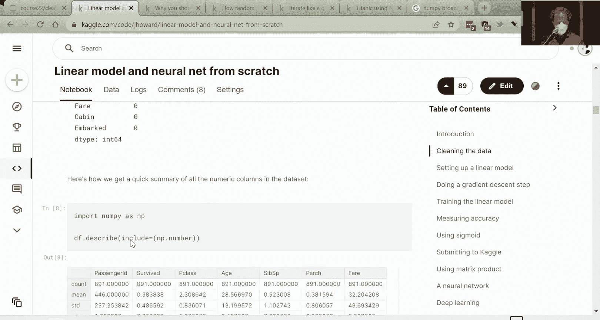

When I've taken people through a whole journey about what I've built here and why I've built it and what intermediate results are and check them along the way。

 the function itself， then I， you know， for me， doesn't need。Extensive comments。

 and I'd rather explain the thinking of how I got there and show examples of how to use it and so forth。

Okay。Now。Here's the first few predictions we made。嗯。And some of the time， we are predicting。

Negatives for survival and greater than one for survival。Which doesn't。Really make much sense， right。

 People either survived one or they didn't，0。嗯。It would be nice。

If we had a way to automatically squish everything between zero and one。

That's going to make it much easier to optimize。The the optimizer doesn't have to try hard to hit exactly one or hit exactly zero。

 but it can just like try to create a really big number to mean survive to a really small number to mean perished。

😊，Here's a great function。Here's a function。That， as I increase。Let's make it even bigger。Range。

As my numbers get beyond4 or5。It's ascenttoing to one。 And on the negative side。

 as they get beyond negative 4 or five， they ascentt to 0。Or to zoom in a bit。是。

But then around about 0， it's pretty much a a straight line。This is actually perfect。

 This is exactly what we want。So here is the equation， 1 over1 plus a to the nuga minus x。

And this is called。The Symoid function。By the way， if you haven't checked out Simpi before。

 definitely do so， this is the symbolic Python package which can do it's kind of like Mathematica or Wolfm style。

😊，Symbolic calculations， including the ability to plot。Symbolic expressions， which is pretty nice。

Pytor sure has a sigmoid function。 I mean， it just calculates this。

 but it does it in an more optimized way。So what if we replaced carp pres？

Remember before countfrtz was。Just this。What if we took that and then put it through a sickoid？

So catt pretz or now basically the bigger。Oops。The bigger this number is。

The closer it's going to get to one and the smaller it is， the closer it's going to get to 0。

 There should be a much easier thing to optimize and ensures that all of our values are in a sensible range。

Now， here's another cool thing about using。Jupiter。Clas， Python。 Python is a dynamic language。

Even though I called cut pres。Train model calls one apoch。Which calls cat loss。Which calls cat pres。

I can redefine cockckpritz， now。And I don't have to do anything。

 That's now inserted into Python's symbol table。 And that's the cat pres that train model will eventually call。

 So if I now call train model。That's actually gonna。Call my new version of cat Pretz。

 So it's a really neat way of doing exploratory programming in Python。 I wouldn't。You know， release。

You know， a library that redefines pretz multiple times。 You know， when I'm done。

 I would just keep the final version， of course。But it's a great way to try things， as you'll see。

And so， look what's happened。 I found I was able to increase the learning rate from 0。1 to 2。 Yeah。

 it was much easier to optimize， as I guessed。😊，And the。Louss has。Improved from 0。295。To 。197。

The accuracy has improved from 0。79。To 。82 nearly 。03。So。😊，As a rule。

This is something that we're pretty much always going to do when we have a binary dependent variable。

 a dependent variable that's one or0。I the very last step is shock it through a syigmoid。

Generally speaking， if you're wondering， why is my model with a binary dependent variable not training very well。

This is the thing you want to check， oh， are you chucking it through a Sig mode or is the thing you're calling。

 chucking it through a Sig mode or not？It can be surprisingly hard to find out if that's happening。

 So， for example， with hugging face transformers， I actually found I had to look in their source code。

To find out， and I discovered that something I was doing wasn't。

And doesn't seem to be documented anywhere， but it is important to。To find these things out。

As we'll discuss in the next lesson。We'll talk a lot about。Neear or net architecture details。

 but the details will focus on what happens to the inputs at the very first stage and what happens to the outputs at the very last stage。

We'll talk a bit about what happens in the middle， but a lot less。

 And the reason why is it's the things that you put into the inputs that's got to change for every single data set you do。

And what do you want to happen to the outputs， which is going to happen for every different target that you're trying to hit。

 So those are the things that you actually need to know about。 So， for example， this thing of like。

 well， you need to know about the sigmoid function。And you need to know that you it isn't。Fast eye。

Is very good at handling this for you。 That's why we haven't had to talk about it much until now。

 If you say， oh， it's it's a category block dependent variable， you know。

 it's going to use the right kind of thing for you。 But most things are not。So convenient。

 John's question。Yes， there is。 It's back in the sort of the feature engineering topic。

 but a couple of people have liked it。 so I thought we'd put it out there。

 So Shivan says one concern I have while using get dummies right So it's in that get dummies phase is what happens while using test data。

I have a new category， let's say male， female and other。

And this will have an extra column missing from the training data。How do you take care of that。

 That's a great question。 Yeah， so。Normally， you've got to think about this pretty carefully and check pretty carefully unless you use fast AI。

 So fast A I。Always creates an extra category called other。And at test time， inference time。

 if you have some level that didn't exist before， we'd put it into the other category for you。

Otherwise， you basically have to do that yourself or at least check， you know。Generally speaking。

 it's pretty likely that otherwise。Your extra。Level will be silently ignored， you know。

 because it's going to be in the data set， but it's not going to。They matched to a column。 So yeah。

 it's， it's a good point and definitely worth checking。For categorical variables with lots of levels。

 I actually normally like to put the less common ones into another category and again that's something that FA AI will do for you automatically。

U。But yeah， definitely something to keep an eye out for。Good question。Okay。

 so before we take our break， let'll just do one last thing。

 which is we will submit this to Caggle because I think it's quite cool that we have successfully built a model from scratch。

😊，So Kagggle provides us with a test。csv， which is exactly the same structure as the training CSsV except that it doesn't have a survive column。

Now， interestingly， when I tried to submit to Kagle， I got an error in my code。Saying that， oh。

 one of my fares is empty。So that was interesting because the training set doesn't have any empty fares。

So sometimes this will happen that the trainings set in the test set have different things to deal with。

 So in this case Ada said， oh， there's only one row， I don't care。

 so I just replaced the empty one with a zero for fair。

So then I just copied and posted the pre processings to pre processing steps from my。

Training data frame and stuck them here for the test data frame and the normalization as well。

And so now I just call cut pretz。Is it greater than 0。5。Turn it into a  zero or1。

 because that's what Kall expects and put that into the survived column。

 which previously remember didn't exist。So then and finally。

 I created a data frame with just the two columns I and survived。Stick it in a CSP file。

And then I can call the UniX command head just to look at the first few rows。

And if you look at the Kaal competitions data page。

 you'll see this is what the submission file is expected to look like。 So that made me feel good。

 So went ahead and submitted it。😊。

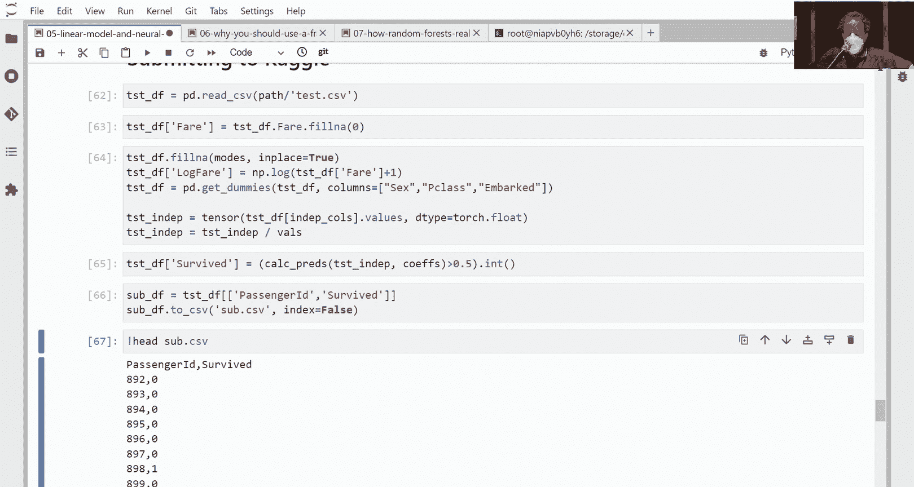

I didn't mention it。 Okay， so anyway， I submitted it。 And I remember I got like。

 I I think I was basically a right in the middle， about 50%， you know。

 better than half the people who have entered the competition worse than half the people。 So。

 you know， solid middle of the pack result for a。Ldydia model from scratch。

 I think it's a pretty good result。 So that's a great place to start。

 So let's take a 10 minute break。 We'll come back at。😊，7，17， and continue on our journey。

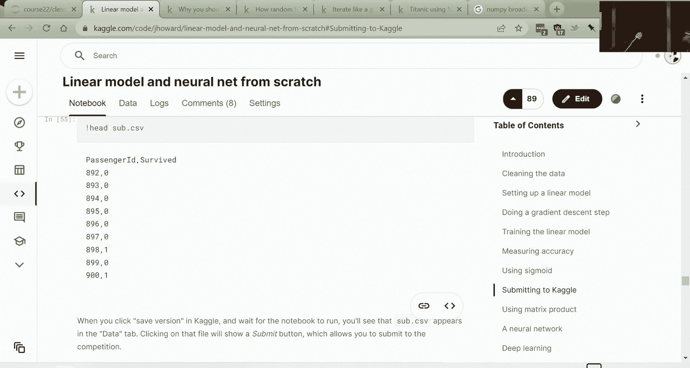

All right， welcome back。

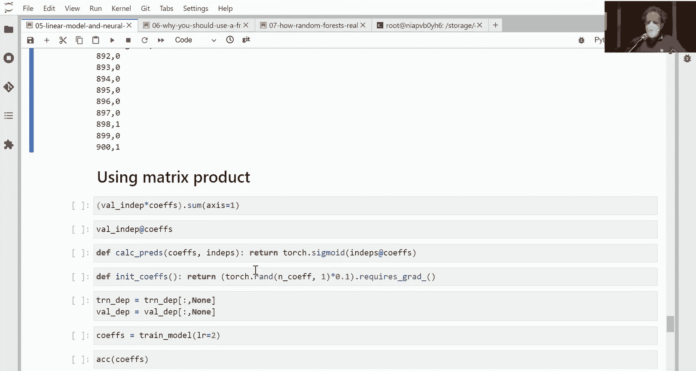

You might remember from Excel that after we did the。Some product version。嗯。Way then。

Replaced it with a matrix multiplay。waitai， well there。 must be here。有没有。

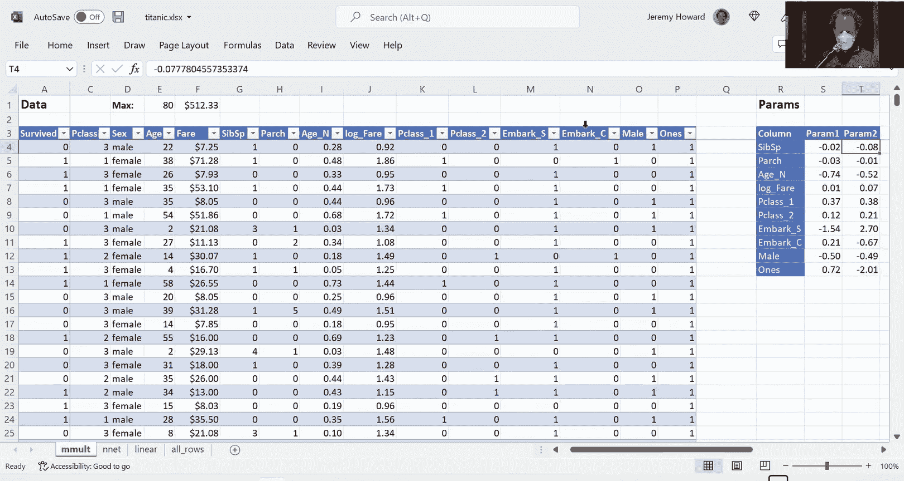

Where the matrix model play。So let's do that step now。

Mattrix times vector dot sum over axis equals 1。It's the same thing as matrix Moplay。So here is。

The times do sum version。 Now， we can't use this character for a matrix bottleplay because it means element wise operation。

 all of the times plus minus divide in pi torch nupy mean element wise， so。Corresponding elements。

So in Python， instead， we use this character。As far as I know， it's pretty arbitrary。

s one of the ones that wasn't used。😊。

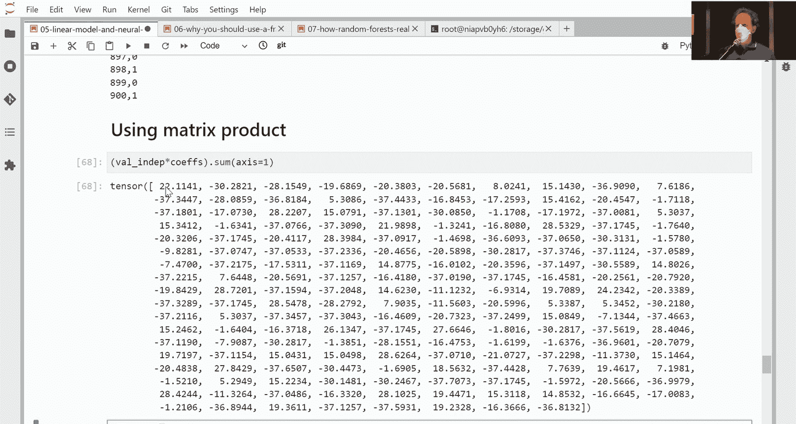

So that is an official Python。It's a bit unusual。 It's an official Python operator。

 it means matrix model play， but Python doesn't come with an implementation of it。

 So because we've imported because these are tensors and in paytorrch， it'll use p torches。

And as you can see， they're exactly the same。So we can now to simplify a little bit what we had before。

 Krk Pretz is now torched。 sigmoid of the matrix modelplay。Now。

 there is one thing I'd like to move towards now is that we're going to try to create neural net in a moment。

And so that means rather than treat this as。A matrix times a vector。

I want to treat this as a matrix times a matrix。Because we're about to add some more columns of coefficients。

So we're gonna change in it co Fs so that rather than creating。An N co F vector。

We're going to create an N cof by one。Matrix。So in math， we would probably call that a column vector。

 but I think it's a kind of a dump name in some ways because it's it's a matrix， right。

 It's a rank 2 tensor。嗯。so。Like the the matrix model player will work fine either way。

 But the key difference is that if we do it this way。

Then the result of the matrix multipplayer will also be a matrix。 It'll be again。Then rose by one。

Mattrix。That means when we compare it to the dependent variable。

 we need the dependent variable to be an n rows by one matrix as well。 So effectively。

 we need to take the N rows long vector and turn it into an n rows by one matrix。

So there's some useful， very useful， and at first maybe a bit weird notation in p torch and nup for this。

 which is if I take my training dependent variables vector。😊，I index into it。

And colon means every row。Right， so in other words。That just means the whole vector。Right。

 it's the same， basically as that。And then， I index into a second。Dimenssion。Now。

 this doesn't have a second dimension。So there's a special thing you can do。

 which is if you index into a second dimension with a special value none。It creates that dimension。

So， this。Has the effect of adding an extra trailing dimension to。Train dependence。

 So it turns it from。A vector。To a matrix with one column。So if we look at the shape after that。

As you say。It's now got。We call this a unit access。 It's got a trailing unit access。

 713 rows in one column。So now if we train our model。

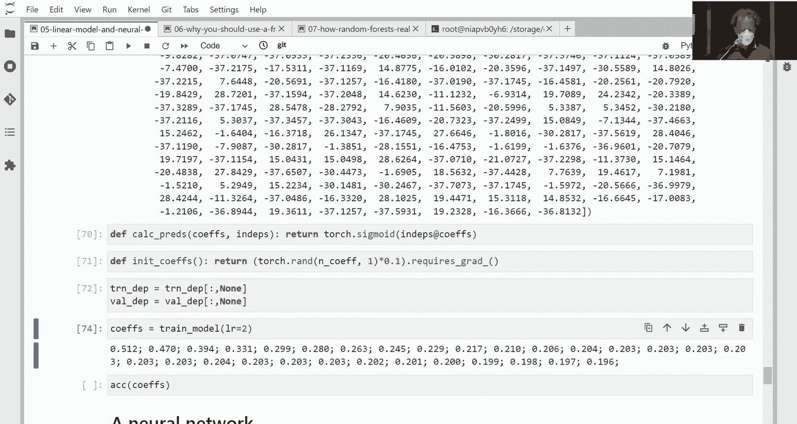

We'll get coefficients， just like before。Acept that。It's now a。Colum vector， also known as。

A rank2 matrix with a trailing unit access。Okay， so that hasn't changed anything。

 It's just repeated what we did in the previous section。

 but it's kind of set us up to expand because now that we've done this using matrix Modelplay。

 we can go crazy and we can go ahead and create a neural network。

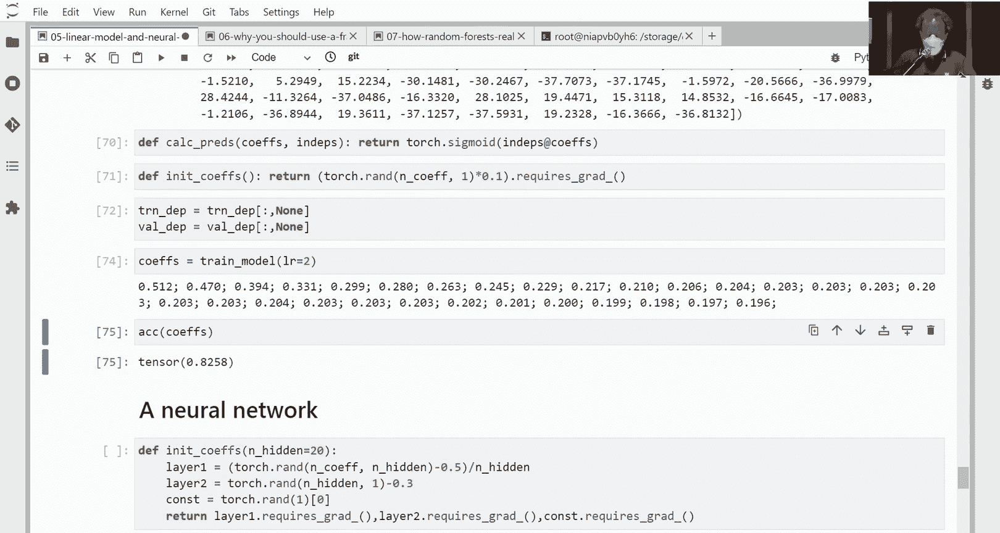

So with our neural network。Remember， back to。The ex days。Notice here， it's the same thing， right。

 we created。A column vector。 but we didn't create a column vector。

 We actually created a matrix with kind of two sets。Of coefficients。

 So when we did our matrix multiply， every row gave us。Two sets of outputs。

Which we then chat through value。Right， which remember， we just used if statement。

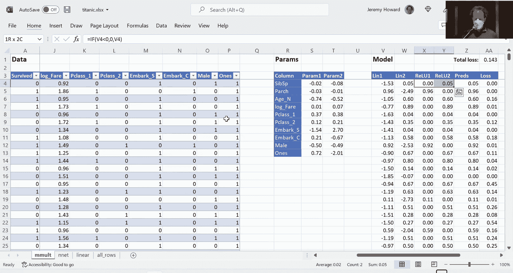

And we added them together。so。

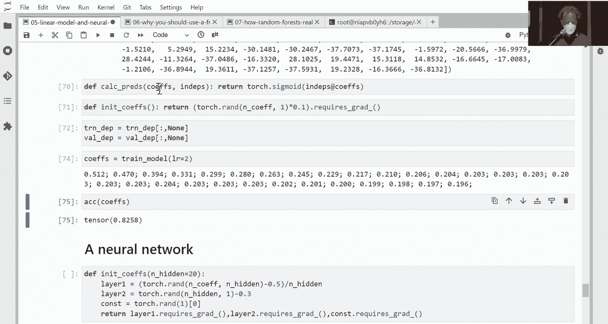

Our cophs now。To make a proper neural net， we need one set of calf cophs。He呀。

And so here they are Torch dot Rand and Co F by what。 Well， in Excel， we just did too。

 because I kind of got bored of。

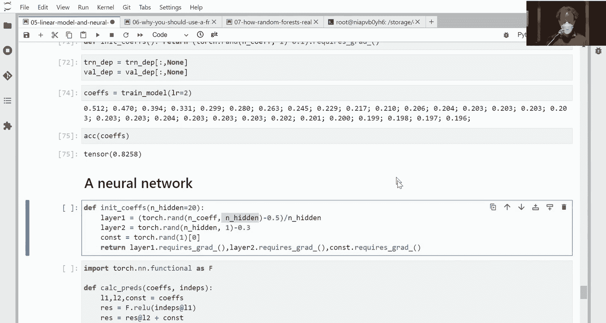

Getting everything working properly。 But you don't have to worry about filling right and creating columns and blah。

 blah， blah and， in Po torch。 you can create as many as you like。

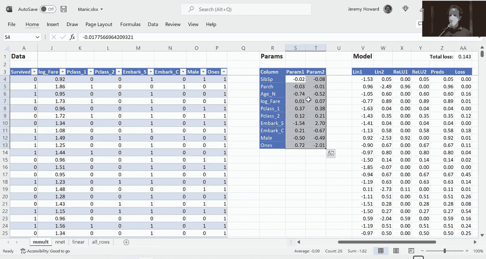

So， I made it。Something you can change according it n hidden number of hidden activations。

 And I just set it to 20。And as before， we centralize them by backing them go from minus 0。5 to 。5。

Now， when you do stuff by hand。Everything does get more fiddly。 If our coefficients aren't。

 if they're too big。Or too small。It's not going to train it at all。 Basically。

 the gradients will kind of vaguely point in the right direction。

 but you'll jump too far or not far enough or whatever。

 So I want my gradients to be about the same as they were before。

 So I divide by N hidden because otherwise at the next step when I add up the next metrics multiply。

 It's going to be much bigger than it was before。So。It's all very fiddly。So then I want to take。

 So that's going give me for every row。 It's going to give me 20。Activations，20 values， right。

 just like an Excel we had。Two values， because we had two sets of coefficients。

And so to create a neural net， I now need to multiply each of those 20 things。A coefficient。

And this time， it's going to be a column vector because I want to create one output predictor of survival。

 So again， torch dot R。And this time the N hidden will be the number of coefficients by one。

And again， like， try to find something that。Actually。

 trains properly required me some fiddling around to figure out how much to subtract。

 And I found if I subtract 。3， I could get it to train。嗯。And then finally。

 I didn't need a constant term for the first layer， as we discussed。

 because our dummy variables have， you know， n columns rather than n -1 columns， but layer 2。

Absolutely needs a constant term。 Okay， and we could do that， as we discussed last time。

 by having a column of ones。Although in practice， I actually find it's just easier just to create a constant term。

 Okay， so here is a single scalar random number。So those are the coefficients we need one set of coefficients to go from input to hidden。

 one goes from hidden to a single output and a constant。 So they're all going to need Gr。

And so now we can change how we calculate predictions。

So we're going to pass in all of our coefficients。 So a nice thing in Python is if you've got a list or a chaple of values。

😊，On the left hand side， you can expand them out into variables。

 So this is going to be a list of three things。 So I'll call them L 1， layer 1， layer 2。

 and the constant term。Because those are the list of three things we returned。So in Python。

 if you just chuck things with commas between them like this， it creates a tuple， a tuple is a list。

 is an immutable list。So now we're going to grab those three things。

So step one is to do our matrix Butfly。😊，And as we discussed。

We then have to replace the negatives with zeros。And then we put that through our second matrix model play。

 So our second layer and add the constant term。 And remember， of course， at the end。

 chuck it through a soid。So here is a neural network。Now。

 update coefs previously subtracted the coefficients。

The gradients times of learning weight from the coefficients。 But now we've got。Three sets of those。

 so we have to just chuck that in a fold loop。So change that as well。

 And now we can go ahead and train our model。😊，叫他。We just trained a model， and how does that compare？

So the loss function is a little better than before。Accuracy。Exactly the same as before。😊。

And you know， I will say it was。Very annoying to get to this point。

 trying to get these constants right and find a learning rate that worked like。That was super fit。

But， you know， we got there。 We got there。 and it's a very small。Tess said。

 I don't know if this is necessarily better or worse than the linear model， but it's certainly fine。

And I think that's pretty cool that we were able to build a neural net from scratch。嗯。

That's doing pretty well。 But I hear that all the cool kids nowadays are doing deep learning。

 not just neural nets。 So we better make this deep learning。 So this one only has one hidden layer。

So let's create one with N hidden layers。So， for example， let's say we want two hidden layers。

10 activations in each。 you can put as many as you like here。 right， So in a co F now。

Is going to have to create a。Toched do ran。For every one of those hidden layers。

And then another torchdot ran。For your constant terms。Stick requires gra and all of them。

And then we can return that。 So that's how we can just initialize。

As many layers as we want of coefficients。So the first one， the first layer。So the sizes of each one。

 the first layer will go from N co F to 10。The second matrix will go from 10 to 10。

 and the third matrix will go from 10 to 1。So it's worth like working through these matrix model players on like a spreadsheet or a piece of paper or something to kind of convince yourself that there's the right number of activations at each point。

嗯。And so then we need to update carrk pretz。So that rather than doing each of these steps manually。

 we now need to look through all the layers。Do the matrix model play？At the constant。

And as long as it's not the last layer。Do the value。 Why not the last layer， Because remember。

 the last layer has sigmoid。So， these things about like。Remember， what happens on the last layer。

 This is an important thing you need to know about。

 and you need to kind of check if things aren't working。What's your。

This thing here is called the activation function， torch dot sigoidoid and F dot re。

 Theyre the activation functions for these layers。One of the most common mistakes amongst people trying to kind of create their own。

Architectures or kind of variants of architectures is to mess up their final activation function。

 and that makes things really hard to train。So make sure we've got a torch。

 sigmoid at the end and no value at the end。So there's our deep learning cut pres。And then。

 just one last change。Is now， when we update our coefficients。

 we go through all the layers and all the constants。And again。

 there was so much messing around here with trying to find like exact ranges of random numbers that end up training。

 okay。But eventually I found some， and as you can see， it gets to about the same。Plus。

 and about the same。Accuracy。This code is worth spending time with， and。When the coats。

Inside a function， it can be a little difficult to experiment with。 So， you know。

 what I would be inclined to do to understand this code is to kind of copy and paste this cell。

Make it sense not in a function anymore。And then use control shift dash to separate these out into separate cells。

 right， and then try to kind of set it up so you can run a single layer at a time or a single coefficient。

 like， make sure you can see。What's going on， Okay， and that's why we use notebooks。

Its so that we can experiment。 And it's only through experimenting like that that at least to me。

 I find that I can really。Under what's going on。 Nobody can look at this code and immediately see。

 I don't think anybody can。 I get it。 That all makes perfect sense。But once you try。

Running through it yourself， you'll be like， I see why that's as it is。So， you know。

 one thing to point out here is that。Our。Nearero nets and deep learning models they't particularly say to help。

Um。So。Does that mean that deep learning is a waste of time and you。

Just did five lessons that you shouldn't have done。No， not necessarily。

 this is a playground competition， we're doing it because it's easy to get your head around。😊。

But for very small data sets like this with very， very few columns and the columns are really simple。

You know， deep learning is not necessarily going to give you the best result， in fact。

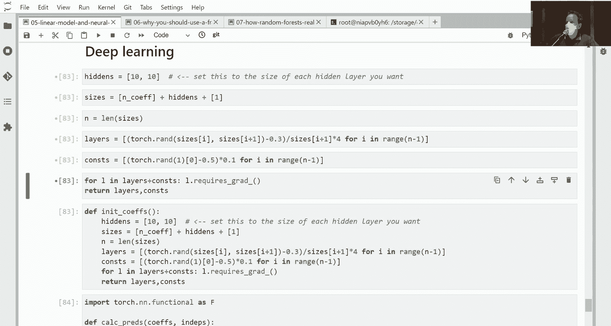

As I mentioned。

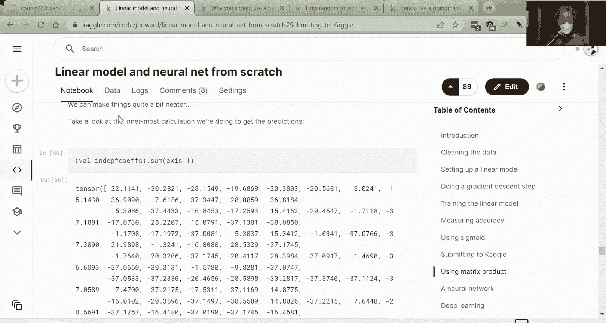

Nothing we do is going be as good。As a carefully designed。Model that uses just the name column。嗯。So。

 you know， I think that's an interesting insight， right， is that。

For the kind of data types which have a very consistent structure， like， for example， images。

Or natural language text documents。 quite often。 you can somewhat brainlessly。

Chuck a deep learning neural net at it， and get a great result。Generally， for tabular data。

 I find that's not the case。 I find I normally have to think pretty long and hard。

About the feature engineering in order to get good results。 But once you've got good features。

 you then want a good model。 And so you， you know。And generally。

 like the more features you have and the more levels in your categorical features and stuff like that。

 you know， the more value you'll get。😊，From more sophisticated models。But yeah。

 I definitely would say a an insight here is that， you know。

 you want to include simple baseline as well， and we're going to be seeing even more of that。

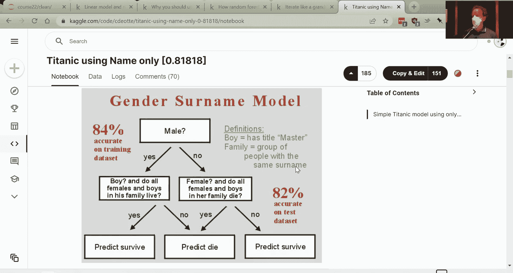

In a couple of notebooks time。

嗯。So we've just seen how you can build this stuff from scratch。 We now see。Why， you shouldn't。I mean。

 I say you shouldn't， you should to learn that way you probably won't want to in real life。

When you're doing stuff in real life。You don't want to be fiddling around with all this。

Annoying initialization and stuff and learning rate stuff and dummy variable stuff and normalization stuff and so forth。

Because。We can do it for you。 And it's not like everything so automated that you don't get to make choices。

 but you want like。You want to make the choice not to do。

Things the obvious way and have everything else done the obvious way for you。

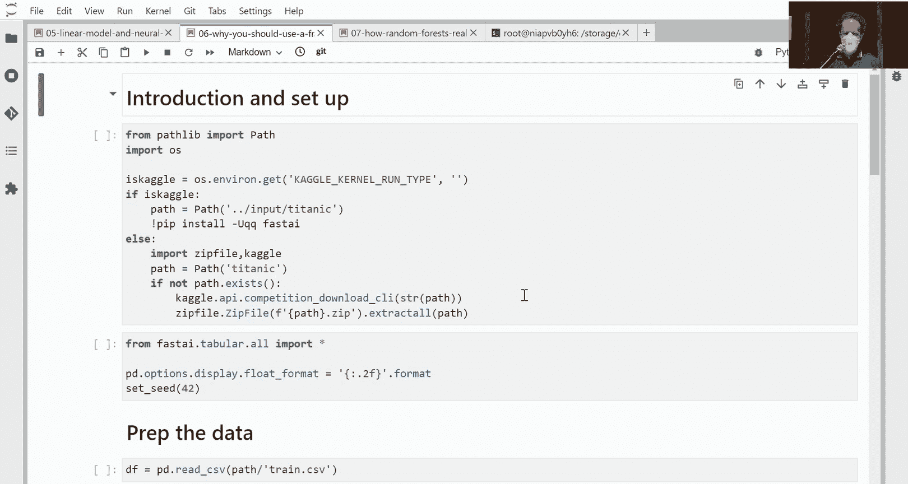

So that's why we're going to look at this。Why you should trace user a framework。

Notebook， and again， I'm going to look at the clean version of it。And again。

 in the clean version of it， step 1 is to。Download the data as appropriate for the cale or noncale environment。

And set the display options and set the random seed and read the data data frame。Right， now。

There was so much fussing around with the doing it from scratch version that I did not want to do any feature engineering because every column I added was another thing I had to think about dummy variables and normalization and。

Random coefficient initialization and blah， blah， blah， But with a framework， everything's so easy。

 you can do all the feature engineering you want。😊。

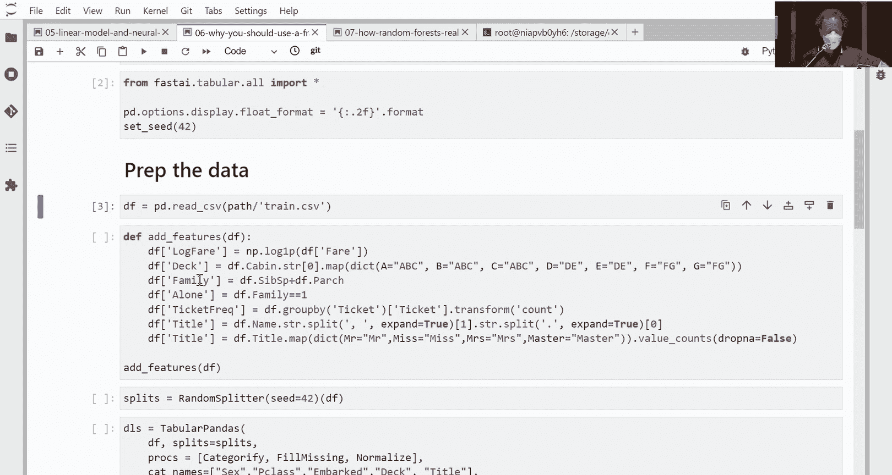

Because this isn't a lesson about fiction engineering instead。

I plagiarized entirely from this fantastic。😊，Advanced feature engineering tutorial on Cagel。

嗯。And what this tutorial found was that。In addition to the log fair we've already done that you can do cool stuff with the deck with adding up the number of family members。

 whether the people are travelling alone， how many people are on each ticket And finally we're going to do stuff with a name。

 which is we're going to grab the Mr， Miss Missus Master， whatever。

So we're gonna to create a function to like， do some feature engineering。

 And if you want to learn a bit ofyth little pandas。😊。

Heres some great lines of code to step through one by one and again。

 like take this out of a function， put them into individual cells， run each one。

 look up the tutorials， what does stir do， what does map do， what does group by and transform do。

What does value accounts do， Like these are all like part of the reason I put this here。

Was for folks that haven't done much if any pandas to have some， you know。

 examples of functions that I think are useful and actually refactored。

Thiss code quite a bit to try to show off some features of pandas， I think， are really nice。

So we'll do the same random split as before， so plaing in the same seed。😊。

And so now we're going to do the same set of steps that we did manually with FA AA。😊，So。

 we want to create a。Tapular Model data set。Based on a panda's data frame。

And here is the tat data frame。These are the train versus validation splits I want to use。

Here's a list of all the stuff I want done， please。Deal with dummy variables for me。 De with。

 deal with missing values for me。Normalize continuous variables for me。

I'm going to tell you which ones are the categorical variables。😊，So here's， for example。

 P class was a number， but I'm telling fastA I ought to treat it as categorical。

Here's all the continuous variables。Here's my dependent variable。

And the dependent variable is a category。So create data loaders from that place and save models right here in this directory。

That's it， That's all the pre processingces I need to do。

 even with all those extra engineered features。Create a learner。Okay。

 so this remember is something that contains a model。And data。

 And I want you to put in two hidden layers with 10 units and 10 units。

 just like we did in our final example。What learning rate should I use？

Make a suggestion for me please so call L find， you can use this for any fast A model。😊，Now。

 what this does。Is it starts at a learning rate that's very， very small， 10 to the negative7。😊。

And it puts in one batch of data。And a cat lets the loss。

And then it puts through then it increases the learning rate slightly and puts through another batch of data。

 and it keeps doing that for higher and higher learning rates。

 and it keeps track of the loss as it increases the learning rate。Just one batch of data at a time。

 And what happens is for the very small learning rates， nothing happens。

But then once you get high enough， the law starts improving。And then as it gets higher。

 it improves faster。 And true， you make the learning rate so big that it overshoots。

 And then it kills it。And so generally， somewhere around here is the learning rate you want。

Fas A has a few different ways of recommending a learning rate。

 You can look up the docks to see what they mean。 I generally find if you choose slide and value and pick one between the two。

 you get a pretty good learning rate。😊，So here we've got about 。01。😊，And about 。08。So I picked 。03。

So just run a bunch of apochs。way it goes。得啦。This is a bit crazy。 After all that。

 we've ended up exactly the same accuracy as the last two models。 That's just a coincidence right。

 I mean， there's nothing particularly about that accuracy。😊，And so at this point。

 we can now submit that to cattle。 Now， remember， with the linear model。

 we had to repeat all of the pre processing steps on the test set in exactly the same way。

Don't have to worry about it with fast D A in fast D I， I mean。

 we still have to deal with a full missing for fair， because that's， that's that。 we have to add our。

Feature engineering features。 But all the pre processing。

 we just have to use this one function called Tes L。

That says create a data loader that contains exactly the same pre processings steps that our learner used。

And that's it。 That's all you need。 So just because you。

 you want to make sure that your inference time。Transformations。

 preprocess are exactly the same as a training time。So this is the magic method which does that。

Just one line of code。And then to get your predictions， you just say get pres and pass in。

That data loader I just built。And so then these three lines of code are the same as the previous。

Notebook。And we can take a look at the top and you can see。

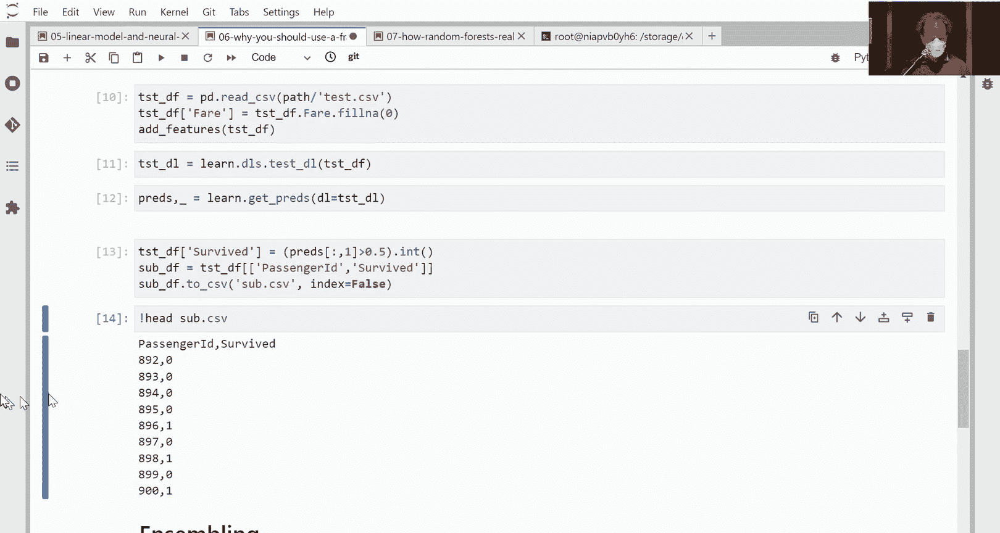

There it is。So how did that go？😔，To tu tu tu。I don't remember。No， I didn't say I think it was again。

 basically middle of the pack， if I remember correctly。

So one of the nice things about。Now that it's so easy shall I add features and build models is we can experiment with things much more quickly。

 So I'm going to show you how easy it is to experiment with。

 you know what's often considered a fairly advanced idea， which is called ensembling。😊。

There's lots of ways of doing ensembling， but basically ensembling is about creating multiple models。

And combining their predictions。And the easiest kind of ensemble to do is just to， literally。

Just build water models。 And so each one is going to have a different set of randomly initialized coefficients。

And therefore， each one's going to end up with a different set of predictions。

So I just create a function called Ensemble， which creates a learner exactly the same as before。😊。

Fits exactly the same as before and returns the predictions。

And so that we'll just use a list comprehension to do that five times。

So that's going to create a set of five。Predictions。Done。

 so now we can take all those predictions and stack them together。And take them in。Over the rows。

 So that's going to give us the what's actually so the mean over the。Over the first dimension。

 So the mean over the sets of predictions。And so that will give us the average prediction of our five models。

But again， we can turn that into a CSV。And submit it to cattle。

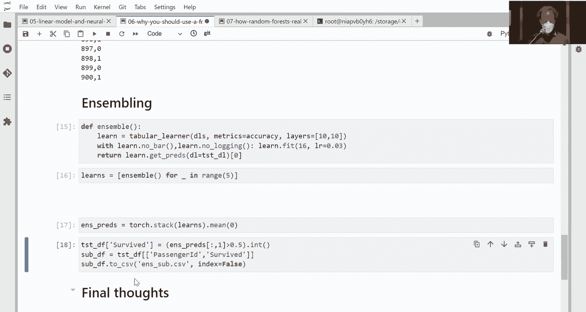

And that one， I think that went a bit better， let's check。Yeah， okay。

 so that one actually finally gets into the top 20%，25% in the competition。 So， I mean， not amazing。

 by any means， but you can see that， you know， this simple step of creating five independently trained models。

 just starting from different starting points in terms of random coefficients actually improved us from。

😊，Top 50% or top 25%。John。Is there an argument because you've got a categorical result。

 you're 01 effectively， is there an argument that you might use the mode of the ensemble rather than the numerical mean？

I mean。Yes， there's an argument that's been made。And， you， something I would just try。

 I generally find it's。Less good。对。Not always。 And I don't feel like I've got a great intuition as to why。

 and I don't feel like I've seen any。Studies as to why you could predict like there's a few。 there's。

 there's at least three things you could do， right？ You could take the， is it greater or less than 。

5。Ones and zeros and average them。Or you could take the mode of them。

 or you could take the actualable probability predictions and take the average of those and then thrash out that。

😊，And I've sent examples where， certainly。Both of the different averaging versions。

 each of them has been better。I don't think I've seen one with the moods better， but。

That was very popular back in there。90s， so。

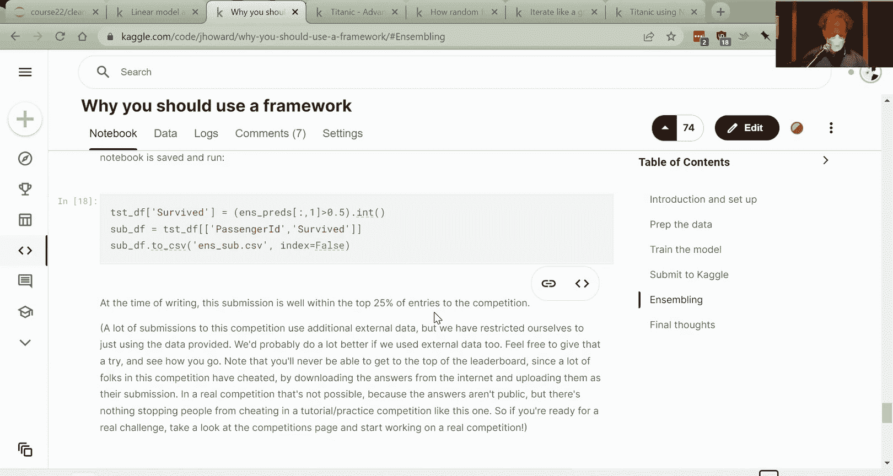

Yeah， so's so easy to try， you may as well give it a go。😊，Okay。

We don't have time to finish the next notebook， but let's make a start on it。So the next notebook。

Is random forests how random forests really work？Who here has heard of random forests before？

Nearly everybody。 Okay， so very popular。😊，Developed。I think initially in 1999， but， you know。

 gradually improved in popularity during the 2000s， I was like。Everybody kind of knew me as Mr。

 randomandom Forts for years。 I implemented them。Like a couple of days after the original technical report came out。

 I was such a fan， all of my early kle results are random forests。I love him。And I think hopefully。

 you'll see why I'm such a fan of them， because they're so。Alllegant。

And they're almost impossible to mess up。嗯。A lot of people will say， like。Oh。

 why using machine learning。 Why didt you use something simple， like logistic regression。And I think。

 like， oh， gosh， in industry， I've seen far more examples of people screwing up logistic regressiongion than successfully using logistic regressiong because it's very。

 very， very， very difficult to do correctly。 You know。

 you've got to make sure you've got the correct transformations and the correct interactions and the correct outlier handling and blah。

 blah， blah。 and anything you get wrong。 The entire thing falls apart。randomandom forests。I。

 it's very rare that I've seen somebody screw up around forest in industry。

 They're very hard to screw up， because they're。They're so resilient。And just say why。

So in this notebook。嗯。Just by the way， rather than importing lumpy and pandas and that plotlet and blah。

 blah blah， there's a little handy shortcut， which is if you just import everything from fast a out imports。

That imports all the things that you normally want。So I mean。ItDoesn't do anything special。

 but it's just save so messing around。So again， we've got our cell here to grab the data。And。

I'm just going to do some basic prepros here。Um。With my felon A for the far only need for the test set。

 of course。嗯。Grab the modes and do the fillinna on the modes， take the log far。

And then Ive got a couple of new steps here。😊，Which is converting， embarked in sex。

Into categorical variables， what does that mean？Well， let's just run this on both the data frame。

 a data frame and the test data frame。Spit things into categories and continuous。

And sex is a categorical variable。 So let's look at it。Well， that's interesting。

 It looks exactly the same as before。Male and female。 But now it's got a category。

 and it's got a list of categories。What's happened here， Well， what's happened is。

Cands has made a list of all of the unique values of this field。And behind the scenes。

 if you look at the cat codes you can see behind the scenes。It's actually turned them into numbers。

It looks up this one into this list to get male looks up this 0 into this list to get female。

 So when it printed out， it prints out。The friendly version。But it stores it as numbers。Now。um。

You'll see in a moment why this is helpful。 but a key thing to point out is we're not going to have to create any dummy variables。

And even that。First， second or third class。 we're not going to consider that。Cateorical at all。

And you'll say why in a moment。I ran in forest。Is an ensemble of trees。

A tree is an ensemble of binary splits。 And so we're going to work from the bottom up。

 We're going to first work。 We're going to first learn about what is a binary split。

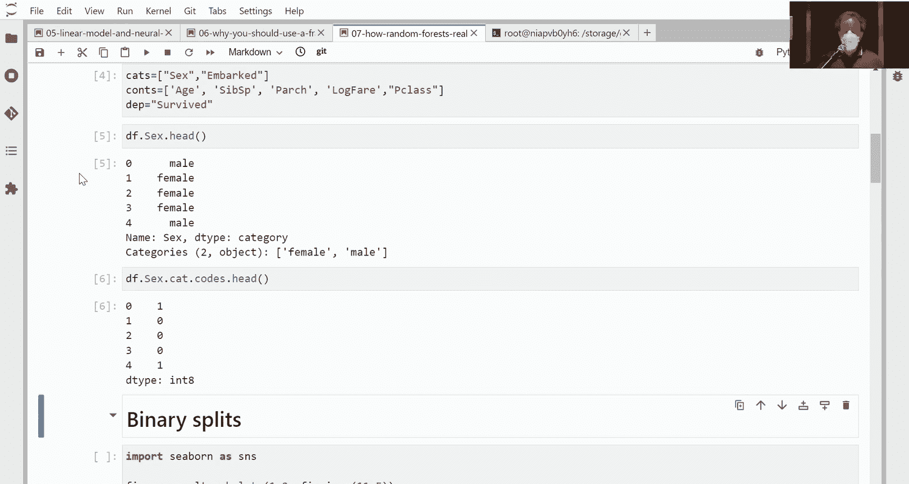

And we're got to do it by looking at an example。Let's consider。

What would happen if we took all the passengers on the Titanic and grouped them into males and females？

And let's look at two things。 The first is， let's look at their survival rate。

So about 20% survival overall rate for males and about 75% for females。

And let's look at the histogram。 How many of them are there， about twice as many males as females。

Consider what would happen if you created the wealth's simplest model。Which was， what sex are they。

I wouldn't be bad， would it。Because there's a big difference between the males and the females。

 a huge difference in survival rate。To face it out。If you're a man， you probably died。

 if you're a woman， you probably survived or not just a man or a boy， so a male or a female。

That would be a pretty good model because it's done a good job of splitting it into two groups that have very different survival rates。

嗯。This is called a binary split。 A binary split is something that splits the rows into two groups。

 hence binary。

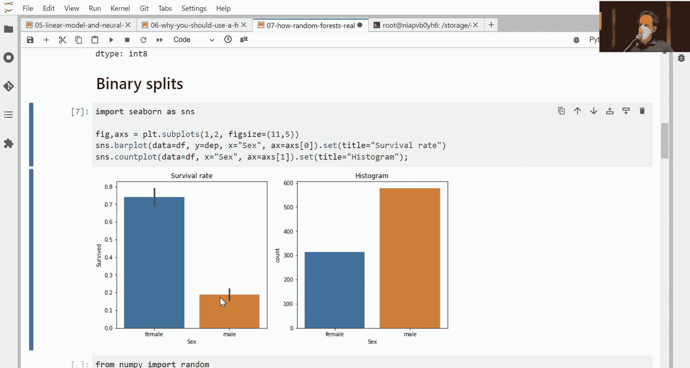

Let's talk about another example of a binary split。

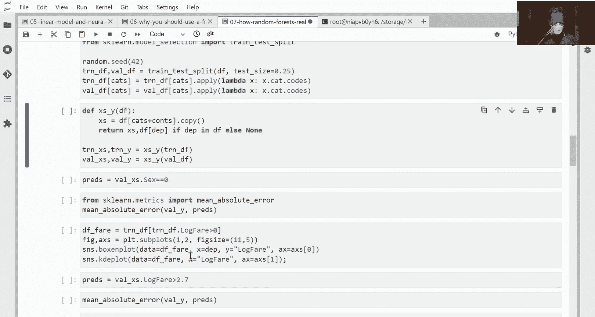

I'm getting ahead of myself。 before we do that， let's look at what would happen if we used this model。

So if we created a model which just looked at sex， how good would it be， So to figure that out。

 we first have to split into training and test sets。So let's go ahead and。Do that。And then。

 let's convert。All of our categorical variables into their codes， so we've now got0，1，2。

 whatever we don't have male， female there anymore。

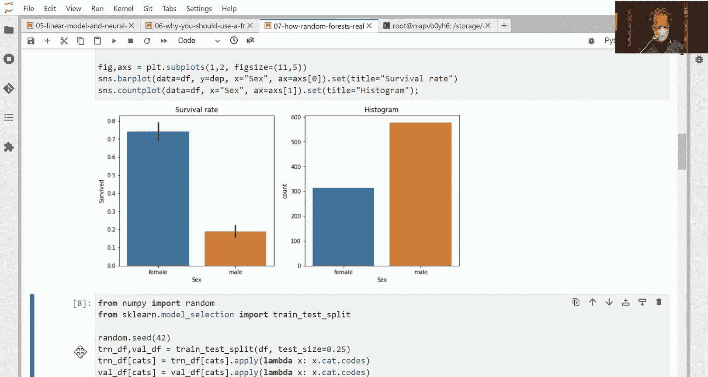

嗯。And let's also create something that's。Returns the。Independent variables。

 which well call the x's and the dependent variable。Thattro call why。

And so we can now get the x's and the Y for each of the training set in the validation set。

And so now let's create some predictions。Well predict that they survived。If there。Sex is 0。

 So if they're female。So how good is that model？Remember， I told you that。

To calculate me an absolute error， we can get pschic learn or payrch。

 whatever do it for us instead of doing it ourselves。 So just showing you。

 here's how you do it just by importing it directly。

 This is exactly the same as the one we did manually in the last notebook。

So that's a 21 and a half percent error。 So that's a pretty good model。😊，Could we do better。Well。

 here's another example。 What about fair。So fair is different to sex because fair is continuous or log fair。

 I take。But we could still split it into two groups。

 So here's for all the people that didn't survive。This is their median faire here。

And then this is that。Cortiles。For big affairs and quartiles to small affairs。

And here's the median fair for those that survived。And their quartels。

 So you can see the median fare for those that survived is higher than the median fare for those that didn't。

We can't create a histogram exactly for fair because it's continuous。

 We could bucket it into groups to create a histogram。

 so I guess we can create a histogram that wasn't true。

 what I should say is we could create something better which is a kernel density plot。

 which is just like a histogram but it's like with infinitely small bins。

 so we can see most people have a log fair of about two。😊，嗯。So what if we split on about。

A bit under three。You know， that seems to be a point at which there's a difference in survival。

Between people that are greater than or less than that amount。 So here's another model。

Log fare greater than2。7。Oh， much worse。3，3，6。V is 。215。Well， I don't know。

 Maybe isn there something better。嗯。We could create a little interactive tool。So。

What I want is something that can give us a quick score of how good a binary split is。

And I want it to be able to work regardless of whether we're dealing with categorical or continuous or whatever data。

So I just came up with a simple little。Why of scoring。Which is I said， okay。

 if you split your data into two groups。A good split would be one in which all of the。

Values of the dependent variable on one side are all pretty much the same。

 and all of the dependent variables on the other side are all pretty much the same。 For example。

 if pretty much。

All the males had the same survival outcome， which is。Didn't survive。

 And all the females had about the same survival outcome， which as they did survive。

 That would be a good split。 right， doesn't just work for categorical variables。

 It would work if your dependent variable was continuous as well。

 You basically want each of your groups within group to be as similar as possible on the dependent variable。

 And then the other group， you want them to be as similar as possible on the dependent variable。

So how similar is all the things in a group？😊，That's the standard deviation。

So what I want to do to get is basically add the standard deviations of the two groups of the dependent variable。

And then， if there's a。Really small standard deviation。 But it's a really small group。

That's not very interesting。 So I multiply it by the size。 right， So this is something which says。

 what's the score for one of my groups， one of my sites。

It's the standard deviation multiplied by how many things are in that group。So the total score。

Is the score for the left hand side So all the things in one group。

 plus the score for the right hand side， which is tilda means not。 So not left hand side。

Is rat Hendsside。And then we'll just take the average of that。So， for example。If we split by sex。

Is greater than a less than 。5。 That'll create two groups， males and females。

 And that gives us this score。And if we do log fair greater than or less than 2。7。

 it gives us this score and lower score is better， so sex is better than log fair。

So now that we've got that， we can use our favorite interaction tool。😊，To create a little。Gy。

And so we can say， you know， let's try like， oh， what about this one， can we。oops。

Can we find something that's a bit better， 4。8。4。5， no， not very good。What about T class？468。

460 so we can fiddle around to these。😊，We could do the same thing for the categorical variables。😊。

So already you know that sex。We can get to 。407， what about embarked？嗯。😊，All right。

 so it looks like sex might be our best。Well， that was pretty inefficient。 right。

 It would be nice if we could find some automatic way to do all that。Well， of course， we can。

 for example， if we wanted to define what's the best split point for age。Then we just have to create。

Let's do this again。If we want to find the best bit point for age。

 we could just create a list of all of the unique values of age。And try H1， in turn。

And see what score we get if we made a binary split on that level of age。

So here's a list of all of the possible binary split thresholds for age。

Let's go through all of them for each of them。Calculate the score。And then。

Numy and pytorrch have an arg min function， which tells you what index into that list is the smallest。

So just to show you， here's the scores。And0，1，2，3，4，5，6。Oh， hit sorry，0，1，2，3，4，5，6。

 so apparently that。That value has the smallest。Score。So that tells us that for age。

The threshold of 6 would be best。So。Here's something that just calculates that for a column。

 it calculates the best split point。So here's six， right。

And it also tells us what the score is at that point。Which is 0。478。

So now we can just go through and。😊，Calculates the score for the best split point for each column。

And if we do that， we find that the lowest。Score is sex。So that is how we calculate。😊。

The best finery split。So we now know that the model the we created earlier。This one。

It's the best single binary split model we can find。

So next week going to be we're going to learn how we can recursively do this to create a decision tree and then do that multiple times to create a random forest。

 but。😊，Before we do。I want to point something out， which is this ridiculously simple thing。

 which is find a single binary split in stock。Its a type of model。 It has a name that's called1 R。

And the1 R model， it turned out in a review of machine learning methods in the 90s。

 turned out to be one of the best， if not the best。

 machine learning classifiers st a wide range of real world data sets。So that is to say。Don't。

Assume that you have to go complicated。It's not a bad idea to always start creating a baseline of。

Why not。A decision tree with a single binary split。 And， in fact， for the Titanic competition。

 that's exactly what we do。 If you look at the Titanic competition on Kale。

 you'll find that what we did is our sample submission is one that just splits into male versus female。

😊，Alright， thanks everybody。 Hope you found that interesting and I will see you next lesson，😊。

