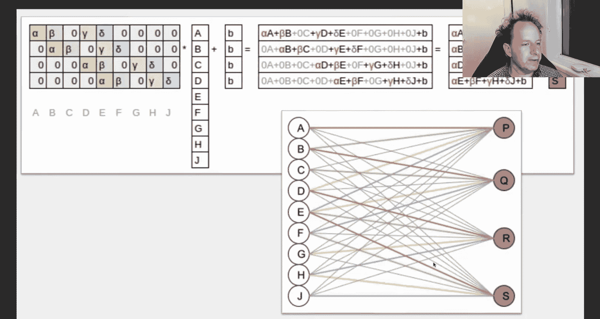
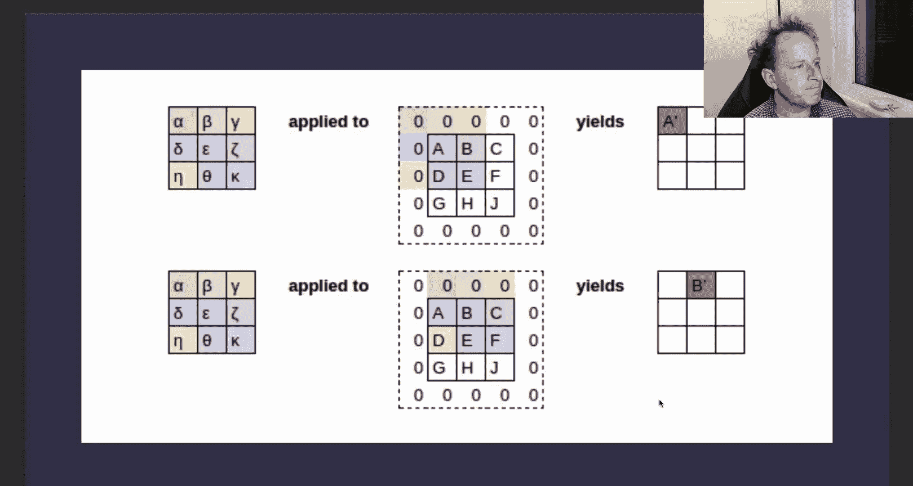
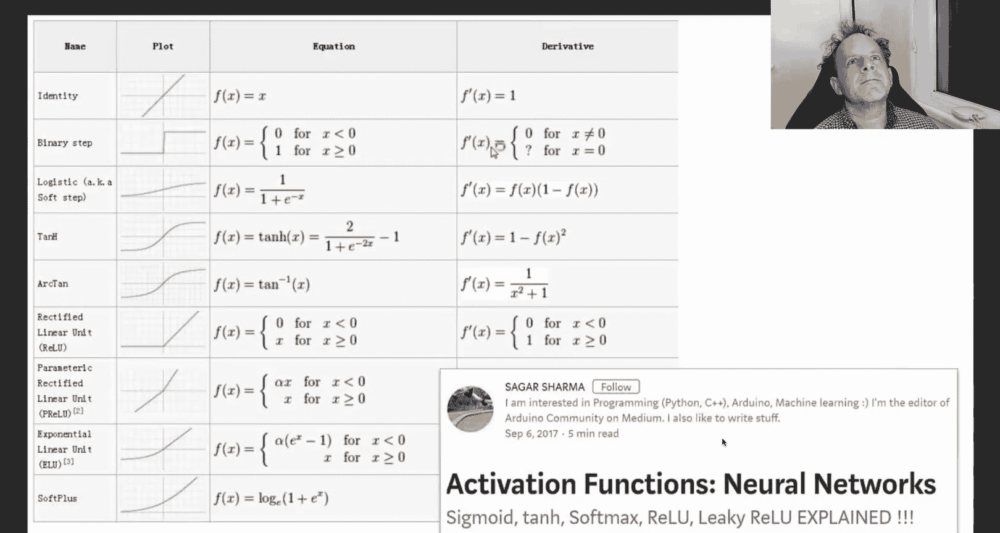
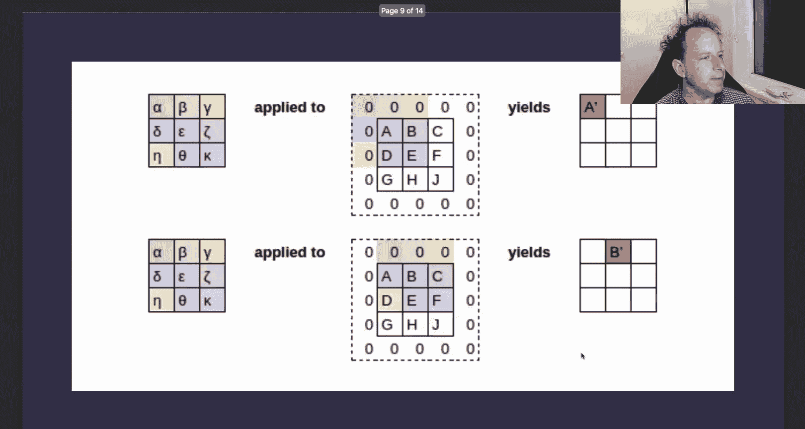
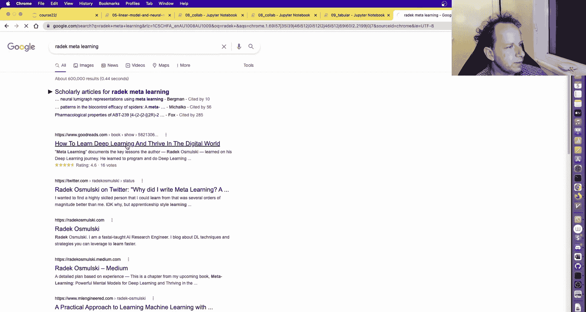
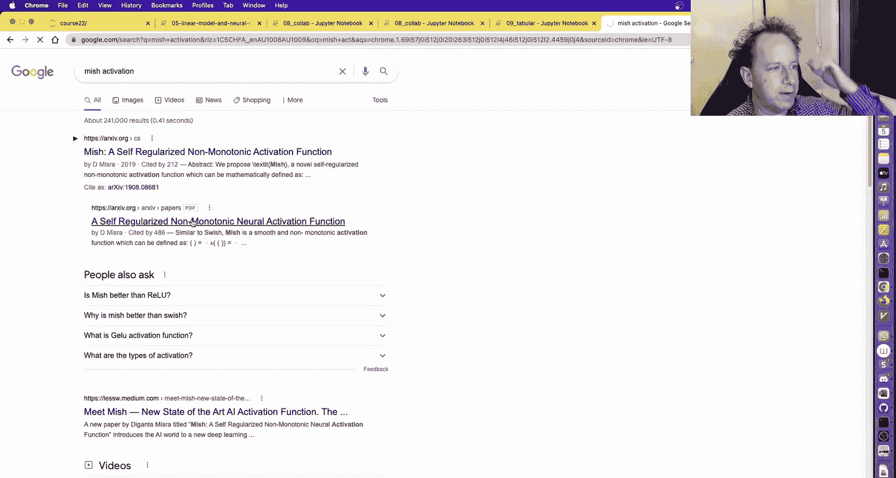
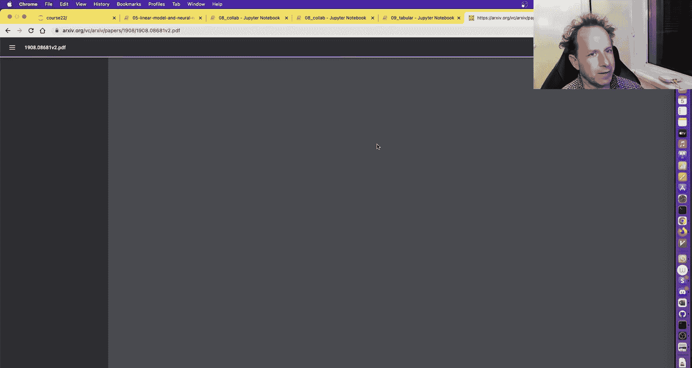
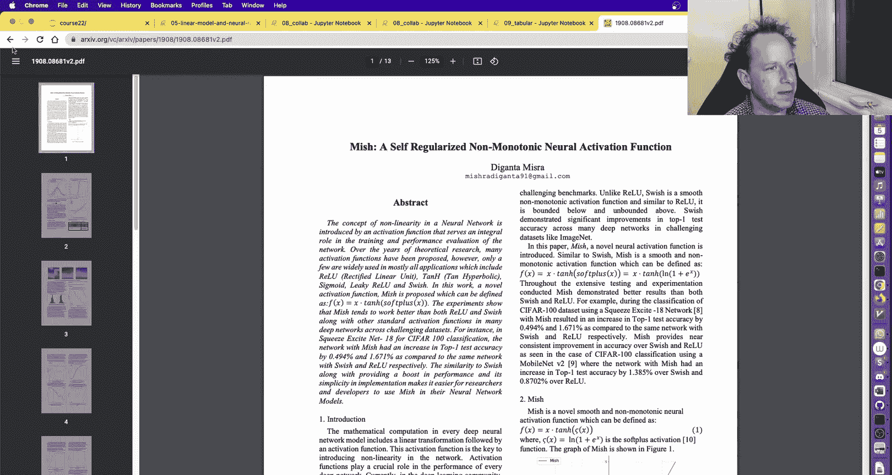
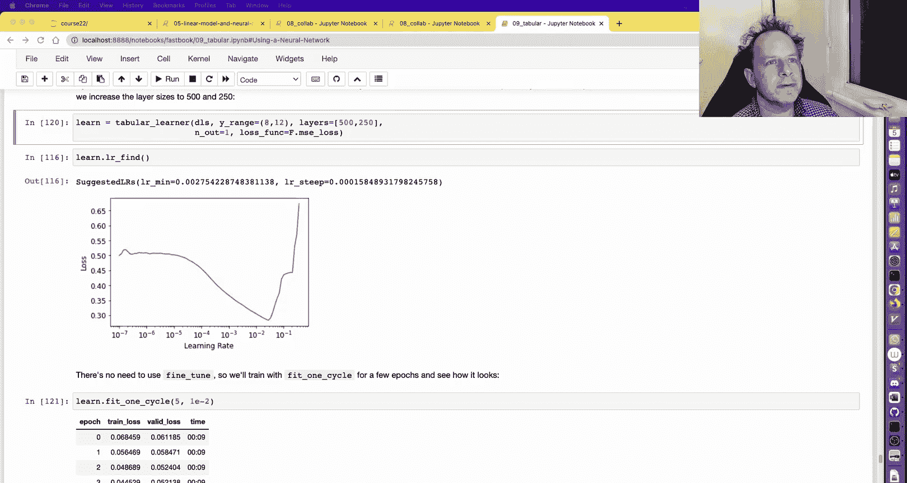

# Jeremy Howard《给码农的深度学习实践课程1｜Practical Deep Learning for Coders2022》中英字幕 p08 -8-Lesson 8 - Practical Deep Learning for Coders 2022.zh_en -BV15Z421H7zj_p8-

So welcome to the last。lessons。Of part 1。Of practical deep learning for coders。A。

It's been a really fun time doing this course。 And depending on when you're。😊。

Watching and listening to this， you may want to check the forums or the Fast。

AI website to see whether we have a part 2 planned。

 which is going to be sometime towards the end of 2022。Or if you're if it's already passed that。

 then maybe there's even the part two already on the website so part two goes a lot deeper than part one technically in terms of getting to the point that you should be able to read and implement research papers and。

Deploy models， you know， in a very kind of real life situation。So。Yeah， last lesson we started。嗯。

On the collaborative filtering notebook。And。We were looking at collaborative filtering and this is where we got to which is creating your own embedding module and this is a very cool this is a very cool place to start the lesson because you're going to learn a lot about what's really going on。

😊，And it's really important。Before you dig into this to make sure that you're really comfortable。

With the the 0，5 media model and neural net from scratch notebook。

 So if parts of this are not totally clear。Put it aside。 and redo。This notebook。Because。

What we're looking at from here are kind of the abstractions that pie torch and fast A I add on top of。

F that we've built ourselves from scratch。So if you remember in the。Near a network from scratch。

 we built。We initialized a number of coefficients， a couple of different layers， you know。

 and a bias term。And then。During as the model trained。

 we updated those coefficients by going through each layer of them。

And subtracting out the gradients by the learning rate。嗯。In you probably noticed that in pieytorrch。

 we don't have to go to all that travel。 And I wanted to show you how Pytorrch does this。 pietorrch。

We don't have to keep track of what our coefficients or parameters or weights are。Pe towards。

Does that for us and the way it does that is it looks inside our our module。

And it tries to find anything that looks like a neural network。Perarameter。

 a tensor of neural network parameters。And it keeps track of them。

 and so here is a class with credit card T， which is a subclass of module。

And I've created one thing inside it， which is something with the attribute A。

 So this is a in the T module。And it has contained three ones。And so the idea is， you know。

 maybe we're creating a module and this is we're initializing some parameter that we want to train。

Now we can find out。What trainable parameters or just what parameters in general Paytorch knows about in our model by instantiating our model and then asking for the parameters。

Which you then have to turn that into a list or in fast call we have a thing called capital L which is like a fancy list。

 which prints out the number of items in the list and shows you those items。Now， in this case。

 when we create our object of type T and ask for its parameters。

 we get told there are zero tenors of parameters and less with nothing in it。Now why is that。

 We actually said we wanted to create three atten with three ones in it。

 How would we make those parameters。Well， the answer is that the way you create the way you tell。

Pie torch， what your parameters are is you actually just have to put them inside a special object called an N。

 N dot parameter。 this thing。Almost doesn't really do anything。 In fact， last time I checked。

 it really quite literally had almost no code。 And that sometimes these things change。

 But let's take a look。Yeah， okay。 so it's about。A dozen lines of code or 20 lines of code。

Which does almost nothing， it's got a way of being copied， it's got a way of printing itself。

 it's got a way of saving itself。And it's got a way of being initialized。

So parameter hardly does anything。 the key thing is， though。

 that when Pytorch checks to see which parameters should it update when it optimizes。

It just looks for anything。That's been wrapped in this parameter class。

 So if we do exactly the same thing as before， which is to set an attribute containing a tensor with three ones in it。

 But this case， we wrap it。And a parameter。We now get told O， there's one parameter tensor。

In this model。And it contains a tensor with three ones。

And you can see it also actually by default assumes that we're going to want require gradient。

 it's assuming that anything that's a parameter is something that you want to calculate gradients for。

Now， most of the time， we don't have to do this because paytorrch provides lots of。

Convenient things for us， such as what you've seen before in N dot linearar。

Which is something that also creates a tensor， so this would create a tensor of one by three。

Without a biased terminate。This has not been wrapped in an N do parameter。But that's okay。

 Piytch knows that anything which is basically a layer in a neural net。It's going to be a parameter。

 so it automatically considers this a parameter。So here's exactly the same thing again。

 I construct my object of type T of check for its parameters。😊。

And I can see there's three of the one tensor of parameters， and there's our three things。

 And you'll notice that it's also automatically。Randomly initialized them。

 which again is generally what we want。 so Pytorch does go to some effort to yeah try to make things easy for you。

So the。This attribute， a。Is a。Is a linear layer。And it's。Got a bunch of things in it。

 One of the things in it is。The whites。And that's where you'll actually find the parameters。

 That is of type parameter。 So a linear layer is something that contains。

Attributes of tight parameter。Okay， so what we want to do is we want to create something that works。

Just like this did。Which is something that creates a matrix。

Which will be trained as we train the model。嗯。Okay， so an embedding is something which， yeah。

 it's going create a matrix of。This by this。嗯。And it will be a parameter。

 and it's something that yeah， we need to be able to index into。As we did here。And so yeah。

 what is happening behind the scenes， you know， in play Torch。

 it's nice to be able to create these things ourselves in scratch because it means we really understand it。

And so。Let's create that exact same module that we did last time。

But this time we're going to use a function of credit called PRms， you pass in a size。So， such as。

In this case。N uses by n factors。And it's going to call。Touchch dot zeros to create a。

A tensor of zeroes of the size that you request。And then it's going to do a normal random distribution so a Gaussian distribution of mean  zero standard deviation 0。

01 to randomly initialize those and it'll put the whole thing into an end end up parameter that so this here is going to create an attribute called userer factors。

Which will be a parameter。Containing some tensa of。Normally distributed random numbers of this size。

Excuse me。And because that's a parameter that's going to be stored inside。

 that's going to be available as in parameters in the module。Oh， I I sneezing。

So user bias will be a vector of parameters， user factors will be a matrix of parameters。

 movie factors will be a matrix and movies by n factors， movie bias will be a vector of N movies。

 and this is the same as before。So now in the forward， we can do exactly what we did before。

 The thing is， when you put a tensor inside a parameter。

It has all the exact same features that a tensor has， so for example， we can index into it。

So this whole thing is identical to what we had before。 and so that's actually， believe it or not。

 all that's required to replicate。Pie torches embedding layer from scratch。

So let's run those and see if it works。Now， there it is， it's trading。

So we'll be able to have a look when this is done。At， for example。model。Dt， let's have a look。

Movie bias。And here it is， right， It's a parameter containing a bunch of numbers that have been trained。

嗯。And as we would expect， it's got 1，665 things in because that's how many movies we have。

So a question from Jonah Raphael was， does torch。 zeros not produce all zeros？嗯。Yes。

 torch do zeros does produce all zeros。 But remember。

 a method that ends in underscore changes in place the tensor it's being applied to。

 And so if you look up by torch。Normal underscore。You'll see it fills itself。

With elements sampled from the normal distribution。 So this is actually modifying。This tensor。

In place。And so that's why we end up with something which isn't just zeros。😊，Now。

 this is a bit I find really fun。Is we train this model。But what did it do。嗯。

How is it going about predicting who's going to like what movie？What。Well。

 one of the things that's happened。Is， we've。Created this movie bias parameter。

 which has been optimized。And what we could do is we could find。Which movie Is。

Have the highest numbers here。And the lowest numbers， so I think this is going to start lowest。

 and then we can print out， we can look inside our data loaders and grab the names of those movies。

For each of those， five lowest numbers。And what's happened here。Well。

 we can see broadly speaking that it has printed out some pretty crappy movies。And why is that， Well。

 that's because。Whenette does that matrix product that we saw in the Excel spreadsheet last week。Um。

 it's trying to figure out who's going to like what movie based on previous movies people have enjoyed or not。

😊，And then it adds movie bias， which can be positive or negative。

 that's a different number for each movie。😊，So in order to do a good job of predicting whether you're going to like a movie or not。

😊，It has to know which movies are crap。 And so the crap movies are going to end up with a very low movie bias parameter。

And so， we can actually。Find out。Which movies to people。

 not only which movies do people really not like， but which movies to people like like less than one would expect。

Given the kind of movie that it is。So。Lne Moer Man too， for example。

 not only apparently is it a crappy movie。😊，But based on the kind of movie it is， you know。

 it's kind of like a。High tech pop kind of shi movie。

 people who like those kinds of movies still don't like lawnnemowerman， too。

So that's what this is meaning， So it's kind of nice that we can like use a model not just to predict things。

 but to understand things about the data。So if we thought by descending。😊。

It'll give us the exact opposite。So here are movies。😊，That people enjoy。

 even when they don't normally enjoy that kind of movie。 So， for example， L O confidential。诶。

Classic kind of Fionong Noir detective movie with the Aussie Gu Pierce。

 even if you don't really like。Film No detective movies。You might like this one。You know。

 silence of the lambs classic kind of。I guess you'd say like horror kind of not horror is a know a suspense movie。

 even people who don't normally like kind of serial killer suspense movies tend to like this this one。

Now the other thing we can do is not just look at what's happening in the bias and by the way。

 we could do the same thing with users and find out like which user just loves movies。

 even the crappy ones， you know， just likes all movies。And vice Vessa。But what about the other thing。

 We didn't just have bias。 We also had。Movie factors。Which has got。

The number of movies is one axis and the number of factors is the other， and we passed in 50。

What's in that huge matrix well pretty hard to visualize such a huge matrix and we're not going to talk about the details。

 but you can do something called PCA which stands a principal component analysis and that basically tries to compress those 50 columns down into three columns。

嗯。And then we can draw。Her chat。Of the top 2。And so this is。PCA component number one。

 and this is PCA component number2。And here's a bunch of movies。 And this is。

A compressed view of these latent factors that it created。

And you can see that they obviously have some kind of meaning， right。

 So over here towards what the right， we've got kind of。You know， very pop。

 mainstream kind of movies。 And over here on the left。

 we've got more of the kind of critically acclaimed。Grity kind of movies。And then towards the top。

 we've got very kind of action oriented and scifi movies。And then down towards the bottom。

 we've got very dialogue driven movies。 So remember。

We didn't program any of these things and we don't have any data at all about what movie is what kind of movie。

嗯。😊，But thanks to the magic of S GD， we just told it to please try and optimize。These parameters。

And the way it was able to predict who would like Mo moviey was it had to figure out。

What kinds of movies are there or what kind of taste is there for each movie？

So I think that's pretty interesting。So this is called visualizing embeddings。

And then this is visualizing the bias。嗯。We。We obviously would rather not do everything by hand like this。

Or even like。This。😊，And Fast AI provides an application for collaborative learner。

And so we can create one and this is going to look much the same as what we just had。

 We're going to say how many latent factors we want and what the Y range is to do the sigmoid and the multiple play。

And then we can do fit。And away it goes。So， let's see how it does。Allright。

 so it's done a bit better。😊，Then our manual one。Let's take a look at the model it created。

The model looks very similar。😊，To what we created in terms of the parameters。

 you can see these are the two embeddings， and these are the two biases。

And we can do exactly the same thing。 We can look in that model and we can find the。

 you'll see it's not called movies，'s it's eye for items， it's users and items。

 This is the item bias so we can look at the item bias， grab the weights。Thought。

And we get a very similar result。 And this case， it's very。

 even more confident that L A confidentialial is a movie that you should probably try watching。

 even if you don't like those kind of movies。 And Titanics right up there as well。

 even if you don't really like。Rmanancy kind of movies you might like this one。

Even if you don't like classic detective， you might like this one。嗯。You know。

 we can have a look at the。嗯。Soce code。For coab Loto。And we can see that。um。

Let's see use N n is false by default。 So our model is going to be of this type embedding dot bias。

So we can take a look at that。Here it is。 And， look， this does look very similar。Okay。

 it's creating an embedding。Using the size we requested。For each of。Uses both factors and items。

 both factors and users and items。And then it's grabbing each thing from the embedding in。

 in the forward。And it's doing the model play。And it's。Adding it up。 And it's doing the sigmoid。嗯。So。

 yeah， it looks。Looks exactly the same。Isn't that neat。

So you can see that what's actually happening in real models is not。Yeah， it's not。 It's not that。

Weird or magic。嗯。So Curion is asking is PCA useful in any other areas and the answer is absolutely。

 and what I suggest you do？If you' interested。Is check out our computational linear algebra course。

It's five years old now， but I mean this is stuff which hasn't changed for decades really。😊。

And this what teach you all about things like。PC and。Stuff like that， it's it's not。

Nearly as directly practical as practical deep nodding for codes。

 but it's definitely like very interesting。 and it's the kind of thing which if you want to go deeper。

You know， its it can become pretty useful later along your path。嗯。Okay。

So here's something else interesting we can do。😊，Let's grab the movie factors。

 so that's in our model， it's the item weights and it's the weight attribute that Pytorrch creates。

Okay， and now we can convert。The movie Silence of the Lambs into its class ID。

 and we can do that with object to ID O I for the titles。

And so that's the movie index of Sil with the Las。 and what we can do now is we can look through all of the movies in our latent factors。

And calculate how。Far apart， the each vector is each， each embedding vector is。

From this one and this cosine similarity is very similar to basically the the Euclidean distance。

 you know， the kind of the the。Roots some squared of the differences， but it normalizes it。

So it's basically the angle between the vectors。 So this is going to calculate how similar each movie is to the silence of the lambs。

On based on these latent factors。 And so then we can find which I。Is。The're clist。Yeah。

 so based on this embedding distance。The closest is dial M for murderta。Whi makes a lot of sense。

I'm not going to discuss it today， but in the book。

 there's also some discussion about what's called the bootstrapping problem。

 which is the question of like。If you've got a new company or a new product。How would you。

Get started with making recommendations given that you don't have any previous history with which to make recommendations。

 and that's a very interesting problem that you can read about in the book。Now。That's one way to。

To do collaborative filtering， which is where we create that。

Do that matrix completion exercise using all those dot products。There's a different way， however。

 which is we can use deep learning。😊，UAnd。To do it with deep learning。

 what we could do is we can we could。Basically， create our user and item in beddings as per usual。

And then we could create a sequential model， so sequential model is just layers of a deep learning neural network in order。

And what we could do is we could just concatenate， so in forward， we could just concatenate。

The user and item embeddings together。And then do a value。

 so this is this is basically a single hidden layer neural network and then a linear layer at the end to create a single output。

So this is a very， you know， world's most simple。Neonnet， exactly the same as。

This style that we created。But here in our neural net from scratch， this is exactly the same。

But we're using pi tors functionality to do it more easily。😊，So in the forward here。

 we're going to in the same exactly the same way as we have before。

 we'll look up the user embeddings and we'll look up the item embeddings。And then this is new。

 this is where we concatenate those two things together and put it through our neural network and then finally do our sigmoid。

😊，Now， one thing different this time is that we're going to。Ask。

Fast AI to figure out how big our embeddings should be。

 and so Fast AI has something called get embedding sizes and it just uses a rule of thumb that says that for 944 users we recommend 74 factor embeddings and for 1。

665 movies。Or is it the other way around it can remember， we recommend 102 factors your embedding？

So that's what those sizes are。So now we can create that model and we can pop it into a learner。

And fit。In the usual way。Um， and so rather than doing all that from scratch。😊。

What you can do is you can do exactly the same thing that we've done before。Which is to call。

Collaborative learner。But you can pass in the parameter， use neural network equals true。

And you can then say how big do you want each layer。

 So this is got to create a two hidden layer deep learning neural on that。 The first will have 1500。

 and the second will have 50。And then you can say fit。And away it goes。Okay， so here is our。

Oh we got 。87。So these are doing less well than our dot product version。

 which is not too surprising because kind of the dot product version is really trying to take advantage of our understanding of the problem domain。

In practice， nowadays， a lot of companies kind of combine。

 they kind of kind of create a combined model that have a has a dot product component and also has a neural net component the。

Neural net components is particularly helpful if you've got metadata， for example， information about。

Your users， like when did they sign up， how old are they， what sex are they， you know。

 where are they from。And then those are all things that you could cancatenate in。

With your embeddings and ditto with metadaator about the movie， how old is it。

 what genre is it and so forth。All right， so we've got a question from Jonno。

 which I think is interesting and the question is， is there an issue where the bias components are overwhelmingly determined by the non experts in a genre？

嗯。In general， actually， there there's a more general issue， which is in collaborative filtering。

Recommendation systems。Very often。A small number of users or a small number of movies。

Overwhelm everybody else and the classic one is anime。

A relatively small number of people watch enemy， and those group of people watch a lot of enemy。

So in movie recommendations like there's a classic problem which is every time people try to make a list of well loved movies all the top ones tend to be anime and so you can imagine what's happening in the matrixtri completion exercise。

Is that there are。Yeah， some， some users that just。

Yet I'll really watch this one genre of movie and they watch an awful lot of them。So in general。

 you actually do have to be pretty careful about the。you know。

 these subtlety kind of issues and yeah， I won't go into details about how to deal with them。

 but they generally involve kind of taking various kinds of ratios or normalizing things or so forth。

All right， so。That's collaborative filtering and。I wanted to show you something interesting then about embeddings。

Which is at embeddings。Are not just for collaborative filtering and in fact。

 if you've heard about embeddings before， you've probably heard about them in the context of natural language processing。

So you might have been wondering back when we did the Huging face transformers stuff。

How did we go about。You know， using text as inputs to models。

And we talked about how you can turn words into integers， we make a list。

 so here here's the movie certain movie， here's the poem I am Sam。I am Daniel， I am Sam， Sam。

 I am that's Sam， I am， eta， et cetera。嗯。We can find a list of all the unique words in that poem and make this list here。

And then we can give each of those words。A unique I D， just arbitrarily in this case， it's。

Athebetical order， but it doesn't have to be。And so we kind of talked about that。

 and that's what we do with categories in general。😊，But how do we turn those into lake？You know。

 lists of random numbers and you might not be surprised to hear what we do is recreate an embedding matrix。

So here's an embedding matrix containing。4 latent factors for each word in the vocab。

 So here's each word in the vocab， and here's the embedding matrix。So if we then want to present。

This poem。To a neuron net。嗯。Then what we do is we。Bsed out our our poem。I do not like that Sam I am。

 Do you like green eggss and ham， etc ceter。Then for each word， we look it up。So in Excel。

 for example， use match， so that will find this word over here and find it is word ID 8。And then。

 we will。Find。The eighth。Word。And the。First， embedding。And so， that's gift us。That's not right。嗯。

8ight。😔，No， that is right。 Sorry， here it is。 It's just。Weird columns。So that's going to be 0。22。

 then 0。1 0。01， and here is 022 。1。01， etc ceter。So， this is the。

Embbedding matrix we end up with for this poem。 And so if you wanted to。

Train or use a train neural network on this poem。You basically turn it into this matrix of numbers。

And so this is what an embedding matrix looks like。In an NLP model。

 and it works exactly the same way。As you can see。And then you can do exactly the same things in terms of interpretation of an NLP model。

By looking at both the， the bias factors。And the latent factors。In a word embedding matrix。

So hopefully you're getting the idea here that。Our。You know， our different models。You know。

 the inputs to them， they're based on a relatively small number of kind of basic principles。

And these principles are generally things like lock up something in a。😊。

And then we know inside the model， we're basically modelplying things together。

 adding them up and replacing the negatives of zeros so hopefully you're getting the idea that what's going on inside a neural network is generally not that complicated。

😊，But it happens very quickly at its scale。😊，Now， it's not just collaborative filtering and。

And L pay。But also， tabular analysis。So in chapter 9 of the book。

 we've talked about how random forests can be used for this。

 which was for this is for the thing where we're predict the auction sale price of industrial heavy equipment like bullordozes。

Instead of using a random forest， we can use a neural net。😊，Now。In this data set。😊，嗯。

There are some continuous columns。And there are some。cateategoical columns。Now。

 I'm not going to go into the details too much， but in short。😊。

We can separate out the continuous column and categorical problem columns using Cont cat split。

 and that will automatically find which is which based on their data types。嗯。And in this case。

 it looks like。Okay， so continuous columns， the elapsed sale date。

So I think it's the number of seconds or years or something since the start of the data set is a continuous variable。

And then here are the cut， the categorical variables。So for example。

 there are six different product sizes and two coupler systems。5059 model description，6 enclosures。

 17 tire sizes and so forth。U so。We can。Use fast A I basically to say， okay。

 we'll take that data frame。And pass in the categorical and continuous variables and create some random splits。

And what's the dependent variable？And we can create data loaders from that。嗯。And from that。

 we can create。A tabular learner。 And basically， what that's going to do is it's going to create a pretty regular multi layer neural network。

 not that different to。This one that we created by hand。And each of the categorical variables。

 it's going to create an embedding for it。😊，And so I can actually show you this， right。

 so we're going to use tabular learner。😊，To create the learner。 And so tabular learner is。One，2，3，4。

56789 lines of code， and basically the main thing it does is create a tabular model。

And so then tabular model。😊，You're not going to understand all of it。

 but you might be surprised at how much。 So a tabular model is a module。😊。

We're going to be passing in how big is each embedding going to be。And。Tapular learner。

What's that passing in。It's going to call get betting sizes， just like we did manually before。

 automatically。So that's how it gets us inbedding sizes。And then it's going to create an embedding。

For each of those embedding sizes， from number of inputs to number of factors。

Dropout we're going to come back to later， batch normally we won't do to your part2。😊，嗯。

So then it's going to create。A layer for each of the layers we want。

 which is going to contain a linear。Layer followed by batch on followed by dropout。

It's going to add the sigmoid range we've talked about at the very end。And so， the forward。

This is the entire thing。If there's some embeddings。

 it'll go through and get each of the embeddings using the same indexing approach we've used before。

It'll concatenate them altogether。😊，And then it'll run it through the layers of the neural net。😊。

Which of these。So yeah， we don't know all of those details yet， but we know quite a few of them。😊。

So that's encouraging， hopefully。And once we've got that， we can do the standard El find and fit。Now。

This exact data set was used in a kal competition。 this data set was in a kgal competition and the third place getter。

Published a paper about their technique， and it's basically the exact。

 almost the exact one I'm showing you here。嗯。So it wasn' sorry it wasn't this data set。

 it was a data set， it was a different one， it was about predicting the amount of sales in different stores。

But they use this basic kind of technique。And。One of the interesting things is that they used a lot less。

Manual feature engineering than the the other high placed entries。

 like they had a much simpler approach。And one of the interesting things they published a paper about their approach。

So they published a paper about their approach。So this is the team from this company。😊，嗯。

And they basically describe here exactly what I've just showed you。

 these different embedding layers being concatenated together and then going through a couple of layers of a neural network。

And it's showing here， it points out in the paper exactly what we learnt in the last lesson。

 which is embedding layers are exactly equivalent to。

Linear layers on top of a one hot encoded import。And。Yeah。

 they found that their technique worked really well， one of the interesting things they also showed。

Is that you can take， you can create your neural net， get your trained embeddings。

And then you can put those embeddings into a random forest or gradient booster tree。

And your main average percent error will dramatically improve。 so you can actually combine。

Brandom forests and embeddings or gradient boosted trees and embeddings， which is really interesting。

 Now， what I really wanted to show you， though， is what they then did。 So as I said。

 this was a thing about the。Predicted amount that different products would sell for at different shops。

Around Germany。And what they did was they。They had a so one of their embedding matrices was embeddings by region。

And then they did， I think this is a PCA principal component analysis of the embeddings。

For their German regions。And。When they could a chart of them。

 you can see that the locations that close together in the embedding matrix。

Are the same locations that are close together in Germany。So you can see here's the blue ones。

And here's the blue ones。 And again， it's important to recognize that the data that they used had no information about the location of these places。

The fact that they are。Close together geographically is something that was figured out as being something that actually helped it to predict sales。

U，And so in fact， they then did a plot showing each of these dots is a shop， a store。😊。

And it's showing for each。Pair of stores。 How far away is it。In real life， in metric space。

 And then how far away is it in embedding space。 And there's this very strong correlation。 right。

 So it's， you know， it's kind of reconstructed somehow。Um。

 this the kind of the geography of Germany by figuring out how how people shop。😊。

And similar for days of the week。 So there was no information really about days of the week。

 but when they put it on the embedding matrix， the days of the week。Monday， Tuesday， Wednesday。

 close to each other， Thursday， Friday， close to each other， As you can see。

 Saturday and Sunday close to each other， and didto for months of the year。January， February。

 March upon June。So。Yeah， really interesting， cool stuff， I think。um。

What's actually going on inside a neural network？All right， let's take a。10 minute break。

 And I will see you back here at 7，10。All right， folks， this is。Something I think is really fun。

 which is we're going to we've we've looked at。What goes into the。The start of a model， the input。

We've learned about how they can be categories。U or embeddings and embeddings are basically kind of one hot encoded category categories with a little compute trick。

 or they can just be continuous numbers。We've learned about what comes the other out of the other side。

 which is a bunch of activations， so just a bunch of tensor of numbers。

 which we can use things like softmax to constrain them to add up to one and。And so forth。😊，嗯。

And we've looked at what can go in the middle， which is the。

Mattrix model plays sandwiched together with you know as rectified linear units。

And I mentioned that there are other things that can go in the middle as well。

 but we haven't really talked about what those other things are。😊。

So I thought we might look at one of the most important and interesting。

Version of things that can go in the middle。But what you'll see is it turns out it's actually just another kind of matrix modification。

😊，Which might not be obvious at first， but I'll explain we're going to look at something called a convolution。

And convolutions are at the heart of a convolutional neural network。

 So the first thing to realize is a convolutional neural network is very， very。

 very similar to the neural networks we've seen so far。 It's got imports， it's got。

Things that are a lot like are actually our form of matrix multi sandwiched with activation functions。

 which can be rectified linear。嗯。But there's a particular thing which makes them very useful for computer vision。

And I'm going to show you。Using this Excel spreadsheet that's in our repo called con example。

And we're going to look at it using an an image from Mnst。 So M Nst is kind of the world's。

Most famous。Computer vision data set， I think because it was like the first one really。

 which really showed。Image recognition being being cracked， it's pretty small by today's standards。

 it's a data set of handwritten digits， each one is 28 by 28 pixels。Um，m， but it， yeah， you know。

 back in the mid 90s， Jann Lacon showed。You know， really practically useful performance on this data set and as a result。

 ended up with convenets being used in the American。A bankinging system for reading checks。

So here's an example of one of those digits， this is a seven that somebody drew is one of those ones with a stroke through it。

😊，And this is what it looks like。😊，This is， this is the image。U，And so I got it from M。

 this is just one of the images from MNst， which I put into Excel。😊，嗯。And。What do you see in the。

In the next column。Is。A version of the image where the horizontal lines are being recognized。

And another one where vertical lights are being recognizedd。

 And if you think back to that Zar and Fergus paper that talked about what the layers of a neural net does。

 this is absolutely an example of something that we。

We know that the first layer of a neural network tends to learn how to do。Now， how did I do this。

 I did this using something called a convolution。 And so what we're going to do now is we're going to zoom in to this Excel notebook。

😊，We're going to keep zming in。 we're going to keep zming in。 So take a look。

 keep a eye on this on this image and you'll see that once we've z enough。

It's actually just made of numbers。Which， as we discussed。In the very first。In the very first lesson。

 we saw how images are made of numbers。So here they are， right， here are the numbers。

Between zero and 1 and what I just did is I just used little trick。

 I used Microsoft Excel's conditional formatting。To basically make things that higher numbers more red。

So that's how I turn this exel。Sheet， and I've just routed it off to the nearest decimal。

 but it's actually they're actually bigger than that。嗯。And so。Yeah， so here is the image as numbers。

And so let me show you how we went about creating this top edge detector。What we did was we created。

This formula， don't worry about the max。Let's focus on this。

What it's doing is have a look at the colored in areas。It's taking each of these cells。

And multiplying them。By each of these cells。And then。Adding them up。

And then we do the recrified linear part， which is if that ends up less than 0。Then make it zero。

So this is like a rectified linear unit。But it's not doing。The normal。😔，Mattrix product。

 It's doing the equivalent of a dot product， but just on these9 cells。And with just these9 whites。

So you might not be surprised to hear that if I moved now one to the right。

Then now it's using the next 9 sil。Al， so if I move like to the right quite a bit and down quite a bit。

Here。It's using these 9 cells。So it's still doing a dot product， right。

 which as we know is a form of metrics multiplication。😊，嗯。

But it's doing it in this way where it's kind of taking advantage of the geometry of this situation。

 that the things that are close to each other。Are being multiplied by this consistent group of the same nine weights each time。

Because there's actually 28 by 28 numbers here， right， which I think is 768。28。Times，28。close enough。

 784。😊，But we don't have 784 parameters， we already have nine parameters。

And so this is called a convolution， so a convolution is where you basically slide。😊。

This kind of little three by3 matrix across a bigger matrix and at each location you do a dot product of the corresponding elements of that3 by 3。

 with the corresponding elements of this three by three matrix of coefficients。Now。

 why does that create something that finds， as you see， top edges？Well。

 it's because of the particular way I constructed this three by three matrix。What I said was。嗯。

That all of the rows just above。 So these ones。I've gotta get a one。

And all of the ones just below are going to get a minus one and all of the ones in the middle are going to get a 0。

😊，So let's think about what happens。Somewhere like here。Right， that is。

Let's try to find the right one。Here it is。So here we're going to get one times1 plus1 times 1 plus one times1。

us1 times 1， minus1 times11 minus1 times 1， we're going to get0。But what about up here？

Here we're going to get one times 1。Plus 1 times 1。Plus，1 times 1。

These do nothing because they're times 0， minus1 times 0。So we're going to get three。

 So we're only going to get three， the highest possible number in the situation where。These are all。

As black as possible， or in this case as red as possible， and these are all white。

And so that's only going to happen。😊，At a horizontal edge。

So the one underneath that does exactly the same thing， exactly the same formulas。Opsid di he。

The one underneath are exactly the same formulas。3 by three sliding thing here。 But this time。

 we've got a different different little mini matrix of coefficients。

 which is all ones going down and all minus ones going down。 And so for exactly the same reason。

 this will only be 3。In situations where。They're all one here， and they're all zero here。So。

You can think of a convolution。As being a sliding window。

Half little mini dot products of these little three by three matrices。

 and they don't have to be three by three。 right， You could have。 we could just a vius done5 by5。

 and then we'd have a five by5。Matris of coefficients or or whatever， whatever size you like。

So the size of this is called its kernel size， this is a three by three kernel。For this convolution。

So then。Because this is deep learning。We just repeat the we just repeat these steps again and again and again。

 So this is this this layer I'm calling con1， it's the first convolutional layer。So conv2。

 it's going to be a little bit different because on conv1， we only had a single channel input。

 it's just black and white or， you know， yeah， black and white gray scale one channel。😊，嗯。

But now we've got two channels， we've got the。Let's make it a little smaller so we can see better。

We've got the horizontal edges channel and the vertical edges channel。

And would have a similar thing in the first layer of its color would have a red channel。

 a green channel and blue channel。So now our。Our filter， this is called the filter。

 This little mini matrix is called the filter， our filter。Our filter now contains。

A three by three by depth two。Or if you give one to thing of another way， two。

 three by three kernels， or one， three by three by two kernel。

And we basically do exactly the same thing。Which is we're going to multiply each of these。

By each of these。And sum them up。But then we do it for the second bit as well。

 We multiply each of these。By each of these。And sum them up。And so that gives us。

 I think I just pick some random numbers here。 right。

 So this is going to now be something which can combine sorry， the set， the second one。

 the second set， so。It's sorry， each of the red ones。They each are the blue ones。That's here。Plus。

 each of the green ones times each of the mave ones。That's here。

 So this first filter is being applied to the horizontal edge detector。

And the second filter is being applied to the vertical edge detector。 And as a result。

 we can end up with something that combines features of the two things。

And so then we can have a second channel over here。Which is just a different bunch of。

Convolutions for each of the two channels， this one times this one。 again， you can see the colour。

So what we could do is if， you know， once we kind of get to the end， well。

 we'll end up as I'll show you how in a moment， we'll end up with a single。Set of 10 activations。

 one per。Numb digit we're recognizings zero to nine， or in this case。

 I think we could just create one， you know， maybe we're just trying to recognize nothing but the number number seven or not the number seven。

 so we could just have one activation。And then we would。

Back propagate through this using SGD in the usual way。

And that is going to end up optimizing these numbers。 So in this case， I manually put in。

The numbers I knew would create edge detectors in real life， you start with random numbers。

 and then you use SGD to optimize these parameters。U。Okay。

 so there's a few things we can do next and I'm going to show you the way that was more common a few years ago and then I'll explain some changes that have been made more recently。

What happened a few years ago was we would then take。These activations， which as you can see。

 these activations now are kind of in a grid pattern。

And we would do something called max pooling and max pooling is kind of like a convolution。

 it's a sliding window， but this time as the sliding window goes across so here we're up to here。

 we don't do a dot product over a filter。But instead， we just take a maximum。 See here。

 just this is the maximum。Of these four numbers。And if we go across a little bit。

This is the maximum of these four numbers。 Go across a bit。Go across of it。And so forth。

 how that goes off the edge。And you can see what happens when this is called a two by two max polling。

😊，嗯。So you can see what happens with a  two by2 max pooling， we end up losing。

Half of our activations。On each dimension。 So we're going to end up with。

Only one quarter of the number of activations we used to have。And that's actually a good thing。

Because if we keep on。Doing convolution， Maxpo， convolution， Max poor。

We're going to get fewer and fewer and fewer activations until eventually we just have one left。

Which is what we want。U。That's effectively what we used to do but the other thing I mentioned is we didn't normally keep going until there's only one left what we used to then do is we'd basically say。

 okay， at some point we're going to take all of the activations that are left and we're going to basically。

Just do a dot product of those with a bunch of coefficients， not as a convolution。

 but just as a normal linear layer。 And this is called the dense layer。

And then we would add them all up。 So we basically end up with our final big dot product。Of。嗯。

All of the max pulled activations by all of the weights。And would do that for each channel。

 And so that would give us our final activation。And as I say here。

 ENIS would actually have 10 activations so you'd have a separate set of weights for each of the digits you're predicting and then softm after that。

😊，Okay， nowadays we do things very slightly differently nowadays we normally don't have max pool layers。

 but instead what we normally do is when we do our sliding window。Like this one here。

We don't normally， let's go back to see。So when I go one to the right。

 so currently we're starting in cell。Column G if I go one to the right， the next one is column H。

 and if I go one to the right， the next one starts in column I。

 so you can see it's sliding the window over over every three by3。Nowadays。

 what we tend to do instead is we generally skip one， so we would normally only look at every second。

 so we would after doing column I。We would skip columns J and would show straight to column K。

And that's called a stride2 convolution。 We do that both across the rows and down the columns。

 And what that means is every time we do a convolution， we reduce our effective kind of。Feature size。

 grid size by two on each axis， so it reduces it by four in total。

So that's basically instead of doing max pullinging。😊。

And then the other thing that we do differently is nowadays， we don't normally have。

A single dense layer at the end， A single matrix multipier at the end。But instead， what we do。

 we generally keep doing Str2 convolutions， so each one's going to reduce the grid size by two by two。

We keep going down until we've got about a seven by7 grid。And then we do a single pooling at the end。

 and we don't normally do max pool nowadays。 Instead， we do an average pool。 So we average the。

The activations of each one of the seven by 7 features。

This is actually quite important to know because。😊，If you think about what that means。

 it means that something like an image net style image detector is going to end up with a 7 by 7 grid。

 let's say's trying to say， is this a bear And in each of the parts of the 7 by 7 grid。

 it's basically saying， is there a bear in this part of the photo。

 Is there a bear in this part of the photo， Is there a bear in this part of the photo。

 and that detects the average of those 49，7 by 7 predictions to decide whether there's a bear in the photo。

That works very well if it's basically a photo of a bear， right， because most， you know。

 it's if the bear is big and takes up most of the frame， then most of those seven by seven bits。

Are bits of a bear。On the other hand。If it's a teeny， tiny bear in the corner。

Then potentially only one of those 49。Squares has a baronet。And at even worse。

 if it's like a picture of lots and lots of different things， only one of which is a bear。

 it could end up not being a great bear attacker。 And so this is where like。

The details of how we construct our model turn out to be important。

And so if you're trying to find like。Just one part of a photo that has a small bear in it。

 you might decide to use average pool sorry maximum pooling instead of average pooling because max pooling will just say。

 I think this is a picture of a bear if any one of those 49 bits of my grid has something that looks like a bear in it。

Com。So these are， you know， these are potentially important details which often get。Hand waved over。

Although， you know， again， like。The key thing here is that。This is happening right at the very end。

 right that that max pool or that average pool。 And actually， fast A I handles this for you。

 We do a special thing， which we kind of independently invented。 I think we did it first。

 which is we do both max pool and average pool and we can cat and let them together。

 We call that concat pooling。 And that has since been。Reinvented in at least one paper。

And so that means that you don't have to think too much about it because we're going to try both for you。

 basically。So I mentioned that this is actually。Really， just matrix modelplication。

And to show you that。I'm going to show you some images created by a guy called Matthew Kleinsmith。

 who did this actually， I think this is the now very first ever。Course might have been the part two。

 first part two course。And he basically pointed out that。In a certain way of thinking about it。

 it turns out that a convolution is the same thing as a matrix model play。

 So I want to show you how he he shows this。 He basically says， okay。

 let's take this three by three image and a two by two kernel。Containing the coefficients alpha beta。

 gamba Delta。嗯。And so in this， as we slide the window over。Each of the colors。嗯。

Each of the colours are multiplied together， red by red plus green by green。

 plus what is that orange by orange plus blue P blue gives you this。

 And so to put it another way algebraically P equals alpha times a plus B to times B， etc。嗯。

And so then as we slide to this part。😊，Rre model playing again， red by red， green by green， so forth。

 So we can say Q equals alpha times B plus B to times C， et cetera。

 And so this is how we calculate a convolution。Using the approach we just described as a sliding window。

But here's another way of thinking about it。😊，We could say， okay， we've got。

All these different things， ABC D， E FGHJ。Let's put them all into a single vector。

And then let's create a single matrix。That has alpha， Al， alpha， alpha， beta， beta， beta， beta。

 et cetera。And then if we do this matrix multiplied by this vector。Where you got this。

With these gray zeros in the appropriate places。Which gives us this。Which is the same as this。

And so this shows that a convolution。Is actually a special kind of matrix modification。

 It's a matrix modification where there are some zeros that are fixed。

And some numbers that are forced to be the same。Now in practice， it's going to be faster。

To do it this way。But it's a useful kind of。Thing to think about， I think that is to realize like。

 oh， it's just another of these。

Special types of matrix modifications。

嗯。

Okay。I think。

Well， let's look at one more thing。Because there was one other thing that we saw and I mentioned we would look at in the tabular model。

 which is called dropout。And I actually have this in my Excel spreadsheet。

If you go to the convicg example， drop out page。You'll see we've actually got a little bit more stuff here。

 we've got the same input as before。And the same first convolution as before。

And the same second convolution as before。And then。We've got。A bunch of random numbers。嗯。

They're showing as between zero and one， but they're actually that's just because they're rounding off。

 they're actually random numbers between， you know， that are floats between zero and1。嗯。Over here。

We're then saying。If。Let's have a look。So way up here， let's zoom in a bit。😊。

I've got a dropout factor that's changed this state of 0。5。There we go。So over here。

 this is something that says。😊，If the random number in the equivalent place is greater than0。5。

Then one， otherwise，0。 And so here's a whole bunch of ones and zeros。 Now。

 this thing here is called a dropout mask。Now what happens is。😊，We multiply over here。

We multiply the dropout mask。And we multiply it by our filtered image。

And what that means is we end up with exactly the same image we started with。

Here's the image we started with。But， it's corrupted。Random bits of it have been deleted。

 and based on the amount of dropout we use。 So if we change it to say 02。

Not very much it's deleted at all， so it's still very easy to recognise。

Or else if we use lots of dropouts， say 0。8。It's almost impossible to see what the number was。

And then we use this as the input to the next layer。So。That seems weird。 Why would we delete。

Some data。At random。From our processed image， from our activations after a layer of the convolutions。

Well， the reason is that a human。Is able to look at this corrupted image and still recognize it's a7。

And the idea is that a computer should be able to as well。

And if we randomly delete different bits of the activations。Each time。

Then the computer is forced to learn。The underlying real representation。Rather than overfitting。

 you can think of this as data augmentation， but it data augmentation， not for the inputs。

 but data augmentation for the activations。So this is called a dropout layer and so drop out layers are。

Really helpful for avoiding overfitting。And you can decide。How much you want to compromise between。

Good generalization， so lack of so good you know avoiding overfitting。Versus。

Getting something that works really well on the training data and so the more dropout you use。

The less good it's going to be on the training data， but the better it ought to generalise。

And so this comes from a。A paper by Jeffrey Hinton's group quite a few years ago now。

Rustlin's now at Applepo， I think。嗯。And then Kajski and Hinton went on to found Google Brain。

and to you can see here they've got this picture of a like fully connected neural network。

 two layers just like the one we built and here look they're kind of randomly deleting some of the activations and all that's left is these connections。

And so that's a different bunch that's going to be deleted each。Peach， page patch。嗯。

I thought this is an interesting point， so dropout which is super important。

 was actually developed in a master's thesis and it was rejected from the main neural networks conference。

 then called NIPps， now called Europes。So it ended up being disseminated through。Through archive。

 which is a preprint server。And as it's just been pointed out。

On our chat that Eliier was one of the founders of Open AI。I don't know what happened to Nitish。

 I think he went to Google Bra as well， maybe。嗯。Yeah， so， you know， peer review。Is a very。

Fable thing in both directions and it's great that we have preprint servers so we can read stuff like this。

 even if reviewers decide it's not worthy。😊，It's been one of the most important papers ever。嗯。ok。Now。

I think that's given us a good tour。 now we've really seen quite a few ways of dealing with input to a neural network。

 quite a few of the things that can happen in the middle of a neural network。

 we've already talked about rectified linear units， which is。

This one here0 effects x is less than 0 or x otherwise。

These are some of the other activations you can use， don't use this one， of course。

 because you end up with a linear model。But they're all just different functions。 I should mention。

 like the， it turns out these don't matter very much。 Basically， pretty much any non non linearity。

Works， fine。So we don't spend much time talking about activation functions。

 even in part two of the course just a little bit。So yeah， so we understand there are。

There's are imports， they can be1 hot encoded or embeddings， which is a computational shortcut。

There are sandwich layers of matrix model plies and activation functions。

 the matrix model plies can sometimes be special cases such as the convolutions or the embeddings the output can go through some tweaking such as the softm。

 and then of course you've got the loss function， such as cross entropy loss or means grid error or mean absolute error。

 but you know it's not。There's nothing too crazy going on in there。嗯。

So I feel like we've got a good sense now of like what goes inside。😊，You know。

 a wide range of neural nets， you're not going to see anything too weird from here。

 and we've also seen a wide range of applications。So before you come back to do part two。嗯。

You know what now？And we're going to have a little AMA session here and in fact one of the questions was what now so this is quite quite good。

😊，One thing I strongly suggest is if you've got this far。It's probably worth。

You investing your time in reading Redex's book。Which is meta learning。

嗯。And so meta learning is very heavily based on the kind of teachings of FA AI over the last few years and is' all about how to learn deep learning and learn pretty much anything。

嗯。呃。Yeah， because， you know， you've got to this point。

 you may as well know how to get to the next point as well as possible。嗯。And。

The main thing you'll see that Radock talks about or one of the main things is practicing and writing。

So if you've kind of。Zippped through the videos on， you know， two wax and haven't done any exercises。

 you know， go back and watch the videos again， you know。

 a lot of the best students end up watching them two or three times。

Probably more like three times and and actually go through and code as you watch。

 you know and experiment。嗯。You know， write posts， blog posts about what you're doing。

Spend time on the forum， both helping others and seeing and other people's answers to questions。

 read the success stories on the forum and of people's projects to get inspiration for things you could try。

One of the most important things to do is to get together with other people， for example。

 you can do you know， a Zoom study group， in fact on our Discord。

 which you can find through our forum， there's always study groups going on or you can create your own。

😊，You know， a study group to go through the book together。Yeah， and of course， you know。

 build stuff and sometimes it's tricky to。Always be able to build stuff for work。

Because maybe there isn't you're not quite in the right area or they're not quite ready to try out deep learning yet。

 but that's okay。😊，You know， build some hobby projects。

 build some stuff just for fun or build some stuff that youre passionate about。U。Yes。

 so it's really important to。😊，To not just put the videos away and go away and do something else'cause you'll forget everything you've learnedt and you won't have ptised。

嗯。So one of our。呃。Community members。Went on to create an activation function， for example。

 which is mesh， which is now。

As Tishsh has just reminded me on our forums is now。

Used in many of the state of the art networks around the world。

嗯。Which is pretty cool and he's now at Milla， I think a research one of the top research labs in the world。

I how that's doing。 Let's have a look。 Go to Google Scholar。Nice，486 citations。 They're doing great。

All right， let's。Have a look at how our AMA topic is going， and pick out。

Some of the highest rank A As。Okay。So the first one is from Lucas and actually maybe I should actually。

 let's switch our view here。😊。

So our first AMA is from Lucas and Lucas asks， how do you stay motivated？

I often find myself overwhelmed in this field。There are so many new things coming up that I feel like I have to put so much energy just to keep my head above the war line。

嗯。Yeah， that's a very interesting question。I think Lucas said the important thing is to realize。

You don't have to know everything， you know， in fact， nobody knows everything。And that's okay。

What people do is they take an interest in some。Some area and and they follow that and they try and do their best the best job they can of keeping up with some little sub area and if your little sub area is too much to keep up on。

 pick a sub sub area。Yeah， there's nothing like there's no need for it to be demotivating that there's a lot of people doing a lot of interesting work and a lot of different subfields。

That's cool。 You know， it is to be kind of dull with， you know。

 there's only basically five labs in the world working on neuronet。😊，嗯。And yeah from time to time。

 you know， take a dip into other areas that maybe you're not following us closely。

 but but when you're just starting out， you'll find that things are not changing that fast at all really。

 they can kind of look that way because people are always putting out press releases about their new tweaks but fundamentally the stuff that is in the course now。

Is not that different to what was in the course five years ago。嗯。The foundations haven't changed。

 and it's not that different， in fact， to the convolutional neural network that Janan Lacoun used on Mnist back in 1996。

UIt's， you know， the basic ideas I've described are forever， you know。

 the way the inputs work and the sandwiches of matrix boplies and activation functions and the stuff you do to the to the final layer。

 you know， everything else is tweaks。And the more you learn about those basic ideas。

The more you'll recognize those tweaks as。Simple little tricks that you'll be able to quickly get your head around。

So then Lucas goes on to ask or to comment another thing that constantly bothers me as I feel the field is getting more and more skewed towards bigger and more computationally expensive models and huge amounts of data I keep wondering if in some years from now I would still be able to train reasonable models with a single GPU or if everything is going to require a compute cluster。

Yeah， that's a great question， I get that a lot。But interestingly， you know， I've been teaching。

People。Machine learning and data science stuff。For nearly 30 years。

And I've had a variation of this question。Through out。And the reason is that。Engineers。

Always want to push the envelope in like the on the biggest computers they can find， you know。

 that's just this like fun thing engineers love to do。And， by definition。

They're going to get slightly better results than people doing exactly the same thing on smaller computers。

So it always looks like。😊，Oh， you need big computers to be state of the art。嗯。

But that's actually never true， right because。There's always smarter ways to do things。

 not just bigger ways to do things。And so， you know， when you look at fast A eyes。

Dawnbech success when we trained Inet。Faster than anybody had trained it before。On standard GPUs。

 we know me and a bunch of students。That was not meant to happen。 You know。

 Google was working very hard with their TPU introduction to try to show how good they were。

 Intel was using like。256 Ps in parallel or something。嗯。But yeah， you know。

 we used common sense and smarts and showed showed what can be done。

You know it's also a case of picking the problems you solve。

 so I would not be probably doing like going head to head up against codex and trying to create code from English descriptions。

嗯。You know， because that's that's a problem that does probably require。

Very large neural net and very large amounts of data。But if you pick areas in different domains。

 you know， there's still huge areas where。Much smaller models are still going to be stated with yet。

嗯。So hopefully that helped answer your question。Let's see what else we've got here。So Daniel。

 as obviously in following my journey with teaching my daughter math， at homescho my daughter。

 and Daniel asks，  how do you homeschool young children， science in general and math in particular？

Would you share your experiences by blogging or in lectures someday？Yeah， I could do that。

So I actually spent quite a few months just reading research papers about education recently。

 So I do probably have a lot I probably need to talk about at some stage， but yeah， broadly speaking。

I lean into。Uing computers and tablets a lot more than most people because actually there's an awful lot of really great apps that are super compelling they're adaptive so they go at the right speed for the student and they're fun and I really like my daughter to have fun you know I really don't like to force her to do things。

And。For example， there's a really cool app called Dragonbox algebrabra 5 plus。

Which teaches algebra to five year olds by using a really fun computer game involving helping dragon eggs to hatch。

And it turns out that， yeah， algebra， the basic ideas of algebra are。

No more complex than the basic ideas that we do in other kindergarten math。

 and all the parents I know of who have given their kids Dragon box algebrabra 5 plus their kids have successfully learned algebra。

So that would be an example， but yeah， we should talk about this more at some point。Alright。

Let's see what else we've got here。So Farra says the walkthroughs have been a game changer for me。

The knowledge and tips you shared in those sessions are skills required to become an effective machine learning practitioner and utilize FastAA more effectively。

 have you considered making the walkthroughs a more formal part of the course doing a separate software engineering course or continuing live coding sessions between part1 and2？

So yes， I am going to keep doing live coding sessions at the moment we've switched to those specifically to focusing on APL and then in a couple of weeks they're going to be going to fast A study groups and then after that they'll gradually turn back into more live coding sessions but yeah the thing I try to do。

And my live coding or study groups， whatever is yeah， definitely try to show。

The foundational techniques that just make life easier as a coder or a data scientist。

 when I say foundational， I mean， yeah， this the stuff which you can reuse again and again and again。

 like。Learning regular expressions really well or knowing how to use VM or understanding how to use the terminal and command line。

You all that kind of stuff。Never goes out of style。 It never gets old。 And yeah， I， I do plan to。

At some point， hopefully actually do a course really all about。That stuff specifically。

 but yeah now for now the best approach is follow along with the live coding and stuff。Okay， W G Ps。

 which is Wade， asks， how do you turn a model into a business？Specifically。

 how does a coder with a little or no startup experience turn an ML based radio prototype into a legitimate business venture？

Okay， I plan to do a course about this at some point as well。😊，So。

You know obviously there isn't a two minute version to this。😊，The key thing with。

Creing a legitimate business venture is to solve。A legitimate problem， you know。

 a problem that people need solve solving and which they will pay you to solve。嗯。

And so it's important not to start with your fun radio prototype as a basis of your business。

 but instead， start with。Here's a problem I want to solve。And， generally speaking。

You should try to pick a problem that you understand better than most people。

So it's either a problem that you face day to day in your work or in some hobby。

 your passion that you have or that， you know， your club has or your local school has or your。

Your spouse deals with in their workplace， you know。

It's something where you understand that there's a。

Something that doesn't work as well as it ought to。😊，Part something where you think to yourself。

 you know， if they just used。Deep learning here or some algorithm here or some better compute here。

That problem would go away。And that's the start of a business。And so then。

My friend Eric Reese wrote a book called The Lean Start where he describes what you do next。

 which is basically you fake it， you create， so he calls it the minimum viable product。

 you create something that solves that problem。It takes you as little time as possible to create。

 It could be very manual。 It can be loss making。 It's fine。 You know。

 even the bit in the middle where you're like， oh， there's going to be a neural net here。

 It's fine to like launch without the neural net and do everything by hand。嗯。

You're just trying to find out are people going to pay for this， and is this actually useful？

And then once you have， you know， hopefully confirmed that the need is real and that people will pay for it and you can solve the need。

 you can gradually。Make it less and less of a fake， you know， and to， you know， more and more。

Getting the product where you want it to be。Okay， I don't know how to pronounce the name M I W OJC。

M IW IJC says Jeremy。Can you share some of your productivity hacks。From the content you produce。

 it may seem you work 24 hours a day。Okay， I certainly don't do that。😊。

I think one of my main productivity hacks actuallyly is not to work too hard， or at least no。

 not to work too hard， not to work too much。I spent。

Probably less hours a day working than most people， I would guess。

But I think I do a couple of things differently when I'm working。😊，One is I've spent half。

 at least half of every working day since I was about 18。Learning or practicing something new。

It could be a new language， it could be a new algorithm， it could be something I read about。And。

Nearly all of that time， therefore I've been doing that thing。

More slowly than I would if I'd just use something I already knew。嗯。

Which often drives my coworker workers crazy，ca they're like。You know。

 why aren't you focusing on getting that thing done， but？And the other 50% of the time。

I'm constantly， you know， building up this kind of exponentially improving。

Base of expertise in a wide range of areas。 And so now I do find， you know， I can do things。Often。

Orders of magnitude faster than people around me or certainly of many multiples faster than people around me because I。

You know， know a whole bunch of tools and skills and ideas， which。嗯。Yeah， no。

 other people don't necessarily know。 So I like， I think that's one thing that's been helpful。

 And then another is， yeah， like try to really。Not overdo things。

 like get good sleep and eat well and exercise well。嗯。And also I think it's a case of like。😊，Tacity。

 you know， I've noticed a lot of people give up much earlier than I do。诶。So yeah， if you。

If you just keep going until something's actually finished。

Then that's going to put you in a small minority， to be honest。

 most people don't do that when I say finish， like finish something really nicely。

And I try to make it like so I particularly like coding。 and so I try to。

Do a lot of coding related stuff。 so I create things like Nb dev and Nb dev makes it much。

 much easier for me to finish something nicely， you know。So in my kind of chosen area。

 I've spent quite a bit of time trying to make sure it's really easy for me to like。

Get out a blog post， get out of Python library， get out a notebook analysis， whatever。 So yeah。

 trying to make these things I want to do easier。 And so then I'll do them more。So。

Well thank you everybody that's been a lot of fun really appreciate you taking the time to go through this course with me yeah if you enjoyed it it would really help if you would give a like on YouTube because it really helps other people find the course。

 goes into the YouTube recommendation system and please do come and help other beginners on forums。

fastar AI it's a great way to learn yourself is to try to teach other people。And yeah。

 I hope you'll join us in in part two。Thanks thanks everybody very much。

 I've really enjoyed this process and I hope get to meet more of you in person in the future。Bye。😔。

