# Jeremy《深度学习基础到稳定扩散模型｜Deep Learning Foundations to Stable Diffusion》中英 p01 Lesson 9_ Deep Learning Foundations to Stable Diffusion.zh_en -BV1Mp421S7xg_p1-

Hi everybody and welcome to deep Learn Foundations to stable diffusion hopefully it's not too confusing that this is described here as lesson9 that's because gently speaking we treat this as part two of the practical Deep Learnning for codes series。

嗯。So that part one had eight lessons， so this is lesson9， but don't worry you didn't miss anything。

 it's the first lesson of of part two， which is called deep learning foundations to stable diffusion and maybe rather than calling it practical deep learning for coders we should call this impractical deep learning for coders in the sense that we are certainly not going to be spending all of our time seeing exactly how to。

Do important things with deep learning， but we'll be doing a whole lot of fun things。

 generative modelly fun things and also a whole lot of understanding lots of details which you won't necessarily need to know to use this stuff。

 but if you want to become a researcher，Or if you want to like put something in production。

 which has got like some kind of complex customization requirements， stuff like that。

 then it is going to be very helpful to learn the details we'll be talking about。😊。

So here in lesson nine there's kind of going to be two parts to it， one is just a quick run through。

 quick is run through of using stable diffusion。😊，Um because we're all dying to play with it， right。

 and thenum。😊，The other thing that I'll be doing is describing in some detail what's going on。

 how is it working？嗯。There'll be a whole lot of hand waving either way。

 because it's going to take us a few lessons to describe。Everything from scratch。

 but hopefully you you' you'll feel like you'll come away from this with this lesson with a reasonable。

 you know， intuitive understanding， at least of how this is all working。😊，UmAssumptions， well。

 I'm going to try to explain everything。Like everything。 I'm going to try to explain everything。

 So like， if you haven't。Doneone deep learning before this is going to be very hard。

 but I will at least be trying to say like this is roughly what's going on and where you can find out more Having said that I would strongly suggest doing part one before doing this course unless you really want to throw yourself in the deep deep end and give yourself quite quite the test if you haven't done part one of practical deep learning for coders but you're you know reasonably comfortable with deep learning basics。

 you could like write a basic SGD loop in Python。😊，And you know。

 you know how to use ideally pieytorrch， potential Tensor flow is probably okay as well。😊。

And you kind of。Know the basic ideas of how to create。U，You know。

 what an embedding is and you could create one of those in scratch stuff like that。You know。

 you'll probably be fine generally speaking for these courses。

 find most people tend to watch the videos a few times and often the second time through folks will like pause and look things up。

 they don't know and check things out。Generally speaking， you know。

 we expect people to be spending about 10 hours of work on each video。

 Having said that some people spend a hell of a lot more and go very deep。

 Some people will spend a whole year， you know， sabbatical studying practical deep learning for coders in order to really。

😊，Fully understand everything。So really， it's up to you as to how deep you go。😊，Okay。

So with that said， let's jump into it。 And as I said。

 the first part we're going to be playing around with stable diffusion and I you know， tried to。

You know preparepare this as late as possible so it wouldn't be out of date unfortunately as of 12 hours ago。

 it is now out of date and this is one of the big issues with the bit I'm about to describe which is like how to play with stable diffusion and exactly how do the details work。

😊，Which is it's moving so quickly that all of the details I'm going to describe to you today and all of the software I'm going to show today by the time you watch this。

 if you're watching it， So what is it up to now， it's 11th of October。

 So if you're watching this in like December of 2022 or watching this in 2023。😊。

The details will have changed so so what's happened today in the last 24 hours is two papers have come out so what I was going to be telling you today is for example。

 to do a stable diffusion generative model the number of steps required has gone down from 1000 to about 40 or 50 but then as of yeah。

😊，Last night， paper has just come out that saying is now down to four， and is 256 times faster。

 and then another paper has come out with a separate。I think orthogonal approach。

 which makes it another。U。Let's see10 to 20 times faster。 So things are very exciting。

 Things are moving very quickly。 Now， having said that， don't worry because。😊，After this lesson。😊。

We're going to be going from the foundations， which means we're going to be learning all the things of how these are built up。

And those don't change much at all。 And， in fact， a lot of what we'll be seeing is extremely similar to another course we did in 2019。

 because the foundations don't change。 And once you know the foundations， these kinds of details。

About the Udo that you'll find in these papers you'll be like oh I see they did all these things the same way as usual when they made this little change so that's why we do things from the foundations so that you can keep up with the research do your own research。

By taking advantage of this foundational knowledge， which all these papers are building on top of。

So anyway， I guess I should apologize that even as I record this， you know。

 the notebook is now one day out of date。😊，So in part one。You know， you might remember。

 we saw this stuff of Dali two illustrations of Twitter bios。Which really pretty cool。😊，So， you know。

 the cool thing is that we're now at a point we can build this stuff ourself。

And run this stuff ourse， we won actually be using this particular model D too will be using a different model stable diffusion。

 but has very similar kind of outputs， but we can go even further now。😊。

So one of our wonderful alumni， Alum actually recently started a new company called I know who says Drmer。

😊，Where you can use something that we'll be learning about today called Dreambooth to put any object person。

 whatever into an image and so he was kind enough to do a quick dream booth run for me and added these various pictures of me using his service so here's a fun service you can try。

One crazy one he tried with me as a dwarf。Which I got to say actually worked pretty well。 This。

 this half looks like me， I reckon。And then the bottom bed is the draw version。😊，So thank you。

 Ala and congratulations on your great progress since completing the Fast AI course。😊，Yeah。

 I love it。嗯。So。Something that's a bit different about this compared to previous courses。

 a lot of previous courses is。It's this is no longer。Just a amazing thing because this。

It's moving so quickly， I've needed to get a lot of help to even vaguely。😊。

Get up to date and stay up to date So everything I'll be showing you today is is very heavily influenced by extremely high levels of input from these amazing folks。

 all of whom are fast A I alumni。😊，So Jonathan Whititaker， who I saw in our chat is。😊。

Was basically the first guy to create detailed educational material about stable diffusion and has been in the generative model space。

😊，Well， for a long time by Staple diffusiony standards， I guess。😊，嗯。😊。

So Wasim has been an extraordinary contributor to all things fast AI。😊。

Ptro came to San Francisco for the last time we did a part two course in 2019 and took what he learnedt there and made his amazing camera plus software dramatically better and had it highlighted by Apple for the extraordinary machine learning stuff added and he's now at Huingface working on the software that we'll be using a lot diffuseers and then to nicheche everybody in the forum the fast AI community probably already knows now at stability AI working on stable diffusion models his expertise。

 particularly is in medical applications， so really folks from all the key。

Groups pretty much around stable diffusion and stuff are working on this together and。

You'll also find some of these folks have recorded additional videos going into more detail about some of the areas which you will find on the。

On the course。Website。So make sure you go to Co at faster AI to get all the information about。

You know， all the materials that that。That you。Need to take full advantage of this， so every lesson。

Has。Links to。Notebooks and details and so forth。If you want to go even deeper。

I'm head over to Forum Stop fasterster AI and the part 2 2022 category。

Hit on the about the course button。And you'll find that every。Lesson。There's a chat。

Um with even more stuff， so look at this carefully to see all the things that me and the community have provided to you to help you understand this video。

And also check out the questions underneath and answers underneath to see what people have talked about。

 they can get a bit overwhelming so。Once they get big enough。

 you'll see that there's a summarize button that you can click。嗯。To kind of see just the most liked。

Pots， so that can be very helpful。Okay， so they're all important resources。

 I think to get the most out of this course。Now compute， so completing。

Part two requires quite a bit more compute than part one。嗯。

Computer options are changing rapidly and to be honest。

 the main reason for that is because of the huge popularity of stable diffusion everybody is taken to using coabab for stable diffusion and coLB's response has been to start charging by the hour for most usage so you may well find if you're a coab user we still love coab。

😊，You may find that， you know， you run out of， they start not giving you decent GPUs anymore and if you want to then upgrade。

They limit quite a lot how many hours you can use。 So at the moment。

 yeah still try collab they they're they're pretty good。 I mean， for free。

 you get some decent stuff but。I would strongly suggest trying out also paper space gradient you can pay like $9 a month to actually get some pretty good GPUs there at the moment or pay a bit more to get even better ones again but the thing is this is all going to change a lot I don't know like maybe people will will make paper space gradient and have to change their pricing too I don't know so check course up faster A to find out what our current recommendations are。

😊，Now Lambda Labs and Ja Labs are also both good options。

 Ja was created by alum of the course and has some just really fantastic options at a very reasonable price and a lot of fast AI students use them and love them and also check out Lambda Las who are the most recent provider on this page and they are。

Rapidly adding new features， but the reason I particularly wanted to mention them is at least as I say this。

 which I say is early October 2022。😊，They're the cheapest provider of kind of big GPUs that you might want to use to to run like。

Serious models。So， they're absolutely。Yeah， well worth checking out but as I say this could all have changed by the time you watched this。

 so go and check out Call stuffF today I also at the moment late 20202022 GPU prices have come down a lot and you may well want to consider buying your own machine at this point。

😊，Okay， so what we're now going to do is jump into the notebooks。And so， there's a。

Repo that we've linked to called diffusion NBs。Um， which。Isn't kind of the main course notebooks。

 It's not the from the foundation's Notes， there's just a couple of notebooks that you might want to play with a bit of fun stuff to try out One of the interesting things here is Jonathan Whitte who I tend to call Jonno so if I say Jonno that's who I'm referring to has created this really interesting thing called suggested toolss。

 MDd which hopefully he'll keep up to date， so even if you come here later this will still be up to date。

Because he knows so much about this area， he's been able to pull out。😊。

Some of the best stuff out there for just starting to play and。

And I think it's actually important to play because that way you can really understand what the capabilities are and what the constraints are so that then you can think about like well what could you do with that and also like what kind of research opportunities might there be so I'd strongly suggest trying out these things the community on the whole。

😊，Haves moved towards。m makingking things available as coLb notebooks。😊，So if I click for example。

 on this one。Da A forum。And I often have this kind of hacker aesthetic around them。

 which is kind of fun。So what happens is like just， they add lots and lots of。

Features and you can basically just fill in this stuff to try。To try things。

And they often have a few examples。😊，And so you can hit up the runtime and say change runtime type to make sure it says GPU。

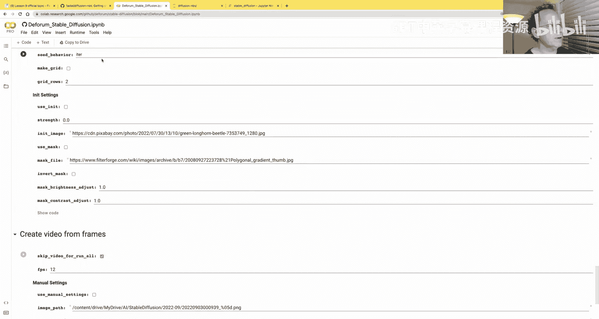

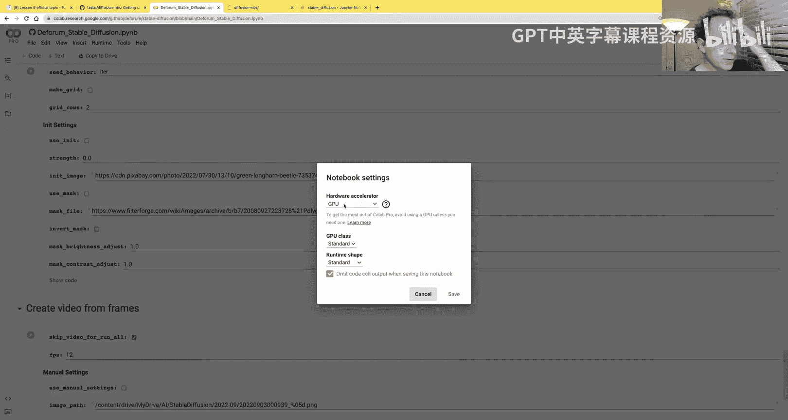

And you can say what kind of GPU？😊，Um and。And start running things now。

A lot of the folks who use this stuff， honestly have no idea what any of these things mean。

Now by the end of the course， you'll know what all of these things mean pretty much。😊。

And that will help you to make great outputs from stuff like this。But you can cr brand outputs。

Just using more of an artisanal approach， there's lots of information online about。You know what？

What kinds of things could you try so anyway， check out this stuff from from Jon O and then he also links to this fantastic resource。

From phpsychotic。Which。Is rather overwhelming。😊，Lest of things to play with。Now again， you know。

 maybe by the time you watch this， this has all changed。

 but I just wanted to know these kind of things are out there and they're basically like ready to go applications that you can start playing with。

😊，So play a lot。

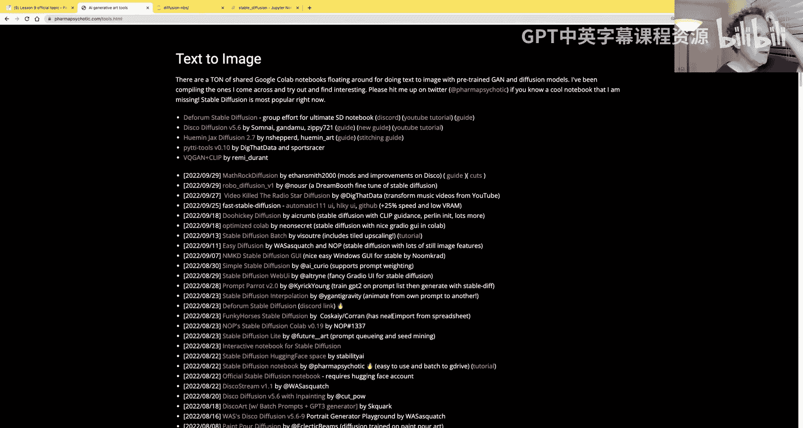

嗯。What you'll find is that most of them at least at the moment。

 expect you to input some text to say what you want to create a picture of。

 it turns out that as we'll learn in detail why the text you pick it's not very easy to know what to write and that gives kind of interesting results。

At the moment， it's quite an artisanal thing to understand。

What to write and the best way to learn what to write it's called the the prompt。

 the best way to learn about prompts is to look at other people's prompts and their outputs。

 So at the moment， perhaps the best way to do that。Is a lexiica， which has lots and lots of。

Really interesting， that works。And so AI artworks， and so you can click on one and see what prompt was used。

And so you'll see here that generally you start with what do you want to make a picture of？

What's the style？And then the trick is to add a bunch of like。Artists。

 names or places that they put art so that the algorithm will tend to create a piece which matches art。

That tends to have these kinds of words in their captions。嗯。

So there's a really useful trick to kind of。Get got at this and so you can even search for things so I don't know if they have teddy bears。

 let's try。😊，There we go， so if there's a kind of like a property not that one。😊。

That's a pretty good teddy bear image。😊，So you can kind of get some sense of。

How to create nice teddy bear images。😊，That's so cute。

I know what I'm going to be showing my daughter to。

And you can see they often tend to have similar kinds of。😊。

Stuff to try to encourage the algorithm to give good outputs。 Okay， so by the end of this course。

 you'll understand why this is happening， why these kinds of， you know。

 prompts create these kind of outputs and also how you can go beyond just creating prompts。

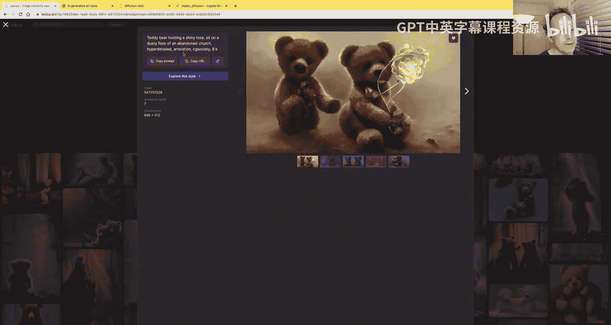

To actually。To actually。Building really innovative new things with new data types。嗯。Okay。

So let's take a look at the diffusion Ms repo。 The first thing we'll look at is stable diffusion。

 So a couple of options here， you can。You can clone this repo。

 which is linked from both the cost at fastered AI and from the forum and run it on like paper space gradient or your own machine or whatever。

 or you can head over to coLab。

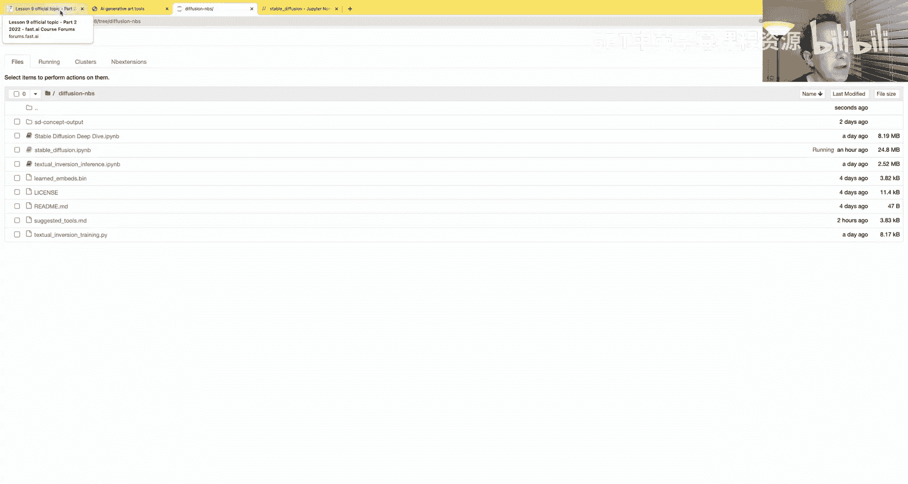

And you can just say GiHub。

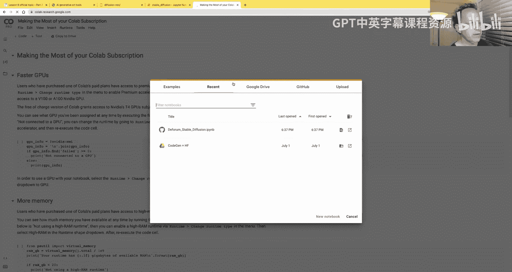

and then you can paste in the link。T it directly from Github。Okay。

 so I'm running it on my own machine。😊，And this dope book is largely being built thanks to the wonderful folks at Huging Face and Huging Face have a library called diffuss。

So any of you that have done part one of the course will be very familiar with Huging F。

 we used a lot of their libraries in part one。Diffuss is their library。

For doing stable diffusion and stuff like stable diffusion。嗯。At the moment。

 you know these things are changing a lot， but at the moment this is our recommended library for doing this stuff and it's what we'll be using in this course maybe by the time you watch this there'll be lots of other options so again keep an eye on coursetop faster AI in general hugging face have done a really good job of being at and staying at the kind of head of the pack around。

😊，Models in general for deep learning， so。It would be。You know。

 not surprising if they continued to be the best option for quite a while。😊。

But the basic idea of any library is going to look pretty similar。😊。

So to get started playing with this。You will need to log in。To hugging face。

 So if youve got a hugging face， you can create a。userrname there and a password and then log in once you've done it once。

 it'll save it on your computer so you won't have to log in again。And。

The thing we're going to be working with。Is pipelines and in particular。

 the stable diffusion pipeline。 Again， you know， they you might be using different pipelines by the time that。

You you watch this， but the basic idea pipeline is quite similar to what we call a learner in Fast AI。

 which is it's got a whole bunch of things in it， you know a bunch of kind of processing and models and inference all all happening automatically and just like you can save a pipeline in FAA sorry save a learner in fast AI。

 you can save a pipeline。😊，In diffusers now something that you can do in all pretty much all huggingface libraries that you can't do in Fast AI is you can then save a pipeline or whatever back up into the cloud onto Huging face they call it the hub and so then if we say from pre-trained it's a lot like how we create pre-trained learners in Fast AI but the thing you put here is actually if it's not a local path it's a huggingface repo。

So if we search hugging face。For this。And you can see。This is what it's going to download。

And you can actually save your own pipelines up to the hub。For other people to use。

 so I think this is a very nice feature that helps， you know the community。Build stuff。

So this is actually going to the first time you run this it's going to download many gigabytes of data from the internet this is one of the slight challenges with using this on coLab is every time you use coLab everything gets thrown away and start from scratch so it'll all have to be downloaded every time you use coLab。

😊，If you use something like paper space or particularly actually Lambda Labs。

 it's all going to be saved for you。😊，So once you've downloaded all this。

' going be it's going to save a whole bunch of stuff into your dark cash and your home directory。

 so that's where huging F puts things。😊，So now that we have a pipeline called pipe。mWe can now。

Treat it as if it's a function。 Tis pretty common for like piytory stuff and fast A Ai stuff。

 you should be very familiar with this， hopefully。 And you can pass it a prompt。

And so this is just some text。And that's going to return some images since we're only passing one prompt。

 it's going to return one image， so we'll just index into dot images。😊，And when we run it， it takes。

 you know， maybe 30 seconds or so and returns a photograph of an astronaut riding a horse。

Um every time you call。A pipeline using the same random seed， you'll get the same image。嗯。

You can set them the random seed manually， and so you could send to somebody else and say， oh。

 this is a really cool astronaut riding a horse they found。Try manual seed 1024。

And you'll get back this particular astronaut。Riding a horse。So that's how you can like。

 that's the most basic way to get started running on coLab or on your own machine。

 you can start creating images。😊，It takes， as I said， it takes 30 seconds or so。

 and in this case it took 51 steps。😊，What it's doing。

 this is a bit very different to like what we're used to with inference in fast AI where it's one step to classify something。

 for example， what it's doing in these 51 steps is that starting with like so this is actually an example that we're going to create ourselves ourselves in the course of creating handwritten digits and this is actually an image from a later notebook we'll be building well we' basically starts with random noise and each step it tries to make it slightly less noisy and slightly more like the thing we want and so going down here is showing all the steps to create the first four for example。

 or here to create the first one and if you look closely you can kind of see in this noise there is something that looks a bit like a one and so kind of decide to focus on that。

😊，And so that's how these diffusion models basically work。

So remember if you're having any trouble finding the materials we're looking at to go to cost at faster AI or go to the forum topic to see all the links and this one is called diffusion dash andBs。

😊，And the notebook is called， you can see it at the top， stable diffusion。Now a question might be。

 well， why don't we just do it in one go and we can do it in one go。

 but if we try to do it in one go。😊，嗯。It doesn't do a very good job。These models aren't。

As I speak now in October 2022， smart enough to go do it in one go Now， as I mentioned at the start。

The fact that I'm doing it in 51 steps here。Is。You know hopelessly out of date because as of yesterday apparently we can now do it in three to four steps I'm not sure if that code's available yet so by the time you see this yeah this might all be dramatically faster but as I'll be describing understanding this basic concept I'm pretty confident going to be very important。

😊，Like forever。So we'll talk about that so if we do 16 steps instead of 51 steps， you know。

 it looks a bit more like it， but it's still not amazing。😊，嗯。Okay， so。

That's how you can kind of get started and I'll show you a few things that you can tune and you know I should remind you that you know when most of the stuff I'm showing you in this was built by Pedro Cuenka and the other folks at hugging F So huge thanks to them there's no way I could have been as up to up to speed with all this。

Detail without their help， they built this library diffusers and。

They have done a fantastic job of helping display what you can do with it。

So let's look at an example of what you can do with it。

 We're just going to quickly define a little function here to create a grid of images。

 The details don't matter， but what we do want to show here，😊，Is you can take your prompt。

 which was an astronaut riding a horse。And just create four copies of it。Okay， so times。

When applied to a list simply copies the list that many times。

 So here's a list of the exact same prompt four times。嗯。

And then what we're going to do is we're going to pass to the pipeline the prompts and we're going to use a different parameter now called guidance scale we're going to be learning about guidance scale in detail later in the course。

 but basically what this does is it says to what degree should we be kind of。

Focusing on the specific caption versus just creating an image。

So we're going to try a few different guidance scales， about 1，3，7，14， generally7 and a half。

 I believe at this stage is the default that might have changed by the time you watch this and so each row here is a different guidance scale。

😊，So you can see in the first row it hasn't really listened to us very much at all。

 these are very weird looking things and none of them really look like astronauts riding a horse。😊。

At guidanced Sc of three。😊，They look more like things riding horses that they might be astronautish。

 And at 7。5， they certainly on the whole， look like astronauts riding a horse。 and at 14 or 15。

They certainly look like that， but they getting a little bit too abstract sometimes I have a pretty strong feeling there are some slight problems with actually how this。

😊，Is coded or actually how the algorithm works， which。And we'll be looking at during this course。

 so maybe by the time you see this， some of these will be looking a bit better。😊，U。

I think basically something that's happening here is it's actually kind of over。

Over jumping a bit too far during these high ones。Anyway。

 so the basic idea of what it's doing here is this guidance is it's basically actually for every single prompt。

 it's creating two versions。😊，One version of the image with the prompt， an astronaut riding a horse。

And one version of the image with no prompt， so it's just some random thing。

 and then it takes the average， basically of those two things。

And that's how that's what guidance scale does， and you can kind of think of the guidance scale as being a bit like a number that's used to weight the average。

嗯。There's something very similar you can do。😊，Where again you create get the model to create two images。

 but rather than taking the average， you can ask it to effectively subtract one from the other。

So here's something that Pedro did of using the prompt， a Labrador in the style of Vermeer。

And then he said， well， what if we then subtract？😊，Something， which is。

Just the model for Dr caption blue。And you can pass in this thing negative prompt to diffuseers and what that will do is it will take the prompt。

 which in this case is Labrador in the style of familiar。And create a second image effectively。

 which is just responding to the prompt blue and effectively subtract one from the other。

 the details are slightly different to that， but that's the basic idea。

 And that way we get a non blue。Labrador in the style of Vermeer。So yeah。

 this is the basic kind of idea of how to use negative prompt and you can play with that good fun。😊。

嗯。Here's something else you can play with is you don't have to just pass in text。

 you can actually pass in images， so for this you'll need a different pipeline。

Youll need an image to image pipeline。And with the image to image pipeline。You can grab。

A rather sketchy looking sketch。U。And you can then pass to this eye to eye image to image pipeline。嗯。

Initial image to start with。And basically， what this is going to do。😊，Is rather than starting。

Diffusion process with random noise。It's going to basically start it with。

A noisy version of this drawing。And so then it's going to try to create something。

That matches this caption。And also。Like。Follows this kind of guiding starting point。

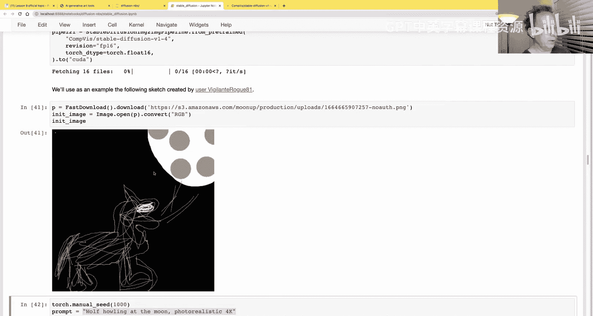

And so， as a result。You get things that look quite a lot better。😊，Then the original drawing。

 but you can see that the composition is the same and so using this approach。

 you can you know construct things that match the particular kind of composition you're looking for。

😊，嗯。So I think that's quite a nifty approach。 And so here this parameter strength is saying to what degree do you want to really create something that looks like this or to what degree do you want the model to be able to。

😊。

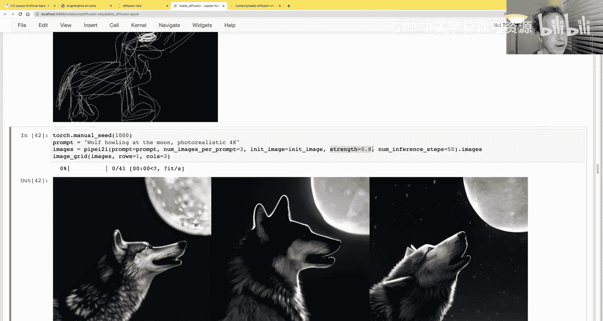

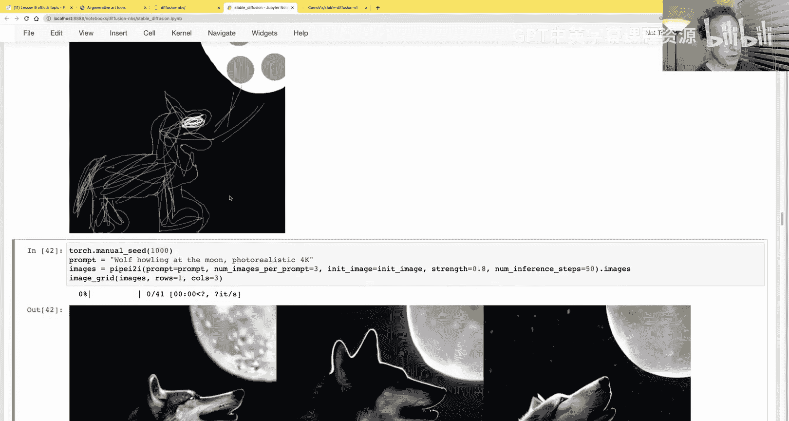

You know， try out different things a bit。Now here's where things get interesting and this is the kind of stuff you're not going to be able to do at the moment with just the basic guies and stuff。

 but you can， if you really know what you're doing。

 what we could do now is we could take these output images and we could say oh， this one's nice。😊。

Sorry， this one， this one's nice， let's make this the initial image。😊。

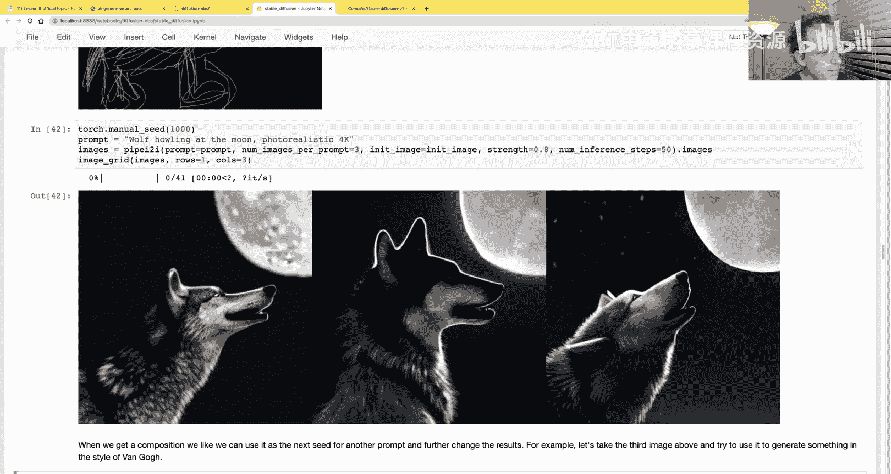

And now we'll say， let's do an oil painting of。By Van Gogh。

And passing the same thing here and a strength of one。And， actually。That pretty much worked。

And I think that's。Absolutely fascinating， right， because this is something。I haven't seen before。

Which which， which Pedro put together this week， and it's combining。Simple Python code together。

And so you can play with that。Um， something else you can do。

 which this one's actually example came from the folks at Lambda Labs。😊。

And we won't be going into this in detail right now because this is like basically exactly like what we've done a thousand times in fast AI is you can take the models in that pipeline and you can pass it your own images and your own captions。

😊，And so what happened here is。Oh， I hate these things。 go away。Never mind oh here we are， this one。

😊，So what these folks did， I think this was Justin， if I remember correctly， yeah。

 so what Justin at Lambda did was he created a really cool data set by going to grab a Pokemon data set of images。

😊，which had almost a thousand images of Pokemon and then this is really neat。

 he then used an image captioning image captioning model to automatically generate captions for each of those images。

😊，And then he fine tuned the stable diffusion model using those image caption pairs。

So here's an example of one of the captions and one of the images。😊，And then talk that fine tuned。

Model and past it。Prorummpts like gal with a cow girl with a pell earring。And cute Obama creature。

 and got back these。To to O， these Oops you Daisy。And got back these。Super nefty。

Edges that now are reflecting the fine tuning data set that he used and also responding to these prompts。

Here's another example of something you can do， phone tuning can take quite a bit of data and quite a bit of time。

 but you can actually do some special kinds of phone tuning。😊，One that you can do。

It's called textexual inversion， which is where we actually find tune just a single embedding。

So for example。😊，We can create a new embedding。嗯。Where we're trying to make things that lock。

Like this。So what we can do is we can give this concept a name。So here we're going to call it。嗯。Oh。

 I just lost it now。Watercolor。There we go， we've got to call it what acolor portrait。

And so that's what the embedding name we're going to use is and we can then basically add that token to the text model and then we can train the embeddings for this so that they match。

The example pictures that we've seen。 and this is going to be much faster because we're just training a single token for just in this case。

 four pictures。😊，嗯。And so when we do that。😊，We can then say， for example。

 woman reading in the style of and then passing in that token we just trained。 And as you see。

 we'll get back a kind of novel。Image， which I think is。Yeah， pretty interesting。Another example。

Very similar to textual inversion。嗯。Is something called Dreambo， which as mentioned here。

 what it does is it takes an existing token， but one that isn't used much like say SKS。

 nothing almost nothing has SKS and fine tunes a model to bring that token。

 as it says here close to the images we provide。 And so what Pedro did here was he。

Graed some pictures of me and said painting of SKS。

 So in this case he's fine tuned this token to be Jeremy Howard photos in the style of Paul Sniac。

And there they are and so the example I showed earlier of the draw of Jeremy Howard that that service Dreamer is actually using this dream booth。

😊，So here's how you can try that yourself。Okay， so。That is。Part  one。Of of this lesson。

 which is the how to get started playing around with stable diffusion。And part2。

 we're going to talk about what's actually going on here from a machine learning point of view。

 So we'll come back in。About seven minutes。To talk about that。All right。

 see you guys in about seven minutes。😊，Okay， welcome back， folks。

I just thought I'd share with you one more example actually of textual inversion training。

 this is my daughter's Teddy Ti。Who， as you can see， is grossly misnamed。 And Pedro and I tried to。

 yeah， create a。Textual inversion。AV of tiny。And I was trying to get。Tiny， riding a horse。

And it's interesting that when I tried to do that this top row here。

 this is actually Pedro's example when he ran it。 This is showing the kind of steps as he was training of trying to use the caption tiny riding a horse。

 And as you can see， it never actually ended up generating tiny riding a horse。 Instead。

 it ended up generating a horse。😊，That looks a little bit like tiny。

And then we're trying to get tiny sitting on a pink rug。And actually， after a while。

 I did make some progress there， it doesn't。Quite looked like tiny。

 One thing Pedro did that was different to me was he started with the embedding for person and my one actually started with the embedding for Teddy and it worked a bit better。

 but as you see there are like problems and。We'll understand where those problems come from as we talk more about how this is trained in the rest of this lesson。

Okay， so I'm gonna be relying on。Some understanding of the basic idea of hell。

Machine learning models are trained here， so if you start getting a bit lost at any point。

 you might want to go back to part one and then come back to this once you're unlost。嗯。

The the way we're going to start， okay， so I need to explain the way stable diffusion is normally explained is focused very much on a particular mathematical derivation。

😊，We've been developing a totally new way of thinking about stable diffusion and I'm going to be teaching you that。

😊，It's mathematically equivalent。😊，To the approach， which。You'll see in other places。

 But what you'll realize and discover is that it's actually。

Conceptally much simpler and also later in this course we'll be showing you some really innovative directions that this can take you when you think of it in this brand new way。

 so all of which is to say，嗯。When you listen to this and then you go and look at some blog post and it looks like I'm saying something different。

 Just keep that in mind。 I'm not saying something different。 I'm expressing it in。A different way。

 but it's。It's equally， mathematically valid。嗯。What I'm going to do is I'm going to start by saying。

 let's imagine that。Let's imagine that we were trying to get something to generate something much simpler。

 which is to generate handwritten digits。Okay， so it's like the stable diffusion for handwritten digits。

😊，And we're going to start by assuming there's some like API， some web service or whatever out there。

 who knows how it was made， but what it does is something pretty nifty。

 which is that you can get an image of a handwritten digit。And you can pass it over into this。

This web API and this， you know， this rest endpoint or whatever it's。

Just a black box as far as we're concerned。And it's going to spit out。

The probability that this thing you passed in is a handwritten digit。😊，So for this one。

So let's say this image is called x1。The probability that x1。Is a handwritten digit。

 it might say is 0。98。And so then you pass something else into this。Magic API endpoint。

Which looks like this。You pass下 in。And that looks a little bit like an8， I guess。

 but it might not be。You pass it into this API and you see what happens， this is x2。😊。

And it says the probability。That x 2。Is a digit is 0。4。Okay， now。We pass in our image X 3。Enter。

Our magicagic API。And it returns the probability。That x 3。Is a handwritten digit？Pretty small。Okay。

So。Why is this interesting？Well。It turns out that if you have。A function。You know。

 let's not call this an API， let's call this。Let's call this。嗯。It's quite F，s some function。

 but it's like behind some web API， rest Endpoint， whatever if you have this function。

 we can actually use it to generate handwritten digits。 so that's。😊，Something pretty magical。

 And we're going to see how on earth would you do that if you have this function。

 which can take an image and tell you the probability。😊，That that is a handwritten digit。

 How could you use it。To generate。New images。Well。Imagine your。

Want to turn this mess into something that did look like。An image。Here's something you could do。

Let's say that's a 28。By 28。Image， which is what 786。up时 lazy。28 times 28，784， so 784 pixels。

And we could pick one of these pixels。And say。What if I increase this pixel to be a little bit darker？

And then we could pass that image through F。And we could see what happens to the probability that it's a handwritten digit。

So for a specific example， handwritten digits don't normally have any。

Pixels that are black in the very bottom corners， so if we took this here。And we said。

 what would happen if we made this a little bit lighter？

And then we passed that exact image through here， the probability would probably go up a tiny bit。

For example。So now we've got an image which is slightly more like a handwritten digit than before。

And also in digits， generally。There are straight lines。 So this pixel here。

 who probably makes sense for it to be darker。So if we made a slightly darker version of this pixel and sent it through here。

 that would also increase。The probability a little bit。

And so we could do that for every single pixel of the 28 by 28， one at a time。

 finding out which ones， if we make them a little bit lighter， make it more like a handwritten digit。

 which ones if we make it a little bit darker， make it more like a handwritten digit。😊。

What we've just done？😮，As we've calculated。The gradient。Of the probability that x3。

Is a handwritten digit？With respect to。The pixels。Of x 3。 Now， notice that。I didn't say D， P， X 3。

DX3， which you might be familiar with from。From high school。

 and the reason for that is that we done we've calculated this for every single pixel。

And so when you do it for lots of different inputs。You have to turn the D into a， this is called a。

Dell or anala。 had it just been， there's lots of values here。 So this here contains lots of values。

 which is the how much does the probability that x 3 is a digit increase。

As we increase this pixel value and as we increase this pixel value， as we increase this pixel value。

 So there's going to be。For 28。By 28 inputs， there's going to be 784 pixels。

 which means that this thing here has 784 values。

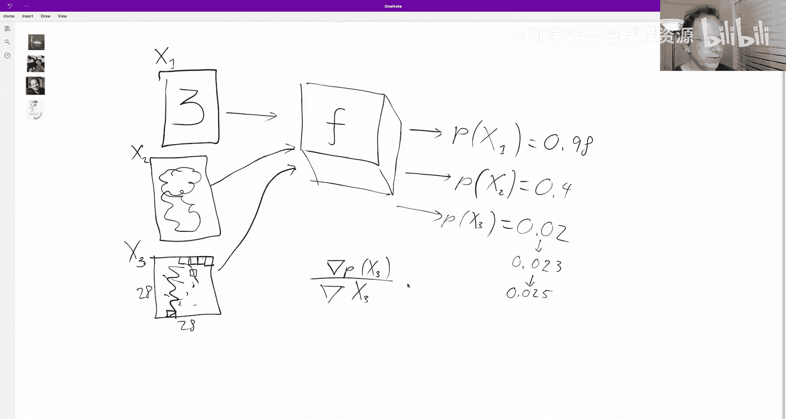

Okay， I totally messed up the notation there。I did think about going back and rerecording it but then I thought well maybe instead as penance for my failure to get the notation right。

 I should instead record a little section describing the notation in more detail both for myself so I don't make it mistake again and for the rest of you so you understand exactly what's going on I think it's actually pretty worthwhile because this notation does come up a lot and I've been。

Regularly butchering it in。Talks and notes for years now， so it's about time I got it right。😊。

So I should mention I have absolutely no excuse for butchering the notation like I have on the basis that actually my friend Terrence and I wrote a。

 what is it like 30， 40 page？Citatorial on metrics calculus and。In that。诶。呃。Paper。

 he actually describe everything I'm going to show you here。 Having said that。

 you certainly don't need to read this。😊，嗯。Rather lengthy tutorial。

 I'm going to explain the key stuff that actually I think it's worth knowing and then you'll understand the mistake that I've made during the lesson。

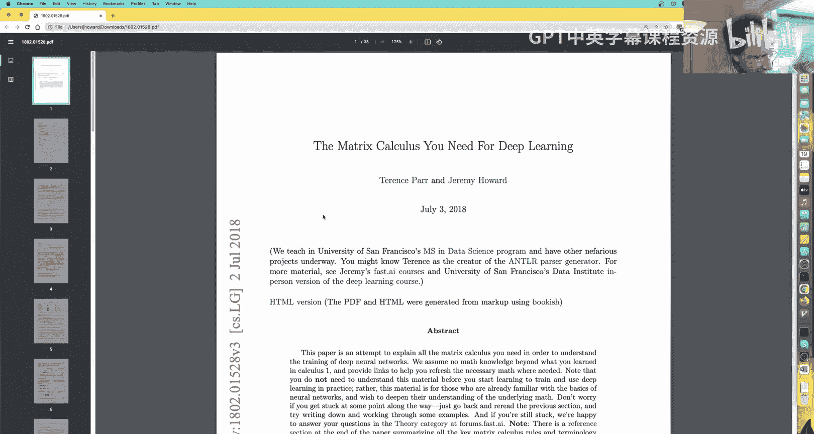

Maybe let's start with some reminders。From stuff that hopefully you did at high school。

 so let's create。Maybe a 2D version here。And maybe a 3D vision as well。😔，Okay， so let's say。

 for example。嗯。OrWe've got a quadratic。If it looks something like this。

And we can say this is a equation such as y equals x squared。

And we might endeavor to identify the slope。Kind of at some exact moment， like。Like here。

This slope at this exact moment here。So this thing is called the tangent and the slope at a tangent is the derivative of a function。

And so， the derivative。Let just try to make this look a bit more like a Y than an x。

Maybe I write it like this Okay， and so the derivative of a function we can write in a few ways。

 but one we can write it is like this D Y。The x。And there are some rules we can use to calculate it analytically and for squared。

 the rule is that we it's 2 x， you basically move the index out to the front。

To calculate its derivative。Another way of writing y equals x squared is we could write F of x。

It equals x squared。And another way of writing the derivative is we could use this。For example。Okay。

 so this is all stuff that hopefully you at least vaguely remember from high school。😊，嗯。Now。

 functions are not necessarily just of。One variable。 So here we've got x and y。

But they could be have two variables。X。And y and Z， say， And so we could have functions， which。

For example， could be like a 3D parabola with this kind of curvature。For instance。

And so you can still。Find the。Derivative。But if you think about it。

 there's one way to kind of get a derivative would be exactly what we did before。

 which would we say as we change x， how does it change Z so that would be this slope？Again。

 but you could also have something that says as we change y， how would we change Z。

 that would be like rotating this whole thing around by 90 degrees and then kind of doing the same thing。

😊，So it's a little bit trickier now because we've got。A function of。X， and y。

And so we could calculate the derivative of that。With respect to just one of these things or both of these things or whatever。

And so what we do here is we write。This little thing。嗯。And so we can then say。This is how our。

Output Z changes as we change。One thing at a time， in this case， just x。

There's another value which would be， how does it change？As we change。Just why。One thing at a time。

And so these are two separate numbers we could calculate at some particular point on this surface and so these things are called partial derivatives。

What is partials。So in our case。We've got。A 28 by 28 pixel image。Which might be， for example。

 the number7。Lade of 28 by 28 pixels。So the pixels would be。You know， something like this。

And then down here。And so in our case， we've got a situation where we're saying。We've got some loss。

And our loss is calculated at some function。Of both some weights in a neural network。

As well as some pixel values。Such as the pixels in this number seven and I guess， you know。

 actually the way it would work with either of these would be shaded。

This is more like what Mnes looks like， right？All right， so。Yes， my pixels， aren't they terrible。

 okay？😊，So。诶。So the loss would be calculated more specifically as the MSE。Main squared error。

Of the actual。The actual， I guess we should use。That's correct the actual answer。嗯。

Of like which digit should it be？USo let's call that why。Mus the predicted y。

 which is some neural network。With some whites and our pixels。

So that would be like delving in one layer deeply， but none of these details really matter too much of like what's the loss function or the neural network or whatever it's just some function that's calculating loss so let's get rid of all that okay。

And。We can now say what happens as we change。X。As we change x。

 what happens to the loss because we want to change x in a way that the loss goes down。

 but there isn't just1 x。There's。Oh I wrote this as 7 by7， it's actually meant to be 28 by 28。

 but let's just do a simple 7 by7 version here。So we've got seven pixels by seven pixels。

 this is a super low resolution， 49 pixel image。So there's 49 different things we could change。

 we could make each of these pixels darker or lighter。Alright， so let's take， for example， P。

 maybe we can write it like this， we'll say P one comma1， we could write it like that， for example。

 and so we could say what happens to the loss as we change pixel one comma 1。Um， so。

We can calculate a derivative， right， and it's going to be a partial。Partial derivative。

How does the loss change？As we change pixel1 comma 1。So that would be a very useful thing to know。

 because that would then tell us， do we need to make Pix 1 comma 1 a bit brighter or a bit darker in order to improve the loss？

And we could also calculate that for pixel1 comma 2， one comma 3。

 and so forth for 49 pixels in this super low resolution digit。So okay。

 so there's the first thing we can calculate to then the second thing I mentioned could be。Lossover。

Pixel1 comma 2。Okay， so that's the slope。As we change Pix 1 comma 2。

And I'm not going to write all of them。But there could be， or there will be 49 of these。

For each seven by seven。So rather than writing out all 49 of those。It's nice to， instead。

Write them all at once and say， and you can do that like so。 you can say upside down triangle。X。

Cllass。And what that means is it's a vector。Of all of these。Derivatives。

And this upside down triangle here is called either the Dell or the Nabla。

And it's just a little convenient notational shortcut to avoid braiding all these out。

And the X here is telling you about the thing that we're。Basically putting on the bottom。 right。

 What's it with respect to you， What's the direction。That we're trying to go。嗯。

So that's actually what I should have written in。In the notes that I was doing in the lesson。

I write something else。Which was basically the equivalent of writing this。

And that's not a thing at all。 So in my notes when you see me write this， I actually mean this。

 So why does my brain get confused and I write this weird thing that doesn't even exist as far as I know Well。

 the reason is that this thing does exist if you turn the triangles upside so down。And hence。

 my brain always gets confused。And if I turn the triangles upside down。

These triangles are now totally different。These triangles now mean a small change。

So this is a small change in loss。Divided by a small change in。 Let's， for example。

 one particular pixel。And that's a totally valid thing to say。And in fact。

 if you make that small change small enough。Then you're going to end up with a derivative。

 that's what the derivative is。So the derivative。😊，Is just our classic rise overrun， okay。

 slope that we did in what is that grade8， grade  nine rise overrun。

Once we make our step in X small enough。嗯。And so then we can then do that for。

Changing just one variable in a multi variable function。So for example sorry。

 well when I say variable， I guess in this case， actually get an example， for example。

 changing one pixel value。😊，In an image to see how that impacts our loss。

 or we could do the same thing for the weights we could change one weight and if you just change one thing at a time and calculate the derivative of the loss against that one thing。

 then we get these things called partials。And if you then do it for all the different things that you could change。

 such as every pixel。Here you get this whole gradient vector。

Which we use the upside down triangle to represent。And then finally。

 the non upside down triangle simply refers to a small change。

 so this would be a small change in loss which is caused by changing pixelix 11 by a small bit and if you use a small enough bit。

 an infinitely small bit，We call that the derivative。Okay， so with all that said， net result。

 every time you see me， well， I think I don't did it once， but in the notes where I say。This。

Please throw that away in your head。And replace it in your head with this。

And that is the moral of the story。 Okay， so thank you very much for bearing with me， as I do。

 my penance to actually get this notation correct this time。

 and I will endeavor not to make the same mistake again during this course， but no promises。

 All right， back to the lesson。😊，Okay， so with those 784 values， they tell us。😊，How can we change？

X3 to make it look more like a digit。And so what we can then do is we can now change the pixels。

According to this gradient。And so we can do something a lot like what we do when we train neural networks。

 except instead of changing the weights in a model， we're changing the inputs to the model。

 and so we're going to take every pixel and we're going to modify it， subtract its gradient。

A little bit times its gradient， so I'll multiply this by some constant， let's call it C。

And then we're going to subtract it。To get some new image。 So with the new image。😊。

It's properly going to get rid of some of these bits at the bottom。Right。

 and it's probably going to add a few more。Bits between some of these here。Right。

And we've now got something that looks slightly more like a handwritten digit than before。

And this is the basic idea。 We can now do that again。 We can now take this。 We can run it through F。

And so we've now got something like， say we call it。X3 prime， for example。So this new version， x3。

 prime， whatever。Its now the probability that's a handwritten digit，'s quite a bit higher。

 I'd say it's probably like 0。2。😊，Maybe笔。And we can now do the same thing we can save for every pixel if I increase its value a little bit or decrease its value a little bit。

😊，How does it change the probability that this new X3， whatever prime prime is a digit。

 and so will now get。A new gradient here， 784 values。

 and we can use that to change every pixel to make it。😊，nock。A little bit more like。

A handwritten digit。So。As you can see。If we have this magic function。

We can use it to turn any arbitrary， noisy input。Into。Something that looks like a valid input。

 something that has a high P value。From that function， by using。This derivative。

 So a key thing to remember here is this saying is saying as I change the input pixels。

How does it change the probability that this is a digit。

 And that tells me which pixels to make darker and which pixels to make lighter。Now。

 those of you who remember your high school calculus。😊。

May recall that when you do this by changing x pixelix or one at a time to calculate a derivative。

 this is called the finite difference。Method of calculating derivatives。

And it's very slow because we have to call finite di。Sorry， I can't spell。Differ and sing。

It's very slow because we have to call it seven dysfunction 784 times every single one。😊。

We don't have to use finite differentencing。Assuming the folks running this magic API endpoint used Python。

We can just call。FF dot backward。And then we can get x。3 dot grad。

And that will tell us the same thing and one go by using the analytic derivatives。So。

We'll learn exactly about what these dot backward does we'll rather our own everything from scratch。

 including our own calculus things from scratch later， but for now。

 just like we did in part one of the course， we're just going to assume these things exist。😊，🤧嗯。

So maybe then the nice folks that provide this endpoint could actually provide a new endpoint the calls dot backward for us and gives us dot grad right and then we don't really have to use F at all。

We can instead just directly call this endpoint。Or'll just directly call this endpoint that gives us the gradient directly。

 We'll multiply it by this smaller constant C， We'll subtract it from the pixels。

 and we'll do it a few times。Making the input get larger and larger P values。

 larger and larger probabilities that this is actually a digit。So we don't particularly need。😊。

This thing at all， would particularly need the thing that calculates these probabilities。

 We only need the thing that tells us how which pixels we should change to calculate the probabilities。

Okay， so that's great。 the problem is。Nobody's provided this for us。

So we're going to have to write it。So how are we going to do that？😊，嗯。Well， no problem。

Generally speaking， in this course。When there's some magic black box that we want to exist and it doesn't exist。

We create a neuronnet and we train it。So we want to train a neural net that tells us。

Which pixels to change to make a digit。Look， well， to make an image look more like a handwritten digit。

😡，Okay， so here's how we can do that。😊，We could。Create some training data。And use that training data。

To get the information we want， we could pass in something that looks a light like a handwritten digit。

We could pass something that looks。A bit like a handwritten digit。We could pass something in that。

Doesn't look very much like a handwritten digit。And we could pass in something which。

Doesn't really look like a handwritten digit at all。Now。

 you'll notice it was very easy for me to create these。 I created real handwritten digits。

And then I just chuck random noise on top of it。嗯。It's a little bit awkward for us to come up with an exact score saying how much is that like a handwritten digit。

 how much is that like a handwritten digit， and how much is that and how much is that。

 it seems a bit arbitrary。So let's not do that。Let's use something which is kind of like the opposite。

Right， and instead。Let's say， oh， why don't we predict？How much noise I added。Right。

 because this number 7 is actually equal to。This number 7， plus。This noise。

And this number three is actually equal to this number3。Plus。Piss noise。

And this number six is actually equal to this number six。😊，Plus。That's noise。

And that one's got a lot。And of course， the very first one is equal to。This number 9。Plus。This noise。

So why don't we generate this data？And then rather than trying to。😊。

Come up with some arbitrary number of like how much like a digit is it？

Let's say the amount of noise tells us how much like a digit it is。

So something with no noise is very much like a digit and something with lots of noise isn't much like a digit at all。

😊，So let's feed in。😊，That's create a narrowro net。Who cares what the architecture is？

It's just a neural net of some kind。And this is critical to your understanding of。Of this course。

 at this point， we're going to go beyond the idea of like worrying all the time about architectures and details。

And we're going to be spending quite often we're going to get， I mean。

 we're going to get to all those details， but the important thing to using this stuff well is to think about neural nets as being something that has。

😊，Some inputs。Some outputs。What't see lazyis。Some outputs。And some lost function。

Which takes those two。And then the derivative is used to update the weights。

That's really what we care about。Those four things。Now， the inputs to our model is。This。Okay。

 that's the inputs to our model。The outputs to our model is a measure of how much noise there is。

 So maybe we could just say， oh， well， what's the these are all basically normally distributed random variables with a mean of 0 and a variance in this case of 0。

In this case， they' normally distributed random variables to the mean of0 and a variance of like 0。1。

😊，This one's normally distributed random variables， pixels， I guess， with a mean zero and like。t3。

 this one's super noisy。There's the main invariance。

 So that's the main for each one and the variance。For H1。So why don't we。

 as the output use the variance？So predict how much noise or better still。

 why don't we predict the actual noise itself？So why don't we actually use？That。

Now we're not just predicting how much noise， but we predict the actual noise。That's our outputs。Now。

 if we do that， our loss is going to be very simple。😊，It's going to be。We took the import。

We passed it through our narrow net。We tried to predict what the noise was。

And so the prediction of the noise is。N hat and the extra noise is N。

 And so we can do something we've done a thousand times。Which is。

 we can divide it by the count squared。 and then we can sum that up。And this here is the。

Main squared error， which we use all the time。So the mean squared error。😊。

Means that we've now got inputs， which is noisy digits。Well you've got outputs。Which is noise。

 And so this neural network is trying to predict。This noise。So we're basically jumping straight to。

The step。That we had here。 Remember， this is what we really wanted。We wanted some ability to know。

 how much do we have to change a pixel by。To make it more digit like。Well， to turn this。Number 7。

Andto this number 7， that's our goal。 We have to remove all of that。So if we can predict the noise。

Then we've got exactly what we want。😊，Which is this。 we can then do this process。

 We can take ro plate by a constant。And subtract it from our input。

And so if you subtract this noise from this input， you get this。Handwritten digit。

So we're doing exactly what we wanted。😊，嗯。Well， that seems easy enough。

We already know from part one how to do this。 So we just have any ord neuralal network。

 So some kind of convnet or something。That text input。

Numbers where we've just randomly added different amounts of noise， lots of noise to some。

 not much noise to others。It predicts what the noise was that we added。

We take the loss between the input sorry we take the loss between the predicted output and the actual noise mean squared error。

 and we use that to update the weights。And so if we train this for a while。Then if we pass。This。

Into our model。It will return。That。And。We done。We now have something that can generate。Images， how。

 Because now we can take this trained neural network。 So I'm going to copy it down here。

And we can pass it。Something very， very， very noisy， which is pure noise。

We pass it to the neural net and it's going to spit out。Information saying。

 which part of that does it think is noise and it's going to leave behind the bits that look the most like a digit。

Just like we did。Back here。So it might say， oh， you know what， if you left behind。Just that bit。

 that bit， that bit， that bit， that bit， that bit， that bit and that bit。

 it's going to look a little bit more like a digit。

 And then maybe you could increase the values of that bit， that bit， that bit， that bit。

 that bit and that bit。And so after you。Do that。 And so that everything else is noise。

So it's a track。Those bits。Subtract it times some constant。We're now gonna have。

Something that looks more like a digit。Which is what we hoped for。

And so then we can just do it again。😊，And you can see now why we。嗯。

You can see now why we are doing this multiple times。Somebody on the。

Chat saying they don't see me drawing。Oh can't see。Thanks， Jimmy。I't know Michelangelo。

 what's happening for you。😊，Okay。And to answer your earlier question about how am I drawing。

 I'm using a graphics tablet。Um whichch I'm not very expert at because on Windows you can just draw it directly on the screen。

 which is why this is particularly messy。All right， in practice。At the moment。

 this might change by the time you've watched this， we use a particular type of neural net。😊。

For this， the particular kind of neural network we use is something that was developed for medical imaging called the unit。

If you've done previous versions of the course， you'll have seen this and don't worry this course we'll see exactly how our unit works and we'll building ourselves from scratch。

😊，And this is the first component。😊，Of stable diffusion。It's the unit。Okay， so。

There's going to be a few pieces。And the details of why they're called these things don't matter too much just yet。

 Just take my word for it。 This is their names。 And the thing that you do need to know for each thing is like。

 what's the input and what's the output。 So the input to a unit。Well what does it do？

The input to the year net is a。somewhatwhat。内isy。Image， and when I say somewhat。

 it could be not noisy at all or it could be all noise， that's the input。And the output。Is。The noise。

Such that if we subtract the output from the input。

 we end up with the un noisy image or at least an approximation of it。So that's the unit。

Now here's the problem， well， here's our problem。We have oh why do I keep forgetting this We have。

28 times 28，7，8，4。 I should write that down。 We have in these things。784 pixels。

And that's quite a lot And it gets worse because in practice。

 we don't want to draw handwritten digits。 The thing that we'd be passing in here is beautiful high definition photos or images of like great paintings。

😊，And at the moment， the thing we tend to use for that is a 500。And 12。By 512。By three channel， RGB。

Nice， big image，5，12 by 5，12 by3。Red grain and blue。These are the pixels。 So that is 5，12，5，5，12，0，3。

7，8，6，4，3，2。 So we've got 707，8，6。Four， three， two pixels in here。

And so this is at an awesome beautiful picture。😊，This is my amazing portrait， Van Goh style。

In a dainty little hat。 There we go。3。This is the beautiful painting。Or an image of it。

 it's that's a lot of pixels。 and so training。This model， where we put noisy versions of。

Millions of these beautiful images is going to take us an awful long time。And， you know， if you're。

Google with a huge cloud of TPUs or something， maybe that's okay。 but for the rest of us。

 we would like to do this as efficiently as possible。How could we do this more efficiently？😊，Well。

 when you think about it。In this beautiful picture I drew。😊，嗯。

Storing the exact pixel value of every single pixel is probably not the most efficient way。😊。

To start it。Um， you know， what if instead we said like， oh， you know， uh， well。

 let's say this is like green rushes or something？😊，It might say like， oh。

 over here is green and everything kind of underneath it's pretty much the same。Or， you know。

 maybe I'm wearing a blue top in this beautiful portrait。😊，And it could kind of say like， oh。

 all the pixels in here are blue。 You know， you don't really have to do everyone individually。

 There are faster， more concise ways of。Of storing what an image is。We know this is true because。

 for example， a JPEG picture。😊，Is far fewer bytes than the number of bytes you would get if your model plate type by its width by its channels。

So we know that it's possible to compress。Pictures。

So let me show you a really interesting way to compress pictures。

Let's take this image and let's put it through a convolutional layer。😊，That stray， too。Now。

 if we put it through a convolutional layer of straight2。With six features with six channels。

 we would get back a 256。By 256， gosh， that was a terrible attempt at drawing a square， wasn't it？嗯。

2，56。By 256， actually do it here。ByOkay， let's double the number of channels to six。By 6。

And then let's put it through another Str 2 convolution and remember we're going to be seeing exactly how to do all these things and building them wall from scratch。

 so don't worry if you're not sure what a Stride 2 convolution exactly is。

And to do it again to get 128 by 128， and again， let's double the number of channels。

And then let's do it again， another Str 2 convolution， so we're just building a neural network here。

😊，So now we're down to。64 by 64 by 24。Okay， and then now let's put that through a few like resnet blocks to kind of squ down the number of channels as much as we can。

So it'll be now down to let's say 64 by 64。By4。Okay， so here's a neural network。😊。

And so the number of pixels in this version is now 64 times 64 times 4， 16384。So， there's 16。3，8。

4 pixels here。Okay， so we've compressed it from 786。4，3，2。To 16，3，8，4。Which is a 48 times decrease。

Now， that's no use if we've lost our image。So can we get the image back again？UmS， why not？

What if we now create。A kind of an inverse convolution。Which does the exact opposite。

 so actually let's put it。Over here。So， we're going to take our。64 by 64 by4 image。

 put it through an inverse convolution。So let's put it， let's keep moving this over further。

Back to 1，2，8 by 1，2，8 by 12。And put it through another inverse convolution。

So these are all just basically， they're just neural network layers。256。By 256。By six。And then。

 finally。Wrap you out。All the way back to。5，12。By 5，12。By3。Okay， we could put this whole thing。

Inside a neural net， here's our single neural network。

And what we could do is we can start feeding at images。😊。

It goes all the way through this neural network。And out at the other end comes back， well， initially。

It's random。 So initially comes out of this is random noise。5ive，12 by5 because I draw it。

Inside here。 So inside here， initially， it's going to give us random noise。

And so now we need a loss function， right？So the last function we can create。ItCould be to say。

 let's take。This output。And this input。And compare them and create and do an MSC mean squared error。

Directly on those two pieces。So what would that do if we train this model？

This model is going to try to put an image through。

And got to try to make it so that what comes out the other end is the exact same thing。

That went into it。That's what it's going to try to do。Because if it does that successfully。

Then the main squarearrow would be zero。😊，So I see some people in the chat saying that this is a unit。

 this is not a unit， okay， we'll get to that later， there's no cross connections。

 it's just a bunch of convolutions that decrease inside size followed by a bunch of convolutions that increase in size。

嗯。And so we're going to try to train this model。😊，To spit out exactly what it received in。

And that seems really boring。What's the point of a model that only learns？

To give you back exactly what came in。Well， this is actually extremely interesting。

 this kind of model is called an auto encoder。😊，It's something that gives you back what you gave it。

And the reason an auto encode is interesting。It's because we can split it in half。

Let's scrap just this bit。Okay， let's cut it up。 Let's grab that just that bit。

 And then we'll cut a second half。 Okay， theyre not quite halves。 But well， you know what I mean。

 which is just。This bit。And so， let's say。I take this image。

And I put it through just this first half， this green half， which is called the encoder。Okay。

 I can take this。This thing that comes out of it。And I could save it。

 And the thing that I'm going to save is going to be。16，384 Btes。I started with something。

That was 48 times bigger than that。786，432 Bits。And I've turned it into something that 16384 Bs。

 I could now。Attach that to an email， say or whatever。

And I've now got something that's 48 times smaller than my original picture。😊。

So what's going to happen， the person who receives these 16384 bytes， well。

 as long as they have a copy of the decoder on their computer。

 they can feed those bytes into the decoder and get back。😊，The original image。

So what we've just done。😊，Is we've created a compression algorithm。That's pretty amazing， isn't it？😊。

And， in fact。These compression algorithms。Work extremely， extremely well。And。

Notice that we didn't train this on just this one image。

 we've trained it on say millions and millions of images。

 right and then so you and I both need to have a copy of these two neural nets。

RightBut now we can share thousands of pictures that we send each other by sending just the 16。

384 byte version。😊，So we've created a very powerful。😊，Compression algorithm。

And so maybe you can see where this is going。If this here is something which contains all of the interesting and useful information of the image in 16384 bytes。

Why on earth。Would we train our unit。With 786432 pixels of information。And the answer is we wouldn't。

 that would be stupid。😊，Instead， we're going to do this entire thing。Using。Our encoded。

Version of each picture。So if we want to train this。Unette。😮，On 10 million pictures。

We put all 10 million pictures through the auto encodecors encoder。So we've now got 10 million。

Of these smaller things。And then we feed it into the unit training。😡，Hundreds or thousands of times。

To train our unit。And so what will that unit now do？

Something slightly different to what we described。 It does not anymore take a somewhat noisy image。

Instead it takes a somewhat noisy one of these， so it probably helped to give this thing a name。

And so the name we give this thing is。Latntens， these are called the latents。Okay， so instead。😊。

The input is somewhat noisy latetntance。The output is still the noise。

And so we can now subtract the noise from the slightly noise， somewhat noisy lant。

And that would give us。The actual la。And so we can then take the output of the unit。😊。

And pass it into our auto encoders。Decoder， sorry， yes， decoder。Because that's something which。

 that's something which takes latentance and turns it into a picture。So the input to this is。Small。

License。Cancer。And the output is a large。Image。Okay。Now。

 this thing here is not going to be called an encoder。 It's going to have the name。The V A E。

 And we'll learn about why later。 those details aren't too important， but let's。

Put its correct name here。The V A A。Decoder。So you're only going to need the encodeder for the VAE if you're training a unit。

 if you want to just do inference like we did today， you're only going to need the decoder。

Of the unit。So this whole thing of latentance is entirely optional， right。

 this thing we described before works fine。😊，But， you know， generally speaking。

 where you would rather not use more compute than necessary。😊。

So unless you're trying to sell the world a room full of TPUs。

 you would probably rather everybody was doing stuff on the thing that's 48 times smaller。😊。

So the VAE is optional。😊，But it saves us a whole lot of time and a whole lot of money。So that's good。

Okay。What's next？Well， there's something else。Which is。We have not just been in this morning's。

 you know， sorry in the first half of today's lesson， we weren't just saying。Produce me an image。

 We were saying， produce me an image of。Tiny the teddy bear， riding a horse。

So how does that bit work？So the way that bit works is actually on the whole pretty straightforward。

 let's think about how we could do exactly that for our Mmunist example。😊。

How could we get this so that rather than just feeding in noise？And getting back some digit。

 how do we get it to give us a particular digit？ What if we wanted to pass in。The literal number 3。

Plus， some noise。 And havingat attempt to generate a handwritten three for us。How would we do that？

Well， what we could do is way back here for the input to this model。

 Why don't in addition to passing in the noisy input， Let's also pass in。A one hot encoded version。

Of what digit it is。So we're now passing two things into this model。 So previously this neural net。😊。

Tk as inputs。Just the pixels。But now it's going to take in the pixels and。What digit is it？

As like a one hot encoded vector。So now it's going to learn。How to predict what is the noise？😮。

and it's going to predict what is the noise and it's going to be have some extra information。

 which is it's going to know what the original image was。

 so we would expect this model to be better at predicting noise than the previous one because we're giving it more information。

😊，This was a three， This was a six。 This was a7。So this neural net is going to learn to estimate noise better by taking advantage of the fact that it knows what actual the input was。

And why is that useful， Well， the reason that's useful is because now， when we feed in the number 3。

 like the actual digit 3 is a one hot and coated vector plus noise after this has been trained。

Then our model is going to say the noise is everything that doesn't represent the number three。

Because that's what it's learned to do。😊，Okay， so that's a pretty straightforward way to give it。😊。

the word we use is guidance about what it is。😊，That we're actually trying to remove the noise from。

And so then we can use that guidance to guide it as to what image we're trying to create。😊。

So that's the basic idea now the problem is。😊，If we want to create a picture of。A cute teddy bear。

We've got a problem。It was easy enough to pass the digit8，al the literal number8 into our neural net。

 because we can just create a one hot encoded vector。

And which position number8 is a one and everything else is a zero。😊。

But how would we do that for acute Teddy。We can't。We can't create every possible sentence that can be uttered in the whole world and then create a one hotd version one hot encoded version of every sentence in the world because that's going to take a vector that is。

😊，Too long to say the least。So we have to do something else to turn this into an embedding。

 something other than grabbing a one hot encoded version of this。So what do we do？So what we do。😊。

So what we're going to do is we're going to try to create。

A model that can take a sentence like acute Teddy。And can return a vector of numbers。

That in some way represents what cute teddies look like。

And the way we're going to do that is we're first going to surf the internet and download images。

 So here are four examples of images that I found on the internet。😊，And so for each of these images。

😊，They。Had an image tag next to them。Right。And if people are being good。

 then they also added an alt tag to help with accessibility。😊，And maybe for Seo purposes。

 And they probably said things like。A graceful swan。

And the old tag for this might have been a scene from Hitchcock's， the birds。

And the altt for by this might have Spain， Jeremy Howard。And the outt tag for this。

Might have been Fast AI's logo。And we could do that for millions and millions and millions of images that we find on the internet。

so。What we can now do with these。😮，As we can create two models。One model。Which is a text encoder。

And one model， which is an image encoder。O。So again， these are neural nets。

 we don't care about what their architectures are or whatever。

 we know that they're just black boxes which contain weights。

 which means they need inputs and outputs in a loss function。And then they'll do something。

Once we've defined inputs and outputs in a loss function， the neural nets will then do something。

So here's a really interesting idea。😊，What if we take？This image。And what if we then also take？

The text。A graceful swan。Okay， and we're going to fade these。Enter their respective models。

 which initially they of course have random weights。And that means that they're going to spit out。😊。

Random features。The vector has stuff。Random crap。Ca we haven't trained them yet， okay。

And we can do the same thing with a scene from Hitchcock。

 we pass the scene from Hitchcock in and we'll pass in the wordss from Hitchcock and then itll give us to other。

😊，Vects。 and so we can do something really interesting now。😊，We can line these up。

Iue we'll just move them。We can line these up。😊，Okay， here's all of our images。Okay。

 and then we can have。Os he Day。Okay， and then we can have our text。So we've got graceful Swn。

We've got Hitchcock。We've got Jeremy Howard。And we've got fast A eye logo。Now， ideally。

 when we pass the graceful swan。😊，Through our model。What were it like？

Is that it creates a set of embeddings that are a good match for the text， graceful swan。😊。

When we pass the scene from Hitchcock through our image model。We would like it to return embeddings。

 which are similar to the embeddings for the text seen from Hitchcock。

And Deto for the picture of Jeremy Howard versus the name Jeremy Howard and Deto for the image Fast AI and。

So， Fast air logo in the word Fast A logo。😊，So in other words， for this particular combination here。

😊，We would like this one's。Features。 and this one's。Features。To be similar。

So how do we tell if two sets of things are similar？Two vectors。Well。

 what we can do is we can simply multiply them together element wise and add them up。

And this thing here is called the dot product。And so we could take the dot product of the features from the image model for this onewa and the dot product of the features from the text model for the wordgraful swan and take their dot product and we want that number to be。

Nice and big。And the scene from Hitchcock's features should be very similar to the text。

Sn from Hitchcock features， so we want their product to be nice and big。

And did I for everything on this diagonal？Now， on the other hand。

 a graceful swan picture should not have embeddings that are similar to the text as seen from Hitchcock。

So that should be nice and small。And deto for everything else off diagonal。

And so perhaps you can see where this is going。If we add up。All of these。All， add those all together。

And then subtract。All of these。We have a loss function。And so if we want this loss function。

To be good， then we're going to need the weights of our model。

For the text encoder to spit out embeddings。That are very similar。

To the images that they're paired with。And we need them to spit out embed features。

For things that they are not paired with， which are not similar。And so if we can do that。😊。

Then we're going to end up with a text encoder that we can feed in。Things like a graceful swan。

Some beautiful swan。Such a lovely swan。And these should all give very similar embeddings。

Because these would all represent very similar pictures。

And so what we've now done is we've successfully created。😊，Two models。😮。

That together put text and images into the same space。So we've got this multimodal。😊，Set of mu。

Which is exactly what we wanted。So now we can take our cute teddy bear。Fed in here。

Get out some features。And that is what we will use。Instead of these one hot encoded vectors。

 when we train our。Photo or painting or whatever unit。

And then we can do exactly the same thing with guidance， we can now pass in。😊。

The text encode is feature vector for Ac Teddy。And it is going to turn the noise into something that。

Is similar to things that it's previously seen that are cute tedies。

So the model that's used or the pair of models that's used here。😊，Is called P。

This thing where we want these to be bigger and these to be smaller。Is caught a contrastive loss。

And now you know where the C comes from。😊，So， here。We have a clip。Taxt encoder。Its input is。

Some text。Its output。Is we call it an embedding， it's just some features。Oops embedding。

Where similar sets of text， meaning with similar meanings。Will， give us。Similar embeddings。O。

Because we need a bit more space， we're nearly done。😊，Okay。So we've got the unit that can denoise。

Latens into unnoisy lants， including pure noise， we've got a decoder that can take latent and create an image。

 we've got a text encoder which can allow us to train a unit which is guided by captions。

So the last thing we need。Is the question about how exactly。Do we do this？Inference process here。

So how exactly once we've got something that gives us the gradients we want？And by the way。

 these gradients。Are often called。The score function， just in case you come across that。

That's all that's referring to Yeah， how exactly do we go about this process？😊，And。Unfortunately。

 the。Language used around this is。Wed。And confusing。And so ideally。

 you will learn to ignore the fact that the language is weird and confusing。 And in particular。

 the language you'll see a lot talks about。Time steps。

And you'll notice that during our training process， we never used any concept of time steps。

This is basically an overhang from the particular way in which the math was formulated in the first papers。

😊，There are lots of other ways we can formulate it and during the course on the whole where we'll avoid using the term time steps。

 but we can to see what time steps are， even though it's got nothing to do with time in real life，😊。

Consider the fact that we used varying levels of noise， some things were very noisy。

 some things were not noisy at all， some things had no noise。

 and some I haven't drawn here would have been pure noise。

You could basically create a kind of a noising schedule。Where along here you could put。

 say the numbers from one to 1 thousand。And you could then say， oh， you know。

 and we'll call this tea。And maybe we've randomly pick a number from one to a thousand。

And when we look up on this noise schedule。Whi will be some monotonically decreasing function。

And we'd look up， let's say we happened to pick randomly a number 4。

 We would look up here to find where that is， and we'd look over here。

 and this would return to us some sigma， which is the amount of noise to use if you happen to get a4。

Um， so if you happen to get a one， you're going to get a whole lot of noise and if you happen to get a 1000。

 you're going to have hardly any noise。😊，嗯。So this is one way of like picking。

 so remember we were going to pick when we were training。

 we were going to pick for every image a random amount of noise。

 So this would be one way to do that is to pick a random number from one to1000。

 look it up on this function， and that tells us how much noise to use。😊，So this T。

Is what people refer to as the time step。Nowadays you don't really have to do that that much and a lot of people are starting to get rid of this idea altogether and some people instead will simply say how much noise was there。

😊，Normally， we would think of using sigma for standard deviations of Gaussians or normal distributions。

 but actually。Much more common is to use the Greek letter beta。嗯。

And so if you see something talking about Beta， they're just saying， oh。

 for that particular image when it was being trained。😊。

What standard deviation of noise was being used， basically？Slightly hand wavy， but close enough。嗯。

And so what you do， each time you're going to create a mini batch to pass into your model。

You randomly pick an image from your training set。You randomly pick either an amount of noise or some some models。

 you randomly pick a T and then look up an amount of noise。

And then you use that amount of noise to H1。And then you pass that mini batchch。Into your model。

To train it。And that trains the weights in your model so it can learn to predict noise。And so then。

When you come to inference time， so inference is when you're generating a picture from pure noise。

You want your model， You' basically your model is now starting。Here， right。

 which is as much noise as possible。And so you want it to learn to remove noise。

But what it does in practice， as we saw in our notebook。

 is it actually creates some hideous and rather random。Kind of thing。So in fact。

 let's remind ourselves。😊，What that looked like。This is what I created。

When we tried to do it in one step。嗯。So remember， what we then do is we say， okay。

What's the prediction of the noise？And then we multiply the prediction of the noise， I said by。

Some constant。It's kind of like a learning rate， but we're not updating weights now we're updating pixels。

And we subtract it from the pixels。So， it didn't actually predict。The image。

 when it actually did was it predicted what the noise is。

So the could then subtract that from the image， from the noisy image。To give us the dennoised image。

And so what we do is we don't actually subtract all of it。 we multiply that by a constant。

And we get a somewhat noisy image。The reason we don't jump all the way to。The best image we can find。

Is because things that look。Like this。Never appeared in our training set。😡。

And so since it never appeared in our training set。😊，Our model has no idea what to do with it。

 Our model only knows how to deal with things that look like。Somewhat noisy latent。😡。

And so that's why we subtract just a bit of the noise。So that we still have a somewhat noisy latent。

So。This process。Repeats a bunch of times and questions like， what do we use for C。

and how do we go from the prediction of noise to the thing that we sub？

These are all of the things that。Are the the kind of the things that you decide in the actual。嗯。

Sampler。And that's used both to think about， like。How do I add the noise and how do I subtract the noise？

And。There's a few things that might be jumping into your head at this point if you're anything like me。

And one is that。Gosh， this looks an awful lot。😮，Like。Deep learning optimizes。

So in a deep learning optimizer， this constant。It's called the learning rate。

And we have some neat tricks where we say， for example， oh， if you change。

The same parameters by a similar amount， multiple times in multiple steps。

 Maybe you should increase the amount you change them。 This concept is something we call momentum。

And we'll be doing all this from scratch during the course， don't worry。And in fact。

 we even got better ways of doing that where we kind of say。

 well what about what happens as the variance changes maybe we can look at that as well。

 and that gives us something called atom。😊，And these are types of optimizer。

And so maybe you might be wondering。Could we use these kinds of tricks。

And the answer based on our very early research is yes， yes， we can。Um。The whole world of like。

 where。Stable diffusion and all these diffusion based models came from a very different world of maths。

Which is the world of differential equations。And there's a whole lot of very parallel concepts in the world of differential equations。

Which is really all about taking these like little steps， little steps。

 little steps and trying to figure out how to take bigger steps。

 and so different differential equation solvers use a lot of the same kind of ideas if you squint as optimizes。

😊，One thing that differential equations solvers do， which is kind of interesting， though。

 is that they tend to take T。😊，Has an input。And， in fact。

 pretty much all diffusion models I've actually lied。Pretty much old diffusion models。

Don't just take the import pixels and the digit or the caption or the prompt。 They also take。衬。😡。

And the idea is that the model will be better at removing the noise。

If you tell it how much noise there is。And remember， this is related to how much noise there is。嗯。

I very strongly suspect that this premise is incorrect。

Because if you think about it for a complicated fancy neural net。

 figuring out how noisy something is。😊，Is very， very straightforward。

So I very much doubt we actually need to pass in tea。And as soon as you stop doing that。😊。

Things start looking like differential equations。And they start looking more like optimizes。

 And so actually。John Os started playing with this and experimenting a bit and early results suggest that。

 yeah， actually when we rethink about the whole thing as being about learning ratess and optimizes。

 maybe it actually works a bit better。😊，In fact， there's all kinds of things we could do。😊。

Once we stop thinking about them as differential equations and worry about the math。

 don't worry about the math so much about Gaussians and whatever。

 we can really switch things around so for example。😊。

We decide O for no particular obvious reason to use MSC。Well， the truth is。

In statistics and machine learning， almost every time you see somebody use MSC。

 it's because the math worked out better that way。Not as in it's a better thing to do， but as in。

 you know， it was kind of easier。 Now， MSC does fall out quite nicely as being a good thing to do with some particular premises。

 you know， like it's not like totally arbitrary。But。😡。

What if we instead used more sophisticated loss functions where we actually said， well。You know。

 after we sub the outputs， how， how good is this really， does it look？😊。

Like a digit or does it have the similar qualities to a digit？😊，So we'll learn about this stuff。

 but there's things called， for example， perceptual loss。😊，Or another question is。Do we really need。

To do this thing where we actually put noise back at all。Could we instead use this directly。

These are all things that suddenly become possible。

When we start thinking of this as an optimization problem。

Rather than a differential equation solving problem。

So for those of you are interested in kind of doing novel research。

 this is some of the kind of stuff that we are starting to research at the moment and the early results are。

😊，Extremely positive， both in terms of how quickly we can do things and what kind of outputs we seem to be getting。

嗯。Okay。So I think that's probably a good place to stop it so what we're going to do in the next lesson is we're going to finish our journey into this notebook。

Um to see some of the code behind the scenes of what's in a pipeline。😊，When I get there。😊。

So we'll do looking inside the pipeline and see exactly what's going on behind the scenes a bit more in terms of the code。

😊，And then we're going to do a huge rewind。So the from the foundations and we're going to build up from some very tricky go ground rules。

 though ground rules would be we're only allowed to use pure Python。The Python Standard Library。

And nothing else。And build up from there until we have recreated。All of this and possibly。

Some new research directions at the same time。So that's our goal and so strap in and see you all next time。

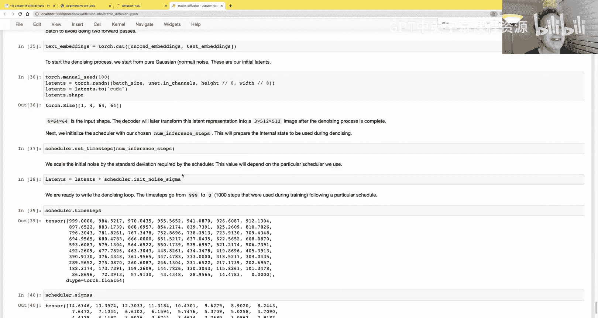

系啊。