# Jeremy《深度学习基础到稳定扩散模型｜Deep Learning Foundations to Stable Diffusion》中英 p03 Lesson 9B - the math of diffusion.zh_en -BV1Mp421S7xg_p3-

Hello everyone， my name is Wassim， I am an entrepreneur in residence at Fast AI and I'm currently at the Fast AI headquarters at the moment in Australia。

 although I'm originally from South Africa from Cape Town。😊，And I'm joined here today by Tni。

 Taniche works at St AI， and we've been working together with a couple other people on diffusion models。

 generative kind of modeling。And that's been super fun so Taish。

 do you want to maybe you know introduce yourself as well？😊，Yeah， so my name is Tenishche。

 I am a PhD student at UC Davis， but I also work at Stability AI and I've been exploring and playing around with diffusion models for the past several months and so it's been great to also explore that with the FASDI community as well in these last few weeks as well。

Awesome， cool， cool， so this talk is。😊，As for me trying to understand the math behind diffusion。So。

 you know， if you've done the first AI courses before。

 you know that you don't need to understand the math to be effective with any of these models。

In fact， you don't even need the math to do research to do novel research and contribute to these。

But for me， it was all about it came out of interest and you know， I thought。

It was kind's kind of beautiful how what diffusion models were discovered。

And I think a large part of that was thanks to some really clever math。

And so I wanted to understand that。I'm not I don't have a math background。嗯。And。就 i。

Want to help kind of describe。How I think about it and how you can kind of interpret。

 you know all of these notations and things。😊，Cool， yeah， so I can just dive into it， I think。So。

 the first。But of math that we see in this paper。Okay。Is Q of x superscript0？

And they call this the data distribution。Do you want to mention what's the paper exactly which paper this is right good good question so this paper is the 2015 paper do you remember the authors of that paper Tish？

😊，I think it's JasA Soul Dickixstein who networks works at Google I think and it's from Surrias Gguli's lab so cool yeah yeah so this was the paper as far as I understand that introduced this idea of diffusion。

Yeah， 2015 by those authors。😊，They start out by you know defining this data distribution and they use this notation and already like a lot of people you know myself included find this quite confusing。

 but let's go through what's described here。😊，So they have an x。And you know。

 in math X is often used as the input variable。😊，Much like。

Why which is then used often as the output variableable。😔，嗯。Yeah。

 and the fact that it has a superscript also implies something。

The fact that we have x superscript zero。Implies that there might be a sequence of x's。And you know。

 I think it's it's useful to get comfortable with this idea of。

Simple compact notations implying a lot more than might be obvious at first glance。

So x implies that it means something about this quantity。

 it's an input variable and you know the zero implies that there might be other things that you might have。

😊，You might have an x1 an x2 and so on， but we might see that。And then the third part is you have Q。

😊，And Q is a what we call a probability density density function。

So the first part here is probability and the question is， you。

 what does QF to do with probabilities？😊，Well it's because usually we use the letter P to describe probability density functions of interest and then because Q is right after that it's another common one so it's kind of like how you use x and Y。

😊，We use P and Q and the fact that we use Q here instead of P is because it suggests that there might be a P that we'll introduce and maybe P is the thing that we're modeling and Q is kind of supplementary to that。

😊，Does that sound right Denish？Yeah， yeah and I think it's also helpful to kind of maybe think about like X X zeros in a more practical concrete way。

 of course if we're working with images then X0 would be you know that' that's what's representing the images so it's also useful to think about it from kind of that concrete practical approach as well。

Right， so x0 might be。You know， an imist。Did you。And then we got Q， so Q。I'll just use this to mean。

Q is some function， so we look at it as a box。嗯。And it takes in x0。

And it gives us the probability that this x0， which is an image。Looks like an ems digit。

 so in this case， you know， this would。E。9 or maybe even yeah， let's go 。

98 so this is quite high probability that this is an emous digit。Hi， this is Jeremy。

 can I jump in for momentmouth？Please do Oh thank you I just wanted to double check this looks a lot like the magic API that we had at the start of lesson one that you feed in a digit and it gives you back a probability is that basically what what Q is doing here？

😊，Absolutely， it's a magic API that's a good way to think of it。

 we don't know we couldn't write down what Q is。😊，But we imagine that somebody somebody has it some。

Yeah， so so this is a concrete example and like if you had to do。😊，Something to this image。😊。

You might get a smallerumb。So another thing worth mentioning here is。😊，Probability density functions。

 so these are these magic APIs that you know give us a number tells us how likely the thing is。😊。

They you don't often see them， they don't often make it all the way to your code in fact。

 they very rarely will appear in your code。But turns out that there are very useful ways or tools to work with random quantities。

😊，Because they allow you to represent random quantities as functions， just ordinary functions。

And because they functions， you have a whole， you know， centuries。😊。

Worth of math to analyze and understanding。So you'll often find probability density functions in papers and eventually they work out to really simple equations or formulas that end up in your code。

Okay。Yeah。Do you want to add anything Tish？I think that sounds all correct of course I think you probably will go over some examples of probability density functions。

 especially relevant to this one， but yeah it's useful to think about the also the sorts of functions you may have in a simplified case and that's what we probably are going to talk about next right yeah yeah that's exactly what we talking so we have this Q X zero and then we introduce another one and like you said this is going to turn out to have a really nice simple form。

😊。

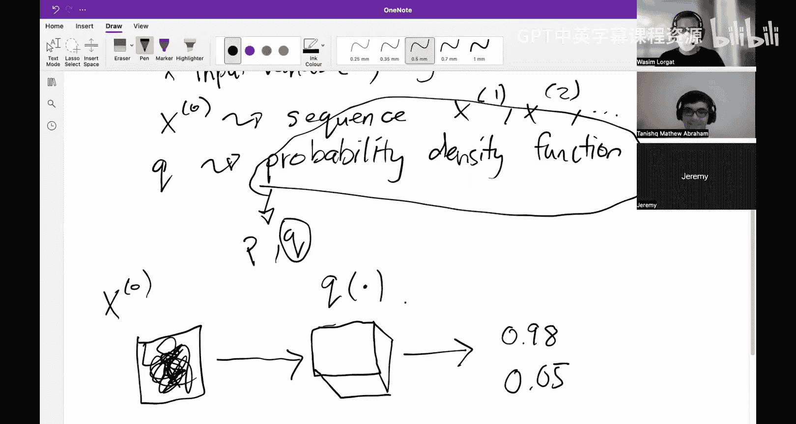

。But before that， the next thing we define is QXt。🤢，Give an X minus one。

So we'll say what we define this to be but。To begin with。

 this is another probability density function。And this bar over here means。

It's a conditional probability density function， which you can think of as。😊。

You are given the thing on the right。To calculate。Probabilities over the thing on the left。

In this case。You can think of it as something that takes images。Yeah。Yeah。So maybe another magic API。

Yeah。Yeah。And produces other images。We don't know what these look like yet because we haven't defined over yet and this this we would call kind of。

 you know xt minus one， which could be x0。😊，And this would be xt， which in the x0 case would be。😔，X1。

Something worth noting is。😊，This。Notation can be a little bit confusing because weve said Q is one thing earlier and now we think Q is another thing。

So this year， I'm going to need your help on this one， Taish。

I think people would usually if in the stricter sense。Define the first one， you know。Like this。

 maybe。And the second one。Well a sub。And that this notation that we see here。On the left。

Is just a shortcut where they， you know， they wanted to save the space of writing that and。

Kind of included that were implied it by what was in the practices at too。Yeah， I mean。

I think here they use the variables Q and then， of course， later on BCP to kind of describe。

 as we'll see different aspects of the diffusion model the sort of different processes of the diffusion model which we see So I think that's what you know they use the same variables to kind of demonstrate this is corresponding to this process than the other variable corresponds to the other process of the diffusion model So we'll obviously go over that So I think that's where that those those variables or those letters are being used in that matter。

 but if you do want to make it for more specific more clear， Yeah。

 I think that that that notation is fine as well All right okay yeah， that makes sense。

Yeah。Okay， so so let's describe what this queue does you know。

 to the image on the left to produce the one on the right。

 so I'll start over here so we have more space。I'll write it out first and then we can go into the details。

Yeah。嗯。Yeah。嗯。

Yeah。Okay。Um so kind of like the bar， you can think of this semicolon as you know。

 grouping things together。And so you have the things on the left and the things on the right。

My understanding is these two things on the right。😊，The parameters。嗯。Of the model。

 sorry of the probability the thing on the left is。Actually， Denise。

 could you help me understand what the thing on the left is？😊。

Do you know right Well so this was again like a probability distribution and the thing on the left to say this is a probability distribution for this particular variable so that's just representing what it is a probability distribution for and then the stuff on the right are the parameters for this probability distribution so it's kind of what's going on here so like yeah anytime you have like a normal distribution and it's describing some variable you'll have that sort of notation where it's the normal distribution of some variable and then these are the parameters that not describe that normal distribution。

Right。Mm。😊，So just to clarify the bit after the semi colonlon is the bit that we're kind of used to seeing to describe a normal distribution。

 which which is the mean and variance of the normal distribution， so we're going to be。Sampling。

Random numbers。From that normal distribution， according to that mean and that variance。

 is that right？Yes， that's correct， yeah。嗯嗯。😊，Yeah。

So we need to describe a bit more there about normal distribution we kind of you know skip past that so we have this fancy in。

😊。

And fancy letters in math for distributions usually refer to well known distributions。

And the N year stands for normal。Which is also known as。The Gaussian distribution。

And it's probably the most well known probability distribution that you can find。

And when I say well known， I mean that。These things pop up every， you know。

 you can do in all sorts of fields， measuring all sorts of things turns out that they follow roughly something that looks like this distribution。

And because they have pop up so much， you know， people studied them， studied all of their properties。

 and we understand them really well now。The reason that theyre used often in cases like this is because they turns out they have really useful properties and they're easy to work with。

😊，Some reasons are they're described by just two parameterss。

So the mean called the mean and the covariance。Another property is that they have kind of， you know。

 what people would call suntail。Which kind of means that they only only need to describe their behavior in a small region of space。

You can kind of just ignore the is。U。Yeah you mind drawing a quick example of a normal institution。

 that's a good point。😊，So we have， let's say our random of variable is just one kind of dimensional。

 so just a single number of float。This is sort of what the normal distribution would look like。😔。

And in this case， that would be our mean。And。The variance would sort of describe the whats of。Yeah。

Which in this case， you'd use a small sigma。Because you're doing a single variable。😔，In our case。

 we use a capital sigma， which is a symbol。For multiple variables or multiple dimensions。And yeah。

 I also didn't say that this is the letter Greek letter mu， so capital sigma。

 mu and lowercase stigma。😊，I just wanted to note that typically the lowercase sba represents the standard deviation。

 which is the square root of the variance so for example， sometimes you may see in papers。

Sigma squared， and that's just the variance， but they will write it sometimes as sigma squared instead。

So it depends on the nottation。So sigma is a standard deviation often and sigma squared would then be the variance。

😔。

Cool， yeah， we can also show with our example what what this would look like So we start out with。😊。

A em digit。Put it through this magic API and what would we get out？😔。

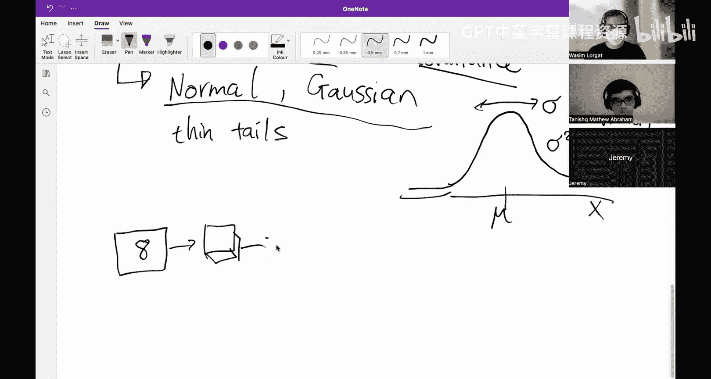

Yeah。Okay， so oh， something we didn't describe is。

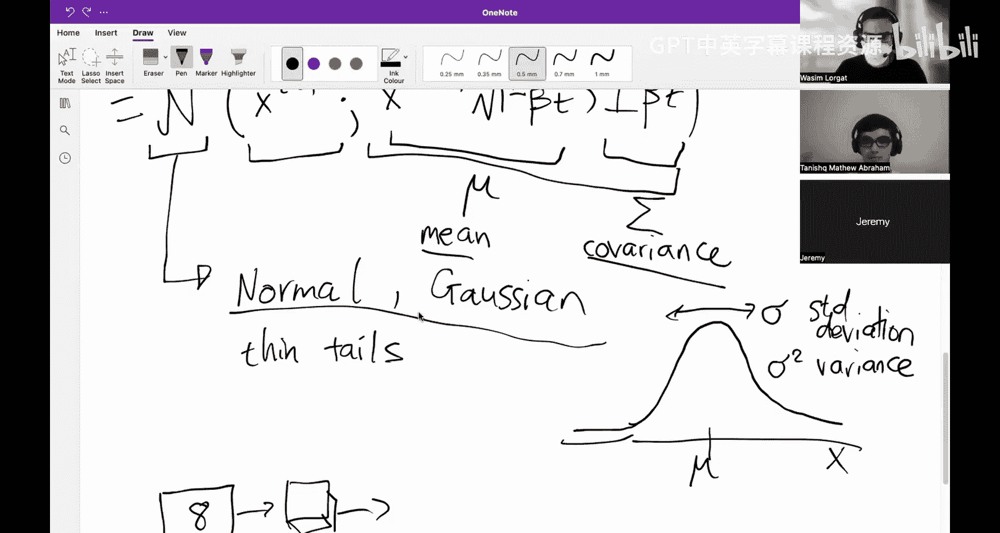

You know， what does this eye mean？

Did you want me to talk about that Well soon yes， please Okay。

 sure so because I think this is something which actually going bur your pen it actually came up in the lesson we were doing kind of in an interesting way so。

😊。

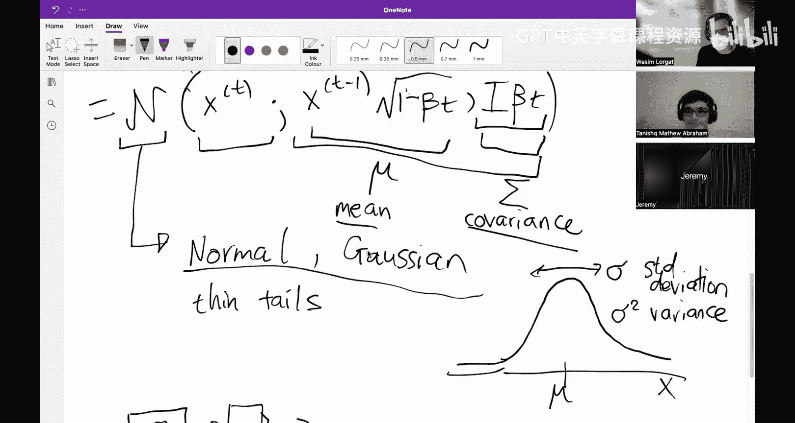

In that lesson want to get in the video no they know what I look like oh well okay。

 I'm in the video now yeah in the video。😊，Hi， Tish， Nice to see you。😊，OhYeah， so in the lesson。

 like we， we did this thing for clip。 I don't know if you're a member plus him where we had the。😊。

You know， the various pictures down here。I'm so embarrassed you're better at the graphics tablet than I am and it's my graphics tablet and we had the various sentences along here right and we said oh。

 you know， it'd be kind of cool to like take the dot product of their embeddings。😊。

Because like if their dot products are high， that means they're similar to each other and you know。

 if we subtracted the means。😊，From those first， right， then you've got the the， the dot。

 and instead of having。Images down here， right。 What if we had。The exact same。Um。

The exact same vectors on each side。Then what you've got down here is basically x minus。You all。

 it average。But if you's to check that first， squared。😊，And that is the variance， right。

 so that's like the variance。😊，For each one of these。Fectus。But what's interesting。

 as you pointed out， is that like normally。You know at high school when we look at a normal distribution it looks like this right but you're not just doing one normal distribution you've got a whole bunch of kind of normal distributions right for all of your different pixels they're the pixels right Gene normally the distribution of every pixel so there's a whole bunch of them。

😊。

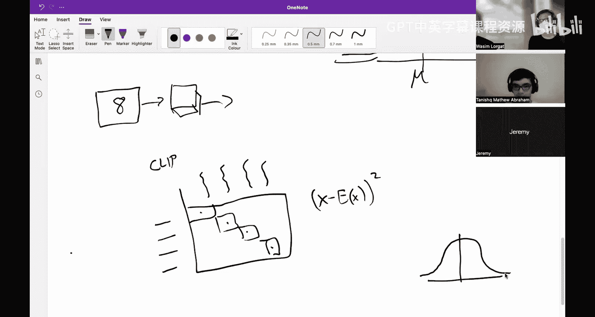

And so one of them might have a normal distribution that's there and another one might have a normal distribution that's here and another one might have a normal distribution that's like here。

😊，And it's more than that though， because like it's possible that， you know。

 one pixel tends to be higher when another pixel tends to be higher or one pixel tends to be higher when another pixel is lower。

 so it actually could kind of kind of create this like surface。😊，You know。

 in n dimensional space where it is a number of pixels。😊，So if you now like look at like， okay， well。

 what happens if we multiply this by this， just like we did in clipP， right？😊。

Then if this number is high， then it's saying that when this variable is high。

 where this pixel is high， this pixel tends to be high and vice versa， or if it's low。

 it's saying when this pixel tends to be high， this one tends to be low or interesting to us。😊。

What happened up days， Sorry about that。What happens if？This。It's zero。

That says that if this is high。😊，Then this could be anything and well this is high。

 this could be anything， there's no relationship between them。

 so statistically we would say that these two pixels are independent。😊。

And so now that basically means we could do that for all of these， we could say， oh。😊，You know。

 these are all the。And what that says is that， oh， every pixel is independent of every other pixel now of course in real pictures that's not how real pixels work。

 but that's the assumption we're making because。😊，If we start with a very special matrix called I。

Which is one，1，1， one， zero，0，0。Right。If we take this very special matrix。

 it's very special because I can multiply it by something， say either。😊。

And if I multiply it by a matrix， I get back the original matrix if I multiply it by a scalar。😊。

I'm gonna get。Beta， beta， beta， and lots of zeros。And so if I multiply something by this matrix。

 right， then I'm just multily it by beta。😊，But what's interesting about this is that this is what。

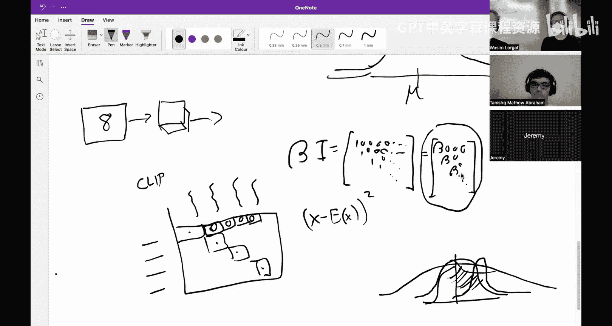

Wellse wrote。same wrote， i times beta， i times beta T。

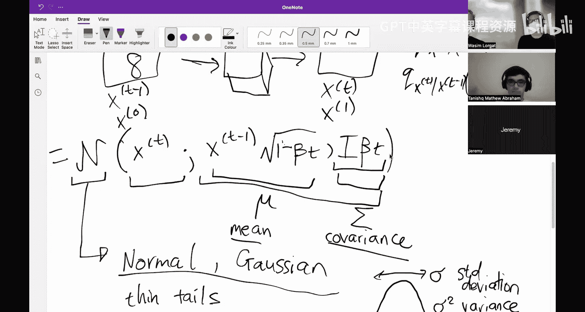

So what he's saying is， oh， we've now got a covariance matrix。😊，Where for each individual pixel。

It's like pixel number one， beta one， pixel number two， beta two， this is the variances of each one。

And the covaris， you know， the relationship between the pixels and zero。

 they're expected to be independent， so that's where we're kind of going from lake。😊。

Statistics you do in high school to statistics you do at university its like suddenly covariances now are matrices not individual numbers does that sound about right for you Tsh Yeah that that's that's a great explanation of it yes。

😊。

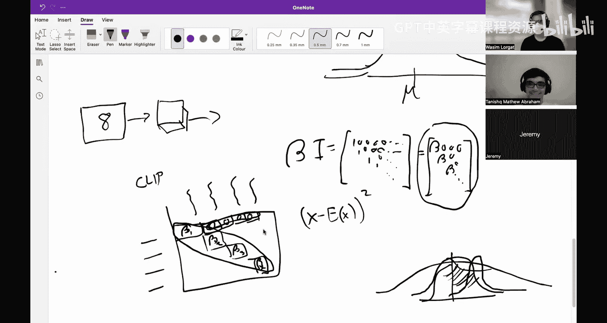

我some。Cool， so now let's try to describe you know what this would do with two M digits。So you know。

 we let's put back our mean。Equation。😔，Yeah。And our covariance。😔，Wellop。Our covariant。

So mean and outcome covariance and let's look at how this behaves， you know， at the ages sort of so。

😊，It's really hard to you know， understand this， I don't think anybody can kind of just look at this and know what it means。

😊，What we typically do is we try to describe it。😊，Kind of at the edges and so we'll start with like what what happens if that's zero and we'll work with x0 as well instead of。

 you know， xt minus one。😊，Which would mean like an emous digit， so if be is zero。😊，And we get our x0。

You know， square root one minus0， which is one and square root of one is one so that kind of falls away so we just have。

😊，A mean of our previous image。And this is just variance of zero。

So we have a normal distribution with the mean of our previous image a variance of zero。😊。

Which means。Yes。Yeah。We have the same image。Yes。Yeah。

 just to clarify when you have variances of zero， that means that there's really no noise or anything。

 it's just at that mean and you know you know your distribution is just saying that's the only point that you can get from it so yeah that's it just becomes the same image because yeah there's no noise or variance because of the variance of zero。

Yeah， exactly。And then when Al beta is one。그。We still have this and then we have you know。

 square root 1 minus one。😔，And that becomes zero， so this whole thing becomes zero。

And this thing becomes i times Eta T， which is， you know， I。And if it's just I。

 then as Jeremy described， it would imply a variance of one。😊，And so our image through this function。

😔，Would just be pure noise， so let you know， mean of zero standard deviation of one。

And it would just be a bunch of noise。

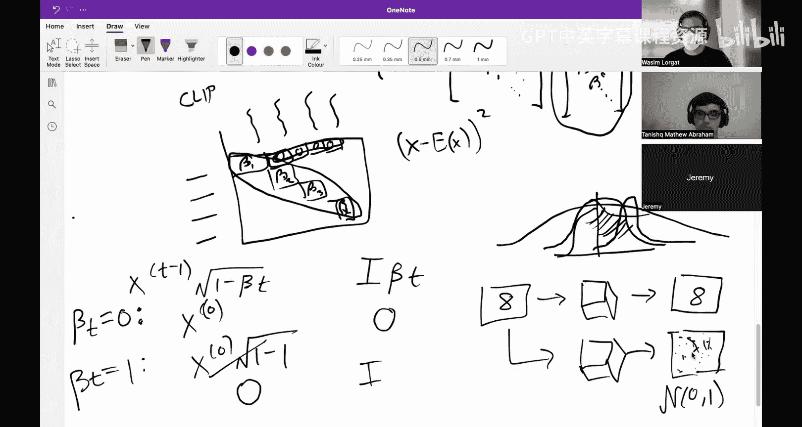

Yeah。And kind of somewhere in between that。We have to say， oh yeah， you know， what would it produce？

It would be some mixture， so， you know， like maybe a light the lighter pixels of eight。

And some noise。Maybe a but talk。

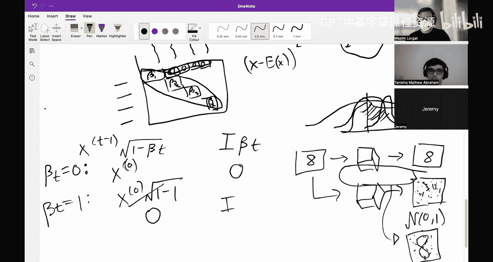

Yeah。P。

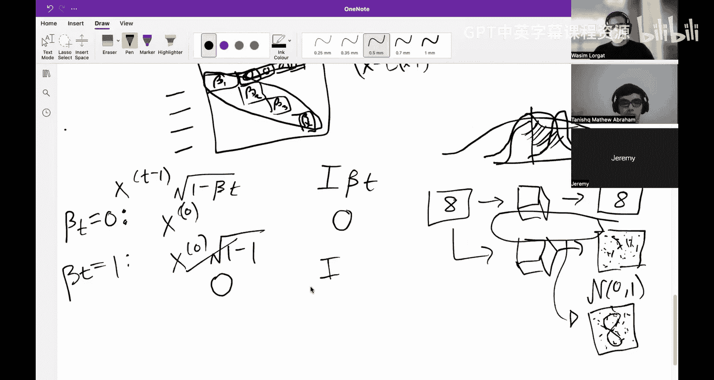

And we can kind of throw this and you would have seen this in the previous lecture。😊。

You can draw the sequence。Yeah。Of things that become。Progressively more noisy in very small steps。

All the way until it becomes pure noise。This is what we call the forward diffusion process。Yeah。

And we can now describe some of these things。 so this would be a sample from。😊。

Our data distribution Q x0。This would be the function。😔，For the conditional。😔。

Probability density function that takes。So of x1。Given x0。

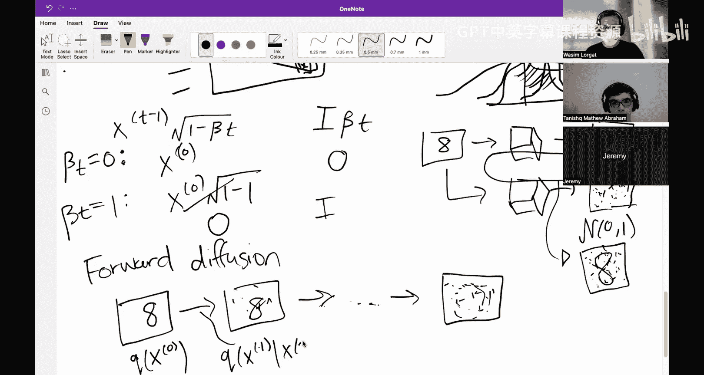

Yeah。And so on。

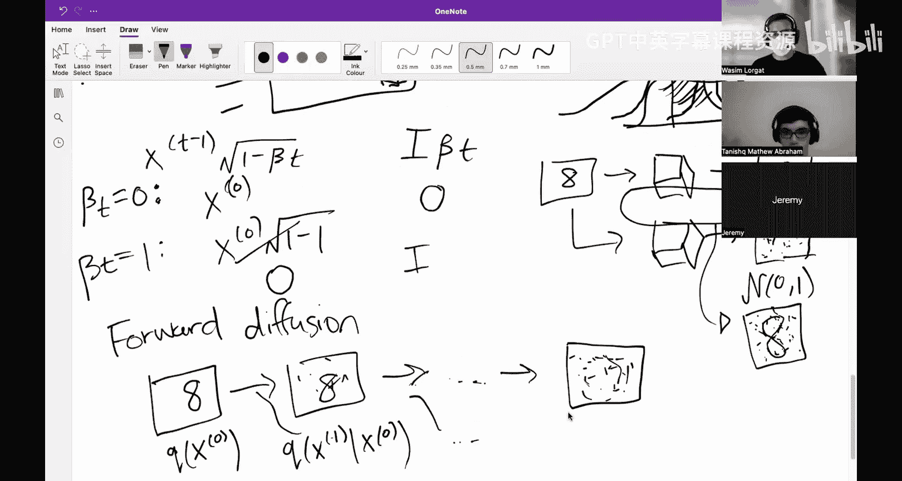

Yeah。Yeah。And。The way that the terminology that we would use or that mathematicians use to describe this。

As they would call it a moov。Process。With Gaussian transitions。😔，And you know。

 this can sound quite scary， but we've just described exactly what this is。😊，So when we say process。

 it usually means， you know， something where there's a sequence involved。😊，When we say Markov。

It means that the thing。At time T depends only on the thing at t minus1。

The transition is this function。How do you actually go from t minus1？The tea。

And Gaussian is the fact that that transition is the normal distribution。Does that sound right？Yes。

 just to also clarify a couple of things， when we say that you know。

 we're sampling from the data distribution， what that is referring to is trying to find some random。

You know， sample or some random data point that maximizes that likelihood。😡。

Or that has a high likelihood so when we say that you know we're looking at that that API that magic API as we' were talking about and we're trying to get some。

 you know some data points that have a high value with you know from that API and you know for some。

So for subdibuts when it's very simple and we know how it works like a Gaussian distribution if you know the parameters of that Gaussian distribution it's very easy to be able to do that sampling and then of course in other cases it's not very not it's quite difficult to do that sampling so that we have to figure out alternative ways of doing that sampling。

 but that's why in this case with the forward distribution we just have these simple Gaussian transitions and we already know the parameters of those Gaussian transitions so we can easily do that sampling。

And going back also to that， I think it's a worthwhile to also kind of show and think about maybe how this is again done practically because one of the nice properties of Gaussian distributions as a whole is that you can。

You know， simply take some normal noise with a mean of zero and variance of one。

 So that's I think they usually typically call that a unit unit distribution is's just like yeah normal of01。

 And then if you want to get to some other point with a mean of whatever value you specify and a variance of whatever value you specify you can simply take that normal distribution scale it by the。

You multiply it by the variance and then you add your your mean so then there's a simple equation that you can take to get the you know to get at any particular mean and variance。

 so that's how you would you know for you know get。

The samples for these other distributions that we have defined throughout the forward distribution。

 So， you know， for example， when you're coding this up， of course， a lot of these softwares。

 they will have a way of getting a sample from this normal distribution of 01。

And then you just use that equation then to get it at the desired mean and variance。

 and so that's how it kind of happens under the hood when you're when you're kind of described this with code。

That's really helpful。Yeah， and this idea of we can't really sample from this thing。😊。

U that's exactly， you know， the problem that generative kind of modeling is trying to solve。

 like how do you represent this in such a way that you can easily sample from it？😊。

And so it turns out that if you have one of these processesors。😊，You know， where you have many。

 many steps， so let's say a thousand steps， a thousand of these steps going to that， right？😊。

And they're all very small steps that eventually go to noise。😊。

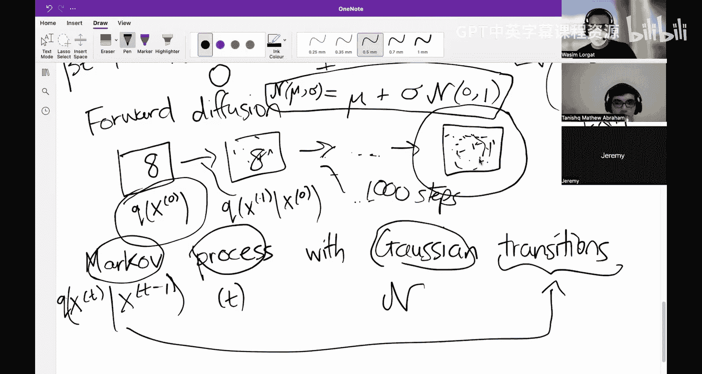

Somebody呃。You know， maybe in the 1950s， I think。Discovered that。

You can represent。The process of going backwards。In exactly the same functional form。😊。

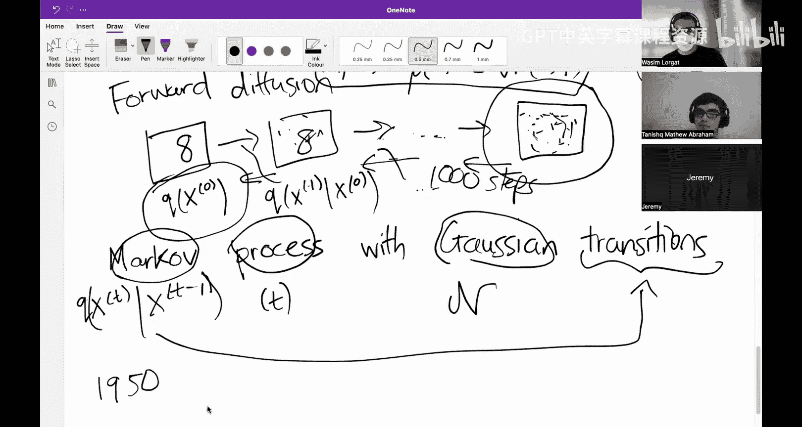

With just different parameters， so what that means is if we say。

P is the thing that goes backwards so you know the。Previous one， given the current one。

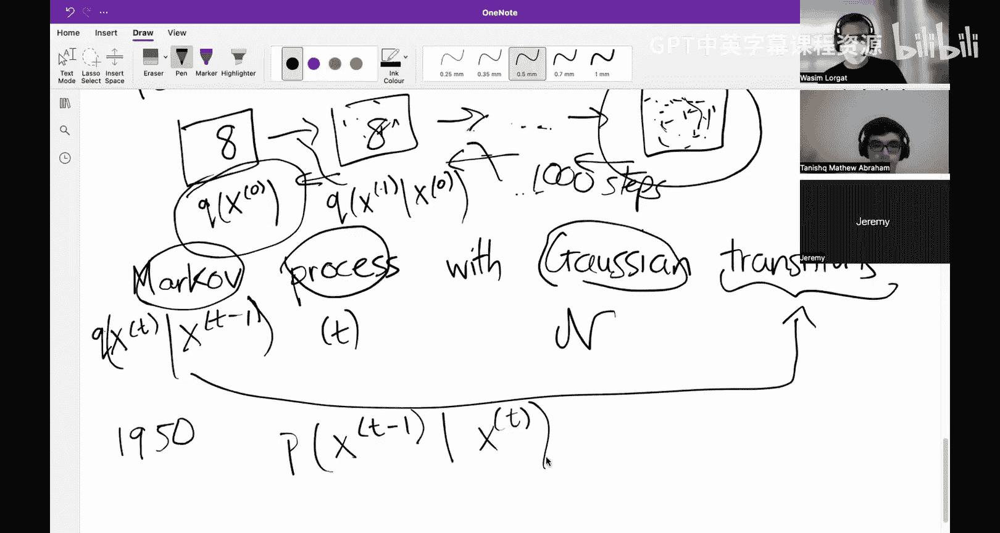

SB。嗯。Ha the same functional form。It's also the transitions are also normal。But the mean is， you know。

 some unknown so we'll use a square and the variance is some unknown， so we'll use a triangle。

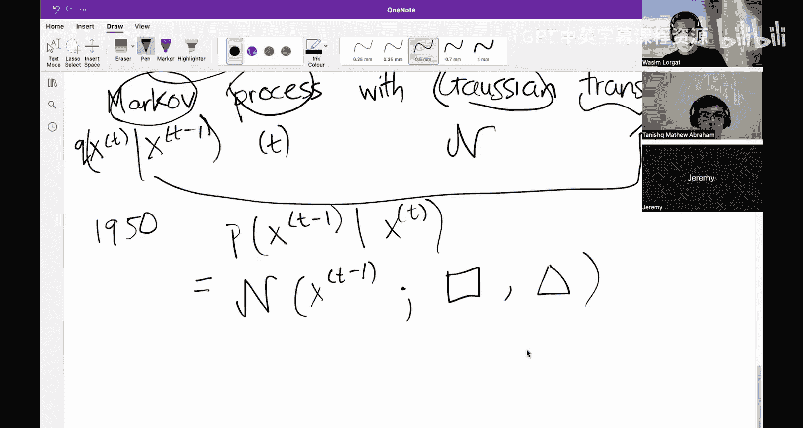

。嗯。Is that correct yeah that's correct and just going back to our previous point about P versus Q here we can see that the Q was describing the sort of forward process going you know yeah。

 this sort of steps that we're doing and then the P is describing what we're going in the reverse reverse way so that's why you know these papers are using you know Q for some one process in the P or another that's what they're kind of indicating at least in the diffusion model literature。

And P is kind of like x， you know it's the it's the one we want to figure out so like Q is kind of like y and but B is kind of like x that's how I like to think of that。

😊。

And so， you know， we have this functional form。😊，And the next question is。

How can we use so you we just don't know what these parameters are。

 how can we figure out what those are？And this is。Goes back， you know。

 to early kind of statistics literature where。You can fit this model by maximizing what's called the likelihood function。

So we can try different parameters。Until we have one that maximizes the likelihood。

It turns out that we can't quite do this exactly。Because you would need to calculate some integral。😊。

And that integral is over very high dimensional values， continuous values。

 so you can't actually calculate this。😊，I think you can think of it because you know we're having these thousands of steps that we're trying to go in this reverse process and so you know you have these thousands of steps that there're going to be many possible values for each steps so it's kind of hard to evaluate it over all these thousands of steps and all the possible values for all these different steps so I think that's kind of where the challenges arise and that's what it makes it difficult because you have to find you have to evaluate it over these multiple steps and try to find these functions for all these different steps so that' that's kind of where the challenges is。

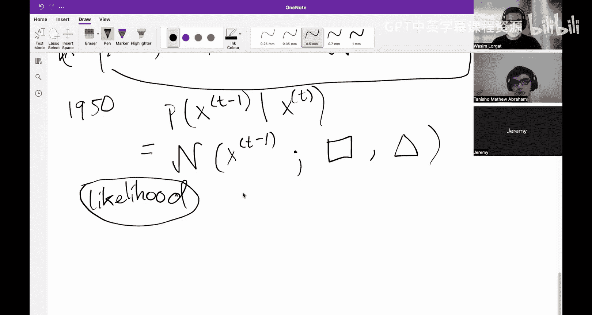

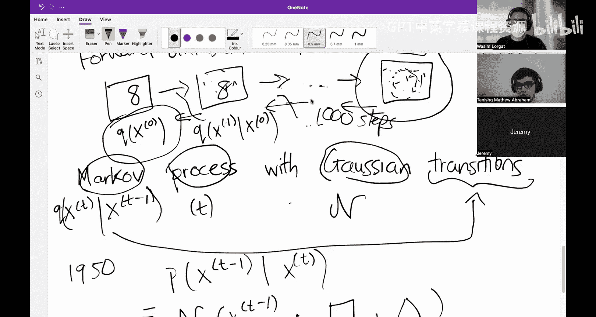

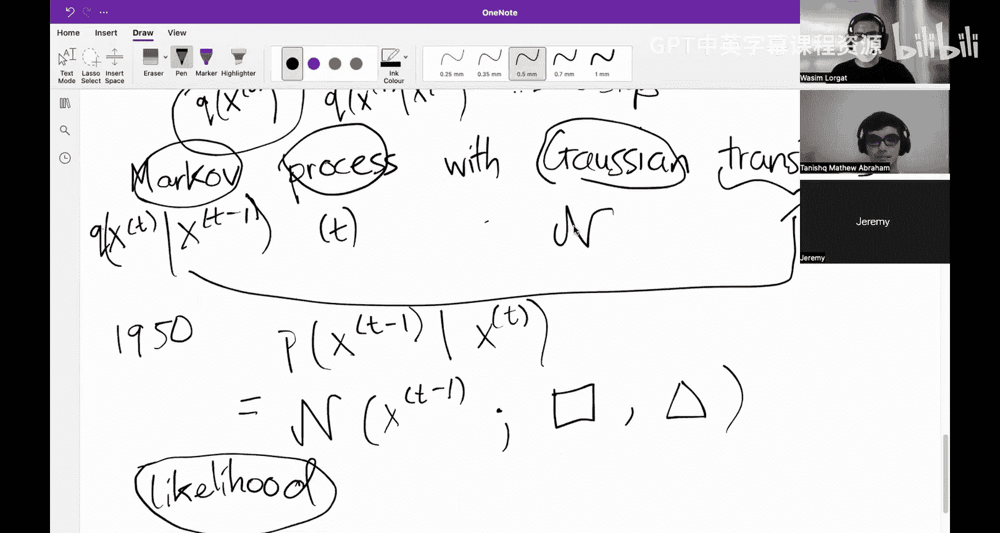

嗯哼。😊，And so you might see people talk not about the likelihood function。

 but about the log likelihood。Yeah。And correct me if I'm wrong here Tenish。

 but I think the log here is is a bit of a you know computational trick almost so I think。

It has a few properties， the first is that it's it's always increasing and you know people would call this think monotonic。

😊，呵哼。😊，You know， it looks always kind of increasing。And because it's always increasing。

 if it's the same， you get the same parameters if you optimize the log likelihood likelihoodhood versus you optimize the likelihood。

😊，It also takes products to some。Because and that's helpful because we have joint distributions。

 you know， which turn out to be products so it turns out we have a lot of products here and they become songs。

 which is easy to work with。And the last thing is that。😊，You know。

 this normal distribution has exponential exponential functions。😊，And those disappear with the log。

So this is a much friendlier thing to optimize。Yep， that's correct。

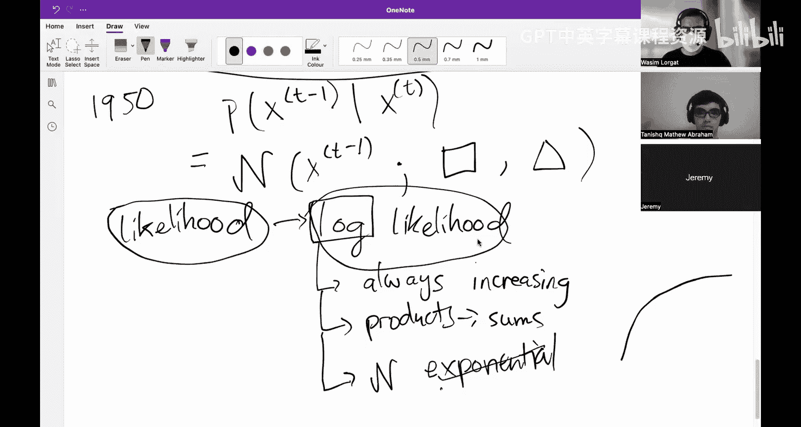

Cool。And then there's one more step you know， we still can't optimize the log likelihood of the thing that this eventually describes。

😊，🤧うん。But again， and this is kind of the beauty of math is that somebody figured out a long time ago that there's a way to optimize some other quantity。

😊，Ced。

The elbow was short。Yeah。Which stands for Evid Lower Bo。😔，嗯。Yeah。

And the evidence is just another name for the likelihood。😊，And the lower bound means。

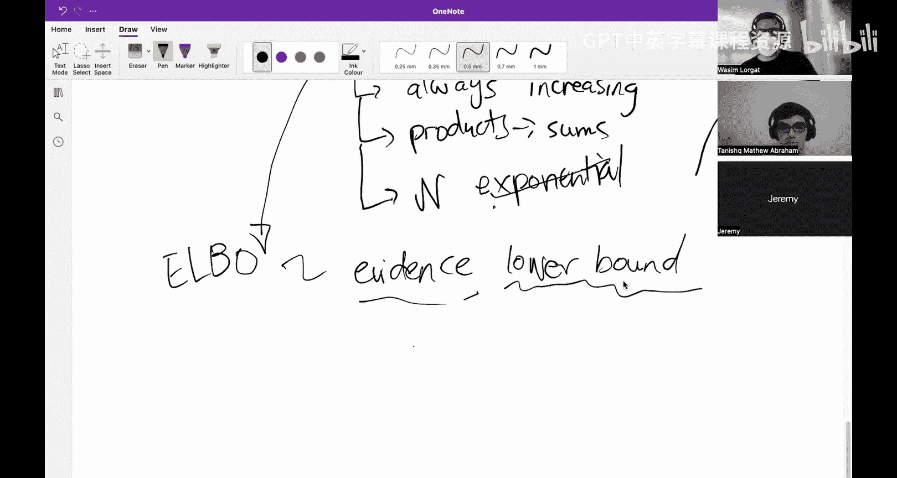

It's sort of you knows the lower bound of the evidence and if you optimize that it's almost as good as optimizing the thing that we really want to。

😊，But this one we can calculate very， very easily。Yeah。

And so you can use this。As a loss function。Yeah。The train。2。Neurural network。Yeah。

I predict our square from earlier， which was our mean。Yeah。And I'll try and go。

 which is our varianceience。Of this reverse process。

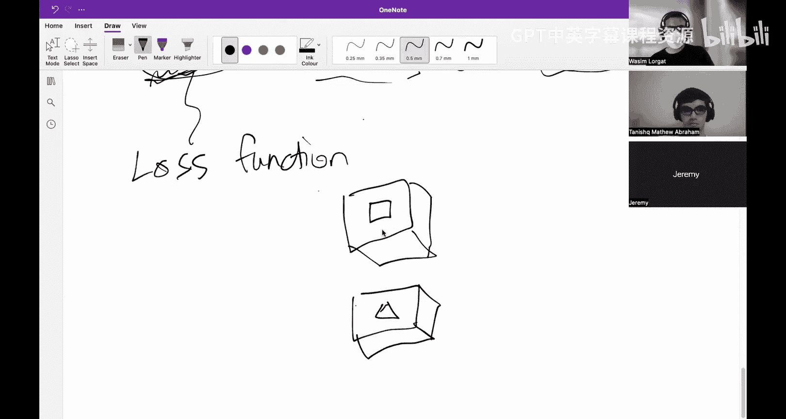

And once you have that。😊，You can go all the way back yes， so then you have these values。😊。

You can start with pure noise。AndKeep calling these neural networks。

 sampling from those normal distributions。嗯。Kind of applying that iteratively over many steps。😊。

And you recover the data distributions。Yeah。One thing that's important to clarify here is that。😊。

You can recover the whole distribution， but you can't necessarily take a single image。😊。

Converted to pure noise and then converted back。So this operates sort of at the distribution level。

You can take this kind of magic API， you can reconstruct that whole API。

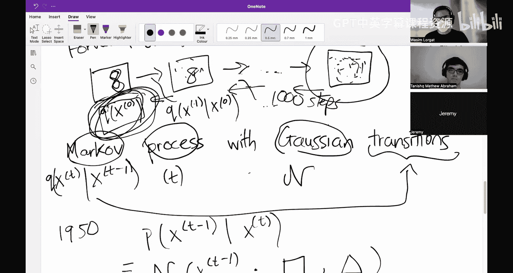

。And if you can do that， then， you know， you can generate images， aim digits or。😊。

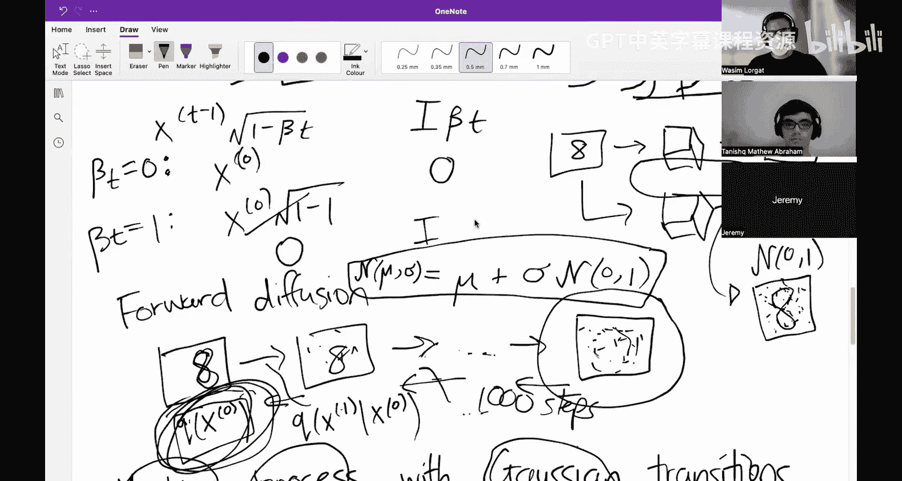

Cats or dogs or whatever you want to。

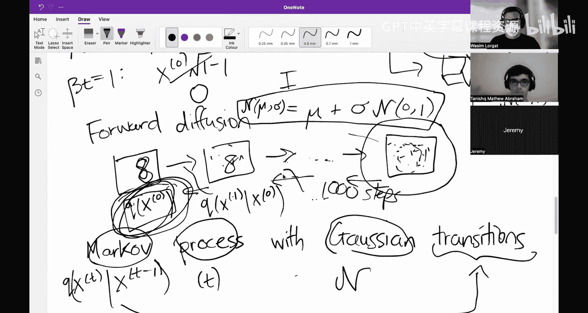

。I want to just clarify one thing about this process of the kind of the loss function so this sort of evidence lower bound loss function。

 the kind of approach that it's taking is that you know we have this forward process right we have we can go from the original images and you know figure out these sorts of intermediate distributions going all the way。

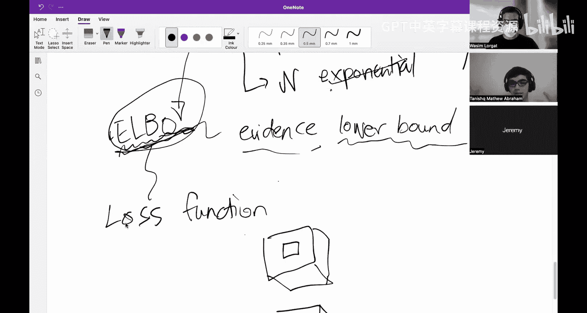

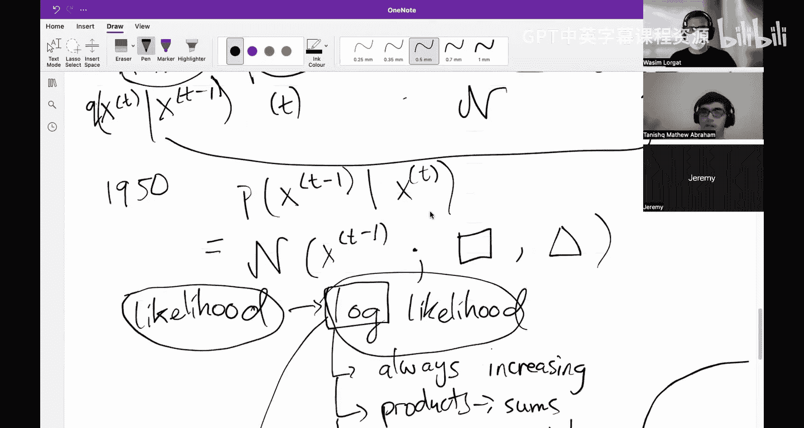

Finally to noise with this sort of evidence little bound loss function what we're really kind of doing is trying to match the our distribution that we're trying to optimize to those distributions that we saw in the forward process so that's what we're trying to do we're trying to match that sort of。

Those distributions and there's a specific type of function and it's able to do that it's called a KL divergence。

 That's the sort of function that can compare probability distributions and again。

 because we're dealing with Gaussians， you can calculate that analytically and a lot of the math you know becomes very simple so that's again。

 you know with the whole Gaussians you know we know them quite well and the math is very simple so that allows us to do the sort of comparison between these distributions very。

 very easily and optimize that and so we want to kind of minimize a difference between the distributions we see in the forward process and the distributions we're trying to determine for the reverse process。

嗯。

Perfect。Then theres there's one more thing， I think， one more kind of major you know。

 step to get closer to the form that that you would have seen in Jeremy's lesson。

So there was a 2020 paper。😊，The initials。Of that model is GDPM。Tish you know what this stands for？

Yeah， that's for denoising diffusion， probabilistic model。Yeah。Okay cool。

And what they did was they said。😊，Let's assume that this variance is just the constant。

 so we don't learn it。

And we assume also that the step size from earlier， you know。

 the variance of the noise that we added each step。

Is also a constant， we don't learn that。So we're just predicting the mean and these are set to some really convenient values。

Yeah。Then， the lotth。Turns out to be。That you predict the noise。嗯。Yeah。

So you can restructure this whole thing as。You take in you need to train a network that takes in images。

Yeah。So here's your network。And it tells you what of this image is noise。😔。

Thanks to these simplifying assumptions。And even though there are assumptions。

Turns out you can train much more models that produce much better images。Now。

I think this relates to something from the， you know， the lesson that Jeremy gave。

Then each year remember， they do something about the gradient or something like that。Yes， yes。

 so this idea of you know adding noise and and and learning to remove noise。

 the idea is that kind of by。You know， again， you have this sort of。This image。That you have noise。

 right and by。Sorry， let me think about the best Vegas as Vegas。😊，呃。Oh yeah， sorry， okay。

 let me start it over， so I'll just start。😊，Yeah， so like Jeremy will say in the lesson。

 what we want to do is we want to figure out the gradient of this likelihood function。

 so this is just kind of a different way about thinking about this if we had some information about this gradient than we could for example。

You know use that information to produce like we talked about kind of optimization kind of produce images with high likelihood so the idea is that we can add noise to to the images that we have so that those are samples that we have and that kind of takes us away from you know the regular images that we know that we have and you know that kind of decreases the likelihood right so we have those images and we're adding noise that decreases the likelihood and we want to kind of learn how to get back to high likelihood images and and kind of use that to provide some sort of estimate of our gradient so this sort of denoising process actually allows us to do that so there are actually theorems also I think from the 1950s that demonstrate that especially in the case of this sort of Gaussian noise that we're working with this denoising process is equivalent。

to learning what is known as the score function and the score function is the gradient of the log of the likelihood so again they have this log here which again makes the math nicer and easier to work with。

 but the general idea is the same because as we talked about log is a monotonic function so again the general ideas are the same but the score function specifically refers to the gradient of the log likelihood so this sort of denoising process allows us to learn the score function so that's when when we're doing this noise predicting that you know we have this whole probabilistic framework using that sort of likelihood framework and it came back down to just predicting the noise and that's what the DDPM paper showed in 2020 but it turns out that is equivalent to calculating out this sort of。

Score function and using that information to be able to sample from our distribution so that's kind of how these two approaches connect so there's a lot of literature talking about maybe the that sort of probabilistic likelihood perspective of diffusion models and there's also a lot of literature talking about this score based perspective but you know this hopefully allows you to think about the the similarities and how these two approaches connect with each other yeah awesome。

Yeah， and that's kind of the， you know， the beauty， I think。

 of the math side of things here is that you find all of these relationships。

Between different fields and also like between different centuries， basically and。😊。

That allows you to do really kind of powerful and unexpected things。Okay， so。

You can just do a quick recap。Way we we got to so we started out with our data distribution。

 which we want to model。

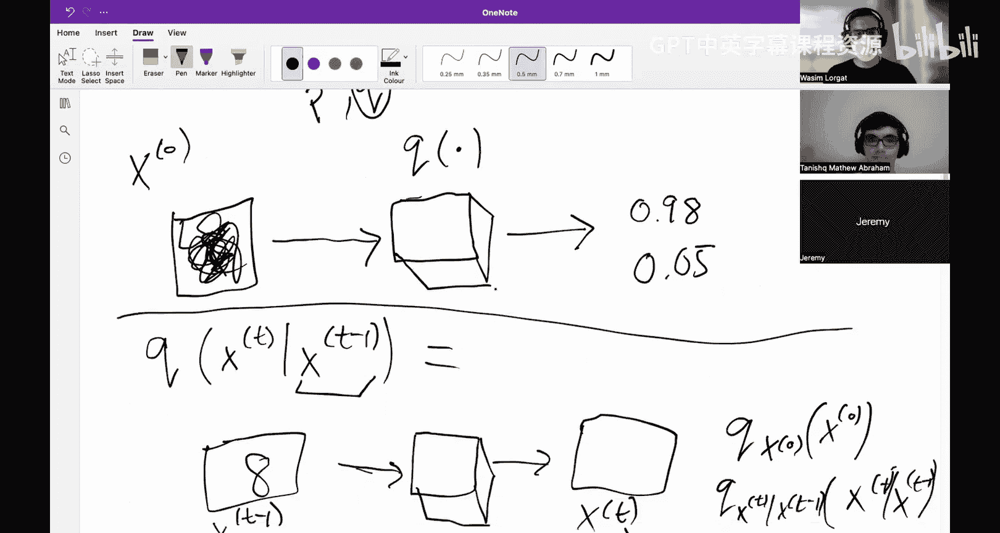

We said， you know， we'll define this forward diffusion process。

 which is a way of kind of adding noise to this model。

And because we add it in this specific way。

Thanks to you know some discovery in the 1950s。

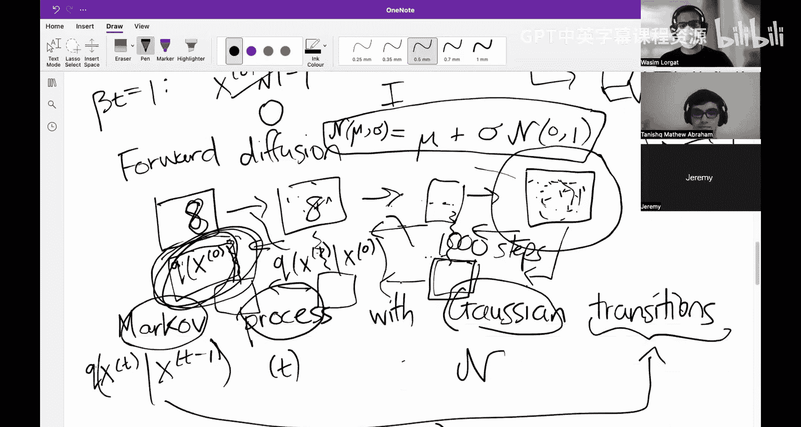

The reverse process has the same form。

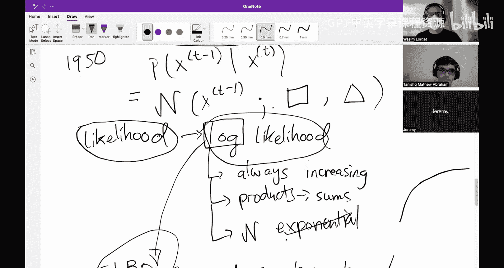

And then， you know， we already know how to。Train in neural own network for this。

Using the elbow。Yeah。

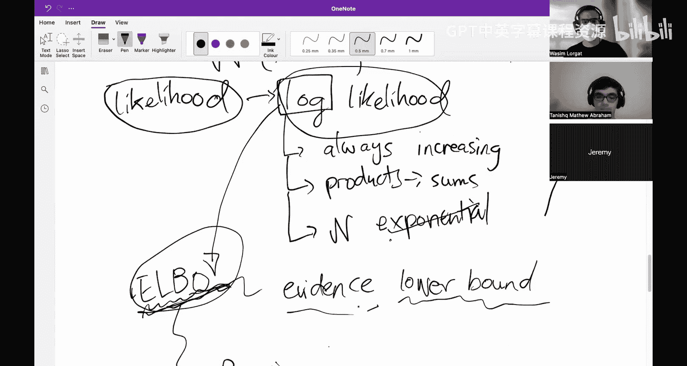

And then a couple years later came the discovery， you know， simplifying assumptions that。

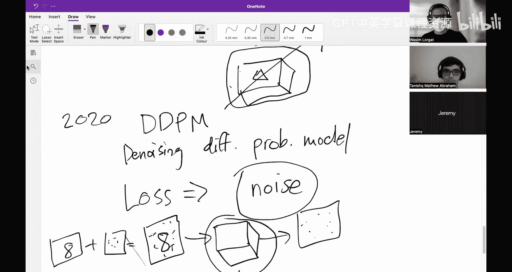

In the end， all we do is predict the noise and I just remembered。😊。

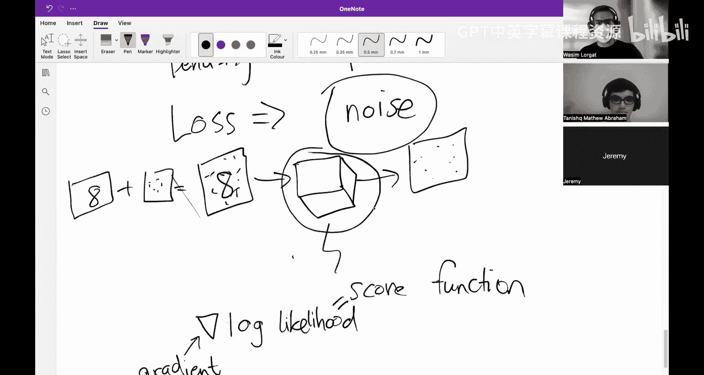

Take actually the MSE of this noise prediction， the mean weighted error which is a nice。

 very simple framing of the model and Intonish spoke about the another way to deriveri all of this。

 which is the score function。😊。

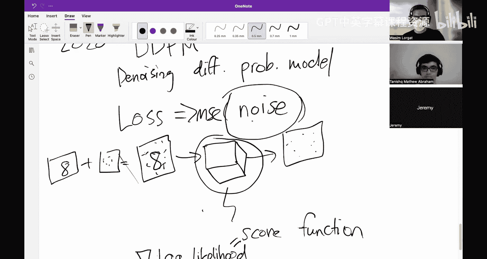

Approach the gradient of the Lord likelihood。😔。

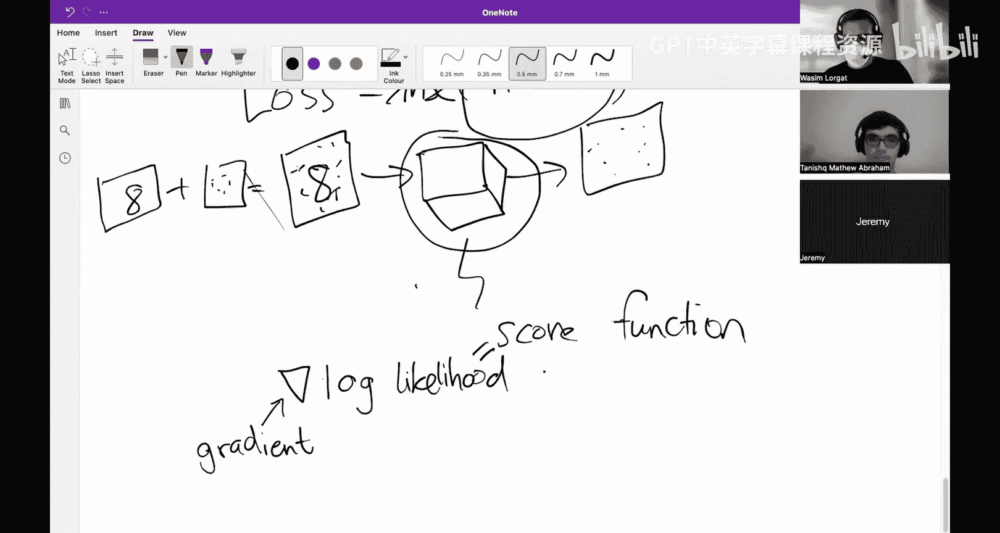

Yeah。Okay， cool yeah I highly recommend checking out the course lesson as well if you haven't。😊。

You know， if you don't understand this， there's no need to be intimidated。

You can still do be very effective without ever using math。

 you can be very effective at deep learning as FA AI has shown us and you can do novel research as well。

For me， this it's interesting and it's even beautiful in a way。😊。

I recommend checking it out but don't feel intimidated。

 you can find the course lesson links in the past AI forum and we'll add those links as well in the description of this video。

We'll also have a topic in the forum for this lesson， you can have discussions there。

 post any comments， add any you relevant links to the math。And then we have another lesson you。

 video by Jon O。Which I really recommend checking out he's a you know he's a great teacher and he was I think he was the first person to do a full course on on stable diffusion yeah joto's video is kind of a deep dive into some of the code a little bit more and into some of the concepts a little bit more so I feel like between these three videos it's a。

😊，A good overview， you know I think。I mean， just to clarify。😊。

You don't need to understand all the math that was seem described in this video that's not to say you won't need to understand math。

 we'll be covering lots of math in these lessons。But we'll be covering just the math you need to understand and build on the code and we'll be covering it over many。

 many more hours than this rather rapid overview。Perfect。Cool and yeah， thank you so much Denish。

 I had a lot of fun and thank you so much West that was awesome。😊，Awesome。哦，拜e拜e。😔，그。

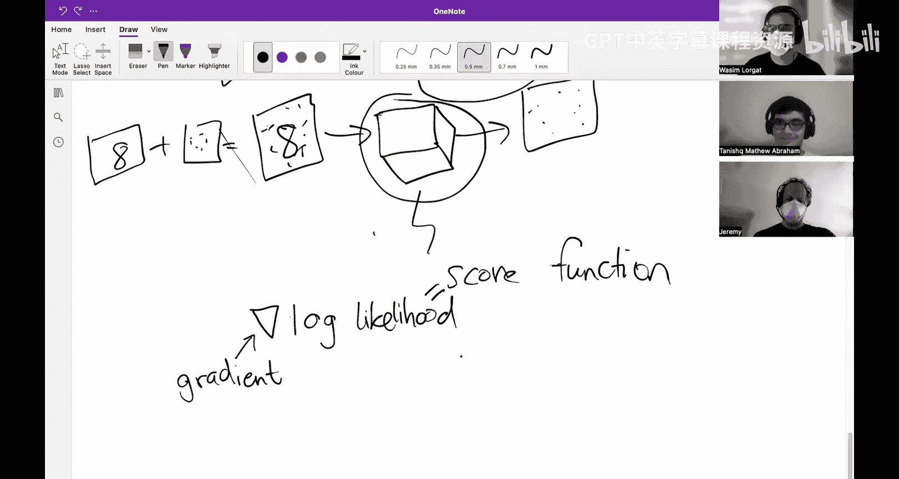