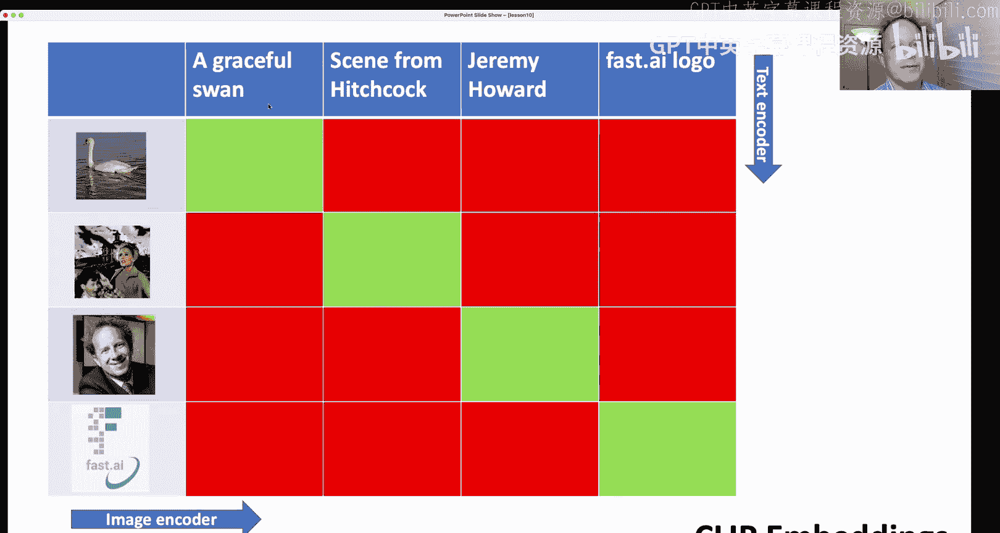
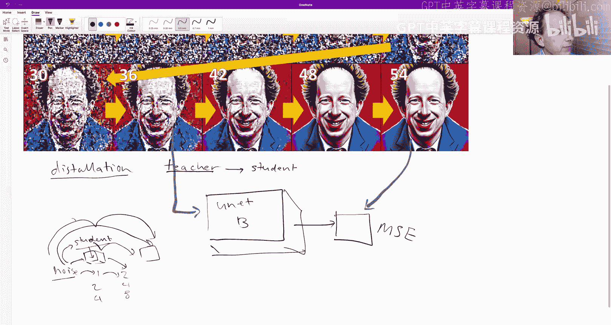
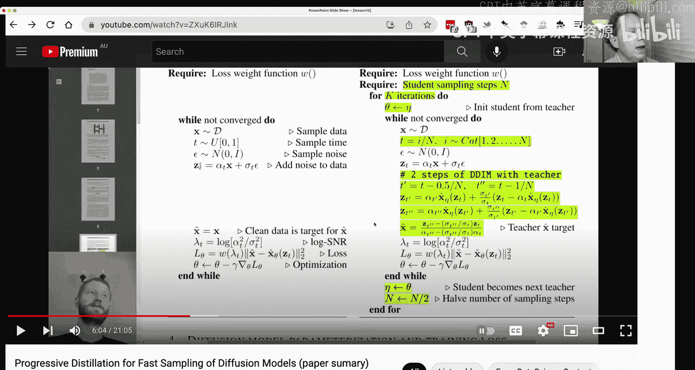
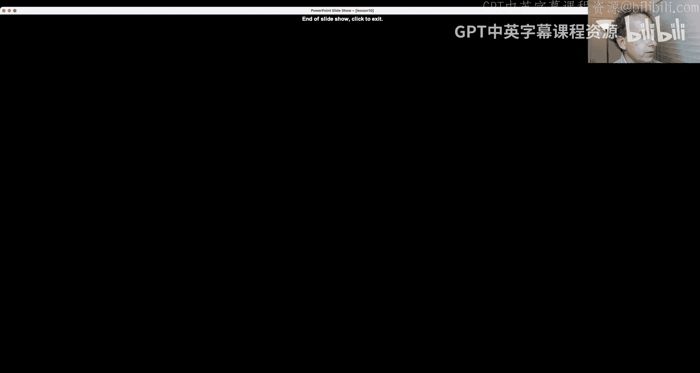
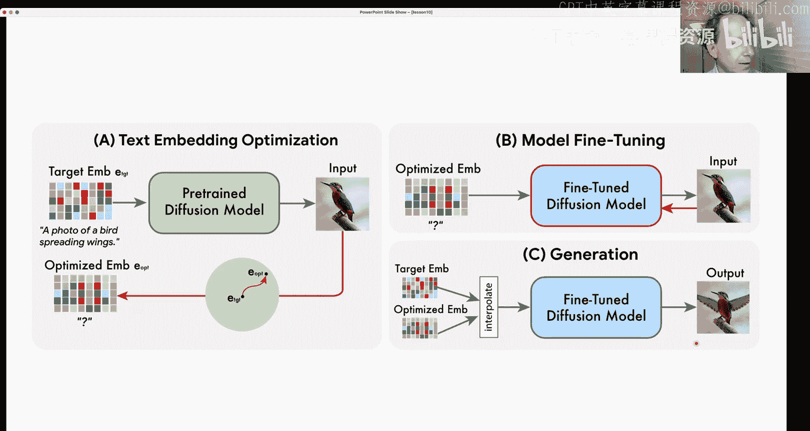
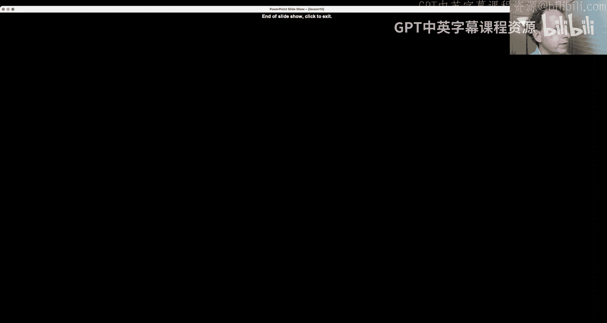
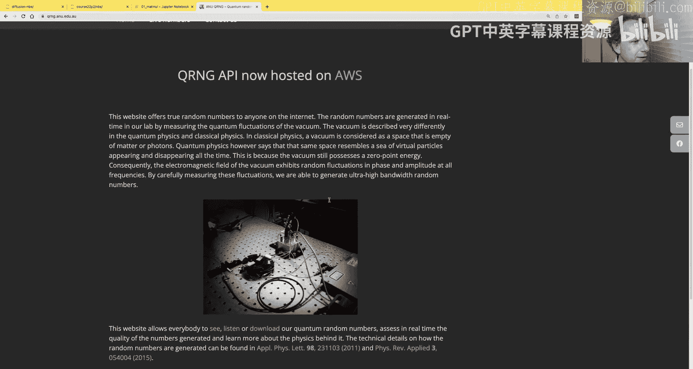
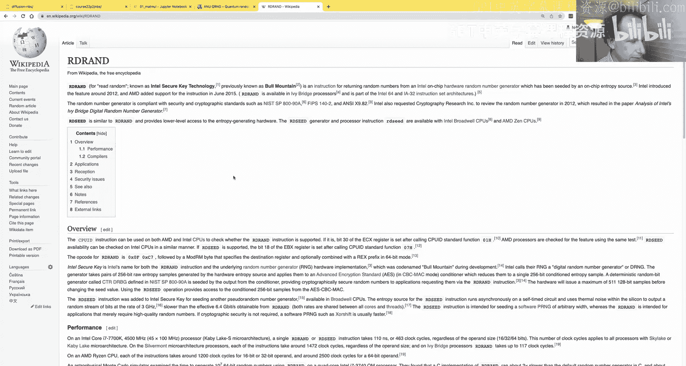
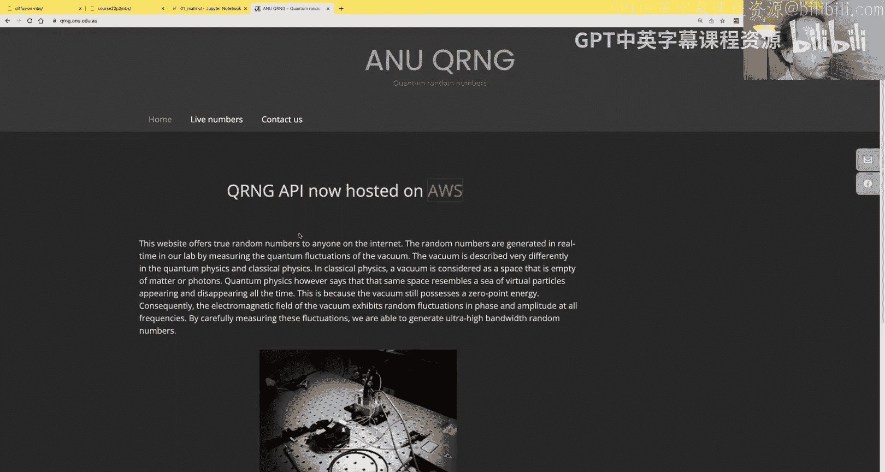
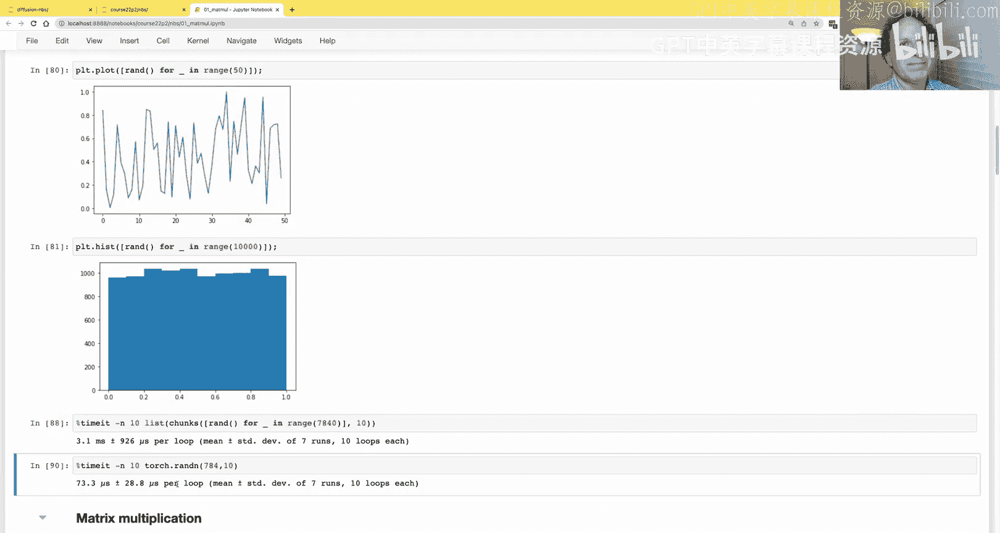

# Jeremy《深度学习基础到稳定扩散模型｜Deep Learning Foundations to Stable Diffusion》中英 p04 Lesson 10_ Deep Learning Foundations to Stable Diffusion, 2022.zh_en -BV1Mp421S7xg_p4-

Hi everybody and welcome back， this is lesson 10 of practical deep learninging for coders。

 it's the second lesson in part two which is where we're going from deep learning foundations to stable diffusion。

So before we dive back into our notebook， I think first of all。

 let's take a look at some of the interesting work that students in the course have done over the last week I'm just going to show a small sample of what's on the forum so check out the Share your work here thread on the forum for many。

 many， many more examples。So Purro did something interesting which is to create a bunch of images of doing a linear interpolation。

 I mean details actually ispherical linear interpolation。

 but doesn't matter doing a linear interpolation between two different latent noisy latent noise starting points for a not a picture and then showed all the intermediate results。

😊，That came out pretty nice， and they did something similar。

 starting with an old car prompt and going to a modern Ferrari prompt。

 I can't remember exactly what the prompts were。 but you can see how as it kind of goes through that latent space。

😊，It actually is changing the image that's coming out， I think that's really cool。

And then I love the way Namrada took that and took it to another level in a way。

 which is starting with a dinosaur and turning into a bird。😊，And this is a very cool。

 intermediate picture of one of the steps along the way the。The Dno bird。I love it。Dino chi。

Fantastic so much creativity on the forum， so I loved this John Richmond took his daughter's dog and turned it gradually into a unicorn。

😊，And I thought this one along the way actually came out very， very nicely， I think this is adorable。

 and I suspect that John has won the dad of the year orDa of the Week maybe award this week for this fantastic project。

And Maureen did something very interesting， which is she took Jonno's parrot image from his lesson。

And。tried bringing it across to various different painters styles and so her question was。

 anyoneone want to guess the artists in the prompts？

So I'm just going to let you pause it before I move on if you want to try to guess。😊。

And there they are， most of them。😊，Pretty obvious， I guess I think it's so funny that Frida Carlo appears in all of her paintings。

 so the parrots actually turned into Frida Carlo not all of her paintings。

 but all of her famous ones So the very idea of a Frida Carlo painting without her and it has so unheard of that the parrots turned into Frida Carlo and I like this Jackson Polock it's still got the parrot going on there So that's that's a really lovely one Maureen thank you and this is a good reminder to make sure that you check out the the other two lesson videos。

😊，So she was working with John O's stable diffusion。Lesson。

 so be sure to check that out if you haven't yet， it is available on the course webpage and on the forums and has lots of cool stuff that you can work with。

Including this parroish。And then the other one to remind you about is the video that Wassim and Tenniish did on the math of diffusion and I do want to read out what Alex said about this because I'm sure a number of you feel the same way my first reaction on seeing something with the title math of diffusion was to assume that oh。

 that's just something for all the smart people who have PhDs in maths on the course and it'll probably be completely incomprehensible but of course it's not that at all。

Um。So be sure to check this out， even if you don't think of yourself as a math person。

 I think it's you know some nice background that you may find useful， it's certainly not necessary。

 but you might yeah， I think it's kind of，Useful to start to dig in some of the math at this point。

One particularly interesting project that's been happening during the week is from Jason Antich， who。

😊，Is a bit of a legend around here， many of you will remember him as being the guy that created delphi and actually worked closely with us on our research which together turned into nogan and decgraify and other things created lots of papers。

嗯。And Jason， yeah， Jason has kindly joined our middle research team working on the stuff for these lessons and for developing a kind of fast a approach to stable diffusion。

 and he took the idea that I prompted last week， which is maybe we should be using classic optimizes rather than differential equation solvers and he actually made it work incredibly well already within a week。

 these faces were generated on a single GPU in a few hours from scratch by using classic classic deep learning optimizes which is like an unheard of speed to get this quality of image and we think that this research direction is looking extremely extremely promising。

So really great news there here and thank you Jason for this。😊，Fantastic progress。嗯。Yeah。

 so maybe we'll do a quick reminder of what we looked at last week。

 So last week I used a bit of a mega one note hand drawn thing。 I thought this week I might just。

Ted it into some。Slides that we can use。So the basic idea， if you remember， is that we started with。

If we're doing handwritten digits， for example， we'd start with a number seven。

This would be one of the ones with a stroke through it that some countries use。

 and then we add to it some noise。And the7 plus the noise together would equal this。

Noisy7 and so what we then do is we present this noisy7 as an input to a unit。

And we haven't tried to predict which which pixels are noise， basically。Or predict the noise。

And so the unit tries to predict the noise from the from the number。😊。

It then compares its prediction to the actual noise。嗯。And it's going to then get a loss。

 which it can use to update the weights in the unit。 And that's basically how stable diffusion。

They're kind of the main bit if you like the unit。Is created to make it kind of easier for the unit。

 we can also pass in an embedding of the actual digit， the actual number seven， so for example。

 a one hot encoded vector which goes through an embedding layer。

And the nice thing about that to remind you is that if we do this。

 then we also have the benefit that then later on， we can actually generate specific digits by saying I want a number 7 or I want a number5 and it knows what they look like。

 I've skipped over here the the VE latent piece which we talked about last week and to remind you。

 that's just a。Computation or shortcut， it makes it faster。

Um and so the we don't need to include that in this picture because it's just a， yeah。

 just a computational shortcut that we can pre process things into that latent space with the VAE first if we wish。

嗯。So that's what the unit does。 Now， then to remind you， you know。

 we want to handle things that are more interesting than just the number seven。 we want to。Actually。

Hand all things where we can say， for example， a graceful swan or a scene from Hitchcock。

And the way we do that is we turn these sentences into embeddings as well。

 and we turn them into embeddings by trying to create embeddings of these sentences。

 which are similar as possible to embeddings of the photos or images that they are connected with。

 and remind you the way we did that or the way that was done originally as part of this thing called clip。

Was to basically download from the internet lots of examples of lots of images。

 find their alt tags and then for each one we then have their image and it alt tag so here's the grayl swan and its alt tag and then we build two models。

 an image encoder that turns each image into some feature vector。

And then we have a text encoder that turns each piece of text into a bunch of features。

And then we create a loss function that says that the features for a graceful swan。

 the text should be as close as possible to the features for the picture of a graceful swan。

 and specifically we take the dot product。😊，And then we add up all the green ones because these are the ones that we want to match and we subtract all the red ones because those are the ones we don't want to match those are where the text doesn't match the image and so that's the contrastive lost which gives us the C in clip so that's a review of some stuff we did last week and so with this then we can we now have a text encoder which we can now say a graceful swan and it will spit out some embeddings and those are the embeddings that we can feed into。

Thou you net during training。And so then we don haven't been doing any of that training ourselves except for some fine tuning because it takes a very long time on a lot of computers。

 but instead we take pretrain models and do inference。

And the way we do inference is we put in an example of the thing that we want that we have an embedding for。

 so let's say we're doing handwritten digits and we put in some random noise into the unit。

And then it spits out a prediction of which bits of noise you could remove to leave behind a picture of the number three。

Initially it's going to do quite a bad job of that。

 so we subtract just a little bit of that noise from the image to make it a little bit less noisy and we do it again。

😊，And we do it a bunch of times。嗯。So here's what that looks like creating a。

 I think somebody here did a smiling picture of Jeremy Howard or something if I remember correctly。

 and if we print out the noise at kind of step 0 and it's step 6 and at step 12。

 you can see this first signs of a face starting to appear， definitely a face appearing here， 1824。😊。

By step 30， it's looking much more like a face。By 42 it's getting there it's just got a few little blemishes to fix up and here we are I think I've slightly messed up my indexes here because it should finish at 60 not 54 but such is life。

😊，Um， so rather rosy red lips， too， I would have to say。😊，Um。So remember in the early days。

 this took a thousand steps and now there are some shortcuts to make it take 60 steps。

And this is what the process looks like and the reason this doesn't look like normal noise is because now we are actually doing the VE latentence thing。

😊，and so noisy latent don't look like Gaussian noise， they look like， well， they look like this。

 this is what happens when you decode those noisy latents。😊。

Now you might remember last week I complained that things are moving too quickly and there was a couple of papers that had come out the day before and made everything entirely out of date。

 so John O and I and the team of actually I had time to read read those papers and I thought。

Now would be a good time to start going through some papers for the first time。

 so what we're actually going to do is show how these papers have taken the required number required number of steps to go through this process down from 60 steps to four steps。

Which is pretty amazing。So let's talk about that and the paper is specifically。😊。

Is this one progressive distillation for fast sampling of diffusion models？嗯。

So it's only been a week， so I haven't had much of a chance to try to explain this before。

 so apologies in advance if this is awkward， but hopefully it's going to make some sense。

What we're going to start with is。嗯。So we're going to start with this process。um。

Which is gradually dennoing images。 And actually， I wonder if we can copy it。Okay。

 so how are we going to get this down from？60 steps to。F steps。

 the basic idea is that we're going to do a process。We're going to do a process called distillation。

Which I have no idea how to spell， but hopefully that's close enough that you get the idea。😊。

Disttillation is a process which is pretty common in deep learning and the basic idea of distillation is that you take something called a teacher。

😊，Network， which is some neural network that already knows how to do something。

 but it might be slow and big。And the teacher network。

Is then used by a student network which tries to learn how to do the same thing but faster or with less memory。

And in this case， we want our to be faster， we ought to do less steps。

And the way we can do this conceptually， it's actually， in my opinion， reasonably straightforward。😊。

We have。Like when I look at this and I think like， wow， you know， neural nets are really amazing。

So given neural thats are really amazing， why is it taking？😊，Like。18 steps to go from there。To there。

 like， that seems like something that you should be able to do in one step。

The fact that it's taking 18 steps and originally， of course。

 that was hundreds and hundreds of steps is because it's kind of that's。

That's just a kind of a side effect of the math of how this thing was originally developed， you know。

 this idea of this diffusion process。😊，U。But the idea in this paper is something that actually we've。

😊，I think I better even have mentioned it in the last lesson of something we were thinking of doing ourselves before this paper beat us to it。

😊，Which is to say， well， what if we train a new model？Where the model takes as input， this image。

Right， and。Puts it through some other unit。Unit。😔，Bei。Okay， and then that spits out some result。

And what we do is we take that result， and we compare it to。This image， the thing we actually want。

Because the nice thing is now。Which we've never really had before is we have for each intermediate output。

 like the desired goal where we're trying to get to。 And so we could compare those to。Just using。

 you know， whatever means  Qued error。Keep on forgetting to change my pen。Main and squared error。

And so then if we keep doing this for lots and lots of images and lots of lots of pairs in exactly this way。

 this unit is going to hopefully learn to take these incomplete images and turn them into。😊。

Complete images。And that is exactly what this paper does。😊，It just says， okay。

 now that we've got all these examples of showing what step 36 should turn into it's step 54。

Let's just feed those examples。Into a model。and that works and you'd kind of expect it to work because you can see that like a human would be able to look at this and if they were a competent artist。

 they could turn that into a。😊，You know， a well finished product。

 So you would expect that a computer could as well。U。

There are some little tweaks around how it makes this work。

 which I'll briefly describe because we need to be able to go from kind of step one through to step 10 through to step 20 and so forth。

😊，U。And so the the way that it does this it's actually quite clever what they do is they initially so they take their teacher model so remember the teacher model is one that has already been trained okay so the teacher model already is a complete stable diffusion model that's finished we take that as a given。

😊，And we put in our image， well， actually it's noise， we put in our noise。

And we put it through two time steps。Okay， and then we train our unit B or whatever you want to call it。

To try to go directly from the noise to time step number two。And that's pretty easy for it to do。

And so then what they do is they take this， okay， and so this thing here remember is called the student model。

They then say， okay， let's now take that student model。And treat that as the new teacher。

 so they now take their noise and they run it through the student model。Twice， once。And twice。

And they get out something at the end。And so then they try to create a new student。

 which is a copy of the previous student， and it learns to go directly from the noise to。

Two goes of the student model。And they won't be surprised to hear they now attack that new student model and use that to go to goes。

😊，And then they learn they use that then they copy that to become the next student model。

 and so they're doing it again and again and again and each time they're basically doubling the amount of work so it goes one to two。

 effectively it's then going two to four and then four to eight。😊。

And that's basically what they're what they're doing and they're doing it for multiple different time steps so the single student model is learning to both do these。

😊。

U。Inial steps try to jump。Multiple steps at a time， and it's also learning to do these later steps。

 multiple steps at a time。And that's it believe it or not。

 so this is this neat paper that came out last week and that's how it works。

 Now I mentioned that there was actually two papers。😊，嗯。

The second one is called un Disisttillation of guided diffusion models。Um and。

The trick now is this second paper and these came out at basically the same time if I remember correctly。

 even though they're built on each other from the same teams。Is that they say， okay。

This is all very well but we don't just want to create random pictures。

 we want to be able to do guidance right and you might remember I hope you remember from last week that we used something called Classifier free guided diffusion models。

Which， because I'm lazy， we will just use an acronym， classifier free guided diffusion models。

And this one， you may recall， we take， let's say we want a cute puppy。

 we put in the prompt cute puppy。Into our clip text encoder。And it sps out and embedding。

And we put that。Let's ignore the VAE late business， we put that into our unit。

But we also put the empty prompt。😊，Into our clip text encoder。

We concatenate these things two together。So that then out the other side we get back two things。

We get back the image of the cute puppy。And we get back the image of some arbitrary thing。

Could be anything。And then we effectively do something very much like taking the weighted average of these two things together。

 combine them。And then we use that。😊，For the next stage of our diffusion process。

Now what this paper does is it says this is all pretty awkward。

 we end up having to train two images instead of one and for different types of levels of gld diffusion we have to like do it multiple different times。

 that's all pretty annoying， how do we skip it？😊，And based on the description of how we did it before。

 you may be able to guess what we do。😊，Is we do exactly the same student teacher distillation we did before。

But this time， we pass in， in addition。The guidance。And so again。

 we've got the entire stable diffusion model the。😊，The teacher model available for us。

And we are doing actual CFGD classifier free guided diffusion to create our guided diffusion puppy pictures and we're doing it for a range of different guidance scales so you might be doing two in 7。

5 and 12 and whatever right and those now are becoming inputs to our student model so the student model now has additional inputs it's getting the noise as always。

😊，It's getting the caption or the prompt， I guess I should say， as always。But it's now also getting。

The guidance scale。And so it's learning。😊，To find out how all of these things。

Are handled by the teacher model like what does it do？😊，After a few steps， each time。

So it's exactly the same thing as before， but now it's learning to use the classifier free guided diffusion as well。

😊，Okay， so that's got quite a lot going on there and if it's a bit confusing that's okay。

 it is a bit confusing and what I would recommend is you check out the extra information。😊，嗯。

From Jonno who has a whole video on this and one of the cool things actually about this video is it's actually a paper walkthrough and so part of this course is hopefully we're going to start reading papers together。

😊，Reading papers is extremely intimidating and overwhelming for all of us all of the time。

 at least for me it never gets any better there's a lot of math and by watching somebody like Jon O who's an expert at this stuff read through a paper。

 you'll kind of get a sense of how he is skipping over。😊。

Lots of the math right to focus on in this case， the really important thing。

 which is the actual algorithm。And when you actually look at the algorithm。

 you start to realize it's basically all stuff， nearly all stuff。

 maybe all stuff that you did in primary school or secondary school， so we've got division。😊，Okay。

 sampling from a normal distribution， so high school subtraction division。Divis multiplication。

 right Oh， okay， we've got to log there。 but basically， you know， there's not too much going on。

 And then when you look at the code。You'll find it， you know， once you turn this into code。

 of course， it becomes even more understandable if you're somebody who's more familiar with code like me。

😊，So yeah， definitely check out。😊。

John Os。Video on this。

U。So another paper came out about three hours ago。😊。

And I just have to show it to you because I think it's amazing and。

So this is definitely the first video about this paper because it yeah only came out a few hours ago but check this out this is a paper called I Magic。

😊，And with this algorithm， you can pass in an input image， so this is just you know。

 a photo you've taken or downloaded off the internet。😊。

And then you pass in some text saying a bird spreading wings and what it's going to try to do is it's going to try to take this exact bird in this exact pose and leave everything as similar as possible。

 but adjust it just enough so that the prompt is now matched。😊，So here we take this。😊。

This little guy here and we say， oh this is actually what we want this to be a person giving the thumbs up and this is what it produces and you can see everything else is very。

 very similar to the previous picture。😊，U。So this dog is not sitting。

But if we put in the prompt a sitting dog。It turns it into a sitting dog。

Believing everything else as similar as possible。So here's an example of a waterfall and then you say it's a children's drawing of a waterfall and boom now it's become a children's drawing so lots of people in the YouTube chat going oh my God this is amazing which it absolutely is and that's why we're going to show you how it works one of the really amazing things is you're going to realize that you understand how it works already。

😊，Just to show you some more examples， here's the dog image， here's the sitting dog。The jumping dog。

Doug playing with a toy。Jumping dog holding a Frisbee。Okay， and here's this guy again。

 giving the thumbs up。😊，Cst arms。In a greeting pose to Nate hands。Harding a cup。So that's pretty。

Amazing， so I had to show you。How this works。And I'm not going to go into too much detail。😊，But。

I think we can get the idea actually pretty well。So what we do is again。

 take we start with a fully pre trained， ready to go generative model like a stable diffusion model。

And this is what this is talking about here， pretrain diffusion model in the paper they actually use a model called Imogen。

 but none of the details as far as I can see in any way depend on what the model is。

 it should work just fine for stable diffusion。😊，And we take a photo of a birds spreading wings。

 Okay， so that's our。That's our target。And we。Creat and embedding from that using， for example。

 our clip encoder as usual。And we then pass it through our pre trained。Diffusion model。

And we then see what it creates。😊，And it doesn't create something that's actually like our。Our bird。

So then what they do is they fine tune this embedding。So this is kind of like textual inversion。

 they fine tune in the embedding。To try to make the diffusion model output something that's as similar as possible。

To the to the input image。And so you can see here they're saying， oh。

 we're moving our embedding a little bit。😊，They don't do this for very long。

 they just want to move it a little bit in the right direction。😊。

And then now they lock that in place and they say， okay。

 now let's fine tune the entire diffusion model end to end， including the VaE。

 or actually with image N， they have a super resolution model， but same idea。

So we find tune the entire model end to end and now the embedding。

 this optimmost embedding we created。😊，We store in place， we don't change that at all。

 that's now frozen。And we try to make it so that the diffusion model now spits out。Albert。

As close as possible。So you fine tune that for a few epochs。

 and so you've now got something that takes this this embedding that we find tuned。

 goes through a fine tune model and bits out our bird。And then finally。

The original target embedding we actually wanted is a photo of bird spreading its wings。

 We ended up with a slightly different embedding。And we take the weighted average of the two。

 That's called the interpolate step， the weighted average of the two。

And we pass that through this fine tune diffusion model。And we're done。

and so that's pretty amazing this this would not take I don't think a particularly long time or require any particular special hardware it's the kind of thing I expect people will be doing。

😊，Yeah， in the coming days and weeks。 But it's very interesting because， yeah， I mean。

 the ability to。

Take any photo of a person， or whatever。And change it。

Like literally change what the person's doing is。You know。

Societally very important and really means that anybody， I guess now can generate。

Believable photos that。Never actually existed。 I see John O in the chat saying it took。

About eight minutes to do it for Imogen on TpUs。Although Imogen is quite as slow。Big model。

 although the TPUs they used were very the latest TPUs。It mightight be a， you know。

 maybe it's an hour or something。😊，For stable refusion on GPs。U。All right， so that is。

A lot of fun。All right， so with that， let's go back to our。Notebook。Um， where we left it last time。

 we had kind of looked at some applications that we can play with in this diffusion NBs repo in the stable diffusion notebook。

And what we've got now and to remind you when I say we， it's mainly actually Pedro Patrick and Sj。

 just a little bit of help for me， so hugging face folks。

What we slash they have done is they're is they now dig into the pipeline to pull it all apart step by step so you can see exactly what happens。

The first thing I was just going to mention is this is how you can create those。

Gdual denoising pictures and this is thanks to something called the callback。

So you can see here when you go through the pipeline， every 12 steps call this function。

And as you can see， it's going to call it with I and T and the latent。😊，And so then we can just。

Make an image and stick it on the end end of a。Aray。

And that's all that's happening here so this is how you can start to interact with a pipeline without rewriting it yourself from scratch。

 but now what we're going to do is we're actually going to write it we're going to you know build it from scratch so you don't actually have to use a callback because you'll be able to change it yourself。

😊，So let's take a look。So looking inside the pipeline， what exactly is going on。

 So what's going to be going on in the pipeline？Is seeing all of the。

Steps that we saw in last week's one note notes today drew。And we' it's going to be all the code。

 Okay， and we're not going to show the code of how each step's implemented。 So， for example。

 the clip text model we talked about， the thing that takes as input。

 a prompt and creates an embedding。We just take that as a given， okay， so we download it。

 open AI is trained one called clippped。VIT largege patch 14。

 so we just say fromry chain so hugging face will transformers will download and create that model for us。

Did over for the tokenizer。Um， and so didto the auto encoder and dido for the unit。😊。

So there they all are， we can just。Grab them so we just take that all as a given though that those these are the three models that we've talked about。

 the text encoder， the tip encoder。The VIE。And the unit， so there they are。

So given that we now have those， the next thing we need is that thing that converts time steps into the amount of noise。

 remember that graph we drew？And so。We can basically again use something that hugging face。

 well actually in this case， Catherine Carlson has already provided。

 which is a scheduler's basically something that shows us that connection。So we've got that。😊。

So we use that scheduler。And we say how much noise we're using and so we have to make sure that that matches and so we just use these numbers that we're given。

Okay， so now to create our photograph of astronaut riding a horse again。In 70 steps with a 7。

5 guidance scale。Btch size of one， step number one is to take out prompt and tokenise it。😊，Okay。

 so we looked at that in part one of the course so check that out if you can't remember what tokenizing does。

 but it's just splitting it in basically it's splitting it into words or sub word units if they're long and unusual words。

So here are so this will be start the start of sentence token and this will be our photograph of an astronaut etc ce。

 and then you can see the same token is repeated again again at the end。

 that's just the padding to say we're all done。And the reason for that is that GPUs and TUs really like to do lots of things at once。

 so we kind of have everything be the same length by padding them that may sound like a lot of wasted work which it kind of is but a GPU would rather do lots of things at the same time on exactly the same sized input so this is why we have all this padding。

So you can see here if we decode。That number， it's the end of text marker。

 just padding really in this case。嗯。As well as getting the input IDs。

 so these are just lookups into a vocabulary。😊，There's also a mask which is just telling it which ones are actual words as opposed to padding。

 which is not very interesting。😊，嗯。So we can now take those input IDs。We can put them on the GPU。

And we can run them through the clip encoder。And so for a batch size of one， so we've got one image。

That gives us back a。77 by 768 because we've got 77 here and each one of those creates a 768 long vector。

 so we've got a 77 by 768。😊，Tensa， so these are the embeddings。

For a photograph of an astronaut riding a horse。That come from clip。 So remember。

 everything's pretrained。 So that's all done for us。 We're just doing inference。

And so remember for the classifier free guidance， we also need。😊，Embbeddings for the empty string。

So we do exactly the same thing。So now we just concatenate those two together because we're just。

 this is just a trick to get the GPU to do both at the same time because we like the GPU to do as many things at once as possible。

😊，And so now we create our noise。😊，And because we're doing it with a VAE， we can call it latetnt。

 but it's just noise， really。😊，I wonder if you' still call it that without the VAE。

 maybe you would have to think about that。😊，So that's just random numbers generated normally distributed random numbers of size one。

 that's how batch size。And the reason that we've got this divided by8 here is because that's what the VAE does。

 it allows us to create things that are eight times smaller by height and width。

 and then it's going to expand it up again for us later， that's why this is so much faster。😊。

You'll see a lot of this after we put it on the GPU you'll see a lot of this do half this is converting things into what's called half precision or FP16 De don't matter too much it's just making it half as big than memory by using less precision modern GPUs are much much much much faster if we do that so you'll see that a lot if you use something like fast AI you don't have to worry about it but all this stuff is done for you and we'll see that later as we rebuild this with much much less code later in the course。

So'll we'll be building our own kind of framework from scratch， which you'll then be able to。

Maintain and work with yourself。Okay， so we have to say we want to do 70 steps。😊，嗯。

Something that's very important we won't worry too much about the details right now but this what you' see here is that we take our random of noise and we scale it and that's because depending on what stage you're up to you need to make sure that kind of you have the right amount of variance basically otherwise you're going to get activations and gradients that go out of control this is something we're going to be talking about a huge amount during this course and we'll show you lots of tricks to handle that kind of thing automatically。

Unfortunately， at the moment in the stable diffusion world。😊，Um this is all done in rather。

 u in my opinion， kind of。Ways that are too tied to the details of the model。

 I think well be able to improve it as the course goes on， but for now we'll stick with。

How everybody else is doing it， this is how they do it。So we're going to be jumping through。

 so normally it would take a thousand time steps， but because we're using a fancy scheduler。

 we get to skip from 999 to 984， 984 to 970 and so forth so we're going to down about 14 time steps。

😊，And remember， this is a very， very， very unfortunate word， they're not time steps at all， in fact。

 they're not even integers。It's just a measure of how much noise are we adding at each time and you find out how much noise by looking it up on this graph okay。

 that's all time step means it's not a step of time and it's a real shame that that word is used because it's incredibly confusing。

This is much more helpful。 This is the actual man of noise。 Add each one of those。Iterations。

And so here you can see the amount of noise。U。For each of those time steps and we're going to be going backwards。

 as you can see we start at 999， so we'll start with lots of noise and then we'll be using less and less and less and less noise。

😊，So we go through the 70 time steps。In a for loop。嗯。

Concatenating our two noise bits together because we've got the classifier free and the prompt versions。

Do our scaling。😊，Calculate our predictions from the unit and notice here we're passing in the time step as well as our prompt。

That's going to return two things， the unconditional prediction。

 so that's the one for the empty string remember we passed in one of the two things we passed in was the empty string。

So we cancate and edit them together and so after they come out of the unit。

 we can pull them apart again， so dot chunk just means pull them apart into two separate variables。

And then we can do the guidance scale that we talked about last week。U。And so， now， we can。

Do that update where we take a little bit of the noise and remove it。To give us our new la。

So that's the lip。And so at the end of all that， we decode it in the VAE。😊。

The paper that created this VAE tells us that we have to divide it by this number to scale it correctly。

And once we've done that。That gives us a number which is between negative one and one。

Python imagingaging library expects something between zero and 1。

 so that's what we do here to make it between zero and one and like force that to be true。

Put that back on the CPU， make sure it's that the order of the dimensions is the same as what Python imagingaging Library expects。

😊，And then finally convert it up to between0 and 255 as an int。

 which is actually what PO really wants。😊，And there's our picture。😊，So there's all the steps。嗯。就。

What I then did， this is kind of like so the way I normally build code I use notebooks for everything is I kind of do things step by step by step and then I tend to kind of copy them and I use shift M I don't know if you've seen that but what shift M does it takes two cells and combines them like that and so I basically combine。

Some of the cells together and I removed a bunch of the the pros so you can see the entire thing。

On one screen。And what I was trying to do here is I'd like to get to the point where I've got something which I can very quickly do experiments with。

 so maybe I want to try some different approach to guidance tree classification。

 maybe I want to add some callbacks。😊，So on and so forth。 So I kind of like to have everything。

 you know， I like to have all of the my important code be able to fit into my screen at once。

 And so you can see now I do。 I've got the whole thing on my screen so I can keep it all in my head。

 One thing I was playing around with was I was trying to understand the。😊，The actual。Guidance free。

Equation in terms of like， how does it work。Computer scientists tend to write things and software engineers with kind of long words as variable names。

 mathematicians tend to use short just letters normally for me when I want to play around with stuff like that I turned stuff back into letters and that's because I actually kind of pulled out one note and I started jutting down this equation and playing around with it to understand how it behaves。

So this is just like it's not better or worse， it's just depending on what you're doing。

 so I actually here I said， okay。G is called is Gu and scale。

Um and then rather than having the unconditional and text embeddings。

 I just call them UNT and now I've got this all down into an equation which I can write down in a notebook and play with and understand exactly how it works。

😊，So that's something I find really helpful for working with this kind of code。😊，Is to， yeah。

 turn it into a form that I can。Manipulate algebraically more easily。

 I also try to make it look as much like the paper that I'm implementing as possible。😊。

Anyway that's that code So then I copied all this again and I basically。😊，Oh。

 I actually did up for two prompts this time。 I thought this was fun while you're painting an astronaut riding the horse in the style of Grant wood。

😊，Just remind you。Grant Wood。Looks like this。Um。Not obviously astronaut material。

 which I thought would make it actually kind of particularly interesting。

 although it does have horses。I can't see one here， some of his pictures have horses。Um。

So because I did two prompts， I got back two pictures I could do。So here's the Grant Wood one。

 I don't know what's going on in his back here， but I think it's quite nice。um。😊，So yeah。

 I then copied that whole thing again and merged them all together and then just put it into a function。

 so I took the little bit which creates an image and put that into a function。😊。

I took the bit which does the tokenizing and text encoding and put that into a function。

And so now all of the code necessary to do the whole thing from， you know。

 top to bottom fits in these two cells。Which makes it for me much easier to see exactly what's going on so you can see I've got the。

😊，Text embeddings， I've got the unconditional embeddings。

 I've got the embeddings which concatenate the two together， optional or random seed。My late。嗯。

And then the loop itself。And you'll also see a something I do。

 which is a bit different to a lot of software engineering is I often create things which are kind of like。

Longer lines， because I try to have each line be kind of like。Mathematically。

 one thing that I want to be able to think about as a whole。 So yeah。

 there are some differences between kind of。The way I find numerical programming works well compared to the way I would write a more traditional software engineering approach。

And again， this is partly a personal preference， but it's something I find works well for me so we're now at a point where we've got yeah three functions that easily fit on the screen and do everything so I can now just say make samples。

😊，And display its image。And so this is something for you to。😊，Experiment with。

And what I specifically suggest as homework。😊，Is to try picking one of the。

Extra tricks we learned about。Like image to image or negative prompts， Ne prompts would be a nice。

 easy one。 Like， see if you can implement。Negative prompt。In your version。Of this。U。Or。Yeah。

 try doing image to image。That wouldn't be too hard either。

 Another one you could add is try adding Corbacks。And the nice thing is then， you know。

 you've got code which you fully understand。😊，Because you know what all the lines do。

You then don't need to wait for the diffusers folks to update it the library to do， for example。

 the Corbacks are only added like a week ago， So until then you couldn't do Corbacks Well now you don't have to wait for the diffusers team to add something the code's all here for you to play with。

So that's my recommendation as a bit of homework for this week。😊，Okay。

 so that brings us to the end of our。Rapid overview of stable diffusion and some very recent papers that very significantly develop stable diffusion。

 I hope that's given you a good sense of。The kind of very high level。

 slightly hand wavy version of all this， and you can actually get started playing with some fun code。

What we're going to be doing next is is。Going right back to the start。

Learning how to multiply two matrices together effectively and then gradually building from there until we've got to the point that we've rebuilt all this from scratch and we understand why things work the way they do understand how to debug problems improve performance and implement new research papers as well so that's going to be very exciting and so we're going to have。

😊，A break and I will see you back here in 10 minutes。Okay， welcome back everybody。

 I'm really excited about the next part of this it's going to require。😊，Serious tenacity。

And a certain amount of patience， but I think you're going to learn a lot a lot of folks I've spoken to have said that previous iterations of this part of the course is like the best course they've ever done and this one's going to be dramatically better than any previous version we've done of this so hopefully you'll find that the hard work and patience pays off。

We're working now through the Co 22 P2 repo， so 2022 course part2。And the notebooks are ordered。😊。

so I'll start with notebook number one。And。Okay， so the goalll is。😊。

To get to stable diffusion from the foundations， which means we have to define what are the foundations So I've decided。

To define them as follows， we are allowed to use Python。

We're allowed to use the Python standard library。 So that's all the stuff that comes with Python by default。

 We're allowed to use Maplotlibb because I couldn't be bothered creating my own plotting library。

And we're allowed to use Jupipyter Notepe books and NB dev， which is something that creates。um。

Modus from notebooks。 So basically what we're going to try to do。😊，Is to， yeah。

 rebuild everything starting from this foundation now。To be clear。

What we we are allowed to use are libraries once we have reimplemented them correctly。

 and so we if we reempple something from Numpy or from Pytororch or whatever。

 we're then allowed to use the Numpy or pytorrch or whatever version。

Sometimes we'll be creating things that haven't been created before and that's thenre going to be becoming our own library and we're going to be calling that library mini AI。

😊，So we're going to be building our own little framework as we go。😊，So for example。

 here are some imports。And these imports all come from the Python Standard Library。

Except for these two。嗯。Now， to be clear， one challenge we have is that the models we use in stable diffusion were trained on。

Millions of dollars worth of equipment for months， which we don't have the time or money so。

Another trick we're going to do is we're going to create smaller identical but smaller versions of them and so once we've got them working we'll then be allowed to use the big pretrain versions So that's the basic idea So we're going to have to end up with our own VAE。

 our own unit， our own clip encoder and so forth。嗯。

To some degree I am assuming that you've completed part1 of the course to some degree。

 I will cover everything at least briefly， but if I cover something about deep learning too fast for you to know what's going on and you get lost know go back and watch part one。

 or go and Google for that term for stuff that we haven't covered in part one I will go over it very thoroughly and carefully。

All right， so I'm going to assume that you。Know the basic idea that which is that we're going to need。

To be doing some matrix modificationplication， so we're going to try to take a deep dive into matrix modificationplication today。

 and we're going to need some input data and I quite like working with MNT data。

EmNT is handwritten digits。It's a classic data set。😊，嗯。They're 28 by 28 pixel。Gray scale images。

And so we can download them from this URL。So we use the path Libs path object a lot。

 it's part of Python and it basically takes a string and turns it into something that you can treat as a path。

 for example， you can use slash to mean this file inside this subdirecty。

So this is how we create a path object。Pth objects have， for example， a make directory McC method。嗯。

So I like to get everything set up， but I want to be able to rerun this cell lots of times and not have it like give me errors if I run it more than once。

 if I read it a second time， it still works in that case that's because they put this exist okay equals true。

😊，How did I know that I can say because otherwise it would try to make the directory。

 it would already exist in a given an error？😊，How do I know what parameters I can pass to makeD I just press shift tab。

And so when I hit shift tab， it tells me what options there are。嗯。If I press it a few times。

 it'll actually pop it down to the bottom of the screen。Just to remind me。

I compress press escape to get rid of it。UOr you can just。嗯。

Or else you can just hit tab inside and it' will list all the things you could type here。

As you can see。嗯。All right。We need to grab this URL。

And so Python comes with something for doing that， which is the URL Lib library that's part of Python that has something called URL retrieve and something which I'm always a bit surprised is not widely used as people reading the Python documentation so you should do that a lot。

So if I click on that， here is the documentation。For your I real retrieve。 And so I can find exactly。

What it can take and I can learn about exactly what it does。Um。And so I， yeah， I read。

The documentation from the Python docks， for every single。Method I use。

 and I look at every single option that it takes。 and then I practice with it。

 and I practice with it， I practice inside。Inside。Jupiter， so if I want this import on its own。

 I can hit control shift hyphen and it's going to splitit it into two cells and then I'll hit。

Ill enter。Or optiontion enter。So I can create something underneath and I can type yeah。

 I will retrieve shift tab， and so there is there it all is。😊。

If I'm like way down somewhere in in the notebook and I have no idea where URLial retrieve comes from。

 I can just hit shift enter and it actually tells me exactly where it comes from。😊。

And if I want to know more about it， I can just hit question mark， shift enter。

And it's going to give me the documentation。And most call of all。Second question， Mark。

And it gives me the full source code。And you can see it's not a lot， you know。

 reading the source code of Python standard library stuff is often quite revealing。

 and you can see exactly。How they do it。 That's a great way to learn more about。More about this。

So in this case， I'm just going to use a very simple functionality。

 which is I'm going to say the URLal to retrieve and the file name to save it as。😊，And again。

 I' made it so I can run this multiple times， so it's only going to do the URLl retrieve if the path doesn't exist。

 If I've already downloaded it， I don't want to download it again。

 So I run that cell and notice that I can put。Exclamation mark。Followed by line of bash。

And it actually runs this using bash。嗯。If you're using Windows， this won't work and I would very。

 very strongly suggest if you're using Windows use WSL and if you use WSL。

 all of these notebooks will work。Perfectly， so yeah， do that。

Or write it on paper space or Lambda labs or something like that， coabb， etc。Okay。

 so this is a G zipip file。😊，Thankfully， Python comes with AG zip module。

 Python comes with quite a lot actually。😊，And so we can open a Gep file using Gzip。

 open and we can pass in the path and we say we're going to read it。As binary as opposed to text。

Okay， so this is called a context manager， it's a with clause and what it's going to do is it's going to open up this G zip file。

😊，The GU object will be called F。And then it runs everything inside the block。And when it's done。

 it will close the file， so with blocks can do all kinds of different things， but in general。

 with blocks that involve files are going to close the file automatically for you。So we can now。

Do that and so you can see it's opened up the G zip file。😊。

And the Gep file contains what's called pickle objects Pickled objects is basically。

Python objects that have been saved to disk。 It's the main way that。

People in pure Python save stuff and it's part of the standard library。So this is how we load in。

From that file。Now， the file contains a couple of tuples。

So when you put a tuple on the left hand side of an equal sign， it's quite neat。

It allows us to put the first tuple into two variables called X chain and Y train。

And the second into x valid and Y valid。This trick here where you put stuff like this on the left is called destructuring and it's a super handy way to make your code kind of。

Clear and concise and lots of languages support that， including Pyon。Okay。

 so we've now got some data。And so we can have a look at it now it's a bit tricky because we're not allowed to use numpy according to our rules。

 but unfortunately this actually comes as numpy， so I've turned it into a list。😊，All right。

 so I've taken the first image。😊，And I've turned it into a list。

And so we can look at a few examples of some values in that list。And here they are。

 so it looks like there are numbers between zero and one。😊，And this is what I do。😊，You know， when I。

Learn about a new data set。 So when I started writing this notebook， what do you see here？

Other than the prose here is， is what I actually did when I was working with this data this I wanted to know what it was。

 So I just。Grab a little bit of it， and look at it。So I kind of got a sense now of what it is now。

Interestingly。It's 784， this image is 784 long list。Oh dear， people freaking out in the comments。

 no numpy， yeah， no nump， do you see Nmpy， no nuy？😊，W 784， what is that。

 well that's because these's are 28 by 28 images。😊。

So it's just a flat list here of 784 long so how do I turn this 784 long thing into 28 by 28 so I want a 28 list of 28 lists of 28 basically because we don't have matrices。

So。How do we do that and so we're going to be learning a lot of cool stuff in Python here。😊，U。

Sorry I can't start laughing at all the stuff in our chat。😊，Yeah。Yeah。

 people are quite reasonably freaking out， that's okay， we'll get there， I promise。😊，I hope。

Otherwise， I'll embarrass myself。 All right， so how do I convert a 784 long list into 28 list。

28 long list of 28 long。😊，lists。嗯。I'm going to use something called chunks and first of all I'll show you what this thing does and then I'll show you how it works。

So vowels is currently a list of 10 things。Now if I take vows and I pass it to chunks。With5。

It creates two lists of five， here's list number one of five elements。

 and here's list number two of five elements。Um， hopefully you can see what it's doing。

 it's chunkrifying this list and this is the length of each chunk。😊，Now， how did it do that？

The way I did it is using a very， very useful thing in Python。

Far too many people don't know about which is called yield。And what yield does is you can see here。

 what on loop。😊，It's going to go through from zero。Up to the length of my list。

And it's going to jump by five at a time。That's going to go。In this case， zero， comma5。

And then it's going to think of this as being like return for now， it's going to return。😊。

The list from 0 up to 5。 So it returns the first bit of the list。But yield doesn't just return。

 It kind of like， returns a bit。And then it continues。And it returns a bit more。

And so specifically what yield does is it creates an iterator and an iterator is basically something you can well that's actually let's use it that you can call next on。

😊，A bunch of times。 So let's try it so we can say。Im iterator。Aals。Okay， oh， got read it。

So what is iterator Well iterator iter is something that I can basically I can call next on and next basically says yield the next thing。

 so this should yield valves。0， Col 5。There it is， it did， right， there's vows0 column 5。Now。

 if I run that again， it's going to give me a different answer because it's now up to the second part of this loop。

😊，Now it returnss the last five。Okay。So。嗯。This is what our iterator does。

Now if you pass an iterator to Python's list。It runs through the entire letter iterator until it's finished and creates a list of the results and what is finished looks like。

This is what finished looks like if you call next and get stop iteration。

 that means you've run out and that makes sense， Jack because by loop。😊，There's nothing left in it。

So all of that is to say， we now have a way of taking a list and chunkrifying it。😊。

So what if I now take？My full image， image number one。Chunk of fire it into chunks of 28 long。

And turn that into a list。And plot it。That we have successfully created an image。So that's good。😊，嗯。

Now。We are done。嗯。But。嗯。There are other ways to create this iterator and because iterators and generators。

 which are closely related。So important， I wanted to show you more about how to do them in Python It's one of these things that if you understand this。

 you'll often find that you can throw away huge pieces of enterprise software and basically replace it with an iterator。

 it lets you stream things one bit at a time， it doesn't store it all in memory。

It's this really powerful thing that once I， I often find once I show it to people。

 they suddenly go like， oh， wow， you know， we've been using all this。😊，Third party is software。

 and we could have just created a Python iterator。Python comes with a whole standard library module called Edtools。

 just to make it easier to work with Ederators。I'll show you one example of something from Edols。

 which is I slice。😊，So let's crab。Our。Values， again， these 10 values。Okay。

 so let's take these 10 values and we can take any list and turn it into an editorerator by passing it to Ed。

Which I should call it。So I don't override this python。That's not a key word。

 but this thing I don't want to override。😊，So this is now basically something that I can call actually let's do this。

 I'll show you that I can call next item。So， if I now go。Next， it。

You can see it's giving me each item one at a time。Okay。

 so that's what converting it into an iterator does。I slice。Converts it into。

A different kind of iterator。😊，Let's call this maybe ice slice。Getit it right up。And。

So you can see here what it did was it jumped。Stop， here we are。That's what have been better。

 so I should query createate the iterator and then call next a few times。

 so this is what I meant to do。😊，It's now only returning the first five。

Before it calls stop iteration。 before it raises stop iteration。

 So what eye slice does is it grabs the first。N things from an iterable。

 something that you can iterate。Why is that interesting？Because。I can pass it to list， for example。

and now if I pass it to list again， this iterator has now grabbed the first five things。

 so it's now up to thing number six， so if I call it again。It's the next five things。

And if I call it again。😊，Then， there's nothing left。Um and。Maybe you can see we've actually now got。

This defined。But we can do it with ice slice。 and here's how we can do it。

It's actually pretty tricky。嗯。Iter in Python。You can pass it something like a list to create an iterator。

 or you can pass it as there's a really important word， a callable， what's a callable。

A call ball is generally speaking it's a function， it's something that you can put。Prirenheses AF。

Com。呃。ItCould even be a class， anything you can put parentheses after。

 you can just think of it for now as a function， so we're going to pass it to function。😊。

And in the second form， it's going to be called until the function returns。This value here。

 in this case is empty list， and we just saw that ice slice will return empty list when it's done。呃他。

So， this here。I's going to keep calling。This function。Again and again and again。😊。

And we've seen exactly what happens because we've quoted ourselves before。😊，There it is。

Until it gets an empty list。So if we do it with 28。😊，Then we're going to get。😊，Our image。

So we've now got two different ways of creating exactly the same thing。

And if you've never used iterators before。😊，um。Now's a good time to pause the video and play with them。

 right， So for example， you could take this here。And if you've not seen Lambdas before。

 they're exactly the same as functions， but you can define them in line， so let's replace that。😊。

With a function。Okay， so now I've turned it into a function。And then you can experiment with it。

So let's create。Out iterator。And co F on it。Were not unical F。And you can see there's the first 28。😊。

And it's time I'd do it。I'm getting another 28 now the first two rows are all empty， but finally。

 look， now I've got some values， call it again。😊，See how each time I'm getting something else。

 just calling it again and again。And that is the values in our iterator。

So that gives you a sense of like how you can use Jupiter to experiment。 So what you should do。

Is as soon as you hit something in my code that。Doesn't look familiar to you。

I recommend pausing the video。And experimenting with that in。Jupiter。And for example， itA。

 most people probably have not used Itder at all， and certainly very few people have used this two argument form。

 so hit shift tab a few times and now you've got it at the bottom there's a description of what it is。

😊，Or。Find out more， Pyhen。Iter。Here we are， go to the docks。😊，Well。

 that's not the right bit of the ducks。C A。 wow， crazy。That's terrible。Let's try。Searching here。开始。

Have a guy hit。That's all I it。 So now you've got links。 So if it's like， okay。

 it returns an itererate object。 what's that Wellll click on it。

 find out now this is really important to know。 And here's that stop exception that we saw。

 So stop iteration exception we saw next already。😊，We can find out what iterable is。

And heres an example。And as you can see， it's using exactly the same approach that we did。

 But here it's being used to read from a file。 This is really cool。 Here's how a read from a file。😊。

64 bytes at a time until you get nothing。Processing it。 right So the the， the dos of Python are。

Quite fantastic。嗯。As long as you use them， if you don't use them， they're not very useful at all。😊。

And I see C for in the comments， our local Haskecalll programmer。

Appreciating this hasskecalness in Python， that's good， it is not quite hasskele， I'm afraid。

 but it's the closest we're going to come。😊，All right。How we going for time。 Pretty good。Okay。

 so now that we've got image， which is a list of lists and each list is 25 long。

 we can index into it。So we can say image 20， well let's do it。Image 20。Okay。

 here's a list of 28 numbers。And then we could index into that。😊，Okay， so we can index into it。 Now。

 normally we don't like to do that for matrices。 we would normally rather write it like this。Okay。

 so that means we're going to have to create our own class to make that work。

So to create a class in Python， you write class。😊，And then you write the name of it。

And then you write some really weird things。The weird things you write， have two underscores。

A special word。And then two underscores these things with two underscores in each site are called dunder methods and they're all the special magically named methods which have particular meanings to Python and you just kind of let them but they're all documented in the Python object model。

E it。Object model。Da， finally。Okay， so what you' eventually for oh， it's called data model。

 not object model。😊，嗯。And so this is basically where all the documentation is about absolutely everything and I can click D to edit。

😊，And it tells you， basically this is the thing that constructs objects。

So anytime you want to create a class that you want to。That you want to construct it。

 it's going to store some stuff。 and in this case， it's going to store our image。

You have to define Dunder in it， Pythons。Slightly weird in that every method you have to put self here for reasons we。

Probably that really need to get into right now。😊，And then any parameters。

 So we're going to be creating an image passing in。The thing to store the x's。

 so we're going to be passing in the x's and so here we're just going to store it inside the self。😊。

So once I've got this line of code， I've now got something that knows how to store stuff the X's inside itself。

So now I want to be able to call square bracket 20 comma 15。😊，Um。So how do we do that Well。

 basically part of the data model， there's a special thing called Dun to getite。😊。

And when you call square brackets on your object， that's what Python uses。

And it's going to pass across the 20 comma 15。😊，Yeah， that's indices。Um， so。

We're now basically just going to return this， so the self dot x's。

With the F index and the second index。So let's create that matrix class and run that and you can now see M20 comma 15 is the same。

U。Oh， quick note on， you know， ways in which my code is different to everybody else's， which it is。

 it's somewhat unusual to put definitions of methods on the same line as。As the signature like this。

 I do it quite a lot for one miners as I kind of mentioned before。

 I find it really helps me to be able to see all the code I'm working with on the screen at once。😊。

A lot of the world's best programmers actually have had that approach as well。

 it seems to work quite well for some people that are extremely productive。

 It's not common in Python， some people are quite against it。 so if you're。

At work and your colleagues don't write placey in this way you probably shouldn't either。

But if you can get away with it， I think it works quite well。Anyho， okay。

 so now that we've created something that lets us index into things like this。

 we're allowed to use Pytorch because we we allowed to use this one feature in Pytorch。😊，Okay， so。

W can now。Do that And so now to create a tensor， which is basically a lot like our matrix。

 we can now pass a list into tensor to get back a tensor version of that list or perhaps more interestingly。

嗯。We could pass in。A list of lists， maybe let's give this a name。Whatops it Da？

That needs to be a list of lists。Just like we had before for our image。😊，In fact。

 let's do for our image。 Let's just pass in。Her image。Here we go。😊。

And so now we should be able to say tense。20 commara 15。And there we go。 Okay， so we've。

Successfully reinvented that。All right。嗯。So now we can convert all of our。Ls。And to tenses。

There's a convenient way to do this， which is to use the map。😊。

Function in the Python standard library。So shift tab map takes a function。And then some。Interables。

InThis case one iterable。And it's going to apply this function to each of these four things and return those four things。

 and so then I can put four things on the left。To receive those four things。

 so this is going to call tensor X train and put it in X train， tensor Y train。

 put it in Y train and so forth， so this is converting all of these lists to tensors and storing them back in the same name。

So you can see that Xtrain now is a tensor， so that means it has a shape property， it has 50。

000 images in it， which are each 784 long。😊，And you can find out what kind of stuff it contains by calling it dot type。

 so it contains floats。So this is the tenser class we'll be using a lot of it。

 so of course you should read its documentation。😊，I don't love the Pytorrch documentation。

 Some of it's good， some of it's not good。 It's a bit all over the place。 So here's Tensor。

But it's well worth scrolling through to get a sense of like this is actually not bad right it tells you how you can construct it。

 this is how I constructed one before passing it lists of lists。😊，You can also pass it nupas。

You can change types。嗯。So on and so forth。 So， you know， it's well worth reading through。 And like。

 you're not going to look at every single method it takes。 but you're kind of， if you pro to it。

 you'll get a general sense， right， that tensess。Do just about everything you couldn't think of。😊。

For numeric programming。um。At some point you will want to know every single one of these or at least be aware roughly what exists so you know what to search for in the docks。

 otherwise you will end up recreating stuff from scratch which is much much slower than simply reading the documentation to find out it's there。

😊，All right， so instead of calling chunks or ice slice。😊。

The thing that is roughly equivalent in a tensor is the reshape method so reshape so to reshape our 50。

000 by 784 thing。We we want to turn it into 50，000。28 by 28。Tenses。So I could write here。

Rshaped to 50000。By 28， by 28。But I kind of don't need to because I could just put minus1 here。

And it can figure out that that must be 50，000 because it knows that I have 50，00 by 784 items。

 so it can figure out so minus1 means just fill this with all the rest。😊，Okay。

 now what does the word tensesa mean？嗯。So there's some very interesting history here。

And I'll try not to get too far into it because I'm a bit overenthusiastic about this stuff。

 I must admit I'm very， very interested in the history of tensor programming and array reprogramming and it basically goes back to a language called APL。

😊，APL is a basically originally a mathematical notation that was developed in the mid to late 50s。

 1950s。And at first it was used to as a notation for defining how certain new IBM systems would work。

 so its all written out in this notation is kind of like a replacement for mathematical notation that was designed to be more consistent and kind of more expressive。

In the early 60s， so the guy who wrote made it was called his name Ken Iverson， in the early 60s。

 some implementations that actually allowed this notation to be executed on a computer appeared。😊。

Both the notation and the executable implementations， slightly confusingly are both called APL。

APPL has been in constant development ever since that time and today is one of the world's most powerful programming languages。

And you can try it by going to try APL。And why am I mentioning it here because？

One of the things Ken Iverson did well he studied an area of physics called Tensor Ana。

And as he developed APL， he basically said like， oh what if we took these ideas from Tenor analysis and put them into a programming language so in yeah in APL you can and you know have been able to for some time can basically you can define a variable。

And rather than saying equals， which is a terrible way to define things really mathematically。

 because that has a very different meaning most of the time in math。 Instead。

 we use arrow to define things。 we can say， okay， that's going to be a。A tensor。Like so。

 And then we can look at their contents of a。And we can do things like， oh， what if we do a times3？

Or a。Minus2。And so forth， and as you can see， what it's doing is it's taking all the contents of this tensor。

😊，And it's modeling them all by three or subtracting two from all of them， or perhaps more fun。😊。

We could put into be。And a different tensor。And we can now do things like。A divided by a B。

And you can see it's taking each of a and dividing by each of B。嗯。Now。

This is very interesting because now we don't have to write loops anymore。😊。

We can just express things directly， and we can multiply things by scalrs even if they this has got a rank one tensor。

 that is to say it's basically in math we call a vector。😊。

we can take two vectors and can divide one by the other and so forth， it's a really powerful idea。😊。

Funnily enough， APL didn't call them tensors， even though though Ken Iverson said he got this idea from Tensor analysis。

 APL calls them as。Ny， which was heavily influenced by APL， also calls them as。For some reason。

 pie torch， which is very heavily influenced by AL sorry by nup doesn't call them arrays。

 it calls them tensesors， they're all the same thing。😊，They are。Rectangular blocks of。Numbers。

 they can be one dimensional， like a vector， they can be two dimensional， like a matrix。

 they can be three dimensional， which is like a bunch of stacked matrices。

 like a batch of matrices and so forth。嗯。If you are interested in APL， which I hope you are。嗯。

We have a whole APL and array programming section on our forums。And also， we've prepared。

A whole set of。nes on。Every single glyph in APL， which also covers all kinds of interesting mathematical concepts。

😊，Like。呃。Complex direction and magnitude and all kinds of fun stuff like that。

 that's all totally optional。 but a lot of people who do APL say that they feel like they've become a much better programmer in the process。

 and also you'll find here at the forums a set of 17 study sessions of an hour or two each covering the entirety of。

Of the language， every single cliff。So that's all like where。😊。

This stuff comes from so this this batch of 50，000 images， 50。

028 by 28 images is what we call a rank3 tensor。In Pytoch， in Ny。

 we would call it an array with three dimensions， those are the same thing。So what is the rank。

 the rank is just the number of dimensions， it's 50，000 images of 28 high by 28 wide。

 so there are three dimensions that is the rank。Of the tensa。

So if we then pick out a particular image。😊，Right。Then we look at its shape。

We could call this a matrix， it's a 28 by 28 tensor or we could call it a rank to tensor。

A vector is a rank1 tensor。In APL， a scalar is a rank zero tensor。And that's the way it should be。

 a lot of languages and libraries don't unfortunately think of it that way。

 so what is a scalar is a bit dependent on the language。Okay， so we can index into。😊。

The zeroth image， 20th row，15th column to get back。This same number。Okay， so we can take。😊。

Extrained at shape。Which is 50，000 by 784。嗯。And you can destructure it into N。

 which is the number of images and C， which is the number of。The phone number of columns。

UmFor example。And we can also。Well， this is actually part of the standard library。

 so we're allowed to use min so we can find out in Y train what's the smallest number and what's the maximum number so they go from zero to9。

😊，So you see here。It's not just the number0， it's the scalar tensor，0。They act almost the same。

 most of the time。So here's some example of a bit of the Y training， the bit of Y train。

 so you can see these are basically this is going to be the labels right these are our digits。

And this is its shape， so there's just 50，000 of these labels。嗯。Okay。

 and so since we're allowed to use this in the standard library， well it also exists in paytorrch。

 so that means we're also allowed to use the dot min and dot max properties。All right。

So before we wrap up， we're going to do one more thing。

And I don't know what the we would call kind of anti cheating， but according to our rules。

 we're allowed to use random numbers because there is a random number generator in the Python Standard Library。

But。We're got to do random numbers from scratch ourselves。

And the reason we're going to do that is even though according to the rules。

 we could be allowed to use the standard library one。

 it's actually extremely instructive to build our own random number generator from scratch well at least I think so let's see what you think。

So。嗯。There。Is no way normally in software to create a random number。嗯。Unfortunately， computers。

 you know， add， subtract times， logic gates， stuff like that。um。

So how does one create random numbers well you could go to the Australian National University quantum random number generator？

And this looks at the quantum fluctuations of the vacuum and provides an API， which will actually。

Hook you in， and return。Quantum random fluctuations of the vacuum。

 So that's about that's the most random thing。I'm aware of。

 so that would be one way to get random numbers。U。And there's actually an API for that。

So there's a bit of fun。嗯。You could do what Cloudflare does。😊，Um。

Cloudflare has a huge wall full of lava lamps， and it uses the pixels of a camera looking at those lava lamps to generate random numbers。

😊，U。Intel nowadays， actually has something in its chips。Which you can call。Adi Rand。

Which will return random numbers on certain in chips from 2012。All of these things are kind of slow。

 they can kind of get you one random number from time to time。

 we want some way of getting lots and lots of random numbers。😊。

And so what we do is we use something called a pseudo random number generator。

A pseudo random number generator。Is a mathematical function that you can call lots of times。

And each time you call it。It will give you a number that looks random。

To show you what I mean by that， I'm going to run some code。😊。

And I've created a function which we'll look at in a moment called RAand。And if I call Rand 50 times。

And plot it。There's no obvious relationship between one call and the next。

That's one thing that I would expect to see from my random numbers。

 I would expect that each time I call Rand， the numbers would look quite different to each other。

The second thing is。Rand is meant to be returning uniformly distributed random numbers。

 and therefore， if I call it lots and lots and lots of times。And plot its histogram。

I would expect to see exactly this， which is h from 0 to 0。1， there's a few from 0。1 to 0。

2 there's a few， 1。2 to 0。3 there's a few， it's a fairly evenly spread thing these are the two key things I would expect to see and even distribution of random numbers and that there's no correlation or no obvious correlation from one to the other。

😊，So we're going to try and create a function that has these properties。

 We're not going to derive it from scratch I'm just going to tell you that we have a function here called the Wickman Hill algorithm。

 This is actually what Python used to use back in before Python 2。3。😊。

And the key reason we need to know about this is to understand really well the idea of random state。

Random state is a global variable。 It's something which is。

Or at least it can be most of the time when we use it we use it as a random variable。

 and it's just basically one or more numbers。So we're going to start with no random state at all。

And we've got to cr a function called seed that we're going to pass something to。

 and I just maed the keyboard to create this number。😊，Okay， so this is my random number。

You could get this from the ANU quantum vacuum generator or from Cloudfs lava Las or from your Intel chip ID RAand or you know in Python land we'd pretty much always use the number 42 Any of those are fine so you pass in some number or you can pass in the current tick count in nanoseconds There's various ways of getting some random starting point。

And if we pass it into seed， it's going to do a bunch of。Modulular divisions。And create。

A coupleple of three things。And it's going to store them in this global state。😊。

So round state now contains。3 numbers。Okay。So why did we do that。

 The reason we did that is because now this function。😊，Which text our random state。

Unpacks it into three things and does again， a bunch of model locations and moduls。

And then sticks them together with various kind of weights。Moo one。

 so this is how you can pull out the decimal part。This returns random numbers。😊。

But the key thing I want you to understand is that we pull out the random state at the start。😊。

We do some math fings to it。And then we store near random state。

And so that means that each time I call this， I'm going to get。😊，A different number。Okay。

 so this is a random number generator and this is really important because lots of people in the deep learning world screw this up。

😊，Including me， sometimes。Which is to remember。The random number generators rely on this state。

So let me show you where that will get you if you're not careful。

If we use this special thing called fork， that creates a whole separate copy of this Python process。

In one copy， OSs。fork returns true。And in the other copy， it returns false。Roughly speaking。

 so this copy here is this if I say this this version here。

 the true version is the original non copied， it's called the parent。😊，And so in my else here。

 this so this will only be called by the parentro， this will only be called by the copy。

 it is called the childil。And each1 I'm calling Rand。These are two different random numbers， right？😊。

Rang。They are the same number。And why is that？That's because。

This process here and this process here are copies of each other。 And therefore。

 they each contained the same。Numbers in random state。

So this is something that comes up in deep learning all the time。😊，Because in deep learning。嗯。

We often do parallel processing， for example， to generate lots of augmented images at the same time using multiple processes。

Fast AI used to have a bug， in fact， where we failed to correctly initialize a random number generator separately in each process。

And in fact， to this day， at least as as of October 2022。Torch dot round itself。By default。

Fs to initialize random number generator。That's the same number， okay。So you've got to be careful。😊。

Now I have a feeling。😊，Numpy gets it right。Let's check。And。I said， how you doing it。

 I don't quite remember which try。Nope， okay， Naie also doesn't。How interesting。What about Python？

Andand。Ah， look at that。So Python does actually remember to reinitialize the random stream in each fork。

So， you know， this is something that like even if you've experimented in Python and you think everything's working well in your data loader or whatever。

 and then you switch to P torch or nupyy and now suddenly everything's broken。😊。

So there this is why we've spent some time reimplementing random the random number generator from scratch。

 partly because it's fun and interesting and partly because it's important that you now understand that when you're calling RAand。

Or any random number generator， kind of the default versions in nupy and playtorrch。

 this global state is going to be copied。So you've got to be a bit careful。Now I will mention。

Our random number generator， okay， so this is this is called percent time at percent。😊。

Is a special Jupiter or ipyython function and percent time it runs a piece of Python code。

This many times， so to call it 1 times， well actually it'll do seven loops and each one will be seven times and it'll take the mean and standard deviation。

So here。I am going to generate。Random numbers？7840 times and put them into 10。Long chunks。

And if I run that， it takes me three milliseconds。Pair lip。If I run it。Using pie torch。

 this is the exact same thing in pie torch。It's going to take me 73 microseconds per loop。

 So as you can see， although we could use our version。

 we're not going to because the pietorrch version is much， much faster。

 This is how we can create a 784 by 10 and why would we want this。😊。

That's because this is our final layer of our neural net， or if we're doing a linear classifier。

 our linear weights will need to be 784。😊，Because that's 28 by 28 by 10 because that's the number of possible outputs。

 the number of possible digits。All right。That is it。Quite the intense lesson。

 I think we can all agree should keep you busy for a week and thanks very much for joining。

And say next time。

Bye， everybody。