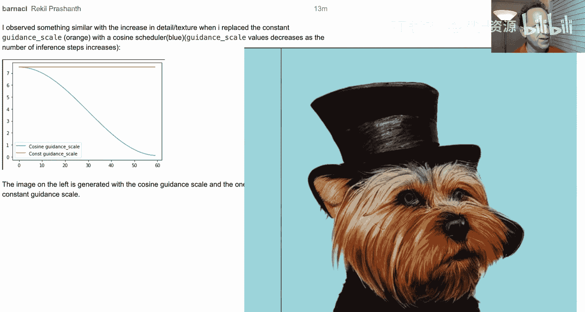
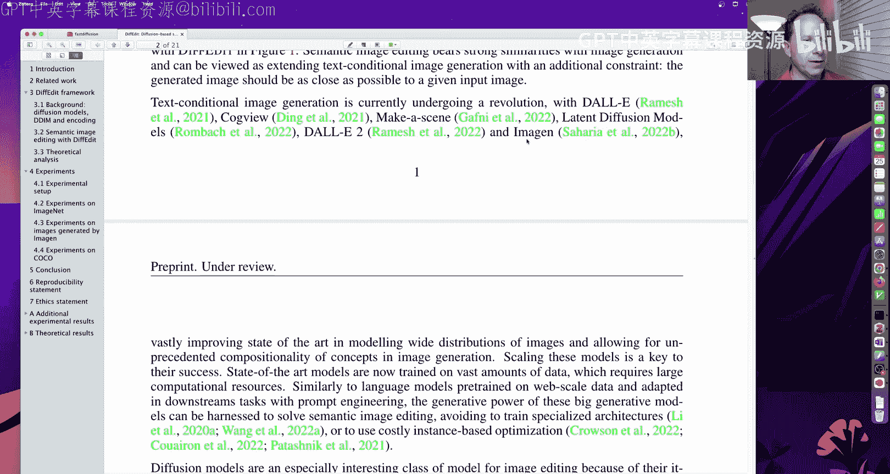
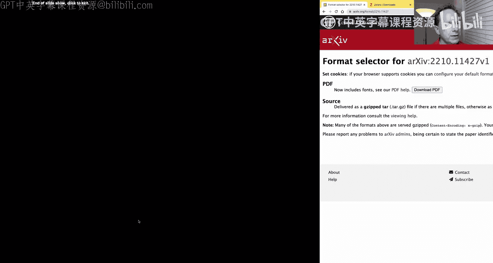
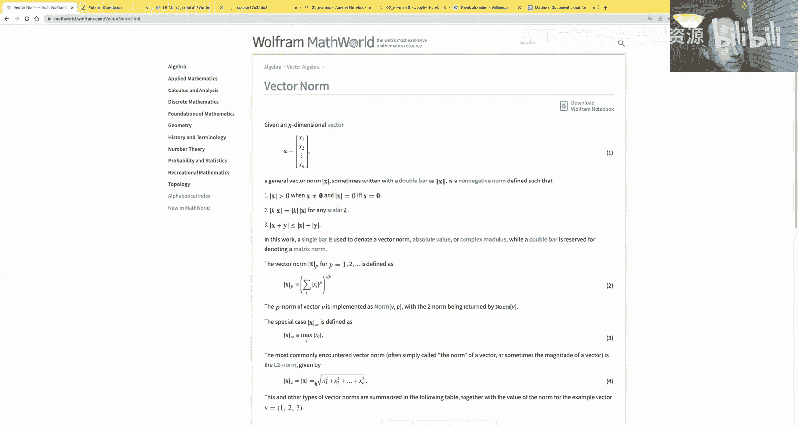
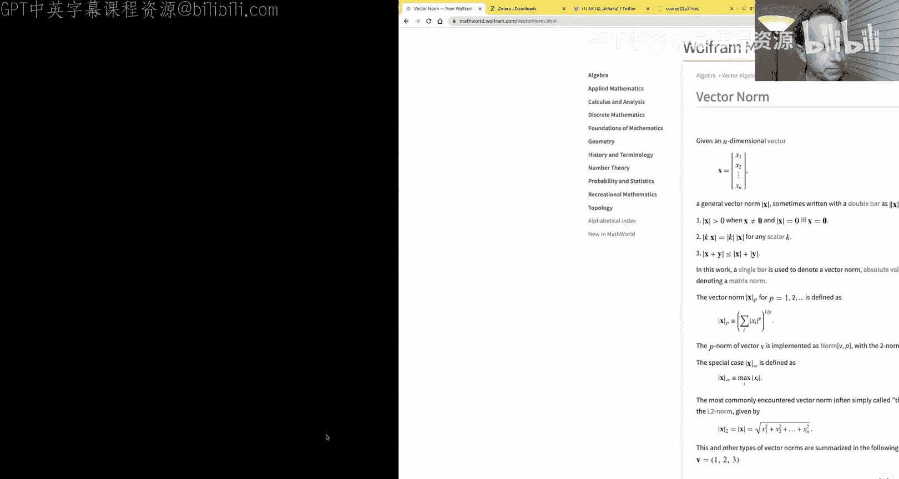
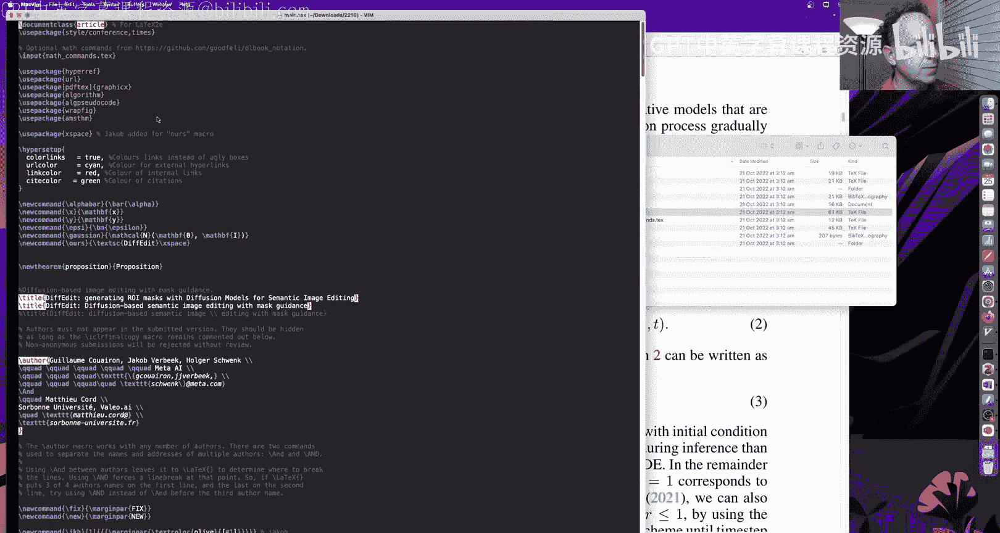
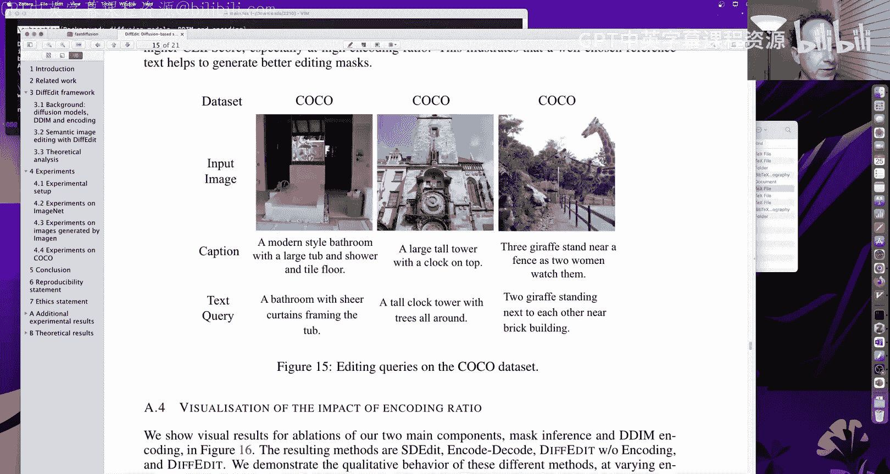
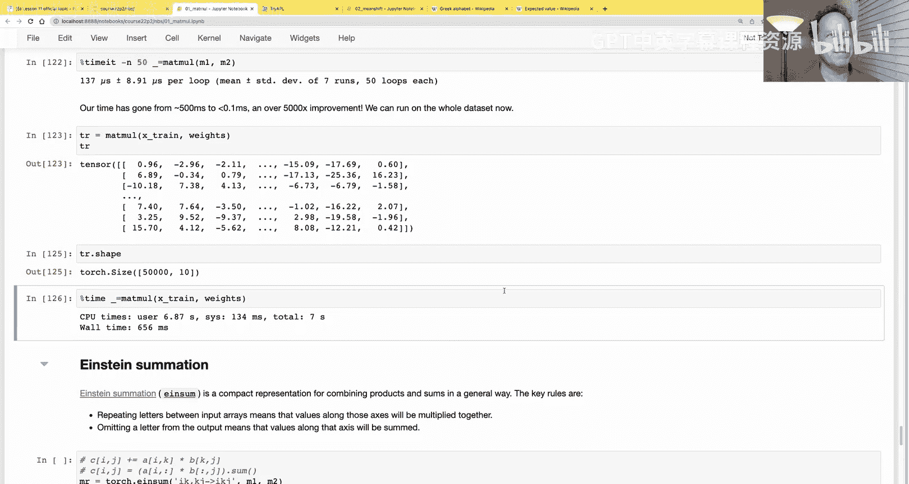

# Jeremy《深度学习基础到稳定扩散模型｜Deep Learning Foundations to Stable Diffusion》中英 p05 Lesson 11 2022_ Deep Learning Foundations to Stable Diffusion.zh_en -BV1Mp421S7xg_p5-

Hi everybody， welcome to lesson 11， this is the third lesson in part two。

Depending on how you count things there's been in a lesson A and lesson B。

 it's kind of the fifth lesson part two， I don't know what it is so we'll just stick to calling it lesson 11 and avoid getting too confused I'm already confused。

😊，嗯。My goodness。 I've got so much stuff to show you。

 I'm only going to show you a tiny fraction of the cool stuff that's been happening on the forum this week。

 but it's been。😊，Amazing。嗯。I'm going to start by sharing this beautiful video from John Robinson。

 I should see。😊，I've never seen anything like this before。 As you can see， it's very stable。

And it's really showing this beautiful。Movement between seasons。

So what I did on the forum was I said to folks， hey， you should try interolating between prompts。

 which is what John did。 And I also said you should try using the last image of。

The previous prompt interpolation as the initial image for the next prompt。And anyway。Here it is。

 came out beautifully， John was the first to get that working， so I was very excited about that。😊。

And the second one I wanted to show you。U。Is this really amazing work from Sebderhi， who Sebastian。

 who did something that I'd been thinking about as well。

 I'm really thrilled that he also thought about this which was，😊，He noticed that this update we do。

Unconditional embeddings plus guidance times， text embeddings， minus unconditional embeddings。

UHa a bit of a problem， which is that it it gets。Big。😡。

To show you what I mean by it gets big is like， imagine that we've got。We've got a couple of vectors。

On this chart here。😔，Okay， and so we've got， let's see。 So we've got， that's just， okay。

 so we've got the original unconditional piece here。 So we've got you。So let's say this is you。Okay。

 and then we add to that sum。Amount of t minus U。 So if we've got like。T。That says， it's huge。Right。

 and we've got you。Again。Then the difference between those is the vector， which。Ca here。Right。Now。

 you can see here that if there's a big difference between T and U。Then the eventual update。

Which actually happens。Is。Ops， you， Daisy， I thought that's going to be anarrow。

 Let's try that again。The eventual update which happens。Is far bigger than the original update。

 And so it jumps too far。嗯。So this idea is basically to say， well。

 let's make it so that the update is no longer than the original unconditioned update would have been。

 and we're got to be talking more about norms later。

 but basically we scale it by the ratio of the norms。

And what happens is we start with this astronaut。And we。Move to。嗯。This astronaut。

 and it's kind of it's a， it's a subtle change， but you can see this' a lot more before， after。

 before， after a lot more texture in the background。嗯。And like on the on the earth。

 there's a lot more detail before after。You say that？

And even little things like before the bridal kind of rains， whatever were pretty flimsy。

 now they look quite proper， so it's made quite a big difference just to kind of get this scaling。😊。

Correct。嗯。So another example， there's a couple of other things that Sebastia tried。

 I'll explain in a moment， but you can see how some of them actually resulted in changing the image and this one's actually important because the poor horse used to be missing a leg。

😊，And now it's not missing a legs。 That's good。And so here's the detailed one with its extra leg。

 So how did he do this？ Well， so what he did was he started with this unconditioned。

Prompt plus the guidance times a difference between the conditional and unconditioned。嗯。

And then as we discussed， the。Next version well actually the next version we then saw is to basically just take that prediction and scale it according to the difference in the lengths。

 so the norms is basically the length of the vectors and so this is the second one I did in lesson9 you'll see it's gone from here so when we go from 1 A to 1 B。

You can see here it's got look at this。 This boots's gone from nothing to having texture。 this。

 I whatever the hell this thing is。 suddenly he's got texture。 And look。

 we've now got proper stars in the sky。It's made a really big difference and then the second change is not just to rescale the whole prediction。

 but to rescale the update。And when we rescale the update。

 it actually not surprisingly changes the image entirely。😊。

Because we're now changing the direction it goes。And so I don't know。 is this better than this。

 I mean， maybe maybe not。 you know， I think so， you know。

 particularly because this was the difference that added the the correct fourth leg to the horse before。

 And then we can do both。 We can rescale the difference and then rescale the result and then we get the best of both worlds。

 as you can see。Big difference， we could a nice background。

 this weird thing on his backs actually become an arm。U。

That's not what a foot looks like that is what a foot looks like So these little details。😊。

Make a big difference as you can see。So this is a really cool or two， really cool。😊，New things。

 new things tend to have wrinkles though wrinkle number one is after I shared on Twitter Sebastier's approach。

 Ben Paul， who's Google Bra I think if I remember correctly pointed out that this already exists。

 he thinks it's the same as what's shown in this paper which is a diffusion model for text to speech I haven't read the paper yet to check whether it's got all the different options or whether it's checked them all out like this。

 so maybe this is reinventing something that already existed and putting it into a new field。

 which would still be interesting anyway， so hopefully folks on the forum you can help figure out。😊。

Whether this paper is actually。Showing the same thing or not。

And then the other interesting thing was John Robinson got back in touch on the forum and said， oh。

 actually that。That tree video。Doesn't actually do what we think it does at all。

 there's a bug in his code。😊，And despite the bag， it accidentally worked really well。

 So now we're in this interesting question of trying to figure out like， oh， why did we？😊。

How did he create such a beautiful video by mistake and okay， so reverse engineering。

 exactly what the bug did and then figuring out how to do that more intentionally。 And this is great。

 right， It's it's really good to。😊，Um， you know， having a lot of people working on something the and the bugs often。

😊，Yeah， they tell us about new ideas， so that's very interesting so watch this space where we find out what John actually did and how come it worked so well。

😊。

嗯。I then something that I just saw like two hours ago on the forum。

 which I had never thought of before， but I had thought of something a little bit similar。😊。

Rqueo Prachhan said like， well what if we took this。

 so if you can see all the students are really bouncing ideas of each other， it's like， oh。

 it's interesting， we're doing different things with a guidance scale。😊。

What if we take the guidance scale and rather than keeping it at 7。5 all the time， let's reduce it？

And this is a little bit similar to something I suggested to JonO a few weeks ago where I said he was doing some stuff with like modifying gradients based on additional loss functions and I said to him。

 maybe you should just use them like occasionally at the start。😊。

Because I think the key thing is once the model kind of knows roughly what image it's trying to draw。

 even if it's noisy， you know you can let it do its thing and this is exactly what's happening here is Re's idea is to say well let's decrease the guidance scale so at the end it's basically zero and so once it kind of is in going in the right direction we let it do its thing。

😊，So this little dogie is with the normal 7。5 guidance scale。Now have a look， for example。

 it's I here it's pretty。😊，Dent， uninteresting， pretty flat。 And if I go to the next one。

As you can see now， actually look at the eye。 That's a proper eye before。Totally glassy black now。

 proper eye or like， look at all this fur very textured， previously very out of focus。 So this is。

 again， a new。Technique。Um。So。I love this， you know， you your folks are。Trying things out。

And some things are working and some things's not working and that's all that's all good。

 I kind of feel like you're going to have to slow down because I'm having trouble keeping up with you all。

 but apart from that。😊。

Yes it's great good work I also wanted to mention on a different theme to check out Alex's notes on the lesson because I thought he's done a fantastic job of showing like how to how to study how to study a lesson and so what Alex did。

 for example， was he made a list in his notes of all the different steps we did as we started the front of the foundations。

😊，What is the library that it comes from， links to the documentation。

 and I know that Alex's background actually is history。You know。

 not not computer science and so you know， for somebody moving into a different field like this。

 this is a great idea， you know， particularly to be able to like look at like， okay。

 what are all the things that I'm going to have to learn and read about。😊。

And then he did something which we always recommend which is to try the lesson on a new data。

 and he very sensibly picked out the fashionash MNIS data。

 which is something we'll be using a lot in this course because it's a lot like MNT。

And it's just different enough to be interesting and so he described in his post or his notes how he went about doing that and then something else I thought was interesting in his notes at the very end was he just jotted down my tips it's very easy when I throw a tip out there to think oh that's interesting that's good to know and then it can disappear so here's a good way to make sure you don't forget about all the little。

😊，But little tricks and I think I've put those notes in the forum wiki so you can you can check them out if you'd like to learn from them as well。

 so I think this is a great role model。😊，Good job， Alex。Um。Okay， so。During the week。

John O taught us about a new paper that had just come out called Deaf Edit and he。

Told us he thought this was an interesting paper。And。

It came out during the week and I thought it might be good practice for us to try reading this paper together。

So let's do that， so here's the paper di at。😊，And you'll find that。

Probably the majority of papers that you come across in deep learning will take you to archive。

Archive is a preprint server。So these are。Models these are papers that have not been peer reviewed。

I would say in our field。We don't generally or I certainly don't generally care about that at all because we have code。

 we can try it， we can see things， whether it works or not。

 you know we tend to be very you know most papers are very transparent about here's what we did and how we did it and you can replicate it。

And it gets a huge amount of peer review on Twitter。😊。

So if there's a problem generally within 24 hours， somebody has pointed it out。

 so we use archive a lot and if you wait until it's been peer reviewed。

 you know you'll be way out of date because this field is moving so quickly。😊。

So here here it is an archive and we can read it by clicking on the PDF button。

 I don't do that instead I click on this little button up here。😊。

which is the save to Ztoro button so I figured I'd show you like my preferred workflows。

 you don't have to do the same thing， there are different workflows。

 but here's one that I find works very well。😊，Which is Zorro is a piece of free software that you can download for Mac Windows Linux and install a Chrome connector。

Oh， Taishka saying the buttons covered。 Alright， so in my taskbar。

 I have a button that I can click that says save to Zro， sorry not taskbar Chrome menu bar。

And when I click it， I'll show you what happens。 So after I've downloaded this。😊，The paper。

Will automatically appear here in the software。Which is odoro。And so here it is， di edit it。嗯。😊，And。

You can see it's told us it's got here the abstract， the authors。

Where it came from and so later on I can go and like if I want to check some detail。

 I can go back and see the URL， I can click on it， pops up and so in this case what I'm going to do is I'm going to double click on it。

And that brings up the paper。Now， the reason I like to read my papers in Zro is that I can you know。

 annotate them， edit them， tag them， put them in folders and so forth。

 and also add them to my kind of reading list directly from my web browser。 So as you can see。

 you know， I've started this fast diffussion folder。 which is actually a group library。

 which I share with the other folks working on this。

Fast diffusion project that we're all doing together and so we can all see the same paper library。

So Maribu on YouTube chat is asking is this better than Mendeley， yeah。

 I used to use Mendelay and it's kind of gone downhill， I think Zdaero is。Far， far better。

 but they're both very similar。😊，um。Okay， so maybe double click on it。😊，It opens up。

And here is a paper。😊，So reading a paper is。Always extremely intimidating。U。

And so you just have to do it anyway。 And you have to realize that your goal is not to understand every word。

 Your goal is to understand。The basic idea， well enough that for example， when you look at the code。

 hopefully it comes with code， most things do， that you'll be able to kind of see how the code matches to it and that you could try writing your own code to implement parts of it yourself。

😊，So over on the left， you can open up the sidebar here。

 so I generally open up the table of contents and get a bit of a sense of， okay。

 so there's some experimental results， there's some theoretical results。嗯。

Introuction related work okay tells us about this new di edit thing， some experiments， Okay。

 so that's a pretty standard approach that you would see in papers。

So I would always start with the abstract， Okay， so what's it saying this does。

So generally it's going to be some background sentence or two about how interesting this field is is just saying wellow we image generations call which is fine and then they're going to tell us what they're going to do which is they're going to create something called deaf editit。

Um。And so this is a what is it for it's going to use text condition diffusion models so we know what those are now that's what we've been using。

 that's where we type in some text and get back an image of that。That matches the text。

But this is going to be different。 It's the task of semantic image editing Okay。

 we don't know what that is yet， so let's put that aside and think okay。

 let's make sure we understand that later。The goal is to edit an image based on a text query。 Oh。

 okay， so we're going to edit an image based on text。 How on earth would you do that。A。

 they're going to tell us straight away what this is， semantic image editing。

 it's an extension of image generation。With an additional constraint。

 which is the generated image should be as similar as possible to the given input。 And so generally。

 as they've done here， there's going to be a picture that shows us what's going on。

 And so in this picture you can see here， an example is an input image。And originally。

 it was attached to a caption， a bowl of fruits。Okay， we want to change this into a bowl of pairars。

 so we type a bowl of pears。And it generates， oh， a about of pez。

Or we could change it from a bowl of fruit to a basket of fruits。 and oh。

 it's become a basket of fruits。 Okay， so I think I get the idea， right？um。

What it's saying is that we can edit an image by typing what we want that image to represent。

 So this actually looks a lot like the paper that we looked at last week。Um。So that's cool。😊。

So the abstract says that currently， so I guess there are current ways of doing this。

 but they require you to provide a mask， that means you have to basically draw the area you're replacing okay。

 so that sounds really annoying but our main contribution so what this paper does is we automatically generate the mask。

So they simply just type in the new query and get the new image so that sounds actually really impressive。

 So if you read the abstract and you think I don't care about doing that。

 then you can skip the paper you know。😊，Or look at the results。

And if the results don't look impressive， then just skip the paper。

 So that's that's kind of your first point where we can be like， okay we're done。

 but in this case this sounds great。 the results look amazing， so I think we should keep going。😊。

Okay， the chief state of the uploading performance， of course， fine， when we try some right。

 whatever， okay。😊，Soir。The introduction to a paper is going to try to give you a sense of。

You know what they're trying to do。And so this first paragraph here is just repeating what we've already read in the abstract and repeating what we see in figure one。

 so saying that we can take。A tax query like a basket of fruits， see the examples all right， fine。

 we'll skip through there。😊，So a key thing about academic papers is that they are full of。Citations。

嗯。You should not expect to read Hall of them。Because if you do then to read each of those citations。

 that's full of citations and then they're full of citations and before you know it。

 you've read the entire academic literature， which has taken you 5000 years。

 So for now let's just recognize that it says text conditional image generations undergoing revolution here's some examples Well fine we actually already know that Okay d's call latent diffusion that's what we've been using。

 that's called Egen apparently that's cool so cool all right so we kind of know that so generally there's this like okay our area that we're working on is important Now in this case we already agree it's important so we can skip through it pretty quickly。

😊。

They have vast amounts of data are used， yes， we know。U。Okay， so。Diffusion models are interesting。

 Yes， we know that。 They denoy starting from Gaussian noise。 We know that。

 So you can see like there's a lot of stuff Once you're kind of in the field。

 you can skip over pretty quickly。 You can guide it using clip guidance。 Yeah。

 that's what we've been doing。 We know about that。 Oh， wait， this is new or by in painting。😊。

By copy pasting pixel values outside a mask。All right。

 so there's a new technique that we haven't done， but I think it makes a lot of intuitive sense that is during that diffusion process。

 if there are some pixels you don't want to change，😊，Such as all the ones that aren't orange here。

 You can just past them from the original after each stage of the diffusion。 All right。

 That makes perfect sense。 If I want to know more about that， I could always look at this paper。

 but I don't think I do for now。Okay， and again， it's just repeating something they've already told us that there。

They require to provide a mask， so it's a bit of a problem。U。And then， you know， this is interesting。

 it also says that when you mask out an area。That's a problem because if you're trying to。

 for example， change a dog into a cat。You want to keep the animal' color and pose。

 So this is a new technique which is not deleting the original you know。

 not deleting a section and replacing it with something else。

 but it's actually going to take advantage of knowledge about what that thing looked like so that this is called two cool new things。

So hopefully at this point， we know what they're trying to achieve。

If you don't know what they're trying to achieve when you're reading a paper the paper won't make any sense so again that's a point where you should start。

 maybe this is not the right time to be reading this paper。

 maybe you need to read some of the references。Maybe you need to look more at the examples so you can always skip straight to the experiments。

 So I often skip straight to the experiments。 In this case， I don't need to because they've put。

Enough experiments on the very first page for me to see what it's doing。So yeah。

 don't always read it from top to bottom。Okay， so。😊，All right。

 so they've got some examples of conditioning a diffusion model on an input without a mask。Okay。

 for example， you can use a noise version of the input as a starting point hey we've done that too so as you can see we've already covered a lot of the techniques that they're referring to here something we haven't done but makes a lot of sense is that we can look at the distance to the input image as a loss function Okay that makes sense to me and there's some references here。

😊，Um。All right， so we're going to create this new thing called di edit， it's going to be amazing。😊。

W to you， check it out， Okay， fine。Okay， so that's the introduction。

 hopefully you found that useful to understand what we're trying to do。😊。

The next section is generally called related work as it is here。

 and that's going to tell us about other approaches。U。So if you're doing a deep dive。

 this is a good thing to study carefully I don't think we're going to do a deep dive right now so I think we can happily skip over it。

 we could kind of do a quick glance of like oh image editing can colorization。

 retouching style transfer， okay called lots of interesting topics definitely getting more excited about this idea of image editing。

😊，Um。And there's some different techniques。嗯。You can use clip guidelines okay。

 they can be computational expensive。U。We can use diffusion for image editing。Okay， fine。

 We can use clip to hoppers so there's a lot of repetition in these papers as well。

 which is nice because we can skip over it pretty quickly。😊，more about the high computational cast。

 okay， so they're saying this is going to be not so computationally expensive， that sounds hopeful。嗯。

And often the very end of the related work is most interesting as it is here where they've talked about how somebody else has done。

 okay concurrent to hours， somebody else is working at exactly the same time。😊。

And they've looked at some different approach。U。Okay， so。Don't share。

 Dont Not sure we learn too much from their related work。 but if you were trying to really。

Do the very， very best possible thing you could study the related work and get the best ideas from each。

Okay， now。Background。So。This is where it starts to look scary。I think we could all agree。U。

And this is often the scariest bit， the background。 This is basically saying like mathematically。

Here's how the problem that we're trying to solve is set up。

And so we're going to start by looking at dennoising diffusion probabilistic models， DDPM。

 Now if you've watched lesson 9 B with Wassim and Tishch。Then， you've already seen。

Some of the math of 80 PM。And the important thing to recognize is that basically。No one in the world。

 pretty much。It's going to look at these paragraphs of text and these equations and go， oh， I get it。

 That's what DDPM is。 That's not how it works， right？To understand DDPM。

 you would have to read and study the original paper， and then you would have to。

Read and study the papers it's based on and talk to lots of people and watch videos and go to classes just like this one and after a while you'll understand DPm and then you'll be able to look at this section and say。

 oh okay I I see they're just talking about this thing I'm already familiar with so this is meant to be a reminder of something that you already know it's not something you should expect to learn from scratch。

😊，So let me take you through。😊，These equations， somewhat briefly。

 because Wasim and Tunishkas have kind of done them already because every diffusion paper pretty much is going to have these equations。

😊，U。Okay， so。Oh， and I'm going just going to read something that Jon O pointed out in the chat。

 he says it's worth remembering the background is often written last and tries to look smart for the reviewers。

Which is correct so feel free to read it last two yeah absolutely I think the main reason to read it is to。

😊，Find out what the different letters mean what the different symbols mean。

 because they'll probably refer to them later， but in this case I want to actually take take this as a way to learn how to read math。

😊，So let's start with this very first equation， which how on earth do you even read this？😊。

So the first thing I'll say is that this。Is not an A。

Right it's a weird looking E and the reason it's a weird looking E is because it's a Greek letter and so something I always recommend to students is that you learn。

😊，The Greek alphabet。Because it's much easier to be able to actually read this to yourself。

 So here's another one。 right， If you don't know that's called The。

 I guess you have to read it as like。Circle with line through it。

 It's just going to get confusing trying to read an equation where you just can't actually say it out loud。

Soir。What I suggest is。That you learn that， learn the Greek alphabet and let me。Find the right place。

So it's very easy to look it up just on Wikipedia heres the。😊，Greg alphabet。And if we go down here。

 you'll see they've all got names and we can go and try and find。Our one curvy E， okay， here it is。

 Epsilon。And oh， circle with a line through it， Theta right。

Practice and you will get used to recognizingogni teeth so you've got。Epsilon Theta。

This is just a weird curly L， so' this is used for the loss function。😊，Okay。

 so how do we find out what this symbol means and what this symbol means？Well， what we can do。😊。

Is there's a few ways to do it one way， which is kind of cool。Is。

We can use a program called maththPs， which。Math pics。Here we are， math picks。😊，And what it does is。

You。Basically， select。Edthing on your screen。And it will turn it into lateek。

So that's one way you can do this is you can select on the screen， it turns it into latex。

 and the reason it's good to turn it into latex is because latex is written as actual。

Stuff that you can search for。On Google。😊，So that's technique one number one technique number two。😊。

Is you can download the other formats。Of the paper。And。That'll have a download source。And if we say。

 download source。Then what we'll be able to do is we'll be able to actually open up。😊。

That latex and have a look at it。 So we'll wait for that to download while that's happening。

 let's keep moving along here。

So in this case， we've got these two bars。So can we find out what that means？

So we could try a few things。😊，We could try looking for two bars。Maybe math notation。Oh， here we are。

 I was hopeful。 What does this mean in mathematics Oh。

 and here there's a glossary of mathematical symbols。😊，Here there's a meaning of this in math。

So that looks hopeful。😊，Okay， so it definitely doesn't look like this。

 it's not between two sets of letters。But it is around something that looks hopeful。

So it looks like we found it。 It's a vector norm。 Okay。

 so then you can start looking for these things up so we can say norm or maybe vector norm。

And so once you can actually find the term， then we kind of know what to look for。Okay， so。

In our case， we've got。They're surrounding all this stuff and then there's twos here and here what's going on here。

Al right， if we scroll through， oh， this is pretty close， actually。嗯。So。Okay。

 so two bars can mean a matrix norm， otherwise a single for a vector norm that's just here in particular。

 it looks like we don't have to worry too much about whether it's one or two bars。

 no and then here's a definition。Oh， that's handy， so we've got the two one。😊，All right。

 so it's equal to root summer squs。😊。

So that's good to know， so this norm thing means a root sum of squares。😊。

But then we've got a two up here， well that just means squared。😊，So this is a root。 summer squares。

 squared。Well， the square of a square root is just the thing itself。 So actually。

 this whole thing is just the sum of squs。It's a bit of a weird way to ride it， in a sense。

We could perfectly well of just。Written it as， you know， like。Some of。You know。Whatever it is。

Squared。Fine， but there we go。😊，嗯。Okay， and then what about this thing here？Weird Eing。

 so how would you find out what the weird E thing is？Okay， so our。😊，Our。

Laateek has finally finished downloading。And if we open it up。

 where you can find there's a dot tech file in here Here we are， main dot tech。So we'll open it。

And it's not the most， you know。Amazingly smooth process， but you know。

 what we could just do is we could say， okay， it's just after it says minimizing the denoising objective。

Okay， so let's search for minimizing the D oh here it is， minimizing the D I objective。

So the latex here， let's get it both on the screen at the same time。Okay， so here it is L。

 mathth Q L equals mathth B， B， E。X naught t。Apsilon。Okay， and here's that vertical bar thing。

 Epsilon minus epsilon Theta X T， and then the bar thing22。 All right。

 so the thing that we've got new is math B， B， E。 Okay， so finally。

 we've got something we can search for。Math baby a。Fantastic。 What does Mathbabe A mean。😊。

That's the expected value operator。Aha， fantastic。 All right， so。😊，It takes a bit of fussing around。

 but once you've got either math picks working or actually another thing you could try because math picks is ridiculously expensive in my opinion is there is。

😊，There is a free version called Pix to Tech。That actually is a。Python thing。

 And you could actually even have fun playing with this because。The whole thing is just a pieytorrch。

Python script。And it even describes。You know， how if use to transformers model and you can train it yourself in coabab and so forth。

 but basically as you can see， yeah， you can snip。And convert to latex。Which is pretty awesome。

 so you could use this instead of paying the math picks guys。Anyway， so we are。😊。

On the right track now， I think。So， expected value。

And then we can start reading about what expected value is and you might actually remember that because we did a bit of it in high school。

 at least in Australia we did it's basically like。😊，Let's maybe jump over here。So， expected value。

Of something is saying what what's the likely value of that thing。 So for example。

 let's say you toss a coin which could be heads or it could be tails And you want to know how often it's heads and so maybe you'll call heads 1 tails 0 So you toss it and you get a 1。

0，0，1，1，0，1，0，1， okay and so forth right and then you can calculate the mean of that right So if that's x。

 you can calculate x bar the mean which would be the sum of or that。Divided by the count of all that。

So it be1，2，3，4，55 divided by 1，2，3，456789 okay so that would be the mean。

 but the expected value is like well what what do you expect to happen and we can calculate that by adding up for all of the possibilities？

😊，For each channel， let us call them x for each possibility x， how likely is x？😊。

And what score do you get if you get x。 So in this example of heads and tails。

 our two possibilities is that we either get heads or we get tails。

So if for the version where x is heads， we get probability is 0。5。And the score。

 if it's an x because I should the score if it's an x is going to be one。

And then what about tails for tails， the probability is 0。5， and the score， if you get tails is 0。

And so overall， the expected is 0。5 times 1 plus 0 is 。5。

So our expected score if we're tossing a coin is 0。5， if getting heads is a win。😊，嗯。😊。

Let me give you another example， Another example is let's say that we're rolling a day。

And we want to know what the expected score is if we roll a die， so again。

 we could roll it a bunch of times。😊，And see what happens。Okay。

 and so we could sum all that up less like before。😊，And divide it by the count。

And that'll tell us the mean for this particular example。

 but what's the expected value more generally？😊，Well。Again。

 it's the sum of all the possibilities of the probability of each possibility times that score。

So the possibilities for。😊，Rolling a die is that you can get a1 or2 or 3 or4 or5 or a 6。

 the probability。Of H1。Is a sixth。Okay。And the score that you get is， well， it's this。

 this is the score。And so then you can multiply all these together。😊，And sum them up。

 which will be 1，6。Plus 2，6。Plus， 3，6。Plus， 4，6。Oops， plus 5，6。Plus。6，6。And that would give you。

The expected value of。That particular thing， which is rolling day rolling a day。

So that's what expected value means。😊，All right so。

That's a really important concept that's going to come up a lot as we read papers。嗯。

And so in particular， this is telling us what are all the things that we're。😊，Averaging it over。

 that was the expectations over。 and so there's a whole lot of letters here。😊。

You' are not expected to just know what they are。 In fact， in every paper。

 they could mean totally different things。 So you have to look immediately underneath where they'll be defined。

So x0 is an image， it's an input image。Epsilon is a noise。

And the noise has a mean0 and a standard deviation of I， which if you watch the lesson 9 B。

 you'll know it's like a standard deviation of1 when you're doing multiple normal variables。😊，Okay。

 and then this is kind of confusing Eda just on its own is a normally distributed random variables。

 it's just grabbing random numbers。😊，But Eta the sorry epsilon， but Epsilon Theta。😊。

I's a noise estimator。 That means it's a function。 You can tell it's a function。

Kind of cause it's got these parentheses and stuff right next to it。 So that's a。A function。

 so presumably most functions like this in these papers and neural networks。😊，Okay。

 so we're finally at a point where this actually is going to make perfect sense。 We've got the noise。

😊，We've got the prediction of that noise。 We attract one from the other。We square it。

And we take the expected value。 So in other words， this is。Main square error。So， well。

 that's a lot of fiddling around to find out that withve this whole thing here means means squared error。

 So the loss function。Is the main great error。And unfortunately。

 I don't think the paper ever says that。 It says minimizing the de noising objective L。

 bloody b bloody， bloody。But anyway， we got there eventually。Fine。

 we also as well as learning about x n， we also learn here about xt and so xt。

Is the original unnooticed image。Times。Some number。Plus。Some noise times one minus that number， okay。

 and so hopefully you'll recognize this from lesson 9 B。

 this is the thing where we reduce the value of each pixel and we add noise to each pixel。😊。

So that's that。😊，All right， so I'm not going to keep going through it。

 but you can kind of basically get the idea here is that once you know what you're looking for。

The equations do actually make sense， right but but all this is doing is remember。

 this is background， right， This is telling you what already exists。

 This is telling you this is what a D PMM is。And then it tells you what a DD I am is。嗯。

DDILook just think of it as a more recent version of DDPM。

 it's some very minor changes to the way it's set up， which allows us to go faster。U。Okay。

 so the the thing is， though， once we keep reading， what you'll find is。

None of this background actually matters， but you know。

 I thought we'd kind of go through it just to get a sense of like what what's in a paper？😊，Okay。

 so for the purpose of our background， it's enough to know that DDPM and DDI am are kind of the foundational papers on which diffusion models today are based。

😊，Okay。So。The encoding process。Which encodes an image onto a latent variable。😊，Okay。

 and then this is basically adding noise， this is called DDI am encoding。

And the thing that goes from the input image to the noise image， they're going to call capital AR。

And I is the encoding ratios， that's going to be some like how much noise are we adding。

If you use small steps。😊，And。Decoding that。So going backwards gives you back the original image。

 Okay， so that's all the stuff that we've learned about。 That's what diffusion models are。All right。

 so。This looks like a very useful picture。😊，So maybe let's take a look and see what this says。

 so what ised de edit has three steps。Step1。We add noise to the input image。

 That sounds pretty normal。 Here's our input image， X n。Okay， and we add noise to it。finine。

And then we dennoise it。Okay， fine。 but we dennoise it twice one time。We dennoise it。

Using the reference text R。Hse。Or this special symbol here means nothing at all。

 so either unconditional or hoarse。All right， so we do it once using the word horse， so we take this。

And we decode it， estimate the noise， and then we can remove that noise on the assumption that it's a horse。

Then。We do it again。But the second time we do that noise when we calculate the noise， we pass in。

Our query Q， which is zebra。Wow， those are going to be very different noises。

The noise for horse is just going to be literally these Gaussian pixels， these are all ducks， right。

 because it is a horse。😊，But if the claim is， no， no， this is actually a zebra。

 then all of these pixels here are all wrong。 They're all the wrong colour。

So the noise that's calculated if we say this is our query。😊。

It's going to be totally different to the noise if we say this is our query。

And so then we' just take one minus the other。😊，And here it is here。

So we derive a mask based on the difference。In the denoing results。

And then you take that and binaryize it， so basically turn that into ones and zeros。

 so that's actually the key idea。That's a really cool idea。

 which is that once you have a diffusion model that's trained。

 you can do inference on it where you tell it the truth about what the thing is。

 and then you can do it again but lie about what the thing is and in your lying version it's going to say okay。

 all the stuff that doesn't match zebra must be noise。

And so the difference between the noise prediction when you say， hey。

 it's zebra versus the noise prediction。 when you say， hey。

 it's a horse will be all the pixels that it says no， these pixels are not zebra。 The rest of it。

 it's fine。 There's nothing particularly about the background that wouldn't work with the zebra。Okay。

 so that's step one。😊，So then step two。😊，As we take。The horse。And we。Add noise to it。Okay。

 so that's this Xr thing that we learned about before。And then， step 3。We did do coding。

Conditioned on the text query。Using the mask to replace the background with pixel values。

 So this is like the idea that we heard about before， which is that during the inference time。

 as you do， diffusion from this。Fuzzy horse。What happens is that we do a step of diffusion inference。

 and then all these black pixels we replace with the noise version of the original。

And so we do that multiple times。 And so that means that the original pixels。In this black area。

 won't get changed。And that's why you can see in this picture here and this picture here。

 the backgrounds all the same。😊，Now the only thing that's changed is that the horse has been turned into a zebra。

So this paragraph describes it。😊，And then you can see here it gets you in a lot more detail。😊。

And the detail often has all kinds of like little tips about things they tried and things they found。

Which is pretty cool。So I won't read through all that because it says the same as what I've already just said。

One of the interesting little things they note here actually is that this binized mask。

 so this difference between the R decoding and the QDding tends to be a bit bigger than the actual area where the horse is。

 which you can kind of see with these legs for example。

 and their point is that they actually say that's a good thing。

Because actually often you want to slightly change some of the details around the object。

 so this is actually fine。U。Allright， so we have the description of what the thing is。

 lots of details there， and then here's the bit that I totally skip。

 the bit called theoretical analysis where this is the stuff that people really generally just a to try to get their papers past review。

 you have to have fancy math and so they're basically proving you can see what it says here。

 insight into why this component yields better editing results than other approaches。😊。

I'm not sure we particularly care because like it makes perfect sense what they're doing。

 it's intuitive and we can see it works， I don't feel like I need it proven to me so I skip over that。

😊，So then they'll show us their experiments to tell us what data sets they did the experiments on。😊。

And so then， you know， they have metrics with names like LP IPS and CSFID you'll come across FID a lot。

 this is just a version of that where basically they're trying to score。😊。

How good their generated images we don't normally care about that either。

 They care because they need to be able to say you should publish our paper because it has a higher number than the other people that have worked on this area。

 In our case， we can just say you know， it looks good。 I like it。😊。

so excellent question in the chat from Micoage， which is so with this only work on things that are relatively similar and I think this is a great point right。

 this is where understanding this helps to know what its limitations are going to be and that's exactly right if if you can't come up。

😊，With a mask for the change you want。This isn't going to work very well on the whole， yeah。

 because those the masked areas， the pixel is going to be copied。😊，So for example。

 if you wanted to change it from you know， a bowl of fruits to。U。

A bowl of fruits with a boquet background Oh and know， or like a bowl of fruits with， you know。

 with a you know， a purple tinged photo of a bowl of fruit If you want the whole color to change。

 that's not going to work right because you're not masking off an area。Yeah。

 so by understanding the detail here， Micoage has correctly recognized a limitation or like what's this for。

 this is for things where you can just say just change this bit and leave everything else the same。😊。

All right， so there's lots of experiments so yeah for some things you care about the experiments a lot。

 if it's something like classification， stuff for generation。

 the main thing you've probably want to look at，😊，Is the actual results？And so。

And often for whatever reason， I guess because this is most people read these electronically。

 the results offered， you have to zoom into a lot to be able to see whether they're really good。😊。

So here's the input image。They want to turn this into an English fox hound so here's the thing they're comparing themselves to ST edit。

 and it changed the composition quite a lot。😊，And their version， it hasn't changed it at all。

 It's only changed the do。 And didto here， semi trailer truck。Yes yet it's totally changed it。

Daf at it hasn't。 So you can kind of get a sense of like， you know。

 the authors showing off what they're good at here， this is。

 this is what this technique is effective at doing。Changing animals and vehicles and so forth。

 it does a very good job of it。All right。嗯。So then there's going to be a conclusion at the end。

 which I find almost never adds anything on top of what we've already read and as you can see it's very short anyway。

嗯。Now quite often the appendices are really interesting so don't skip over them。

 often you'll find like more examples of pictures they might show you some examples of pictures didn't work very well。

 stuff like that， so it's often well worth looking at the appendices often some of the most interesting examples are there。

And that's it。 All right， so that is。I guess our first full on paper walk through。 And， you know。

 it's important to remember， this is not like。A carefully chosen paper that we've picked specifically because you can handle it like this is the most interesting paper that came out this week。

And so， you know， it gives you a sense of what it's really like and。Uh， for those of you who are。

 you know， ready to try something that's going to stretch you。😊。

See if you can implement any of this paper， so there are three steps。

The first step is kind of the most interesting one。

 which is to generate automatically generate a mask。

And the information that you have and the code that's in the lesson9 notebook。

Actually contains everything you need to do it。 So maybe give it a go， see if you can mask out。

The area of a horse that does not look like a zebra。

And that's actually you know that's actually useful of itself like that's that's allows you to create segmentation masks automatically so that's pretty cool and then if you get that working。

 then you can go and try and do step two if you get that working you can try and do step three and this already came out this week so I haven't really seen yeah examples of of。

😊，Easy to use interfaces to this so here's an example of a paper that you could be the first person to create a call interface to it so there's some yeah there's a fun little project and even if you're watching this a long time after this was released and everybody's been doing this for years still good homework I think to practice if you can。

All right， I think now's a good time to。Have a 10 minute break。

So I'll see you all back here in 10 minutes。Okay， welcome back。

One thing during the break that Diego reminded us about which I normally describe and I totally forgot about this time is deteify。

 which is another really great way to find symbols you don't know about so let's try it for that expectation so if youve got a deteify。

And you draw。The thing。It doesn't always work fantastically well， but sometimes it works very nicely。

嗯。Yeah， in this case， not quite。 What about the double line thing。

It's good to know all the techniques， I guess。You'd think it could do this one？

I guess part of the problem is there's so many options。😊，It actually， you know。Okay， in this case。

 it wasn't particularly helpful and normally it's more helpful than that， I mean。

 if we use a simple one like。😊，Apsilon， I think it should be fine。

There's a lot of room to improve this out actually if anybody's interested in a project。

 I think you could make it， you know。😊，More successful， okay。

 that's you go signal sum that's cool Anyway so there's it's another useful thing to know about just Google for Dt a Fa。

😊，Okay， so let's move on with our from the foundations now。😊，And so we were working on trying to。

At least get the start of a forward pass of a linear model or a simple multilayceptron for MNT going。

 and we had successfully created a basic tensor， we've got some random numbers going。

So what we now need to do is we now need to be able to multiply these things together matrix multiplication。

 so matrix multiplication。To remind you。In this case， so we're doing Mnnes， right， so we've got。嗯。

I think we're going to use a subset， let's see。Yeah， okay。

 so we're going to create a matrix called M1， which is just the first five digits。So， M1。😔。

Will be the first five digits。So， five rows。And oh， tut， tut， tut。Dot dot dot。

And then 780quarter it again， 784 columns。784 columns。Because it's 28 by 28 pixels。

 then we flattened it out。So this is our first matrix and our matrix modification。

 and then we're going to modifyply that by some。Some whites。So。

The weights are going to be 784 by 10 round numbers。 So for every one of these 784 pixels。

 each one is going to have a weight。So 784 down here。784 by 10。So this first column， for example。

It's going to tell us。All the weights in order to figure out if something are zero and the second column will have all the weights in deciding the probability of something a1 and so forth。

 that' assuming we're just doing a linear model。 and so then we've got to multiply these two matrices together。

So when we multiply matrices together。We take row1。Of matrixtri 1。And we take column one。If matrix 2。

And we take each one in turn， we take this one， we take this one， we model play them together。

And then we take this one。And this one， and we multiply them together。

And we do that for every element wise pair。😊，And then we add them all up。

And that would give us the value。For the very first cell。That would go in here。

That's what matrix modificationplication is。Okay， so。😊。

Let's go ahead and create our random numbers for the weights since we're allowed to use random number generators now。

 and for the bias， we' just use a bunch of zeros to start with。

So the bias is just what we're going to add。😊，To each one and so for our matrix modification。

 we're going to be doing a little mini batch here， we're going to be doing five rows of。

 as we discussed。Five rows of so five， five images flattened out。And then。

Moiply by this weights matrix。So here are the shapes M1 is 5 by 784， as we saw M2 is 784 by 10 Okay。

 so keep those in mind。So here's a handy thing， M1 do shape。Contains two numbers。

 And I want to pull them out。 I want to call。The I'm going to think of that as I'm going to actually think of this as like A and B rather than a under M2。

 so this is like A and B， so the number of rows in a and the number of columns in a。

If I say equals M1 do shape that will put 5 in AR and 784 in AC， So you'll probably notice this。

 I do this a lot this D structure and we talked about it last week too。

 so we can do the same for M2 dot shape， put that into B rows and B columns。

And so now if I write out AAC and BRBC， you can again see the same things from the sizes。

 so that's a good way to kind of give us the stuff we have to loop through。So here's our results。

 so our resultant tensor。Well we'relying， we're multiplying together all of these7，8。

4 things and adding them up。 so the resultant tensor is going to be。5 by。

10And then each thing in here is the result of multiplying and adding 784 pairs。

So the result here is going to start with zeros。And this is the result。

And it's going to contain AR rows，5 rows and B columns，10 columns，5 comma 10。 Okay。

 so now we have to fill that in。 And so to do a matrix modification。We have to first。

 we have to go through each row one at a time。And。Here we have that。

 go through each row one at a time。And then go through each column。One at a time。

And then we have to go through each pair。In that row column one at a time。

 so there's going to be a loop in a loop， in a loop。So here's we're going to loop over each row。

And here we're going to loop over each column。And then here we're going to loop so these colon and sea。

 and then here we're going to loop over。Each column of a。

Which is going to be the same as the number of rows of B， which we can see here。A，784， B R，784。

 they're the same， so it wouldn't matter whether we said AC or BR。So then our result。😊。

For that row and that column。We have to add on to it。The product of。

I in the first matrix the O J in the second matrix O is going up through those 7，84。

And so we're going to go across the columns and down， sorry across the rows and down the columns。

 it's going to go across the row whilst or whilst it goes down this column。

So here is the world's most naive， slow， uninteresting metrics multi。嗯。And if we run it。Okay。

 it's done something。 we have successfully， apparently， hopefully。

 successfully multily the matrices M1 and M2。 It's a little hard to read this， I find because。😊。

Because punch cards used to be 80 columns wide， we still assume screens 80 columns wide。

 everything defaults to 80 wide which is ridiculous。

 but you can easily change it so if you say set print options you can choose your own line width。

Oh if you can see well we know that's  five by 10， we did it before。

 so if we change the line width okay， that's much easier to read now we can see here are the five rows and here are the 10 columns for that matrix modification。

😊，I tend to always put this at the top of my notebooks and you can do the same thing for Numpy as well。

😊，So what I like to do， this is really important is when I'm working on code。

 particularly numeric code， I like to do it all step by step in Jupiter。

And then what I do is once I've got it working is I copy all the cells that have implemented that。

And I passed them。And then I select them all， and I hit shift M to merge。

Get rid of anything that prints out stuff I don't need。And then I put a header on the top。

Give it a function name。And then I select the whole lot and I hit。

Control or Apple right square bracket， and I've turned it into a function。

 but I still keep the stuff above it so I can see all the step by step stuff for learning about it later。

And so that's what I've done here to create this function。😊。

And so this function does exactly the same things we just did。

And we can see how long it takes to run by using percent time。And it took about half a second。

Which gosh， that's a long time to generate such a small matrix。 This is just to do 5。Emnes digits。

 So that's。Not got to be great。We're going to have to speed that up I'm actually quite surprised at how slow that is because there's only。

😊，39200 so you know if you look at how we've got a loop within a loop within a loop。

 a loop within a loop within a loop it's doing 39200。😊，Of face。So Python， yeah， Python。

 when you're just doing Python it is it is slow， so we can't we can't do that。

 that's why we can't risk rate Python。嗯m。But there is something that kind of lets us write Python。😊。

We could instead use number。Number is a system that takes Python。

And turns it into basically into machineach code。😊，And it's amazingly easy to do。

 you can basically take a function。😊，And right， end it at end it on top。

And what it's going to do is it's going to。😊，Look， the first time youve called this function。

 it's going to compile it down to Ma code。And it will run much more quickly。

So what I've done here is I've taken the。Inimmost loop。So just looping through。😔，And adding up。

All these。So start at zero， go through and add up all those just for two vectors and return it。

This is called a dot product and linear me have algebra， so we'll call it dot。😊，嗯。

And so number only works with nu Pi doesn't work with Py torch。

 so we're just going to use arrays instead of tensors for a moment。Now have a look at this。

 if I try to do a dot product of 1，2，3 and 2， three，4， that's pretty easy to do。

It took a fifth of a second， which sounds terrible。

 But the reason it took a fifth of a second is because that's actually how long it took to compile this and run it。

 Now that it's compiled the second time。It just has to call it。 It's now 21 microseconds。

And so that's actually very fastsed。So with number， we can basically make。😊，Python run at sea speed。

So now the important thing to recognize is if I replace。😊，This loop in Python。With a colded dot。

 which is running in machine code。Then we now have one， two loops running in Python， night3。So our。

448 milliseconds。Well， first of all， let's make sure if I run it。Run that map mall。

It should be close to my T1。 T1 is what we got。Before， remember。

So when I'm refactoring or performance improving or whatever I always like to put every step in the notebook and then test。

 So this test close comes from fast Qua test and it just checks that two things are very similar。

 They might not be exactly the same because of little floating point differences， which is fine。

 Okay， so our map mole is working correctly， or at least it's doing the same thing it did before。

 So if we now run it。It's taking 268 microseconds。Okay， versus 448 milliseconds。 So it's taking。

You know， about 2000 times faster。Just by changing the one innermost loop。

 so really all we've done is we've added our engine to make it 2000 times faster。😊。

So number is well worth knowing about。It can make your Python code very， very fast。Okay。

 let's keep making it faster。So we're going to use stuff again， which kind of goes back to APL。

And a lot of people say that learning APL is a thing that's taught them more about programming than anything else。

So it's probably worth。Considering。lening a。And let's just look at these various things we've got a is 10。

6 minus4。 So remember at APL we don't say equals equals actually means equals funly enough we to say set to。

 we use this arrow and it's this is a list of 10，64。Okay， and then B is 287。Okay。

And we're going to add them up a plus B。So what's going on here。

 So it's really important that you can think of。😊，A symbol like a， as representing。

A tensor or an array， AL calls them a race， Ptorch calls them tensors。Numply calls them a rose。

 they're the same thing。So this is a single thing that contains a bunch of numbers。

 This is a single thing that contains a bunch of numbers。

 This is an operation that applies to arrays or tensesors。😊。

And what it does is it works what's called element ways。 It takes each pair。

1 and 2 and adds them together。Each pair， six and8， add them together。 This is element wise addition。

😊，And Fred's asking in the chat， how do you put put in these symbols if you just mouse over any of them？

It will show you how to write it and the one you want is the one at the very。Bottom。

Which is the one where it says prefix。 Now， the prefix is the back tick character。

 So here it's saying prefix hyphen gives us times。 So if I type pre hyphen。 there。 So okay a。

Back ticked dash V is a times B， for example。 So yeah， they all have shortcut keys， which you。

Learn pretty quickly， I find。And there's a fairly consistent kind of system for those shotcut keys too。

😊，Allright， so we can do the same thing in Pytorrch， it's a little bit more verbose in Ptorrch。

 which is one reason I often like to do my mathematical fiddling around an APL。

 I can often do it with less。um。Boiler plate， which means I can spend more time thinking， you know。

 I can see everything on the screen at once， I don't have to spend as much time trying to like ignore the tensor round bracket square bracket do co blah。

 blah， blah。😊，It's all cognitive load， which I'd rather ignore， but anyway。

 it does the same thing so I can say a plus B and it works exactly like APplL。😊。

So here's an interesting example， I can go a less than B dot floatat。 mean。😊。

So let's try that one over here A less than V。 So this is a really important idea which I think was invented by Ken Iverson。

 the APOga， which is that true and false are represented by zero and1 and because they're represented by0 and1 we can。

Do things to them， we can add them up and subtract them and so forth， it's a really important idea。😊。

So in this case， I want to take the mean of them。And I'm going to tell you。Something amazing。😊。

Which is that in APL， there is no function called mean。Why not？

That's because we can write the mean function， which so that's four letters mean MAN。

 We can write the mean function from scratch。With four。Characters， I'll show you。

 here is the whole main function。We're going to create a function called main。

And the mean is equal to the sum of a list。Divided by。The count of a list。

So this here is sum divided by count。And so I have now defined a new function called mean。

Which calculates the mean mean of a is less than B。There we go and so， you know， in practice。

 I'm not sure people would even bother defining a function code mean because it's just as easy to actually write its implementation in APL。

😊，In。Nunly or whatever python is going to take a lot more than four letters to implement mean So anyway。

 it's you know， it's a math notation and so being a math notation， we can do a lot with little。😊。

Which I find helpful because I can。See everything going on at once。Anyhow， okay。

 so that's how we do the same thing in Ptorrch And again。

 you can see that the less than in both cases are operating element wise。 Okay。

 so a is lesson B is saying 10 is less 2，6 is less 8。

4 is less 7 and gives us back each of those trues and falses had zeros and ones and according to the Aboji on our YouTube chat see if it's head just exploded as it should this is why APL is。

Yeah， life changing。Okay， let's now go up to higher ranks。 so this here is a rank one tensor。

 so a rank one tensor means it's it's a list of things， it's a vector。

It's whereas else a rank2 tensor is like a list of lists， they all have to be the same length lists。

 or it's like a rectangular bunch of numbers and we call it in math we call it a matrix。😊。

So this is how we can create a tensor containing 123-406789。

And you can see often what Id like to do is I want to print out the thing I just created it after I created it。

 so two ways to do it， you can say put an enter and then write M and that's going to do that or if you want to put it all on the same line that works too you just use a semi column。

😊，Neither ones better than the other， they're just different。So we could do the same thing in APL。

 of course， in APL， it's going to be much easier。😊，So we're going to define a matrix called M。😊。

Which is going to be a three by three。Tensa。Containing the numbers from one to9。Okay。

 and there we go， let's done it in APL。A three by three tensor containing the numbers from one to nine。

A lot of these ideas from APL you'll find have made their way into other programming languages。

 for example， if you use go， you might recognize this。

 this is the Aiota character and go uses the word Aiota so they spill it out in a somewhat similar way。

😊，A lot of these ideas from APL have found themselves into math notation and。And other languages。

It's been around since the late 50s。😊，Okay， so here's a bit of fun。😊。

We're going to learn about a new thing that looks kind of crazy， called Frbeius Norm。

And we'll use that from time to time as we're doing generative modeling。

 and here's the definition of a fbrinous norm。It's the sum。

Over all of the rows and columns of a matrix。And we've got to take H1。And square it。

They're going to add them up。And they're going to take the square root。And so to implement that in。H。

 torch。Is as simple as going n times m。 sum。That's square root。

So this looks like a pretty complicated thing。 when you kind of look at it at first。

 it looks like a lot ofquiggly business。 Or if you said this thing here， you might be like。

 what on earth is that， Well now， you know， it's just。Square sum square root。So again。

 we could do the same thing in APL。😊，So let's do So in APL， we want the， Okay。

 so we're going to create same called SF。Now it's interesting。

 APPL does this a little bit differently， so dot sum by default in Pytorch sums over everything and if you want to sum over just one dimension you have to pass in a dimension keyword。

For very good reasons， APL is the opposite。😊，It just sums across rows or just down columns。

So actually， we have to say sum up。The flattened out version of the matrix and to say flattened out you use comma。

 so here's sum up the flattened out version of the matrix。Okay。

 so that's our SF oh sorry of and the matrix is meant to be M times M。There we go。

 so there's the same thing sum up the flattened out M by M matrix and another interesting thing about APL is it always as read right to left。

 there's no such thing as operator precedence which makes life a lot easier。😊，Okay。

 and then we take the square root of that， there isn't a square root function。

 so we have to do to the power of 0。5。😊，And there we go， same thing。😊，All right， you got the idea。

Yes， a very interesting question here。From Merribu， are the bars for norm or absolute value。

 And I like Sefa's answer， which is。The norm is the same as the absolute value for scala so in this case you can think of it at absolute value and it's kind of not needed because it's being squared anyway。

😊，But yes， in this case， the norm。Well， in every case， for a scale， the norm is the absolute value。

 which is kind of a cute discovery when you realize it。😊，So thank you for pointing that out， Seva。😊。

All right， so this is just fiddling around a little bit to kind of get a sense of how these things work。

😊，嗯。So really importantly， you can index into。A matrix。 and you'll say rows first and then columns。

 And if you say colon， it means all the columns。 So if I say row 2。Here it is， right too。

All the columns。So this is row  two starts at zero， AplL starts at one or the columns。😊。

That's going to be 789。😊，And you can see I often use comma to print out multiple things and I don't have to say print in in Jupiter it's kind of assumed and so this is just a quick way of printing out the second row and then here。

😊，Every row。Column 2， so here is every row of column2， and here you can see 36 note。嗯。

So one thing very useful to recognize is that for tensors of higher rank than one， such as a matrix。

Any trailing colons are optional， so you see this here M2。That's the same as M2 commcolon。

It's really important to remember， okay， so M2， you can see the result is the same。

So that means row to every column。Okay。So now with all that in place。We've got quite an easy way。

 we don't need number anymore， we can multiply so we can get rid of that innermost loop。😊。

So we're going to get rid of this loop。😊，Because this is just multiplying together all of the corresponding rows of a all the corresponding columns of a row of a with all the corresponding rows of a column of B。

And so we can just use an element wise operation for that。😊，So here is the。Eth row of a。

And here is the Jth column of B。 And so those are both， as we've seen。Just vectors。And therefore。

 we can do an element wise modification of them。And then sum them up。

 And that's the same as a do product。So that's handy。😊，And so again， we'll do test close， Okay。

 it's the same， great。😊，And again， you'll see we， we kind of did all of our experimenting first。

 right， to make sure it we understood how it all worked and then put it together。

 and then if we time it，😊，6，61 microseconds。Okay， it's interesting， it's actually slower。😊。

Then which really shows you how good number is， but it's certainly a hell of a lot better than our。😊。

450 milliseconds。 but， we're using something that's kind of a lot more general now。😊。

This is exactly the same as dot as we've discussed， so we could just use Torch dot。😊，Toch dot dot。

 I suppose I should say。And if we run that。Okay， little faster， it's still interestingly。

 it's still slower than the number， which is quite amazing actually。😊，All right。

 so that's that one was not exactly a speed up， but it's kind of more general， which is nice。😊。

Now we're going to get something into something really fun。😊。

Which is broadcasting and broadcasting is about what if you have a array with different shapes。

So what's a shape， The shape is the number of rows or the number of rows and columns or the number of。

What would you say faces， rows and columns and so forth。 So for example， the shape of M。

Is three by three。So what happens if you multiply or add or do operations to tensors of different shapes？

Well， there's one very simple one， which is if you've got。😊，A rank1 tensor， the vector。

Then you can use any operation。With a scalar。And it broadcasts that scalar across the tensor。

 So a is greater than 0 is exactly the same as saying a is greater than tensor。0。Coma 0。Coma zero。

So it's basically copying that across three times now it's not literally making a copy in memory。

 but it's acting as if we had said that， and this is the most simple version of broadcasting it's broadcasting the zero across the 10 and the6 and the negative four。

And APL does exactly the same thing。A is less than 5。So zero， zero， one。So same idea。Okay。嗯。

So we can do plus with a scalar and we can do exactly the same thing with higher than rank one。

 so two times a matrix is just going to do two is going to be broadcast across all the rows and all the columns。

Okay， now gets interesting。So broadcasting dates back to APL。

 but a really interesting idea is that we can broadcast not just scrs。

 but we can broadcast vectors across matrices or broadcast any kind of lower ranked tensor across higher rank tensors or even broadcast together two tensors of the same rank but different shapes in a really powerful way and as I was exploring this。

 I was trying to I loved doing this kind of computer archaeology。

 I was trying to find out whether the hell this comes from and it actually turns out。Yeah from this。

Amail message in 1995。That the idea actually comes from a language that I'd never heard of called Euric。

😊，Which。Still。Apparently exists。 Here's Eurrick。And so Eurrick has talks about。

Broadcasting and conformability。 So what happened is this this very obscure language。嗯。

As this very powerful idea and Numpy has happily stolen the idea from Yic that allows us to broadcast together。

Tenssors that don't appear to match， so let me give an example。Here's a tensor called C。

That's a vector， it's a rank onenttensa 102030。And here's a tensor called M。

 which is a matrix we've seen this one before。😊，And one of them is shape 3， comma 3。

 the other is shape 3。And yet。We can add them together。

Now what's happened when we added it together well what's happened？😊，Its 10，2030 got added to 1，2，3。

And then 102030 got added to 456。And then 102030 got editor to 789。

And hopefully you can see this looks quite familiar instead of broadcasting a scalar over a higher rank tensor。

 this is broadcasting a vector across every row of a matrix。😊，And it works both ways。

 so we can say C plus M gives us exactly the same thing。

And so let me explain what's actually happening here。😊。

The trick is to know about this somewhat obscure method called expandas。

And what expand as does is this creates a new thing called T。

Which contains exactly the same thing as C， but expanded or kind of copied over so it has the same shape as M。

😊，So here's what T looks like。Now T contains exactly the same thing as C does。

 but it's got the three copies of it now。And you can see we can definitely add T to M because they match shapes。

Okay， so we can say m plus T， we know we can say m plus T because we've already learned that you can do element wise operations on two things that have matching shapes。

😊，Now， by the way， this thing T didn't actually create three copies。

 Check this out if we call t dot storage， it tells us what's actually in memory。

 it actually just contains the numbers 102030。But it does a really clever trick。😊。

It has a stride of0 across the rows and a size of three comma 3 and so what that means is that it acts as if it's a three by three matrix and each time it goes to the next row。

 it actually stays exactly where it is and this idea of strides is the trick which nuy and pi torch and so forth use for all kinds of things where you basically can create you know very efficient ways to。

😊，To do things like expanding or to kind of jump over things and stuff like that， you know。

 switch between columns and rows， stuff like that Anyway。

 the important thing here for us to recognize is that we didn't actually make a copy this is totally efficient and it's all going to be run in C code very fast。

😊，So remember this expand as is critical， this is a thing that will teach you to understand how broadcasting works。

 which is really important for implementing deep learning algorithms or any kind of linear algebra on any Python system。

😊，Because the nuy rules are used exactly the same in jacks， in Tensorflow， in pie torch。

 and so forth。Now I'll show you a little trick， which is going to be very important in a moment。😊。

If we take C， which remember is a vector containing 102030。And we say dot unsreed zero。😊。

Then it changes the shape from 3 to1 comma 3。So it changes it from a vector of length3 to a matrix of one row by three columns。

 This will turn out to be very important in a moment， and you can see how it's printed。

 It's printed out with two square brackets。Now I never use Unseze because I much prefer doing something more flexible。

 which is if you index into an axis with a special value none， also known as NP。nu axis。😊。

It does exactly the same thing。 it inserts a new axis here， so here we'll get。Exactly the same thing。

 one row by or the columns， three columns。 So this is exactly the same as saying unsqueze。

So this inserts a new。Unit access， this is a unit access a single row。And this dimension。

And this does the same thing。So these are the same。

So we could do the same thing and say unsqueeze one。

 which means now we're going to unsqueeze into the first dimension。 So that means we now have。

3 rows and one column。See the shape here。The shape is inserting a unit axis in position 1。

Three rows and one column。And so we can do exactly the same thing here。😊。

Give us every row and a new unit access in position one， same thing。 Okay。

 so those two are exactly the same。So this is how we。Create a matrix with one row。

 this is how we create a matrix with one column。None come a call versus column come a nun。

Or unscquece。We don't have to say， as we've learned before。😊，Nan comm colon， because do you remember？

Trailing colons are optional。So therefore， just see none is also going to give you a row matrix。

 one row matrix。This is a little trick here if you say dot dot dot。

 that means all of the dimensions and so dot dot docom none will always insert a unit axis at the end regardless of what rank a tensor is。

😊，So yeah， so none and N nu access mean exactly the same thing N nu access is actually a synonym for nu。

If you've ever used that， I always use none。嗯。Because why not short and simple？

So here's something interesting if we go C colon and Co Nn。

 so let's go and check out what C colon and common nun looked like。😊，See， call and come and nu。Its a。

Column。And if we say expand as M， which is 3 by3。😊。

Then it's going to take that 102030 column and replicate it 10，2030 102030 102030。So， we could add。

So remember， like， well， remember I I'll explain that when you say。Matrix plus。

Say call and come none。It's basically going to do this dot expand as for you。

So if I want to add this matrix here to M。I don't need to say dot expand as I just write this。

 I just write M plus C， colon and common nu。And so this is exactly the same as doing。M plus C。

 But now， rather than adding the vector to each row。It's adding the vector to each column。

3 plus 102030， 102030， 102030。So that's a really simple way that we now get kind of for free。

 thanks to this really nifty notation， there's a nifty approach that came from Uuric。

So here you can see nu comm colon is adding 102030 to each row。

 and M plus C colon common nu is adding 102030 to each column。Allright。

 so that's the basic like hand wavy version so let's。😊，Look at like what are the rules？

And how does it work？Okay， so see none cl a colon。Is one by three。See column and Co N is 3 by1。

What happens if we multiply C nu come a colon by C colon come a nun？Well。

 it's going to do if you think about it。But you definitely should， because thinking is very helpful。

Ro is going on here。 Help took forever。Okay， so what happens if we go C nu common colon times C colon common nun。

 so what it's going to have to do is it's going to have to take this 102030。😊。

columnlumn vector or three by one matrix。And it's going to have to make it。

Work across each of these rows。 So what it does is expands it to be 102030，102030，102030。

 So it's going to do it just like this。And then it's going to do the same thing for C nu colon。

 So that's going to become three rows of 102030。 So we're going to end up with three rows of 102030。

Times， three columns of 102030。Which gives us our answer。And so this is。😊，Go to do an outer product。

 So it's very nifty that you can actually do an outer product without any special。😊，You know。

 functions or anything just using broadcasting。And it's not just outer products。

 you can do Al booleion operations。And this kind of stuff comes up all the time right， now remember。

 you don't need the comm Hol， so get rid of it。😊，So this is showing us all the places where。

It's greater than it's kind of an outer， an outer Boolean， if you want to call it that。😊。

So this is super nifty and you can do all kinds of tricks with this because it runs very， very fast。

 so this is going to be accelerated in C。😊，So here are the rules。Okay。

 when you operate onto arraysor tensesors， nuy and py torch will compare their shapes。 Okay。

 so remember the shape， this is a shape。You can tell us a shape， because we said shape。

And its goes from right to left， starts with the trailing dimensions。

And it checks where the dimensions are compatible。Now they're compatible if they're equal。

 So for example， if we say M times M。Then those two shapes are compatible。Because the。

Because in each case the it's just going to be three， right， so they're going to be equal。

So if theyre if the。Shape in that dimension is equal。 They're compatible。Or if one of them's one。

And if one of thems one， then that dimension is broadcast to make it the same size as the other。😊。

So that's why the。😊，How a product worked。We had a one by three。Times a3 by1。And so， this one。

Got copied three times to make it this long， and this one got copied three times to make it this long。

Okay， so those are the rules。So the arrays don't have to have the same number of dimensions。

So this is an example that comes up all the time， let's say you've got a 256 by 256 by3 array of or tensor of RGB values so you've got an image in other words。

 a three a color image。😊，And you want to normalize it。

 so you want to scale each color in the image by a different value。

 so this is how we normalize colors。😊，嗯。So one way is you could multiply or divide or whatever。

 multiply the image by a one dimensional array with three values。😊。

So you've got a 1D array so that's。Just three， okay， and then the image is 256 by 256 by three。😊。

And we go right to left and we check， are they the same and we say yes， they are。😊。

And then we keep going left and we say， are they the same， and if it's missing。

 we act as if it's one。And if we go kicking， if it's missing， we act if it's one。

 So this is going to be the same as doing one by one by3。

 And so this is going to be broadcast this three，3。

Elements will be broadcast over all 256 by 256 pixels。

 so this is a super fast and convenient and nice way of normalizing image data with a single expression and this is exactly how we do it in the fast AA library。

😊，In fact。So we can use this to dramatically speed up our matrix multi。😊。

Let's just grab a single digit， just for simplicity and I really like doing this in Jupyter notebooks and if if you build Jupyter notebooks to explain stuff that you've learnedt in this course or ways that you can apply it。

 consider doing this for your readers but add a lot more prose I haven't added prose here because I want to use my voice if for example in our book that we've published。

 it's all written in notebooks and there's a lot more prose obviously but like really I like to show every example all along the way using simple as possible so let's just grab a single digit so here's the first digit。

So its shape is it's a 784 long vector and remember that our weight matrix is 784 by 10。Okay。

So if we say digit colon and common nu dot shape。Then that is a 784 by one。Row matrix， Okay。

 so there's our matrix。嗯。And so， if we then。Take that 7804 by1 and expand as M2。

 it's going to be the same shape as our weight matrix。So it's copied。😊，Our。

Image data for that digit across all of the 10。Vectctors representing the 10 kind of linear projections we're doing for our linear model。

And so that means that we can take the digit， coal and common a nun。

 so 784 by one and multiply it by the weights。And so that's going to get us back 784 by 10。😊。

And so what it's doing， remember， is it's basically looping through。😊。

Each of these 10784 long vectors。 And for each one of them， it's multiplying it by this。Digit。

So that's exactly what we want to do in our matrix modelplication。😊，So originally， we had。

 were not originally， most recently， I should say， we had this。Dot product。

Where we were actually looping over J， which was the columns of B。

So we don't have to do that anymore because we can do it all at once by doing exactly what we just did so we can take the。

I throw。And all the columns。And at a。Access to the end。And then just like we did here。

Multiply it by B。And then， dot some。And so that is， again， exactly the same thing。

 that is another matrix modification。Doing it using broadcasting。 Now， this is like。

Ty to get your head around and so if you haven't done this kind of broadcasting before。

 it's a really good time to pause the video。😊，And look carefully at each of these。

4 cells before and understand。 what did I do there。Why did I do it。

 What am I showing you and then experiment with trying to and to remember that we started with M10 right so just like we have here AI okay so that's why we've got I a colon a nu because this digit is actually M10 so this is like M10 colon nu。

So this line is doing exactly the same thing。As this here。Plus， a sum。

So let's check if this map mole is the same as it used to be。

 yet it's still working and the speed of it。Okay， not bad， so 137 microseconds。

So we've now gone from a time from 500 milliseconds to about 01 milliseconds。 Funnily enough on my。

 oh， actually， now think about it。 my MacBook Air is an M2， whereas this Mac mini is an M1。

 So that's a little bit slower。 So my air was a bit faster than 。1 milliseconds。 So overall。

 we've got about a 5000 times。Speed improvement。So that is pretty exciting and since it's so fast now。

 there's no need to use a mini batch anymore if you a member。😊，We used a mini batch of。

Of where is it。Of five images。But now we can actually use the whole datasets it so fast。

 so now we can do the whole data set。There it is。 We've now got 50000 by 10。Which is what we want。

And so it's taking us only 656 milliseconds now to do the whole data set。

 so this is actually getting to a point now where we could start to create and train some simple models。

😊，And I raised my amount of time。😊，So that's good news。😊，All right。

I think that's a probably good time to take a break， we don't have too much more of this to go。

 but I don't want to keep you guys up too late。😊，So hopefully you learn something interesting about broadcasting today。

 I cannot overemphase how widely useful this is in all deep learning and machine learning code it comes up all the time it's basically our。

Number one， most critical kind of foundational operation。

So yeah take your time practicing it and also good luck with your diffusion homework from the first half of the lesson。

 thanks for joining us and I'll see you next time。

