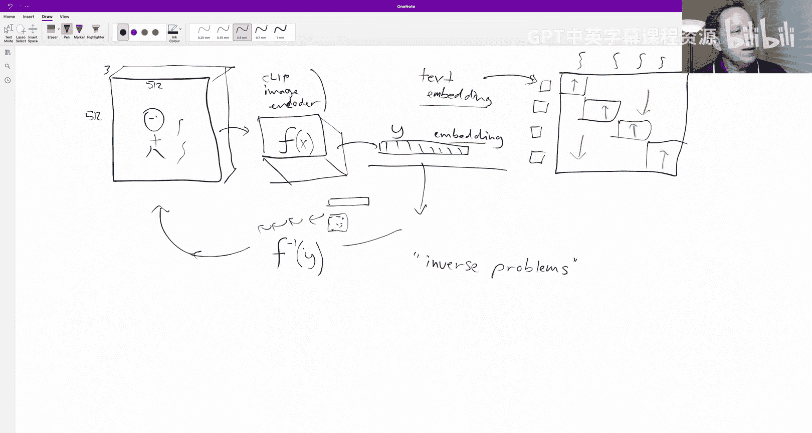
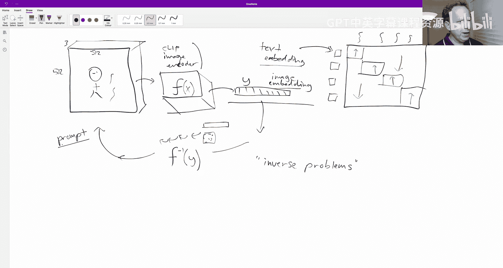
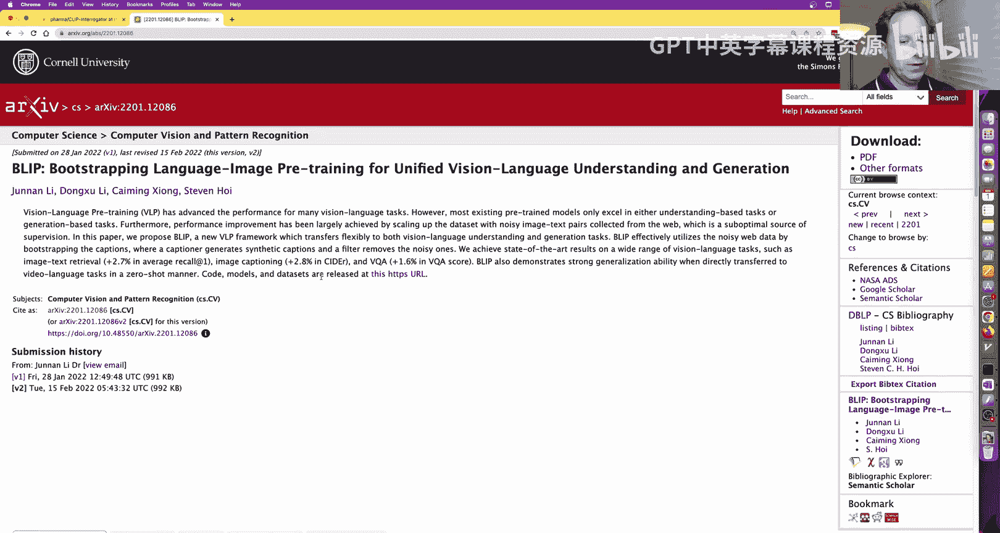
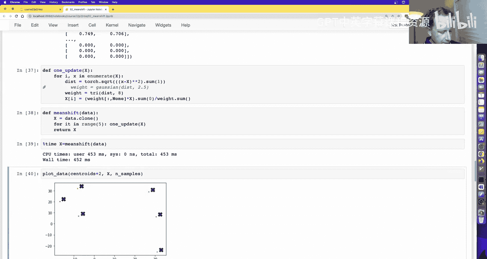
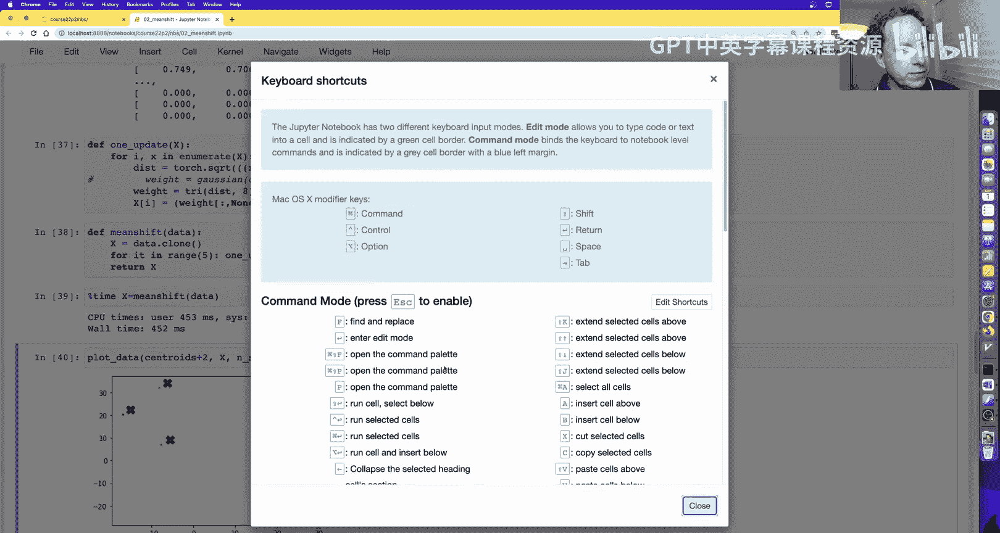
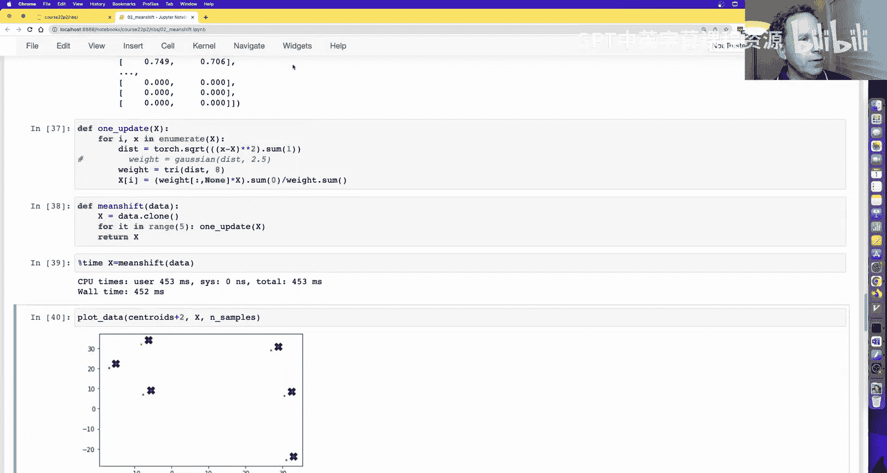
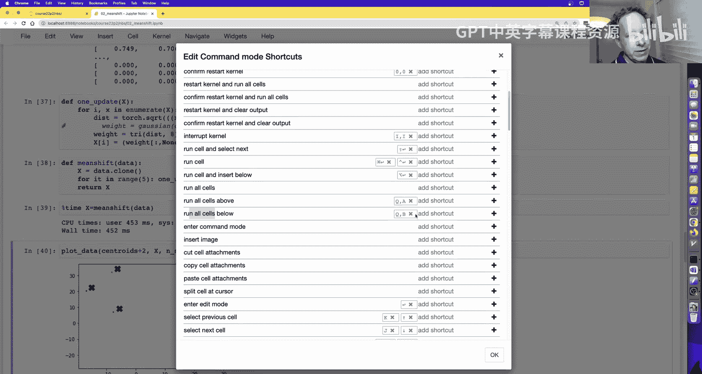

# Jeremy《深度学习基础到稳定扩散模型｜Deep Learning Foundations to Stable Diffusion》中英 p06 Lesson 12_ Deep Learning Foundations to Stable Diffusion.zh_en -BV1Mp421S7xg_p6-

Hi everybody， welcome back to lessons 12 of Pra deep learninging for coders。

So got a lot of stuff to cover today， so let's dive straight in and I actually thought I would start by sharing something which。

I've seen been getting a lot of attention recently， which is the clip interrogator。

 So the clip interrogator is a hugging face bases， I guess， radio app。Where I uploaded my image here。

And its output。Let's just zoom in a bit。It's output a text prompt for creating a clip and bedding from。

 I guess。So I've seen a lot of folks on Twitter and elsewhere on the internet saying that this is。

Producing the clip prompt that would generate this image。 And generally speaking the the clip。

 the prompter creates are rather rude。 no one's less rude than the sum， although， you know。

 extremely long forehead， maybe not thanks very much， but your personal data avatar。

Funny professional photo。 I don't know what tectonics has meant to me here without eyebrows。

 So this doesn't。😊，Actually。Return the clip prompt that would generate this photo at all and the fact that some people are saying that makes me realize that some people have no idea what's going on with stable diffusion。

 so I felt we might take this as an opportunity to explain why we can't do that and what we can try and do instead。

So let's imagine that。My friend took a photo。And of himself。And he wanted to send me his photo。

 And he thought he would compress it a whole lot。 So what he did was he put it through the。

Cllip image encoder。Okay， so that's going take this big image。

And it's going to turn it into it embedding， Oid Daisie。And the embeddings much。

 much smaller than the image is just a。Vectctor of a few floats。嗯。So。

Then my friend hopes that they could send me this embedding。And so they send that over at an email。

 and they say， there， go， Jeremy。 there's the clip and bedding of the photo I wanted to send you。

 So now you just have to。Decode it to turn it back into a picture。嗯。

So now I've got the patting and I have to decode it。😊，How would you do that。well。You can't。Okay。

 we have a function here， where let's call it F。Which is the clip image encoder。

 which takes as input and image， which I'll call X。And returns and embedding。

Does that mean that there is some other function and inverse functions， we normally write with a -1。

 an inverse function。With which I can take that embedding， let's say we call that。Wai。We pass it why。

And it would give us back our photo。And so y， remember is F of x so to put it another way。

 this is F inverse of F of F of y。 So the an inverse function is something that undoes a function。

 And so that gives you back。Why is there an inverse function。For the clip image encoder。Well。

 not everythingt has a inverse function， for example， consider the function like let's say in Python。

😊，Which takes F， F。Osy does be F of x。Orturn0。Can you invert that function if you get back。

 you pass in  three， you get back0， I there a function 0。

 is there a function that's going to take the output and give you back the input。 No of course not。

 because you just threw the whole thing away。So not all functions can be。Inverted， and indeed。

 in this case， weve started with a function。Which is whatever，512 by 512 by3， say。

And we've turned it into about something much， much smaller。

I can't remember exactly how big a clip image encoding is embedding is， but it's much smaller。

 so clearly we're losing something。😊，嗯。But what I could do。😮，Yes I could put it through。

A diffusion process。And so remember， a diffusion process is something where we have learnt。

We have taught or or we shouldn't I don't know if taught。

 an algorithm has learned to take some noise。So we could start with a noise。

 and we could start with an image embedding。We haven't done this before， but we could do that。

 we could train something that takes noise in an image bedding and removes a bit of the noise。

And we could run that a bunch of times。And it wouldn't give us back the original picture。

But hopefully， it would give us something back if it's a conditional。

 So remember using the the conditional diffusion approach。

 we'd get back something that might be something like。Our original image。So that's what diffusion is。

 right， diffusion is something that takes an embedding。😊，And inverts an encoder。

To give you back something that hopefully might generate that embedding。Now， of course， remember。

 we don't actually get image embeddings when we do。Prompts in stable diffusion。

 instead we have tax embeddings。But if you remember。That actually doesn't matter。

Because do you remember how we actually we open AI trained clip so that they had various pictures。

Along with their captions。And they trained an algorithm that was explicitly designed to make it so that each image。

Returned a。Embbedding for the image that was similar to the embedding that the text encoder created for the caption。

Then remember all of the stuff that didn't match。It was trained to be different。

And so that means that a text embedding， which describes this picture。

And the actual image embedding of this picture should be very similar if they're clip andbeddings。

 That's the definition of clip inbeddings。 So you see this idea that you could take a text or image embedding and turn it back。

Into an image。Perfectly makes most no sense。 This is the very definition of the thing we're trying to do when we do clip。

 and because。What we're basically trying to do is invert the embedding function。

These kinds of problems are generally referred to as inverse problems。

So stable diffusion is something that attempts to approximate the solution to an inverse problem。

So why does that mean that。Cllip interrogator is not actually inverting the picture to give us back the text。

 Well， it's just as nonsensical If we've got an image in bedding。

Right， trying to undo that to get back to the picture and trying to undo that to get back。

To a suitable prompt。Is equally infeasible。Both of them require。Inverting an encoder。

 and that just doesn't exist。 The best we can do is。

 or at least the best we know how to do at the moment is to approximate that。

Using a diffusion process。Okay， so that's why。

These texts that it spits back are fun and interesting。

 but they are not the thing that you can put back into stable diffusion and have it generate the same photo。

And the nice thing is that actually the code for this is available。

And you can take a look at it。Here's the app。And you'll say what it does is it has a big list。

OfLet's have a look at some examples。So this has big lists of examples， for example。

 a big list of artists。😊，And it has a big list of。Medians， and a big list of。Movements and so forth。

 it's got all this hard coded pieces of text。And so what it does is it basically mixes and matches those various things together to see which one works well。

 and it combines it with the output of something called the Blip language model。

Which is not designed to give you。

An exactly accurate description of an image， but it has been specifically trained to give。

An O is caption for an image。 and it actually works reasonably well。 but again， it's not。

It's not the inverse of the clip encoder。

So okay， so that's how that。All works。So where we had got to was that we had done matrix multiplication with broadcasting where we had broadcast。

The entire column from the right hand matrix all at once。

 and that allowed us to get it down to a point where we only have one four loop written in Python。

And generally speaking， we do not want to be doing loop looping through too many things in Python because that's a slow bit。

 So the two interallos we originally had， which just to remind us。Originally were here。

 these two interlos looping through 10 and then to 784 respectively。

Have been replaced with a single line of code。So that was pretty great and our times at now is increased is improved by 5000 times。

 so we're 5000 times faster than we started out。😊，So another trick that we can use。

 which I'm a big fan of， is something called Einstein summation。

And Einstein's summation is a compact representation for representing products and sums。

And this is an example。Of an Einstein summation。 And what we're going to do now is we're going to replicate our matrix product with an Einstein summ。

 And believe it or not， the entire thing。Can be pushed down to just these characters。

Which is pretty amazing。 So let me explain what's happening here。

 The arrow is separating the left hand side from the right hand side。😊。

The left hand side is the inputs。The right hand side is the output。The comma is between each input。

 so there are two inputs。The letters are just names that you're giving to the number of rows and the number of columns。

So the first matrix we are model playing by has I， rows and K columns。The second has。

K rose and J columns。It's going to go through a process which creates a new matrix。That actually。

 this is not even doing。 this is not yet doing the matrix modification。 This is without the sum。

 This one's going to create a new matrix that contains。A rose and K。 Well， how do we say。

 I faces and K。Rose and J Collins so a rank three tensor。

 so the number of letters is going to be the rank。And the rules of how this works is that if you repeat letters between input arrays。

 so here's my inputs， I and KJ， we've got a repeated letter。

 it means that values along those axes will be multiplied together。So it means that H。

Item in each row of sorry， in each Yeah， across a row will be multiplied by each item down each column。

To create this I by K by J output tensor。So to remind you， our first matrix is 5 by 784。That's had1。

Our second matrix is 784 by 10。 That's M2。So I is 5。 K is 7，84， and J is 10。So if I do this torch。

t Im sum。Then I will end up with a I by K by J， it'll be 5 by 784 by 10。 and if you have a look。

 I've run it here on these two tensesors， M1 and M2， and the shape of the result is 5。 784 by 10。

And what it contains is the original five rows of M1， the original 10 columns of M2。

 And then for the other 784， that dimension， they're all multiplied together because it's been copy。

 It's been copied between the two。Arguments to the Einsome。And so if we now sum up。😊，That。

 over this dimension。Wt get back。So what we get back， if we go back to the original。

Mattrix multiply we do， we had 10。94， negative， negative 。68 etc。And so now with this Einstein。

Samation version。We've got back exactly the same thing。Because what it's done。

Is it taken each of these。Columns by rows multiply them together to get this 5 by 7，8，4 by 10。

 and then add it up。That's 784 for each one， which is exactly what matrix modelplication does。

But we're going to use one of the two things from Einstein summation。

 The second one says if we om a letter from the output， so the bit on the right of the arrow。

It means those values will be summed。So if we remove this K。Which gives us IK and KJ goes to Ij。

So we've removed the K entirely， that means that sum happens automatically。😊，So if we run this。

As you see， we get back again， matrix modification。So Einstein's submission notation is。You know。

 it takes some practice getting used to， but it's very convenient and once you get used to it。

 it's actually a really nice way of thinking about what's going on。😊。

That as well see lots of examples。Often you can really simplify your code by using just a tiny little Einstein summation。

And it doesn't even have to be a sum， right， you can you don't have to admit any letters if you're just doing products。

 so maybe it's a bit misnamed。So we can now define our mapmo as simply this torch dot ownssome。

So if we now check it。Test close that the original result is equal to this new map mo， and yes it is。

And let's see how the speed looks。15 milliseconds。Okay， and that was for， oh， the whole thing。

So compared to 600 milliseconds。 So as you can see。

 this is much faster than even the very fast broadcasting approach we used。

 So this is a pretty good trick is Torch dot9some。Okay。

 but of course we don't have to do any of those things because Pytorch already knows how to do map Mole so there's two ways we can run map Mo directly in Pytorch you can use a special at operator so X train at weights is the same as map Mo train common weights as you see test plus。

Or you can say Torchdo mapmo。And interestingly， as you can see here。

 the speed is about the same as the einsome。 So there's no particular harm。

 no particular reason not to do an einsome。 So when I say Ein sum that stands for Einstein summation notation。

😊，All right， let's go faster still。😊，Currently， we're just using my CPU。😊，But I have a GPU。

 it would be nice to use it。😊，So how does a GPU work。And NviIDIdia GPU and indeed。

Pretty much George GPUs。The way they work。Is that they do lots and lots of things in parallel。

And you have to actually tell the GPU。What are all the things you want to do in parallel。

 one at a time？And so what we're going to do is we're going to write in pure Python something that works like a GPU。

 except it won't actually be in parallel so it won't be fast at all。😊。

But the first thing we have to do if we're going to get something working in parallel is we have to create a function that can calculate just one thing。

 even if  a thousand other things are happening at the same time。

 it won't interact with anything else。😊，And there's actually a very。

Easy way to think about matrix multiplication in this way。

 which is what if we try to create something which just as we've done here。😊，Fills in a single。

A single item of the result。So how do we create something that just fills in？😊，row zero， column zero。

Well， what we could do is we could create a new map Mo。😊。

Where we're going to pass in the coordinates。Of the place that we want to fill in。

So we're going to start by passing it zero， comma 0。😊，We'll pass at the matrix。

 the matrices we want to model play。😊，And we're passing a tensor that we've pre filled in with zeros to put the result into。

 So we're going to say， okay， the result is to dot zeros。Rose by Collins。

Call map mall for location 0 comm 0， passing in those two matrices and the。

Bunch of zeros metrics ready to put the result in。 And if we call that， we get the answer in cell 00。

 So here's an implementation of that。😊，So the implementation is first of all。

 we've then passed the zero comma0 coordinates， so let's destructure them。

 so hopefully you've been experimenting with destructuring because it's so important you see it all the time into I and J so it's the row in the column。

Make sure that that is inside the bounds of our output matrix。

And we're going to start by start at zero and loop through all of the rows of a and all of the columns of B for I and J。

 sorry all of the columns of a and all of the rows of B for I and J。

 just like the very innermost loop of our very first python attempt。And then at the end。

 pop that into the output。 So here's something that fills in one piece of the grid successfully。

So we could call this。Row by columns times each time passing in a different grid。

 and we could do that in parallel because none of those different locations interact with any other location。

So something which can calculate a little piece of an output on a GPU is called a kernel。

 so we'd call this a kernel， and so now we can create something called launch kernel。

 we pass it the kernel so that's the function so here's an example。

 launch kernel passing in the function。And how many rows and how many columns are there in the output grid？

And then give me any arguments that you need to calculate it。So in Python。

 star AGs just says any additional arguments that you pass are going to be put into an array called AGs。

If you hear something like C， you might have seen like very attic。Arguments， parameters。

 it's the same basic idea。So we're going to be calling launchch kernel。

 we're going to be saying launch the kernel map Mole。😊，U all the rows of a or the columns of B。

 and then the args， which are going to be in the star args， they arere going to be M1。

 the first matrix M2， the second matrix and res， another torch。 zeros we just created。

So launch kernel is going to loop through。😊，The row of A am A。And then for each row a。

 it'll loopt through the columns of B and call the kernel， which is map Mole。On that grid location。

 passing in。M1， M2 and Res。So star args here is going to unpack that and pass them as three separate arguments。

And if I run that。all of that。You'll see it's done it， it's filled in the exact same matrix。

Okay so that's actually not fast at all it's not doing anything in parallel。

 but it's the basic idea so now to actually do it in parallel。

 we have to use something called Kuda So Couda is a programming model for Nvidia GPUs and to program in Couda from Python the easiest way currently to do that is with something called number and number is a compiler well you've seen it actually already for nonGpU it's a compiler that takes Python code and spits out you know compiled fast machine code。

😊，If you use its Couda module， it'll actually spit out GPU accelerated Kudr code。

So rather than using at endjet like before， we now say at Kuda Dot。

And it behaves a little bit differently。But you'll see that this map mo。

 let me copy the other one over so you can compare it to our Python one。

Our Python map mole and this kuda dot chip map mo look。I think identical， except for one thing。

 instead of passing in the grid。There's a special magic thing called Kuda dot grid and you say how many dimensions does my grid have and you unpack it so that's you don't have to it's just a little convenience that number does for you。

 you don't have to pass over the grid it passes it over for you so it doesn't need this grid。

Other than that， these two are identical， but the decorator is going to compile that into GPU code。😊。

So now。We need to create our output in tensor just like before。And we need to do something else。

 which is we have to take our input matrices and our output。

 so our input tensors the matrices in this case our output tensor。

 and we have to move them to the GPU， I should say copy them to the GPU。

 so Kuda device copies a tensor to the GPU。And so we've got three things getting copied to the GPU here。

 and therefore we store the three things over here。Another way I could have written this。😊。

I I could have said， map。Which I kind of quite like doing。A function which is K to dot device。

To each of。These arguments。And this would be the same thing this is going to call Kud dot device on Xtrain and put it in here on weights and put it in here and on R and put it in here。

Seetss us slightly more。Convenient。Way to do it。Okay， so。We've got our 50，000 by 10 output。

 that's just all zeros， of course， that's just how we created it。

And now we're going to try and fill it in。There is a。

There's a particular detail that you don't have to worry about too much， which is in Kuda。

 they don't just have a grid。But there's also a concept of blocks and there's something we call here TPB which is threads per block this is just a detail of the cor programming model you don't have to worry about too much you can just basically copy this and what it's going to do is it's going to call each grid item in parallel and with a number of different processes basically so this is just the code which turns the grid into blocks。

And so you don't have to worry too much about the details of that， you just always run it。Okay。

 and so now how do you call。The equivalent of launch kernelnel。Well， it's。

It's a slightly weird way to do it， but it works fine。 you call Ma Mole。

 but because Map Mole has kuda dotjet， it's got a special thing。

 which is you have to put something in square brackets afterwards。😊。

Which is you have to tell it how many blocks per grid that's just the result from the previous cell。

And how many threads per block in each of the two dimensions。 So again。

 you can just copy and paste this from my version， but then you pass in the three arguments to the function。

 This will be A， B， and C。And this this is how you launch a kernel。

 so this will launch the kernel map Mole on the GPU。😊，At the end of it RG is going to get filled in。

 it's on the GPU which is not much good to us， so we now have to copy it back to the CPU。

 which is called the host， copyied to host to run that。😊。

And it's done and test F shows us that our result is similar to our original results。

 so it seems to be working。So that's great。So I see Siva on the YouTube chat is finding that it's not working on his Mac。

 that's right， so this will only work on an NviDdia GPU as basically all of the GPU。

 nearly all the GPU stuff we look at only works on NviDIdia GPUs。U。

Mac GPUs are gradually starting to get a little bit of support from。Machine learning libraries。

 but it's taken quite a while it's been， you know。It's got quite a way to go。

 as I say this at least towards the end of 2022， if this works for you and later on thats yeah that's great。

😊，嗯。Okay， so let's time how fast that is。😊，Okay， so that was 3。61 milliseconds。

And so if we compare that to the pytorrch map mole on CPU， that was 15 milliseconds。So that's great。

 So it's faster still。 So how much faster。😊，Oh， by the way， we can actually go faster than that。

 which is we can use the exact same code we had from the pitorrch up， but here's a trick。

If you just take your tensor and write do ka after it， it copies it over to the GPU。If it's on a。

 if it's on a。And V GPU do the same for Waitstock Couda。 So these are our two co diversions。

And now I can do the whole thing。And this will actually run。

On the GPU and then to copy it back to the host， you just say dot CPU。

So if we look to see how fast that is。😊，458 microseconds。So。Oh。

 that is somebody just pointed out that I wrote the wrong thing here one E。Next three。Okay。

So how much faster is that， Well，4，58 microseconds our original。

On the whole data set was 663 microseconds。 so compared to our broadcast version。We are。

Another thousand times faster。 So overall， this version here。😊，Compared to our original version。

 which was。Here。The difference in performance is。5 million x。So。When you。See people say， yeah。

 Python can be pretty slow， can be better to run stuff on the GPU if possible。

 we're not talking about a 20% change， we're talking about a 5 million X change。

Um so that's a big deal and so that's why you need to be running stuff on the GPU。😊，嗯。All right。

 some folks on YouTube are wondering how on Earth I'm running Kuda when I'm on a Mac and given it says local host here。

 that's because I'm using something called SSH tunneling。

 which we might get to sometime I suspect my live coding from the previous course might have covered that already。

 but this is basically you can use a Jupyter notebook that's running anywhere in the world from your own machine using something called SSH tunneling which is a good thing to look up。

嗯。Okay， one person asks if Einsteins summation borrows anything from APL， yes， it does actually so。

It's kind of the other way around， actually， APO borrows it。From Einstein notation。

 So I don't know if you remember I mentioned that Ken Iverson， when he developed APL， was。

Heavily influenced by tensor analysis。And so this Einstein notation is very heavily used there。

If you'll notice a key thing that happens in Einstein notation。Is there's no loop， you know。

 there isn't this kind of sigma， you know， I from here to here。

 and then you put the eye inside the function that you're summing up。Everything is implicit。

And APL takes that a very long way。And and J takes it even further。

 which is what Ken Iverson developed after APO and this kind of general idea of removing the index。

Is very important in APL and it's become very important in nu Pitorrch， Tensorflow， and so forth。嗯。

So finally， we know how to multiply matrices。😊，Congratulations。嗯。So let's practice that。

Let's practice what we've learned。So we're going to go to zero2 meanshift to practice this。

And so we're going to try to exercise our。Kind of tensor manipulation operation muscles in this section and the key actually end point for this is the homework。

And so what you need to be doing is getting yourself to a point that you can implement something like this。

 but for a different algorithm。Why do we care about this。

 Because this is like learning your times table？Your timestables if you're doing， you know。

Mathematics， it's this kind of like thing that's going to come up all the time。

 And if you're not good at your time's tables。Everything else a lot well， a lot of other things。

 particularly at primary school and high school。😊，You know， they。They get difficult。

You get slower and it's frustrating and you spend time thinking about。

These mechanical operations rather than getting your work done。 It is。

 It's important that when you have an idea about something you want to try or debug or profile or whatever。

That you can quickly translate that into working code。

And the way that code is written for GPUs or even for fast running on CPUUs is using broadcasting Einstein notation。

嗯。Mattrix modifications and so forth。So you've got to got to practice， super important。

So we're going to practice it by。U。Running by developing a clustering algorithm。

And the clustering algorithm we're going to work on is something called mean shift clustering。

 which hopefully you've never heard of before and I say that because I just think it's a really funny algorithm。

That not many people have come across。Oh， excuse me。And I think you'll find it really useful。

So what is cluster analysis， cluster analysis is very different。

To anything that we've worked on in this course so far and that there isn't a dependent variable that we're trying to match。

 but instead we're just trying to find， are there groups of similar things in this data and those groups we call clusters。

And as you can see from the Wiiki page， there's all kinds of applications of cluster analysis across many different areas。

I will say that sometimes cluster analysis can be overused or misused。

It's really best for when your're。Your various columns。

The same kind of thing and have the same kind of scale。嗯。For example。

 pixels are all the same kind of thing they're all pixels so one of the examples they use is market research so I wouldn't use cluster analysis for socio demographicographic inputs because they're all different kinds of things。

 but the example they give here makes a lot of sense which is looking at data from surveys if you've got a whole bunch of like from one to five answers on surveys。

Allright， so let's take a look at this and the way I like to build my algorithms is to create some often to create some synthetic data that I know how I want it to behave and so we're going to create six clusters。

And each class is going to have 750 samples in it。😊，So first of all。😊。

I'm going to randomly create six。Centroids and so the centroid is going to be like the middle of where my clusters are。

 so I'm going to randomly create them I need to n clusters by 2 because I need an x and a Y coordinate for each one。

嗯。And so I'm now going to randomly generate data。Around those six centroids。Okay， so to do that。

I'm going to call a little function I made here called sample。And I'm got to run it on each of。

Those six centroids。And so I'll show you what that looks like。😊，So here's what that data looks like。

 so the x's are the six centroids。And the colored dots is the data。

 So if you were given this data without the X's。The idea would be to come up come back with figuring out where the X's would have been。

 like where are the， where are these clustering around。 And so if you can get clusters。

 that that's that's the goal here is to find out that there's a few。

Dcreettely distinctly different types of data in your data set。 So for example。

 for images I've used this before to discover that there are some images that look completely different to all the other ones。

 for example， they were taken at night time or they of a different object or something like that。

So how does sample work？😊，While we're passing in the centroid。

And so what we want is we're going to get back。U。诶。

So each of those centroids contains an X and a away。 So multivariate normal is just like normal。

 It's going to give you back normally distributed data， but。More than one item。

 That's why it's multivariate。 And so we passed in two means， a mean for our x and a mean for our y。

And so that's the mean that we're going to get。😊，And our standard deviation is going to be five。

Why do we use torch dotDg 5 comma 5， that's because we're saying that's because that for multivariate normal distributions。

 there's not just one standard deviation for each column that you get back。

There could also be a connection between columns， so columns might not be independent。

 so you actually need， so it's called a covariance matrix。

 not just a variance we discuss that a little bit more in lesson 9B if you're interested in learning more about that。

Okay， so this is something that's going to give us back random columns of data with this mean and this standard deviation。

 and this is the number of samples that we want。😊，And this is coming from Pytorrch。

 so Pytorrch has a whole bunch of different distributions that you can use， which can be very handy。

So there's our data。Okay， so remember for S for clustering， we we don't know the different colors。

And we don't know where the x's are， that's kind of our job is to figure that out。😊。

We might just briefly also look at how to plot。😊，So in this case， we want to plot。The Xs。

 and we want to plot the data。So it looks like this， so all I do is I loop through each centroid。😊。

And I grab that centroid samples and they're just all done in order， so I grab it。From。

I times n samples up to I plus 1 times n samples。And then I create a scatter plot。

With the samples on them。And what I've done is I've created an access here。

 and you'll see why later that we can also pass one in， but I'm not passing one in。

 So we create a plot and an access。 And so a map plot lib。

You can keep plotting things on the same axis。So then I plot on the centroid。A big X。Which is black。

And then a smaller X。Which is what is that magenta。

 and so that's how I get these x's So that's how plot data。Works。O。

So how do we create something now that starts with all the dots and returns where the x's are？

We're going to use a particular algorithm， particular。Cllustering algorithm called Mainshift。And。

And meanshift is a nice clustering approach because you don't have to say how many clusters there are。

 so it's not that often that you're actually got to know how many clusters there are。

 so we don't have to say quite a few things like the very popular K means require you to say how many。

Instead， we just have to pass them in called a bandwidth。

 which we'll learn about which can actually be chosen automatically。😊。

And it can also handle clusters of any shape。 so they don't have to be ball shaped like they who they are here。

 They can be kind of like L shaped or lips shaped or whatever。And so here's what's going to happen。😊。

嗯。We're going to pick some point。 So let's say we pick。That point just there。Okay。嗯。

And so what we now do is we go through。Each data point， so we'll pick the first one。

 and so we then find the distance between that point and every other point。Okay。

 so we're gonna have to say。um。What is。The distance between that point and that point and that point in that point and that point in that point。

 and also the ones further away， that point in that point and you do it for every single point compared to the one that we're currently looking at。

Okay， so we get all of those as a big list。And now what we're going to do is we're going to take a weighted average of all of those points。

Now。That's。Not interesting without the weighting。 If we just take our average over all of the points and how far away they are。

 we're going to end up somewhere here。 right， This is the average of all the points。

But the key is that we're going to take an average。And need to find the right spot。

The key is we need to find an average。😊，That is weighted by how far away things are。 So， for example。

 this one over here。I's a very long way away。From our point of interest。

And so it should have a very low weight in the weighted average。 whereas this point here。

 which is very close。Should have a very high weight in our weighted average。

So what we do is we create weights for every point compared to the one that we're currently interested in using a what's called a Gaussian kernel that we'll look at。

 but the key thing to know is that points that are further away from our point of interest。

 which is this one， are going to have lower weights， that's what we mean there they're penalized。

The range at which weights4 to0 is determined by this thing that we set at the start called the bandwidth。

And that's going to be the standard deviation of our Gaussian。

So we take an average of all the points in the data set。

 a weighted average weighted by how far away they are。😊，So for our point of interest。Right。the。

This points going to get a big weight， this point's going to get a big weight。

 this point's going to get a big weight。That point's going to get a tiny weight。

That point's going to get an even tinier weight。So it's mainly going to be a weighted average。😊。

Of these points that are nearby。And the weighted average of those points， I would guess。

 is going to be somewhere around about。Here。 and would have a similar thing for the weighted average of the points near this one。

 that's going to probably be somewhere roundabout。😊，Here， right， or maybe over here。

And so it's going to move all of these points in closer。 it's almost like a gravity， right。

 They're kind of going to be moved like。😊，Closer and closer。In。Towards。

This kind of gravitational centre。And then， these ones。

Will go towards their own gravitational centre。And so forth。Okay， so let's take a look at it。😊。

Allright， so what's the Gaussian kernel。This is the Gaussian colonel。

 which was a sign in the original match for science back in the days when。

The idea of not following scientists was considered socially unacceptable。

 We used to have match for these things， if you remember， so this is this is not normal。

So this is the definition of the Gaussian kernel， which is also known as the normal distribution。

 this is the shape of it。😊，Sure you've seen it before。😊，And here is。

That formula copied directly off the science March sign。Okay， here we are。

 You can see the square root to pi， et cetera， Okay， and this here is the standard deviation。

Now what does that look like， It's very helpful to have something that we can very quickly plot any function that doesn't come with mapplotlib。

 but it's very easy to write one， just say oh let's as x let's use all the numbers from 0 to 10。

100 of them based evenly， that's what lens based does linearly based 100 numbers in this range。

That's going to be our xs。 so plot those x's and plot f of x as the ways。

 So here's a very nice little plot bug we want。And here it is。And as you can see here。

 we've now got something where if you are。This， like very close to the point of interest。

 You're going to get a very high weight。 And if you're a long way away from the point of interest。

 you'll get a very low weight。 So that's the key thing。

That we want to to remember is something that penalises further away points more。诶。

Now you'll notice here I've managed to plot。😊，This function。For a bandwidth of 2。5。

And the way I did that was using this special thing from func toolss called partial。 Now。

 the first thing to point out here is that very often it drives me crazy。

 I see people trying to find out what something is in Jupiter。

 And the way they do it is they'll scroll up to the top of the notebook and search through the imports and try to find it。

 That is the dumb way to do it。 The smart way to do it is just to type it and press shift enter。

 and it'll tell you where it comes from， and you can get its help with question mark。😊。

And you can get it source code with two question marks。Okay。

 so just type it to find out where it comes from。Okay， so this is， as Suva has mentioned in the chat。

 also known as carrying or partial function application。😊，This creates a new function。

 so let's just grab it。We create a new function。And this function F is is the function Gaussian。

 but it's going to automatically pass Bw equals 2。5。 So this is a partially applied function。

 So I could type F of4， for example。嗯。That's going to be a tensor。

There we go and you can see that's exactly what this is got up to 4 go across yep about 。

44 so we use partial function application all the time。 it's a very， very。

 very important tool without it for example， plotting this function would have been more complicated with it it was trivially easy。

😊，I guess the alternative， like one alternative。😊，which would be fine。

 but slightly more clunky would be we could create a little function in line， so we could have said。

 oh， plot of function that I'm going to define right now。Which is called lambda， which is lambda x。

Which is Gaussian of。X where the bandwidth of 0。2。5。You could do that too， you know， it's it's fine。

 but but yeah， partials， I think are。A bit neater， a bit less to think about they often。

And produce some nature and clearer code。Okay。嗯。Why did we decide to meet the bandwidth 2。

5 as a rule of thumb， choose a bandwidth。Which covers about a third of the data。

So if we kind of found ourselves somewhere over here。

Right a band which covers about a third of the data would be enough to cover two clusters ish。

 so it would to be kind of like this big so somewhere in the middle there， so that's the basic idea。

Yeah， so but you can play around with bandwidths and get different amounts of clusters。

I should mention like often when you see something that's kind of on the complicated side like a Gaussian。

 you can often simplify things， I think most of the implementations and write ups I've seen talk about using Gaussians。

 but if you look at the shape of it，😊，It looks a lot like this shape。

So this is a triangular waitinging。Which is just using clamp min。

 so it's just using a linear with clamp min。嗯。And yeah。

 it occurred to me that we could probably use this just as well。

 so I find I decided to define this triangular waitinging and then we can try both。Anyways。

 so we'mre to start with， we're going to use the Gaussian version。All right。

 so we're going to be move literally moving all the points towards their kind of center of gravity。😊。

So we don't want to mess up our original data， so we clone it that's a pay torch thing is dot clone。

 it's very handy。And so。Big X is our matrix of data。 I mean， it's actually a。嗯。That's right。

 matrixs of data， yeah。😊，And then little X。Will be our first point。

And it's pretty common to use big capital letters for matrices。嗯。So this is our data。

 this is the first point。Okay。So there it is， we've got to start at 26。2， 26。3。So 26。2， 26。3。

 so somewhere up here。so。Little x， its shape is just。

 it's a rank 1 tensor or shape 2 big x is a rank 2 tensor of 1500 data points by2， the x and y。And。

If we call x none， that would add a unit access to that。

And the reason I'm going to show you that is because we want to find the distance from little x to everything in big x。

 and the way we do a distance is with minus。But you wouldn't be able to go。um。

You wouldn't be able to go。X minus big x and get the right actually to you get the right answer。

 let's think about that。Xt shape。 Oh we've got that already。诶。And actually that is going to work。

 isn't it？😊，Yes， all right。 So you can see why we've got these two versions here。 If we do x nu。

 we've got something of shape 1 comma 2。 Now we can subtract that from something of shape 1500 comm 2 because the twos match up。

Cause they're the same。 and the 1500 and the one matches up because if you remember our nuy rules。

 everything matches up to a unit axis。 So it's going to copy this。

Matrix across every row of this matrix。And it works。But do you remember there's a special trick？

Which is， if you've got two。Shapes of different lengths。

We can use the shorter length and it's going to add unit axes to the front to make it as long as necessary。

😊，So we actually don't need the x nu， we can just use little X。

And it works because it's going to say， is this compatible with this， Well， the last axis。

 I we go right to left， the last axis matches。The second last axis， Oh， it doesn't exist。

 So we pretend that there's a unit axis and it's going to do exactly the same thing。As this。so。

If you have not studied the broadcasting from last week carefully。

 that might not have made a lot of sense to you and so definitely at this point you might want to pause the video and go back and reread the Ny broadcasting rules and last time and practice them because that's what we just did we used N broadcasting rules and we're going to be doing this dozens more times throughout the rest of the course and many more times in fact in this lesson。

Okay， so now I think it's a pretty good place to have a pause。 so I'll see you back here in。

Nine minutes。Hi everybody， welcomecom back So we had got to the point where we had managed to get the distance between our first point X and。

All of the other points in the data and so we're just looking at the first eight of them here。

 so the very first distance is of course，0 on the x axis and0 on the y axis because it is the first point。

The other thing is that because we。The way we created the clusters is they're all kind of next to each other in the list。

 so these are all in the first clusters and none of them are too far away from each other。

So now that we've got all the distances。😊，It's easy enough to。

 well not that the distance is on X and Y， it's easy enough to get the distance。

The kind of Euclidean distance so we can just square that。U。That difference。 and some。

And square root。And actually， maybe this is a good time to talk about norms and to talk about what we just did there。

嗯。We've got all these data points。U。So here's one of our data points。

And here's the other one of our data points。And there's some。You know， distance across the X axis。

And there's some distance along the Y axis。So we could call that。Change in X。And changing why。

And one way to think about this distance then。Is it this distance here。So to calculate that。

 we couldn use Pythagoras。A squared plus b squared equals C squared。Or in our case。

So this would be C， A and B， see， so in our case， it would be the square root。

Of the change in x squared plus the change in y squared。And rather than saying square root。

We could say。嗯。To the pair of a huff。Another way of saying the same thing。

 But there's a different way we could find the distance。We could。First， go along here。And then。

 go up here。And so that one would be。Change in X。If you like to the one plus change in y to the one to the power of。

1 month。I running it a slightly odd way for reasons you'll see in a moment。

 it's just this other ways。😊，嗯。In general。If we've got a whole list of numbers。We can add them up。

Let's say there are some listist V。We can add them up。 We can do each one to the power of。S number。

Alpha。And take that sum。To the one over alpha。And this thing here。Is called a non。

So you might have remember we came across that last week and we' come across it again this week。

 They basically come up， I don't know。 They might end up coming up every week。

 They come up all the time， particularly because the two norm。Which we could write like this。

Or we could write like this。Or we could write like this。They're all the two on。嗯。

This is just saying it's this equation。For alpha equals。2。

And Steano is pointing out we should actually have an absolute value。

 I'm not going to worry about that， we're just doing real numbers here。

 so we'll keep things simple oh well I guess for higher than one no you're probably right。😊。

For something like three， yeah， I guess we do need an absolute value there。

 That's a good point because。Okay， we could have this one。

And so the distance actually has to be the absolute value。So the change in X。

I's the absolute value of that distance。Yes， thank you Stefao Okay。

 so we'll have the absolute value Okay， so the two norm is what happens when Al equals2。😊。

And we would call this， in this case， we would call this the Euclidean distance。But actually。

 where it comes up more often。😊，Um is。When you're doing like a loss function。

 So the mean squared error。Is just well， the root means grid error， I should say。

 is just the two norm。诶。Where else the main absolute error？Is the one normm。

 and these are also known as L2 and L1。Plus。And remember what we saw in that paper last week。

 we saw it in this form。 Theres a two up here， which is where they got rid of the square root again。

 So that would have just been。Change in x squared plus change in y squared。

 and now we don't even need the parentheses。Os， lazy。Yeah go。Okay， so。All of this is to say that for。

嗯。You know， this comes up all the time because we're very。

 very often interested in distances and errors and things like that。 I'm trying to think。

 I don't feel like I've ever seen。Anything other than one or two。So although it is a general concept。

I don't think we're going to see。Probably things other than one or two in this course。

 I'd be excited if we do。 That would be kind of cool。So here we're taking。The Euclidean distance。

 which is the tu on。So this has got eight things in it because we've summed it。😊，Over dimension 1。So。

 here's your。First time work。Is to rewrite。Using Torch。 Eom。

You won't be able to get rid of the x minus x， you'll still need to have that in there。

But when you've got a multiply followed by a sum， or you won't be to get rid of this to square it either。

 you should be able to get rid of the multiply in the sum by doing it in a single torch do iron sum。

So we're summing up over the first dimension， which is this dimension。

 so in other words we're summing up the x and the y xes。Okay， so now。We can get the。

The weights by passing those distances into our Gaussian。And so as we would expect。

 the biggest weights it gets up to 0。16。So the closest one is itself。

 it's going to be at a big weight。 These other ones get reasonable weights and the ones that are in totally different clusters have weights small enough that at three significant figures。

 they appear to be zero。Okay， so we've got our weights。嗯。So there are the weights。

A 1500 long vector and of course our original data is 1500 by2， the x and the Y for each one。

So we now want a weighted average， we want。This data， we want its average weighted by this。So。

Normally， an average is the。嗯。Is the sum。Of your data。Divided by account。 That's a normal average。

 A weighted average。Each item in your data。Let's put some eyes around here， just to be more clear。

 Each item in your data is gonna have a different。Wait。And so you modelply each one by the weights。

 And so rather than dividing by n， which is just the sum of ones， we would divide by。

The sum of whites。So this isn't important。Concept be familiar with， weighted As。

So we need to multiply every。One of these xes。By this。Okay， so can we say wait times。X。No， all right。

 Why didn't that work？So。Remember we go right to left， so first of all。

 it's going to say let's look at the two。And multiply that by the 15， are they compatible。

 Things are compatible if they're equal。😊，Or if at least one of them is one。These are not equal。

 and they're not one， so they're not compatible。That's why it says the size of a tensor A。Must match。

Now when it says match， it doesn't mean the haveory the same， one of them can be one okay。

 that's what it means to match， they're either equal or one of them's one， so that doesn't work。😊。

On the other hand。What if this was 1500 1？If it was 15001。

Then they would match because the one and the two match。

 because one of thems are unit access and the 1500 and the 1500 match because they're the same。

So that's what we're going to do because that would then copy this。😊，To every one of these。

 which is what we want we want weights for each of these X Y tuples。

So to add the trailing unit access， we say every row and a trailing unit access。

So that's what that shape looks like。 So we can now modifyply that by x。😊，And as you can see。

 it's now waiting each of them。And so each of these x's and Y's down the bottom。Oral 0。

So we can sum that up and then divide by the sum of weights。So let's now write a function。

That puts all this together。 So you can see this really important way of lake。To me。

 though the only way that makes sense to do particularly scientific numerical programming。

 I actually do all my programming this way， but particularly scientific and numerical programming is write it all out step by step。

 Check every piece Have it all there documented for you for others， and then copy the cells。

Merge them together。And indent them to indent its control rights spare bracket and put a function header on top。

 So here's all those things we just did。And now rather than just grabbing the first X。

We enumerate through all of them。So that's the distance we had before。

 That's the weight we had before。 There's the product we had before。 And then finally。

 some across the rows divide by the sum of the weights。 So that's going to calculate。for the i。

So' we're going to move， so it's actually changing capital x。

 so it's changing the I thing in capital x so that it's now the weighted sum。😊，Oh， actually， sorry。

 the weded average of all of the other data weighted by how far it is away。😊。

So that's going to do a single step。 So the mean shift update is extremely straightforward。

 which has clone the data。Eererate a few times。And do the update。So if we run it。

Take 600 milliseconds。And。What I've done is I've ploted the centroids moved by two pixels or two well not two pixels。

 two units so that you can see them， and so you can see the dots is where our data is and their dots now because every single data point is on top of each other on a cluster and so you can see they are now in the correct butts。

 so it has successfully clustered our data。So that's great news。

 And so we could test out our hypothesis。 Could we use triangular just as well as we could have used Gaussian。

 So control slash comments and un commentsments。😊，Yep， we' got exactly the same results。

 so that's good。😊，Um it's really important to know these keyboard shortcuts hit H to get a list of them。

😊。

Some things that are really important don't have keyboard shortcuts。

 so if you click Help Ed keyboard shortcuts， there's a list of all the things Jupiter can do and you can add keyboard shortcuts to things that don't have them so for example I always add keyboard shortcuts to run all cells above and run all cells below as you can see I type Q and then a for above and Q and then B for below。

All right。Now。That was kind of boring in a way because it did five steps。嗯。

But we just saw the result。 what did it look like one step at a time？This isn't just fun。

 it's really important to be able to see things happening one step at a time because there are so many algorithms we do which are like updating weights or updating data。

 you know， so if for stable diffusion， for example， you're very likely to want to show。😊，You know。

 you're incrementally dennoising and so forth。So in my opinion。

 it's important to know how to do animations。😊，And。

I found the documentation for this unnecessarily complicated because its a lot of it's about how to make them performant。

 but most of the time we probably don't care too much about that。

 so I want to show you a little trick， a simple way to create animations without any trouble。😊。

So mappllootlibb。 animationimation has something called funk animation。

 that's what we're going to use。To create an animation， you have to create a function。

And the function you're going to be calling funk animation。

 passing in the name of that function and saying how many times to run it。

 And that's what this frames argument。 This says， run this function， this many times。

And then create an animation that basically contains the result of that with a 500 millisecond interval between each one。

😊，So what's this do one going to do to create one frame animation？We will call our one update。

Here it is one update， right， we're going to call this that's going to update x's。

And then we're going to have an axis。Which we've created here。

So we're going to clear whatever was on the plot before and plot our new data。😊，On that axis。

And then the only other thing you need to do is that the very first time it calls it。

 we want to plot it before running and D is going to be passed automatically the frame number。

 So for the zeroth frame。We're going to not do the update with is going to apply plot the data as it is already。

I guess another way we could have done that would have been just to say F D。Then。Do the update。

 I suppose。That should work too， maybe it's even simpler， let's see if it has broke it， okay。

So we're going to clone our data， we're going to create our figure in our subpls。

 we're going to call fun animation calling do one five times。😊。

And then we're going to display the animation。And so let's see。

 So HTML takes some HTML and displays it and2 JS HTML creates some HTMLm。

 So that's why it's created this HTMLm includes JavaScript and so we'll click run。One，2， three， four。

5， there's the five steps， so if I click loop， you'll see them running again and again。Fantastic。

So that's how easy it is to create a mapplot lib。Animation。

So hopefully now you can use that to play around with some fun stable diffusion animations as well。😊。

You don't just have to use to JSHtl， you can also create。嗯。Oops，y Daisy。You can also create movies。

 for example。So you can call2 HTML 5 video would be another option and you can save an animation as a movie file so theres all these different options for that。

But hopefully that's enough to get you started。For your homework。

I would like you when you create your K means or whatever to try to create your own animation or create an animation of some stable diffusion thing that you're playing with。

So don't forget this important AX do clear， without the AX dot clear。

 it prints it on top of the last one。Which sometimes is what you want to be fair。 but in this case。

 it's not what I wanted。Allright， so kind of slow。Half a second for not that much data。

I'm sure we'd be nice if it was faster。😊，Well， the good news is we can GPU accelerate it？😊。

The bad news is it's not going to GPU accelerate that well because of this loop， this is looping 1。

500 times。If we so looping is not going to run on the GPU。

 so the best we could do with this would be to move all this to the GPU。Now。

 the problem is that calling something on the GPU 1，500 times from Python is a really bad idea。

Because there's this kind of huge communication overhead of this kind of flow of control and data switching back between the CPU and the GP。

It's the kernelel launching overhead。 It's bad news。 So you don't want to have。

A really big fast python loop。That inside it calls Kuda code， that calls GPU code。

 So we need to make all of this。Ran without the loop。Which we could do with broadcasting。😊，So， let's。

Ro'll up our sleeves and try to get the broadcast version of this working。So generally speaking。

 the way we tend to do things with broadcasting on a GPU is we create batches or many batches。

So to create batches or mini batches， we normally just call them batches nowadays。😊。

We create a batch size。 So let's say we're going to do a batch size of 5。 So we're going to do 5。

At a time。Al right， so how do we do five at a time， This is only doing one at a time。

 How do we do five at a time？As before let's clone our data and this time little X for our testing so we're going to do everything ahead of time。

 little tests as we always do， this is not now x0 anymore but it's x colon BS。

 so it's the first five， this is now the first five items。Okay， so little x is now a5 by two matrix。

 This is our mini batch， the first five items。As before， our data itself is 15002。All right。

 so we need a distance calculation。But previously， our distance calculation。嗯。Previously。

 a distance calculation only worked if little x with a single number。

And it returned just the distances from that to everything in big X。

But we need something that's actually going to be。Return of mates， right， we've got。嗯。Let's say。

 we've got five。By2。In little X。And then in big X， we've got。Something much bigger。Not to scale。

 obviously。We've got 1，500 by two。And what is the distance between。These two things。Well。

 if you think about it， there's going to be a distance。Betweentwain。Item1 and item1。

But there's also going to be a distance between。Item 1， item 2。

And there's going to be a distance between， let's use a different color for the next one。

Item 2 and item 1。Right。So the output of this is actually going to be。A matrix。

 The distances are actually going to give us a matrix。Where， I mean。

 it doesn't matter which way around we do what we can decide。But if we do it this way round。

 for each of the five things in the mini batch， there will be 1500。Distances。

 the distance between everyone。So we're going to need to do broadcasting to do this calculation。So。

This is the function that we're going to create。And it's going to create this， as you can see。

5ive by 1，500 output， but let's see how we get it。So can we do？X minus x。No， we can't。 Why is that。

That's because big X is 1，50002。And little x is 5 by2。So it's going to look at remember our rules。

Right to left， are these compatible。Yes， they are。 They're the same。Are these compatible？No。

 they're not。Okay， because they're different。So that's not possible to do。What if though。

 we wanted to？What if we insert in big X and axis at the start here？And in little X。

 we add an axis in the middle here。Then now these are compatible。Because you've got。They're the same。

Because I should use arrows， really。These are compatible because one of them are one。

And these are compatible because one of the things the one as well。So they are all compatible。

 And what it's going to do is it's going to。Do the attraction between these directly。

And it's going to copy this across all 1，500 rows， it'll copy it。 This is going to be copied。

And then this to across five rows， and then this will be copied across these 1500 rows。

Because that's what broadcasting does， I mean it's not really copying， but it's effectively copying。

And so that gives us。We can now subtract them and that gives us what we wanted， which is 5 by 1，500。

 and that's also by 2 because there's both the x and the Y。So that's why。This works。

 That's what this is doing here。 It's taking this attraction， it's squaring them。

 and then summing over。That last shortest axis summ over the X and the Y squares。

And then take square root。 I don't know why I said torch dot square root。

 We could just put dot square root at the end， but same same。 In fact， it's worth mentioning that。

 So most things that you can do on tensess， you can either write torch dot as a function or you can write it as a method。

Generally speaking both should be fine。Not everything， but most things work in both spots。Okay。

 so now we've got this matrix， which is。5 by 1500。And the nice thing is that our Gaussian kernel doesn't actually have to be changed to get the weights。

 believe it or not。😊，And the reason for that is now， how do we get the source code。

 I could move back up there or I can just type Gaussian question mark question mark。And set it。

And the nice thing is that this is just this is a scalar， so it broadcasts over anything。And then。

This is also just a scalar。So this is all going to work fine without any fiddling around。Okay。

So now we've got a 5 by 1500 weight， so that's the weight for each of the five things there mini batch which of the 1500 things each of the most compared to。

And then， we've got the。Shape of the data itself， X dot shape， which is the 1500 points。

So now we want to apply each one of these weights。To each of these columns。

So we need to add a unit access to the end。So to add a unit access to the end。

 we could say colon comma， colon comma none， but dot dot， dot means all of the axes up until。

However many you need， so in this case， the last one common nuns。

 this is going to add an axis to the end。😊，So this is going to turn this is going to turn weight dot shape from5 comma 1500 to 5 comma 1。

500 comma 1。😊，And this is going to add access to the start。

 remember it's the same as x nu comma colon comma colon。And so let's check our rules。

Left right to left。 these are compatible。Because one of thems one。

These are compatible because they're both the same and these are compatible because one of them is one。

Okay， so it's going to be。Copying。Each weight across to each of the X and Y。

 which is what we want want we want to weight both of those components。

And it's going to copy each of the 1，500 points。sorryrry， H at the point。

Five times because we do in fact want to wait every one of the five things now mini batch a separate set of weights for each of them。

 so that sounds perfect。So that's how we think through these calculations。Okay， so we can now。

Do that multiplication。Which is going to give us something of 5 by 1。

50002 because we end up with the maximum of our ranks。And then we sum up over those 1500 points。

And that's going to give us。There are five new data points。嗯。Now。

Something that you might notice here。Is that we've got a product。And a sum。

 And when you see a product and a sum。That tells you that maybe we should use。Asome。So。In this case。

We've got our weight， we've got5 by 1500。 So let's call those I and J as for the 5 and 1500。

We've got the x is 150002。 Now， we want to take the product of that and that。

 So we need to use the same name for this row。 So we use J again， okay， and then。

K is the number of rows， that's the two。And then we want to end up with IVK。So torch。t own some。

Gets exactly the same result， that's great。But you might recognize this。

That's exactly the same enzyme sum we had just before when we were doing matrix multiplication。 Oh。

 that is a matrix multiplication。😊，We've just reinvented matrix multiplication。😊，Using。

This rather nifty trick。So we could also just use that。😊，And so， you know， again。

 this is like what I was just playing around with this morning as I started to look at this and I was thinking like。

 oh， you know， can we simplify this， I don't like this kind of like。

Messing round of axes and summing over dimensions and whatnot。

And so it's nice to get things down to Einim or better still get down to make Jigs model plays。

 It's just clearer， you know， it's stuff that we will recognise because we use them all the time。

 They all work。😊，The performanceance would be pretty similar， I suspect。嗯。Okay。

So now that we've got that， we then need to do our sum， and we've got our。5 points。

 This is our five denominators。 So we've got our numerator that we calculated up here through our weights for our weighted average。

 the denominator is just the sum of the weights。 Remember。

 And so numerator divided by denominator is our answer。 So again， we've gone through every step。

 we've checked out all the dimensions all along the way。 So nothing's going to surprise us。

 don't try and write a function like this。 just bang from scratch。

 right you've got to drive yourself crazy。Instead do it step by step。

 so here's our mean shift algorithm。Cown the data。Go through five iterations。

And thou go from nughaught to n， batch size at a time。

So Python has some good slices so we can create a slice。Of x。Starting at one up to i plus batch size。

 right， unless you've gone past n， which goes use n。

And so then we're just copying and pasting each of the lines of code that we had before。

 actually I just copy the cells and merge them， of course I don't actually copy and paste because it's slow and boring。

😊，And there's my final step to create the new。X， S。 And so notice here， S。Is not a single thing。

 It's a slice of things。 You might not have seen slice before。

 but this is just internally what Python's doing when you use colon。

 and it's very convenient when you need to use the same slice multiple times。Okay。

So let's do that using Kuda， I would run it first without kuda。

 but I mean I've done all the steps before， so it should be fine。

 so pop it on the GPU and run mean shift。😊，And let's see how long that takes。It takes1 millisecond。

And previously， without GPU， it took 400 milliseconds。 And， you know。

 the other thing we should probably think about doing is looking at other batch sizes as well。

 because now we're looping over。Btches。So if we make the batch size bigger。

 that full loop is going to do less looping。So what if we make that 16， will that be any faster？

I actually never tried this before。That's interesting。 It's actually slower。看。There you go。

 fascinating， what if it was eight。Amazing， so。The big patches don't quite seem to be working so well for some reason。

 so I wonder if Ive。😊，Hang on， what's going on， Why is it？

Why is it changing how it should be my batch size is five， why is it slower suddenly？

I think it's just a bit varying is probably the answer。So that just varies a lot。Okay。

 so it doesn't seem like changing the batch size is changing much here。So that's fine。

 so we'll just leave it where it was。And then check looking at the data， oh， that looks lovely。😊，Oh。

I see。Thank you， people on YouTube pointing out that I'm passing batch says。

 so I actually need to put it here。All right， so if we use a batch size of five。

No wonder it was messing up， oh， look at that I've totally。😊，Made it slow now。157 milllliseconds。

哈哈 ok。64。13 milliseconds， All right， finally， that makes much more sense to56。1，02，4。Okay。

 so the bigger bigger is better。And I guess we could actually do all 5000 at once， probably。Nice。

All right。嗯。Thank you， YouTube friends。For solving that bizarre mystery。Okay。All right， so。

That's pretty great， I mean， you know， to see that we can GPU optimize a mean shift like I actually Googled for this to see if it's been done before。

😊，嗯。And it's the kind of thing that people like write papers about。Um。

 so I think it's great that we can。😊，Do it so easily with pay torture as the kind of thing that previously had been considered。

You know， a very challenging academic problem to solve。So maybe you can do something similar。

With some of these， now I haven't told you what these are。

 so part of the homework is to go read about them and learn about them。😊。

DB scan Fun Mr factually is an algorithm that I accidentally invented and then discovered a year later had already been invented that was a long time ago I was playing around with J which is success to APL on a very old Windows phone and I had a long plain flight and I came up with an algorithm and implemented the whole thing on my phone using J and then discovered a year later that I just invented DB scan This is actually a really cool algorithm and it's got a lot of similarities to meanshift。

😊，嗯。LSH comes up all the time。 So that's great。 And in fact， I have a strong feeling。😊。

And I've been thinking about this for a while that something like LSH could be used to speed this whole thing up a lot。

Because if you think about it and again， maybe there already this already exists， I don't know。

 but if you think about it， when we did that distance calculation。

 the vast majority of the weights are nearly zero。😊，And so it seems pointless to create that big。

 you know， kind of eventually 1，500 by 1，500 matrix。That's slow。

It would be much better if we just found the ones that were like pretty close by and just took their average and so you want an optimized nearest neighbors basically and so this is an example of something that can give you a kind of a fast nearest neighbor's algorithm。

or， you know， there are things like Kd trees and op trees and stuff like that。

 So if you want to like have a bonus bonus。Invent。A new mean shift algorithm。Which。Picks only。

The closest。Points to avoid quadratic。Tpe。Alright， so not very often you get an assignment。

 which is to invent a new mean shift algorithm。 I guess a super super bonus。😊，Super， super bonus。

Publish a paper。That describes it。All right， you definitely get four points if you do that。

We'll give you a number of points equal to the impact factor of the journal you get it published in。

Okay。嗯。So what I want to do now。Is。Move on to calculus。Which。For some of us。

May not be our favourite topic。That's funny as Steano who wrote the I sun version here already。

 I didn't notice， okay。😊，Always ahead of his time that guy。😊。

Let's talk about calculus if you're not super comfortable with derivatives and what they are and why we care3 blue1 brown has a wonderful series called the Esence of Calalculus。

 which I strongly recommend watching。😊，It's just a pleasure actually。

 to watch as its everything that。Is un3 blue1 brown a pleasure to watch。嗯。

And so we're not going to get into back today when Deborah is going to have a quick chat about。😊。

About calculus。嗯。Where do we start？So the good news is。😊。

Just like you don't have to know much linear algebra at all。

 you basically just need to know about matrix modification。 You also don't need to know much。

Calculus it all。Just derivatives。So。Let's think about， like， what derivatives are。

So I'm going to borrow actually the same。Starting point that three blue one brown users in one of their videos is to consider a car。

And we're going to see how far away from home it is。At various time points。Okay， so after a minute。

 let's say after a second。It's traveled5 meters。And then after two seconds。It's chapel 10 meters。

Okay， and after three seconds， you can probably guess it's travelled 15 mets。

So there's this concept here of a。Yeah， got it the wrong way around。😊，Obviously。So。😔，Time。😔，Distance。

ok。So嗯。There's this concept of， yeah， of of like location。

 It's like how far how far have you traveled at a particular point in time。

 So we can look at one of these points and find out how far。That car is gone。

We could also take two points。And we can say， where did it start at the start of those two points。

And where did it finish at the end of those two points？And we can see between those two points。

 how much time passed。And how far did they travel In two seconds， they travelled。10 me。

So we could now also say， all right， well。The slope of something。Let's rise overrun。O see daisy。

10 M in 2 seconds。And notice we don't just divide the numbers。 We also divide the units。

 We get5 mes per。Second。So this here has now changed the dimensions entirely。

 we're now not looking at distance。But we' looking at speed or velocity。And it's equal too。

Rise overrun。It's equal to。😊，The rate of change。And what it says， really， is。As time， the X axisus。

Goes up by。One second。What happens to the distance in metters。As one second passes。How does。

The number of meters change。And so maybe these aren't points at all， maybe there's a function。

it's a continuum of points， and so you can do that for the function。So the function。

Is a function of time。Distance is a function of time。And so we could say， what's the slope？

Of that function。And we can get the slope from point A to point B， using rise overrun。So， from。

T1 to T2， the of distance that's the amount of time that's passed。Is。T 2。Minus t1。

 That's how much time has passed。 Let's say this is T1。 this is T2。

And the distance that they've travelled while they've moved from。Wherever they are at the end。

Two wherever they were at the start。So that's the change in distance divided by the change in time。

Change in distance。Divided by change in time。Okay。Say that's why。So another way。Now。

 the thing is when we talk about calculus， we talk about finding a slope。

But we talk about finding a slope of something。That's more often more tricky than this， right？

We have slopes of things。But look more like this。And we say。What's this slope？

Oops and terrible attempt at drawing that may be put it over here Ca I'm left handed。What's。

This slope。Now。What does it mean to have like the idea of a velocity。At an exact moment in time。

It doesn't mean anything。You know， at an exact moment in time， you're just like it's frozen， right。

 what's happening exactly now， but what you can do is you can say， well。

 what's the change in time between a bit before our point and a bit after our point？

And what's the change in distance between a bit before our point and a bit after our point。

 And so you can do the same kind of rise overrun thing。Right。

But you can make that distance between T2 and T1。Smaller and smaller and smaller。

 So let's rewrite this。In a slightly different way。Let's call the denominator。The distance between。

T1。Plus。A little bit。I'll call it D。It's that。Minus T1。 So this is T2， right。

 It's T1 plus a little bit。 So we say， oh， here's T1。 let's add a little bit。

And notice that were when we write at this。 Well， let's actually， let's do the rest of it。

 So now F of T 2 becomes F of。T1 plus a little bit。And this is the same。

And now notice here that T 1 plus D minus t 1。We can delete all that。Because it just comes out to D。

So this is another way of calculating the slope of our function。

And as cadi gets smaller and smaller and smaller， we're kind of getting a triangle that's tinier and tinier and tinier。

 and it still makes sense。 It's still that some time has passed and the car is moved。

But it's just smaller and smaller amounts of time。😊，Now， if you did。😮，Calculus set at。

 at college or at school。You might have done all this stuff messing around with limits and Epsilon Delta and blah。

 blah， blah。I've got really good news， it turns out。😊，You can actually just think of this， D as。

A really small number。Where d is the。Difference。Der rents。And so when we calculate the slope。

We can write it in a slightly different way。As the change in y divided by the change in x。

This here is the change in y， and this here is the change in X。And so in other words。

 this here is a very small number。A very small number。

And this here is the result in the function of changing by that very small number。

And this way of thinking about calculus is known as the calculus of in。Pesimals。

And it's how Lenets originally developed it。 And it's been turned into。A后。Theory nowadays。

 and the reason I talk about it here is because when we do calculus。

You'll see me doing stuff all the time， where I act like。D X is a really small number。

 And when I was at school， I was told I wasn't allowed to do that。

 I've since learned that it's totally fine to do that。 So， for example， next lesson。

 we're going to be looking at the chain rule。Which looks like this。

D y d x equals de y to u times to u d x。And I'm just going to say， oh。

 these two small numbers can cancel out。And that's why， obviously， they're the same thing。

And that's all going to work out nicely。So Eddie who。

 what would be very helpful would be if before the next lesson。

If you're not totally up to date with your， you know。

 remembering all the stuff you did in high school about calculus is watch the three blue one brown course。

We are not going to be looking， I don't think at all， at integration。

So you don't have to worry about that。Also， we are not going to on the whole。

 be doing any derivatives by hand。So， for example， there are rules such as。嗯。嗯。To y D X， if。

Y equals x squared。Is 2 x， these kind of rules you're not really going to have to learn。

m because Pytorrch is going to do the more for you。

 the one that we care about is going to be the chain rule。

 but we're going to learn about that next time。Okay， I hope I don't get。

Beaten to a bloody pulp the next time I walk into a mathematician's conference， I suspect I might。

But hopefully I get away with。😊，With this， I think it's safe， we'll see how we go。😊。

Thanks everybody very much for joining me and really look forward to seeing you next time where we're going to do back propagation from scratch。

 we've already learned to multiply matrices， so once we've got back propagation as well。

 we'll be ready to train a neural network。😊，All right， thanks all， bye。

