# Jeremy《深度学习基础到稳定扩散模型｜Deep Learning Foundations to Stable Diffusion》中英 p07 Lesson 13_ Deep Learning Foundations to Stable Diffusion.zh_en -BV1Mp421S7xg_p7-

Hi everybody and welcome to lessons 13。Where we're going to start talking about back propagation。

Before we do， I just mention that there was some great success amongst the folks in the class during the week on。

嗯。Working with。Fexing their tensor manipulation muscles。So far， the fastest。Main shift algorithm。

Which has a similar accuracy to the one I displayed is one that actually randomly chooses data points。

A subset and I actually think that's a great approach very often random sampling and random projections are two excellent ways of speeding up algorithms。

 so it'll be interesting to see if anybody during the rest of the course comes up with anything faster than random sampling。

Also been seeing some good Einstein summation examples and implementations and continuing to see lots of good。

Diff edit implementations。A。So congratulations to all the students and I hope those of you following along the videos in the MOC will be。

Working on the same homework as well and sharing your results on the Fast AO forums。

So now we're going to take a look at。

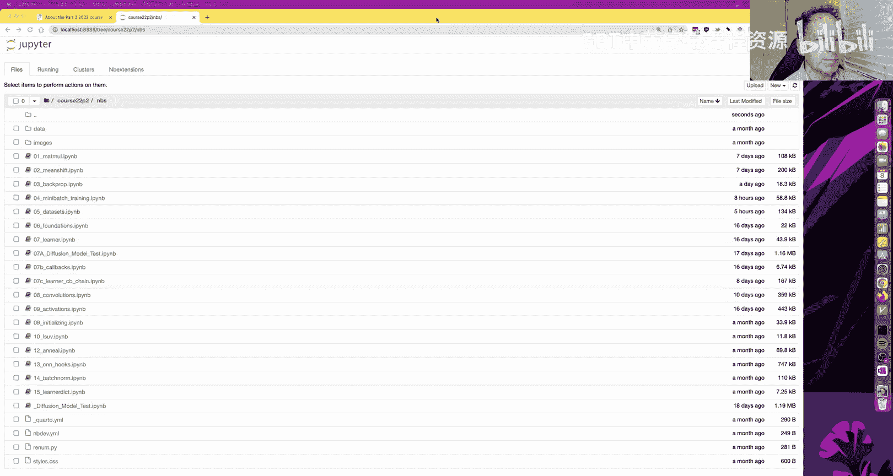

Notebook number 3。

In the normal repo course 22 p1 repo。And we're going to be looking at the forward and backward passes of a。

A simple multi layer perceptionceptron， a neural network。

Initial stuff up here is just importing things and just settings and stuff that just copying and pastings and stuff from previous notebooks around paths and parameters and stuff like that。

So we'll skip over this， so well often be kind of copying and pasting stuff from one notebook to another's kind of first cell to get things set up。

And I'm also loading in our data for MNT as tensesors。Okay。So， we。

To start with need to create the basic architecture of our neural network。

 and I did mention at the start of the course that。

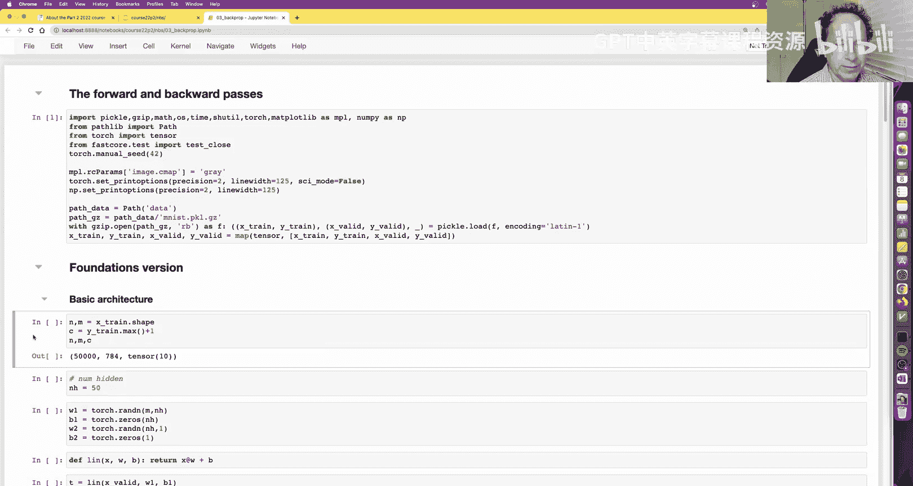

We will briefly review everything that we need to cover， so we should briefly review。

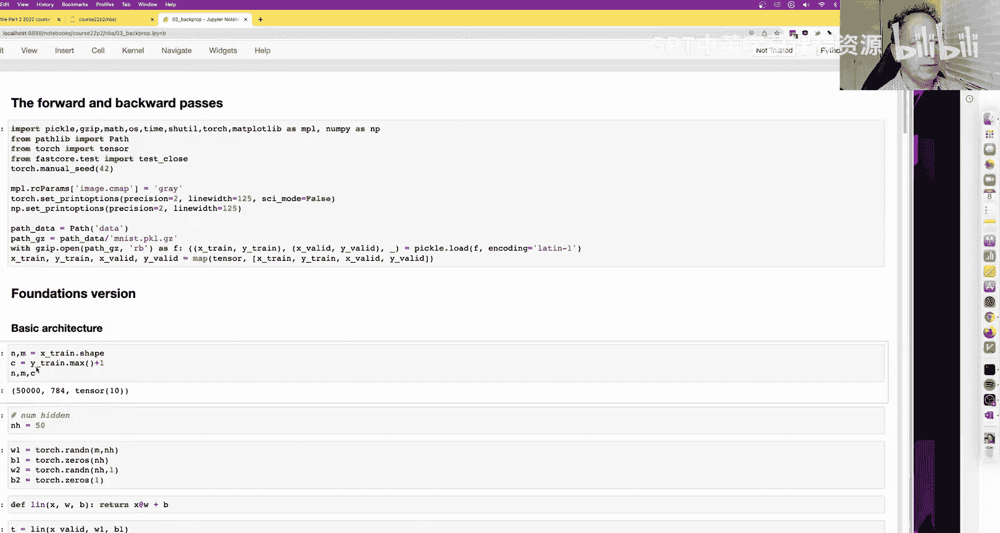

What basic neural networks are and why they are， what they are。So to start with， let's consider。A。

A linear model。Oops， that's not how I do it。😔，So let's start by considering a linear model。Of。U。Well。

 let's take the most simple example possible， which is we're going to pick a single pixel from our Mest pictures。

 and so that will be our X。😊，And for our。For our y values。

 then we'll have some loss function of how good is this model。um。Sorry， not some loss function。

That's clear even simpler for our y value， we're going to be looking at how likely is it that this is。

 say， the number three。Based on the value of this one pixel， so the pixel。

Its value will be x and the probability of being the number three， we'll call Y。

And if we just have a linear model。Then it's going to look like this。And so in this case。

 it's it's saying that the brighter this pixel is the more likely it is that it's the number。thre。

And so。There's a few problems with this。 The first one， obviously， is that as a linear model。

 it's very limiting because， maybe， you know， we actually are trying to。

Draw something that looks more like。This， so how would you do that？Well。

 there's actually a neat trick we can use to do that what we could do。😊，I， well。

 let's first of all talk about something we can't do。

Something we can't do is to add a bunch of additional lines。 So consider what happens if we say。

 okay， well， let's add a few different lines。 So let's also add。This line。

So what would be the sum of。Our two lines。Well， the answer is， of course。

 that the sum of the two lines will itself be a line。

 so it's not going to help us at all match the actual curve that we want。So here's the trick。Instead。

 we could。Create a line。Like this。That， actually。We could create this line。

And now consider what happens if we add this original line with this new， what's not a line， right。

 it's a， it's two line segments。 So what we would get is this everything to the。Left of。This point。

Is going to not be changed if I add these two lines together because this is0 or the way and everything to the right of it is going to be reduced。

 and looks like they've got similar slopes。 So we might end up。With instead， so this would all。😔。

Disappear here。And instead， we would end up with something like。This。嗯。

And then we could do that again， right， we could add an additional line that looks a bit like that。😊。

So it would go， but this time it could go even further out here。And it could be。Something like this。

 say。So what if we added that well again， at the point underneath here， it's always zero。

 so it won't do anything at all， but after that it's going to make it even more negatively slopeed。

And if you can see using this approach， we could add up lots of these。😊，Reecttified lines。

 these lines are truncated at zero， and we could create any shape we want with enough of them。

And these lanes are very easy to create because actually all we need to do。😊。

Is to create just a regular line。Just create a regular line。Right。

 which we can move up down left right。Change its angle or whatever。And then just say。

 if it's greater than 0， tranccate it to 0。Or we could do the opposite for a line go in the opposite direction of us less than zero。

 we could say chunket it is zero。And that would get rid of。As we want this whole section here。

And make it flat。Okay， so these are rectified lines。

And so we can sum up a bunch of these together to basically match any arbitrary curve。嗯。

So let's start by doing that oh the other thing we should mention， of course。

 is that we're going to have not just one pixel， but we're going to have lots of pixels。

So to start with the kind of。Most， you know， slightly， you know。

 the only slightly less simple approach。We could have something where we've got you know。

 pixel number one and pixel number two， we're looking at two different pixels to see how likely they are to be the number three。

And so。That would allow us to draw。More complex shapes。Does that have some kind of？

Surface between them。嗯。Okay， and then we can do exactly the same thing is to create these surfaces。

 we can add up lots of these rectified lines together。

 but now they're going to be kind of rectified planes。嗯。

But it's going to be exactly the same thing we're going to be adding together a bunch of lines。

 each one of which is truncated at zero。

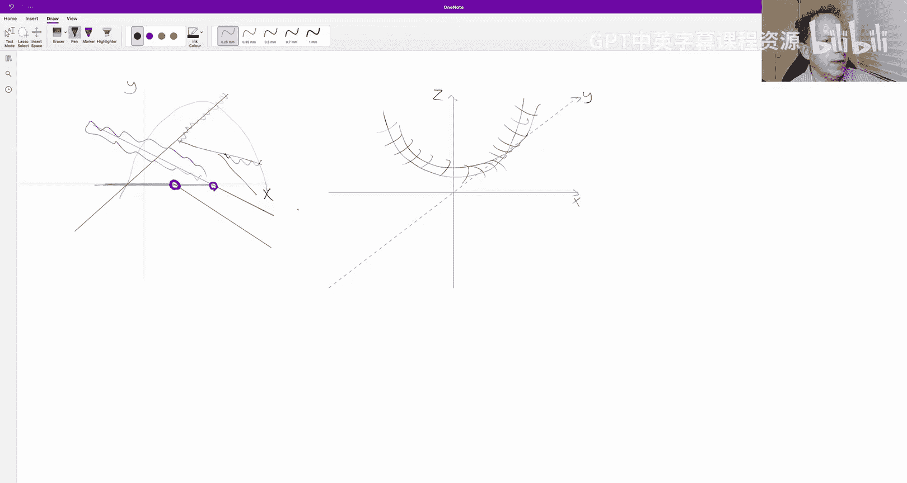

Okay， so that's the quicker review and so to do that。😊。

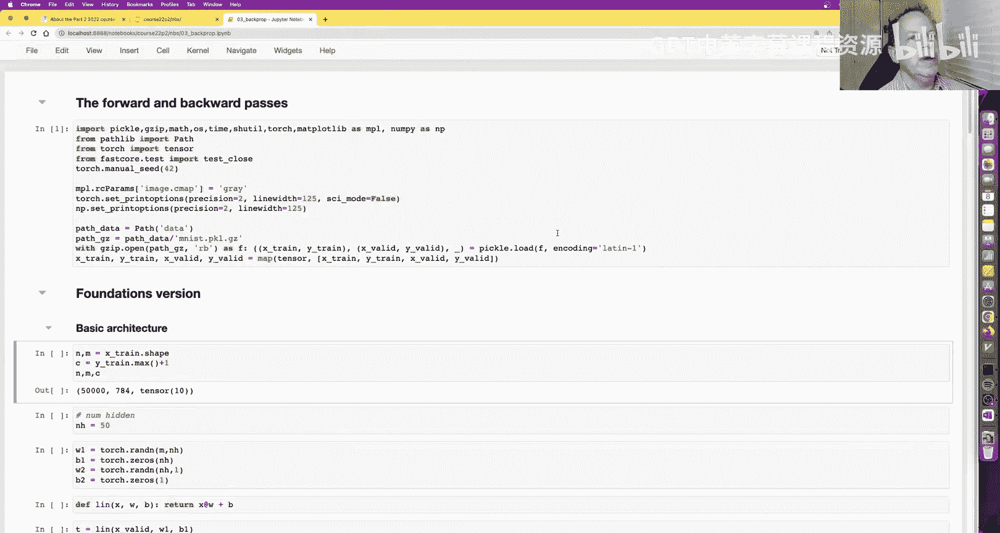

um。We'll start out by just defining a few variables。 So N is the number of training examples。

 M is the。Number of pixels。U。C is the。Number of possible values of our digits。

 and so here they are 50，000 samples， 784 pixels and 10 possible outputs。Okay。

 so what we do is to is we basically decide ahead of time how many of these。

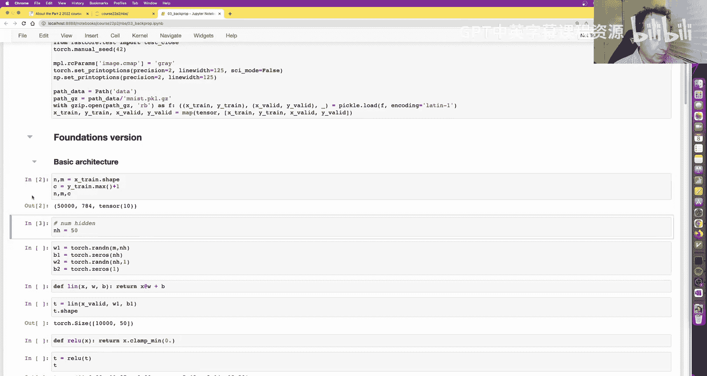

Line segment thing he used to add up。And so the number that we create in a layer is called the number of hidden。

Notdes or activations， so we'll call that NH， so let's just arbitrarily decide on creating 50 of those。

😊。

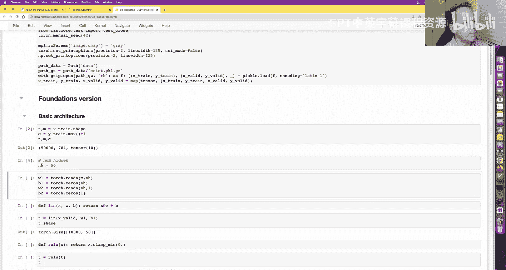

So in order to create lots of lines， which we they're going to truncate at zero。😊。

We can do a matrix multiplication。 So with a matrix multiplication。😊，We're going to。

Have something where we've got。50000 rows。By 700 was 784。Yeah， by 784 columns。

Am I going to multiply that？Bye。😔，Something with。784 rows。And 10 columns。 And why is that， Well。

 that's because if we take this very first line of this first vector here， row 1 of 784 values。

 They're the pixel values of the first image。Okay， so this is our first image。

 and so there each of those 784 values will be modified by。

Each of these 784 values in the first column， the zero index column。

And that's going to give us a number。In our output， so our output is going to be。50000。50，000 images。

Bye。10。And so that result will'll multiply those together and we'll add them up。

 and that result's going to end up over here in this first cell。And so each of these columns。😊。

It's going to eventually represent if this if this was this is a linear model in this case。

 this is just the example of doing a linear model， each of these cells is going to represent the probability So this first column will be the probability of being a zero and the second column will be the probability of one the third column will be the probability of being a two and so forth。

 So that's why we're going to have these。10 columns， each one allowing us to weight the 784 inputs。

Now， of course， we're going to do something bit more tricky than that。

 which is actually we're going to have a 784 by 50 input going into a。😊。

784 by 50 output to create the 50 hidden layers then we're going to truncate those at zero and then multiply that by a 50 by 10 to create our 10 output so we do it in two steps。

😊。

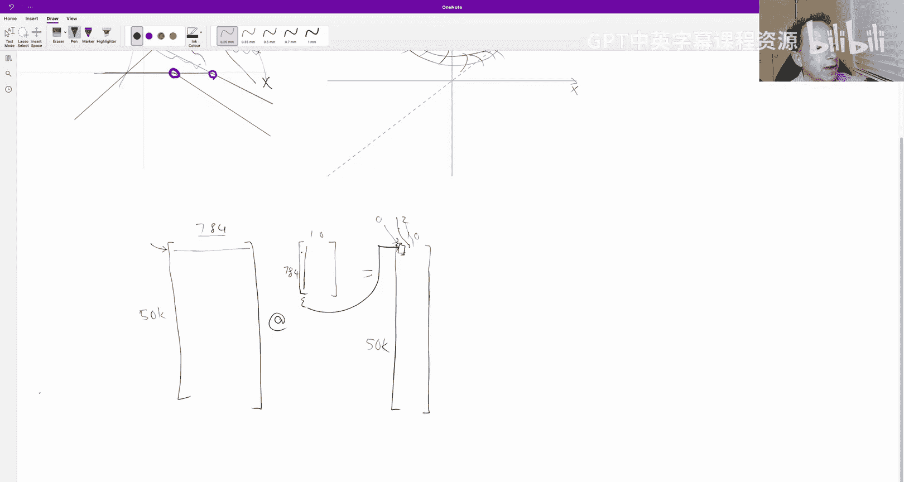

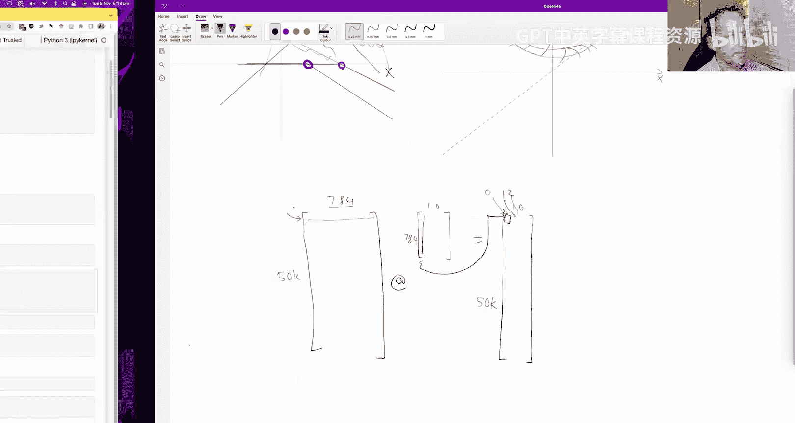

So the way SGD works is we start with just this is our weight matrix here。

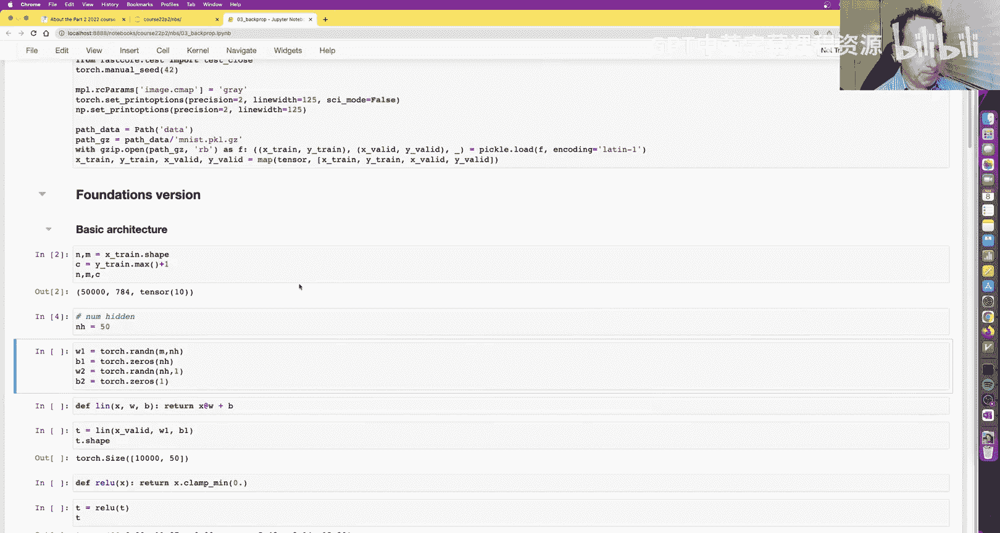

And this is our data。This is our outputs。The way it works。😊。

Is that this weight matrix is initially filled with random values。

 We also course this contains our pixel values。 This contains the results。

 So W is going to start with random values。

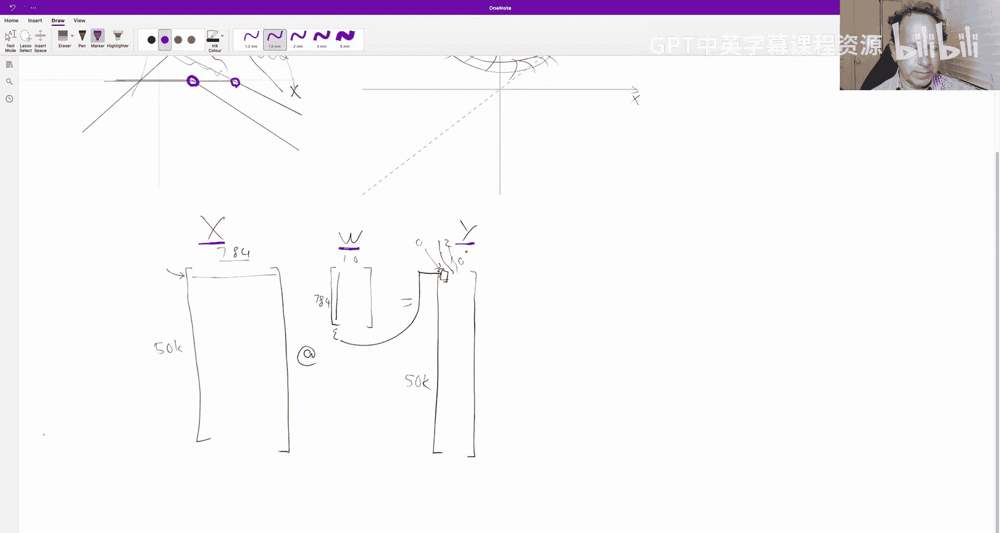

So here's our weight matrix it's going to have， as we discussed，50000。By 50。

Random randomandom values。And it's not enough just to multiply， we also have to add。

 so that's what makes it。😊，A linear function， so we call those the biases， the things we add。

We can just start those at zeros。So we'll need one for each output， so 50 of those。

And so it'll be layer one。 And then， as we just mentioned， layer 2 will be a matrix that goes from。

50 hidden。And now I'm going to do something totally cheating to simplify some of the calculations for the calculus。

 I'm only going to create one output， Why am I going to create one output？😊。

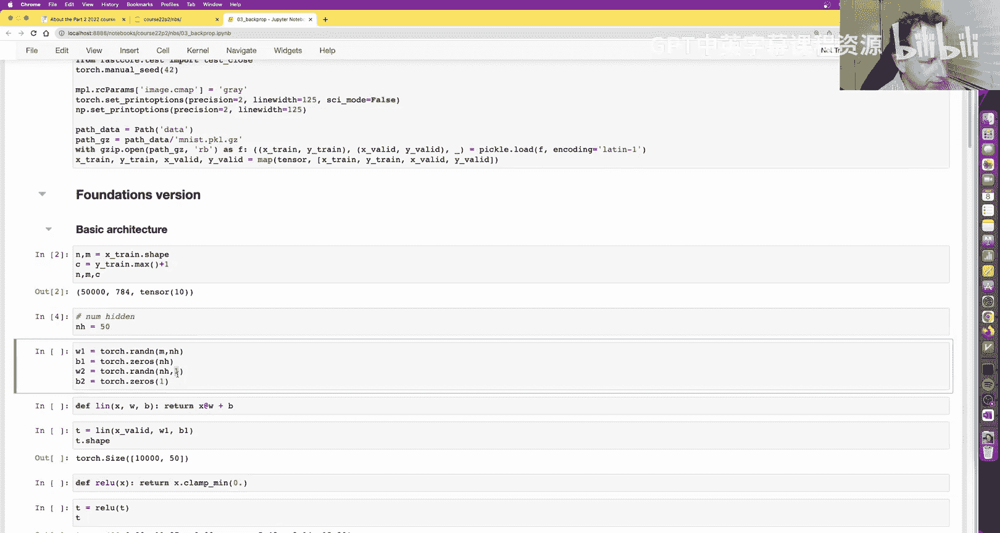

That's because I'm not going to use cross entropy just yet， instead I'm going to use MSE。So。

 actually。I'm going to create one output。Which will literally just be。What number do I take it is？

From zero to 10。And so then we're going to compare those to the actual。

 so these will be our wire predicted， we normally use a little hat for that and we're going to compare that。

😊，To her as。And yeah， in this very hacky approach， let's say we predict over here the number nine and the actual is the number two。

 and we'll compare those together using MSE。Which will be a stupid way to do it because it's saying that 9 is further away from being two than two9 is further away from2 than iss from4 in terms of how correct it is。

 which is， which is not what we want at all。 But this is what we're going to do just to simplify our starting point。

 So that's why we're going to have a single。

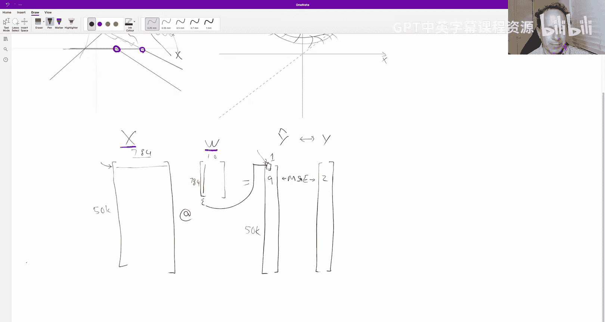

Output for this weight matrix and a single output for this bias。So a linear。

 let's create a function for putting x through a linear layer with these weights and these biases。

 so it's a matrix multiply and an add。Alright， so we can now try it。 So if we multiply our。X。

 are we doing x valid this time， So just to clarify。X valid。Is 10000 by 784。

 So if we put x valid through our weights and biases with a linear layer。

 we end up with a 10000 by 50。 So 10000。50 long， hidden activations。

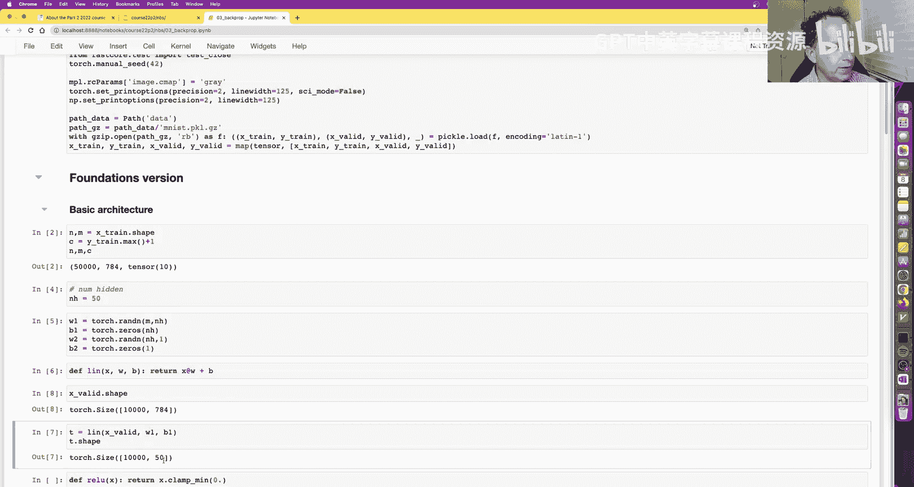

They're not quite ready yet because we had to put them through value。😊。

And so we're going to clamp at zero， so everything under zero will become zero。😊。

And so here's what it looks like when we go through the linear layer and then the value and you can see here's a tensor with a bunch of things some of which are zero or they're positive and so that's the result of this this matrix multiplication。

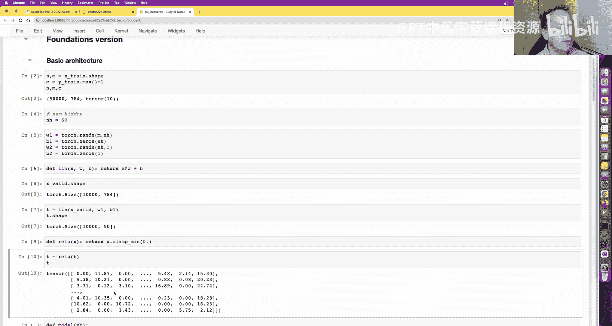

Okay。So to create our basic MLP multilayer perceptron from scratch。We will。Take our。

Many batch of x's Xb is a x match， we will create our first layers output with a linear and then we will put that through a value and then that will go through the second linear so the first one uses the W1B1 okay these ones and the second one uses the W2B2。

And so we've now got a simple model。And as we hoped when we pass in the validation set。

 we get back 10，000。Digits， so 10，000 by one， great， so that's a good start。Okay。

 so let's use our ridiculous loss function of MSC。

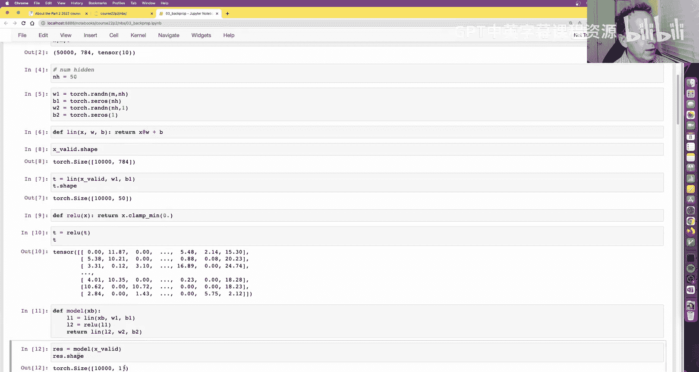

So。Our results is 10，000 by one。And our x valid sorry， our Y valid is just a vector。Now。

 what's going to happen if I do？Res minus y valid。So before you continue in the video。

Have a think about that， what's going to happen if I do Res minus y valid by thinking about the Nmpy broadcasting rules we've learnedt。

Okay， let's try it。

Oh， terrible。 We've ended up with a 10，000 by 10，000 matrix。

So 100 million points now we would expect an MSE to contain a thousand0 points。😊，Why did that happen？

The reason it happened is because we have to。Start out。At the last dimension。And go right to left。

And we compare the 10，000 to the one and say， are they compatible？And the answer is， that's right。

 Alexxi in the chat's got it right， Brocasting rules。

 So the answer is that this one will be broadcast over these 10000。

 So this pair here will give us 10000 outputs。And then we'll move to。The next one。

And we'll also move here to the next one。Oh oh there is no next one。

 what happens now if you remember the rules it inserts a unit access for us， so we now have 10。

000 by one， so that means each of the 10，000 outputs from here is well end up being broadcast across the 10。

000 rows here， so that means that we end up for each of those 10，000 we' have another 1000。

 so we'll end up with the 10，000 by 10，000 output。So that's not what we want。

So how could we fix that？Well， what we really would want would we want this to be？10000a1。Here。

 if that was 10，000 comma 1， then we'd compare these two。😊，Right to left。 And they're both one。

So those， those match， and there's nothing to broadcast because they're the same。

 And then we'll go to the next 1，10000 to 10000 those match。

 So they just go element wise for those and we'd end up with exactly what we want。

 We'd have them out with 10000 results， or alternatively。We could remove this dimension。

And then again， same thing we're then going to add right to left。Compatible 10，000， so they'll get。

Eleement wise。

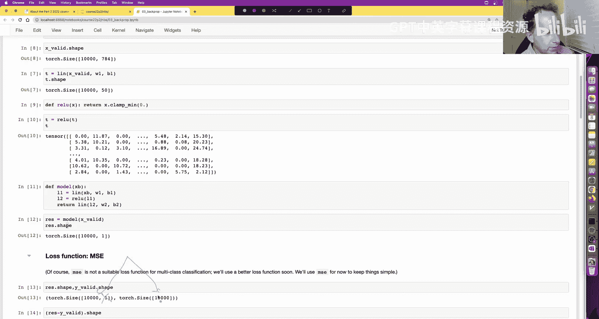

Operation。

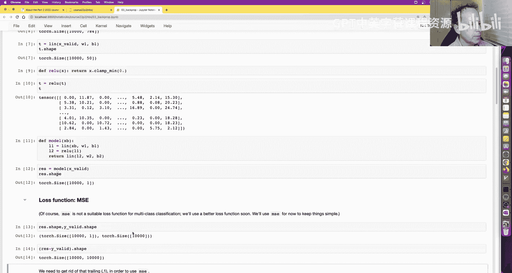

So in this case， I got rid of the trailing， comma one。

There's a couple of ways you could do that one is just to say， okay。

 grab every row and the zeroth column。😊，Of Res， and that's going to turn it from a 10。

000 by1 into a 10，000。Or alternatively， we can say dot squeeze Now dot squeeze removes all。😊。

Trailing unit vector， and possibly also prefix unit vector I can't quite recall。

I guess we should try， so let's say。Res。那 come麦。😔，Coon comment none。Q dot shape。

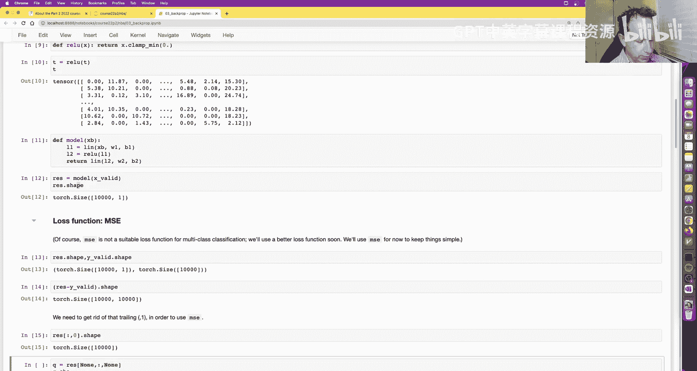

Okay， so if I go。C dot squeeze。A touch shape。Okay， so all the unit vectors get removed。Sorry。

 all the unit dimensions get removed， I should say。Okay。

So now that we've got a way to remove that axis that we didn't want。

 we can use it and if we do this attraction now we get 10，000 just like we wanted。

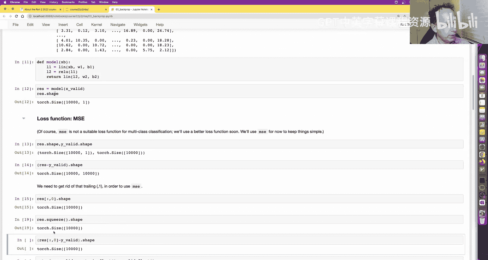

So now， let's get our。Training and validation wise we turn them into floats because we're using MSE。

So let's calculate our predictions。😊。

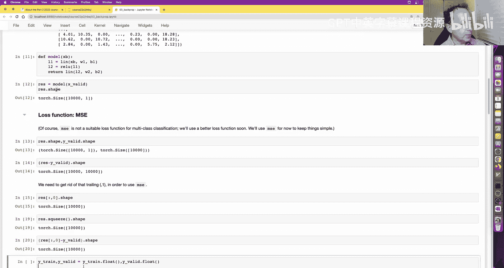

For the training set， which is 50，000 by one。And so if we create an MSc function that just does what we just said we wanted。

 so it does this attraction。And then squares it and it takes the mean， that's MSC。So there we go。

 we now have a loss function being applied to our training set。Okay。Now we need gradients。

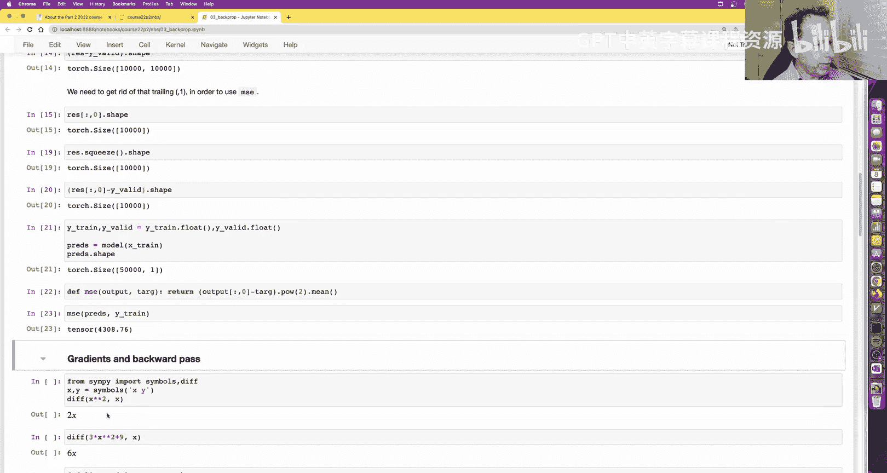

So as we briefly discussed last time。Graadients are slopes。And in fact。

 maybe it would even be easier to look at last time。

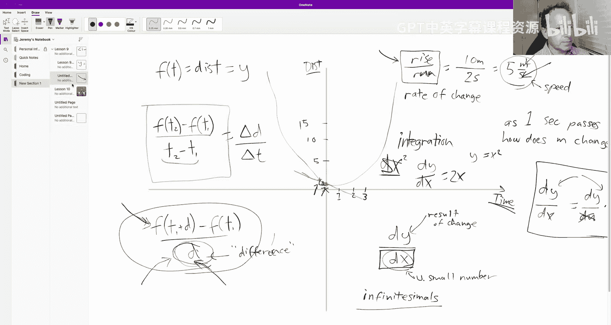

So this was last time's notebook。And so we saw how。The gradient at this point。Is。Is the slope here。

And so it's the， as we discussed， rise overrun。Now。

 so that means as we increase in this case time by one。Distance increases by。

How much that's what the slope is。So why is this interesting？

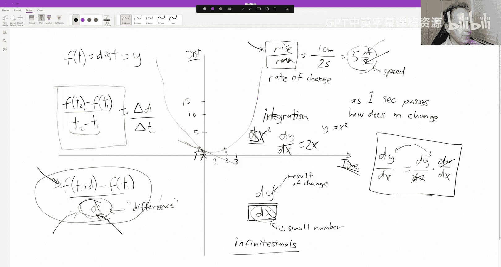

The reason is interesting。Is because let's consider our neural network our neural network is some function。

That takes two things to groups of things。It contains a matrix of our。Inputs。And it contains our。

Whight matrix。And。We want to。嗯。And and let's assume we're also putting it through a loss function。

 So let's say， well， I mean， I guess we can be explicit about that。

 so we could say we then take the result of that and we put it through some loss function。

So these are the predictions。And we compare it to our。嗯。To our actual。Depenent variable。

So that's our neural net。And that's our loss function。Okay。So。

If we can get the derivative of the loss。With respect to， let's say one particular weight。

 so let's say weight number zero。What is that doing well。

 it's saying as I increase increase the weight by a little bit。😊，What happens to the loss？

And if it says， oh， well that would make the loss go down。

 then obviously I want to increase the weight by a little bit。 and if it says， oh。

 it makes the loss go up， then obviously I want to do the opposite。

So the derivative of the loss with respect to the weights。

 each one of those tells us how to change the weights， and so to remind you。

 we then change each weight by that derivative times a little bit and subtract it from the original weights and we do that a bunch of times and that's called SGD。

Now， there's something interesting going on here， which is that。In this case。

 there's a single input and a single output。And so the derivative is a single number at any point。

 it's the speed in this case， the vehicle is going。But consider a more complex function。Like， say。

 this one。Now in this case， there's one output， but there's two inputs。

And so if we want to take the derivative of this function。Then we actually need to say， well。

 what happens if we increase x by a little bit and also what happens if we increase y by a little bit and in each case what happens to Z？

And so in that case， the derivative is actually going to contain two numbers， right。

 it's going to contain the derivative of Z with respect to y。

And it's going to contain the derivative of Z with respect to x。

 What happens if we change each of these two numbers， so for example。

 these could be as we discuss two different weights in our neural network and Z could be our loss。

 for example。Now we've got actually 784 inputs right， so we would actually have 784 of these。

 so we don't normally write them all like that we would just say。😊。

Is this little squly symbol to say the derivative of the loss across all of them。

With respect to all of the weights， Okay， and that's just saying that there's a whole bunch of them。

 it's a shorthand way。Of writing this。Okay， so。It gets more complicated still， though。

 because think about what happens。If， for example， you are in the first layer where we've got a weight matrix that's going to end up giving us 50 outputs right so for every image we're going to have 784 inputs to our function。

And we're going to have 50 outputs to a function。And so in that case。I can't even draw it， right？

Because like for every， even if I had two inputs and two outputs， then as I increase my first input。

 I actually need to say， how does that change both of the two outputs and as I change my second input。

 how does that change both of my two outputs？So for the full thing。

 you actually are going to end up with a matrix of derivatives。

 it basically says for every input that you change。😊，By a little bit。

How much does it change Every output。Of that function， so you're going to end up with a matrix。

So that's what we're going to be doing is we're going to be calculating these derivatives。

 but rather than being single numbers， they're going to actually contain。😊。

Marices with a row for every input and a column for every output and a single cell in that matrix will tell us as I change this input by a little bit。

 how does it change this output？Now， eventually。We will end up with a single number。For every。

Inport and that's because our loss in the end is going to be a single number and this is like a requirement that you'll find when you try to use SGD is that your loss has to be a single number。

 and so we generally get it by how you're doing the me， the summ or a mean or something like that。😊。

But as you'll see on the way there， we're going to have to be dealing with these。😊。

Mattrix of derivatives。

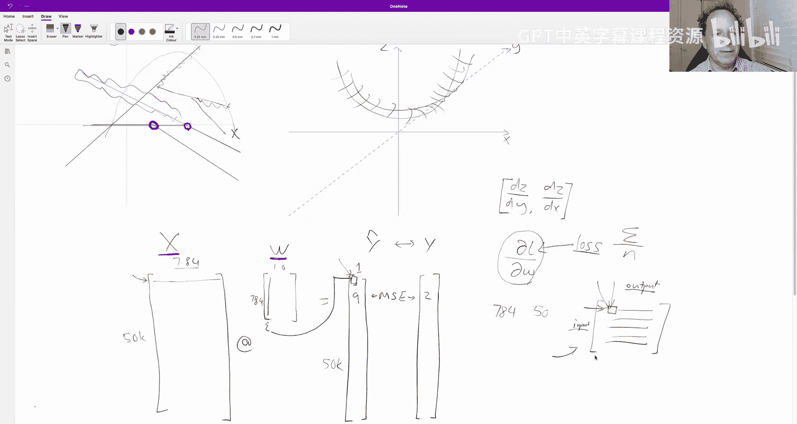

So I just want to mention。

As I might have said before， I kind of even remember。

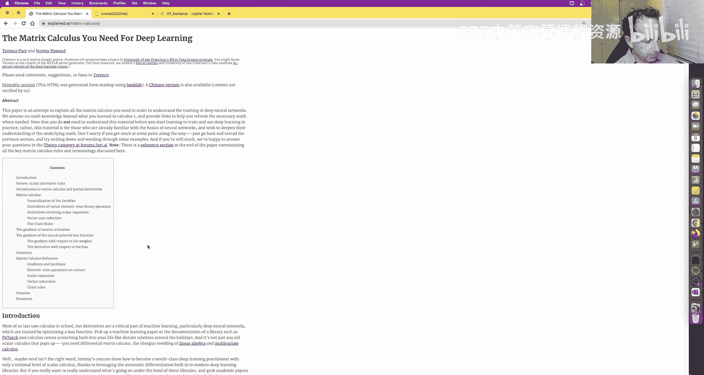

There is this paper that Terrence Pyer and I wrote a while ago。

Which goes through all this。

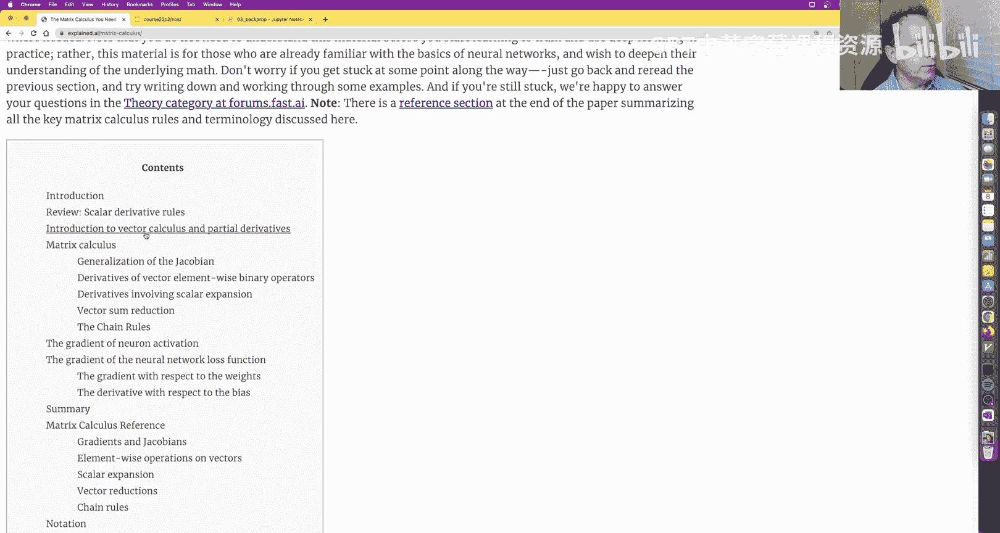

And it。Basically， assume that you only know high school calculus and if you don't check out Khan Academy。

 but then it describes。Matrix calculus in those terms， so it's going to explain to you。

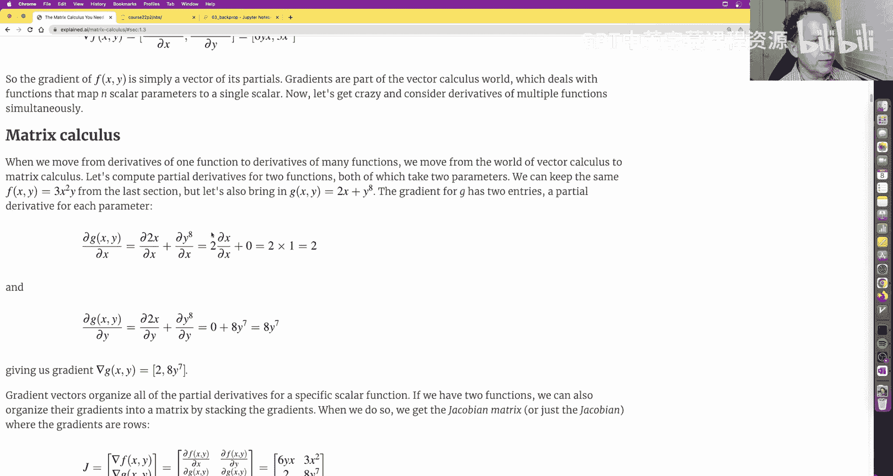

Exactly and it works through lots and lots of examples。

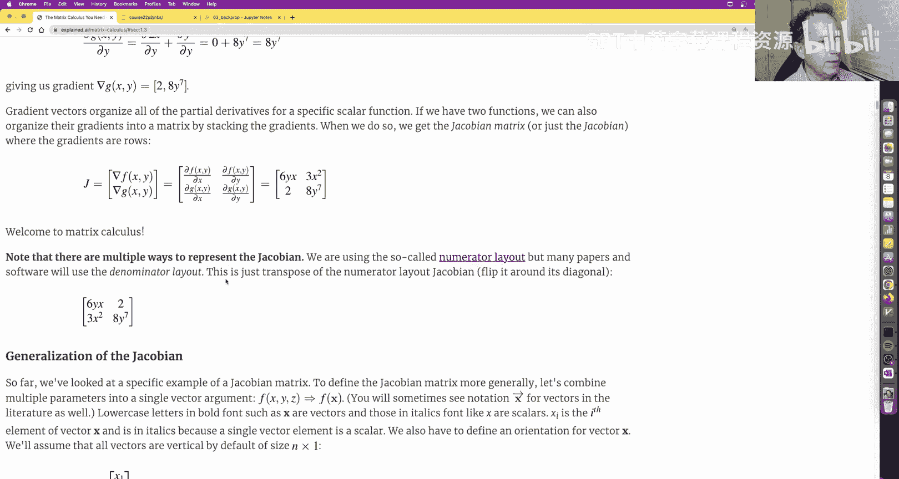

U。So for example， as it mentions here， when you have this matrix。Of derivatives。

We call that a Jacobian matrix。 So there's all these like words。

 It doesn't matter too much if you know them or not， but it's it's convenient。

To be able to talk about。You know， the matrix of all of the derivatives。

 if somebody just says it the Jacobian， it's a little convenience。

 it's a a bit bit easier than saying the matrix of all of the derivatives where all of the rows are the things that are are all the inputs and all the columns of the outputs。

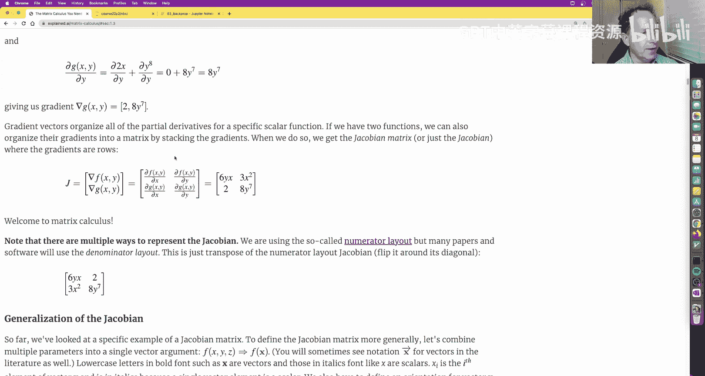

So。Yeah， if you want to really understand。😊。

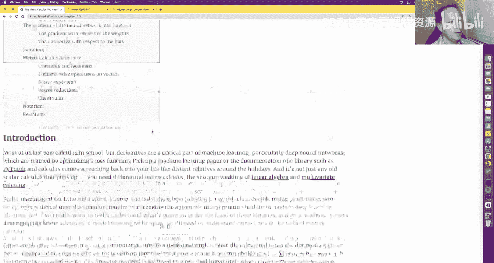

Get to a point where papers are easier to read in particular。

 it's quite useful to know this notation and。And， and。Definitions of words。

 you can certainly get away without it。

It's just something to consider。

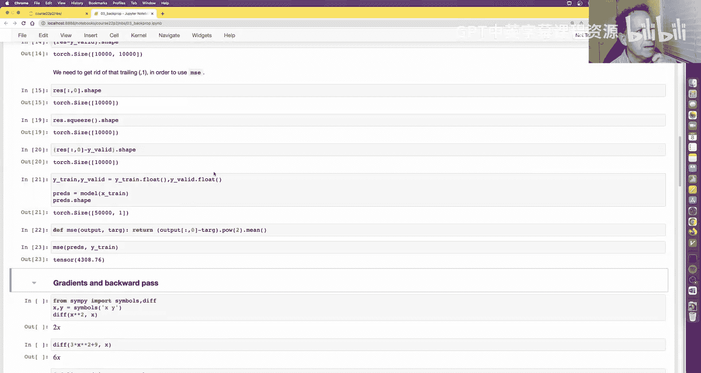

Okay， so。

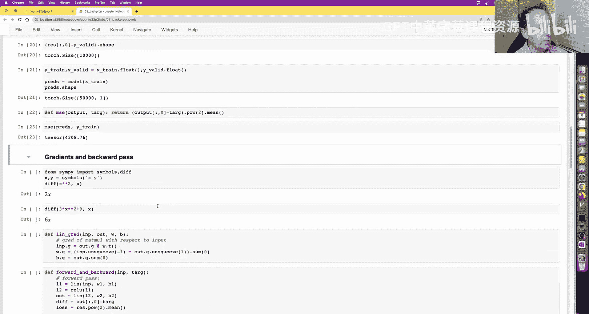

We need to be able to calculate derivatives at least of a single variable。

 and I am not going to worry too much about that A because that is something you do in high school math and B。

 because your computer can do it for you。😊，And so you can do it symbolically using something called Simpi。

 which is really great， So if you create two symbols called X and Y。😊。

You can say please differentiate。X squared with respect to x。 And if you do that。

Simpai will tell you the answer is 2 x。If you say。Differentiate3 x squared plus9 with respect to x。

 S will tell you that 6 x。 And a lot of you probably will have used a Wolf from alpha that does something very similar。

 I kind of quite like this because I can quickly do it inside my notebook and。Included in my pros。

so I think Simpplay is pretty cool， so you know， basically， yeah， the if you， you know。

 you can quickly calculate derivatives on a computer。😊，嗯。Having said that。

I do want to talk about why the derivative of 3 x squared plus 9 equals 6x because that's going to be very important。

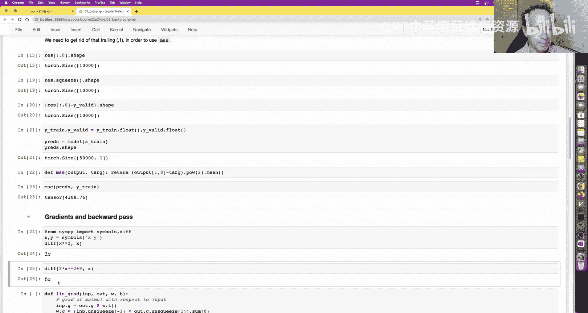

U。So3 x squared。Plus，9。So。We're going to start。With the。

The information that the derivative of A to the B。With respect to A。Aquals B times a。So for example。

 the derivative of x squared。With respect to x he callss2 x。

 so that's just something I'm hoping you'll remember from high school or refresh your memory using Khan Academy or similar。

 so there that is there。So what we could now do is we could rewrite this derivative。As。3， you。Plus9。

And then we'll write U equals。X squared。Okay， this is getting easier。嗯。😊。

The derivative of two things being added together is simply the sum of their derivatives。Oh。

 forgot B minus one in the exponent， thank you， so B A to the pair of B minus1。

That's what it should be。hich would be 2 x to the pair of one and the one is not needed。

Thank you for fixing that， all right。😊，So we just sum them up so we'll get the derivative of 3 U。

Is actually just。Well， it's gonna to be the derivative of。That plus the derivative of that。 Now。

 the derivative of any constant with respect to a variable is 0， because if I change something。

 an input， it doesn't change the constant is always9。 So that's going to end up a 0。

And so we're going to end up with， do why do you？😊，As。

Something plus zero and the derivative of3 U with respect to U is just three because it's just a line so it's's slope。

😊，Okay， but that's not to ydx， we won't do it up to Ydx。Well， the cool thing is that de Y X。

Is actually just equal to to y to U。Do U to X。So I'll explain why in a moment。

 but for now then let's recognize we've got D Y0 to UDx。We know that one， 2 x。

So we can now modifyply these two bits together。And we will end up with。2 x。Times 3， which is 6 x。

 which is what Simppa told us， so fantastic。Okay， this is something we need to know really well。

 and it's called the chain rule。😊，And it's best to understand it intuitively。

So to understand it intuitively， we're going to take a look at an interactive animation。

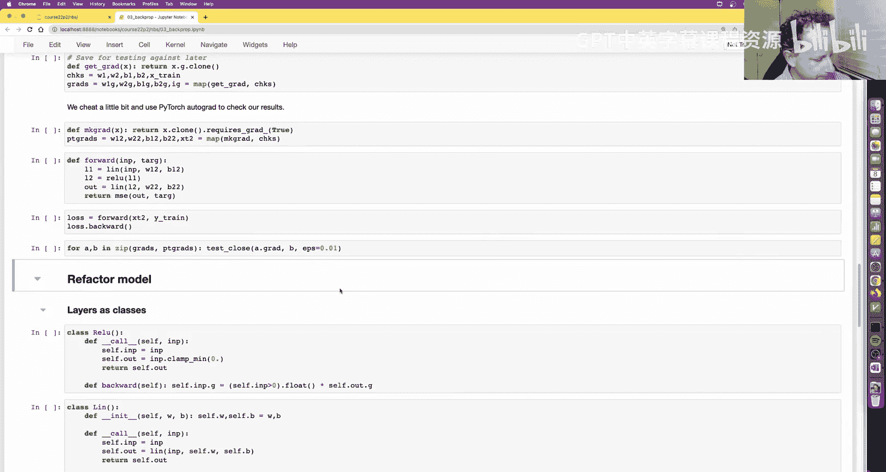

So I found this nice， interactive animation。On this page here。Webspaceship Eduu slash。And it's ready。

 Re， George， George， yeah， geoo cheaperper， cculus。Okay。

 and the idea here is that we've got a wheel spinning around。And each time it spins round。

This is X going up。 Okay， so at the moment， there's some。Change in X， Dx。Over a period of time。

All right， now this wheel is。8 times bigger than this will。

 So each time this goes round once if we connect the two together。This wheel would be going round。

Four times faster， because。The difference between the multiple between eight and two is four。

 maybe I'll bring this up to here。So now that the this wheel is has got twice as big a circumference as the U wheel。

 each time this goes around once。This is going around two types。So the change in you。😊。

Each time x goes round once， the change in U will be 2， so that's what Du U dx is saying。

 the change in U for each change in x is 2。Now， we could make this interesting。

By connecting this wheel to this wheel， now this wheel is twice as small as this wheel。

So now we can see that again， each time this bends round once， this bins round twice。

Because this has twice the circumference of this。So therefore do y do u equals2。

But now that means every time this goes around once。This goes round twice。

 every time this one goes round once， this gun goes round twice。

 so therefore every time this one goes round once， this one goes round four times。

So do y d x equals 4。😊，So you can see here how the two。Well。

 how the X UDX has to be multiplied with the D wayu。To get the total， so this is what's going on。😊。

In the chain rule， and this is what you want to be thinking about is this idea that。

You've got one function that is kind of this intermediary。

And so you have to multiply the two impacts to get the impact of the X wheel。On the Y wheel。

So I hope you find that。Useful， I find this personally， I find this intuition quite useful。

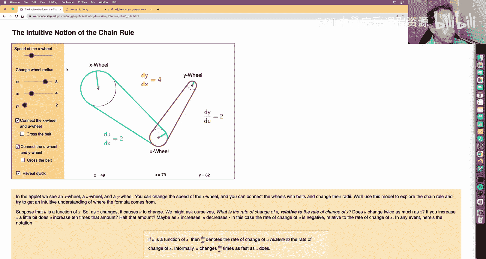

So why do we care about this？ Well， the reason we care about this is because we want to calculate。

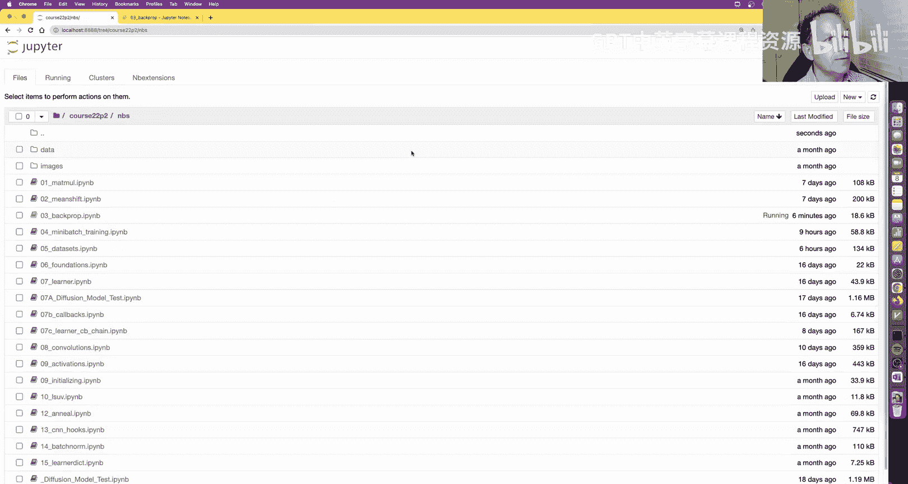

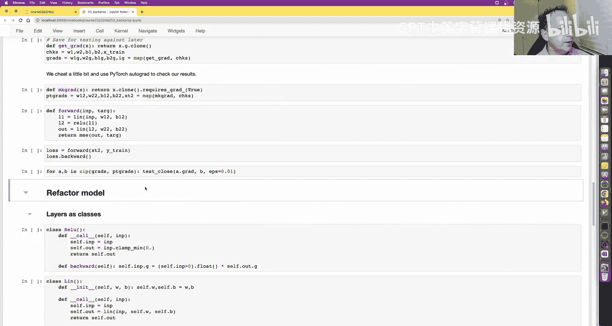

，Graadient of our MSE。

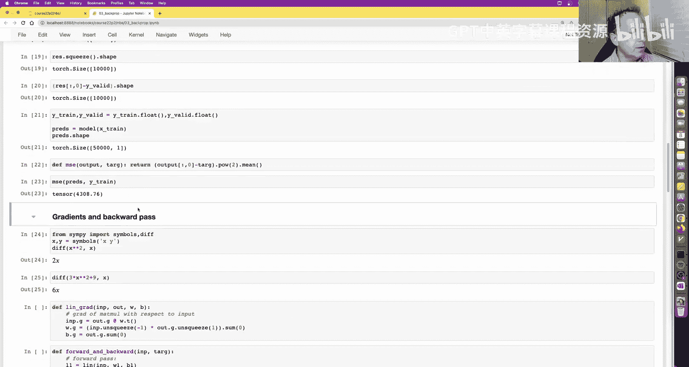

Apply to。

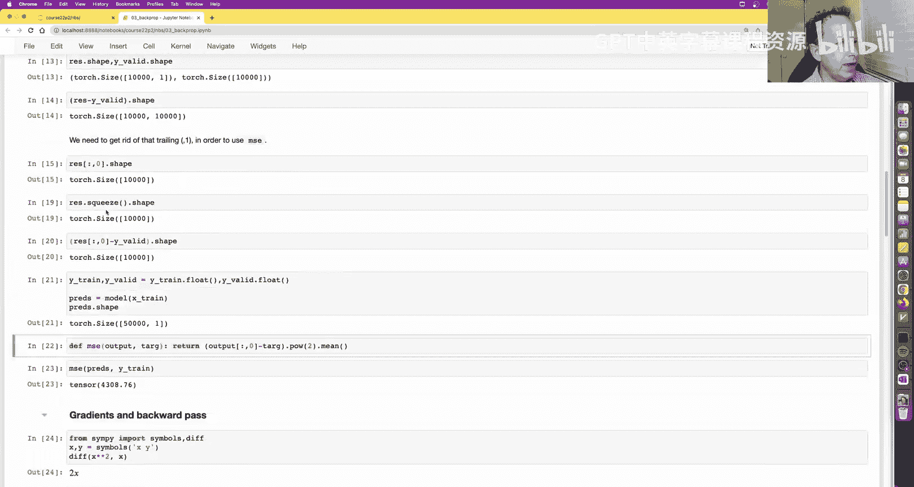

A model。And so our inputs are going through a linear， they're going through a value。

 they're going through another linear， and then they're going through an MSE。

 So there's four different steps going on。 and so we're going to have to combine those all。

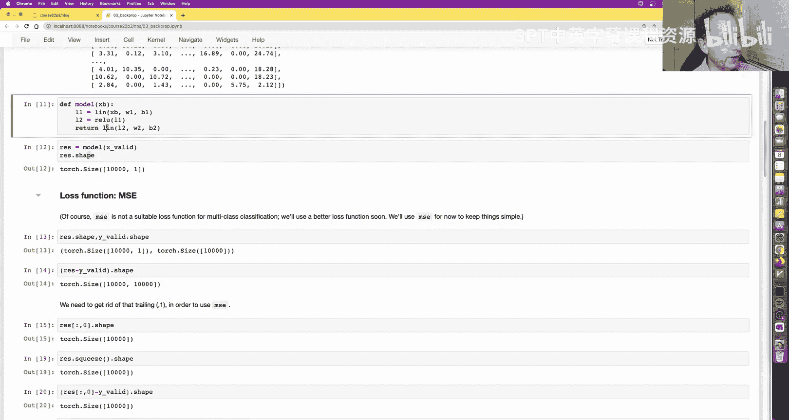

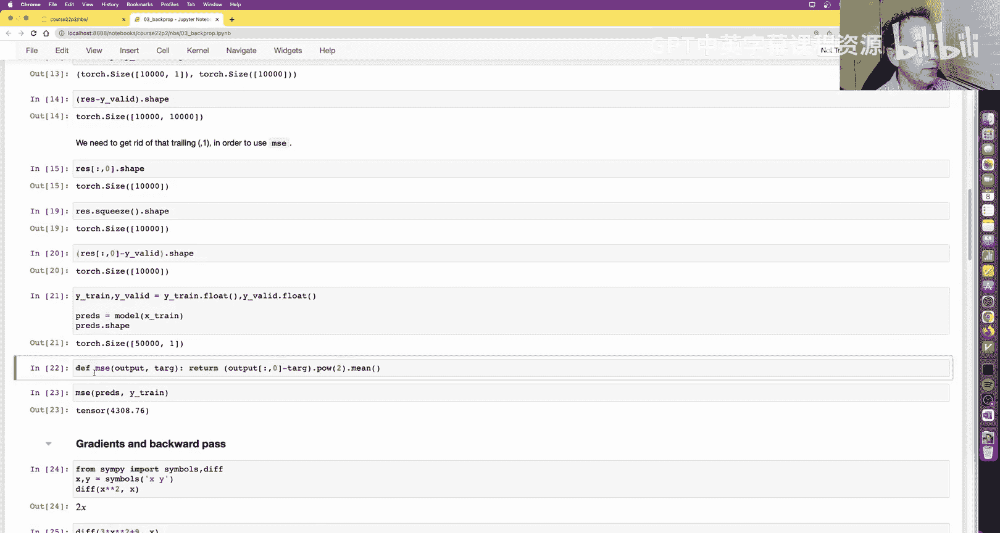

And so we can do that with a chain rule。

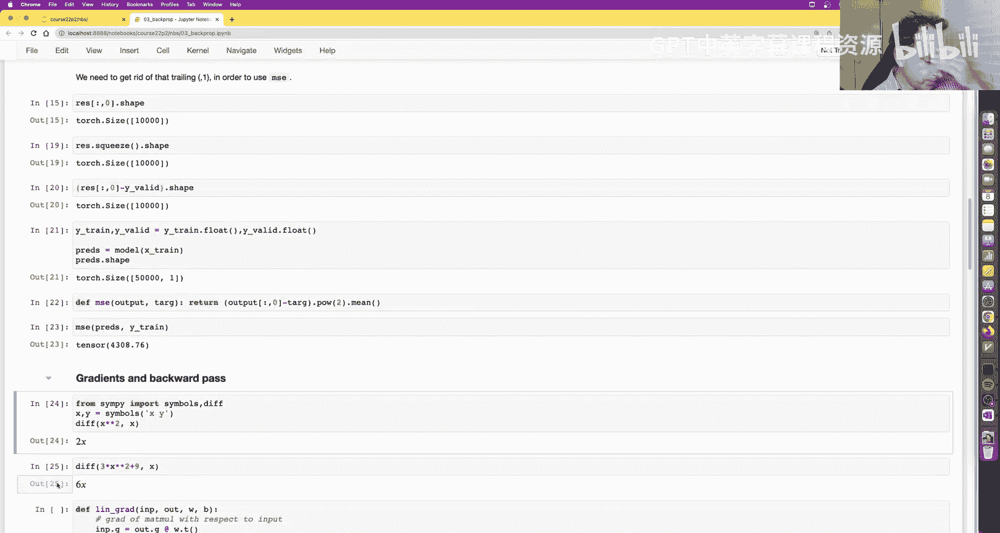

So， if our steps are that。Loss function。Is。So weve got the loss function。

 which is some function of the predictions。And the actuals。And then we've got。We've got the。

Second layer。Is a function of。Actually， that's said， let's call this。The output of the second layer。

Slightly weird notation， but hopefully it's not too bad。

 is going to be a function of the of the value activations。um。

And the value activations are a function of the first layer。

And the first layer is a function of the inputs。 and of course， this also has weights and biases。

So we're basically going to have to calculate。The derivative of that。Okay。

 but then remember that this is itself a function， so then we'll need to multiply that derivative by the derivative of that。

 but that's also a function。 So we have to multiply that derivative by this。

 but that's also a function was that we have to multiply that derivative by this。

 So that's going to be our approach。 We're going to start at the end。

We're going to take its derivative and then we're going to gradually keep multiplying as we go each step through。

 and this is called back propagation。So back propagation。Sounds pretty fancy。

But it's actually just using the chain rule。Gosh， I didn't spell that very well， propp occasion。U。😊。

It's just using the chain rule and as you'll see it's also just taking advantage of a computational trick of memorizing some things on the way。

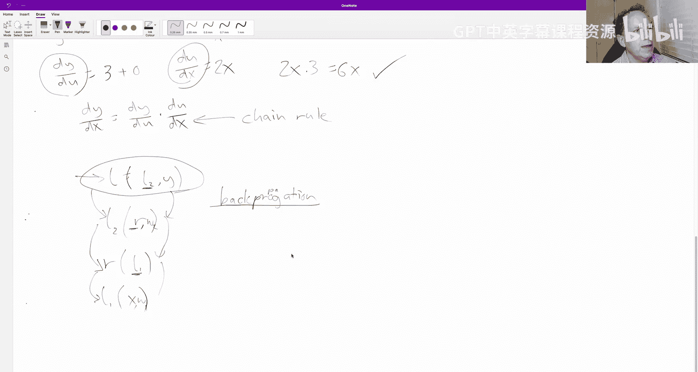

And in our chat， Siva made a very good point about understanding。

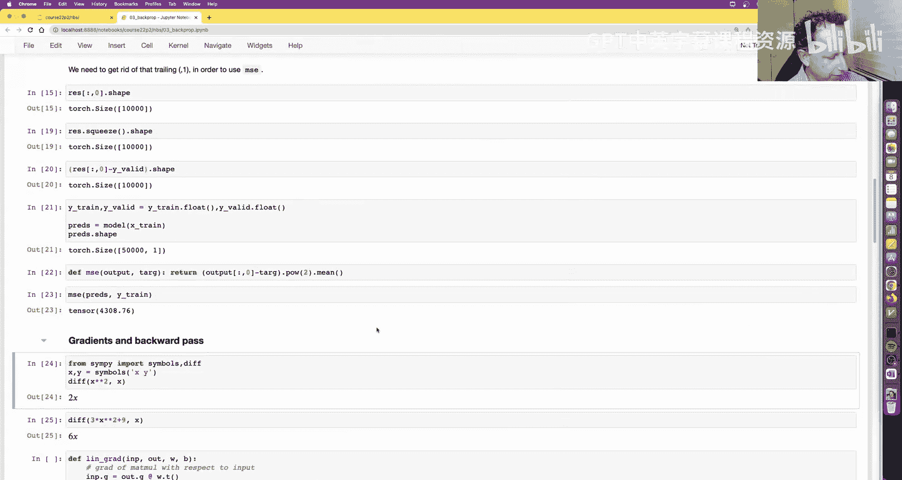

Non nonlinear functions in this case， which is just to consider that the wheels could be growing and shrinking all the time as they're moving。

 but you're still going to have the same compound effect， which I really like that。 Thank you Sva。

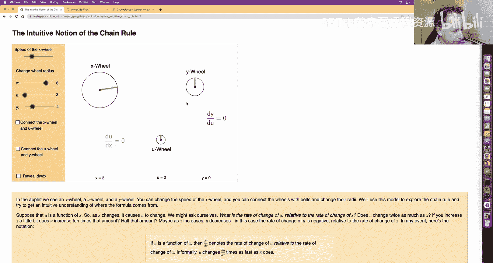

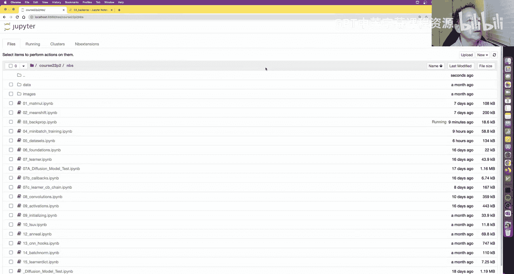

There's also a question in the chat about why is this？Coal and comma 0 being placed in the function。

 given that we can do it outside the function。 Well。

 the point is we want an MSC function that we will apply to any output。 not we're not using it once。

 We want it to work anytime。 so we haven't actually modified。Pritz。

Or anything like that or why train， so we want this to be able to apply to anything without us having to like pre processcess it is basically the idea here。

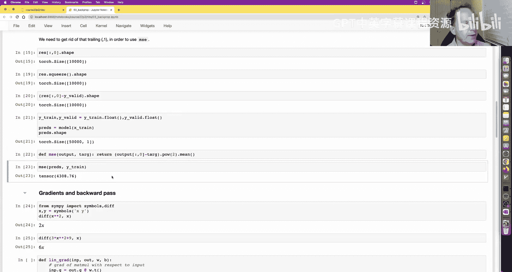

Okay， so。Let's take a look at the basic idea。 So here's going to do a forward pass and a backward pass。

 So the forward pass is where we calculate the loss。 So the loss。Is。Oh， I've got an error here。😊。

That should be diff。Here we go。嗯。So the loss is going to be。

Output of our neural net minus our target。Squared。Then take the main。Okay。

 and then our output is going to be the output of the second linear layer。

The second linear layer input will be the value， the res input will be the first layer。

 so we're going to take our input， put it through a linear layer， put that through a value。

 put that through a linear layer and calculate the MSC。Okay。

 that bit hopefully is pretty straightforward。😊，So what about the backward pass？So the backward pass。

What I'm going to do， and you'll see why in a moment。

 is I'm going to store the gradients of each layer。😊。

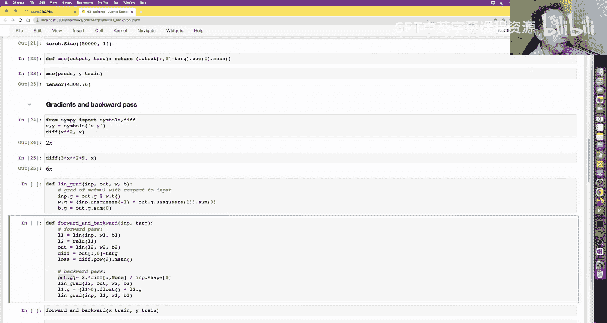

So， for example， the gradients of。

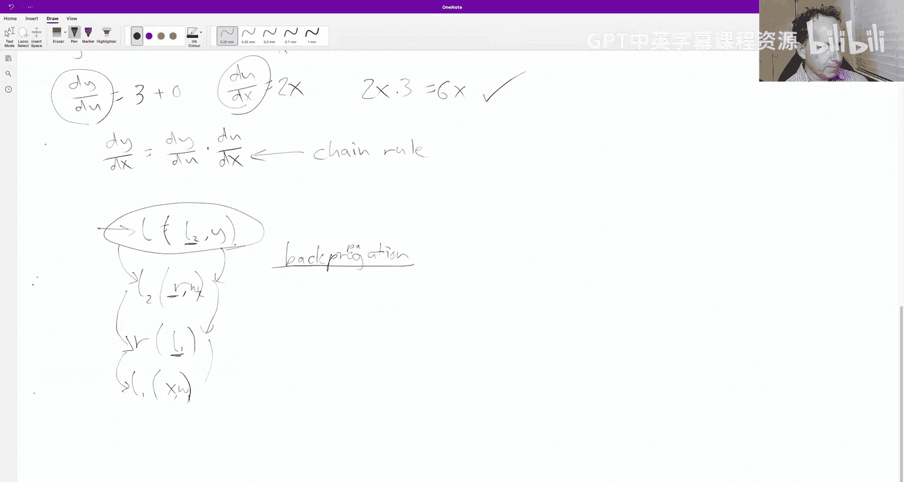

The loss with respect to its inputs。In the layer itself， so I'm going to create a new attribute。

 I could call it anything I like， and I's going to call it dot G。😊。

So I'm going to create a new layer， a new attribute called out dot G。

 which is going to contain the gradients。 You don't have to do it this way。

 but as you'll see it turns out pretty convenient。So that's just going to be。

Two times a difference because we've got different squared， so that's just the derivative。And then。U。

We have taken the。Main here， so we have to do the same thing here divided by the input shape。😊。

And so that's that's those gradients， that's good and now what we need to do is multiply。😊。

By the gradients of the previous layer。 So here's their previous layer。

 So what are the gradients of a linear layer。 I've granted a function for that here。

So the gradient of a linear layer。We're going to need to know the weights of the layer。

 We're going to need to know the biases of the layer。And then we're also going to know the。

Input to the linear layer。Because that's the thing that's actually being manipulated here。

 and then we're also going to need the output。Because。

We have to multiply by the gradients because we've got the chain rule。So again， we're going to store。

The gradients of our input。So this would be the gradients of our output with respect to the input。

And that's simply the weights because the weights， so a matrix multiply is just a whole bunch of linear functions。

 so each one slope is just as weight。But you have to multiply it by the gradient of the outputs because of the chain rule。

😊，And then the gradient of the outputs with respect to the weights。Is going to be the。

Input times the output。Summed up， I'll talk more about that in a moment。

The derivatives of the bias is very straightforward。It's the。Grads of the output。Added together。

 because the bias is just a constant value。So for the chain rule， we simply just use。Output times 1。

Which is output。So for this one here， again， we have to do the same thing we've been doing before。

 which is multiplied by the output gradients because of the chain rule。And then we've got the。

Input weights， so every single one of those has to be multiplied by the outputs。嗯。

And so that's why we have to do an unsqueezed minus1。

So what I'm going to do now is I'm going to show you how I would。😊。

Experiment with this code in order to understand it， and I would encourage you to do the same thing。

 It's a little harder to do this one cell by cell because we kind of want to put it all into this function like this。

 So in it a way to explore the calculations interactively。

And the way we do that is by using the Python debugger。

Here is how you let me see a few ways to do this， here's one way to use the Python debugger。

The Python debugger is called PDdB， so if you say PDdb do set trace。In your code。

Then that tells the debugger to stop execution when it reaches this line so it sets a break point。

 so if I call forward and backward， you can see here its stopped and the interactive Python debugger IPDV has popped up。

With an arrow pointing at the line of code， it's about to run。😊，And at this point。

 there's a whole range of things we can do to find out what they are， we H。😊。

For help， understanding how to use the Python debugger is one of the most powerful things I think you can do to improve your coding。

😊，Um。So。One of the most useful things you can do is to print something you see all these single letter things they're just shortcuts。

 but in a debugger you want to be able to do things quickly so instead of typing print。

 Ill just type P。😊，So for example。Let's take a look at the shape of the input。

So I type P for print input dot shape。So I've got a 50。

000 by 50 input to the last layer that makes sense。

 these are the hidden activations coming into the last layer for every one of our images。😊。

What about the output gradients？And there's that as well。 And actually， a little trick。

 you can ignore that you don't have to use the P at all if your variable name is not the same as any of these commands。

 so I could have just typed。Out dotg。tsha。Get the same thing。Okay。So you can also put in expressions。

So let's have a look at the shape of this。So the output of this is， let's see if it makes sense。

 We've got the input，50000 by 50。 we put a new axis on the end。

 unsqueezed minus-1 is the same as doing dot as indexing it with dot dot dot co none。

 Let's put a new axis at the end。 So that would have become。50000 by 50 by one。

And then the out G dot un squeezequeze we're putting in the first dimension。

 so we're going to have 50，000 by 50 by one times。50000 by one by one。

And so we're going to end up getting this broadcasting happening over these last two dimensions。

 which is why we end up with 50，000 by 50 by one。And then， with summing up。This makes sense， right。

 We want to sum up over。All of the inputs， each image is individually contributing to the derivative。

And so we want to add them all up to find their total impact because remember the sum of a bunch of the derivative of the sum of of functions is the sum of the derivatives of the functions。

 so we can just sum them up。Now， this is one of these situations where if you see a times an a salmon an unsqueeze。

 it's not a bad idea to think about Einstein's summation notation。

Maybe there's a way to simplify this。So first of all。

 let's just see how we can do some more stuff in the debugger I'm going to continue。

 so just continue running， so C for continue。

And it keeps running until it comes back again to the same spot。

 and the reason we've come to the same spot twice is because Ly grad is called two times。

So we would expect that the second time。We're going to get a。Different bunch of。Inputts and outputs。

And so I can print out a top all of the inputs and output gradient， so now yeah。

 so this is the first layer。Going into the second layer， so that's exactly what we' would expect。

To find out what called this function， you just type W W is where am I。

 and so you can see here where am I， oh， forward and backward was called， see the arrow。

 that called Ly grad the second time and now we're here in W。G equals。

If we want to find out what w。tg ends up being equal to。

 I can press n for the to say go to the next line。And so now we've moved from line 5 to96。

 so the instruction point is now looking at line  six so I could now print out， for example， w。g。

shape。And there's the shape of our weights。One person on the chat has pointed out that you can use breakpoint instead of this。

Import PDB business， unfortunately the breakrepoint keyword doesn't currently work in Jupiter or in a Python。

 so we actually can't， sadly。

So that's why I'm doing it the old fashioned way。 So this way。

Maybe they'll fix the bug at some point， but for now you have to type all this。Okay。

 so those are a few things to know about， but I would definitely suggest looking up a Python PDDB tutorial to become very familiar with this incredibly powerful tool。

U。Because it really is so very handy。 So if I just continue again。

 it keeps running all the way to the end and it's now finished， running forward and backward。

So when it's finished， we would find that there will now be， for example， a W1 dot。Zi。

Because this is， this is the。Gras that it just calculated。And there would also be a。

Xtrain dot G and so forth。Okay， so let's see if we can simplify this a little bit。

 so I would be inclined to take these out。

And give them their own variable names just to make life a bit easier。

 it would have been better if I'd actually done this。Before。

The debuggings would be a bit easier to type。So let's set i and O equal to input and output dot g。

 unsqueze。哦。Okay， so we'll get rid of our break point。

And double check that we've got。Agras。

Okay。And I guess before we rerun it， we should probably set those to zero。

What I would do here to try things out。Its I put my break point there。And then I would try things。

 so let's go next and so。I realize here that。What we're actually doing is we're basically doing。

Exactly the same thing as an Ein sum would do。So I could test that out。By trying an esome， right。

 because I've just got。This is being。Replicated。And then I'm summing over that dimension because that's the multi that I'm doing。

 So I'm basically multiplying。The first dimension of H and then summing over that dimension。

 so I could try running that。And a， it works。😮，So that's interesting。U。Oh。

 and I've got zeros'ca I did X train do0。 That was silly。

That should be do gradients dot 0。Okay， so。

Let's try doing an Ein sum。And there we go。 That seems to be working。That's pretty cool。

 so we've multiplied this repeating index， so we were just multiplying the first dimensions together and then summing over them so there's no eye here。

Now， that's not quite the same thing as a matrix modificationplication。

 but we could turn it into the same thing as matrix modificationplication just by swapping I and J so that they're the other way around and that way we'd have。

J I comma IK。And we can swap into dimensions very easily。 That's what's called the transpose。

 So that would become a matrix modificationplication if we just use the transpose and in nu。

 the transpose is the。Capital T attribute。 So here is exactly the same thing using a matrix multiply and a transpose。

And let's check。Yeah， that's the same thing as well。Okay， cool。

So that tells us that now we've checked in our debugger。That we can actually。Replace all this。

Where the matrix modelplay。We don't need that anymore。

Let's see if it works。

It does。All right。Xtrain dot G。😔，Cool。

Okay， so hopefully that's convinced you that the debugger is a really handy thing for playing around with numeric programming ideas or coding in general。

And so I think now's a good time to take a break， so let's take a eight minute break and I'll see you back here actually seven minute break。

 I'll see you back here in seven minutes。Thank you。Okay， welcome back。

 so we've calculated our derivatives。😊，And we want to test them luckily Pytorrch already has derivatives implemented so I'm got to totally cheat and use ptorrch to calculate the same derivatives so don't worry about how this works yet because we're actually going to be doing all this from scratch anyway for now I'm just going to run it all through ptorrch and check that their derivatives are the same as ours and they are so we're on the right track Okay so this is all pretty clunky I think we can all agree and obviously it's clunkkiier than what we do in pytorrch so how do we simplify things。

😊。

There's some really cool refactoring that we can do。😊。

So what we're going to do is we're going to create a whole class for each of our functions for the value function and for the linear function。

😊，Um， so。The the way that we're going to do this is we're going to。Create a dunder call。

What does Dun to call do， let me show you so if I create a class。

And we're just going to set that to print hello。So if I create an instance of that class。

And then I call it as if it was a function。Oops， messing the dnda bit here。

Qu it as if it's a function， it says high。So in other words， you know。

 everything can be changed in Python， you can change how a class behaves you can。

Make it look work like a function， and to do that is simply define。D call。

 you could pass it an argument。Next so。Okay， so that's what Dancole does。

 it just says it's just a little bit of syntax sugary kind of stuff to say I want to be able to。

Treat it as if it's a function without any method at all。

 You can still do it the method way you could have done this。Don't know why you'd want to。

 but you can。But because it's got this special magic named under。

 you don't have to write the do underco at all。So here， if we create an instance of the value class。

 we can treat it as a function。😊，And what it's going to do is it's going to take its input and do the value on it。

😊。

But if you look back at the forward and backward。There's something very interesting about the backward pass。

Which is that it has to know。About。For example， this intermediate calculation gets passed over here。

This intermediate calculation gets up passed over here because of the chain rule。

 we're going to need。Some of the intermediate calculations are not just because of the chain rule because of actually how the derivatives are calculated。

😊，So we need to actually store。

Each of the layer intermediate calculations。 And so that's why value doesn't just。

Calculate and return the output， but it also stores its output。And it also stores its input。

So that way， then when we call backward。We know how to calculate that。

We set the inputs gradient because remember we stored the input so we can do that， right？

And it's going to just be， oh input greater than0 dot float， right， So that's the definition。Okay。

 of the derivative of a value。And then chain rule。😊。

So that's how we can calculate the forward pass and the backward pass for value。

 And we're not going to have to then store all this intermediate stuff separately。

 It's going to happen automatically。 So we can do the same thing for a linear layer。 Now。

 linear layer needs。

Some additional state weights and biases， value doesn't right so there's no edit。

So when we create a linear layer， we have to say， what are its weights， what are its biases。

 we store them away。And then when we call it when the forward pass， just like before。

 we store the input， so that's exactly the same line here。And just like before。

 we calculate the output and store it and then return it。 Okay， and this time， of course。

 we just call min。And then for the backward pass。It's the same thing， Okay。

 so the input gradients we calculate just like before。Oh。

duct tea brackets is exactly the same with a little T as big tea is as a property。

 so that's the same thing that's just the transpose。Calculate the gradients of the weights。Again。

 with a chain rule and the bias， just like we did it before。

 and they're all being stored in the appropriate places。

And then for MSE， we can do the same thing， we don't just calculate the MSE， but we also store it。

And we also now the MSC just needs two things， an input and a target， so we'll store those as well。

So that in the backward pass， we can calculate its gradient of the import。As being two times。

The difference。And there it all is okay。Our model now is much easier to define。 We can just。

Create a bunch of layers， linear。W1， B1， R， linear W2B2。And then we can store an instance of the MSE。

 This is not calling MSC。 it's creating an instance of the MSE class。

 And this is an instance of the L class。 This is an instance of the reality class。

 So they're just being stored。 So then when we。Call the model。We pass it our inputs and our target。

We go through each layer。Set X equal to the result of calling that layer。

And then pass that to the loss。 So there's something kind of interesting here that you might have noticed。

 which is that we don't have。

嗯。E would we do it。Something interesting here is that we don't have two separate functions inside our model。

 the loss function。Being applied to。A separate neural net。

 but we've actually integrated the loss function directly into the neural net， into the model。

See how the loss is being calculated inside the model。Now。

 that's neither better nor worse than having it separately。 It's just different。 And so generally。

 a lot of hugging face stuff does it this way。 They actually put the loss inside the forward。

Most stuff in fast AI and a lot of other libraries does it separately。

 which is the loss is a whole separate function and the model only returns the result of putting it through the layers so for this model we're going to actually do the loss function inside the model。

So for backward， we just do each thing So self dot loss do backwards so that self dot loss is the MSE object。

 so that's going to call。Backward， right， and it's stored when it was cold here。It was storing。

 remember the inputs， the targets， the outputs， so it can calculate the backward。

And then we go through each layer is in reverse， right， this is back propagation backwards reversed。

 calling backward on each one。So that's pretty interesting， I think。So now we can calculate。

The model。You can calculate the loss。We can call backward， and then we can check that。

Each of the gradients that we stored earlier。Equal to each of our new gradients。😊，Okay。

 so Williams asked a very good question that is if you do put the loss inside here。

 how on earth do you actually get predictions， so generally what happens is in practice hugging face models do something like this。

 so I'll say self dot pres equals x。And then they'll say。Self。Dot， I don't know， Fi loss。

He calls that。And then return self dot final loss and that way。

I guess you don't even need that last bit。 Well， that's with them anyway， they're just what they do。

 So I'll leave it there。 And so that way， you can kind of check like。Model dot。Creds， for example。

 so it'll be something like that， or alternatively you can return not just the last。

 but both as a dictionary stuff like that。 So there's a few different ways you could do it。Actually。

 now I think about it， I think that's what they do is they actually return both as a dictionary so it would be。

It be like， return， dictionary。Loss equals that comma。Treds， he close that。Something like that。

 I guess， is what they would do。Anyway， there's a few different ways to do it。Okay。

 so hopefully you can see that this is really。😊。

Making it nice and easy for us to do our。

Forward pass and our backward pass without all of this manual fiddling around every class now can be totally separately considered and can be combined however we want。

 We could create layers so you could try creating a bigger neural net if you want to。

But we can refactor it more， so basically ass a rule of thumb when you see repeated code， self。

 imp pickles in。Self to M equals Imp self dot out equals return Soed out self to out equals return soft out。

 That's a sign you can refactor things。 and so what we can do is a simple refactoring is to create a new class calledor module。

And module is going to do those things we just said， it's going to store the inputs。😊。

And it's going to call something called self dot forward in order to create our self dot out because remember。

 that was one of the things we had again and again and again selft out self dot out。

And then return it。And so now there's going to be a thing called Forward。😊，Which， actually。In this。

 it doesn't do anything because the hot purpose of this module is to be inherited。

Let me call backward。It's going to call self dot backward passing in self dot out because notice all of our backwards。

Always wanted to get hold of self dot out， self dot out。

Itself do out because we need it for the chain rule。

So let's pass that in。And pass in those arguments that we stored earlier。

And so star means take all of the arguments regardless whether it's zero， one。

 two or more and put them into a list。😊，And then that's what happens when it's inside the actual signature。

 and then when you call a function using star， it says take this list and expand them into separate arguments。

 calling backward with each one separately。So now for RE， look how much simpler it is。

 let's copy the old R to the new R。So the old value had to do all this storing stuff manually。

Hand it out of little self dot stuff as well。That now we can get rid of all of that and just implement forward。

Because that's the thing that's been called and that's a thing that we need to implement。

And so now the forward of value just does the one thing we want。

 which also makes the code much cleaner and more understandable， did over backward。

 it just does the one thing we want。😊，So that's nice now we still have to modifyply it。

 but we still have to do the chain rule manually。😊，But so the same thing for linear。

 same thing for MSc。 So these all look a lot nicer。 and one thing to point out here。

Is that。There's often opportunities。To manually speed things up when you create custom autograd functions in paytorrch。

 And here's an example， look， this calculation。Is being done twice。Which seems like a waste。

 doesn't it， So at the cost of。Some memory， we could instead store that calculation。As ifff。

And we guess we'd have to store it for use later， so don't need to be self。 di。

And at the cost of that memory。We could now remove。This。

Radundant calculation because we've done it once before already installed it。

And just use it directly。And this is something that you can often do in neural nets。There's this。

Compromise between storing things， the memory use of that。

 and then the computational speed up of not having to recalculate it。

 This is something we come across a lot。And so now we can call it in the same way。

 create our model passing in all of those layers。So you can see with our model。

 we're just so the model hasn't。

Chaanged at this point， the definition was。

Up here we just pass in the layers。

Sorry， not the layers， the weights for the layers。

Calculate the loss， call backward。And look， it's the same， three。😊。

Okay， so。

Thankfully。Pytorrch has written all this for us。 And remember， according to rules of our game。

 once we've re implementeded it， we're allowed to use Ptorrch's version。

 So Ptorrch calls their version and end dot module。

And so it's exactly the same， you inherit from N N dot module。

 so if we want to create a linear layer just like this one rather than inheriting from our module。

We will inherit from their lo。But everything's exactly the same。So we create our。

We can create our random numbers， so in this case rather than passing in the already randomized weights。

 we're actually going to generate the random weights ourselves and the zero biases and then here's our linear layer。

Which you could also use L for that， of course。So we defined our forward。

 and why don't we need to define。

Backward， because。

Pytorch already knows the derivatives of all of the functions in Pytorch and it knows how to use the chain rule。

 so we don't have to do the backward at all， it'll actually do that entirely for us。

 which is very cool。So we only need forward， we don't need backward。

So let's create a model that uses that endO module。

Otherwise it's exactly the same as before and now we're going to use pi torchs MSE loss because we've already implemented ourselves。

 It's very common to use torch。 nN dot functional as capital F， this is where。

Lots of these handy functions live， including MSE loss。

And so now you know why we need the colon and common nu because you saw the problem if we don't have it。

And so create the model， call backward。

And remember， we stored our gradients in something called dot G。

Pytorrch stores them in something called dot grad， but it's doing exactly the same thing。

 so there is the exact same values。

So let's take stock of where we're up to， so we've created a matrix modification from scratch。

 we've linear layers， we've created a complete backpro system of modules。

 we can now calculate both the forward pass and the backward pass for linear layers and values so we can create a multilayer perceptron。

So we're now up to a point where we can train a model。嗯。So let's do that。

Many batch training， notebook number four。

So same first seller as before， we won't go through it。This cells also the same as before。

 so we won't go through it。Here's the same model that we had before， so we won't go through it。

 so just rerunning all that to see。

Okay， so the first thing we should do。😊，I think is to improve our loss function。

 so it's not total rubbish anymore。

U。

So if you watched part one。You might recall that there are some Excel notebooks。

 one of those Excel notebooks。

His entropy example。Okay， so this was what we looked at， so just to remind you。

What we're doing now is which we're saying， okay， rather than。

嗯。Rather than outputting a single。Number for each image we're going to instead output。

10 numbers for each image。And so that's going to be a one hot encoded。Set of it'll be like one， zero。

 zero， zero， etctera and so then。That's going to be so well actually the outputs won't be 100。

 they'll be basically probabilities， won't they sort of be like 0。99？Coma you know， 0。01， etc cetera。

 and the targets will be one hot encoded。 So if it's the digit。0ero， for example， it might be1，0，0，0。

0。Thatfer all the 1 possibilities。And so to see， you know， how good is it。

 in this case it's really good， it had a 0。99 probability prediction that it's 0 and indeed it is because this is the  one hot encoded version。

😊，And so。The way we implement that is we don't even need to actually do the one hot encoding。

Thanks to some tricks， we can actually just directly store the integer。

 but we can treat it as if it's one hot encoded so we can just store the actual target zero。

As an integer。嗯m。So the way we do that is we say， for example， for a single output。Oh。

 it could be cat， let's say， cat dog plain fish building。The neural net sps out a bunch of outputs。

What we do for softm is we。Go either the power of each of those outputs。

We sum up all of those e to the power ofs， so here's the E to the power of each of those outputs。

 here's the sum of them。And then， we divide。One， each one by the sum， so divide each one。By the sum。

That gives us our soft maxes。And then for the loss function。We then compare those soft maxes。

Two the one hot encoded version， so let's say it was the dog。

 then it's going to have a one for dog and zero everywhere else。And then soft Max。

 this is from this nice。Block post here。um。This is the calculation， some of the ones and zeros。

 so each of the ones and zeros multiplied by the log of the probabilities。 So here is the。

Lg probability times the actuals。And since the actuals are either zero or1 and only one of them is going to be a 1。

 we're only going to end up with one value here。😊，And so if we add them up。

 it's all zero except for one of them。😊，So that's cross entropy。嗯。😊。

So in this special case where the output's one hot encoded。

Then doing the one hot encoded multiplied by the log softm is actually identical to simply saying。

 oh， dog is in this row， let's just look it up directly and take its log softm。

 we can just index directly into it。So it's exactly the same thing。嗯。So that's just review。

 so if you haven't seen that before， then yeah， go and watch the part one video where we went into that in a lot more detail。

嗯。

Okay， so here's our softm calculation， it's E to the power of each output divided by the sum of them。

 or we can use sigma notation to say exactly the same thing。And as you can see。😊。

Jupyter Notebook lets us use lateX if you haven't used lateEx before it's actually surprisingly easy to learn。

 you just put dollar signs around your equations like this。And your equations。

 backslash is going to be kind of like your functions， if you like。

 and curly parentheses curlys are used kind of for arguments。

So you can see here here is E to the power of and then underscore is used for subscript。

 so this is x subscript I。And power of is used for superscripts。So here's。Dots。

You can see here it is dots， so it's actually， yeah。

 learning latete is easier than you might expect and can be quite convenient for writing these functions when you want to。

😊，So anyway， that's what softftmax is， as we'll see in a moment， well actually。

 as you've already seen in cross entropy we don't really want softms， we want log of softmax。😊。

So log of softm is here it is。 So we've got a X dot X。 So A to the X divided by X dot X dot sum。

And we're going to sum up over the last dimension。And then we actually want to keep that dimension so that when we do the divided by。

 we want to trailing unit access for exactly the same reason we saw when we did our MSC loss function。

 so if you sum with keepDm equals true， it leaves a unit access in that last position so we don't have to put it back to avoid that horrible out of product issue。

So this is the equivalent of this and then dot logg。So that's log ofofft Mac。

So there is the log of the soft Max with the predictions。Now。

 in terms of high school math that you may have forgotten。

 but you definitely are going to want to know a key piece that in that list of things is。

Is log and exponent rules？So check out Khan Academy or similar if you've forgotten them。

 but a quick reminder。Is， for example。The one we mentioned here。Log of。A over B。Itquals log of a。

Minus log。Of bay。And equivalently， log of。A times B。Equals log of a。Plus。Log of B。

And these are very handy。Because for example， division can take a long time。

 multiply can create really big numbers that have lots of floating point error。

 being able to replace these things with pluses and minuses is very handy indeed。

 in fact I used to give people an interview question。20 years ago。

 a company which I did a lot of stuff with SQL and math， SQL actually only has a sum function。

For group by clauses， and I used to ask people how you would deal with calculating a compound interest column where the answer is basically that you have to see。

Because its compound interest is taking products， so it has to be the sum of the log of the column。

And then E to the power of all that。so there's like all kinds of little places that these things come in handy。

 but they come into neural nets all the time。😊。

So we're going to take advantage of that， because we've got。A divided by， it's being lockedgged。

And also， rather handily， we're gonna have， therefore。Log of X dot x minus the log of this。

 but x pen logger opposites， so that is going to end up just being x minus。

So log softt Max is just x minus。All this lucked， and here it is。Oh， they slugged， so that's nice。

So here's our simplified version， Okay， now there's another very cool trick。U。

Which it's one of these things I figured out myself and then discovered other people had known it for years。

 so not my trick， but it's always nice to rediscover things。😊，The trick is what's written here。

 let me explain what's going on。😊，嗯。This piece here， the log of this sum。Right， theres sum here。

 We've got x dot x dot sum。 Now x could be some pretty big numbers。

 and E to the power of that's going to be really big numbers。

 And E to the power of things creating really big numbers。 Well， really big numbers。

 there's much less precision。In your computer's floating point， handling。

 the further you get away from 0， Basically。 So we don't run really big numbers。

 particularly because we're going to be taking derivatives。 And so if you're in an area that's。

Not very precise， as far as flood point math is concerned。

 then the derivatives are going to be a disaster， they might even be zero because you've got two numbers that the computer can't even recognize is different。

So this is bad。But there's a nice trick we can do to make it a lot better。

 What we can do is we can calculate the max of a sorry， the max of x， right， and we'll call that a。😊。

And so then rather than doing。

They log。Of thesm。Of a to the x， I。We're instead going to define a。As being the minimum， sorry。

 the maximum。Of all of our x values， it's our biggest number。Now， if we then subtract。That。

 from every number。That means none of the numbers are going to be big by definition because we've subtracted it from all of them。

Now the problem is that's given us。A different result， right？ But if you think about it。

 let's expand this sum。 It's E to the power of x1。 if we don't put include our minus a plus E to the power of x 2。

Plus E to the pair of X 3 and so forth。Okay， now we just。Subtracted A from our exponents。

Which has we're now wrong。But I've got good news， I've got good news and bad news。

 the bad news is that you've got more high school math to remember。😊，Which is exponent rules。

So a x to the A plus B。Equals x to the A times x to the B。And similarly， x to the a minus B。

Its x to the A。Divide it by x to the B。And to convince yourself that's true， consider， for example。

 two to the power of two plus three。What is that， Well。

 you've got two to the power of two is just two times2。And two to the pair of two plus three。 Well。

 it's two times  two times it is two to pair of5。 So you've got two to the pair of two。

 you've got two of them here and you've got another three of them here。 So we're just adding up。

The number to get the total index。So we can take advantage of this here and say， like， oh， well。

 this is equal to e to the x1 over。A the a。Plus E to the x2。Over E to the a。Plus a to the x3。

 oops plus a to the x3。Over E to the a。And this is a common denominator。😊。

So we can put all that together。E to the A， and why did we do all that。

 Because if we now multiply that all by E to the A。

These would cancel out and we get the thing we originally wanted。

So that means we simply have to multiply this。By that。

 and this gives us exactly the same thing as we had before。But with， critically。

This is no longer ever going to be a giant number， so this might seem a bit weird we're doing extra calculation。

 it's not a simplification， it's a complexification。😊。

But it's one that's going to make it easier for our floating point unit。😊。

So that's our trick is rather than doing log of this sum。 what we actually do is log of。

E to the a times the sum of e to the x minus a。And since we've got log over a product。

 that's just a log， that's just the sum of the logs and log over e to the a is just a。

 so it's a plus that。So this here。

Is。

Called the log sum expat trick。Oops， people pointing out that I've made a mistake， thank you。That。

 of course， should have been。Inside the log， you can't just go sticking it on the outside like a crazy person。

😊。

Yeah， that's what I meant to say。😊。

Okay， so here is the log sum X chip oh， I called it M and sort of A， which is a bit silly。

 should have call it a， but anyway， so we find the maximum on the last dimension。

And then here is the M plus。That exact thing。Okay。So that's just another way of doing that。Okay。

 so that's the。Log。Sam。😔，Exp。So now we can rewrite logofm as x minus。

M some X and we're not going to use our version because P torch already has one so we'll just use p torches。

And if we check。

Weiyi。Here we go， here's our results。And so then as we've discussed the cross entropy loss is the sum of the outputs times the log probabilities。

 and as we discussed our outputs are one hot encoded or actually they're just the integers better still。

 so what we can do is we can， I guess I should make that more clear。Actually。对。Just the。Integer。

Inters。So we can simply rewrite that as negative log of。The target。

So that's what we have in our Excel。

And so how do we do that in p torch so this is quite interesting。

 there's a lot of cool things you can do with array indexing in p torch and nupyy so basically they use the same approaches。

Let's take a look。 Here is the first three actual values in Ytrain， there're  five， zero， and4。

Now what we want to do is we want to find in our soft Max predictions。We want to get。5。

 the fifth prediction in the zero throw。The zeroth prediction。In the first row。

And the fourth prediction。And the second in the index two row。So these are the numbers that we want。

 this is going to be our what we add up for the first two rows of our loss function。

So how do we do that and all in one go， Well， here's a cool trick。 See here I've got 0。😊，1。2。

 if we index using a。Two lists we can put here zero1，2。And for the second list。

 we can put Y train Holm 3，5，0，4。 And this is actually going to return 0， comma 0。One color。

So it's going to sorry it's going to be zero comma5， one， comma 0 and two comma 4。😊，Which is。

 as you see， exactly the same thing。So， therefore。This is actually giving us what we need for the cross entropy loss。

So if we take range of our。Targets first dimension or zero index dimension， which is all this is。

And the target。And then take the negative of that dot mean that gives us our cross entropy loss。

Which is pretty neat， in my opinion。

Alright， so Ptorch calls this。Negative log likelihood loss。And but that's all it is。

And so if we take the negative log likelihood and we pass that to that， the log soft Max。Then we get。

The loss and this particular combination in Ptorch is called F doc cross entropy。So let's check， yep。

 F dot cross entropy gives us exactly the same thing。So that's cool。

 so we have now reimplemented the cross entropy loss。And。

There's a lot of confusing things going on there a lot and so this is one of those places where you should pause the video and go back and look at each step and think not just like what is it doing but why is it doing it and also try typing in lots of different values yourself to see if you can see what's going on？

And then put this aside。

And test yourself by reimplementing logoft Mac。And LLS and cross entropy yourself and compare them to pitorrs values。

And so that's a piece of homework for you for this week。

So now that we've got that， we can actually create a training loop。

 so let's set our loss function to be cross entropy。Let's create a batch size of 64。

 And so here's our first mini batch。 Okay， so Xb is the X mini batch。

 It's going to be from 0 up to 64 from our training set。So we can now calculate our predictions。😊。

So that's 64 by 10。 so for each of the 64 images in the mini batch， we have 10 probabilities。

 one for each digit。And our whys？😮，Is just。I fact， let's print those out。

So there's our first 64 target values， so these are the actual digits。And so our loss function。

 so we're going to start with a bad loss because it's entirely random at this point。Okay， so for。嗯。

Each of the predictions we made。

So those are our predictions。And so remember， those predictions are a 64 by 10。

What did we predict？So for each one of these 64 rows， we have to go in and see。Where is the。

Highest number， So if we go through here， we can go through each one。Here's a。That's a 01。

Okay looks like this is the highest number， sos 0，1，2，3， so it's the highest number is this one。

 so you've got to find the index of the highest number。

 the function to find the index of the highest number is called Agmax。And yep， here it is， three。

And I guess we could have also written this probably as pred。Argmax。

 normally you can do them either way。And actually prefer normally to do it this way， yep。

 there's the same thing。Okay， and the reason we want this is because we want to be able to calculate accuracy。

 We don't need it for the actual neural net， but we just like to be able to see how we're going because it's like it's a metric。

 It's something that we use for understanding。So we take the Ogmax。We compare it to the actual。

So that's going to give us a bunch of balls if we turn those into floats。

 there'll be ones and zeros and the mean of those floats is the accuracy。So a current accuracy。

 not surprisingly， is around 10%， it's 9% because it's random， that's what you would expect。😊。

So let's train our first neural net， so we'll set a learning rate， we'll do a few epochs。

 so we're going to go through each epoch。

And we're going to go through。From0 up to n， that's the 50。

000 training rows and skipping by 64 the batch size each time。

And so we're going to create a slice that starts at I。 So starting at 0 and goes up to。

64 unless we've gone past the end in which case we' just got to n。

And so then we will slice into our training set for the X and for the Y to get our X and Y batches。

We will then calculate our predictions。Our loss function and do our backward。

 So the way I did this originally was I had all of these。In Oid diy， in separate cells。

And I just typed in， you know， I equals zero。And then went through one cell at a time。

 cat claiding each one until they all worked。U。And so then I can put them in a loop。Okay。

 so once we've got done backward。嗯。We can then。With Torch not gograd， go through each layer。And。

If that's layer that has weights， we'll update them to the existing weights minus gradients times the learning rate。

And then zero out。So the weights and biases for the gradients。

 the gradients for the weights and biases， this underscore means do it in place。 So that sets this。

To zero， So if I run that。

Oop's got to around all of them， I guess I skipped。

So。There we go。 It's finished。😊，So you can see that our accuracy。

NowOn the training sets a bit unfair， but 23 epochs is nearly 97%， so we now have a digit recognizer。

U trains pretty quickly and is not terrible at all。

So that's a pretty good starting point。All right。😊，What we' going to do next time？

Is we're going to refactor this training loop。

To make it dramatically， dramatically dramatically simpler step by step until eventually。

We will get it down to。

So we'll get it down to something much， much shorter。

 and then we're going to add a validation set to it and a multi processingces data loader。

Um，And then yeah， we'll be in a pretty good uh position， I think to。😊。

To start training some more interesting models。Um。All right。

Hopefully you found that useful and learn some interesting things and so。

What I'd really like you to do。嗯。Is at this point now that you've kind of like got all these key basic pieces in place is to really try to。

Recreate them。Without pickinging as much as possible。 So， you know， recreate your metrics multiply。

 recreate those forward and backward passes， recreate something that steps through layers and even see if you can like recreate。

The idea of the dot forward and the dot backward。Make sure it's all in your head really clearly so that you fully understand what's going on you know at the very least if you don't have time for that because that's a big job you could pick out a smaller part of that the piece that you're more interested in or you could just go through and look really closely at these notebooks so if you go to kernel restart and clear output it'll delete all the outputs and like try to think like what are the shapes of things can you guess what they are。

 can you check them and so forth。Okay， thanks everybody。

 I hope you have a great week and I will see you next time， bye。😊。

