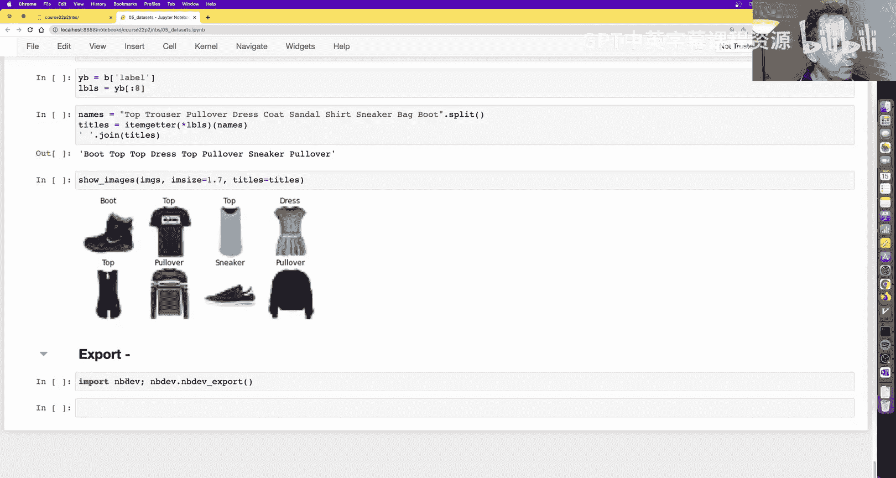
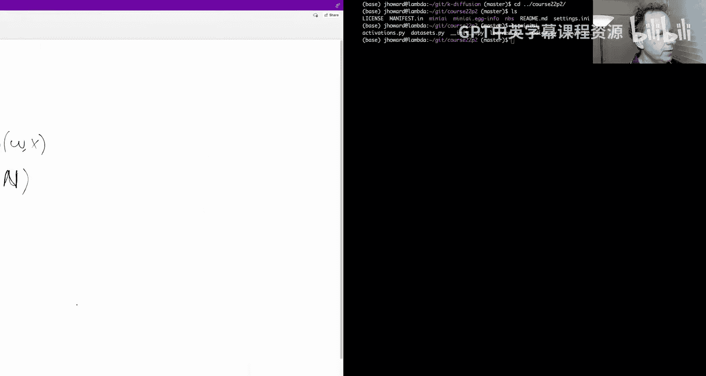
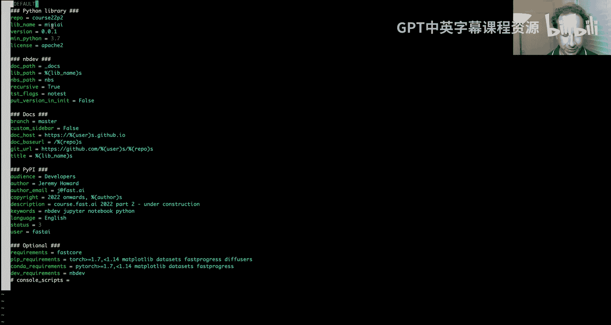
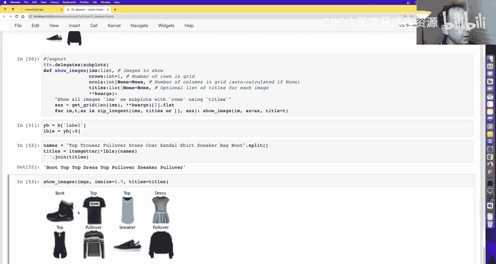
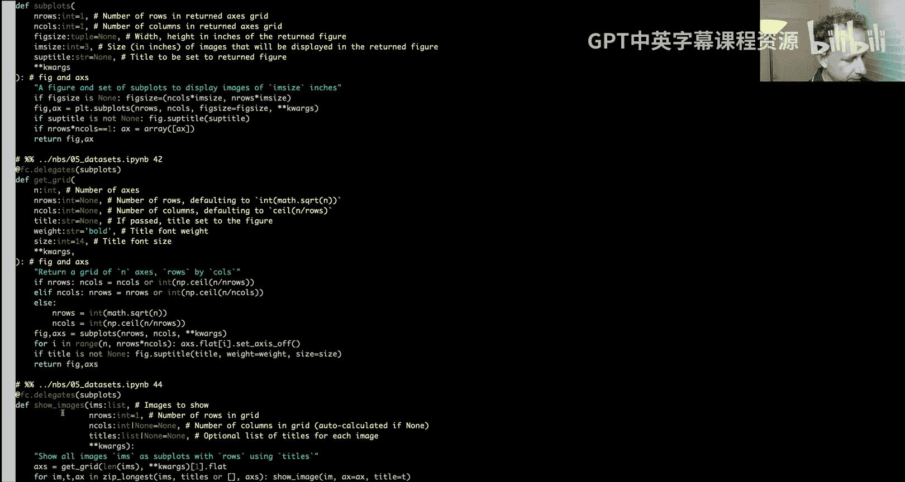
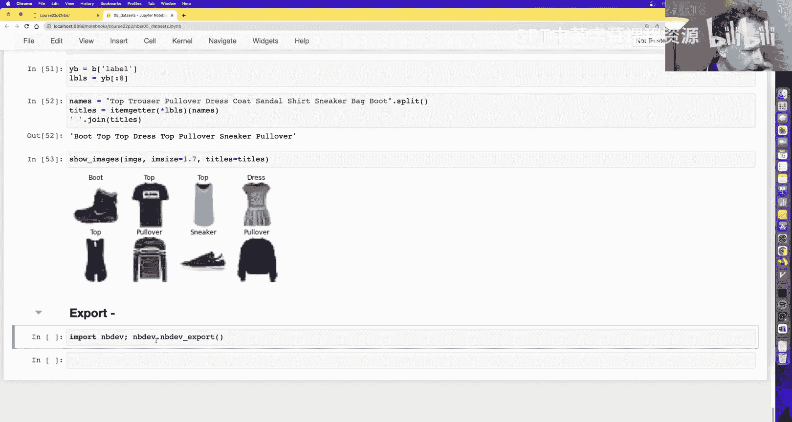
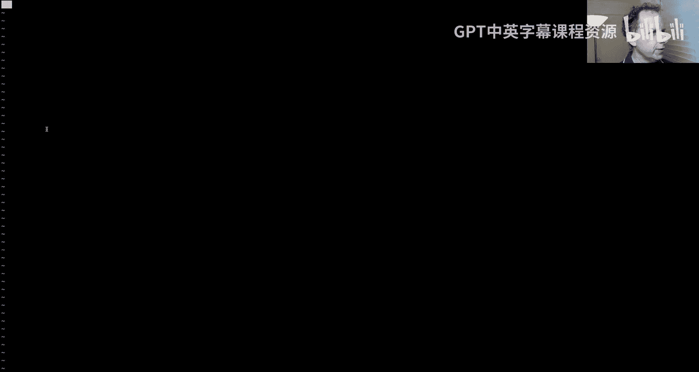
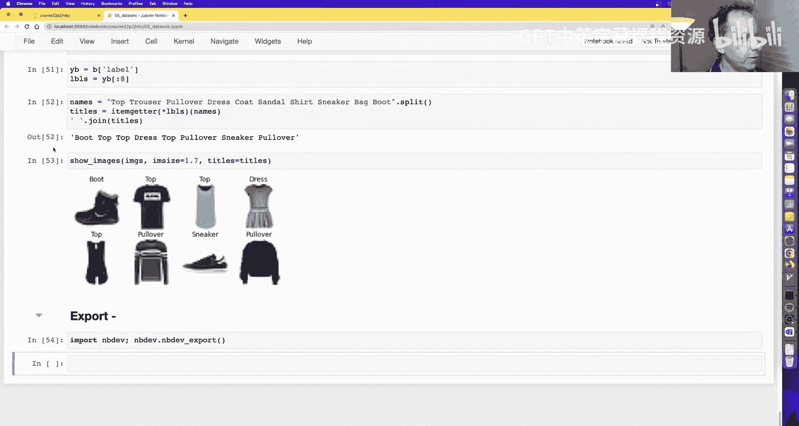
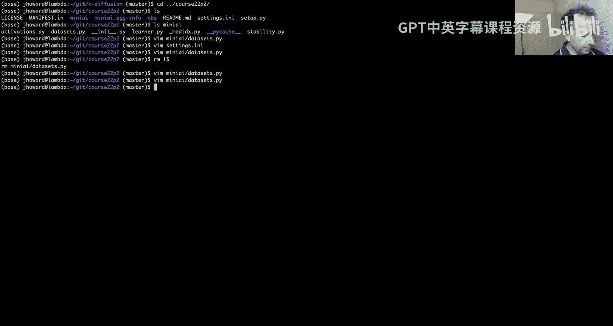
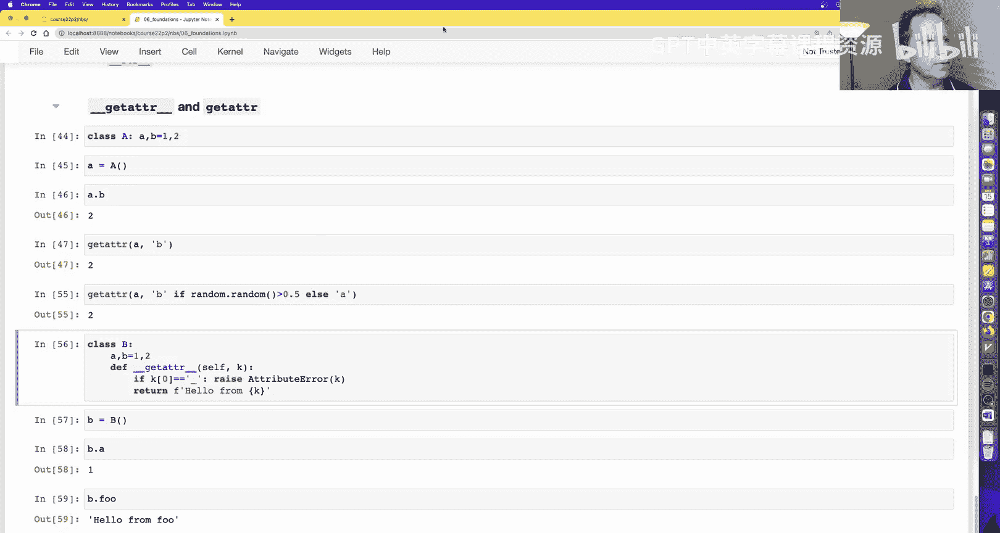

# Jeremy《深度学习基础到稳定扩散模型｜Deep Learning Foundations to Stable Diffusion》中英 p08 Lesson 14_ Deep Learning Foundations to Stable Diffusion.zh_en -BV1Mp421S7xg_p8-

Okay hi everybody and welcome to lesson 14 the numbers are getting up pretty high now huh。😊，We had a。

Lessson last time talking about。Calculus and how we implement the chain rule in neural network training in a efficient way。

 called back propagation。I just wanted to point out that u。One excellent student。

Kak Sinha has produced a very nice explanation of the code that we looked at last time。

 and I've linked to it。So it's got the math and then the code。诶。

The code's slightly different to what I had but it's basically the same things and minor changes。

 and it's helpful， it might be helpful to kind of link between the math and the code to see what's going on。

😊，So you'll find that in the， yeah， lesson 13 resources， but I thought I'd just quickly， you know。

 try to explain it as well。So， maybe I could try to。Copy this。😔。

And just explain what's going on here。嗯。With this code So the basic idea is that we have a neural network that is calculating a well a neural network and a loss function that together that calculate a loss so let's imagine that well let's just call that the loss function we'll call it L。

And the loss function is being applied to the output of the neural network。

 so the neural network function we'll call n， and that takes two things。

 a bunch of weights and a bunch of inputs。The loss function also requires the。the targets。

 but I'm just going to ignore that for now because it's not really part of the what we actually care about。

And what we're interested in knowing is if we want to be able to update the weights。

 let's say this is just a single layer things。 Keep it simple。

 If we want to be able to update the weights， we need to know how does the。Loss。Change。😔。

If we change the weights。If we change one way at a time， if you like。So how would we calculate that？

Well， what we could do is we could rewrite our loss function。By saying， well， let's call capital N。

The result of the neural network applied to the weights。And the inputs。

And that way we can now rewrite the loss function to say L equals big L equals little L。

 the loss function applied to。The output of the neural network。

And so maybe you can see where this is going。 we can now say， okay。

 the derivative of the loss with respect to the weights is going to be equal to。

The derivative of the loss。With respect to the outputs of that neural network layer。Times。

So this is the chain rule， the derivative of。The outputs of that neural network layer。

I'm to get my notation consistent since these are。Not scalar。With respect to the weights。Right。

 so you can。See we can get rid of those and we end up with the change in loss with respect to the weights。

And so they we can just say this is a chain rule， that's what the chain roll is。😊，So the。

Change in the loss with respect to the output of the neural network。Well。

 we did the forward pass here。And then we took here， this。

 this here is where we calculated the derivative of the loss。With respect to the。

Output of the neural network。Which came out from here， and ended up in。Diff。

So there it is there so out dot G。Contains。This derivative。So then to calculate。

 well let's actually do one more。We could also say。The change in the loss， with respect to。

The inputs， we can do the same thing。With a chain rule。Times。And so this time we have the inputs。

So here， you can see。That is。This line of code。So that is。The change in the loss。

With respect to the inputs。That's what input。g means， and it's equal to the change in the loss。

With respect to。The output。So that's what app。g means。Times。

 it's actually matrix times because we're doing。Matrix calculus times the this derivative。

 and since this is a linear layer， we were looking at this derivative is simply the weights themselves。

And then we have exactly the same thing。For W。tg， which is the change in the loss。

 the derivative of the loss with respect to the weights。And so again， you've got the same thing。

 you've got your out dog， and remember we actually showed how we can simplify this into also a matrix products with a transpose as well。

So that's how the。What's happening in our code。Is mapping to the meth。So hopefully that's useful。

 but as I say do check out this really nice resource which has a lot more detail if you're interested in digging deeper the other thing I'd say is if you some people mentioned that they actually didn't study this at high school which is fine that we've provided resources on the forum for recommending how to learn the basics of derivatives and the chain rule and so in particular I would recommend。

Threere blue one Browns essences of calculus series and also Khan Academy it's not particularly difficult to learn it'll only take you a few hours and then you can then this will make a lot more sense or if you did it at high school but you've forgotten it same deal。

So don't worry if you found this difficult because you had forgotten the or had never learnt。

The you know basic derivative and chainural stuff， that's something that you can pick up now and I would now recommend doing so。

😊，Okay。So。What we then did last time， which is actually pretty exciting。

 is we got to a point where we had successfully created。A training loop。Wch took these four steps。So。

And the nice thing is that every single thing here is something that we have implemented from scratch now we didn't always use our implemented from scratch versions there's no particular reason to when we've reimmented something that already exists。

 let's use the version that exists， but every single thing here I guess not aGm but that's trivial easy to implement every single thing here。

We have。Implemented ourselves。And we successfully trained an MNist model to96% accurately recognize handwritten digits。

So I think that's。Super neat it's。This is I mean this is not a great metric。

 it's only looking at the training set and in particular it's only looking at one batch of the training set since last time I've just refactored a little bit I've pulled out this。

😊，Report function， which is now just running at the end of each epoch。

and it's just printing out the loss and the accuracy just something I wanted to mention here is hopefully you've seen F strings before。

 they're a really helpful part of Python that lets you pop a variable or an expression inside curly braces in a string and it'll evaluate it。

You might not have seen this colon thing， this is called a format specifier and with a format specifier you can change how things are printed in an F string。

 so this is how I'm printing it to do decimal places this says a two decimal places floating point number called loss。

Priinted out here。P back come。嗯。So I'm not going to show you how to use those other than to say。

 yeah， Python F strings and format specifiers are really helpful and so if you haven't used them before do go look them up tutorial of the documentation because they're definitely something that you'll probably find。

Heres what to know about， okay， so let's just rerun all those liness of code。

If you're wondering how I just reran all the cells above where I was。There's a。

So here there's run All above。And it's so helpful that I always make sure there's a keyboard shortcut for that。

 so you can see here I've added a keyboard shortcut。Q A。 So if I type Q A， it runs all cells above。

 If I type Q B， it runs all cells below。And so yeah， stuff that you do a lot。

 make sure you've got keyboard shortcuts for them。 you don't want to be fiddling around。

 moving around your mouse everywhere you want it to be。As easy as thinking。

So this is really exciting we've successfully trained a neural built and trained neural network model from scratch and it works okay it's a bit clunky there's a lot of code。

 there's features we're missing so let's start refactoruring it and so refactoruring is all about making it so we have to write less code to do the same work。

😊，嗯。And so we're now going to， I'm going to show you something that's part of Pytorch and then I'm going to show you how to build it。

And then you'll see why this is really useful so Ptorch so Ptorrch has a submodule called Nn torch。

 nn and in there there's something called the module class now we can we don't normally use it this way but I just want to show you how it works we can create an instance of it in the usual way where we create instances of classes and then we can assign things to attributes of that module。

So for example， let's assign a linear layer to it and if we now print out。That you'll see it says。

 oh， this is a module containing something called F， which is a linear layer。

But here's something quite tricky。This module， we can say。

Show me all of the named children of that module and it says，  oh。

 there's one called fo and it's a linear layer。And we can say， oh， show me all of the parameters。

Of this module。And it says， oh， okay， sure， there's two of them。 There's this。4our by three， tensa。

 that's the weights。 and there's this。For long vector， that's the biases。嗯。And so somehow。

 just by creating this module and assigning this to it。

 it's automatically tracked what's in this module and what are its parameters。That's pretty neat。

 so we're going to see both how and why it does that。I'm just going to point out， by the way。

 why did I add list here？If I just said M1 dot name children， it just prints out generator object。

 which is not very helpful and that's because。This is a kind of Ederator called a generator and it's something which is going to only produce the contents of this when I actually do something with it。

 such as list them out so just popping a list around a generator is one way to like run the generator。

And get its output。So's a little trick when you want to look inside a generator。Okay， so。嗯。Now。

 as I said， we don't normally use it this way， what we normally do is we create our own class。

 so for example， we'll create our own multi layerer perception。And we inherit it。

 we inherit from an endduct module。And so then in Dunah En， this is the thing that constructs。

An object of the class。 This is the special magic method that does that。 We'll say， okay， well。

 how many inputs are there to this multi layer perceptron。

 How many hidden activations and how many output activations are there。 So just be one hidden layer。

 And then here we can do， just like we did。😊，Up here where we assign things as attributes。

 we can do that in this constructor so we create an L1 attribute。

 which is a linear layer from number in to number hidden。

L2 is a linear layer from number hidden number out， and will also create a value。And so。When we。

Call that module。We can。Take the input that we get。And。

Run the linear layer and then run the rail and then run the L2。And so I can create one of these。

As you say。Um， and I can have a look and see like， oh， here's the attribute L1。😊。

And there it is like I add， and I can say print out the model and the model knows or the stuff that's in it。

And I can go through each of the named children and print out the name and the layer。Now， of course。

 if you remember。Although you can use。Dunder call， we actually showed how we can refactor things。

Using forward。UmSuch that it would automatically kind of do the things necessary to make all the you know。

 automatic gradient stuff work correctly。😊，And so in practice。

We're actually not going to do under coal。 we would do。Forward。

So this is an example of creating a custom payytorch module。

 and the key thing to recognize is that it knows what are all the attributes you added to it。

And it also knows。What are all the parameters， So if I go through the parameters and print out their shapes。

 you can see I've got my linear layers weights。First linear layer， sorry， second linear layer。

 my I don yeah， first linear layers weights， my first linear layers biases。

 second linear layers weights， second linear layers biases and this 50 is because we set Nh。

 the number of hidden。2，50。Um， so。😊，Why is that interesting， Well Because now I don't have to write。

Or this any more。Going through。Layers and having to make sure that they've all been put into a list。

 We've just been able to add them as attributes， and they're automatically going to appear as parameters。

 So we can just say。Go through each parameter。And update it based on the gradient and the loan rate。

And furthermore， you can actually just go model。0 gra and it'll zero out all of the gradients。😊。

So that's really made our code。😊，Quite a lot nice，r and quite a lot more flexible， which is cool。😊。

So let's check that this still works。There we go， so just to clarify with if I called report on this before I ran it as you would expect the accuracy is about 8% with about 10% a bit less and the loss is pretty high and so after I run this fit this model。

The accuracy goes up。And the loss goes down， so basically it's all of this is exactly the same as before。

😊，The only thing I've changed is these two lines of code。 So that's a really useful refactoring。

 So what how on earth did this happen， How did it know。😊。

What the parameters and layers are automatically。It used a trick called Dunder Seattra。

And we're going to create our own and end module now。

So if there was noticing as N end module here's how we'd build it and so let's actually build it and also add some things to it so in Dun to En we would have to create a dictionary for our named children this is going to contain a list a dictionary of all of the layers okay and then just like before we'll create a couple of linear layers。

Right。And then what we're going to do is we're going to define this special magic thing that Python has called Duna Seatcha。

 and this is called automatically by Python if you have it。

 every time you set an attribute such as here。Or here。

 and it's going to be past the name of the attribute， the key。

 and the value is the actual thing on the right hand side of the equals sign。Now， generally speaking。

 things that start with an underscore we use for either for private stuff， so we check。

That it doesn't start with an underscore。And if it doesn't start with an underscore， set At will。

Poet。This。Value into the modules dictionary with this key。And then。Call Pythons。

The normal Python said At to make sure it just actually does the attribute setting。

So super is how you call whatever is in the super class， the base class。

So another useful thing to know about is how does it do this nifty thing where you can just type the name and it kind of lists out all this information about it that's a special thing called Dununderrepro so here Dununder Reppro will just have it。

Return a stringified version of the modules dictionary。And then here we've got parameters。

 how did parameters work？So how did this thing work well？We can go through each of those modules。

 go through each value， so the values of the modules is all the actual layers。

 and then go through each of the parameters in each module。And yield P。

 So that's going to that's going to create an iterator。

 If you remember when we looked at iterators for all the parameters。

 So let's try it so we can create one of these modules。And if we just spoke before。

 loop through its parameters， there they are。Now I'll just mention something that's optional kind of like。

😊，Advanced Python that a lot of people don't know about， which is there's no need to loop through。

A list or a generator， or I guess theyd look through an iterator and yield。

 There's actually a shortcut， which is you can just say。Yield from。And then give it the iterator。

And so with that。We can get this all down。To one line of code。 And it'll do exactly the same thing。

 So that's basically saying。Yelleed one at a time。 Everything in here。That's what yield from does。

So there's a cool little advanced Python thing， totally optional， but if you're interested。

 I think it can be kind of neat。So we've now learn how to create our own implementation of NN dot module and therefore we are now allowed to use Pytorch's NOt module。

 so that's good news。嗯。So。How would we do？😔，Using the Pytorch Gen and dot module。

 how would we create the model that we started with？Which is where we had this。Self dot layers。

Because we want to somehow register all of these all at once。

That's not going to happen based on the code we just wrote。So。To do that， let's have a look we can。

 so let's make a list of the layers we want。And so we'll create again a subclass of and end up module。

Make sure you call the super classes in it first。And we' to store the list of layers and then to tell。

Pytorrch about all those layers。We basically have to loop through them and call add module and say what the name of the module is and what the module is。

And again， probably should have used forward here in the first place。

And you can see this is now done exactly the same thing Okay。

 so if you've used a sequential model before， you'll see or you can see that we're on the path to creating a sequential model。

Okay， so Gaash has asked an interesting question， which is。

What on earth is super calling because we actually， in fact， we don't even need the parentheses here。

 we actually don't have a base class。 that's because if you don't put any parentheses or if you put empty parentheses。

 it's actually a shortcut。For writing that。 and so Python has。Stuff in object， which does， you know。

 all the normal object he things like。Storing your attributes so that you can get them back later。

So that's what's happening there。😊，Okay， so this is a little bit awkward is to have to store the list and then enumerate then call add module so now that we've implemented that from scratch we can use Ptorrchs version which is they've just got something called moduleule list that just does that for you。

Okay so if you use module list and pass it a list of layers it will just go ahead and register them all those modules for you so here's something called sequential model so this is just like an in sequential now。

So if I create it passing in the layers。There you go。 You can see。

There's my model containing my module list with my layers。And so。

I don't know why I never used For for these things。It's sillyy。

Because it doesn't matter terribly in this stage， but any okay。Call fit。And there we go， okay？😊，So。

So in forward here， I just go through each layer。And I set the result of that equal to calling that layer on the previous result and then pass and return it at the end。

 Now， there's little another way of doing this， which I think is kind of fun。 It's not。

Like shorter or anything at this stage， I just wanted to show an example of something that you see quite a lot in machine learning code。

😊，Which is the use of reduce this implementation here。Is exactly the same as。This thing here。

So let me explain how it works。😊，What reduced does。

 So reduce is a very common kind of like fundamental computer science concept reductions。

 This is something that does a reduction。 And what a reduction is， is it something that says。

Start with the third parameter， some initial value， so we're going to start with x。

 the thing we've being passed。And then loop through a sequence， so loop through each of our layers。

 and then for each layer， call some function。Here is our function。

And the function is going to get past。First time round itll be past the initial value。

And the first thing in your list。So your first layer and X。So it's just going to call。

MyThe layer function on x。The second time around it takes the output of that and passes it in as a circuit as the first parameter and passes in the second layer。

 So then the second time this goes through it's going to be calling the second layer on the result of the first layer。

😊，And so forth。 And that's what a reduction is。 And so when you might see reduce。

 you'll certainly see it talked about quite a lot in in papers and books。

 And you might sometimes also see it in code。 It's a very general concept。

 And so here's how you can implement。A嗯。Sequential model。using。Reduce。

So there's no explicit loop there， although the loop's still happening internally。All right。

 so now that we've re implementedplemented sequential。

 we can just go ahead and use Py Torchess version， so there's an end dot sequential。

 we can pass in our layers。😊，And we can fit， not surprisingly， we can see the model， so yeah。

 it looks very similar to the one we built ourselves。Allright， so。This thing of。

Looping through parameters。And updating。Our parameters based on gradients and a learning rate。

 and then zeroing them。Is。Very common。So common that there is。Something that does that all for us。

 and that's called an optr is's a stuff in Opim。 So let's create our own optr。 And as you can see。

 it's just going to do the two things we sort just saw。😊，It's going to。

Go through each of the parameters and update them using the gradient in the learning rate and there's also zero grad。

 which will go through each parameter。And S there。Graaddients to zero。If you use do data。

 it's like it's just a way of avoiding having to say torch。nograd， basically。Okay， so in optimizer。

 we're going to pass it the parameters that we want to optimize。

 and we're going to pass it the learning rate。 and we're just gonna。Stall them away。

And since the parameters might be a generator， we'll call list2。To turn them into a list。

So we are going to create our optimizer。😊，Pass it in the model dot parameters。

 which have been automatically constructed for us by N end dot module。 And so here's our new loop。

 Now， we don't have to do any of the。Stuff manually。

 we can just say opt dot step so that's going to call this。And up to dot zero grad。

 and that's going to call this。😊，There it is。So we've now built our own SGD optimizer from scratch。

 So I think this is really interesting， right， Like these things， which seem。😊。

Like they must be big and complicated once we have this nice structure in place， you know。

 an SGD optimizer doesn't take。Much code at all。 And so it's all very transparent， simpleple， clear。

 if you're having trouble。Using complex library code that you've found elsewhere， you know。

 this can be a really good approach is to actually just go all the way back remove。As you know。

 as many。Um， if these abstractions as you can and like run everything by hand to see exactly what's going on。

 it can be really freeing to see that you can do all this。😊，Anyways。

 since Pytorrch has this for us in torch。optim， it's got a opttim。

sgd and just like our version you pass in the parameters and you pass in the learning rate so you really see it is just the same。

So let's define something called get model。That's going to return。The model， the sequential model。

 and the optimizer for it。So if we go model come up equals get model。

And then we can call the loss function to see where it's starting。And so， then， we can。Right， hour。

Training loop again， go through H park。Go through each starting point for our batches。

 grab the slice， slice into our X and Y in the training set， calculate our predictions。

 calculate our loss。Do the backward pass， do the optimizer step， do the zero gradient。

 and print out how you're going at the end of each one。And there we go。😊，Allright。

 so let's keep making this simpler， there's still too much code。😊。

So one thing we could do is we could replace。These lines of code with one line of code。

By using something we'll call the data set Plus。So the dataset set class is just something that we're going to pass in our independent and dependent variable。

We'll store them away。Ass self at x and self do y。We'll have something things so if you if you define Dunder L。

 then that's the thing that allows the L function to work。

 so the length of the data set will just be the length of the independent variables。

And then done to get item is the thing that will be called automatically anytime you use square brackets in Python。

 So that just is going to call this function passing in。The indices that you want。

 So when we grab some items from our data set， we're going to return a topple of the x values and the Y values。

 So then we'll be able to do this。So let's create a data set using this tiny little three line class。

It's going to be a dataset set containing the X and Y training。

 and they'll create another data set containing the X and Y valid。

 and those two data sets we'll call Tra Ds and Val Ds。

So let's check the length of those data sets should be the same as the length of the x's and they are。

And so now we can do exactly what we hope we could do。

 we can say Xb comm a Yb equals train Ds and pass in some slice。So that's going to give us back。Now。

Check the shapes are correct， should be5 by 28 by 28。5 by 28 times 38 and the y's should just be5。

 and so here they are the x's and the y's。So that's nice。

 we've created a data set from scratch and again it's not。Complicated at all。

 And if you look at the actual Pytor source code， this is basically what data sets do。

So let's try it。 We call get model。 And so now we've replaced our。Data set line with this one。

 and as per usual， it still runs。 And so this is what I do when I'm writing code is a trader like。

Always make sure that my starting code works as a refactor and so you can see all the steps and so somebody reading my code can then see exactly like why am I building everything I'm building。

 how does it all fit in see that it still works and I can also keep it clear in my own head so I think this is a really nice way of implementing libraries as well。

Allright， so now we're going to replace these two lines of code。With this one line of code。

So we're going to create something called a data loader and a data loader is something that's just going to do this Okay。

 so we need to create an iterator。😊，So an iterator is a class that has a dunder Eder method。

 When you say for N in Python behind the scenes， it's actually calling Dunder Eder to get a special object。

 which it can then。Loot through using yield， so it's basically getting this thing that you can iterate through using yield。

So a data loader is something that's going to have a data set and a batch size because we're going to go through the batches and grab one batch at a time。

So we have to store away the data set and the batch size and so when you when we call the for loop。

 it's going to call down to it， we're going to want to do exactly what we saw before。

 go through the range just like we did。Before。And then， yield。That bit of the data set。

And that's all， so that's a data letter。😊，So we can now create a train data loader and a valid data loader from our train data set and valid data set。

And so now we can， if you remember the way you can create out one thing out of an iterator。

 so you don't need to use a full loop， you can just say iter。And that will also called underit。 Next。

 we'll just grab one value from it。 So here we will run this。

 And you can see we've now just confirmed。With Xb is a 50 by 784， and y B。There it is。

And then we can check what it looks like， so let's grab the first element of our Xpat。😊。

Make it 28 by 28。And there it is。So now that we've got a data loader again。

 we can grab our model and we can simplify our fit function to just go for X B，YB and Tra deal。

So this is getting nice and small， don't you think？😊，And it still works the same way。Okay。

So this is really cool and now that it's nice and concise， we can start adding features to it。😊。

So one feature I think we should add is that our training set each time we go through it。

 it should be in a different order， it should be randomized the order。So instead of always。

Just going through these indexes in order， we want some way to say， go use random indexes。

So the way we can do that is create a class called sampler。And what sample is going to do？Asha you。

Is if we create a samplea。Without shuffle without randomizing it。It's going to simply return。

All the numbers from0 up to n。In order， and it'll be an Eder。 See this is done Ed。

But if I do want it shuffled， then it will randomly shuffle them。

So here you can see I've created a sampler without shuffle。So if I then make an iterator from that。😊。

And。Print a few things from the iterator， you can see it's just printing out the indexes it's going to want。

Or I can do exactly the same thing as we learned earlier in the course using Ila。

 we can grab the first five so here's the first five things from a sampler when it's not shuffled so as you can see these are just indexes。

😊，So。We could add shuffle equals true。And now that's going to call random dot shuffle。

Which just randomly permits them。 And now if for do the same thing， I've got。

Random indexes of my source data。So why is that useful well what we could now do is create something called a batch sampler and what the batch sampler is going to do is it's going to basically do this ice slice thing for us so we're going to say okay。

 pass in a sampler that's something that generates indices and pass in a batch size。And remember。

 we've looked at chunking before， it's going to chunk。😊，That iterator。By that batch size。

And so if I now say， all right， please take our sampler。And create batches of four。

As you can see here， it's creating batches of four indices at a time。So， rather than。

Just looping through。D in order， I can now loop through this batch sampler。

So we're going to change our data loader。So that now it's going to。Take some。Patch sampler。

And it's going to loop through the batch sampler that's going to give us indices。

And then we're going to get that data set item from that batch for everything in that batch。

So that's gonna to give us a。List， and then we have to stack all of the X's and all of the Y's together into tensess。

So I've created something here called Colllite function。And we're going to default that。

To this little function here。Which is going to grab our。Batch， pull out the x's and y separately。

And then stack them up into tenses。So this is called our collate function。Okay。

 so if we put all that together， we can create a training sampler。

 which is a batch sampler over the training set。With shuffle true。

A validation sampler will be a batch sampler over the validation set with shuffle false。

And so then we can pass that into this data loader class。The training data set。

And the training sampler and the collate function， which we don't really need because it's we just using the default one。

 so I guess we can just get rid of that。And so now。Here we go。

 we can do exactly the same thing as before X B，Y B is next iter。

 and this time we use the valid data load。😊，Check the shapes。And this is how。

Pi torch is actual data loaders work this is all the pieces they have， they have samplers。

They have batch samplers。 They have a col function。And they have。Data letters。So remember that。

What I want you to be doing for your homework。Is experimenting。

With these carefully to see exactly what each thing is taking in。 Okay。

 so Pierre' is asking on the chat， what is this collate thing doing Okay， so collate function。

It defaults too。Collite。😊，What does it do， Well， let's see， Let's go through each of these steps。

 Okay， so we need， so we， we've got a batch sampler。 So let's do。Just the valid sampler。Okay。

 so the batch sampler。Here it is。 So we're going to go through each thing in the batch sampler。

 So let's just grab one thing from the batch sampler。 Okay。

 so the output of the batch sampler will be next it。Okay， so here's what the。

Btch sampler contains all right， just the first 50 digits。

 not surprisingly because this is our validation sampler if we did a training sampler that would be randomized。

There they are。 Okay， so then what we then do is we go。Self。 data I for I and B。So。Let's copy that。

卡啲。Paste。And so rather than self that data set， I will'll just say。Called to S， I。Oh。

 and it's not A and B， it's A and O， that's what we called it。Oh， when we did it for trading， sorry。

Training。😔，Okay， so what it's created here is。A list of。Tuples of tensess。 I think let's have a look。

 So let's have a look。 So we'll call this。U。嘿我得吧。So。P0。Okay， is a tuple。It's got the X。And the Y。

 independent， independent variable。So that's not what we want。

 what we want is something that we can look through。We want to get batches。 So what the col model。

Is going to do。 So not the collection model。 the collect collect function is going to do is it's going to take all of our。

Exs。And all of our y's and col them into two tensors， one tensor of x's and one tensor of y's。

So the way it does that is it first of all， calls。Zip。So zip is a very。

 very commonly used Python function。It's got nothing to do with the compression program yetip。

 but instead what it does is it effectively allows us to like transpose things so that now。

 as you can see。We've got all of the second。Elements or I index one elements altogether together and all of the index zero elements together。

And so then we can stack those all up together。And that gives us our why for our batch。

 So that's what colate does。 So the colate function is used。An awful lot。U。

In in Ptorrch increasingly nowadays where hugging face stuff uses it a lot and so we'll be using it a lot as well and basically it's a thing that allows us to customize how the data that we get back from our data set once it's been kind of generating a list of things from the data。

 how do we put it together into some into a bunch of things that our model can take as inputs because that's really what we want here so that's what the collection function does。

Oh， this is the wrong way around。Like so。This is something that I do so often that fastcore has a quick little shortcut for it just called store At or attributes and so if you just put that in your dunder in it。

 then you just need one line of code。And it does exactly the same thing。

 so there's a little shortcut as you see。And so you'll see that quite a bit。All right。

 let's have a seven minute break and Ill see you back here very soon and we're going to look at a multiprocess data loader and then we all have nearly finished this notebook。

All right， see you soon。All right， let's keep going。嗯。

So we've seen how to create a data loader and sampling from it。诶 the。Pytoch data loader。

Works exactly like this， but it uses a lot more code because it implements multi processing。

 And so multi processing means that the actual。This thing here。

That code can be run in multiple processes， that can be run in parallel for multiple items。

 so this code， for example， might be opening up a JPg。Rotating it， flipping it， etc cetera。 right。

 So because remember， this is just calling the Dunder get item。For a data set。

 so that could be doing a lot of work for each item and we're doing it for every item in the batch。

 so we'd love to do those all in parallel。So I'll show you a very。

Quick and dirty way that basically does the job。Python has a multiprocessing library It doesn't work particularly well with Pytorrch tensors so Pytorrch has created an exact reimplementation of it so it's identical API wise but it does work well with tensors so this is basically what is grab the multiprocessing so this is not quite cheating because multiprocessing isn't the standard library and this is API equivalent so I'm going to say we're allowed to do that。

so。As we've discussed， you know， when we call。Square brackets。On a class。

It's actually identical calling the Dundgate item function。On on the object。

So you can see here if we say give me items3，6， eight and1。

It's the same as calling Dunundergate item， passing in 3，6，8， and 1。Now， why does this matter well？

I'll show you what。It matters because we're going to be able to use map and Ill explain why we want to use map in a moment map is a really important concept you might have heard of map reduce so we've already talked about reductions and what those are maps are kind of the other key piece map is something which takes a sequence and calls a function on every element of that sequence so imagine we had a couple of batches of indices three and six and eight and one。

Then we're going to call Dunder get item。On each of those batches。So that's what map does。

 map calls this function。On every element of his sequence。And so that's going to give us。

The same stuff。 But now this， same as this， but now batched into2。Bts now， why do we want to do that。

Because。Multi processing has something called Paul。

 where you can tell it how many workers do you want to run， how many processes you want to run？

And it then has a map。Which works just like the Python normal Python map。

 But it runs this function in parallel over。The items from this iterator。

 So this is how we can create a multi processing data letter。So here were craning our data loader。

And again， we don't actually need to pass in the collect function because we're using the default one。

 So if we say n workers as equals2。😊，And then create that if we say next。

See how it's taking a moment and it took a moment because it was firingaring off those two workers in the background。

 So the first batch actually comes out more slowly。

 But the reason that we would use a multi processing data loader is if this is doing a lot of work。

 we want it to run in parallel and even though the first。

But the first item might come out a bit slower once those processes are fired up it's going to be faster to run so this is yeah this is a really simplified multiprocessing data loader because this needs to be super super efficient Pytorrch has lots more code than this to make it much more efficient but the idea is this and this is actually a perfectly good way of experimenting or building your own data loader to make things work exactly how you want。

So now that we've reimplemented all this from Pi torch， let's just grab the Pi torch。

 and as you can see， they're exactly the same data loader。

They don't have one thing called sampler that you pass shuffle to。

 they have two separate classes called sequential sample and random sampler。

 I don't know why they do it that way it's a little more work to me but same idea and they've got the batch sampler and so it's exactly the same idea a training sampler is a batch sampler with a random sampler。

The validation sampler is a batch sampler with a sequential sampler。Pass in batch sizes。

And so we can now pass those samplers。To the data load。

 this is now the pi torch data loader and just like ours it also takes a collate function。Okay， and。

It works。Cool。嗯。So that's as you can see， it's doing exactly the same stuff that ourS is doing with exactly the same API。

😊，And it's got some shortcuts， as I'm sure you've noticed when you've used data loaders。😊，So。

 for example。嗯。Calling batch sampler is very going to be very， very common。

 so you can actually just pass the batch size directly。

To a date loader and it will then auto create the batch samplers for you so you don't have to pass in batch sampler。

At all， instead you can just say sampler and it will automatically wrap that in a batch sampler for you。

 so it does exactly the same thing。And in fact， because it's so common to create a random sampler or a sequential sampler for data set。

 you don't have to do that manually， you can just pass in shuffle equals true or shuffle equals false to the data loader。

 and that does again exactly the same thing。There it is。Now， something that is very interesting。

Is that when you think about it， the batch sampler and the collation function are things which are taking the result。

Of the sampler looping through them and then sting them together。But what we could do。

Is actually because。Our data sets know how to grab multiple indices at once。We can actually。

 just use。Batch sampler。As a sampler， we don't actually have to loop through them and collate them because they're basically。

Instantly they come precolated。So this is a trick which actually hugging face stuff can use as well and we'll be seeing it again。

 so this is an important thing to understand is how come we can pass a batch sample or a sample on what's it doing and so rather than trying to look through the Pytorch code I suggest going back to our nonmprocessing pure Python code to see exactly how that would work。

Because it's a really nifty trick for things that you can grab multiple things from at once and it can save a whole lot of time。

 it can make your Earth code a lot faster。Okay， so now that we've got all that nicely implemented。

 we should now add a validation set。And there's not really too much to talk about here。

 let us take our fit function and this is exactly the same code that we had before。😊，And then。

We're just going to add something which goes through the validation set。And gets the predictions。

And sums up the losses and acuracies。And from time to time。Prince out。The loss and accuracy。

And so get DLs we will implement by using the PayyToch data loader now。

And so now our whole process will be get Diels。Passing in the training and validation data set。

Notice that for our validation data loader， I'm doubling the batch size because it doesn't have to do back propagation so it should use about half as much memory so I can use a bigger batch size。

Get our model and then call this fit。And now it's printing out。

The loss and accuracy on the validation set， so finally we actually know how we're doing。

Which is that we're getting 97% accuracy on the validation set。And that's on the whole thing。

 not just on the last batch。 So that's cool。 We've now implemented a proper。Working， sensible。

Training loop。It's still， you know， a bit more code than I would like， but it's not bad。

 And every line of code in there and every line of code it's calling is all stuff that we have built ourselves。

 re implementedplemented ourselves。 So we know exactly what's going on。

 And that means it's going to be much easier for us to。Create anything we can think of。

 we don't have to rely on other people's code。So hopefully you're as excited about that as I am。😊。

Because it really opens up a whole world for us。嗯。So one thing that we're going to want to be able to do now that we've got a training loop is to。

Grab data。Um and。There's a really fantastic library of data sets available on Huging face nowadays。嗯。

And so let's look at how we use those data sets now that we know how to bring things into data loaders and stuff。

So that now we can use the entire world of hugging face data sets。With our code。So。We're going to。

So you need to P install data sets。And once you've pe install datas。

 you' able to say from datas import and you can import a few things。

 just these two things now load data set， low data builder。

 and we're going to look at a data set called fashion MNIST。

And so the way things tend to work with Huging faces there's something called the Huging Face Hub。

 which has models and it has data sets。Amongst other things。And generally， you'll give them a name。

And you can then say in this case， load a data builder for fashion MIS Now a data builder is just basically something which has some metadata about this data set。

 so the data builder has a dot info and the dot info has a dot description。

And here's a description of this and as you can see again we've got 28 by 28 grayscale so it's going to be very familiar to us because this is just like MNsT and again we've got 10 categories and again we've got 60000 training examples and again we've got 10000 test examples so this is this is called as it says it's direct drop in replacement for MNsT。

😊，um。And so the data set builder also will tell us。

What are what's in this data set and so hacking face stuff generally uses dictionaries rather than topples。

 so there's going to be an image。Of type image。 there's going to be a label of type class label。

 There's 10 classes。 and these are the names of the classes。

 So it's quite nice that in hacking face data sets， you know。

 we can kind of get this information directly。It also tells us if there are some recommended training test splits we can find out those as well。

So this is the size of the training split and the number of examples。

So now that we're ready to start playing it with it， we can load the data Okay。

 so this is a difference between load data builder versus load data set so this will actually download it cache it and here it is and it creates a data dictionary。

So a data dictionary， if you've used FA AI， is basically just like what we call the data sets class。

 they call the data diic class。So it's a dictionary that contains in this case。

 a train and a test item， and those are data sets。These data sets are very much like the data sets that we created in the previous notebook。

嗯。So， we can now。Grab the training and test。Items from that dictionary and just pop them into variables。

And so we can now have a look at the zero index thing in training and just like we were promised。

 it contains an image and a label。So as you can see we're not getting couples anymore。

 we're getting dictionaries containing the x and the Y in this coast image and label。

 so I'm going to get pretty broad writing image and label in strings all the time so I'm just going to store them as x and y so x is going to be the string image and y will be the string label。

嗯。I guess the other way I could have done that。Would have been to say。X comma y equals。That。

That' would probably be a bit neater。Because it's coming straight from the features。 And if you。

 if you iterate into a dictionary， you get back its its keys。 That's why that works。 So anyway。

 I've done it manually here， which is。A bit sad， but there you go， Okay。

 so we can now grab the from train zero， which we've already seen。We can grab the X I the image。

And there it is， there's the image。嗯。We could grab the first five images and the first five labels。

 for example， and there they are。 Now we already know what the names of the classes are。

So we could now see what these map to。By grabbing those features。So there they are。

 so this is a special huging F class which most libraries have something including Fastti that works like this。

 there's something called Inta stringing， which is going to take these and convert them to these。

 so if I call it。😊，On our Y batch， you'll see we've got first is ankle boot。

 and there that is indeed an ankle boot。Then going have a couple of T shirts and a dress。嗯。Okay。

 so how do we use this to train a model？Well， we're going to need a data loader and we want a date loader that for now。

 we're going to do just like we've done it before， it's going to return。嗯。Well， actually。

 we're going to do something to different。 We're going to have our collate function is actually going to return a dictionary。

 actually， thiss pretty common for。Hgging face stuff and plytorch doesn't mind if you is happy for you to return a dictionary from a colian function。

 so rather than returning a tuple。Of the stacked up。Hopefully this looks very familiar。

 this looks a lot like the thing that goes through the data set for each one and stacks them up just like we did in the previous notebook。

 so that's what we're doing we're doing all all in one step here。

In our collate function and then again， exactly the same thing， go through our batch， grab the y。

 and this is just stacking them up at their integers so we don't have to call stack。

And so we're now going to have the image and label bits in our dictionary。So， if we。

Create our data loader using that col function。Grab one batch。

So we can go batch x touch shape is a 16 by 1 by 28 by 28。And why， if the batch here， here it is。

 So the thing to notice here is that we haven't done any。

Transforms or anything or written our own data set class or anything。

 We're actually putting all the work directly in the col function。

 So this is like a really nice way to skip。All of the kind of。Abstractions of your framework。

 if you want to， is you can just do all of your work in col function。 So it's going to pass you。

Each item it's going you're going to get the batch directly， you just go go through each。It。

And so here we're saying， okay， grab the X。Kay， from that dictionary。Convert it to a tent， Sir。

And then do that for everything in the batch and then stack them all together。 So this is， yeah。

 this is like can be quite a nice way to do things if you want to do things just very。Mennually。Um。

 without having to think too much about， you know， a framework。

 particularly if you're doing really custom stuff， this can be quite helpful。Having said that。

 hacking face data sets absolutely lets you。Avoid doing everything in col function。

 which if we want to create really simple applications。

 that's where we're going to eventually want to head。So we can do。This。Using a transform。Instead。

And so the way we do that is we create a function。😊，You're going to take out patch。

It's going to replace the X in our batch with the。Tensor version of each of those PaO images。

And I'm not even stacking them or anything， and then we've got to return that batch。

And so hacking F datasets has something called with transform。

 and that's going to take your data set， your hugging F data set。

And it's going to apply this function。To every element。 and it doesn't run at all now。

 it's going to basically when， when it behind the scenes， when it calls dunder getite。

It will call this function on the fly。 So in other words， this could have data augmentation。

 which can be random or whatever because it's going to be rerun every time you grab an item。

 It's not cache or anything like that。So other than that， this data set has exactly the API。

 same API as any other data set， it has a length it has a done to get item so you can pass it to a data loader。

And so。Pytorch already knows how to。Collate dictionaries of tensesors。

 So we've got a dictionary of tensesors now。 So that means we don't need a col function anymore。

 I can create a data loader from this， without a col function。As you can see。

And so this is given exactly the same thing as before。😊。

But without having to create a custom col function。Now， even this is a bit more code than I want。

 having to return this seems a bit silly， but the reason I had to do this is because hack face data sets expects the with transform function to return。

😊，The new version of the data。So I wanted to be able to write it like this， transform in place。

And just say the change I want to make and have it automatically return that。 So if I call。

 if I create this function that's exactly the same as their previous one， but doesn't have return。

How would I turn this into something which does return the result？So here's an interesting trick。

We could take that function。Pass it to another function。To create a new function。

 which is the a version of this in place function that returns the result。

 and the way I do that is by creating a function called in place。It takes a function。

It returns a function。The function it returns is one that calls my original function。And then。

 returns the result。So this is the function， this is a function generating function。

And it's modifying an in place function to become a。Function that returns。

Then a new version of that data。And so this is a function。This function is past to this function。

 which returns a function。 And here it is。 So here's the version that hugging face will be able to use。

 so I can now pass that。😊，To with transform。 And it does exactly the same thing。So。This is very。

 very common in Python， it's so common that this line of code can be entirely removed and replaced with this。

Little token。If you have a function。And put at at the start。

You can then put that before a function and what it says is take this whole function。

Pass it to this function。And replace it with the result。 So this。

Is exactly the same as the combination of this。And this。And when we do it this way。

 this kind of little syntax sugar is called a decorator。 Okay。

 so thiss I think nothing magic about decorators， it's literally， literally identical。😊，To this。Oh。

 I guess the only difference is we don't end up with this unnecessary intermediate underscore version。

But the result is exactly the same， and therefore I can create a transformed data set。By using this。

And there we go， It's all working fine。😊，嗯。Yeah， so I mean， none of this is particularly necessary。

 but what we're doing is we're just kind of like seeing。You know， the paces that we can put in place。

To make this stuff as easy as possible and that we don't have to think about things。Too much。嗯。

Alright， now。With all this， we can basically make things pretty automatic and the way we can make things pretty automatic is we're going to use a cool thing in Python called itemgiter。

And I didn' getta is a function。That returns a function。

 So hopefully you're getting used to this idea。 Now， this creates a function。😊，That gets the A And C。

Items from a dictionary or something that looks like a dictionary， So here's a dictionary。😊。

It contains keys， A， B， and C。So， this function。Well， take a dictionary。

And return the A And C values。And as you can see， it has done exactly that。

Explain why this is useful in a moment， I just wanted to briefly mention what did I mean when I said something that looks like a dictionary。

 I mean this is a dictionary okay that looks like a dictionary。😊，But at Python。

It doesn't care about what type things actually are， it only cares about what they look like。

And remember that when we call something with square brackets。

 when we index into something behind the scenes， it's just calling Dun de get item。

 so we could create our own class。And it's done to get item gets the key and it's just going to manually return one if k equals a or two if k equals B or three other ways。

😊，And look， that class。Also works just fine with an item getter。

The reason this is interesting is because like a lot of people。😊。

Write Python as if it's like C++ or Java or something。

 they write as if it's this kind of statically typed thing。

 but I really wanted to point out that it's an extremely dynamic language and there's a lot more flexibility than you might have realized。

😊，Anyway， that's a little aside。嗯。😊，So what we can do。😮，Is。

Think about a batch example where we've got these two dictionaries。Okay。

 so Pytorch comes with a default collation function called not surprisingly default collate。

 so that's part of Pytorch and what default collate does with dictionaries is it simply takes the matching keys。

And then grabs their values。And stacked them together。And so that's why if I call default collate。

 A is now 1，3， B is now 2，4。 That's actually what happened before。When we created this data loader。

 is that used the default collation function， which does that。

It also works on things that are topples， not dictionaries。

 which is what most of you would have used before。😊。

And what we can do therefore is we could create something called colate D。😊。

Which is something which is going to take a。嗯。Data set。

And it's going to create a item getter function for the features in that data set。

 which in this case is image and label， so this is a function which will get the image and label items。

And so we're now going to return a function and that function is simply going to call our item getter on default collate and what this is going to do is it's going to take a dictionary and collate it into a tuple。

Just like we did up here。So if we run that， so we're now going to call data loader on our transform data set passing in。

And remember， this is a function that returns a function， so it's a colian function for this data。

And there it is。 So now this looks a lot like what we had in our previous notebook。

 This is not returning a dictionary that it's returning a tuple。So this is。

A really important idea for particularly for working with huggingface data sets is that they tend to do things with dictionaries and most other things in the Pytorch world tend to work with tuples。

 so you can just use this。Now， to convert anything that returns dictionaries into something that provides tuples by passing it as a col function to your data letter。

So remember， you know， the thing you want to be doing this this week is is doing things like import PDdb。

 pdb。 settra， right？Put break points， step through， see exactly what's happening， you know。

 not just here， but also even more importantly。Doing it inside。Inside the innermost inner function。

 so then you can see。Let they do wrong there oh today。Se underscore trace。

So then we can see exactly what's going on。😊，Print out B。Miss the code。

And I could step into it and look， I'm now inside the default colate function。

 which is inside Pytorch。And so I can now see exactly how that works。There it all is。

 so it's going to go through and this code is going to look。😊。

Very familiar because we've implemented all this。ourselves。

 except as being careful to like it works for lots of different types of things， dictionaries。

 nu pay arrays， so on and so forth。😊，So the last thing I wanted to do， oh。

 actually something I do want to mention here， this is so useful。

 we want to be able to use it in all of our notebooks。😊，U。

So rather than copying and pasting this every time。

 it would be really nice to create a Python module that contains this definition。

So we've created a library called NB dev and it's really a whole system called NB devev which does exactly that。

 it creates modules you can use from your notebooks and the way you do it is you use this special。

Thing we call comment directives， which is。Hash pipe。And then hash pipe export。

 so you put this at the top of a cell and it says do something special for this cell。

 What this does is it says put this into a Python module for me， please。Export it to a Python module。

What Python module is it going to put it in。 Well， if you go all the way to the top， you tell it。

What default export module to create。 So it's going to create a module called datas。

So what I do at the。Very end of this。Module is I've got this line that says import MBmb devev devev。

 dev export and what that's going to do for me。

Is create。A library。A Python library is going to have a data set stop pay in it。

 and we'll see everything that we exported。 Here It is。 Colate di will appear in this。For me。

 And so what that means is now， in the future， in my notebooks。

 I will be able to import colite diic from。That from my data sets。 Now you might wonder， well。

 how does it know to call it mini AI， What's mini AI Well an M B dev。

You create a settings do any file。Where you say what the name of your library is。

So we're going to be using this quite a lot now because we're getting to the point。

Where we're starting to implement stuff that didn't exist before。

 so previously most of the stuff or pretty much all the stuff we've created。

 I've said like oh that already exists in Ptorrch so we don't need it， we just use ptorrches。

But we're now getting to a point where we're starting to create stuff that doesn't exist anywhere we've created it ourselves and so therefore we want to be able to use it again so during the rest of this course we're going to be building together a library called Min AI that's going to be our framework。

 our version of something like Fast AI， maybe it's something like what fast AI 3 will end up being。

We'll see， so that's what's going on。Here。To so we're going to be using once I start using mini AI。

 I'll show you exactly how to install this， but that's what this export is。

 And so you might have noticed I also had an export on this in place thing。And I also had it on my。

Necessary import statements。ok 嗯。We want to be able to see what this data looks like。

 so I thought it now is a good time to talk a bit about plotting because knowing how to visualize things well is really important and again the idea is we're not allowed to use FAIs plotting library。

😊，So we've got to learn how to do everything ourselves。😊。

So here's the basic way to plot an image using map plotlib so we can create a batch。

Grab the X part of it。Gra the very first thing in that。And I am show， means show an image。

And here it is， there is our ankle boot。嗯。So let's start to think about what stuff we might create。

 which we can export to make this a bit easier。So let's create something called show image。Which。

 basically。Does。I am sure。But we're going to do a few extra things。We will。

Make sure that it's in the correct access order。We will make sure it's not on Kuda that's on the CPU。

If it's not a nuumpy array， we'll convert it to a nuumpy array。嗯。

We'll be able to pass in an existing access which we'll talk about soon if we want to。

 we'll be able to set a title if we want to， and also this thing here removes all this ugly 05 blah。

 blah， blah axis because we're showing an image we don't want any of that。So if we try that。

 you can see there we go， we've also been able to say what size we want the image。

There it all is Now here's something interesting when I say help。Their help shows。

The things that I implemented。But it also shows a whole lot more things。

How did that magic thing happen and you can see they work because here's fixs。

 which I didn't add Oh sorry I did add well， okay， that's a bad example anyway。

 these other ones all work as well。😊，So how did that happen Well。

 the trick is that I added star star quags here and star star quags says grab。

 you can you know pass as many any other arguments as you like that aren't listed and they'll all be put into a dictionary with this name。

And then when I call， I am show， I pass that entire dictionary。

 star star here means as separate arguments。And that's how come it works and then how come does it how come it knows what help to provide。

😊，The reason why is that Fastcore has a special thing called delegates， which is a decorator。

 so now you know what a decorator is and you tell it。

 what is it that you're going to be passing quags to， I'm going to be passing it to I am a show。

And then it automatically creates the documentation correctly to show you what quags can do。

So this is a really helpful way of being able to kind of extend existing functions like I am show and still get all of their functionality and all of their documentation and at your own so delegates is one of the most useful things we have in fast call in my opinion so we're going to export that so now we can use show image anytime we want which is nice。

😊，Something that's really helpful to know about MaplotLb is how to create subplots。😊，So for example。

 what happens if you want to plot two images next to each other？So in Maplot Libb。

 subplots create multiple plots and you pass it the number of rows and the number of columns。

So this here has， as you see， one row and two columns。And it returns。

Axes Now what it calls axes is what it refers to as the individual plots。

So if we now call show image on the first image， passing in axes zero。It's going to get that here。

 right？Then we call Ax。am show that means put the image。On this subplot。

 they don't call it a subplot。 Unfortunately， they call it an axis。 put it on this axis。

 So that's how come we're able to show an image， one image on the first axis and then show a second image on the second axis by which we mean subplot。

And there's our two images。So that's pretty handy。So I've decided to add some additional functionality to subplots。

 so therefore I use delegates on subplots because I'm adding functionality to it。

And they'm going to be taking quags。And passing it through to some plots。

 And the main thing I wanted to do。Is to automatically create an appropriate figure size by just finding out。

Do you tell us what image size you want？And I also want to be able to add a title for the whole set of subplots。

嗯。And so。There it is。And then I also want to show you that。

InIt'll automatically if we want to create documentation for us as well for our library and here is the documentation so as you can see here。

For the stuff I've added， it telling me exactly what each of these。Prameters are their type。

 their defaults and information about each one。And that information is automatically coming from these little commentss is we call these documents。

 this is all automatic stuff done by Fast corere and NB dev。

And so you might have noticed when you look at Fast AI library documentation。

 it always has all this info that's why you don't actually have to call show Dooc it automatically added to your documentation for you I'm just showing you here what it's going to end up looking like and you can see that it's worked with delegates it's put all the extra stuff from delegates in here as well。

And here they all listed today here as well。So anyway， subplots。So let's create a three by three。

Set of plots。And we'll go grab the first few images and so now we can go through each of the subplots Now it returns it as a three by three basically list of three lists of three items。

 so I flatten them all out into a single list。So we'll go through each of those subplots and go through each image and show each image on each axis。

 And so here's a quick way to。Quickly show them all。😊，As you can see， it's a little bit ugly here。

 so we'll keep on adding more useful plotting functionality。So here's something that again。

 it calls our subplots delegates to it。Um， but we're going to be able to say， for example。

How many subplots do we want， and it will automatically calculate the rows in the columns。嗯。

And it's going to remove the axes for any ones that we're not actually using。

And so here we've got that， so that's what gett grids going to let us do。

 so we're getting quite close。😊，And so finally。Why don't we just create a single thing called show images that's going to get our grid？

And it's going to go through our。Images optionally with list of titles and show each one。

And we can use that here， you can see。We have successfully got。All of our labeled images。

And so we yeah I think all this stuff for the plotting is pretty useful so as you might have noticed they were all exported so in our data stop Pi we've got our get grid。

 we've got our subplots， we've got our show images so that's going to make life easier for us now since we have to create everything from scratch。

We have created all of those things。So as I mentioned at the very end。

 we have this one line of code to run。

And so just to show you。If I remove。Many AI data mini but AI/ datas do pi， so it's all empty。

And then I run this line of code。

And now。It's back， as you can see， and it tells you it's what I generated。All right。

So。对。We are nearly at the point where we can build our learner and once we've built our learner。

 we're going to be able to really dive deep into training and studying models。

 so we've kind of got nearly got all of our infrastructure in place。Before we do。😊，There's some。

Pces of。Python， which not everybody knows and I want to kind of talk about and kind of computer science concepts I want to talk about。

 so that's what O6 foundations is about。USo this whole section is just going to tell just going to talk about some stuff in Python that you may not have come across before。

嗯。Or you know， maybe it's a review for some of you as well。

And it's all stuff we're going to be using basically in the next notebook。

 so that's why I wanted to cover it。😊，So we're going to be creating a learner class。

 so a learner class is going to be a very general purpose training loop which we can get to do anything that we wanted to do。

And we're going to be creating things called callbacks to make that happen。

And so therefore we're going to just spend a few moments talking about what are callbacks。

 how are they used in computer science， how are they implemented， look at some examples。

They come up a lot perhaps the most common place that you see callbacks in software is for Gy events。

 so for events from some graphical user interface， so the main graphical user interface library in Jupyter Notes is called I pay Wiidgets。

And we can create a widget like a button like so。And when we display it， it shows me a button。

And at the moment， it doesn't do anything if I click on it。😊，What we can do though。

 is we can add an onclick callback to it。Which is something which is a fun。

 we're going to pass it to function。Which is called。When you click it。So let's define that function。

 so I'm going to say w。t unclick F is going to assign the F function to the unclick coreback。Now。

 if I click this。There you go， it's doing it Now what does that mean Well a callback is simply a callable that you've provided so remember a callable is a more general version of a function so in this place it is a function that you've provided that will be called back to when something happens。

😊，So in this case，' something that's happening is that they're clicking a button。So。

This is how we are defining and using a callback as a GuI event。

 so basically everything in IP widgets， if you want to create your own graphical user interfaces for Jupiter。

You can do it with I pay widgets and by using these callbacks。Particular kinds of Cors。Called events。

 but it's just a callback。All right， so that's somebody else's  Quebec。Let's create our own callback。

So let's say we've got some very slow calculation。😊，And so it takes a very long time to add up。

The number 0 to 5 squared because we sleep for a second after each one。

 So let's run our slow calculation， still running。Oh， how's it going， come on。

 finish our calculation， there we go， The answer is 30。😊，Now for a slow calculation like that。

 such as training a model， is a slow calculation， it would be nice to do things like， I don't know。

 print， you know， print out the loss from time to time or show a progress bar or whatever。😊。

So generally for those kinds of things， we would like to define a callback。

That is called at the end of each epoch or batch or every few seconds or something like that。

So here's how we can modify our slow calculation routine such that you can optionally pass at a callback。

And so all of this codes the same， except we've added this one line of code that says if there's a callback。

😊，Then。Call it。And pass in where we're up to。So then we could create our callback function。

 So this is just like we created a foot callback function F。

 let's create a show progress callback function that's going to tell us how far we've got。

So now if we call slow calculation passing in our Corback。You can see it's going to coal。

Dis function。At the end of each step。So here we've created our own callback。 So there's nothing。

Special about a callback like it doesn't require its own like syntax， it's not a new concept。

 it's just an idea really， which is the idea of passing in a function which some other function will call at particular times such as at the end of a step or such as when you click a button。

So that's what we mean by quabacks。We don't have to define the function ahead of time。

We could define the function。At the same time that we call the slow calculation。By using Lambda。

 so as we've discussed before， Lambda just defines a function but it doesn't give it a name。

 so here's a function that takes one parameter and prints out exactly the same thing as before。

 so here's the same way as doing it but using a Lada。嗯。We could make it more sophisticated now。

 and rather than always saying， also， we finished epoch。

 whatever we could have let you pass in an explanationation。And we print that out。

 And so in this case， we could now have our Lada call that function。

And so one of the things that we can do now is to， again。

 we can create a function that returns a function。😊。

And so we could create a make show progress function where you pass in the exclamation。

We could then create， mean， there's no need to give it a name， actually。

 it's just return it directly。We can return。A function。That calls that exclamation。 So here we。

A passing in nice。And that's exactly the same as doing something like what we've done before。

 we could say instead of using a Lada， we can create an inner function like this。😊。

So here is now a function that returns a function， this does exactly the same thing。Okay。

 so one way with a Lambda， one with a loud p Lada。And one of the reasons I wanted to show you that is so I can。

I don't know about so many here is that we can do exactly the same thing using partial。

So with partial。It's going to do exactly the same thing as this kind of make show progress。

 it's going to call show progress and pass okay， I guess。

 so this is again an example of a function returning a function。

And so this is a function that calls show progress passing in this as the first parameter。And again。

 it does exactly the same thing。Okay， so we tend to use partial a lot。

 so that's certainly something worth spending time practicing。嗯。Now， as we've discussed。

 Python doesn't care about types in particular， and there's nothing about any of this。

That requires C to be a function。It just to be， it just has to be a callable a callable is something that that you can。

That you can call and so as we've discussed， another way of creating a callable is defining done to call。

 So here's a class。😊，And this is going to work exactly the same as our make show progress thing。

 but now as a class， so there's a dunder in it。Which draw the exclamation and a under call the prints。

And so now， we're creating a。Object， which is callable。And does exactly the same thing。嗯。Okay。

 so these are all like。Fundamental ideas that I want you to get really comfortable with。

 the idea of dunder call， dunder things in general。Partials， classes because they come up。

All the time。In playtorrch code and in the code we'll be writing and in fact。

 pretty much all frameworks。So it's really important to feel comfortable with them and remember。

 you don't have to rely on。The resources we're providing， you know。

 if there are certain things here that are very new to you， you know。

 Google around for some tutorials or ask for help on the forums for finding things and so forth。😊。

And then I'm just going to briefly recover something I've mentioned before。

 which is star As and star star quags because again， they come up a lot。嗯。

I just wanted to just show you how they look。So if we create a function that has star args and star star quags。

 nothing else， and I'm just going to have this function just print them。

Now I'm going to call the function， I'm going to pass three， I'm going to pass a。

 and I'm going to pass thing one equals hello。😊，Now， these are past what we would say by position。

 We haven't got a b equals。 They're just stuck there。

 Things that are passed by position are placed in star args。 If you have one。

 It doesn't have to be called args。 you can call this anything you like， but in the star bit。

And so you can see here that as is a tuple。😊，Containing the positionally past arguments。

And then quaggs is a dictionary containing。The named arguments。

So that is all that star As and star star quags too。 And as I say。

 there's nothing special about these names。 I'll call this A， I'll call this B。😊，Okay， and it'll do。

Exactly the same thing。Okay， so this comes up a lot and so it's it's important to remember that this is literally all that they're doing。

And then。On the other hand。Let's say we had a function。Which takes a couple of。Okay。

 let's try that print。IActually， we just print them directly， ABC， okay。

We can also rather than just using them as parameters。We can also use them when calling something。

 So let's say I create something called Ags。 again it doesn't have to be called Ags called。

 which contains one comma 2。And I create something called quags that contains a dictionary containing。

See， column 3。😔，I can then call G and I can pass in star As， comma， star star quags。

And that's going to take this one， two and pass them as individual arguments。For positionally。

 and it's going to take the C3 and pass that as a named argument C equals 3。And there it is Okay。

 so they're kind of two linked but different ways that use star and star star。Okay， now。

Here's a slightly different way of doing Corbacks， which I really like。In this case。

 I've now passing in a callback that's not callable。But， instead。

It's going to have a method called before Kc。And another method called Aftercalc。

And I'm so now my call back。😊，It's going to be。A class containing of a fourcalc and an after cc method。

And so if I run that， you can see it's there it goes。Okay。And so。

This is printing before and after every step by calling before Cal and after CA。

 so callback actually doesn't have to be a callable， doesn't have to be a function。

 a callback could be something that contains methods。嗯。

So we could have a version of this which actually， as you can see here。

 it's going to pass in to after Calalc both the epoch number and the value it's up to。

 but by using star ags and star star quags， I can just safely ignore them if I don't want them。Right。

 so it's just going to chew them up and not complain if I didn't have those here。It won't work。See。

 because it got passed in vow equals and there's nothing here looking for vow equals。

 now it doesn't like that。So this is one good use of Star Ags and StarSt quags is to。

Et up arguments you don't want。Or we could use the argument， so let's actually use epoC。😊。

And vow and print them out。And there it is。So this is a more sophisticated callback that's giving us status as we go。

😊，嗯。I'm going to skip this bit because we don't really care about that。😔，Okay， so finally。

 let's just review this idea of Dnda， which we've mentioned before。

 but just to really nail this home， anything that looks like this， underscore， underscore something。

 underscore， underscore something is special。And basically it could be that Python has defined that special thing or Py torch has defined that special thing or nu has to find that special thing。

 but they're special these are called dunder。Methods。

And some of them are defined as part of the Python data model。

And so if you go to the Python documentation， it'll tell you about these various different his wrapper。

 which we used earlier。Here is in it that we used earlier。So they're all here。

Py torch has some of its own， nuo has some of its own。So， for example。If Python says plus。

What it actually does is it calls Dun to Ed。So if we want to create something that's not very good at adding things。

😊，It actually already also always adds 0。01 to it。Then I can say sloppy adder 1 plus sloppy adder 2 equals。

3。01， so plus here。Is actually calling Dun toad。So if you're not familiar with these。

 click on this data model link and read about these specific 12，3，4，5，678，1911。

Methods because we'll be using all of these in the course， so I'll try to revise them when we can。

 but I'm generally going to assume that you know these。嗯。A particularly interesting one。Is Gattra？

We've seen satattra already， Gaattra is just the opposite， take a look at this。Here's a class。

It just contains two attributes， A and B that are set to one and2。

So I'll create that an object of that class A dot B equals 2 because I set。B to two， okay？Now。

 when you say A dot B， that's just syntax sugar， basically in Python。

 what it's actually calling behind the scenes is gaachra。It calls cattra。

On the object and this one here is the same as getattra。系。Come on。B。

 which hopefully oh actually that'll be yeah so called gaatra a comma B and this can kind of be fun because you could call gaattra a comma and then either B or a randomly。

 how's that for crazy So if I run this2， one，1， one，2， as you can see it's random。😊，Um so。Yeah。

 Python such a dynamic language， you can even set it up so you literally don't know what attributes going to be called。

😊，Now， get at behind the scenes。Is actually calling something called Dun de Gatra， and by default。

 it'll use the version in the object base plus。So here's something just like A。

 it's I've got A and B defined。But I've also got done to Getatra defined and so Dun to Gattra it's only called for stuff that hasn't been defined yet。

😊，And it'll pass in the key more than the name of the attribute。

So generally speaking if the first character is an underscore， it's going to be private or special。

 so I'm just going to raise an attribute error， otherwise I'm going to steal it and return hello from K。

So if I go。B dot a， that's defined。 So it gives me one。 If I go B dot fo， that's not defined。

 So it calls gaachcha。 and I get back hello from fo。 And so。

This gets used a lot in both fast AI code and also hacking face code to often make it more convenient to access。

Things。um。So that's， yeah， that's how the Gattra function and the Dunder Gattra method work。Okay。

 so I went over that pretty quickly since I know for quite a few folks this will be all review but I know for folks who haven't seen any of this。

 this is a lot to cover， so I'm hoping that you'll kind of go back over this revise it slowly experiment with it and look up some additional resources and ask on the forum and stuff anything that's not clear remember。

😊，Everybody has parts of the course。That's really easy for them and parts of the course that are completely unfamiliar for them and so if this particular part of the course is completely unfamiliar to you。

 it's not because this is harder or going to be more difficult or whatever it's just so happens that this is a bit。

That you're less familiar with， or maybe the stuff about calculus in the last lesson was a bit that you're less familiar with。

 There isn't really anything， particularly in the course that's。More difficult than other parts。

 it's just that， you know based on whether you happen to have that background。And so， yeah。

 if you spend a few hours。Studying and practicing， you know， you'll be able to pick up。These things。

 And yeah， so don't stress if there are things that you don't get right away。 just take the time。

 and if you。Yeah， if you do get lost， please ask because people are very keen to help if you've tried asking on the forum。

 hopefully you've noticed that people are really keen to help。All right。

 so I think this has been a pretty。😊，Successful lesson。

 we've got to a point where we've got a pretty nicely optimized training loop we actually understand exactly what data loaders and data sets do。

 we've got an optimizer， we've been playing with huggingface datas and we've got those working really smoothly so we really feel like we're in a pretty good position to write our generic learner training loop and then we can start building and experimenting with lots of models。

So look forward to seeing you next time to doing that together， okay， bye。

