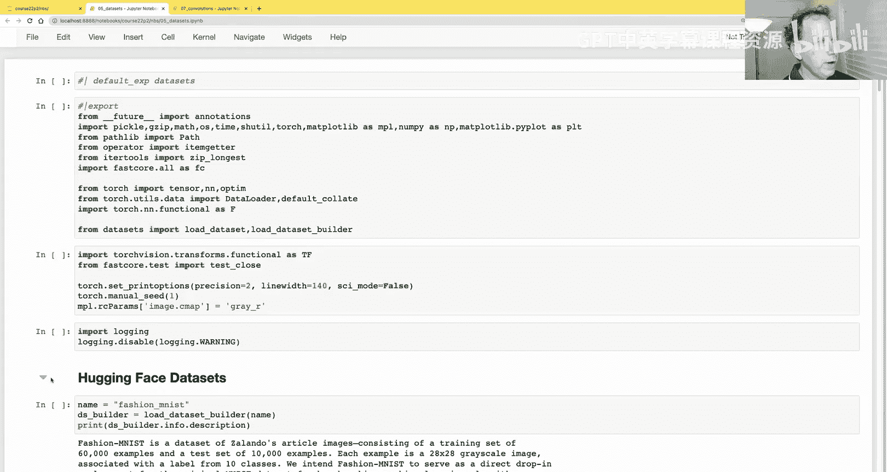
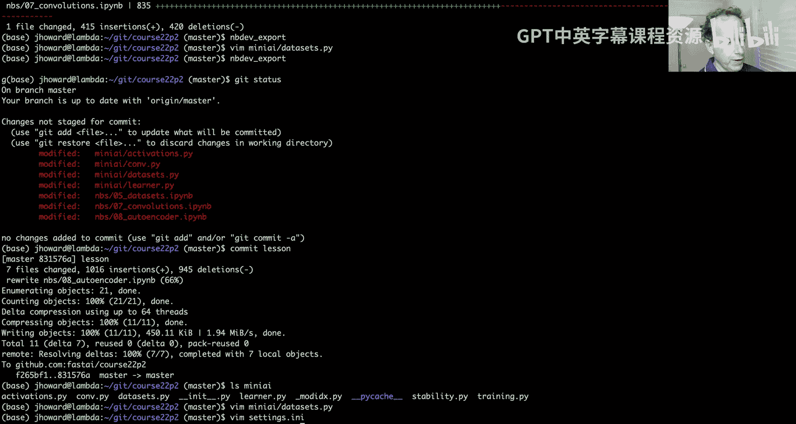
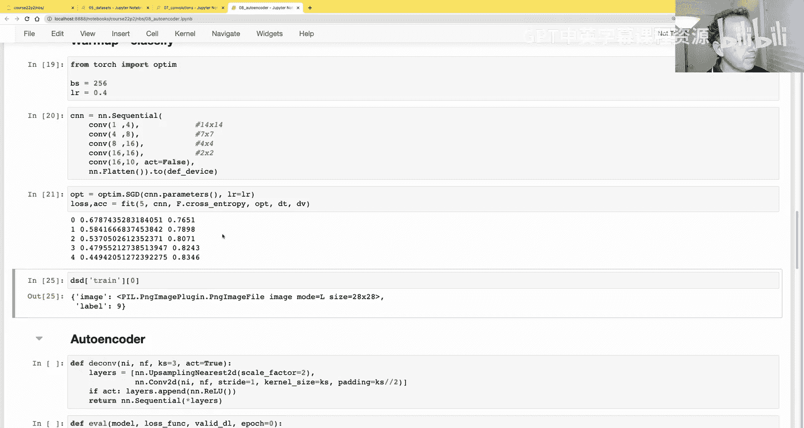
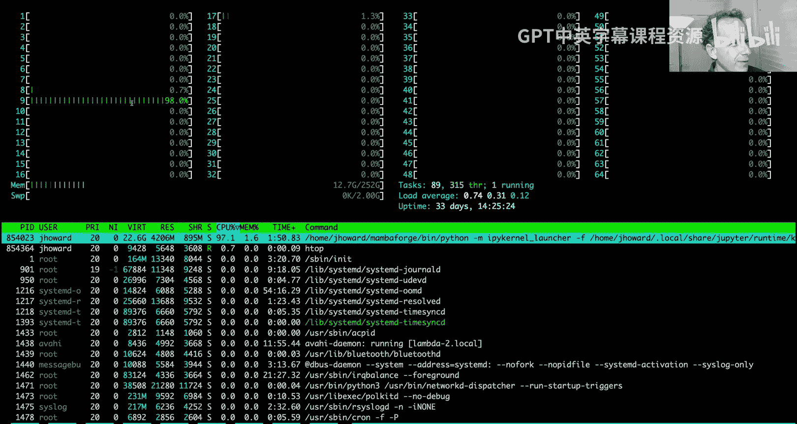
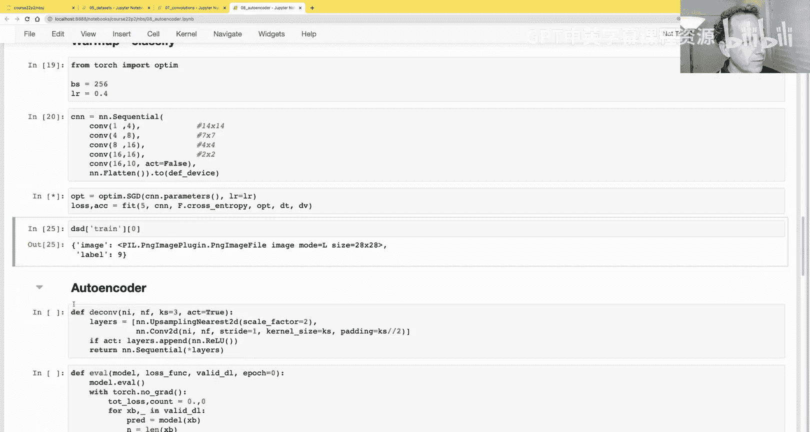
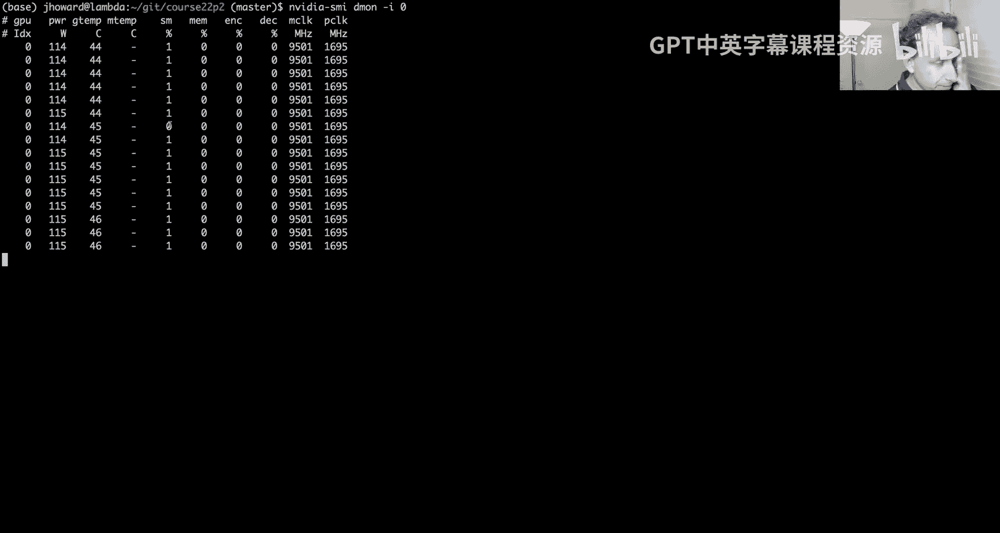
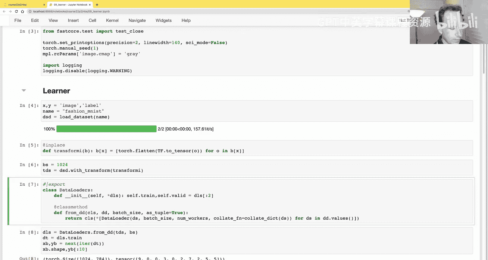
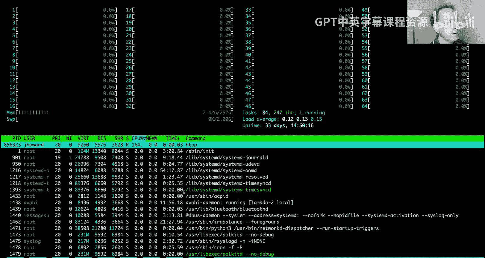
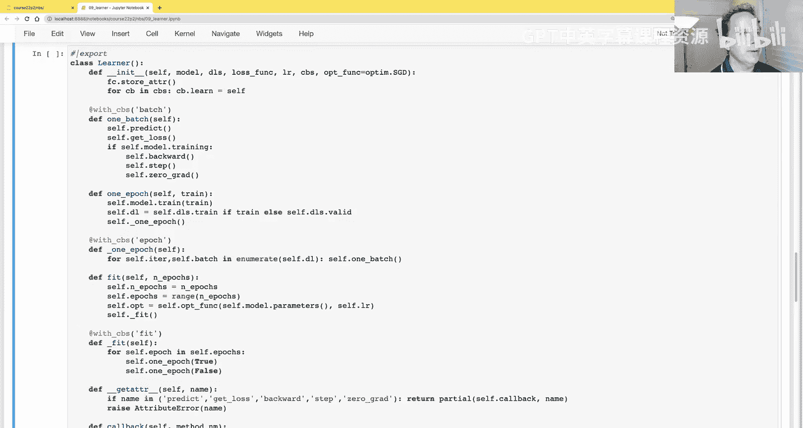

# Jeremy《深度学习基础到稳定扩散模型｜Deep Learning Foundations to Stable Diffusion》中英 p09 Lesson 15_ Deep Learning Foundations to Stable Diffusion.zh_en -BV1Mp421S7xg_p9-

Hi all and welcome to lessons 15 and what we're going to endeavorav to do today is to create a convolutional auto encodecor。

😊，And。In the process， we will see why。Doing that well is a tricky thing to do， and。Time permitting。

 we will begin to work on a。Framework， a deep learning framework to make life a lot easier。

Not sure how far we'll get on on that today timeway， so let's see how we go and get straight into it。

嗯。So。Okay， so today， let's start by talking before we can create a convolutional auto encoder。

 we know to talk about convolutions and what are they and what are they for？😊，Broadly speaking。

 convolutions are something that allows us to。To tell our neural network a little bit about the structure of the problem that's going to make it a lot easier for it to solve the problem。

 And in particular， the structure of our problem is we're doing things with images。

 imagesmages are laid out on a grid， a 2D grid for black and white or a 3D for。

color or a 4D for a color video or whatever。😊，And so。😊，We would say， you know。

 there's a relationship between the pixels going across and the pixels going down。

 They tend to be similar to each other。 differences in those pixels across those dimensions tend to have meaning sets。

 Pat of pixels that appear in different places often represent the same thing。 So， for example。

 a cat in the top left is still a cat， even if it's in the bottom right。

 These kinds of this kind of prior information is something that is naturally captured by。

A convolution or neural network， something that uses convolutions。Generally speaking。

 this is a good thing because it means that we will be able to use less parameters and less computation because more of that information about the problem we're solving is kind of encoded directly into our architecture。

There are other architectures that don't encode that prior information as strongly。

 such as a multi layer perceptron， which we've been looking at so far or a transformers network。

 which we haven't looked at yet。 Those kinds of architectures could potentially。

Give us what they do give us more flexibility and given enough time， compute and data。

 they could potentially find things that maybe CNNs would struggle to find。嗯。

So we're not always going to use convolutional neural networks。

 but they're a pretty good starting point and certainly something important to understand they're not just used for images。

 we can also take advantage of one dimensional convolutions。For language based tasks， for instance。

So convolutions come up a lot。嗯。So in this notebook。

 one thing you'll notice that might be of interest is we are importing stuff from mini AI now now Min AI is this little library that we' are studying to create。

And we're creating it using NB dev， So we've G got a mini AI dot training and a many AI dot data sets。

 and so if we look， for example， at the datas notebook。

It starts with something that says that the default export module is called data sets。

And some of the cells have a export directive on them。 and at the very bottom， we had something that。

Called N B dev export。 Now， what that's going to do is it's going to create a file called datas dot P。

가。Just here， dataset sets stop Pway。And it contains。That's those cells that we exploited。

And it why is it called mini AI dot data sets， that's because everything NB Dev is stored in settings。

 any and there's something here saying create a library lip name called mini AI。嗯。

You can't use this library until you install it now we haven't uploaded it to Paypayi like we emit a Pip installable package from the public server。

 but you can actually install a local directory as if it's a Python module that you've kind of installed from the internet and to do that you say Pip install in the usual way。

 but you say minus E that's down to editable and that means set up the current directory as a Python module well current directory actually any directory you like I put dot to mean the current directory and so you'll see that's going to go ahead and actually install。

My library。And so after I've done that。😊，I can now。Import things from that library。As you say。嗯。

Okay so this is just the same as before we're going to grab our MNS data set and we're going to create a convolutional neural network on it。

 so before we do that we're going to talk about what are convolutions and one of my favorite descriptions of convolutions comes from the student in now I think it this very very first course Matt Kinsmith who wrote this really nice medium article CNNs from different viewpoints which I'm going to steal from and here's the basic idea。

 say that this is our image it's a three by three image with nine pixels labeled from A to J is capital letters。

😊，Now， a convolution uses something called a kernel and a kernel is just another tensor in this case it's a two by2 matrix again。

 so it's this ones we're going to have alphabeta gamma delta as our four。嗯。

Values in this convolution。嗯。Now， in this kernel， Oh， now one thing I'll mention。

 I can't remember if I've said this before is。The Greek letters are things that you want to be able to。

 I think I have mentioned this。 You want to be able to pronounce them。

 So if you don't know how to read these and say what these names are。

 make sure you head over to Wikipedia or whatever and learn the names of all the Greek letters。

So that you can because come up all the time， okay？😊。

So what happens when we apply a convolution with this 2 by2 kernel to this 3 by3？Image。I mean。

 it doesn't have to be an image， it in this case it's just a rank to tensor。

 but it might represent an image。What happens is we take the kernel and we overlay it over the first middle2 by two subgrid。

Like so。And specifically， what we do is we match color to color。

 so the output of this first over2 by2 overlay would be alpha times a plus beta times B plus gamma times D plus delta times E。

And that would yield some value P。 And that's going to end up in the top left of a two by two output。

So the top right of the 2 by2 output， we're going to slide， it's like a sliding window。

 we're going to slide our kernel over to here。😊，And apply each of our coefficients to these。

Re colored squares。And then dead over the bottom left。And then did over the bottom right。

So we end up with this equation。P， as we discussed， is alpha A plus B to B plus ga D plus delta E。

Plus， some bias term。嗯。Q。To the top right， as you can see， it's just alpha in this taste timess B。

And so we're just multiplying them together and adding them up， multiply together， add them up。

 multiply together and add them up so we're basically you can imagine that we're basically flattening these out into rank1tensors into vectors and then doing a dot product would be one way of thinking about what's happening as we slide this kernel over these windows。

😊，And so this is called a convolution。😊，um。So let's try and create a convolution。So， for example。

Let's grab。Our training images。And take a look at one。And let's create。A3 by 3 kernel。

 So remember a kernel is just we've already， a kernel appears a lot of times in computer science and math。

 We've already seen the term kernel to mean a piece of code that we run on a GPU across。

Lots of parallel kind of virtual devices are potentially an grid。There's a similar idea here。

 we've got a computation which is in this case kind of this dot product or something like a dot product sliding over occurring lots of times over a grid。

 but it's yeah it's a bit different that's kind of another use of the word kernel so in this case a kernel is a in this case it's going to be ranked to tensor。

😊，And so let's create a kernel with these values。In the three by three matrix， rank2 tensor。

And we could draw what that looks like。Not surprising。 It just looks like a bunch of lines， oops。

Okay， so what would happen？If we。Slide this over to these nine pixels over this 28 by 28。Well。

 what's going to happen is if we've got some the top left， for example。

 3 by3 section has these names， then we're going to end up with negative a1 because the top3 are or negative right。

 negative a1 minus a2 minus a3， the next to just0 so that went do anything and then plus a7 plus a8 plus a9。

Why is that interesting？That's interesting。But let's try here。 What I've done here is I've grabbed。

Just the first 13 rows in first 23 columns。Of our image。And I'm actually showing the numbers。

And also using gray。Kind of conditional formatting， if you like。

 or the equivalent in pandas to show this top bit。 So we're looking at。Just this top bit。嗯。

So what happens if we take rows？3，4， and 5。Remember， this is not inclusive right， so it's rows 3。

4 and 5 columns 4 15，16，14 1516。 so we're looking at this， these three here。

What's that going to give us if we multiply it by。This kernel。It gives us a。

Fairly large positive value because the three that we have negatives on is the top row or error or0。

And the three that we have positives on。They're all close to one。

 so we end up with quite a large number。What about the same columns， But for row 7，8，9，7，8，9。Here。

The top is all positive， and the bottom is all0。So that means that we're going to get a lot of negative terms。

And not surprisingly， that's exactly what we see this， if we do。This。

Kind of it's a dot product equivalent which all you need in nupy to do that is just an element my multiplication followed by a sum right So that's going to be a quite a large negative number。

 And so perhaps you're seeing what this is doing and maybe youve got a hint from the name of the tensor we created。

It's something that is going to find the top edge。so this one is a top edge， so it's a positive。

And this one is a bottom edge。 So it's a negative。So we would like to apply that。😊，This colonel。

To every single three by three section in here。So we could do that by creating a little apply kernel function。

That takes some particular row and some particular column and some particular。Tenser as a kernel。

 and does that modification。Dot sum that we just saw。So， for example， we could replicate。

This one by calling apply kernel， and this here is the center of that three by3 grid area。

And so there's that same number， 2。97。So now we could apply that kernel to every one of the three by three windows in this 28 by 28 image。

So we're going to be sliding over like this red bit sliding over here。

 but we've actually got a 28 by 28 input， not just a5 by5 input。So to get all of the coordinates。

 let's just simplify to do this5 by5。 we can go， we can create a less comprehension。

 We can take I through every value in range 5。 and then for each of those。

 we can take J for every value in range 5。 And so if we just look at that tuple。You can see we get。

A list of lists containing all of those。Coordinates。

So this is a list comprehension in a list comprehension， which when you first say it may be。

Surprising or confusing， but it's a really helpful Eiom and I certainly recommend getting used to it。

Now， what we're going to do is we're not just going to。Create the cup， this tuple。

 but we're actually going to call apply play kernel。😊，For each of those。So if we go through。

From1 to 27， well actually 1 to 26 because 27 is exclusive。 So we're going to go through。

Everything from1 to 26 and then for each of those go through from 1 to 26 again and call apply kernel。

😊，And that's going to give us the result of applying that convolutional kernel to every one of those coordinates。

And there's a result。 And you can see what it's done， as we hoped is it is highlighting。

The top edges。So， yeah， you might find that kind of surprising that it's that。

 that easy to do this kind of image processing。 We're literally just doing。

An element wise modification。 and a sum。For each window。Okay， so。So that is called a convolution。

So we can do another convolution。 This time， we could do one with a left edge tensor， as you can see。

 it looks just a rotated version or。Transpose version， I guess， of our top edge tensor。

 heres what it looks like。 And so if we apply that kernel。

So this time we're going to apply the left edge kernel and so notice here that we're actually passing in a function。

Right， we're passing in a function。Sorry， actually not a function， isn' it， It's。

 it's just a tense step actually。So we're going to pass in the left edge tensor。For the same。

List comprehension in a list comprehension。 And this time。We're getting back to the left edges。

 It's highlighting all of the left edges in the digit。So， yeah。

 this is basically what's happening here is that a two by two can be。Loot over an image。

 creating these。Outputs。Now， you'll see here that in the process of doing so。We are。

Losing the outermost pixels。Of our image。 we'll learn about how to fix that later。 But just for now。

 notice that as we are putting our three by3 through， for example， in this 5 by5， there's only one，2。

 three places that we can put it going across， not five places because we need some kind of edge。

Allright， so that's cool that's a convolution and hopefully if you remember back to kind of the Zilar and Fergus pictures from lesson one。

 you might recognize that the kind of first layer of a convolutional network is often looking for kind of edges and gradients and things like that and this is how this is how it does it and then then with convolutions on top of convolutions with nonlinearar activations between them can combine those into curves or corners or stuff like that and so on and so forth。

😊，Okay， so how do we do this quickly because currently this is going to be super。

 super slow doing this in Python。😊，So one of the very earliest or probably the earliest publicly available general purpose deep learning。

 GPU acceleratedccator deep learning thing I saw was called Cafe。

That was created by somebody called Yang Qing Jia。😊，And he actually described what happened where。

 where cafe， how cafe went about implementing。嗯。A fast convolution on a GPU。 And basically， he said。

 well， I had two months to do it， and I had to finish my thesis。

 And so I ended up doing something where I said， well。There was some other code out there。

 Kjaski who you might have come across him and Hinton set up a little startup which Google bought and that kind of became the start of Google's deep learning the Google brain basically so Kjaski had all this fancy stuff in his library but Yang Qing J said  oh I didn't know how to do all that stuff so I said" well I already know how to multiply matrices so maybe I can convert a convolution into a matrix multiplication。

And so that I became known as I am to Cole。😊，I am to Co is a way of converting a convolution into a matrix model play。

😊，And so， actually。😊，I don't know if I suspect Yang Qing Ja could have accidentally reinvented it because it actually had been around for a while。

 even at the point that he was writing his thesis， I believe。

So it was actually this is the place I believe it was created in this paper。嗯。So that was in 2006。

 just a while ago。😊，And so this is actually from that paper。😊，And what they describe is。

 let's say you are putting this two by two。嗯。Colonnel over this3 by3 bit of an image。

 So here you've got this， this window needs to match to this pit of this window。 right。

 What you could do is you could unwrap this to 1，1，2 to sorry，1，2，1，2， downwards to here 1，2，1。

2 to unroll it like so and you could unroll the kernel here。嗯。Yeah， so this is 1，2，1，1。

 So this is bit is here，1，2，1，1， And then you could unroll the kernel 1，1，2，2 to here，1，1，2，2。

 And then once they've been flattened out and moved in that way。

And then you'll do exactly the same thing with this next patch here，2，01，3。

 You flatten it out and put it here，2，01，3。 So if you basically take those kernels and flatten them out in this format。

 then you end up with a matrix model play。 If you modelp this matrix， by this matrix。

 you'll end up with。The output that you want from the convolution。

 So this is basically a way of unrolling your kernels and your input features into matrices。

 such as when you do the matrix modelplay。You get the right answer， so it's a kind of a nifty trick。

And so。So that is called I am to call。 I guess we're kind of chaing a little bit。

 Implementing that is kind of boring is just a bunch of copying intense manipulation。

 So I actually haven't done it。 Instead， I've linked to。A Nly implementation。Which is here。

And it also part of it is this get indices。Which is here。And as you can see。

 it's a little bit tedious with repeats and tiles and reshapes and whatnot。

I'm not going to call it homework， but if you want to。

Practice your tensor indexing manipulation skills。 Try creating a pie torch version from scratch。

 I've got to admit I didn't bother。 Instead， I use the one that's built into pie torch。

 and in pie torch， it's called Un。Um。So， if we take our image。

And Pytorch expects there to be a batch axis and a dimension and a channel dimension。

 so we'll add two unit leading dimensions to it。Then we can unfold our input。4 a3 by3。

And that will give us a 9 by 6，76。Input。嗯。And so then we can take that。And。Oops， Daisy。

We can take that。And then well make our， we will take our kernel and just flatten it out into a vector。

 So view changes the shape and-1 just says dump everything into this dimension。

 So that's going to create a。N long vector。Length9 vector。

 And so now we can do the matrix model play just like they've done here of the kernel matrix。

 that's our weights。By the unrolled input features。And so that gives us a 676 long。

 we can then view that as 26 by 26。And we get back。As we hoped， our left edge tensor result。

 And so this is， yeah， this is how we can kind of from scratch， create a a better。

Implementation of convolutions。 The reason I'm cheating。

 I'm allowed to cheat here is because we did actually create convolutions from scratch。

 We're not always creating the GPU optimized versions from scratch。

 which was never something I promised。 So I think that's fair。

But it's cool that we can kind of hacker out a GPU optimizeimised version in the same way that the kind of original deep learning library did。

So if we use apply kernel。Wake at。Nearly 9 milliseconds。UIf we use。Unfold with matrix modelplay。

We get 20 microseconds。So that's what about 400 times faster。 So that's pretty cool。 Now， of course。

 we don't have to use unfold and matrix waterply because。Pyotch has acon 2D， so we can run that。

And that， interestingly， is about the same speed。At least on GPU。

But this would also work on GPU just as well。Yeah， I'm not sure this will always be the case in this case it's a pretty small image I haven't experimented a whole lot to see whereabouts there's a big difference in speeds between these。

 Obviously I always just use F。 co2D but if there's some more tricky convolution you need to do with some weird thing around channels or dimensions or something you can always try this unfold trick It's nice to know it's there I think。

So we could do the same thing for diagonal edges。😊，So here's our diagonal edge。Cannel。

Or the other diagonal。So if we just grab。The first。16 images。

Then we can do a convolution on our whole batch with all of our kernels at once。So this is a nice。

Optimize thing that we can do。And you end up with。You're 26 by 26。 You've got your four。Clonnels。

 and you've got your 16 images。And so that's summarized here。

 So that's generally what we're doing to get good GPU acceleration is we're doing a bunch of kernels and a bunch of images all at once across across all of their pixels。

😊，And so。Here we go。 That's what happens when we take a look。

At our various kernels for a particular image。Left edge， I guess， top edge and then diagonal。

 top left and top right。Okay， so that is optimized convolutions on and that works just as well on CPU or GPU。

 obviously GPU will be faster if you have one。Now， how do we deal with the problem that we're losing。

One pixel on each side。What we can do is we can add something called padding。😊，And for padding。

 what we basically do is rather than starting our window here。

 we start it right over here and we actually would be up one as well。 And so these three。

On the left here。We just take the input for each of those as zero。

 so we're basically just assuming that they're all zero I mean that there's other options we could choose。

 we could assume they're the same as the one next to them。Um there's various things we can do。

 but the simplest and the one we normally do is just assume that there's zero。😊，So。Now。嗯。

So let's say， for example， this is called one pixel padding。Let's say we did two pixel padding。

 so we had two pixel padding。With a5 by5 input。Okay， and a four by four kernel。

 So that gras our kernel。 then we're going to start right up way over here on the corner。 Okay。

 and then you can see what happens as we slide。The kernel over。

 there's all the spots that it's going to take。 And so that this dotted line area is the area that we're kind of effectively going through。

 But all of these white bits， we're just going to treat a 0。

 And so and then this is this green is the output size we end up with， which is going to be 6 by 6。

For a 5 by5 input。And I should mention。Even numbered edge kernels are not used very often。

 we normally used odd numbered kernels if you use， for example， a three by three kernel。

And one pixel of padding。 you will get back the same size you start with。 If you use 5 by 5。

With three pixels of padding， you'll end up with the same size you start with。 So generally。

 out numberered edge size kernels are easier to deal with to make sure you end up with the same thing you start with。

嗯。Okay， so yeah， so as it says here with you've got a odd numberumbed size Ks by Ks size kernel。

 then Ks。Tnccate divide to。That's what slash slash means we'll give you the right size。😊，嗯。

Another trick you can do is you don't always have to just move your window across by one each time you could move it by a different amount each time。

 The amount you move it by is called the Str。So for example， here's a case of doing a stride2。

 so with stride2 padding one， so we start out here and then we jump across two。

And then we jump across two。And then we go to the next tray。So that's called a Str 2 convolution。

 Str 2 convolutions are handy because they actually reduce the dimensionality of your input。😊。

By a factor of two。And that's actually what we want to do a lot， for example， with an auto encoder。

 we want to do that。 And in fact， for most classification architectures， we do exactly that。

 We keep on reducing the。The kind of the grid size by a factor of two again and again and again。

 using Str2 convolutions with padding of one。So that's strides and petting。

So let's go ahead and create a confinant using these approaches。

So we're going to put get our size of our training set， this is all the same as before。

 number of categories， number of digits size of our hidden layer。Um。So。嗯。Previously。

 with our sequential linear models with our MLPs， we basically went。From from the number of。

Pixels to the number of hidden and then a row and then the number of hidden to the number of outputs。

So here's the equivalent。😊，With a convolution。Now the problem is that you can't just do that because the output is not now 10 probabilities for each item in our batch。

 but it's 10 probabilities for each item in our batch for each of 28 by 28 pixels because we don't even have a stride or anything。

 so you can't just use the same simple approach that we had for MLLP。

 We have to be a bit more careful。So to make life easier， let's create little con function。😊。

That does a con of 2 D。Where the st of2。Optionally followed by an activation， so if act is true。

 we will add in a value activation。So this is going to either return a conv 2D or a little sequential containing a conv 2D followed by a re。

And so now we can create a CNN know from scratch as a sequential model。😊。

And so since activation is true by default， this is going to take our 28 by 28 image， starting with。

One channel and creating an output of four channels， so this is the number of in。

 this is the number of filters， sometimes we'll say filters to describe the number of kind of channels that our convolution has。

 that's the number of outputs。And it's very similar to the idea of the number of outputs in a linear layer except that this is the out number of outputs in your convolution。

So what I like to do when I create stuff like this is I add a little comment just to remind myself what is my grid size after this so I had a 28 by 28 input。

😊，So then I've then put it through a straight2 con， so the output of this will be 14 by 14。

So then we'll do the same thing again。 but this time we'll go from a four channel input to an8 channel output and then from 8 to 16。

 So by this point we're now down to a 4 by 4。And then down to a two by two。And then finally。

 we're down to a one by one。 So on the very last layer， we won't add an activation。😊。

And the very last layer is going to create and create 10 outputs。

 And since we're now down to a one by one， we can just call flatten。

 and that's got to remove those unnecessary unit axes。 So if we take that。

Pop our mini batch through it。 We end up with exactly what we want as 16 by 10。

 So for each of our 16 images。We've got 10。Probabilities of10 probabilities of each possible digit。

So if we take our training set and make it into 28- 28 images and we do for the same thing for a validation set。

And then we create two data sets。One for each， which record Tra data set and valid data set。

And we're now going to train this。Um，On the GPU。😊，Now， if you've got a Mac。

You can use a device called well， if you've got a。Apple Sil Mac， you've got a device called MP。

 which is going to use the your Mac GPU， where if you've got NviDdia， you can use Kuda。

 which will use your Nvio GPU ks。You know，10 times or more。

 possibly much more faster than a Mac so you definitely want to use Nvidia if you can。um。

But if you're just running it on a Mac laptop or whatever， you can use it MP。

 So basically you want to know what device to use do we want to use Kuda or MP You can check if you can check Torchtop backend。

mpps。t is available to see if you're running on a Mac with MP。You can check Torch。coer。

t is available to see if you've got an NviIdia GPU in which case you've got Kuda。

 and if you've got neither， of course you'll have to use the CPU to do computation。So Ive created a。

Little function here to device。Which takes a tensor or a dictionary or a list of tensors or whatever。

 And a device to move it to。 And it just goes through and moves。Everything on to that device。

 or if it's a dictionary， a dictionary of things， value is moved on to that device。

So there's a handy little function。And so we can create a。Customt col function。

Which calls the Pytorrch default col function and then puts those tensesors onto our device。

And so with that， we've now got enough。To run train this neuraln net on the GPU。

We created this gettDLs function in the last lesson， so we're going to use that passing in the datas。

That we just created。 and our。Default col function。

We're going to create our optimizer using our CNNs parameters。😊，And then we。Call fit。 Now fit。

 remember， we also created in our last lesson and it's done。 So then what I did then was I reduced。

 but the learning rate by a factor of four。And ran it again。 And eventually， yo。

 I got to a fairly similar accuracy to what we did on our multi on our MLP。Um。So yeah。

 we've got a convolutional network working。 I think that's pretty encouraging。

 And it's nice that to train it， we didn't have to write much code， right。

 we were able to use code that we already built。 we were able to use the data class that we made the get Dls function that we made and the fit function that we made。

 And， you know， because those things are。😊，Written in a fairly general way。

They worked just as well for a covnet as they did for an MLP。 Nothing had to change。

 So that was nice。Notice I had to take the model and put it on the device as well。

 so that will go through and basically put all of the tensors that are in that model onto the MP or Coer device if appropriate。

So if we've got a batch size of 64 and as we do one channel 28 by 28。

 so then our axes are batch channel height width。 So normally this is referred to as NCHW so N generally when you see N in a paper or whatever in this way it's referring to the batch size N being the number that's the mnemonic。

 the number of items in the batch C is the number of channels height by width NCHW。

TenssorFlow doesn't use that， TensorFlow uses NHWC。So we generally call these that channelss last。

Since channels are at the end。And this one we normally call channels first Now， of course。

 it's not actually channels first。It's actually channel second， but where you ignore the batch bit。😊。

嗯。In some models， particularly some more modern models， it turns out the channel's last is faster。😊。

So Ptorrch has recently added support for channels last。

 and so you'll see that being used more and more as well。

Allright so a couple of comments and questions from our chat the first is Sam Watkins pointing out that we've actually had a bit of a win here。

 which is that the number of parameters in our CNN is pretty small by comparison。

 so the number in the MLP version， the number of parameters is equal to basically the size of this matrix so times NH。

Right。Oh， plus the number in this， which will be Nh times 10。And， you know。

 something that at some point we probably should do is actually create something that。

Allows us to automatically calculate the number。Of parameters。um。And I'm ignoring the bias there。

 of course。Let's see what would be a good way to do that。Maybe NP dot product。There we go。

 So what we could do。😊，What we could do is just calculate this automatically。

By doing a little list comprehension here。 So there's the number of parameters across all of the different layers of both bias and weights。

 and then we could。嗯。I guess just， well， we could just use。Oh， excuse Ptoch。

 So we could turn that into a ten， Sir。And sum it up。Oops。

So that's the number in our MLP and then the number in our simple CNN。So that's pretty cool。

 We've gone down from 40000 to 5000 and got about the same number there。 Oh， thank you， Jonathan。

 Jonathan's reminding me that there's a better way than NP dot product O dot shape。

Which is just to say。O dot number of elements， nu E L。Same thing。Very nice。嗯。Now。

 one person asked a very good question， which is。A thought convolutional neural networks can handle any sized image。

 and actually， no， this convolutional network cannot handle any sized image。

 this convolutional neural network。Only handles images that once they go through these dried two cons end up with a one by one。

Because otherwise， you can't dont flatten it and end up with 16 by 10。嗯。

So we will learn how to create。😊，Convnets that can handle any sized input。

 but there's nothing particularly about a cofnet that necessitates that it has to be any sized input that it can handle。

Okay， so。Just let's briefly finish this section off by talking about this yeah， this。

Well particularly on to talk about the idea of receptive field， consider this yeah。

 one input channel，4 output channel，3 by3 kernel。😊，Right。

 so that's just just to show you what we're doing here， con1， well actually so simple CNN。😊。

Sampoable CNN。This is the model we created。 Remember it was like a sequential model containing sequential models because that's how our con function worked。

 So simple CNNn 0 is our first layer。 It contains both a convere。 So simple CNN00 is the actual conf。

 So if we grab that con con1。 it's a。4our by one by3 by3。Number of outputs。

 number of input channels and height by width of their kernel， and then it's got its bias as well。

So that's how we could kind of deconstruct what's going on with our。

Weight matrices who are parameters inside a convolution。Now， I'm going to switch over。To Excel。

 So in the lesson notes on the course website or on the forum， you'll find we've got an Excel。

You'll see we've got an Excel workbook。Oh， what seem reminded me that there is a nice trick we can do。

 I do want to do that actually because I love this trick。嗯。Oh， I just deleted everything though。back。

 Here we go， which is you actually don't need square brackets。

 The square brackets is a list comprehension without the square brackets。

 It's called a generator and it oh， no， you can't use it there。 Maybe that only works with。

Maybe that only works with nupy。Okay， so don， that's the list。No， that doesn't work either。

 so much for that。😊，Um。I am kind of curious now。Maybe torched at some。😔，No。Just some。Okay。

Wellhy I don't want to use Python some。That's interesting。

 I feel like all of them should handle generators， but。There go。Okay， so open up。😊。

The convic example spreadsheet and what you'll see on the convic example pay worksheet page is。

Something that looks a lot like the number 7。 And indeed。

 this is the number number 7 that I got straight from Amnes。Its same。Okay。

 so you can see over here we have a number7， this is a number7 from MNT that I've copied into Excel and then you can see over here we've got like a the top edge kernel being applied and over here we've got a right edge kernel being applied。

😊，This might be surprising you because you might be thinking where to tick Jeremy？😊。

Microsoft Excel doesn't do convolutional neural networks。Well， actually， it does。

So if I zoom in in Excel。😊，You'll see， actually， these numbers are， in fact。

 conditional formatting applied to。A bunch of spreadsheet cells。

 And so what I did was I copied the actual pixel values。

Into Excel and then applied conditional formatting。

 And so now you can see what the digit is actually made of。So， you can see here。I've created。

Our top edge filter。 And here， I've created our。Left edge filter。 And so here I am。Applying。

That filter， too。That。Window。And so here you can see it looks a lot like numpy。

 It's just a sum product。And。You might not be aware of this。

 but in Excel you can actually do broadcasting you have to hit Apple shift enter or control shift enter and it puts these little curly brackets around it it's called an array formula it's basically lets you do broadcasting or simple broadcasting in Excel and so here's how you so this is how I created this top edge filtered version in Excel and the。

Left edge version is exactly the same。 Just a different kernel。 And as you can see， if I。Click on it。

 it's applying this filter to this input area and so forth。Okay， so we can then。

 I just arbitrarily picked some different。Values here。

 And so something to notice now in my second layer。So here's conv1。I's con of 2。

 it's got a bit more work to do。 We actually need two filters。Because we need to。Add together。

This bit here applied to this with this kernel plate and this bit here。With his colonel applied。So。

You actually need one。Set of 3 by 3 for each input。 And also， I want to set two separate outputs。

 So I actually end up needing。诶。2 by2 by3 by3。weightights matrix or weights Tensor， I should say。

 which you might remember is exactly what we had in Ptorch we had a rank for tensor。

So if I have a look at this one。😊，You see exactly the same thing this input is using this kernel applied to here and this kernel applied to here。

So that's important to remember that you have these rank for tensors。And so then。

Rather than doing Str2 con， I did something else which is actually a bit out of favor nowadays。

 but it's another option， which is to do something called max pooling。😊，To reduce my dimensionality。

 So you can see here I've got 28 by 28。 I've reduced it down here to 14 by 14。

And the way I did it was simply to take the max。Of each little or two by two area。Okay。

 so that's all that's been done there。So that's called max pooling。

 and so max pooling has the same effect as a Str2 con， not mathematically identicalible。

 the same effect， which does a convolution and reduces the grid size by two on each dimension。😊，Okay。

 so then how do we create a single output if we don't keep doing this until we get to one by one。

 which I'm too lazy to do in Excel。😊，Well， one approach and again this is a little bit out of favor as well。

 but one approach we can do is we can take every one of these we've now got 14 by 14 and apply a dense layer to it。

And so what I've done here is I've got a big imagine this is basically all being flattened out into a vector。

😊，And so here， we've got。Some product of this by this plus the sum product of this by this。

 And that gives us a single number。And so that is how we could then optimize that in order to optimize our weight matrices。

Now and then you know the more modern approach， we don't use this kind of dense layer much anymore。

 it still appears a bit， the main place that you see this used is in a network called VGG。

 which is very old now， I thought it might 2013 or something。

But it's actually still used and that's because for certain things like something called style transfer or in general perceptual losses。

 people still find VGG。😊，Seems to work better。 So you still actually see this approach nowadays。

 sometimes。The more common approach， however， nowadays， is we take the penultimate layer。

And we just simply take the average of all of the activations。 So the you know， the nowadays。

 we would simply， the Xial way of doing it would be literally simply， say， average。Of。

There's anult layer。And。That is called global average polling。Everything has to has a fancy word。

 a fancy phrase， but that's all it is。 Take the average， it's called global average polling。

 or you take you could take the max， whatever that would be global max polling。😊，So anyway。

 the main reason I wanted to show you this was to do something which I think is pretty interesting。

 which is to take something in。嗯。I'm just going to zoom out a little bit here。

Let's take something in our。Max poll here。And I'm going to say， trace precedence。

To show you here it is the area that it's coming from， Okay so what's coming from these four numbers。

Now， if for trace precedents again， saying what's actually impacting this？

Obviously the kernel's impacting it。And then you can see that the input area here。Its a bit bigger。

And then if I trace precedence again。Then you can see the input area is bigger still。

So this number here is calculated from。All of these numbers in the input。

This area in the input is called the receptive field。Of this unit。

And so the receptive field in this case is one，2，3，4，5。

6 by6 and that means that a pixel way up here in the top right has literally no ability to impact。

That activation， it's not part of its receptive field。

If you have a whole bunch of Str2 comms each time you have one。

 the receptive field is going to get twice as big， so the receptive field at the end of a deep network is actually very large。

But the inputs closest to the middle of the receptive field have the biggest kind of say in the output because they implicitly appear the most often in all of these kind of dot products that are inside this convolutional window。

😊，So the receptive field is not just like a single binary on off thing。

 Certainly all the stuff that's not。Got precedence here is not part of it at all。

But the closer to the centre of the receptive field， the more impact it's going to have。

 the more ability it's got to change this number。So the receptive field is a really important concept。

 And yeah， fiddling playing around with Excel's precedent arrows， I think is a nice way to。😊。

To say that， at least in my opinion。And apart from anything else。

 it's great fun creating a convolutional neural network in Excel。😊，Um， I felt so anyway。Okay。

 so let's take our seven minute break。 I'll see you back after that to talk about a convolutional。😊。

我der曼开 up。All right。😊，Okay， welcome back。We're going to have a look now at the auto encoder notebook。

😊，So we're just going to import all of our usual stuff。

 and we've got one more of our own modules to import now as well。😊。

And this time we are going to switch to a different。嗯。We're going to switch to a different data set。

 which is the fashion MNIS data set。We can take advantage of the。Stuff that we did in  O5 data sets。

And the hugging face stuff to load it。 So we've seen this。A little bit before。Back in our data sets。

1 here。And we never actually。But any models with it。 So let's， first of all， do that。

So this is just I'm going to convert。Each thing， each image into a tensor。

And that's going to be an in place transform。 Remember we created this decorator。

And so we can call data set dictionary with transform， this is all stuff we've done before。

And so here we have our。Example of。Snneaker。嗯。All right， and we will create akylation function。😊。

We're collating a dictionary for that data set， that's something to remind you should remind yourself。

 we built that ourselves in the datas notebook。And let's actually make our collate function。😊。

Something that does。Two device， which we wrote in our last notebook。

And we at little data loaders function here。Which is going to go through each item in the data dictionary。

And create a data loader for it and give us a dictionary of data loaders。Okay， so。Okay。

 so now we've got。Data load of for training and a data load of for validation so we can grab。

The X and Y batch by just calling next on that iterator as we've done before。We can。

Grab the let's look at each of these in turn actually， we've done all this before。

 but it's a couple of weeks ago， so just to remind you。We can get the names of the features。

And so we can then create an item getter for our Ys and we can， so well call that the label getter。

 we can apply that to our labels to get the titles of everything in our mini batch。😊。

And we can then call our show images that we created。With that mini batch， with those titles。

 And here we have our fashion emist mini batch。Okay， so let's create a classifier。😊。

And we're just going to use exactly the same code， copy and pasted from the previous notebook。

So here is our。Sequential model。And。We are going to grab the parameters of the CNN。嗯。And the CNN。

 I've actually moved it over to the device。the default device was what we created in our last notebook and as you can see it's fitting。

😊，HNow our first problem is it's fitting very slowly。😊，Which is kind of annoying。so。

Why is it running pretty slowly？嗯。Let's think about， let's have a look at our data set so。

When it's finally finished。Let's take a look at an item in the data set。Actually。

 let's not look at the data set。 Let's actually go all the way back to the data dictionary， so。

Before it gets transformed， data set dictionary。And let's grab the training part of that。

And let's grab one item。And actually， we can see here the problem for Endness。

We had all of the data loaded into memory into a single big tensor。

 but this hugging face one is created in a much more kind of normal way。

 which is each image is a totally separate PNG image， it's not all pre converted into a single thing。

嗯。Why is that a problem， Well， the reason it's a problem is that our。

Our data loader is spending all of its time。Deding these PNGs。

So for train here。Okay， so while I'm training， I can type H top and you can see that basically my CPU is 100% used。

 Now， that's weird because I've actually got 64 CPUs。

Why is it using just one of them as the first problem。

 but why is it matter that it's using 100% CPU or the reason it matters？😊。

It's runund it again so you can see。Why does it matter that our CPU is 100% and why is it making it so slow。

 Well， the reason why is if we look at Nvidia SM I demon， that will monitor our， our。

Our GPUs utilization， I've got three GPUs， so I say， to choose just the zeroth index one。

And you'll see see this column here SMM， this stands for symmetric body processor。

 its like the iss the equivalent of like CPU usage and generally we're only using up 1% of our1 GPU so no wonder it's so slow。

So the first thing we want to do then is try to make things faster。😊，Now to make things faster。

 we want to be using more than one CPU to decocode our PNGs。And as it turns out。

 that's actually pretty easy to do。 you just have to。Add a。Extra argument to。Your data letters。

Which is here。 None underscore workers。And so I can say use eight CPUs， for example。Now。

 if I recreate data loaders and then try to get the next one。Oh。

 now I've got an  error and the error is。Rather， quirky。And what it's saying is， oh。

 you're you're now trying to use multiple processes。

 and generally in Python and in Pytor using multiple processes， things start to get complicated。

 And one of the things that absolutely just doesn't work is you can't。Actually。

 have your data loader。Put things onto the GPU in your， in your separate processes。

 It just doesn't work。 So the reason for this error is actually because of the。

Fact that we used a collate function that put things on the device。 That's incompatible。

Unfortunately， with using multiple workers。U。So。That's。That's a problem。And。

The answer to that problem， sadly。Is that we would have to actually rewrite our fit function entirely。

嗯。So there's annoying thing number one and we don't want to be rewriting our fit function again and again。

 we want to you have a single fit function So okay。

 so there's a problem that we're going to have to think about。Problem number two。😊。

Is that this is not very accurate。87%。 Well， I mean， is it accurate。

 It's easy enough to find out there's a really nice website called paperspers with Code。

And it will tell you。A little leaderboard。 And we can see whether we're any good。And。

The answer is we're not very good at all， so these papers had 96%， 94%。92%。U。So。Yeah。

 our we're not looking great。So how do we improve that？嗯。There's a lot of things we could try。

 but pretty much all of them are going to involve。Modifying our fit function again and in really simply complicated ways。

 so we've still got a bit of an issue there。Let's put that aside because what we actually wanted to do is create an auto encoder。

😊，嗯。So。To remind you。About what an auto encoder is。

 And we're going to be able to go into a bit more detail。 now。

 we're going to start with our input image， which is going to be 28 by 28。

 So it's the number 3 right and it's a 28 by 28。And we're going to put it through， for example。

 a stride to。K。It's drive 2。And that's going to have an output。Of the 14 by 4。

And we can have more channels。 So say maybe4。 So this is 28 by 28 by1。 that's do 14 by 14。B 2。

 So we've reduced the height and width by2， but added an extra channel。 So overall。

 this is a2 x decrease in parameters。And then we could do another straight2 con。😊。

And that would give us a 7 by 7。 And again， we can choose however many channels we want。

 But let's say we choose 4。So now compared to our original， we've now got a times4。Rduction。

And so we could do that a few times， or we could just stay there。😊，This is。Compressing。

And so then what we could do is then somehow have a convolution layer or group of layers。

Which does a convolution， and also。Increases the size。There is actually something called。

A transposed convolution。Which I'll leave you to look up if you're interested。

Which can do that also known as a rather weirdly a stride one half convolution。

 But there's actually a really simple way to do this， which is to say。

 let's say you've got a bunch of pixels。 Here's out。 Let's say we've got a three by three pixels。

That looks like this，1，0，1，1， say， we could make that into a 6 by 6。Very easily。Which is。

 we could simply。Just's getting these out。We could simply copy that pixel there into the first four。

Copy that pixel there into these four。And so you can see and then copypy this pixel here into these four。

And so we're simply turning each pixel into four pixels。And so this is called nearest。Neighour。

Up sampling。Now， that's not a convolution。 That's just copying。

 But what we could then do is we could then apply a stride one。Convolution to that。

And that would allow us to double the grid size。With the convolution。

 and that's what we are going to do。So our auto encoder is going to need a deconvolutional layer。😊。

And that's going to contain two layers。😊，Up sampling nearest neighbour。Scale factor of 2。

 followed by a conv 2 D with a straight of one。Okay， and you can see for padding。

 I just put kernel size slash slash2， so that's a truncating division because that always works for any odd sized kernel。

😊，As before， we will have an optional activation function。😊，And then we will create a sequential。

Using star layers。 that's going to pass in each layer as a separate argument。

 which is what sequential expects。Okay。嗯。So let's write a new fitness function。

goes through I'll just basically copied it over from our previous one going through each epoch。

 but I've pulled out a vowel into a separate function。But it's basically doing the same thing。😊，Okay。

 so here is our。Auto encoder。And so we're going to。😊。

It's a bit tricky because I wanted to go down by one， two， three to get to a four by four by eight。

But starting at 28 by 28， you can't divide that three times and get an integer。

 So what I first do is a zero pad so I add padding of two on each side to give a 32 by 32 input。

 So if I then do a con with two channel output that gives a 16 by 16 by 2。And then again。

 to get an 8 by 8 by4 and then again， to get a4 by 4 by 8。 So this is doing an8ex compression。

 and then we can call decon。To do exactly the same thing in reverse。

 the final one with no activation。 and then we can truncate off those two pixels off the edge。

 slightly surprisingly， Pi torch lets you pass negative2 to0 padding to crop off the final two pixels。

And then we'll add a sigmoid， which will force everything to go between 0 and 1。

 which of course is what we need。And then we will use MSE loss。

To compare those pixels to our input pixels。And so a big difference we've got here now is that our loss function is being applied to the output of the model and itself。

 right we don't have Y B here。 We have Xb。嗯。So we're trying to recreate our original。 and again。

 this is a bit annoying that we have to create our own fit function。😊，嗯。Anyway。

 so we can now see what is the MSE loss， and it's not like going to be particularly。G readable。

but it's it's， it's a number we can see if it goes down。 and so then we can create。

Then we can do our SGD with the parameters of our auto encoder with MSE loss。

 call that fit function we just wrote。And。I won't wait for it to run because as you can see。

 it's really slow for reasons we've discussed。I've run it before， and。

What we want is to see that the original， which is。Which is here。Gets recreated。And the answer is。

 oh。Not really。U。I mean。They're roughly the same things。But there's no point having an auto encoder。

Which can't even recreate the originals。 The idea would be that if this。

 if these looked almost identical to these， they would say， wellow。

 this is a fantastic network at compressing things by eight times。😊，嗯。

So I found this like very fiddly to try and get this to work at all。

 something that I discovered can get it to start training is to start with a really low learning rate。

😊，For a few epochs and then increase the learning rate after a few epochs。I mean。

 at least it gets it to train and show something vaguely sensible but。😊，Let's see。 Yeah。

 it still looks pretty crummy。 This one here I got actually by switching to Adam。

 and I actually removed the tricky bit。 I removed these two as well。😊，Um， but yeah。

 I couldn't get this to to like recreate anything very reasonable or any reasonable amount of time。

And。You know， whyhy is this not working very well， there's so many reasons it could be。You know。

 like we do we need a better optimizer， do we need a better architecture。

 do we need to use a variational auto encoder？😊，You know， there's a thousand things we could try。But。

You know， doing it like this is going to drive us crazy。

 We need to be able to really rapidly try things and all kinds of different things。

And so what I often see， you know， in， in， in projects or on carle or whatever。

 People's code looks kind of like this。 It's all like。Manual， and then their iteration speed。

Is is too slow。 We need to be able to really rapidly try things。

 So we're not going to keep doing stuff manually anymore。 This is where we。Take a halt。And we say。

 okay， let's build up。A framework that we can use to rapidly try things and to understand when things are working and when things aren't working。

So we're going to start creating。Alena。嗯。So what is a learner it's basically the idea is this learner is going to be something that we build which will allow us to try like anything that we can imagine very quickly and we will build that on top of that learner things that will allow us to introspect what's going on inside a model will allow us to do multi-process couda to go fast。

 it will allow us to add things like data augmentation。

 it will allow us to try a wide variety of architectures quickly and so forth so that's going to be the idea。

And of course， we're going to create it from scratch。And so let's start with fashion emnes as before。

😊，U。And。Let's create a data loaders plus。Which is going to look a bit like what we had before。

 where we're just going to。Pass in， this is just， it couldn't be simpler， right。

 we're just going to pass in。Two data loaders。And store them away。

And I'm going to create a class method from data dictionary。

And what that's going to do is it's going to call data loader。😊。

On each of the data set dictionary items。With our batch side， batch size and。Instiate our class。

 So if you haven't seen class method before， it's what allows us to say data loaders dot something in order to construct this。

 we could have put this in in it just as well， but we'll be building more complex data loaders things later。

 So I thought we might start by getting the basic structure right。

 So this is all pretty much the same as what we've had before。

 I'm not doing anything on the device here because as we know that didn't really work。Um。Okay。嗯。Oh。

 this is an old thing I don't need to kuda anymore。So we're going to use two device。

 which I think came from。😔，Here we go。So here's a。Here's an example of a very simple learner that fits on one screen。

 and this is basically going to replace our fit function。

So a learner is going to be something that is going to train or learn a particular model。

Using a particular set of data loaders， a particular loss function。

But some particular learning rate and some particular optimizer or some particular optimization function。

😊，Now， normally， I， you know， most people would often kind of store each of these away separately by writing like self dot model equals model。

 blah， blah， blah， right， And as I think we've talked about before。That's， you know。

 that kind of huge amounts of boilerplate。 It just。

 it's more stuff that you can get wrong and it's more stuff to mean that you have to read to understand the code and yeah。

 don't like that kind of repetition。 So instead we just call fast core dot store Atcher to do that all in one line Okay so that's a basic idea with a class is to think about what's the information it's going to need。

 So you pass that all to the constructor。 store it away。And then our fit function。

Is going to we've got the basic stuff that we have。4。嗯。Keeping track of accuracy。

So this has only work for stuff that's a classification where we can use accuracy。

Put the model on our device。Create the optimizer。Store how many epochs we're going through then for each epoch。

We'll call the one epoch function and the one epoch function we're going to either do train or evaluation。

 so we pass in true if we're training and false if we're evaluating and they're basically almost the same。

 we basically set the model to training mode all night。

We then decide whether to use the validation set or the training set based on whether we're training。

And then， we go through。H batch in the data load。And call one batch。

 And one batch is then the thing which is going to put。Our batch onto the device。Call our model。

Call our loss function。 And then if we're training。Then do our backward step。

 our optimizer step in our zero gradient。And then finally， calculate our metrics or our stats。

 And so here's where we calculate our metrics。So that's basically。What we have there。

So let's go back to using an MLP。We call fit。And the way it goes。This is an error here。

Pointed out by Kevin。 Thank you。 Selftop modelled up， too。

One thing I guess we could try now is we think that maybe we can use more。Thenhan one process。

So， let's try that。

Oh was so fast。 I didn't even see。Here it goes， you can see all force CPUs being used at once bangang is done Okay。

 so that's pretty great。Let's see how fast it looks here。Pump， pump。 All right， lovely。Okay。

 so that's a good sign we've got a learner that can fit things。

 but it's not very flexible it's not going to help us， for example。

 with our autoenr because there's no way of like to say you know changing which。😊。

Which things are used for predicting with or for calculating with。

 We can't use it for anything except things that involve accuracy with the binary classification sorry。

That right so yeah， a multiclass classification。 It's not flexible at all， but it's a start。

 And so I wanted to basically put this all on one screen so you can see what the basic learner looks like。

😊，All right， so how do we do things other than multi class accuracy？😊，I decided to create a metric。

Cl。And basically， a metric class is a something where we are going to define。

Subclasss of it that calculate particular metrics。So for example here I've got a subclass of a metric called accuracy。

 So if you haven't done subclasses before。😊，You can basically think of this。As saying。

 please copy and paste all the code from here。Into here for me。

But the bitt that says deaf Kc replace it with this version。 So， in fact， this would be identical。

Took copying and pasting this whole thing。Typing accuracy here and replacing the definition of cc。

With。That。That's what is happening here when we do subclassing。

 So it's basically copying and pasting all that code in there for us。

 It's actually more powerful than that。 There's more we can do with it。 But in this case。

 this is all that's happening with this subclassing。 And that's this is called。

Actuallyt nobody he's there， that's fine。😊，嗯。Okay， so the accuracy metric。Is here。

 and then this is kind of our really basic metric， which is we're going to use for just for loss。

And so what happens is we're going to。Let's， for example， create an accuracy metric object。

 We're basically going to add in many batches of data。So for example。

 here's a many batches of inputs and predictions， here's another mini batch of inputs and predictions。

 and then we're going to call dot value and it will calculate the accuracy。Now， dot value。

Is a neat little thing， it doesn't require parentheses after it because it's called a property。

And so a property is something that just calculates automatically without putting having to put parentheses。

 That's all a property is while property gatherter anyway。 And so they look like this。

 You give it a name。And so we are going to be each time we call add。

We are going to be storing that input。And that target。

And also the number of items in the mini batch optionally。For now。

 that's just always going to be one。😊，嗯。And you can see here that we then call。Duckcallk。

Which is going to call the accuracy cc。 So just see how often they're equal。

And then we're going to append to the list of values。That calculation。

And we're also going to cut ourend to the list of Ns。 in this case， just one。

 And so then to calculate the value。We just do that， So that's all that's happening for accuracy。

And then we can do for loss we can just use metric directly because metric directly will just calculate the average of whatever of it's past so we can say oh add the number 0。

6 so the target's optional and we're saying this is a mini batch of size 32 so it's going to be the n and then add the value 0。

9 with a mini batch size of 2。And then get the value。😊，And as you can see。

 that's exactly the same as the weighted average。Of 0。6 and 。9 with weights of 32 and 2。

So we've created a metric class。 And so that's something that we can use to create。

Anyimetric we like just by overriding Calc。😊，Or we could create totally things from scratch as long as they have an add and a value。

Okay， so we're now going to change our learner。U。And what we're going to do is we're going to keep the same basics chapter。

So there's going to be fit。It's going to go through each epoch。

 it's going to call one epoch passing in true and false as for training and validation。One apoch。

Is going to go through each batch in the data loader and call one batch。

One batch is going to do the prediction， get loss， and if it's training。

 it's going to do the backward step and zero gra。But there's a few other things going on。😊，So。

Let's take a look。Well actually， let's just look at it in use first， so when we use it。😊。

We're going to be creating a learner with the model， data loaders， loss function。

 learning rate and some callbacks which we'll learn about in a moment and we call fit and it's going to do our thing and look we're going to have charts and stuff Allright。

 so the basic idea is going to look very similar。So we're going to call fit。😊。

So when we construct it， we're going to be passing in exactly the same things as before。😊。

But we've got one extra thing， callbacks， which we'll see in a moment。😊。

Store the attributes as before。And we're going to be doing some stuff with the callbacks。

 So when we call fit。For this number of epochs， we're going to store away how many epochs we're going to do。

We're also going to store away the actual range that we're going to loop through as soft dot epoch。

 So here's that looping through soft dot epochs。We're going to create the optimizer using the optimizer function。

😊，And the parameters。And then we're going to call underscore fit。 Now。

 what on earth is underscore fit。 Why didn't we just copy and paste。 So this into here。 why。

 why do this。 It's because we've created this special。Decorator with Colbes。What does that do？So。

 it's up here。With Corbes， with Corbex is a class。It's going to just store one thing。

 which is the name。 In this case， the name is。Fit。And what it's going to do？😊，Is。

Now this is the decorator， right， So when we call it， remember， decorators get past a function。

 So it's going to get past this whole function。😊，And that's going to be called F。

So D core remember is what happens when a class is treated an object is treated as if it's a function。

 so it's going to get past this function， so this function is underscore fit。

And so what we want to do is we want to return a different function。😊，It's going to， of course。

 call the function that we were asked to call。Using。

The arguments and keyword arguments we were asked to use。But before it calls that function。

 it's going to call a special method called callback。Passing in the string before， in this case。

 before underscore fit。After it's completed， it's going to call that method called Corak。😊。

And passing the string after underscore fit。And it's going to wrap the whole thing in a try except block。

😊，And it's going to be looking for an exception called。Cancel， fit exception。And if it gets one。

It's not going to complain， so let me explain what's going on with all of those things。

Let's look at example over a Queback。😊，um。So for example， here is a callback。Called device Cb。

 device scoreback。 And before fit will be called automatically before that underscore fit method is called。

And it's going to put the model。Ontu。Our device， codeda or MP。 If we have one， otherwise。

 it'll just be on。GPU。So what's going to happen here， So it's going to call。We're going to call fit。

 it's going to go through these lines of code， it's I' going to call underscore fit underscore fit is not this function underscore fit is this function。

😊，With F is。Dis function。So it's going to call。Our learner。 Corback passing in before_ fit。

And callback is defined。Here， what's Corbe going to do。It's going to be past the string before_ fit。

It's going to then go through。H of our Kobes。Sored based on their order。

 and you can see here our Corbacks can have an order。And it's going to。😔。

Look at that callback and try to get an attribute called before_ fit。And it will find one。

And so then it's going to call。😊，That method。Now， if that the method doesn't exist。

 it doesn't appear at all。 then Gaatcher will return this Instead， identity is a function。Just yeah。

This is an identity function。 All it does is whatever arguments it gets passed。

It returns them if it's not past any arguments， it just returns。

So there's a lot of Python going on here。And that is why we did that foundations listen。Um。And so。

 for people who。Haven't done a lot of this Python。There's going to be a lot of stuff， too。

Experiment with and learn about。And so do ask on the forums if。😊，Any of these bits get confusing。

 but the best way to learn about these things is to open up this Jupiter notebook and try and create really simple versions of things。

 right， So， for example。Let's try identity。Identity。How exactly does identity work。

I can call it and it gets nothing。 I can call it with one。 It gets back1。 I could call it with a。

Gets back A， I call it with a1。Call it with A1 and get A1。嗯。And how is it doing that exactly。

 So remember， we can add。A great point。 And this would be a great time to really test your debugging skills。

Okay， so remember in our debugger， we can hit H to find out what the commands are。

 but you really should do a tutorial on the debugger if you're not familiar with it。

 and then we can step through each one so I can now print。Aggs。And there's actually a trick。

 which I like， is that AX is actually a command funnily enough。

 which will just tell you the arguments to any function， regardless of what they're called。😊。

It is kind of nice。And so then we can step through by pressing n。And after this。We can check like。

 okay， what is X now。And what is Os now。Right，So remember to really experiment with these things。嗯。

So anyway， we're going to talk about this a lot more in the next lesson。嗯。But before that。

If you're not familiar with T， except blocks。You know。

 spend some time practicing them if you're not familiar with decorators， well。

 we've seen them before， so go back and look at them again really carefully。

If you're not familiar with a debugger， practice with that， if you haven't spent much time with。

Getattra， remind yourself about that。 So try to get yourself really familiar and comfortable。

As much as possible with the pieces， because if you're not comfortable with the pieces。

 then the way we put the pieces together is going to be confusing。

There's actually something in education in kind of the theory of education called cognitive load theory and the theory of basically cognitive load theory says if you're trying to learn something。

😊，But your cognitive load is really high because of all lots of other things going on at the same time。

 you're not going to learn it。So it's going to be hard for you to learn。😊。

This framework that we're building， if you have too much cognitive load of like what the hells are decorator or what the hells get at or what does sort of do or what's partial you know all these things now I actually spent quite a bit of trying trying to make this as simple as possible。

 but but also as flexible as it needs to be for the rest of the course and this is as simple as I could get it so these are kind of things that you actually do have to learn but in doing so you're going to be able to write some really you know powerful and general code yourself so hopefully you'll find this a really valuable and mind expanding exercise in bringing high-level software engineering skills to your data science work。

😊。

Okay， so with that， this looks like a good place to leave it and look forward to seeing you next time。

 bye。😊。