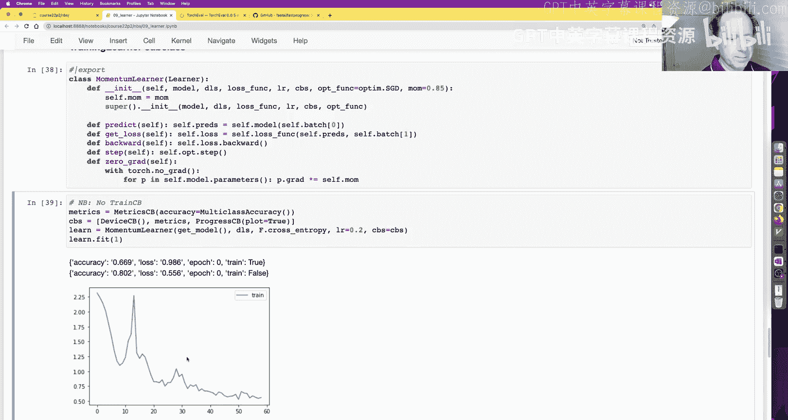
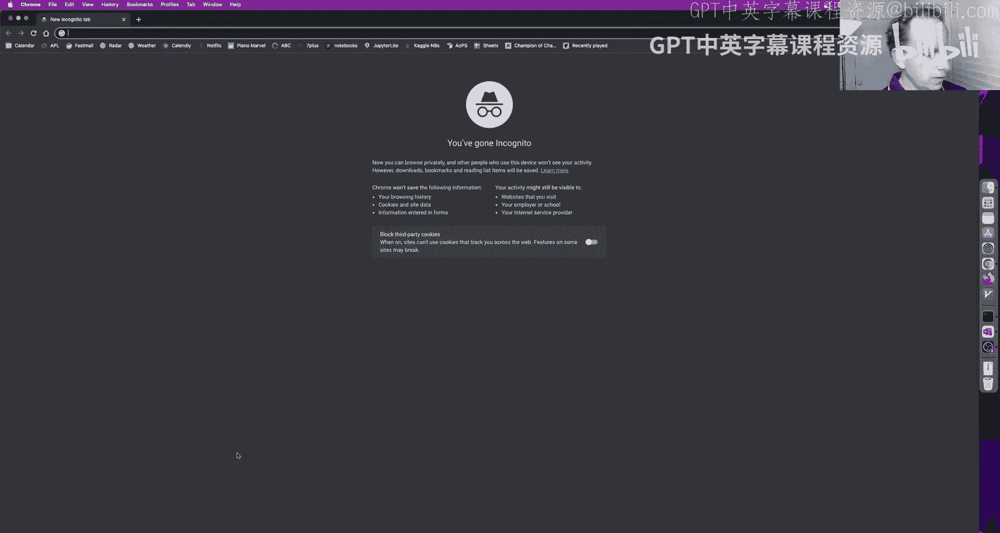
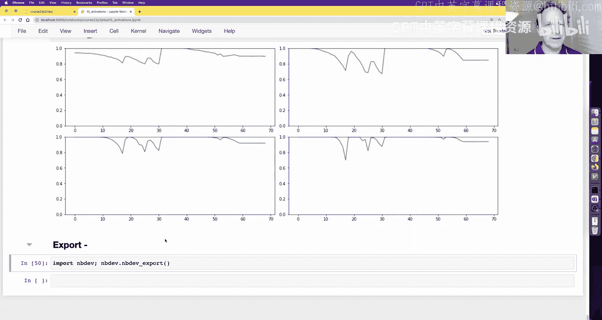

# Jeremy《深度学习基础到稳定扩散模型｜Deep Learning Foundations to Stable Diffusion》中英 p10 Lesson 16_ Deep Learning Foundations to Stable Diffusion.zh_en -BV1Mp421S7xg_p10-

Hi there and welcome to lessons 16， where we are working on building our first flexible training framework。

 the Lana。And I've got some very good news， which is that I have thought of a way of doing it a little bit more gradually and simply actually than last time。

 so that that should make things a bit easier so we're going to take it a bit more step by step。😊。

So we're working in the09 learner notebook today。嗯。And we've seen already this。

There's basic Corbacks learner。And so the idea is that。We've seen so far this。😊。

Learner which wasn't flexible at all， but it had all the basic pieces。

 which is we've got a fit method， we are hard coding that we can only calculate accuracy and average loss we're hard coding we're putting things on a default device。

嗯。Hard coding a single learning rate， but the basic idea is here we go through each epoC。😊。

And call one epoch to to train or evaluate depending on this flag。

And then we loop through each batch in the data loader。

 and one batch is going to grab the X and Y parts of the batch。Call the model。

 call the loss function。 And if we're training， do the backward pass。And then print out。

We'll calculate the statistics for our accuracy and then at the end of an epoch print that out。

 so it wasn't very flexible。😊，But it did。Do something。 So that's good。

 So what we're going to do now is we're going to do as an intermediate step。

 We're going to look at a。But I'm calling a basic Corax learner and it actually has nearly all the functionality of the full thing when we're going to after we look at this basic Corax learner。

 we're then going to。😊，After creating some callbacks and metrics。

 we're going to look at something called the flexible learn， so let's go step by step。😊。

So the basic callbacks learner looks very similar to the previous learner。It's got a fit function。

Which is going to。Go through H A park。Calling one epoch with training on and then training off and then one epoch will go through each batch。

And call one batch。 and one batch will call the model， the loss function。 And if we're training。

It will do the backward step。So that's all pretty similar。

 but there's a few more things going on here， for example， if we have a look at fit。😊。

You'll see that after creating the optimizer， so we call self dot opttfk， so opttfk here。

Defaults to SGD， So we instantiate an SGD object passing in our models' parameters and the requested learning rate。

And then before we start looping through one epoch at a time， now we've set epochs here。

We first of all call self。callback and passing in before fit Now what does that do？

Self talk Koback is here。And it takes some method names， in this case it's before fit。

And it calls a function called run Corbeex。It passes in a list of our callbacks and the method name in this case before fit。

So run Corbacks。Is something that's going to go for each callback and it's going to sort them in order of their order attribute。

 And so there's a base class to our callbacks which has an order of 0。

 So our callback are all going to have the same order of0 in which we will ask other ways。

So here's an example。😊，Of a callback。So before we look at how Corbacks work let let's just run a Corback so we can create a ridiculously simple Corback called completion Corback。

 which before we start fitting a new model， it will set its count attribute to zero after each batch it will increment that。

And after completing the fitting process， it will print out how many batches we've done。

 So before we even train a model we could just run manually before fit。After batch。

And after fit using this run Cs。And you can see it's ended up saying completed one batches。

 So what did that do？So it went through。Each of the Cs in this list there's only one。

 so it's going to look at the one C。And it's going to try to use get Attra to find an attribute with this name。

 which is before fit。So if we try that manually， so this is the kind of thing I want you to do if you find anything difficult to understand is do it all manually so create a callback。

 set it to CBs0 just like you're doing in a loop right and then find out what happens if we call。

This。And pass in this。And you'll see it's returned。A method。 And then what happens to that method。

It gets cold。So let's try calling it。There we are， so that's what happened when we call the before fit。

 which doesn't do anything very interesting， but if we then call after batch。😊。

And then we call afterfi。There it is， right。Yeah， make sure you don't just ran code。Really， nearlyie。

But understand it by experimenting with it， and I don't always experiment with it myself in these classes。

 often I'm leaving that to you， but sometimes I'm trying to give you a sense of how I would experiment with code if I was learning it。

 So then having done that， I would then go ahead and delete those cells。

 but you can see I'm using this interactive notebook environment to to explore and learn and understand and so。

Now we've got and if I haven't created a simple example of something to make it really easy to understand。

 you should do that， right， don't just use what I've already created or what somebody else has already created。

😊，So we've now got something that works totally independently， we can see how it works。

 this is what a callback does， so a callback is something which we'll look at a class。😊。

A callback is a class where you can define。1 or more of before after fit， before after batch and。

Before， after epoch。So it's going to go through and run all the callbacks that have a before fit method before we start fitting。

Then it'll go through H shapepo。And call one epoch with training and one epoch with evaluation。

 and then when that's all done。It will call。After fit。Cbes and one E parkc will before it。

Starts on enumerating through the batches it will call before epoch， and when it's done。

 it will call after epoch。The other thing you'll notice is that there's a try except。

Immediately before every before method and immediately after every after method， there's a try。

And there's an exception and each one has a different thing to look for cancel fit exception。

 cancel epoch exception and cancel batch exception。

 so here's the bit which goes to each batch calls before batch processes the batch calls after batch and if there's an exception that of type cancel batch exception。

It gets ignored。So what's that for？So the reason we have this is that any of our callbacks。

Could call。Could raise any one of these three exceptions to say， I don't want to do this batch。

 please。So maybe you'll look at an example of that in a moment。😊，So we can now train with this。

USo let's call create a little get model function that creates a sequential model with just some linear layers。

And then we'll call fit。 And it's not telling us anything interesting because the only callback we added。

Was the completionflation Corbec？That's fine。 It's it's training， it's doing something。

 and we now have a trained model just didn't print out any metrics and I think because we don't have any callbacks for that。

 but that's the basic idea。So we could create a。U。Maybe we could call it a。Single。Batch， callback。

Which after batch， after a single batch， it raises a。Cancel。Council Fed exception。So that's a pretty。

 I mean， that place that could be kind of useful actually。

 if you want to just run one battery your model to make sure it works so we could。Try that。

So now we're going to add to our list of callbacks。Single batch Quebec。Let's try it。And in fact。

 you know， we probably want this， let's just have a think here。嗯。Oh， that's fine， Let's run it。

There we go。 So it ran and nothing happened and the reason nothing happened。

Is because this cancelled before this ran。 so we could make this run second by setting its order to be higher。

And we could say just order equals one because the default order is zero and we sought in order of the order attribute。

Actually， let's use。Cancel APpoC exception。There we go。That way， it'll run the final fit。

There we are。So it did one batch for the。It did one batch for the training and one batch for the evaluation。

 so it's a total of two batches。So remember， callbacks are not。

A special magic part of like the Python language or anything。

 It's just a name we use to refer to these functions or classes or callables more accurately that we。

😊，That we pass into something that will then call back to that quotable at particular times。

And I think these are kind of interesting kinds of Corbacks because these Corbes have multiple。😊。

Methods in them。So as each method a callback， is each class with all those methods of callback。

 I don't know， I tend to think of the class with all the methods in as a single callback。😊。

I'm not sure if we have great nomenclature for this。All right。

 so let's actually try to get this doing something more interesting by not modifying the learner at all。

 but just by adding Corbes because that's the great hope of Corbes， right？😊，So。U。

It would be very nice if it told us the accuracy and the loss。So to do that。

 it would be great to have a class that can keep track of a metric。

So I've created here a metric class。And maybe before we。Look at it， we'll see how it works。

You could create， for example， an accuracy metric by defining the calculation necessary to calculate the accuracy metric。

Which is the mean of how often do the inputs equal to targets？

And the idea is you could then create an accuracysymmetric object。

You could add a batch of inputs and targets and add another batch of inputs and targets and get the value。

 and there you would get the。45 accuracy。Or another way you could do it would be just to create a metric which simply gets the weighted average。

 for example of your loss so you could add 0。6 as the loss with a batch size of 32， 0。

9 is a loss in a batch size of 2 and then that's going to give us。A weighted average loss of 0。62。

 which is equal to this。Weaiighted average calculation。

So that's like one way we could kind of make it easy to calculate metrics。So here's the class。

Basically， we're going to keep track of all of the actual values that we're averaging and the number in each mini batch and so when you add a mini batch。

😊，We call calculate。Which for example， for accuracy。

 remember this is going to override the parent classes calculate so it does the calculation here。

And then we'll add that to our list of values。 We will add to our list of batch sizes。

 the current batch size。And then when you calculate the value。😊，喂 will。Calculate the weighted sum。

 I' sorry， the weighted mean weighted average。Now notice that here value I didn't have to put parentheses after it。

 and that's because it's a property I think we've seen this before so just to remind you。

 property just means you don't have to put parentheses after it to get the calculation to happen。😊。

All right， so just let me know if anybody's got any questions up to here， of course。😊，Um。

So we now need some way to use this metric in a callback to actually print out。

The first thing I'm going to do though I'm going to create one more one useful metric first。

 a very simple one， just two lines of code called the device Corback。

 and that is something which is going to allow us to use Kuda or the Apple GPU or whatever。😊。

Without the complications we had before of you know。

 how do we have multiple processes in our data loader and also use our device and not have everything fall over？

So the way we could do it is we could say before fit。😊，Put the model。Onto the default device。And。

Before each batch is run。Put that batch。Onto the device。Because look what happened in the。

 this is really， really important in the learner。😊，Absolutely， everything is put inside self do。

Which means it's all modifiable， so we go for self dot iteration number。

 comm self dot the batch itself， enumerating the data loader。And then we call one batch。

But before it， we call the callback so we can modify this。Now。

 how does the callback get access to the learner？ Well。

 what actually happens is we go through each of our callbacks and put set an attribute called learn。

Aquor to the Lena。And so that means in the callback itself， we can say self。learn。mod。And actually。

 we could make this a bit better， I think， so make it like maybe you don't want to use a default device。

 So this is where I would be inclined to add a constructor。😊，And set device。

And we could default it to the default device， of course。And then we could use that instead。

 and that would give us a bit more flexibility。 So if you wanted to train on some different device then you could。

I think that might be a slight improvement。😊，Okay， so there's a callback we can use to put things on kuda and we could check that it works by just quickly。

😊，Going back to our old liner here， remove the single batch Cb。And replace it with。Device C。Yep。

 still works， so that's a good sign。Okay， so now let's do our metrics now。嗯。

Of course we couldn't use metrics until we built them by hand The good news is we don't have to write every single metric now by hand because they already exist in a fairly new project called Torch Eval which is an official P Torch project。

And so torch Eval。It's something that gives us actually I came across it after I had created my own metric class。

 but it actually looks pretty similar to the one that I built earlier。😊，So you can install it。

With PP， I'm not sure if it's on Condy yet but it probably will be soon by the time you see the video。

 I think it's pure of Python anyway， so it doesn't matter how you install it。And yeah。

 it has a pretty similar。Pretty similar approach， where you call。Dot update。

 and you call dot compute。 So they're slightly different names。

 but they're basically super similar to the thing that we just built。 but there's a nice。

 good list of。Mettris to pick from。So because we've already built our own now。

 that means we're allowed to use theirs。So we can import。

The multi class accuracy metric and the main metric。And just to show you， they look very。

 very similar if we call multiclass accuracy and we can pass in a mini batch of inputs and targets and compute。

 and that all works nicely。Now these， in fact， it's exactly the same as what I wrote。

 we both added this thing called reset。😊，Which basically well resets it and。So obviously。

 we're going to be wanting to do that probably at the start of at GPk。😊，And so if you reset it。

And then try to compute。You'll get Nan because you can't get a meaningless when you don't have any data yet。

Okay。So let's create a metrics callback so we can print out our metrics。😊。

I've got some ideas to improve this， which maybe I do this week， but here's a basic working version。

 slightly hacky， but it's not too bad。嗯。So generally speaking。

 one thing I noticed actually is I don't know if this is considered a bug。

 but a lot of the metrics didn't seem to work correctly in torch Eval when I had。诶。

Tensors that were on the GPU and had requires grad。So I created a little2 CPU function。

 which I think is very useful and that's just going to detach the so detach takes the tensor and removes all the gradient history。

 the computation history used to calculate the gradient and puts it on the CPU。

It'll do the same for dictionaries of tensesors， lists of tensesors and tuples of tensesors。

So our metrics callback。Basically， here's how we're going to use it， so let's run it。

So here we are creating a metrics callback object。And saying we want to create a metric called accuracy。

That's what's going to print out。And this is the metrics that object we've got to use to calculate that accuracy。

And so then we just pass that in as one of our Corbacks。

And so you can see what it's going to do is it's going to print out the epoch number。

 whether it's training or evaluating， so training set or validation set， and it'll print out。

Our metrics and our current status， actually， we can simplify that。

We don't need to print those bits because it's all in the dictionary now。Let's do that。There we go。😊。

Um， so。Let's take a look at how this works。We are going to be creating with for the callback。

 we're going to be passing in the names and object metric objects for the metrics to track and print。

So here it is here， star star metric， so we's seen star star before。And as a little shortcut。

 I decided that it might be nice if you didn't want to write accuracy equals。

 you could just remove that and run it， and if you do that then it will give it a name and it'll just use the same name as the class。

And so that's why you can either pass in。😊，So star MS will be a tuple well I mean it's got to be pulled out so it's just passing a list of positional arguments which will be turned into a tuple or you can pass in named arguments it'll be turned into a dictionary if you pass in positional arguments then I'm going to turn them into named arguments in the dictionary by just grabbing the name from their type so that's where this comes from so that's all that's going on here just a little shortcut bit of convenience so we' store that away。

嗯。And this is， yeah， this is a bit I think I can simplify a little bit。

 but I'm just adding manually an additional metric。😊，Which is， I'm going to call the loss。

 and that's just going to be the weight the weighted average of the losses。

So before we start fitting。😊，We're going to actually tell the learner that we are the metrics callback and so you'll see later where we're going to actually use this。

Before each epoch， we will reset all of our metrics。After each apoch。

 we will create a dictionary of the。Keys and values。

 which are the actual strings that we want to print out。And we will call log， which for now。

 we'll just print them。And then after each batch， this is the key thing。 we're going to actually。

Grab the input and target。We're going to put them on the CPU。And then we're going to。

Go through each of our metrics。And call that update。 So remember the update in the metric。

Is the thing that actually says here's a batch of data right， So we're passing in the batch of data。

 which is the predictions。And the targets。And then we'll do the same thing for our special loss metric。

Passing in the actual loss and the size of our mini batch。And so that's how we're able to get this。

Yeah， this actual。runningning on the NviIDdia GPU and showing our metrics and obviously there's a lots of room to improve how this is displayed。

😊，But all the informations we needed here， and it's just a case of changing that function。Okay。

So that's our kind of like intermediate complexity learner， we can make it more sophisticated。😊。

But it's still exactlys still going to fit in a single screen of codes。

 this is kind of my goal here is to keep everything in a single screen of code。😊。

This first pit is exactly the same as before。😊，But you'll see that the。

1 apoch and fit and batch has gone from。Let's see。 But what it was before。

It's gone from quite a lot of code， or this。To much less code。

And the trick to doing that is I decided to use a context manager。

 We're going to learn more about context managers in the next notebook。

 but basically originally last week I was saying I was going to do this with the decorator。

 but I realized a context manager is better Basically what we're going to do is we're going to call our before。

😊，And after callbacks in a try， except block。And to say that we want to use the callbacks in the tricept block。

 we're going to use a with statement。 So in Python， a with statement says everything in that block。

Call our context manager。Before and after it now there's a few ways to do that。

 but one really easy one is using this context manager decorator。😊。

And everything up into the up tool the yield statement is called before your code。

Where it says yield， it then calls your code and then everything after the yield is called after your code。

So in this case， it's going to be try self dot callback before name where name is。Fit。

And then it will call for self dotpo， etc。Because that's where the yield is。

 and then it'll call self do coreback after。Fit。Except okay。

 and now we need to grab the cancel fit exception， So all of the variables that you have in Python all live inside a special dictionary called Globals。

😊，So this dictionary contains all of your variables so I can just look up in that dictionary。

 the variable called。Cancel fit with a capital F exception， so this is except Can fitt exception。

So this is exactly the same then as。This code， except the nice thing is now I only have to write it once。

Rather than at least three times， and I'm probably going to want more of them， so。You know。

 I tend to think。It's worth yeah I tend to think it's worth refactoruring a code when you have duplicate code particularly here we had the same code three times so that's going to be more of a maintenance headache we're probably going to want to add Corbacks to more things later so by putting it into a text manager just once I think we're going to reduce our maintenance burden well I know we do because I've had a similar thing in Fast AO for some years now and it's been quite convenient。

Um。So that's what this context manage about。Yeah， other than that， the codes exactly the same。

 So we create our optimizer and then with our callback context manager for fit goes through each epoch core1 epoC。

😊，Set it to training or non training mode based on there。Argument we pass in。

Grab a training or validation set based on the argument we trust in and then using the context manager for Epoch。

Go through each batch in the data loader and then for each batch in the data loader using the batch context。

Now this is where something gets quite interesting we call predict get loss and if we're training backward step and zero grad but。

😊，Previously， we actually called self dot model， et cetera。 self dot loss function， etc ceter。

So we go through each batch and。Call before batch。Do the batch。I the say that so。

That's our slow version。 Wait， what are we doing。 Oh， yes， we're going to be over here。Okay。

 back where we are， yes。😊，So previously we were calling， yeah calling calling the model。

 calling the loss function， calling lost dot backward up to dot step， up to dot0 grad， but now。

We are。😔，Calling instead， self dot predict self dot get loss， self dot backward。

 and how on earth is that working because they are not defined here at all？

And so the reason I've decided to do this is it gives us a lot of flexibility。 We can now actually。😊。

Create our own way of doing predict， get loss， backward step and zero grad in different situations and we're going to see some of those situations。

So what happens if we call self dot predict and it doesn't exist Well it doesn't necessarily cause an error what actually happens is it calls a special magic method in Python called Dununder Gaatra as we've seen before。

And what I'm doing here is I'm saying， okay， well， if it's one of these special five things。

Don't raise an attribute error， which is this is the default thing it does。But， instead。

Creed a callback。Or actually， I should say coal self。coback。Passing in。That name。

 So it's actually going to call self dot callback， quote predict。

And self do coreback is exactly the same as before。

 and so what that means now is to make this work exactly the same as it did before。

 I need a callback which does these five things。😊，And here it is， I'm going to call it train Corbec。

😊，So here are the five things predict get loss backwards， step and zero grad。So they are here。

 predict， get loss backward step and zero grad。Okay， so。

They're almost exactly the same as what they looked like in our intermediate learner。

 except now I just need to have self dot learn in front of everything because we remember this is a callback it's not the learner and so for a callback。

 the callback can access the learner using self dot learn So self dot learn。

 pres is self dot learn model passing in self dot learn dot batch and just the independent variables。

Did over the loss cause the loss function。Backward。Step。Zah cr。So that's at this point。

 this isn't doing anything that wasn't doing before， but the nice thing is now if you want to use。

Hugging face accelerate or you want something that works on hugging face data styles。

 dictionary things or whatever。You can actually change。

Exact how it behaves by just by creating a callback for training。😊。

And if you want everything except one thing to be the same you can inherit from Tra C so this isve I've not tried this before I haven't seen this done anywhere else so it's a bit of an experiment。

 so I was sure to hear how you go with it。😊，And then finally。

 I thought it'd be nice to have a progress bar， so let's create a progress callback。😊。

And the progress bar is going to show on it our current loss and going to create a plot of it。😊，U。

 so。I'm going to use a project that we created called Fast Progress。Mainly created by the wonderful。

小翻。嗯。And basically fast progress is。Yeah very nice way to create a very flexible progress bars so let me show you what it looks like first so let's get the model and train and as you can see it actually in real time updates the graph and everything there you go that's pretty cool。

😊，So that's the progress bar。The metrics callback， the device callback and the training callback all in action。

So before we fit， we actually have to set。😊，Self。tle。t epochs。

 Now that might look a little bit weird， but self。tle。t epochs。Is the thing that we。

Loop through for self。 epoch in so we can change that so it's not just a normal range。But instead。

 it is a。Progress bar around a range。UWe can then check。

 remember I told you that the learner is going to have the metrics attribute applied。

 we can then say， oh， if the learner has a metrics attribute。😊。

Then let's replace the underscore log method there with ours and our one instead we'll write to the progress bar Now this is pretty simple。

 it looks very similar to before， but we could easily replace this for example with something that creates an HTML table which is another thing fast progress does or other stuff like that。

 so you can see we can modify the nice thing is we can modify how our metrics are displayed。

So that's a very powerful thing that Python lets us do is actually replace one piece of code with another。

 And that's the whole purpose of why the。😊，Metrics callback。Had this underscore log separately。

 So why didn't I just say print here， that's because this way classes can replace。

How the metrics are displayed。 So we could change that to like send them over to weights and biases。

 for example， or。It'll create visualizations or so forth。嗯。So before ePARC。

 we do a very similar thing， the self。le。dl iterator。

 we change it to have a progress bar wrapped around it。And then after each bar， we。

Set the progress bar comment to be the loss， print it's going to show the loss on the progress bar as it goes。

And if we've asked for a plot， then we will append the losses。To a list of losses。嗯。

And we will update the graph。With the losses。And the。Btch numbers。So there we have it。

 We have a yeah， nice working。Learner， which is， I think the most flexible learner。

 that training loop probably that I hope has ever been written because I think the fast AI2 one was the most flexible that had ever been written before。

 and this is more flexible。And the nice thing is。😊，You can make this your own， you know。

 you can you know fully understand this training loop， so it's kind of like you can use a framework。

 but it's a framework in which you're totally in control of it and you can make it work exactly how you want to。

 ideally not by changing the learner itself ideally by creating Corbacks。But if you want to。

 you could certainly like look at that， the whole learner fits on a single screen。

 so you could certainly change that。😊，We haven't added inference yet。

 although that shouldn't be too much to add， I guess we have to do that at some point。U。Okay。

 now interestingly， I love this about Pyth and it's so flexible when， when we said。😊。

Self dot predict self dot get loss。 I said if they don't exist， then it's going to use Gaatra。

 and it's going to try to find those in the Corbacks。And in fact。

 you could have multiple callbacks that define these things and then they would chain them together。

 which would be kind of interesting。😊，but there's another way we could make these exist， which is。😊。

Which is that we could subclass this。So let's not use train Cb just to just to show us how this would work。

 And instead we're going to use。S up plus。So here I'm going to subclass learner and I'm going to override the five。

😊，Well， it's not exactly overriding， I didn't have any definition of them before。

 so I'm going to define the five directly in the learner subplus。

 so that way it's never going to end up going to getatra because getatcha is only called if something doesn't exist。

😊，嗯。So here it's basically all these five are exactly the same as in our train callback except we don't need self。

 learn anymore， we can just use self because we're now in the learner。

But I've changed zero grad to do something a bit crazy。😊。

I'm not sure if this has been done before I haven't seen it。

 but maybe it's an old trick that I just haven't come across。😊，But it occurred to me，0 grad。

Which remember is the thing that we call after we take the optimizer step。

Doesn't actually have to zero the gradients at all。What if instead of zeroing the gradients？

We multiplied them by some number， like say， 0。85。嗯。Well， what would that do， Well。

 what it would do is it would mean that your previous gradients。Would still be there。

But they would be reduced a bit。 And remember what happens in pieytorrch is pieytorch always adds the gradients to the existing gradients。

 and that's why we normally have to call zero gra。 But if instead we multiply the gradients by some number。

 I mean， we should really make this a parameter。 Let's do that， shall we。So let's create a parameter。

U。So probably there's a few ways we could do this。🤢，嗯。Well， let's do it properly。

We've got a little bit of time。U。So， we could say。Well。😔，嗯。

Maybe able'll just copy and past all those over here。And we'll add。Momentum。Momentum equals 0。85。

Self do momentum equals momentum。And then， super。So make sure you call the super classes。Passing in。

All the stuff。We could use delegates for this and quags。

 that would be possibly another way of doing it。Let's just do this for now， Okay。

 and then so there we wouldn't make a 0。05， we would make it dot momentum。

So you'll see now still trains， but there's no train CB Corback anymore in my list。

 I don't need one because I've defined the five methods in the subclassus。Now。

 this training at the same learning rate for the same time， the accuracy。

And we' get to improve by let's run them all。Yeah， this is a lot like gradient accumulation Corbec。

 They're kind of cooler， I think。Okay。Okay， so the。Let's see the loss has gone from 0。8 to 0。

55 and the accuracy has gone from about 0。7 to about 0。8。 So they've improved。

 Why is that Well we're going to be learning a lot more about this pretty shortly。

 but basically what's happening here。

But basically what's happening here is we have just implemented in a very interesting way which I haven't seen done before。

 something called momentum。😊，And basically， what momentum does is it say like， imagine you are。

 you know， your， you've got some kind of complex contour。嗯。Lost surface， right？ And， you know。

 so imagine these are hills with a marble very similar， right， there are marbles up here。

 What would normally happen with gradient descent is it would go。You know， in the direction downhill。

 which is this way。 So we'll go who over here and then w over here， right， very slow。

What momentum does is the first steps the same。And then the second step says， oh。

 I wanted to go this way， but I'm going to add together the previous direction plus the new direction but reduce the previous direction a bit。

 so that would actually make me end up about here。And then the second one does the same thing。

And so momentum basically makes you much more quickly go to your destination。

So normally momentum is done the reason I did it this way partly to show you is just a bit of fun and a bit of interest。

 but it's very useful because normally momentum you have to store a complete copy basically of all the gradients。

 the momentum version of the gradients so that you can kind of keep track of that that running exponentially weighted moving average。

 but using this trick you're actually using the dot grad themselves to store the。😊。

Exponentialally weighted moving average。 So anyway， there's a little bit of fun。

 which hopefully particularly those of you who are interested in accelerated optimizes and memory saving might find a bit inspiring。

😊，All right， this one more。Call back I'm going to show before the break。

 which is the wonderful learning rate Finder I'm assuming that anybody who's watching this already is familiar with the learning rate Finder from Fast AI if you're not there's lots of videos and tutorials around about it。

It's an idea that comes from a paper by Leslie Smith from a few years ago and the basic idea is that we。

Well increase the learning rate， I should have put titles on this， the X axis here is learning rate。

 the Y axis here is loss， we increase the learning rate gradually over time and we plot the loss against the learning rate and we find how high can we bring the learning rate up before the loss starts getting worse and you kind of went roughly where about the steepest slope is so probably here itll be about 0。

1。嗯。So it'd be nice to create a learning rate finder。So here's a learning rate find a Corbe。

So what a learning rate finder needs to do well you have to tell it how much to multiply the learning rate by each batch。

 let's say we add 30% to the learning rate each batch。So we'll store that。😊，So before we fit。

We obviously need to keep track of the learning rates。

 and we need to keep track of the losses because those are the things that we put on a plot。😊。

The other thing we have to do is decide when do we stop training so when has it clearly gone off the rails and I decided that if the loss is three times higher than the minimum loss we've seen then we should stop so we're going to keep track of the minimum loss and so we's just initially set that to infinity it's a nice big number well not quite a number but a number is like thing。

So then after every batch， first of all， let's check that we're training okay if we're not training then we don't want to do anything。

 we don't use the learning ratefiner during validation so here's a really handy thing just raise cancel epoch exception and that stops it from doing that epoch andile so just to see how that works。

You can see here one apoch does with。The Corback context manager Epoch， and that will say， oh。

 it's got cancelled so it goes straight to the accept。

 which is going to go all the way to the end of that code。And it's gonna to skip it。

So you can see that we're using exceptions as control structures。Which is actually a really。

Powerful programming technique that is really underutilized， in my opinion。

 like a lot of things I do， it's actually somewhat controversial。Some people think it's a bad idea。

 but I find it actually makes my code more concise and more maintainable and more powerful。

 so I like it。😊，U， soum。😊，Let's see。 Yeah。 so that's we've got our council epoch exception。

 So then we're just going to keep track of our learning rates。

The learning rates we're going to learn a lot more about optimizes shortly so I won't worry too much about this。

 but basically the learning rates are stored by Pytorch inside the optr and they're actually stored in things called parameter groups parameter groups so don't worry too much about the details but we can grab the learning rate from that dictionary and we'll learn more about that shortly。

We've got to keep track of the loss appendant to our list of losses and if it's less than the minimum we've seen then recorded as the minimum and if it's greater than three times the minimum then look at this is truly cool cancel F exception。

 so this will stop everything。in a very nice， clean way。Um。

 no need for lots of returns and conditionals or stuff like that。

 just raise the council fit exception。U。And yeah， and then finally we've got to actually update our learning rate to 1。

3 times the previous one， and so basically the way you do it in pi torch is you have to go through each parameter group and grab the learning rate in the dictionary and multiply it by L Mot。

So yeah， you've already seen it run and we can at the end of running。

 you will find that there is now a the callback will now contain an Ls and a losses。

So for this callback， I can't just add it directly to the callback list。

 I need to instantiate it first， and the reason I need to instantiate it first is because I need to be able to grab its learning rates and its losses。

And in fact， you know， we could grab that whole thing。And move it in here。

 there's no reason Corbacks only have to have the Corback things， right？So we could do this。

UAnd now that's just going to become self。There we go。And so then we can train it again。

 and we could just call。E find plot。 So Corbacks can really be， you know， quite self contained。

 nice things， as you can see。So there's a more sophisticated callback and I think it's doing a lot of really nice stuff here。

嗯。You might have come across something in paytorrch called Learn Re schedulers。And in fact。

 we could implement this whole thing with a learning rate scheduler it won't actually save that much time。

 but I just want to show you when you use stuff in Pytorch light learning rate schedulers。

 you're actually using things that are extremely simple。

 The learning rate scheduler basically does this one line of code for us So I'm going to now create a new Lr find a C。

And this time I'm going to use the Pa Tors exponential Lr scheduler。Which is here。

So this has come now it's interesting that actually。😊。

The documentation of this is kind of actually wrong。

It claims that it decays the learning rate of each parameter group by gamma。

 so gamma is just some number you pass in。I don't know why this has to be a Greek letter。

 but it sounds more fancy than multiplying by an Lr multiplayer。😊，It says every apoC。

But it's not actually done every epoch at all， what actually happens is in Pytorch。

 the schedulers have a step method and the decay happens each time you call step。

And if you set gamma， which is actually Lr malt。To a number bigger than one， it's not a decay。

 it's an increase。So the difference now， I guess I'll copy and paste the previous version。Okay。

 so the previous versions on the top。So the main difference here is that before fit。

We're going to create something called a self dotch shed equal2。

The scheduler and the scheduler because it's going to be adjusting the learning rates。

 it actually needs access to the optimizer so we pass in the optimizer and the learning rate model player。

嗯。And so then in after batch， rather than having this line of code。

 we replace it with this line of code， self dot shed dot step。

So that's the only difference and you know， I mean we're not gaining much。

 as I said by using the Ptorch exponential LR scheduler。

 but I mainly wanted to do it so you can see that these things like playtorrch schedulers are not。

Doing anything magic。 They're just doing that one line of code for us。

 And so I run it again using this new version， Oid dosy。😊，U。Oh， I forgot to run this line of code。

There we go， and I guess I should also add the nice little plot method。

 maybe we'll just move it to the bottom。对。Ell I find up plot。😔，There we go。😊。

And put that one back to how it was。All right。Perfect timing。

 so we added a few very important things in here so make sure we export。

And we'll be able to use them shortly。All right， let's have an eight minute break。

 they just have a 10 minute break， so I'll see you back here at。It passed。All right， welcome back。

 one suggestion which I really like is we could rename plot。😊，To after fit。Which I really like。

 because that means we should be able to then just call learn dot fit and delete the next one and。

Let's see。 that didn't work。 Why not。Oh， no， that doesn't work， Does it， because the。Hm。

You know what， I think the callback here。Could go into a finally block。Actually。

That would actually allow us to always call the callback， even if we've cancelled。

I think that's reasonable。That may have its own confusions anyway。

 we could try it for now because that would I just put this after fit in。😊，There we go that。

Autoomatically runs that。So that's an interesting idea。 I think I quite like it。U。Cool。

So let's now look at notebook 10， so I feel like this is the next big piece we need。

 so we've got a pretty good system now for training models。A。What I。

IThink we're really missing though is a way to identify how our models are training。

And so to identify how our models are training， we need to be able to look inside them and see what's going on while they train。

 We don't currently have any way to do that and therefore it's very hard for us。

To diagnose and fix problems。Most people have no way of looking inside their models and so most people have no way to properly diagnose and fix models and that's why most people when they have a problem with training their model randomly try things until something starts hopefully working we're not going to do that we're going to do it properly。

So we can import the stuff that we just created in the learner。😊。

And the first thing I'm going to do introduce now is a set seed function we've been using torch dot manual seed before we know all about RGs random number generators。

We've actually got three of them。Pie torches， nueyies and Pythons， let's say all of them。

And also in Pytorrch you can use a flag to ask it to use deterministic algorithm so things should be reproducible。

 as we discussed before， you shouldn't always just make things reproducible but for lessons I think this is useful so is a function that lets you set a reproducible seed。

Allright， let's use the same data set as before， a fashion emous data set will load it up in the same way。

😊，And let's create a model that looks very similar to our previous models。

 this one might be a bit bigger， might't it， I didn't actually check。Okay， so let's。

Use multiclass accuracy again。Same Corbes that we used before。

We'll use the TraCB version for no particular reason。And generally speaking。

 we want to train as fast as possible， not just because we don't like wasting time。

 but actually more importantly because the higher the learning rate you train at the more you're able to find often more generalizable set of weights and also。

😊，Oh， training quickly also means that we can look at each batch each item in the data less often。

 so we're going to have less issues with overfitting and generally speaking if we can train at a high learning rate。

 then that means that we're learning to train in a stable way and stable training is very good。

So let's try setting up a high learning rate of 0。6 and see what happens。

So here's a function that's just going to create a learner with our quabacks。

And fit it and return the learner in case we want to use it。And it's training up。

 and then it suddenly fell apart。 So it's going well for a while。 and then it。Stop training nicely。

 So one nice thing about this graph is that we can immediately see when it stops training well。

 which is very useful。嗯。So what happened there， Why did it go badly， I mean。

 we can guess that it might have been because of very a high learning rate。

 but what's really going on？So let's try to look inside it。😊。

So one way to look inside it would be we could create our own sequential model with just like the sequential model we've built before。

 do you remember we created one using an endO module list in a previous lesson if youve forgotten and go back and check that out？

嗯。And when we call that model， we go through each layer and just call the layer。

And what we could do is so we could add something in addition， which is at each layer。

 we could also get the main。Of that layer。And the standard deviation of that layer。

 and append them to。A couple of different。Ls and activation means and activation standard deviations。

 This is going to contain after we call this model。

 It's going to contain the means and standard deviations。For each layer。

And then we could define Dunder Ed， which makes this into an iterator as being， let's say just oh。

 just when you iterate through this model， you can iterate through the layers。😊。

So we can then train this model in the usual way and this is going to give us exactly the same outcome as before because I'm using the same seed so you can see it looks identical。

😊，But the difference is instead of using NN dot sequential。

 we've now used something that's actually saved the means and standard deviations of each layer。

And so therefore， we can plot them。Okay， so here we've plotted。The activation means。

And notice that we've done it for every。Btch so that's why along the X axis here we have batch number and on the Y axis we have the activation means。

 and then we have it for each layer So rather than starting at one because we play with when we're starting at 0。

 So this is the first layer is blue， second layer is orange， third layer green。Fourth layer。

 red and fifth layer， I you call that like Movie kind of color。And look what's happened。

 The activations have started pretty small， close to zero and have increased at an exponentially increasing rate。

And then， if crashed。And then have increased again an expary rate and crashed again。

 It increased again， crashed again。 And each time they'vet gone up， they've gone up even higher。

 and they've crashed。In this case， even lower。And what happens well。

 when what's happening here when our activations are really close to zero。

 well when your activations are really close to zero。

 that means that the inputs to each layer are numbers very close to zero。😊，As a result of which。

 of course the outputs are very close to zero。😊，Because we're doing this matrix modelpl。 and so。

This is a disaster when activations are very close to zero， they're dead units。

 they're not able to do anything and you can see for ages here it's not training at all and so this is the activation means the standard deviations tell an even stronger story。

You want generally speaking you want the means of the activations to be about0 and the standard deviations to be about1 mean of0 is5 and as long as they' spread around 0 but a standard deviation of close to0 is terrible because that means all of the activations are about the same。

 So here after batch 30 all of the activations are close to0 and all of the standard deviations are close to 0 so all the numbers are about the same and they're about 0。

 So nothing's going on。嗯。And you can see the same things happening in the standard deviations。

 We start with not very much variety in the weights。

 It exponentially increases how much variety there is， and then it crashes again。

 exponentialently increases， crashes again。 This is a classic。Shape of bad behavior。

 And with these two plots， you can really understand what's going on in your model。

 And if you train a model and at the out end of it， you kind of think， well。

 I wonder if this is any good。If you haven't looked at this plot。

 you don't know because you haven't checked to see whether it's training nicely。

 maybe it could be a lot better if you can get something we'll see some nicer training pictures later。

 but generally speaking you want something where your mean is always about zero and your variance is always about one。

 standard deviation is always about one。And if you see that。

 then there's a pretty good chance you're training properly， if you don't see that。

 you're almost certainly not training properly。😊，Okay。

 so what I'm going to do in the rest of this part of the lesson is explain how to do this in a more elegant way because as I say。

 being able to look inside your models is such a critically important thing to building and debugging models。

😊，We don't have to do it manually， we don't have to create our own sequential model。

 we can actually use a pietorch thing called hooks。So。As it says here。

 a hook is called when a layer that it's registered to is executed during the forward pass。

 that's quite a forward hook hook or the backward pass， and that's quite a backward hook。😊。

And so the key thing about Hawks is we don't have to rewrite the model。

 we can add them to any existing model。😊，So we can just use standard N dot sequential passing in our layers。

 which were these ones here。😊，And so we're still going to have something to keep track of the activation means and standard deviation。

 so just create an empty list for now。For each layer in the model。

And let's create a little function that's going to be called because a hook is going to call a function when during the forward pass for a forward hook or the backward pass or a backward hook。

 so it could a function called a pen stats， it's going to be past the hook number。

 sorry the layer number， the module。😊，And the input and the output so we're going to be grabbing the outputs mean and putting in activation means and the outputs standard a deviation and putting it in activations standard deviations。

So here's how you do it， we've got a model。😊，You go through each layer of the model and you call on it register forwardward hook that's part of Pytoch。

And we don't need to write it ourselves because we already did， right。

 it just doing the same thing as this， basically。😊，U。And what function is always going to be called？

The function that's going to be called is the append stats function passing in。

 remember partial is the equivalent of saying append stats passing in I as the first element。

 the first argument。So if we now fit that model， it trains in the usual way。

But after each after each layer， it's going to call。This。

And so you can see we got exactly the same thing as before。😊。

So one question we get here is what's the difference between a hook and a callback。

 nothing at all hooks and callbacks are the same thing。

 it's just that pytorch defines hooks and they call them hooks instead of corebacks。U。

They are less flexible than the callbacks that we used in。

In the learner because you don't have access to all the available states， you can't change things。

 but there are， yeah they're a particular kind of callback it's just setting a piece of code that's going to be run for us when we。

Um。When something happens， and in this case， there's something that happens is that either a layer in the forward pass is called or a layer in the backward pass is called。

Um。I guess you could describe the function that's being called back as the callback and the thing that's doing the callback has the hook。

 I'm not sure if that level of distinction is important， but maybe that's you could do that。Okay。

 so anyway， this is a little bit fussy of kind of like creating globals and depending to them and stuff like that。

 so let's try to simplify this a little bit。😊，So what I did here was I created a class called Hook。嗯。

So this class， when we create it， we're going to pass in the module。That we're hooking。

 so we call MD dot register forward hook and we call the function。

 we passed the function that we want to be given and so here's we passed the function and we're also going to pass in the hook class to the function。

嗯。Let's also define a remove because is this is actually the thing that removes the hook。

 we don't want it sitting around forever。😊，This is called Dell is called by Python when an object is freed。

 so when that happens we should also make sure that we remove this。Um，Okay。

 so append stats now we're going to replace， it's going to instead get past the hook。😊，Instead。

Because that's what we asked。To be passed。And if there's no dot stats attribute in there yet。

Then let's create one。嗯。And then we're going to be past the activations so put them on the CPU and depend the mean and at the standard deviation。

 and now the nice thing is that the stats are actually inside this object， which is convenient。

So now we can do exactly the same thing as before。😊。

But we don't have to set any of that global stuff or whatever we can just say okay。

 our hooks is a hook with that layer and that function for all those models layers。

And so were just calling it has called registerister For hook for us。So now when we fit that。

It's going to run with the。Hooks。There we go， it trains。Actually， they did do that too。Okay。

 so then it trains and we get exactly the same shape as usual and we get back the same results as usual。

 but as we can see we're gradually making this more convenient， which is nice。😊，Um。So。

We can make it nicer still because generally speaking。

 we're going to be adding multiple hooks and this stuff of。😊，You know， this list comprehension。

 whatever it's a bit inconvenient。 So let's create a hooks class。 So first of all。

 we'll see how the hooks class works in practice。 So in the hooks class。

 the way we're going to use it。Is we're going to call。With。Hooks pass in the model。

 Pass in the function to use as theirhou hook。And then we'll fit the model and that's it。

 It's going to be literally just one extra line of code to set up the whole thing。

 and then when we then you can then go through each hook and plot。

The mean and standard deviation of each layer。 So that's how that's the hooks class is going to make things much easier。

 So the hooks class， as you can see， we're using a making it a context manager。And。um。

We want to be able to live through it。We want to be able to index into it。

 so it's quite a lot of behavior we want， believe it or not all that behavior is in this。😊。

Tinny little thing。And we're going to use the most flexible general way of creating context managers now。

 context managers are things that we can say with。The general way of creating a context manager is to create a class。

😊，And to find two special things， D to enter and Dunder exit。

Dundunder enter is a function that's going to be called when it hits the width statement。

And if you add an as b after it， then the contents of this variable will be whatever is returned from done to En。

And as you can see， we just returned the object itself。

So the hooks object is going to be stored in hooks。嗯。Now interestingly。

 the hooks class inherits from L， you can do this， you can actually inherit from stuff flight list in Python。

 so a hooks， the hooks object is a list。😊，And therefore。

 we need to call the superclasss constructor and we're going to pass in。

AThat list comprehension we saw， that list of hooks where it's going to hook into each module and the list of modules we asked to hook into。

Now we're passing in a model here， but because the model is an NN dot sequential。

 you can actually loop through an NN dot sequential and it returns each of the layers。

 so this is actually very， very nice and concise and convenient。

So that's the constructor done to end just returns it。

Dunder excer is what's called automatically at the end of the whole block。

So when this whole thing is finished it's going to remove the hooks and removing the hooks is just going to go through each hook and remove it and the reason we can do 4 H in is because remember this is a list。

U。And then finally， we've got a Dun Dell like before。And I also added a Dununder Dell item。

 This is the thing that lets you delete a single hook from the list。

Which will remove that one hook and call。The list still item。So there's our whole thing。

 so this is going to this one's optional， this is the one that lets us remove a single hook rather than all of them。

😊，so。Let's just understand some of what's going on there， so here's a dummy context manager。

As you can see here， it's got a du to enter。Which is going to return itself。

And it's going to print something。So you can see here I call with dummy contexttex manager。

And so therefore it prints， let's go first。The second thing it's going to do is call。😊。

This code inside the context manager。So we've got as DCCM， so that's itself。

And that's going to extend a core hello， which prints hello。😊，So here it is。And then finally。

 it's going to automatically call exit Th exit， which is all done。So here's all done。 So again。

 if you haven't used context managers before you want to be creating little samples like this for yourself and getting them to work。

 so this is your key homework for this week is anything in the lesson where we're using a part of Python you're not 100% familiar with is for you to from scratch to create some simple like kind of dummy version that fully explores what it's doing。

If you're familiar with all the Python pieces， then it's to create your own you know。

 that is to explore， do the same thing with the Pythwach pieces， like with hooks and so forth。😊。

And so I just wanted to show you also what it's like to inherit from list so here I'm here inheriting from a list and I could redefine how Dunnda Dell item works so now I can create a dummy list。

And it looks exactly the same as usual。 but now if I delete an item from the list。

It's going to call my。Overridden version。And then it will call the original version and so the list has now removed that item and did this at the same time so you can see you can actually yeah modify how Python works。

Or create your own things that get all the behavior or the convenience of Python classes like this one and add stuff to them。

So that's what's happening there。😊，Okay。So that's our hooks class。

So the next bit was developed largely developed the last time I think it was that we did a part two course in San Francisco with Steano so many thanks to him for helping get this next bit looking great we're going to create my favorite single image explanations of what's going on inside a model。

 we call them the colourful dimension which they're histograms。

We're going to take our same append stats。 these are all the same as before。

 we're going to add an extra line of code， which is to get a histogram。😊。

Of the absolute values of the activations， so a histogram to remind you is something that takes a collection of numbers and tells you how frequent each group of numbers are。

And we're going to create 50 bins。😊，For our histogram。嗯。So。We will use our hooks。

That we just created。 And we're going to use this new version of a pen stats。

 So it's going to train this before。 But now we're going， in addition， have this extra。

Extra thing in stats， we' is going to contain a histogram。And so with that。

 we're now going to create this amazing plot。😊，And now what this plot is showing is for the first。

 second， third， and fourth layers。What does the training look like and you can immediately see the basic idea is that we're seeing this same pattern。

But what is this pattern？Showing what exactly is going on in these pictures。

So I think it might be best if we。Try and draw a picture of this。So let's take a normal histogram。

Pleases。😔，Okay， so let's take a normal histogram where what will be where we basically have like。

Have grouped all the data into bins and then we have counts。Of how much is in H bin。So， for example。

This will be like the value of the activations and it might be say。嗯。

From zero to 10 and then from 10 to 20 and from 20 to 30， and these are generally equally spaced。

Pins。Okay。And then。Here is the count。So it's a number of items with that range of values。

So this is called a histogram。O。So。What Stefao and I did was we。Actually。Turn that histogram。

 that whole histogram into a single column of pixels。 So if I take one column of pixels。

With that's actually one histogram and the way we do it。If we take these numbers， so let's say。

It's say it's like 14， at once's like 2，7，9，11，3，2，4，2， say。

 and so then what we do is we turn it into a single column。😔，And so in this case we've got one， two。

 three， four，5， six，7， eight， nine groups right， so we would create our nine groups。

Sorry they were meant to be evenly spaced， but they were not a very good job， got our nine groups。

 and so we take the first group it's 14 and what we do。😊，Is we color it with a gradient and a colour。

 according to how big that number is。 So 14 is a real big number。 So depending what gradient we use。

 maybe red's really， really big。 And then the next one's really small， which might be like green。

And then the next one's quite big in the middle， which is like blue。The next one's getting quite。

 quite bigger still。 so maybe it's just a little bit sorry we should go back to red。

 go back to it more red。 next one's bigger still， it's even more red。And so forth。 So basically。

 we're taking the histogram。And taking it into a color coded single column plot， if that makes sense。

And so what that means is that at the very， so let's take layer number two here。

Layer number two we can take the very first column and so in the color scheme that actually mapplot lives picked here yellow is the most common and then light green is less common and then light blue is less common and then dark blue is0 so you can see the vast majority is0 and there's a few with slightly bigger numbers which is exactly the same that we saw for index1 layer here it is。

😊，Right， the average， the average。Is pretty close to zero， the standard deviation is pretty small。

This is giving us more information， however。So as we train at this point here。At this point here。

 there is。Quite a few activations that are a lot larger， as you can see。

 and still the vast majority of them are very small， but there's a few big ones。

 they's still got a bright yellow bar at the bottom。

The other thing to notice here is what's happened is we've taken those。Those stats， those histograms。

 we've stacked them all up into a single tensor。And then we've taken their log Now log 1p is just log of the number plus one that's because we've got zeros here。

And so just taking the log is going to kind of let us see the full range more clearly。

 so that's what the logs for。嗯。So basically what wed really ideally like to see here is that this whole thing should be a kind of more like a rectangle。

 you know the maximum should be not changing very much。

 there shouldn't be a thick yellow bar at the bottom but instead it should be a nice even gradient matching a normal distribution。

 each single column of pixels wants to be kind of like a normal distribution so。You know。

 graduallydu decreasing the number of activations。That's what we're aiming for。嗯。

There's a another really important and actually easier to read version of this。

 which is what if we just took those first two bottom pixels So the the least common 5% and counted up how many were in what's not the sorry least common 5% the least the。

It's not least coming either that's dragon。In the bottom two pixels。

 we've got the smallest two equally sized groups。Of activations。

We don't want there to be too many of them because those are basically dead or nearly dead activations。

 they're much much much smaller than the big ones and so taking the ratio between those bottom two groups。

And the total basically tells us what percentage have。

Zero or near zero or extremely small magnitudes。And。Remember that these are with absolute values。

So if we plot those， you can see how bad this is and in particular， for example， at the final layer。

😊，From the， you know， nearly from the very start， really， nearly all of the activations are。

re entirely just about entirely disabled。USo this is this is bad news and if you've got a model where most of your model is close to zero。

 then most of your model is doing no work。😊，And so it's， it's really。It's really not working。

So it may look like at the very end things were improving but as you can see from this chart that's not true right theres still the vast majority is still inactive generally speaking I found that if early in training you see this rising crash rising crash at all。

You should stop and restart training。Because this。Your model will probably never recover too many of the activations have gone off the rails。

So we wanted to look。Kind of like this the whole time， but with less of this very thick yellow bar。

 which is showing us most inactive。Okay， so that's our activations。um。So we've got really now。U。

All of the kind of key pieces I think we need to be able to。🤢，Flexibly change how we train models。

And to understand what's going on inside our models。Um， and so from this point。

 we've kind of like drilled down as deep。😊，As we need to go and we can now start to come back up again。

And put together。The pieces building up， what are all of the things that are going to help us train models reliably and quickly and then hopefully we're going to be able to successfully create from scratch some really high quality generative models and other models along the way。

嗯。Okay， I think that's everything for this class， but next class we're going to start looking at things like initialization。

 it's a really important topic。😊，嗯。If you want to do some revision before then just make sure that you're very comfortable with things like standard deviations and either stuff like that because we'll be using that quite a lot for next time。

嗯。And yeah， thanks for joining me， look forward to the next lesson。

西镜。