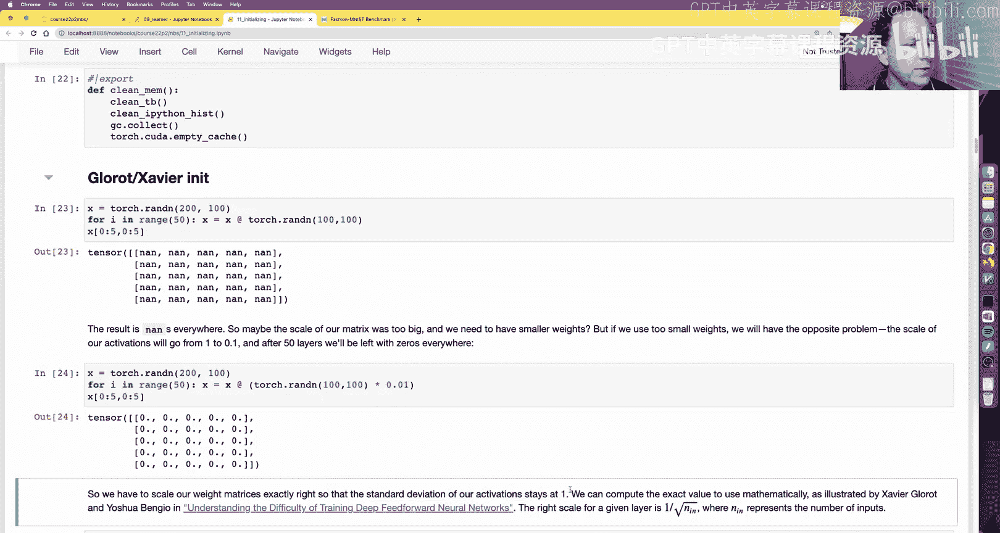
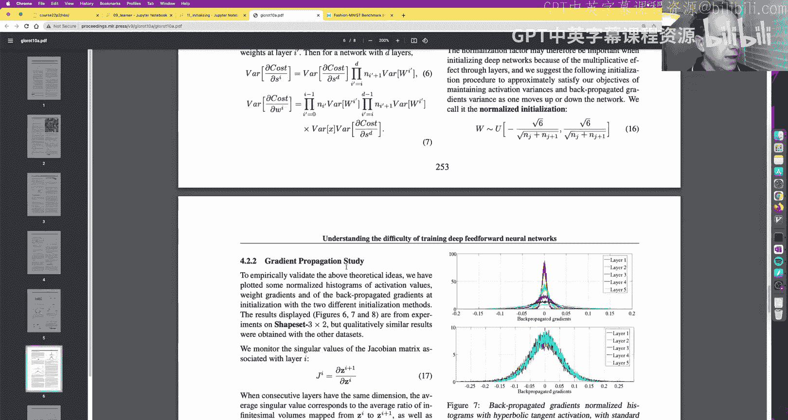
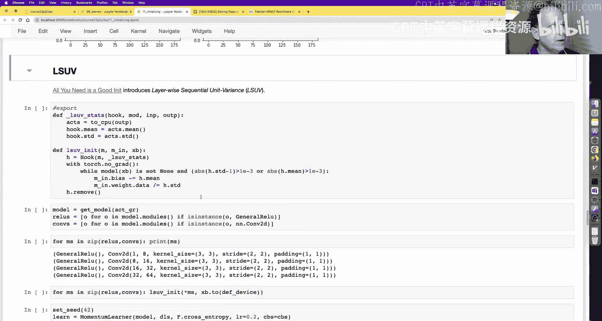
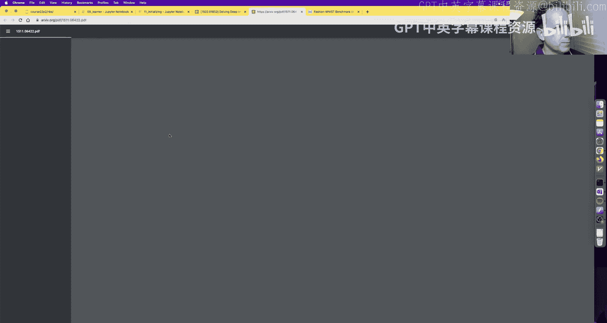
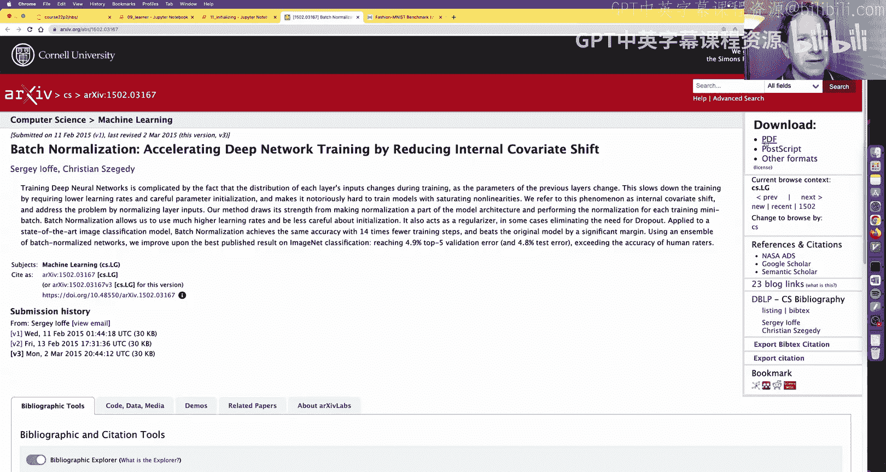
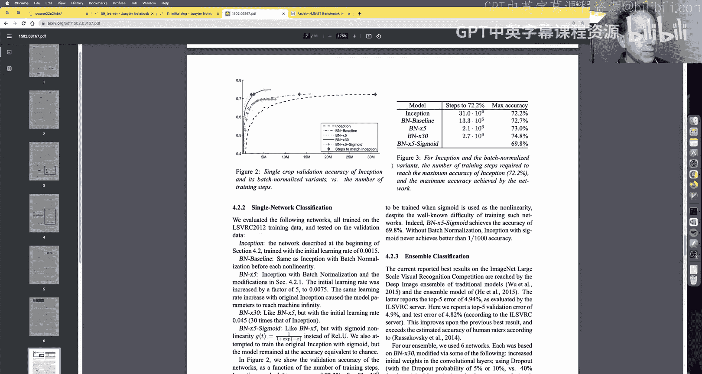
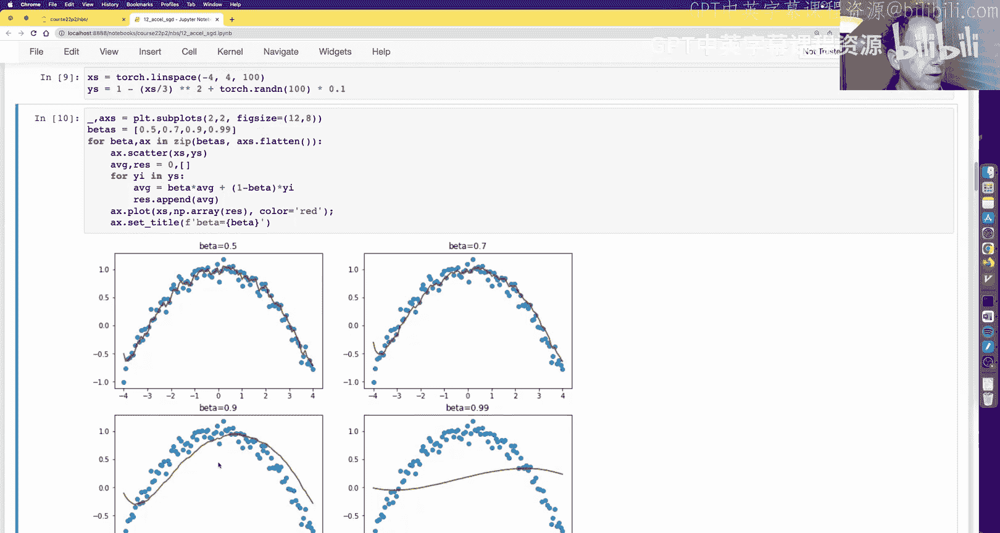
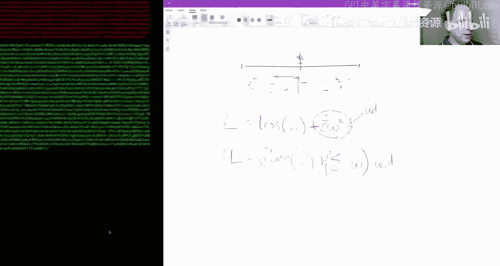
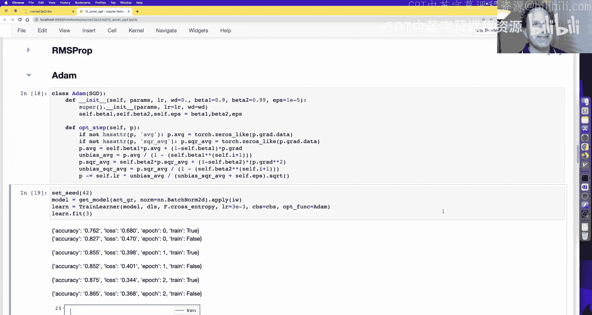

# Jeremy《深度学习基础到稳定扩散模型｜Deep Learning Foundations to Stable Diffusion》中英 p11 Lesson 17_ Deep Learning Foundations to Stable Diffusion.zh_en -BV1Mp421S7xg_p11-

Hi everybody and welcome to lesson 17 of practical deep learning for coders really excited about what we're going to look at over the next lesson or two's it's actually been turning out really well much better than I could have hoped so I can't wait to dive in before I do I just going to mention a couple of minor changes that I made to our mini AI library this week One was I went back to our callback class in the learner notebook and I did decide in the end to add a Dunder Gattra to it that just adds these four。

These four attributes and for these four attributes it passes it down to self。

t learn So in a callback you'll be able to refer to model to get self。land。 model opt will be self。

land optt batchch will be self。land。 batchch and epoC will be self。land。 epoch。You can change these。

 you know， you could subclass the callback and add your own to underscore forward or you could remove things from underscore forward or whatever。

 but I felt like these four things I access a lot and I was sick of typing self。L。

And then I added one more property， which is in a callback， there'll be a self dot training。

 which saves from typing。Self。len。mod。training since we have model you can get rid of the learn。

 but still I mean you so often have to check the training now you can just get self dot training in a callback so that was one change I made。

The second。Change， I made。Was I found myself getting a bit bored of adding Tra CB every time so what I did was I took the four training methods from the momentum learner subclass and I've moved them into a train learner subclass along with zero grad so now momentum learner actually inherits from train learner and just adds some momentum this kind of a quirky momentum method and change a zero grad to do the momentum thing yeah so we'll be using train learner quite a bit over the next lesson or two。

So train learners just a learner which？Has the usual trading。It's exactly the same that Fast AI2 has。

 or you'd have in most pi torch training loops。嗯。And obviously by using this。

 you lose the ability to change these with a Corbe。😊，So it's a little bit less flexible。😊，Okay。

 so those are little changes。And then I made some changes to what we looked at last week。

 which is the activations notebook and specifically。Okay。So I added a hooks callback。

So previously where you had a hooks class and it didn't really require too much ceremony to use。

 but I thought we could make it even simpler and a bit more。😊。

Fast AIish or mini AIish by putting a hooks into a callback。 So this callback。As usual。

 you pass a function that's going to be called for your hook。

And you can optionally pass it a filter as to what modules you want to hook。And then in before fit。

 it will。😊，Filter their modules。In the loader。嗯。And so this is one of these things we can now get rid of。

 we don't need to dot learn here because model is one of the four things we have a shortcut to and then here we're going to create the hooks。

😊，Object and put it in hooks。嗯。And so one thing that's convenient here is the hook function now you don't have to worry and we can get rid of learned the model。

 you don't have to worry about checking in your hook functions whether in training or not it always checks whether you're in training and if so it calls that hook function you pass in and after it finishes it removes the hooks and you can iterate through the hooks and get the length of the hooks because it just passes these iters and length down to self dot hooks so to show you how this works。

 we can create a hooks callback we can use the same。Append stats。And then we can run the model。

And so as it's training， what we're going to be able to do is yeah， we can now then here we go。

 So we just added that as an extra callback to our fit function。

 I don't remember if we had the extra callbacks before。 I'm not sure we did。 So just to explain。

It's just， I just added extra callbacks here。In the fit function。

 and we're just adding any extra coalbes， yeah。嗯。So then now that we've got that callback that we created because we can get iterate through it and so forth。

 we can just iterate it through that callback as if it's hooks and plot in the usual way。

 so that's a convenient little thing I think it's convenient thing I added。Okay， and then。I took our。

Calorful dimension stuff。Whi Steano and I came up with a few years ago and decided to wrap all that up in a callback as well so I've actually subclassed here our hooks callback to create an activation stats and what that's going to do is it's going to use this append stats which appends the means。

The standard deviations in the histograms。And oh， and I changed that very slightly。Also。

 the thing which creates these kind of dead plots， I changed it to just get the ratio of the very first。

 the very smallest。A histogram bin to the rest of the bins。

So these are really kind of more like very dead at this point。

 so these graphs look a little bit different。😊，Okay， so yeah。

 so I subclass the hooks callback and yeah， added the colourful dimension method。

 a dead chart method and a plot stats method， so to see them at work。

If we want to get the activations on all of the cons。Then we train our model。

And then we can just call and so we've added created our activation stats。

 we've added that as an extra callback。And then。And then， yeah。

 then we can call colour in to get that plot dead chart to get that plot and plot stats to get that chart plot。

 So now we have absolutely no excuse for not getting all of these really fantastic。😊，Informative。

Visualizations of what's going on inside our model， because it's literally as easy as。

Adding one line of code。And just putting that in your callbacks so I really think that couldn't be easier and so I hope you're even for models you thought you know we training really well。

Why don't you try using this because you might be surprised to discover that they're not？Okay。

 so those are some changes。Pretty minor， but hopefully useful。嗯。And so today。

 and over the next lesson or two， we're going to look at trying to。Get to a important milestone。

 which is to try to get fashion ems training to a accuracy of 90% or more。

 which is certainly not the end of the road。But it's not bad if we look at papers with code。

There's so 90% would be a 10% error， so there's folks that have got down to three or 4% error in the very best。

 which is very impressive， but you know， 10% error wouldn't be way off。What's in this？

Paper leaderboard， I don't know how far we'll get eventually， but。

Without using even any architectural changes， no renets or anything。

 we're going to try to get into the。10% error。嗯。All right， so。

Let'sSo the first few cells I just copied from earlier。And so。Here's a ridiculously simple model。

 like all I did here was I said， okay well the very first convolution is taking a9 by9 by one channel input so we should compress it at least a little bit。

 so I made it 8 channels output for the convolution and then I just doubled it to 16 doubled it to 32 doubled it to 64 and so that's going to get to a that will be as 14 by 14 image7 by7 or4 by42 by two and then this one gets us to a  one by one。

 So of course we get the 10 digits so there was no thought at all behind really this architecture this just pure convolutional architecture。

And remember this flattened at the end is necessary to get rid of the unit axes that we end up with because this is a one by one。

Okay， so let's do a learning rate finder on this very simple model。

 And what I found was that this model is。And and， you know。

 this situation is so bad that when I tried to use the learning rate finder。Kind of in the usual way。

 which would be just to say。You know， start at one in next five or one next four， say。

 and then run it。It kind of looks ridiculous。It's impossible to see what's going on。

 So if you remember， we added that that multipler。We called it LR malt or gammo is what they called it intor。

 so we ended up calling it gamma， so I dialed that way down to make it much more gradual which means I have to dial up with a starting learning rate and only then did I manage even to get the learning rate finder to tell us anything useful Okay so。

So there there we are， so that's our learning rate finder actually'm just going to come back to these three later。

So I tried using a learning rate of 0。2 and after trying a few different values， 0。4。1。

2 seems about the highest we can get up to even this actually is too high I found much lower and it didn't train much at all you can see what happens if I do it starts training and then it kind of yeah we lose it which is unfortunate and you can see that in the colourful dimension plot。

We got this classic。You know， getting activationations crashing， getting activationations crashing。

And you can kind of see the key problem here really is that we don't have zero mean。

Standard deviation 1。Layers at the start， so we certainly don't keep them throughout。嗯。

And this is a problem。Now， just something I've got to mention， by the way is。

When you're training stuff in Jupyter Notes， this is just a new thing we've just added。If you get。

 you can easily run out of memory， GPU memory， and there's two reasons it turns out why you can particularly run out of GPU memory if you run a few cells in a GPpyter notebook。

The first is that kind of for your convenience， Jupyter notebook。

 you might you might may or may not know this actually stores the results of your previous few。

Evaluations， if you just type underscore。It tells you the very last thing you evaluated。

And you can do more underscores to go backwards further in time， or you can also use。Oh。

 you can also use numbers to get the the out16， for example， would be underscore 16。 Now。

 the reason this is an issue is that if one of your outputs。

Is a big couda tensor and you've shown it in a cell that's going to keep that GPU memory basically forever。

 and so that's a bit of a problem。So if you are running out of memory one thing you'd want to do is clean out all of those underscore Blala things I found that there's actually some a function that nearly does that in the ipyython source code so I copied the important bits out of it and put it in here so if you call clean ipyython history well don't worry about the lines of code at all this is just a thing that you can use to get back that GPU memory。

The second thing which Pierta figured out in the last week or so is that you also if you have a couper error at any point or even any kind of exception at any point。

Then the exception。Object is actually stored by Python and any tensesors that were allocated anywhere in that trace in that traceback will stay allocated basically forever and you hit again that's a big problem so I created this clean traceback function based on Pita's code which gets rid of that。

So if this is particularly problematic because if you have a coer out of memory error and then you try to rerun it。

 you'll still have a coer out of memory error because all the memory that was allocated before is now in that traceback。

 So basically anytime you get a couder out of memory error or any kind of error， you know。

 with memory。😊，You can call clean Mem and that will clean the memory in your trace back。

 it will clean the memory used in your Jupiter history， do a garbage collect。

Empty the couda cache and that will basically should give you a totally clean GPU you don't have to restart your notebook。

😊，Okay so Sam asked a very good question in the chat so just to yeah just to remind you guys， yes。

 we did start he's asking I thought we were training an auto encodecor or are we training a classifier or what so we started doing this auto encoder back in notebook 8 and we decided oh this is we don't have the tools to make this work yet so let's go back and create the tools and then come back to it so in creating the tools we're doing a classifier we try to make a really good fashion Mnes classifier while we try to create tools which hopefully have a side effect we find of giving us a really good classifier and then using those tools we hope that will allow us to create a really good auto encodecoder。

So， yes， we're kind of like。Gradually unwinding and we'll come back to where we were actually trying to get to。

So that's why we're doing this classifier the techniques and library pieces we're building will be all very necessary。

Okay， so。😊，Why do we need a zero mean one standard deviation， Why do we need that and B。

 how do we get it， So first of all， on the way。So if you think about what a neural net does。

 a deep learning net specifically。嗯。It takes an input and it puts it through a whole bunch of matrix multis。

 and of course there are activation functions that which did there。

Don't worry about the E activation functions that doesn't change the argument。

 so let's just imagine when we start with some bunch of some matrix， right？😊，嗯。

Imagine the 50 deep neural net so a 50 deep neural net basically if we ignore the activation functions is taking the previous input and doing a matrix multiply by some initially some random widths so these are all yeah these are just a bunch of random widths and these are actually round n is mean zero variances one。

A。And if we run this。After 50 times of modelping by a matrix by a matrix by a matrix by matrix。

We end up with。Nance。That's no good， so that might be that our the numbers in our matrix were too big。

😊，So each time we multiply it， the numbers were getting bigger and bigger and bigger。

So maybe we should make them a bit smaller。 Okay， so let's try using in the matrix we are playing by。

 let's try model playing by 0。01。And we've about to play that lots of times， oh， now we've got zeros。

😊，Now， of course， in mathematically speaking， this isn't actually N。

 it's actually some really big number， mathematicalmaticly speaking， this isn't really zero。

 it's some really small number， but computers。😊，Can't handle really， really small numbers or really。

 really big numbers， so really， really big numbers eventually just get code n and really。

 really small numbers eventually just get code zero。😊，So basically， they get washed out。😊。

And in fact， even if you don't get a n or even if you don't quite get a zero。😊。

For numbers that are extremely big。嗯。The internal representation has no ability to discriminate between even slightly similar numbers。

 basically in the way a floating point is stored， the further you get away from zero。

 the less accurate the numbers are。嗯。So yeah， this is a problem。

 So we have to scale our weight matrices exactly right。

And we have to scale him in such a way that the standard deviation at every point stays at one and the mean stays at zero。

So there's actually a paper。

That describes how to do this。

For multiplying lots of matrices together。嗯。And this paper basically just went through。

 it's actually pretty simple math。诶。Actually， let's say， what did they do？All right。Yeah。

 so they looked at gradients and the propagation of gradients。

 and they came up with a particular weight initialization of using a uniform with。

With one over rootot N as the bounds of that uniform and they， yeah。

 they studied basically what happened with various different activation functions。And yeah。

 as a result， we we now have this。

This this way of initializing neural networks， which is called either Glorro initialization or Xavier initialization。

嗯。😊，And。Yeah， is this is the amount that we scale our initialization our random numbers by where n in is the number of inputs。

 so in our case we have 100 inputs。And so Ro 100 is。10。So 1 over 10 is 0。1。

And so if we actually run that if we start with our random numbers。

And then we multiply it by random numbers。Time is 0。1。Which is this is the G initialization。

 You can see we do end up with numbers that are。Actually reasonable， so that's pretty cool。嗯。So just。

 I mean， just some background in case you're not familiar with some of these details。嗯。

What exactly do we mean by variance so if we take a tensor， let's call it T and just put 12418 in it。

The mean of that is simply the sum divided by the count， sos 6。25。

Now we want to know basically we want to come up with a measure of how far away each data point is from the mean that tells you how much variation there is if all the data points are very similar to each other。

Right， so if you've got kind of like a whole bunch of data points。

And they're all pretty similar to each other。Right， then the mean would be about here。

 right and the average distance away。Of each point from the mean is not very far。

Where else if you had dots which were very widely spread all over the place。

Then you might end up with the same mean。But the distance from each point to the main is now。

Quite a long way。So that's what we want。 We want some measure of kind of how far away the points are on average from the mean。

So here we could do that， we can take our tensor， we can subtract the mean。😊。

And then take the man of that。Ah， well， that doesn't work。

Because we've got some numbers that are bigger than the mean and some that are smaller than the mean。

 and so if you average of them all out， then by definition you actually get zero。😊，So instead。

 you could either。Square。Those differences。And that will give you something。

 And you could also take the square root of that if you wanted to to get it back to the same。

Kind of area or you could take the absolute differences。Okay。

 so actually I'm doing this in two steps here so for the first one here it is on a different scale and then the Ed square root get it on the same scale。

 so 6。87 and 5。88 are quite similar right but they're mathematically not quite the same。

 but they're both similar ideas。So this is the main absolute difference。

And this is called the standard deviation， and this is called the variance。

So the reason that the standard deviation is bigger than the mean absolute difference is because in our original data。

 one of the numbers is much bigger than the others。And so when we square it。

 that number ends up having a outsized influence。 And so that's a bit of an issue in general with。

Standard deviation variance is that outliers like this have an outsized influence。

 So you've got to be a bit careful。Okay， so。Here's the formula for the standard deviation that's normally written as Sigma。

Okay it's just going to be each of our data points minus the mean squared。Plus。

 the next data point minus the main squared， so forth for all the data points。

 and then divide that by the number of data points in square root。And okay。

 so one thing I point out here is that the mean absolute deviation isn't used as much as a standard deviation because mathematicians find it difficult to use。

😊，嗯。But we're not mathematicians， we have computers， so we can use it。Okay。

 now variance we can calculate like this， as we said， the main of the square of the differences。

And if you feel like doing some math， you could discover that actually this is exactly the same。😊。

As you can see。And this is actually nice because this is showing that the mean。😊。

Of the square data points。Minus the square of the mean of the data points is also the variance。

And this is very helpful because it means you actually never have to calculate this。😊。

You can just calculate the mean。So with just the data points on their own。

 you can actually calculate the variance。 This is a really nice shortcut。

 this is how we normally calculate。Varance。And so there it is the。Latex version。

 which of course I didn't write myself， I stole from the Wikipedia latex because I'm lazy。😊，嗯。你。

There's a very， very similar idea。Which is covariance and has already come up a little bit in the first lesson or two。

 and particularly the extra math lesson that Waseim and Tnik did。And it's， yeah。

 so covariance tells you how much two things vary， not just on their own， but together。

And there's a definition here in math， but I like code， so we'll see the code。

 So here's our tensor again。Now we're going to want to have two things。

 so let's create something called U， which is just two times our tensor with a bit of randomness。

So here it is。 Now you can see that U and T。A very closely correlated here。嗯。

But they are not perfectly correlated。So the covariance tells us， yeah。

 how they vary together and separately。So we can take the you can see this exactly the same thing we had before。

 each data point minus its mean。😊，But now we've got two different tensesors。

 so we're also going to do the other one， the other data points minus their mean。

And we multiply them together。 So it's actually the same thing as data deviation。

 but in standard deviation， it's kind of like the covariance with itself in a sense。Right。

And so that's a product we can calculate。 And then what we then do。As we take the mean of that。

And that gives us the covariance between those two。

Tensors and you can see that's quite a high number。

 And if we compare it to two things that aren't very related at all。

 so that's quite a totally random tensor。喂。So this is not related to T。😊。

And we do exactly the same thing。So take the difference of t to its main and v to its means and take the mean of that。

 that's a very small number。And so you can see covariance is basically telling us how related are these two tensesors。

So covariance and variance are basically the same thing。

 but you kind you can think of variance as being covariance with itself。嗯。

And you can change this mathematical version， which is the one we just created and code to this version。

 just like we have for variant， there's a easier to calculate version。嗯。Which， as you can see。

 gives exactly the same answer。Okay。😊，So if you haven't done stuff with covarian much before。

 you should experiment a bit with it。😊，um。By creating a few different plots and experimenting with those。

嗯。And the finally， the Pearson correlation coefficient， which is normally called R or rh。

 is just the covariance divided by the。Product of the standard deviations。

So you've probably seen that number many types。There's just a scaled version of the same thing。Okay。

So。嗯。With that in mind， here is how Xavier in it or Gro in it is derived。

So when you do a matrix modification。嗯。For each of the。Why eyes。

We're adding together all of these products。So for we've got Ai comma 0 times x0 plus Ai comma 1。

Times x1， et cetera。 And we can write that in segmentig notation。 So we're adding up together。

All of the AIKs。With all of the XKs， this is the stuff that we did in our first lesson of part two。

And so here it is in pureup Python code。And here it is in nupo code。Now at the very beginning。

 our vector has a mean of about zero and a standard deviation of about one because that's what we asked for to remind you。

😊，RightThat's what we asked for。 That's the standard deviation of0 and of one a standard deviation of 1 mean of0。

 That's what random n is。😊，Okay， so。Let's create some random numbers and we can confirm， yeah。

 they have a mean of about zero and a standard deviation of about one。So if we。😊。

Cose weights for a that have a me 0。 We can compute the standard deviation quite easily。

So let's do that。😊，So100 times。Let's try creating。How x。

And let's try creating something to multiply it by。😊，And we'll do the matrix modification。

And we're going to get the。Maine and。Min of the squares。And so。That is very close to。Now matrix。

So I won't go into， I mean， you can look at it if you like。

 but basically as long as the elements in A and x are independent。

 which obviously they are because they're random。Then we're going to end up with。A mean is zero。😊。

And a standard deviation of one。For these products。And so we can try it。If we。

Creates a random number， a normally distributed random number， and then a second random number。

 multiply them together and then do it a bunch of times and you can see here we've got our 01。So。

 that's the reason why。We need this mathth dot square root 100。

We don't normally worry about the mathematical reasons why things are exactly， but yeah。

 I thought I would just dive into this one because sometimes it's it's fun to go through it and so you can check out the paper if you want to look at that in more detail or experiment with these。

😊，With these little simulations。Now， the problem is。That that。Doesn't work。😀Ha。😊。

It doesn't work for us because we use rectified linear units which is not something that Svia Gro looked at let's take a look let's create a couple of matrices this is 200 by 100 this is just a vector well matrix and a vector this is 200。

😊，And then let's create a couple of weight matrices， two weight matrices， and two bias vectors。Okay。

 so we've got some input data， x's and Y's， and we've got some weight matrices and bias vectors。So。

 let's create a。Linear layer function which we've done lots of tones before and let's start going through a little neural net you know I'm mentionagining this is the forward pass of our neural net so we're going to apply our linear layer to the aes with our first set of weights and our first set of biases and see what the mean standard deviation is。

Okay， it's。About zero and about one。So that's good news。

And the reason why is because we have 100 inputs and we divided it by square root of 100。

 just like Glorro told us to， and our second one has 50 inputs and we divide by square root of 50 and so this all ought to work。

 right？😊，And so far it is， but now we're going to mess everything up by doing value。😊，So rail。

 after we do a rail， look， we don't have a zero mean or a one standard deviation anymore。

So if we go through that and create like a deep neural network。😊，With Clao initialization。

But with a value。2点。It's disappeared， it's all gone to zero， and you can see why， right。

 after a matrix multiply and a value。Our means and variances are going down。And of course。

 they're going down because a use squishes it。So I'm not going to worry about the math of Y。

 but a very important paper indeed called delving deep in recifiers。

Surpassing human level performance on imagenet classification。

by Coming her at Al came up with a new in it， which is just like。Gloro initialization。

 But she multiplied that。 remember， the G initialization was。One over root n。

 this one is root2 over n and again， n is the number of inputs。So let's try it。

 so we've got 100 inputs， so we have to multiply it by root2 over 100。And。There we go。

 you can see we are in fact getting some non zero numbers that's very encouraging even after going through 50 layers of depth。

So that's good news。😊，So this is called Kaiming， it's either called Kaying initialization or called her initialization。

 and notice it looks like it's sp he， but it's a Chinese surname， so it's actually pronounced her。

Okay。Maybe that's why a lot of people increasingly call it climbinging initialization。

 they don't have to say his surname just a little bit harder to pronounce。😊，All right。

 so how on earth do we actually use this now that we know what initialization function to use for a deep neural network with a value activation function？

The trick is to use a method called apply， which all NN dot modules have so if we grab our model。

 we can apply any function we like， for example， let's apply the function。Print the name of the type。

So here you can see it's going through， and it's printing out all of the modules that are inside。

Amoal。And notice that our model has modules inside modules， it's a con in a sequential。

 in a sequential， but model that apply goes through all of them regardless of their depth。

So we can apply an in function。So we can apply the init function， which simply does。

MultipRandom numbers。Normally distributed a random numbers times square root of two over the number of inputs that's such an easy thing it's not even worth writing。

 so that's already been written， but that's all it does it just does that one thing is called in it。

ing normal。As we've seen before， if there's an underscore at the end of a pi torch method name that means that it changes something in place。

 so in it dot timing normal underscore will modify this weight matrix so that it has been initialized with normally distributed random numbers based on。

Two root of two divided by the number of inputs。Now you can't do that to a sequential layer or a rally layer or a flatten layer。

 so we should check that the module is a convolline layer。And then we can just say model don't apply。

The function。And so if we do that。And now I can use our learning rate finder callbacks that we created earlier and this time I don't have to worry about。

Actually， we can create our own ones because we don't need to use even the weird gamma thing anymore。

 So let's go back and。Copy that。i see。😔，Let's get rid of this gamma equals 1。1。

 it shouldn't be necessary anymore。And we can probably make that for now。Oh。

 I should have need to recreate the model。There we go， Okay， so that's looking much more sensible。😊。

So at least we've got to a point where the learning rate findr works， that's a good sign。😊。

So now when we create our learner， we're going to use our momentum learner deal after we get the model。

😊，We will apply in it weights and apply also returns the model so we can actually this is actually going to return the model with the initialization applied。

While I wait， I will answer questions。Okay， so Fbiio asks。

 why do we double the number of filters in successive convolutions？嗯。

So what's happening is in H Str 2 convolution。嗯。These are all Str 2 convolutions。

 so this is changing the grid size from 28 by 28 to 14 by 14。

 so it's reducing the number the size of the grid by a factor of 4 in total。So basically。

 so as we go from one to from this one to this one， same deal we're going from 14 by 14 to 7 by 7。

 so we reduce the grid size by4。😊，We wanted to learn something。 And if you。Use。

 if you give it exactly the same kind of number of。Units or activations。

 there's there's not really it's not really forcing it to learn things as much。 So ideally。

 as we decrease the grid size。We want to。Have enough channels that you end up with a few less activations。

 but than before， but not too many less。 So if we double the number of channels。

 then that means we've decreased the grid size by model of four。

 increase the channel count by model of two。 so overall the number of activations has decreased by a factor of two。

And so that's what we want， we want to be kind of forcing it to find ways of compressing the information intelligently。

As it goes down， also， we kind of want to be having a roughly similar amount of compute。

 roughly similar amount。through the neural net， so as we decrease the grid size。

 we can add more channels because decreasing the grid size decreases the amount of compute。

 increasing the channels then gives it more things to compute so we're kind of getting this nice compromise between yeah between the kind of amount of compute that it's doing but also giving it some kind of compression work to do。

That's the kind of the basic idea。Well， still not able to train。 Well， okay。

 if we leave it for a while。Okay， it's not great， but it is actually starting to train。

 That's encouraging。And we got up to a 707 percent accuracy， so we can see。Yeah not surprisingly。

 we're getting these spikes and spikes。And so in the statistics， you can see that。Well。

 it didn't quite work。 We don't have a mean 0。 We don't have a standard deviation of one。

 even at the start。Why is that？U。Well， it's because we forgot something critical。

 If you go back to our original point， even when we had our， well， let's go to the climbing version。

Even when we had the correctly normalized matrix that we're multiplying by。Well。

 you also have to have a correctly normalized input matrix。

 and we never did anything to normalize our inputs。 So our inputs actually， if we get the。

Just get the first x mini batch get it' a mean and standard deviation， it has a mean of 0。

28 and a standard deviation of 0。35， so we actually didn't even start with a 01 input。

And so we started with the main beneath。Above zero and a standard deviation beneath one。

 so it was very hard for it。 so using the in helped at least we're able to train a little bit。

 but it's not quite what we want。 We actually need to modify our inputs so they have a mean of one and a standard sorry a mean of zero and a standard deviation of one。

😊，So we could create a callback to do that。😊，So a callback， let's create a batch transform callback。

 and so we're going to pass in a function that's going to transform every batch。

And so just in the before batch， we will set。The batch to be equal to the function applied to the batch。

Now I can note， by the way， we don't need self。 learn。tbach here。

Because we can read any because it's one of the four things that we。

Kind of proxy down to the learner automatically。 But we do need it on the left hand side。

Because it's already in the Gattra， remember。So be very careful。

 so I might just leave it the same on both sides just so that people don't get confused。😊，Okay。

 so let's create a function underscore norm that subtracts the mean。

And divides by the standard deviation。And so remember a batch has an X and a y。

 so it's the X part where we sub the mean and divide by the standard deviation。

 and so the new batch will be that as the x and the y will be exactly the same as it was before。

So let's create a instance of the normalization of the batch transform callback。

 which is going to do the normalization function， and we'll call it No。😊。

So we can pass that as an additional callback。T Elna。And now。That's looking a lot better。

 so you can see here。All we had to do was check that our input。Matrix was 0，1。

Mean standard deviation and all of our weight matrices were 01 standard deviation and we didn't have to use any tricks at all that was able to train and got it to an accuracy of 85%。

And so if we look at the colour dimm and stats， look at this。 It looks beautiful。 Now。

 this is layer 1。 this is layer 2，3，4， it's still not perfect。 I mean， there's some randomness。

 right， and we've got， what is it like， 7 or 8 layers。😊，嗯。

So that randomness does kind of as you go through the layers， by that last one。

 it still gets a bit ugly。And you can kind of see it bouncing around here as a result。

And you can see that also in the means and standard deviations。

There's some other reasons this is happening。 We'll see in a moment。

 But this is the first time we've really got our。Even somewhat deep convolutional model to train。

And so this is a really exciting step。 You know， we have from scratch in a sequence of 11 notebooks managed to create。

😊，A real。Convolutional Ne network。That is training。Properly， so I think that's pretty amazing。嗯。Now。

 we don't have to use a callback for this。 The other thing we could do to modify the input data。

 of course， is to use。TheWith Trans method from the Huging F Datas library so we could modify our transform I。

just attract the mean and divide by the standard deviation。And then recreate our data loaders。

 And if we now get a batch out of that and check it， it's now got， yep。

 a mean 0 and the standard deviation of  one。 So we could also do it this way。 So generally speaking。

For stuff that needs to kind of dynamically modify the batch。

 you can often do it either in your data processing code or you can do it in a callback and neithers right or wrong。

 they both work well and you can see whichever one works best for you。Okay。

 now I'm going to show you something amazing。😊，嗯。Okay， so。It's great。 This is training well。

 but when you look at our stats。Despite what we did with the normalized input and the normalized the yeah。

 and the normalized weight matrices。We don't have a mean 0。

And we don't have a standard deviation of one， even from the start。So why is that？Well。

 the problem is。That。We were putting our data through a value。And our。

Our activation stats are looking at。The output of those re blocks because that's kind of the end of each。

You know， that that's that's the activation of each of each combination of。

WeMatri Mo and activation function。And sensor value removes all of the negative numbers。

It's impossible for the output of a re。To have a mean of 0。

 unless literally every single number is 0， B has got no negatives。So re seems to me。

 to be fundamentally。Incompatible with the idea of a correctly calibrated bunch of layers in a neural net。

So I came up with this idea of saying， well， why don't we？Take our normal value。

And have the ability to subtract something from it。

 and so we just take the result of our value and subtract so sub of minus。

 I mean I just I can write this in more obvious way is's exactly the same as just minus equals when I just do that。

We'll subtract something from value。That will allow us to pull the whole thing down so that the bottom of our value is underneath the x axis and it has negatives。

And that would allow us to have a mean zero。And while we're there。

 let's also do something that's existed for a while， I didn't come up with this idea。

 which is is to do a leaky value， which is where we say let's not have the negative speed totally flat just truncated。

 but instead let's just have those numbers decreased by some constant amount。😊。

Let me show you what that looks like。 So those two together I'm going to call general value。

 which is where we do this thing called leaky value， which is where we make it。

 So it's not flat under0， but instead just less less sloped and we also subtract something from it。

 So for example， I've credit a little function here for plotting a function。

 So let's plot the general value function with a leakiness of 0。1。 So that will mean there's a 0。

1 slope underneath the。Under  zero and we'll subtract 0。4。And so you can see above 0。

 it's just a normal y equal equals x line， but it's been pushed down by 0。4。

And then when it's less than zero， it's not flat anymore， but it's just got a slope of 1/10th。😊。

And so this is now something which if you find the right amount to attract。😊。

For each amount of leakiness， you can make a mean at zero and I actually found that this particular combination gives us a mean at zero or thereabouts。

😊，嗯。So， let's now。Create a new convolution function where we can actually change what activation function is used。

 so that gives us the ability to change the activation functions in our neural nets。

Let's change Gt model to allow it to take an activation function， which is passed into the layers。

And while we're there， let's also make it easy to change the number of filters so we're going to pass in a list of the number of filters in each layer and we will default it to the numbers in each layer that we've discussed。

And so we're just going to go through in a。List comprehension。

 creating a convolution from the previous number of filters。

 this number of filters to the next number of filters。

And we'll pop that all into a sequential along with the flatten at the end。😊，And while we're there。

 we also then need to be careful about in weights because this is something that people tend to forget。

嗯。Which is that。In it， it is that climbing initialization， the default only specific only applies。

 only applies at all to layers that have。A value activation function。We don't have value anymore。

 we actually have leaky value。😊，The fact that we're subtracting a bit from it doesn't change things。

 but the fact that it's leaky does now luckily a lot of people don't know this。

 but actually piytorrch is claiming normal has an adjustment for leaky values weirdly enough because call it a so if you pass into the claiming normal initialization how your leaky values leaky factor。

😊，As a， then you'll get the correct initialization for a leaky value。

 So we inter to change in it waits now to pass in the leakiness。Alright。

 so let's put all this together。 So our general value activational activation function is is general value。

😊，With a leak of 01 and it's attractive of 0。4。 So we use partial to create a function that has those。

Built in parameters。For our activation stats， we need to update it now to look for general values。

 not NN dot values。嗯。Okay， and then our iner weights function。

 we're going to have a partial with leaky equals 0。1。 So we'll call that our in weights。Ha great。

 so now we'll get our model using that new activation function and that new in weights。😊。

And we'll fit that。Oh， that's encouraging。 accuracy of 8，4，5。

Which is about as high as we got to at the end previously。Wow， look at that。

 So we're up to an accuracy of 87%。 And let's take a look。Yeah， I mean。

 look we still got a little bit of a spike。But it's almost smooth and flat。

And let's have a look here。 Look at that。 Our main is starting at about 0。Standard deviation。No。

 standard deviation is still a bit low， but it's coming up around one。 It's not too bad。

 generally around 。8。 So it's all looking pretty encouraging， I think。And oh yeah， look。

 the percentage of dead units in each layer is very small。So finally。

 we've really trained got some very nice looking training graphs here。Yeah， it's interesting that。

We had to literally invent our own activation function to make this work。

 And I think that gives you a sense of。How few people actually care。About this。

 which is crazy because as you can see its in some ways it's the only thing that matters and it's not at all mathematically difficult to make it all work and it's not at all computationally difficult to see whether it's working。

 but other frameworks don't even let you plot these kinds of things so nobody even knows that they've completely messed up their initialization。

So， yeah， now， you know。Now some very nice news so the first thing to be aware of。

 which is tricky is。😊，A lot of models use more complicated activation functions nowadays rather than R or leaky value or even this general version。

嗯。You need to initialize your neural network correctly， and most people don't。U。

And sometimes nobody's even figured out or bothered to try to figure out。

What the correct initialization to use is， but there's actually a very cool trick which almost nobody knows about。

 which is a paper called All you need is a good in it。

嗯。

Which Demitra Mikin wrote a few years ago。And what Dimitro showed is that there's actually a completely general way of initializing any neural network correctly。

 regardless of what activation functions are in it。

And it uses a very， very simple idea。And the idea is create your modelal。

 initialize it however you like。And then go through and put a single batch of data through。

And look at the first layer。See what the mean standard deviation through the first layer is。

 and if the mean you know if the standard deviation is too big， divide the weight matrix by a bit。

 if the means too high， subtract a bit off the weight matrix and do that repeatedly for the first layer until you get the correct mean and standard deviation and then go to the second layer。

 do the same thing， third layer， do the same thing and so forth。

So we can do that using hooks right so we could create a little so this is called layer Y sequential unit variance。

 LSUV， we can create a little LSUV stats that will grab the mean of the activations of a layer and the standard deviation of the activations of a layer。

😊，And we will create a hook。With that function。And what it's going to do is， after the。

After we've run that hook to find out the main standard deviation of the layer。We will go through。

And。Rund the model。Get the standard deviation of mean， see if the standard deviation is not one。

 see if the mean is not zero。And we will subtract the mean from the bias。

 and we will divide the weight matrixs by the standard deviation。

And we will keep doing that until we get a standard deviation of 1 and a mean  zero。

And so by making that a hook。😊，What we'll do。😊，As we will。Grab all the valueslls。And all the comms。

RightAnd so just to show you what happens there， once I've got all the rellies and all the comms。

 I can use zip so zip in Python takes a bunch of lists and creates a list of the items the first items。

 the second items the third items and so forth。 So if I go through the zip of rells and cons and just print them out you can see it prints out there re and the first comm the second re。

 the second comm， the second re sorry the third value， the third con and so forth。

 we use zip all the time in Python So it's really important thing to be aware of。

So we could go through the rellies and the comms。😊。

And call layer away sequential unit variance in it， passing in。Those module pairs。So passing in， yes。

 passing in the value and the conv。And。嗯。Then， for H1。Oh。

 and we're going to do that on the the batch。 and of course。

 we need to put the batch on the correct device for our model。And so now that I've done that。

We now have。It ran almost instantly。 It's now made all the biases and weights correct。 Give us 0，1。

And now if I train it。There it is。So we didn't do any initialization at all of the model。

Other than just call Ls U V in it。And this time we've got an accuracy of 0。86。

First is previously it's 0。87， so pretty much the same thing close enough。And actually。嗯。

If you want to actually see that happening， I guess what we could do。

 mean it's going to be pretty obvious after we've run this， we could say print。

H dot mean comma H dot standard deviation。Actually， we could do it like before and afterwards right。

 so we could say right？嗯。Before。And after。There we go。😊，Yeah。

 so it starts at so the first layer started at a mean of negative 0。13 and a variance of 0。46。

And it kept doing the divide sub divide sub divides attract until eventually it got two mean zero standard deviation of 1。

 and then it went to the next layer and it kept going going and going until that was01 and then the third layer and then the fourth layer and so at that point all of the layers had a mean 0 in a standard deviation of1。

So I guess， like one thing with。LSUV， you know， it's kind of very mathematically convenient。

 We don't have to spend any time thinking about， you know if we've invented a new activation function or we're using some activation function where nobody seems to have figured out the correct initialization for it。

 we can just use LSUV it did require a little bit more fiddling around with hooks and stuff to get it to work。

 and I haven't even put this into like a callback or anything。 So if you yeah。

 if you decide you want to try using this in some of your models。

 it might be a good idea and it actually be good homework to see if you can come up with a callback that does LSUV initialization for you that would be pretty cool。

 wouldn't it in。And before fit， I guess that would be。You'd have to be a bit careful， because。

If you ran fit multiple times， it would actually initialize it each time。

 so that would be one issue with that to think about。Okay。

 so something which is quite similar to LSUv。😊，Is batch normalization。 So we're going to have a。

Seven minute break and then we're going to come back and we're going to talk about patch normalization。

 I'll see you in seven minutes。Okay， hi， let's do this。 batchch normalization。

Patron normalization was。Such an important paper。I remember when it came out。I was at Analytic。

 my medical startup。

And。I think that's right。U。And everybody was talking about it。And， in particular。

They were talking about this。

This graph。That basically showed like what it used to be like until batchchnom to train a。

Model on imagenet， How many。Training steps you'd have to do to get to a certain accuracy。

And then they showed what you could do。With batch on。嗯。

How much faster it was amazing and we all thought that can't be true， but it was true。😊，嗯。So。

 basically。Like key idea of batch normm is that， you know， with with。

We there SUV an infant normalization and climbing in it。We are normalizing。

The layers each layer's inputs before training。But the distribution of each layer's inputs changes during training。

And that's a problem。So you end up having to decrease your learning rates。😊，And as we have saying。

 you have to be very careful about parameter initialization。

So the fact that the layers's inputs change during training they call internal covariate shift。

 which for some reason a lot of people tend to find a confusing statement or a confusing name。

 but I thought it's very clear。To me， and you can fix it by normalizing layer inputs during training。

So you're making the normalization a part of the model architecture。

 and you perform the normalization for each mini batch。

Now I'm actually not going to start with batch normalization。

 I'm going to start with something that came out one year later called layer normalization because layer normalization is simpler。

 let's do the simpler one first。So layer normalization came out as。This group of fellows。

 the last of whom I'm sure you heard of。And it's probably easiest to explain by showing you the code。

So。If you're thinking layer normalization。Wow， it's a whole paper。

 Gerey hint and paper must be complicated。 No， the whole thing is this code。

What is layer normalization while we can create a module？And we're going to pass in。

We don't need to pass in anything， actually， you can totally ignore the parameters for now， in fact。

What we're going to do is we're going to have a single number called malt for the multiplayer。

And a single number called add， that's the thing we're going to add。

 and we're going to start off by multiplying things by one and adding zero。😊。

So we'm going to start off by doing nothing at all。Okay， this is the layer。

 it has a forward function。😊，And in the forward function So remember that by default。We have。NC， H W。

 we have。Batch by channel， by height， by width。We're going to take the mean。Over the channel。

 height and width。 So we're just going to find the mean activation。For each input in the mini batch。

 and when I say input though remember that this is going to be as there's a layer right。

 so we can put this layer anywhere we like， so it's the input to that layer。

And will do the same thing for finding the variance。Okay。And then， we're going to。

Normalize our data by subtracting the mean。And dividing by the square root of the variance。嗯。Which。

 of course， is the standard deviation。We're going to add。A very small number by default 10 egg5。

To the denominator， just in case the variance is0 or ridiculously small。

 this will keep the number from going giant just if we happen to get something with a very small variance。

This idea of an epsilon as being something we add to a divisor is really， really common。

And in general， you should not assume that the defaults are correct。

 very often the defaults are too small for algorithms that use in Epsilon。Okay， so here we are。😊。

As you can see， we are。Normalizing。The batch。I can call it a batch。 but just remember。

 it isn't necessarily the first layer， right， So it's its wherever which whichever layer we decide to put this in。

 So we normalize it。 Now， the thing is。Maybe。We don't want it。To be normalized。

 maybe we wanted to have something other than。Unit variance and something other than zero main。Well。

 what we do is we then multiply it back by self dot malt and add self dot add。 Now。

 remember self dot malt is one and self dot add is 0。So at first that does nothing at all。

 So at first this is just normalizing the data， so that's good。But because these are parameters。

 these two numbers are learnable， that means that the SGD algorithm can change them。

So there's a very subtle thing going on here， which is that in fact。

This might not be normalizing the data at all or normalizing the the inputs to the next layer at all。

 because self to mot and self dot ad could be anything。

So I tend to think that when people think about these kind of things like layer normalization and batch normalization。

 thinking of as as normalization in some ways is。😊，Not the right way to think of it。

It's actually doing something I think to really， well it's definitely normalizing it for the initial layers and we don't really need LSUv anymore if we have this in here because it's going to normalize it automatically。

So that's handy。But after a few batches， it's not really normalizing at all。😊。

But what it is doing is previously。This idea of like。

 how big are the numbers overall and how much variation do they have overall。

Was kind of built into every single number in the weight matrix and in the bias vector。This way。

Those two things have been turned into just two numbers。

And I think this makes training a lot a lot easier for it。

 basically to just have just two numbers that it can focus on to change this overall like positioning and variation。

So there's something very subtle going on here because it's not just doing normalization。

 at least not after the first few batches are complete because it can learn。

To create any distribution of outputs at want。So there's our layer so we're going to need to change our con function letter again previously we changed it to add activation function to be modifiable now we're going to also change it to allow us to add normalization layers to the end。

So our basic layers， well we'll start off by adding our conf 2D as usual。

 and then if you're doing normalization， we will append the normalization layer with this many inputs。

Now， in fact， Laonon doesn't care how many inputs， so I just ignore it。

 but you'll see batch normal care。If you've got an activation function add。

 and so our convolutional layer is actually a sequential bunch of layers。😊，嗯。Now。

 one thing that's interesting， I think， is that for bias in the conve。If you're using。Well。

 this isn't quite true， is it， I was going to say if you're using layer norm， you don't need bias。

 but actually you kind of do。So maybe we should actually change that。

For batch norm we won't need bias， but actually for this one we do， so I'm to put this back。

Bs equals treasure。Bs equals bias。Okay。So then these initial layers， Yes， so they all have bias。

 and then we've got。Bs equals false。Okay， so。Now in our model。

 we're going to add layer normalization to every layer except for the last one。And。

Let's see how we go。😊，Oh， nice，8，7，3。Okay，860 and 872。

 so just we've just got our best by a little bit。😊，So， that's call。嗯。So。

The thing about these normalization layers is though， that。They do cause a lot of。

Challenges and modelss。 And generally speaking， ever since patch Nor appeared， well。

 there's been this kind of like。Big change of。A view towards it at first， people like， oh my God。

 Bach Norm is our saviour， and it kind of was it let us train much deeper models and get great results and train quickly。

But then increasingly people realized it also added a lot of complexity these learnable parameters turned out to create all kinds of complexity and in particular batch norm which we'll see in a minute created all kinds of complexity so there has been a tendency in recent years to be trained to get rid of or at least reduce the use of these kinds of layers。

Knowing how to actually initialize your models correctly。

At first is becoming increasingly important as people are trying to move away from these normalization layers increasingly。

 So I will， I will say that。 So you know， they're still very。Helpful。

 but they're not as silver bullet as it turns out。Allright， so now let's look at batchnom。

 So batchnm is。Still not huge， but it's a little bit bigger than layer norm。

And you'll see that we've now， we've got the mol and a as before， but。

It's not just one number to add or one number to multiply。

 but actually we've got a whole bunch of them and the reason is that we're going to have one for every channel and so now when we take the mean and the variance。

 we're actually taking it over the batch dimension and the height and width dimensions。

So we're ending up。With one mean per channel and one variance per channel。So just like before。

Once we get our means and variances， we subtract them out and divide them by the epsilon modified。

Vance， and just like before， we then multiply by malt and add add。

 But now we're actually multiplying by a vector of malts。 And we're adding a vector of ads。

 And that's why we have to pass in the number of filters。Because we have to know。

How many ones and how many zeroes we have in our initial mots and ads。

So that's the main difference in a sense is that we are we have one per channel and that and that we're also taking the average across all of the。

Things in the batch， Where else in Laonorm， we didn't。 Each thing in the batch had its own separate。

normalormalization it was doing。嗯。😊，Then there's something else in batch norm， which is a bit tricky。

Which is that during training。We are not just subtracting。The mean and the variance。 But instead。

 we're getting an exponentially weighted and moving average of the means and the variances of the last few。

嗯。Of the last few batches。That's what this is doing。So we start out。

 so we basically create something called vase and something called means and initially the variances are all one and the means are all zero and there's one per channel just like before or one per filter。

 This is number of filters， same idea， I guess filters we tend to actually use inside the model and channels we tend to use as the first input and so we should probably see filters。

Either works， though。嗯。So we get our， let's for example， we get our mean per filter。

And then what we do is we use this thing called lup。 and lup is simply saying。Yes。

 that's what it's done。So what Lp does is it takes two numbers in this case I'm going to take five and 15。

Or two tensesors。 there could be vectors or matrices， and it creates a weighted average of them。

 and the amount of weight it uses is this number here。 Let me explain in this case， if I put 0。5。

 it's going to take half of this number plus half of this number。 So we end up with just the mean。

But what if we used 0。75？Then going to that's going to take 0。75 times this number plus 0。

25 of this number。So it's basically kind of allows it to be on like a sliding scale。

 so one extreme would be to take all of the second number。

 so that would be lurp with one there and the other extreme would be all of the first number。

And then you can slide anywhere between them。Like， so， right。

 So that's exactly the same as saying five times。0。9。Plus，15 times，0。1。So this。

 this number here is how much of the second number do we have and one minus that is how much of this number do we have。

 And you can also move this as you can with most pietorrch things。

 You can move the first parameter into there and get exactly the same result。 So that's what Lrp。Is。

So what we're doing here is we're doing an in place loop。 So we're replacing self dot means with。

One minus momentum of self dot means。And plus， self dotment times。This particular mini batches mean。

 So this is basically doing momentum again， which is why we indeed are calling the parameter mom for momentum。

USo with a mom of 0。1。😊，Which I kind of think is the opposite of what I'd expect momentum to mean and I'd expect to be 0。

9， but with a mom of 0。1。It's saying that each mini batch self do means will be0。

1 of this particular mini batches。Main and 0。9 of the previous one， the previous。Sequence， in fact。

 and that ends up giving us what's called an exponentially weighted moving average。

And we do the same thing for variances。Okay， so that's only updated during training。

And then during inference， we just use the saved means and variances。So this。

 and then why do we have buffers， what does that mean？😊。

These buffers mean that these means and variances will be actually saved as part of the model。

So it's important to understand that this information about the vitamins and variances that your model saw are saved in the model。

 And this is the key thing， which makes。Bchnm very tricky to deal with and particularly tricky。

 as we'll see in later lessons with transfer learning。

But what this does do is that it means that we're going to get something that's much smoother。

 you know， a single weird mini batch shouldn't screw things around too much。

 And because we're averaging across their mini batch， it's also going to make things smoother。

 So this whole thing should lead to a pretty nice smooth training。So。We can train this。

 So we're going to this time we're going to use our batch norm layer for norm。 Oh， actually。

 we need to put the bias thing。I that right。 I know， it's。Now， that's fine。 We got to change that。

Okay， and one interesting thing I found here is I was able to now finally increase the learning rate。

Up to 04。For the first time， so each time I was really trained to see if I can push the learning rate and I' now able to double the learning rate and still as you can see it's training very smoothly。

 which is really cool。😊，So there's actually a number of different types of layer based normalization we can use in this lesson we specifically seen batch normm and layer normm。

 I wanted to mention that there's also instance Nor and group normm and this picture from the group normm paper explains what happens。

what it's showing is that we've got here the N C HW。

 and so they've kind of concatenated flattened HW into a single axis since they can't draw 4D cubes and what they're saying is in batch norm。

All this blue stuff is what we average over， so we average across the batch and across the height and width。

 and we end up with one， therefore normalization number per channel。

Right so you can kind of slide these blue blocks across。

 so batch norm is averaging over the batch and height width。Layer on， as we learn。

 average is over the channel and the height and the width， and it has a separate。

One per item in the mini batch。Com。I mean， kind of it's a bit it's a bit subtle， right。

 because remember the overall mallten ad， it just had literally a single number for each right so it's not quite as simple as this。

 but that's a general idea。Instance none， which we're not looking at today。

 only averages across height and width， so there's going to be a separate one for every channel and every element of the mini batch。

And then finally group normm， which I'm quite fond of， is like instance normm。

 but it arbitrarily basically groups a bunch of channels together。😊。

And you can decide how many groups of channels there are and averages over them group normm tends to be a bit slow unfortunately because the way these things are implemented is a bit tricky。

 but group normm does allow you to yeah avoid some of the challenges of some of the other methods。😊。

So it's worth trying。If you can。And of course batchchnm has the additional thing of the kind of momentum based statistics。

 but in general the idea of like do you use momentum based statistics， do you store things。

 you know per channel or a single meanvari in your buffers or whatever you know all that kind of stuff along with what do you average over。

 they're all somewhat independent choices you can make and particular combinations of those have been given particular names and so there we go。

Okay， so。We're getting， you know， we've got some good initialization methods here。

 let's try putting them all together and。One other thing we can do is we've been using a batch size of 1024 for speed purposes if we drop it down a bit to 256。

 it's going to mean that it's going to get to see more mini batches so that should improve performance。

And so we're trying to get to 90%， remember。Let's。Yeah， do all this。

 This time we'll use pie torch as its own batch Nor， we'll just use pi torches。

 There's nothing wrong with ours， but we try to switch to。

Play Torches when something we've recreated exists there， well use our momentum learner。

And we'll fit for three epos。 And so as you can see， it's going a little bit more slowly now。

And then the other thing I'm going to do is I'm going to。

Decrease the learning rate and keep the existing model。And then。

Trange for a little bit longer the idea being that as the you know。

 as it's kind of getting close to a pretty good answer。

 maybe it just wants to be able to fine tune that a little bit and so we by decreasing the learning rate。

 we give it a chance to fine tune。A little bit。So。Let's see how are we going， So we got to 87。

8% accuracy after three epochs。Which。Is is an improvement， I guess mainly thanks to， well。

 basically thanks to using this small mini batch size。Now with a smaller mini batch size。

 you do have to decrease the learning rate， so I found I could still get away with 0。2。

 which is pretty cool。And look at this after just one more epoch by decreasing the learning rate we've got up to 89。

7， oh we didn't make it 89。9， so towards 90% but not quite 90%， 89。

9 so we're going to have to do some more work。😊，To get up to our magical 90% number。

 but we are getting pretty close。 all right。 So that is the end of initialization and incredibly important。

😊，Topic， as hopefully。You've seen。Accellerrated SJD。

Let's see if we can use this to get us up to 90 plus above 90%。

So let's do our normal imports and data setup as usual。And so just to summarize what we've got。

 we've got our metrics callback。We've got our activation stats on the general value。

 so callbacks are going to be the device Corback to put it on Kuder or whatever， the metrics。

 the progress bar， the activation stats。Our activation function is going to be our general value with 0。

1 leakiness and 0。4 attraction。And we've got the in weights。

 which we need to tell it about how leaky they are。And then if we're doing a learning rate finder。

 we've got a different set of callbacks。 So it's no real reason to have a progress by callback for the learning rate finder。

 I guess it's pretty short anyway。Oh， which reminds me。

 there was one little thing I didn't mention in initializing。

Which is a fun trick you might want to play around with。And in fact。

 Sam Watkins asked a question earlier in the chat， and I didn't answer it because it's actually exactly here。

 In general R， I added a second thing you might have seen， which is the maximum value。

And if the maximum value is set， then I clamp。The value to be no more than the maximum。 So basically。

 as a result， let's say you set it as to  three。 then the liner go up to here。 like it does here。

 and then it go up to three， like it does here。 and then it will be flat。

And using that can be a nice way， I mean， I'd probably go higher up to about six。

 but that can be a nice way to avoid yeah， numbers getting too big and maybe if you really wanted to have fun。

 you could do kind of like a leaky maximum， which I haven't tried yet where maybe at the top it kind of goes like。

😊，You know，10 times smaller， kind of just exactly like the leaky could be。So anyway， if you do that。

 you'd need to make sure that。You know that you're still getting 0，1 layers with your initialization。

 but that would be something you could consider。Playing with。Okay。So。嗯。

Let's create our own little SGD class。So an SGD class is going to need to know。😊。

What parameters to optimize and if you remember the module dot parameters method returns a generator so we use a list to turn you know we want to turn that into a list so it's going to forced to be a particular you know not something that's going to change we're going to need to know the learning rate。

 we're going to need to know the weight decay which we'll look at a bit in a moment。Um。

And for reasons we'll discuss later， we also want to keep track of what batch number are we up to？

So an optimizer basically has two things， a step and a zero grid。

So what Steps going to do is obviously with no grad because this is not part of the learn part of the thing that we're optimizing。

 this is the optimization itself， we go through each tensor of parameters。

And we do a step of the optimizer and we'll come back to this in a moment。

 we do a step of the regularizer。And we keep track of what batch number we're up to。

And so what does STGD do in out step of the optimizer？😊，It subtracts out from the parameter。

 its gradient times the learning rate， so that's an SGD optimization step。And to0 the gradients。

 we go through each parameter。And we zero it。嗯。And that's in Toch do no grad， so。

I guess it's not okay。嗯。So use dot data that way if you use dot data。

 then you don't need to say that no grad， just a at all。Typing saver。嗯。Okay， so let's create。

A train learner so it's a learner with a training callback kind of built in。

 and we're going to set the optimization function to be this SGD we just wrote and we'll use the batchcheor model。

With the weight initialization we've used before。And if we train it。

 then this is just should give us basically the same results we've had before while this is a training。

 I'm going to talk about regularization。Hopefully you remember from part one of this course or from your other learning what weight decay is and so just to remind you weight decay。

嗯。Or L regularization are kind of the same thing。 And basically， what we're doing。I we're saying。

 let's add the square of the weights。To the last function。Now。

 if we add the square of the weights to the loss function。Whatever our lost function is。

So what us call it。Los but but。We're adding， plus。The sum of the square of the whites。

So that's our L。And so the only thing we actually care about is the derivative of that。

And the derivative of that。嗯。Is equal to the derivative。Of。😔，try to write that a little bit better。😔。

It's the derivative of the loss。Plus the derivative of this。Which is just the sum of。退W。

And then what we do is we multiply this bit here by some。Some constant， which is the weight decays。

 we call that weight decay， and so since the weight decay could directly incorporate the number。

The two， we can actually just delete that entirely。And just。Time， wait okay。

 do that I doing this very quickly because we have already covered it in part one。

 So this is hopefully something that you've all seen before。So， we can。Do wait to。

By taking our gradients。And adding on the weight decay times。The whites。嗯。😊，And so as a result。

 then in SGD， because that's part of the gradient。Oh man， I got it the wrong way around。😊，Need to do。

That first。I guess it does well， whatever， okay。So since that's part of the gradient。

Then in the optimization step， that's using the gradient and it's subtracting out gradient times learning rate。

嗯。But what you could do。Is because we're just ending up doing p。gradtimeofft。

lr and the P dotgrad update is just to add in WT times weight。We could， simply。Skip。

 updating the gradients and instead directly update the weights。

To subtract out the learning rate times the WD times weight。

 so they would be mathematically identical。And that is what we've done here in the regularization step。

 we basically say， if you've got weight decay。Then。Just take p times equals。

1 minus the learning rate times the weight decay， which is mathematically the same as。

This because we got white on both sides。嗯。So that's why the regularization is here inside our SGD。

And yeah， so it's finished running， that's good， we've got an 85% accuracy that all looks fine。嗯。

And we're able to train at our high learning rate at  point。4。 That's pretty cool。

So now let's add momentum now we had a kind of a hacky momentum learner before。

 but we're actually momentum should be in an optimizer really。

 and so let's talk a bit about what momentum actually is。😊，So let's just create some。Some data。

 So our x's are just going to be。Equally spaced numbers from -4 to 4，100 of them。

 and our y's are just going to be our x's。嗯。Divided by three squared1 minus that plus some randomization。

And so these dots here is our random data。I'm going to show you what momentum is by example。😊。

And this is something that Silva Guger helped build so thank you Silva for our book actually。

 if memory sayss correctly。😊，Actually， might even be the course before that。

 What we're gonna do is we're gonna show what momentum looks like for a range of different levels of momentum。

 These are the different levels we're gonna use。So let's take a beta of 0。5。

 So that's going to be our first one。 So we're going to do a scatter plot of R x's and Y's。

 that's the blue dots。And then we're going to go through each of the ways。

And we're going to do this hopefully looks familiar。 this is doing alertp。We're going to take our。

Previous average， which was start at 0。Times beta， which is 0。5。Plus 1 minus beta。 That's 0。

5 times our new average。 And then we'll append that。To this red line。

And we'll do that for all the data points。😊，And then plot them。

 And you can see what happens when we do that is that the red line。Becomes less bumpy。

RightBecause each one is half it's this exact dot and half of whatever the red line previously was。

 so again， this is an exponentially weighted moving average and so we could have implemented this using Lp。

So as the beta gets higher。😊，It's saying do more of just beware the red line used to be and less of where this particular data point is。

 and so that means when we have these kind of outliers， the red line doesn't jump around as much。

As you say。But if your momentum gets too high。Then it doesn't follow what's going on at all。 And。

 in fact， it's way behind， right， when you're using momentum。

 it's always going to be partially responding to how things were。Many batches ago。

And so even at beta of 0。9 here。The red line is offset to the right because again。

 it's taking it a while for it to recognize that all things have changed because each time its 0。

9 of it is where the red line used to be and only 0。1 of it is what does this data point say。

So that's what momentum does。😊，So the reason that momentum is useful。😊，Is because when you have a。

You know， a loss function。

That's actually kind of like very， very bumpy。Like that， right， you want to be able to。Follow。

The actual curve， right， So using momentum， you don't quite get that。

 but you got a kind of a version of that that's offset。To the right a little bit。 But still。

 you know， hopefully spending a lot more time， you don't really want to be heading off in this direction。

 which you would if you follow the line and then this direction， which you would。

 if you follow the line， you really want to be following the average of those directions。

And that's what momentum lets you do。So to use momentum。We will inherent from SGD。

 and we will override the definition of the optimization step。

 remember there was two things at Step called it called the regularization step and the optimization step。

So we're going to modify the optimization step， we're not just going to do minus s equals grad times self。

Lr。But， instead。And when we create our momentum object。We will tell it。What momentum we want。

Or default 。9。Sall that away。And then in the optimization step。😊，For each parameter。

 because remember， the optimization step is being called for each parameter in a model。

So that's each layer's weights and each layer's biases， for example。Well find out for that parameter。

 have we ever stored away its moving average of gradients before？And if we haven't。

 then we'll set them to zero initially， just like we did。Here。😊，And then。嗯。We will do our look。Right。

 so we're going to say the moving average of exponentially weighted moving average of gradients is equal to。

Whatever it used to be。Time the momentum。Plus。This actual new batchs gradients times one minus momentum。

So that's just doing the Lp as we discussed。 And so then we're just going to do exactly the same as the SGD update step。

 But instead of model playing by P do grad， we're model playing it by P doc grad average。

 So there's a cool little trick here， right， which is that we are basically inventing a brand new attribute。

Putting it inside the parameter tensa。And that attribute is where we're storing away。

The moving average， exponentially weighted moving average of gradients for that particular parameter。

 So as we look through the parameters， we don't have to do any special work to get access to that。

 So I think that's pretty handy。Al right， so one interesting thing。

 very interesting here I found is I could really hike the learning rate way up to 1。5。

 and the reason why is because we're not getting these huge bumps anymore。

 And so by getting rid of the huge bumps， the whole thing's just a whole lot smoother。😊。

So previously we got up to 85%。Because we've gone back to our 1024 batch size and just three epochs in a constant learning rate。

And look at that。 We've got up to 87。6%。 So it's really improved things。 And the the。

Loss function is nice and smooth。As you can see。Okay， and so then in our color dim plot。

 you can see it's， this is actually this really the really the smoothest。We've seen。

 and it's a bit different to the momentum learner because the momentum learner didn't have this one minus part。

 right？ It wasn't lurping。 It was。 It was basically always including all of the grad plus a bit of the momentum part。

 So this is， yeah， this is a a。Different， better approach， I think。Um，And yeah。

 we've got a really nice smooth result。One person's asking don't we get a similar effect I think in terms of the smoothness if we increase the batch size。

 which we do， but if you just increase the batch size， you're giving it less opportunities to update。

 so having a really big batch size is actually not great Janan Lacohn who created the first really successful cons including Learn at 5 says he thinks the ideal batch size if you can get away that is one。

 but it's just。Slow， you wanted to have as many opportunities to update as possible。😊。

There's this weird thing recently where people seem to be trying to create really large batch sizes。

 which to me is， yeah， doesn't make any sense。嗯。We want the smallest batch size we can get away with generally speaking to give it the most chances to update。

 so this has done a great job of that and we've getting very good results despite using。

 yeah only three epochs of very large batch size。Okay， so that's called momentum。😊。

Now something that was developed in a course well well announced in a Coursera course back in maybe 2012 2013 by Jeffrey Hinton has never been published is called RMS Pro。

 let's have it running while we talk about it RMS Pro is going to update the optimization step using something very similar to momentum。

 but rather than。Lurping on the。嗯。Paid up， grad。We're going to lurp on P dot grad squared。

And well just to keep it to keep it kind of consistent。

 we won't call it mom we'll call it square mom， but this is just the multipler and what are we doing with the grad squared well the idea is that a large grad squared indicates a large variance of gradients。

So what we're then going to do is divide by。The square root of that。

Plus epsilon Now you'll see I've actually been a bit all over the place here with my batch norm I put the epsilon inside the square root in this case I'm putting the epsilon outside the square root it does make a difference and so be careful as to how your epsilon is being interpreted。

Generally speaking， I can't remember for being exactly rap but I've tried to be consistent with the papers or normal implementations。

This is a very common cause of。Confusion and errors， though。

So what we're doing here is we're dividing the gradient by。😊，The the amount of variation。

 so the square root of the moving average of gradient squared and so the idea here is that if the gradient has been moving around all over the place then we don't really know what it is right so we shouldn't do a very big update。

If the gradient is very， very much the same all the time， then we're very confident about it。

 So we do want to be a big update。 I have no idea why we're doing this in two steps。

 Let's just pop this。Over here。嗯。Now， because we are dividing our gradient by。This， generally。

Possibly rather small number。We generally have to decrease the learning rate。

 so we bring the learning rate back to 0。01。And as you see， it's training， I mean， it's not amazing。

 but it's training okay。😊，Um。So IMS propp can be quite nice。It's a bit bumpy there， isn't it， I mean。

 I could try decreasing it a little bit。Maybe down to 3 E， Ne 3 instead。That's a little bit better。

And a bit's smoother， so that's probably good。😊，see what the。Colorful dimension plot looks like too。

 shall we？Now， again， it's very nice， isn't it， That's great。嗯。Now， one thing I did。

 which I don't think I've seen done before。 I don't remember people talking about is I actually decided not to do the normal thing of initializing。

To zeros， because if I initialize to zeros， then my my initial denominator here will basically be0 plus epsilon。

 which will mean my initial learning rate will be very， very high， which I certainly don't want。

 So I actually initialized it at first to just whatever the first mini batch's gradient is。Squared。

 and I think this is a really useful little trick。😊，For using RMS Pro。嗯。😊，Mment， adding， you know。

 momentum can be。A bit aggressive sometimes for some really， you know， finicky learning methods。

 finicky architectures。 and so Rm S prop can be a。A good way to get reasonably fast optimization of very finicky architectures。

 And in particular， efficient net is an architecture which people have generally trained best with Rms Pro。

So you don't see it a whole lot， but， you know， in some ways it's just historical interest。

 but you see it a bit。But I mean the thing we really want to look at is our RMS prop plus momentum together and RMS prop plus momentum together exists。

 it has a name， you all have heard the name many times name is Adam。😊。

Adam is literally just Rm S prop and momentum。So we。Rather annoyingly， call them beta 1 and beta 2。

 they should be called。Momentum and square momentum or momentum of squares。

 I suppose so beta 1 is just the momentum from from the momentum optimizer beta 2 is just these。

Momentum for the squares from the RMS Pro optimizer。

USo we'll store those away and just like because Is propp， we need the epsilon。😊，嗯。

So I'm going to as before， store away the gradient average and the square average。

And then we're going to do our。Lping。But there's a nice little trick here。

 which is in order to avoid。Doing this where we。Just put the initial batch gradients as our starting values。

 We're going to use zeros as our starting values。And then we're going to unbiased them。 So basically。

 the idea is that for the very first mini batch， if you have 0。Here being lurped with the gradient。

 then the first mini batch will obviously be closer to zero than it should be。

But we know exactly how much closer it should be to zero。Which is just。

 it's going to be self do beta 1。Times closer at least in the first mini batch because that's what we've worked with and then the second mini batch should be solved at beta 1 squared so and the third mini batch should be solved up beta 1 cubed and so forth and that's why we had this soft dot I back in our SGD。

😊，Which was keeping track of what many batchs were up to。So we need that in order to。

Do this unbiasing。Of the average。Oh dear， I'm not unbiasing the square of the average。Hly。No。

 I'm not。😔，hoops。So we need to do that here as well。

 wonder if this is going to help things a little bit unbiased。Square average。Is going to be P dot。😔。

Square average。And that will be be too。And so we will use those unbiased versions。

 so this unbiasing only matters for the first few mini batches where otherwise it would be close to zero。

 you know be closer to zero than it should be。Right。So around that。And so again， you know。

 we've you'd expect the learning rate to be similar to what RMS prop needs because we're doing that same division。

 so we actually do have the same learning rate here。And yeah， so we're up to 865，86。5% accuracy。

 So that's pretty good， I think。Yeah， it's actually a bit less good than， which is fine， you know。

 obviously you can fiddle around。😊，Well， momentum we had。9。Yeah。

 so you can fiddle around with different values of beta 2， beta one。

 see if you can beat the momentum version， I suspect you probably can。😊，诶。ok。We're a bit out of time。

 aren't we。 All right， I I'm excited about the next bit， but I want to spend time doing it properly。

 so I won't rush through it now， but instead， we're going to do it next time。 So I will。 yes， I will。

😊，Give you a hint that in our next lesson we will in fact get above 90% and it's got some very cool stuff to show you。

 I can't wait to show you that then。But you know， I think in the meantime。

 let's give ourselves a pat in the back that we have successfully implemented， you know， I mean。

 think about all this stuff we've got running and happening and we've done the whole thing from scratch using nothing but what's in the Python standard library。

 we've re implementeded everything and it's we understand exactly what's going on。

 So I think this is。This is really quite terrifically cool personally。

 I hope you feel the same way and look forward to seeing you in the next lesson。😊，Thanks， ae。

