# Jeremy《深度学习基础到稳定扩散模型｜Deep Learning Foundations to Stable Diffusion》中英 p12 Lesson 18_ Deep Learning Foundations to Stable Diffusion.zh_en -BV1Mp421S7xg_p12-

Hi， folks， thanks for joining me for lesson 18。We're going to start today in Microsoft Excel。

 you'll see there's an Excel folder actually in the course 22 P2 repo。😊，And in there， there's a。

Spreadsheet called Grddesk as In descent。WhichI guess we should zoom in a bit here。So。

There's some instructions here。But this is basically describing what's in each sheet。

We're going to be looking at the various SGD accelerated approaches we saw last time。

But done in a spreadsheet。U。We're got to do something very， very simple。

 which is to try to solve a linear regression。 So the actual data was generated with y equals。

A x plus B， where a， which is the slope was 2 and B is the intercept or constant was 30。

And so you can see we've got some random numbers here。嗯。And then over here， we've got the。A X plus B。

Calculation。So then what I did is I copied and pasted as values。

 just one set of those random numbers into the next sheet called basic， this is the basic SGD sheet。

 so that that's what X and Y are。And so the idea is， we're gonna try to。

Use SGD to learn that the intercept。Is。30。And the slope。Is2。

So the way we do SGD is so those are our weights or parameters。

 so the way we do SGD is we start out at some random kind of guess。

 so my random guess is going to be one and one for the intercepting slope。😊。

And so if we look at the very first data point， which is x is 14 and y is 58。

The intercept and slope are both one， then we can make a prediction。😊，And so our prediction。

Is just equal to。啊。Slope times x plus the intercept。 So their prediction will be 15。Now。

 actually the answer was 58， so we're a long way off， so we're going to use mean squared error。😊。

So the mean squared error is just the。Error， so the difference is squared。Okay。

 so one way to calculate how much would the prediction。So how much would the error change。

 So how much would the the squared error， I should say， change if we changed。嗯。The intercept。

 which is B。Would be just to change B by a little bit。

 change the it by a little bit and see what the error is。

 So here that's what I've done is I've just added 0。01。To the intercept。 and then calculated y。

And then calculated the different squared。 And so this is what I mean by U B1。 This is。

 this is the error squared I get if I change B by 0。01。 So it's made the error go down a little bit。

 So that suggests that we should probably increase。Ba increased the intercept。嗯。

So we can c calculateulate the estimated derivative。

By simply taking the change from when we use the actual intercept using the intercept plus 0。01。

So that's the rise。 and we're divide it by the run， which is， as we said， is 0。01。

And that gives us the estimated derivative。Of the squared error with respect to B， the intercept。

Okay， so it's about negative of 86， 85。99。So we can do exactly the same thing for a。

 So change the slope by 0。01。Calculate y， calculateulate the difference and square it。

And we can calculate the。Estimated derivative in the same way rise。

 which is the difference divided by run， which is 0。01。And that's quite a big number，-1200。

 in both cases， the estimated derivatives are negative。

 So that suggests we should increase the intercept in the slope。

 And we know that that's true because actually， the intercept and the slope are both bigger than one。

The intercept is 30， should be 30， and the slope should be 2。

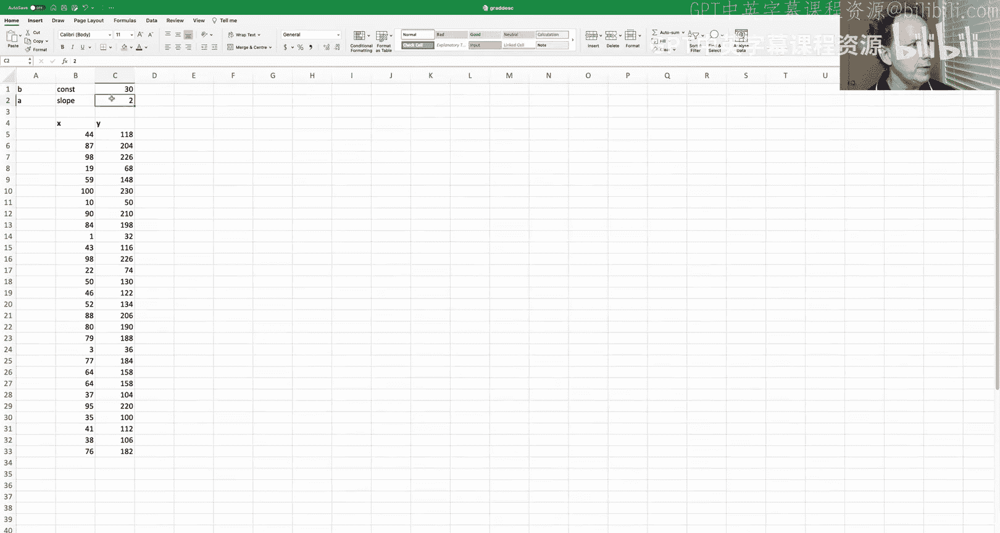

So。There's one way to calculate the derivatives another way is analytically。😊，And the。

The derivative of squared is two times。So。Here it is here， I've just written it down for you。

So here's the analytic derivative， it's just two times。😊，The difference。

And then the derivative for the slope。Is here？And you can see that the estimated version using the rise overrun and the little 0。

01 change and the actual， they're pretty similar。Okay， and same thing here。 They're pretty similar。

 So anytime I calculate gradients。Kind of analytically， but by hand。

 I always like to test them against doing the actual rise overrun calculation with some small number。

 and this is called using the finite differentcing approach。

 We only use it for testing because it's slow because you have to do a separate calculation for every single weight。

But it's good for testing。 We use analytic derivatives all the time in real life。Anyway。

 so however we calculate the derivatives， we can now calculate a new slope。

 so our new slope will be equal to the previous slope。😊，Minus the derivative times the learning rate。

 which we have just set here at 0。0001。And we can do the same thing for the intercept。As you see。

And so here's our new sloped intercept， so we can use that for the second row of data。

 so the second row of data is x equals 86 y equals 202， so our intercept is not 11 anymore。

The interception sleeping not 11， but there。1。01 and 1。12。

 So here's we're just using a formula just to point at the old at the new。Entercept and slope。

 and we can get a new prediction and squared error。And derivatives。And then we can get another new。😊。

Slope and intercept。And so that was a pretty good one， actually。

 it really helped our slope head in the right direction。

 although the intercept's moving pretty slowly。😊，And so we can do that for every row of data。Now。

 strictly speaking， this is not。Many batch gradient descent that we normally do in deep learning it's a simpler version where every batch is a size one so I mean it's still a stochastic gradient descent it not it's just a batch size of one。

But I think sometimes it's called online gradient descent， if I remember correctly。

 So we go through every data point。In our very small data set until we get to the very end。

 And so at the end of the first epoch， we've got an intercept of 1。06 and a slope of 2。57。

 and those indeed are better estimates than our starting estimates of 11。

So what I would do is I would copy our slope 2。57 up to here， 2。57。

 I'll just type it for now and I'll copy our intercept。😊，Up to here。

And then it goes through the entire。Epoch again， and we got another interception slope。

And so we could keep copying and pasting and copying and pasting。Again and again。

And we can watch the root mean square error going down。 Now。

 that's pretty boring during that copying and pasting。So what we could do is。Fi up。

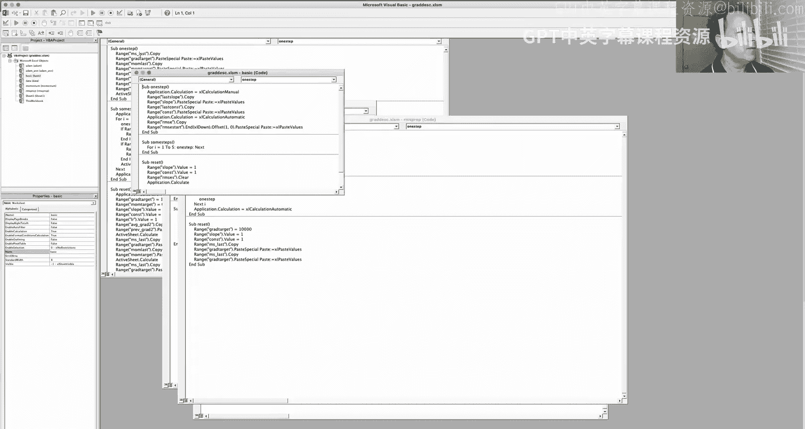

Visual basic through applications。And sorry， this might be a bit small。

 I'm not sure how to increase the font size。嗯。And what it shows here。So sorry this is a bit small。

 so you might want to just open it on your own computer be able to see it clearly。

 but basically it shows I've created a little macro where if you click on the reset button。

 it's just going to set the slope and constant to one。And calculate。😊。

And if you click the run button， it's going to go through five times calling one step and what one step is going to do。

Is it's going to copy the slope， last slope to the new slope and the last constant intercept to the new constant intercept。

And also do the same for the RMSC。And it's actually going to paste it down to the bottom for reasons I'll show you in a moment。

 so if I now。Run this by reset， and then run。There we go， you can see it's run at five times。

 and each time it's posted the RMSE。And here's a chart of it showing it going down。

 And so you can see the new slope is 2。57。 new interceptors 1。27。 I could keep running at another5。

 So this is just doing copy paste， copy， paste， copy paste five times。 and you can see that the。

RsC is very， very， very slowly going down。And the intercept and slope are very， very。

 very slowly getting closer to where they want to be。

 The big issue really is that the intercept is meant to be 30 it looks like it's going to take a very very long time to get there。

 but it will get there eventually if you click run enough times or maybe set the VBA macro to loot more than five steps at a time。

Mat， you can see it's， it's very slowly。 And， and importantly， though， you can see like。

It's kind of taking this linear route every time these are increasing。

 so why not increase it by more and more and more and so you'll remember from last week that that is what momentum does so in the next sheet we show momentum。

And so everything is exactly the same as the previous sheet。

 but this sheet we didn't bother with the finite difference， we just have the analytic derivatives。

 which are exactly the same as last time， the data is the same as last time。

The slope and intercept are the same starting points as last time。And this is the。um。

New B and new A that we get。嗯。But what we do this time。Is that we've added a momentum term。

 which we're calling beta。And so， the beta。Is going to these cells here。And what are these cells。

 what these cells are is that they're， maybe it's most interesting to take this one here。

What it's doing？😊，Is it。Taking the。Graient。And。It's taking the gradient and it's using that to update the weights。

 but it's also taking the previous update。 so you can see here。The blue 1，-25。

 So that is going to get multiplied by。9， the momentum。And then， the derivative。Is then。

 multiplied by。Po1。 So this is momentum， which is getting a little bit of each。

And so then what we do。😊，As we then use that instead of the derivative to multiply by our learning rate。

So。We keep doing that again and again and again as per usual。

 And so we've got one column which is calculating the next， which is calculating the momentum。

 you know， lurped version of the gradient for both B and for a。 And so you can see that for this one。

 it's the same thing。 You look at what was the previous。Move。And that's going to be 0。

9 of what you're going to use for your。Momentum version gradient and 0。

1 is for this version the momentum gradient。 And so then that's， again。

 what we're going to use to multiply by the learning rate。

And so you can see what happens is when you keep moving in the same direction。

 which here is we're saying。The derivative is negative again and again and again。

 so it gets higher and higher and higher。And get are here？

And so particularly with this big jump we get， we keep getting big jumps because still we want to there's still negative gradient。

 negative gradient， negative gradient。 So if we。So at the end of this。Our new， our B and our A have。

Jump ahead。 And so we can click run。And we can click clicking it， and you can see that it's moving。

You know， not super fast， but certainly faster than it was before。

So if you haven't used VBA Viual basics for applications before。

 you can hitt Alt F11 or option F11 to open it， and you may need to go into your preferences and turn on the developer tools so that you can see it。

Um。You can also right click and choose assign sign macro on a button， and you can see what。

Macro has been assigned。So if I hit Alt F 11 and I can just double or you can just double click on the sheet name and it'll open it up and you can see that this is exactly the same as the previous one。

There's no difference here。Oh， one difference is that to keep track of momentum。At the very。

 very end， so I've got my momentum values going all the way down。The very last momentum。

I copy back up to the top H epoch so that we don't lose track of our kind of optimizer state。

 if you like。Okay， so that's what momentum looks like。 So yeah。

 if you're kind of a more of a visual person like me。

 you like to see everything laid out in front of you and like to be able to experiment。

 which I think is a good idea。 this can be really helpful。😊，So。IMSs prop。We you've seen。

 and it's very similar to momentum。 but in this case。

 instead of keeping track of kind of alertrped moving average and exponential moving average of gradients。

 we're keeping track of a moving average of gradients squared。

And then rather than simply adding that， you know， using that as the gradient。

 what instead we're doing is we are。Dividing our gradient。By the square root of that。

 And so remember， the reason we were doing that is to say。If， you know， if， if the。

There's very little variation， very little going on in your gradients。

 then you probably want to jump further。So that's RMS Prop。And then finally， Adam， remember。

 was a combination of both。So in atom， we've got both the。Lerped version of the gradient。

And we've got the loped version of the gradient squared。And then。We do both。When we update。

 we're both dividing the gradient by the square root of the alert。

 the moving exponentially weighting average moving averages。

 and we're also using the momentumized version。嗯。And so again， we just go through that each time。

And so if I reset， run。And so， oh， wow， look at that。

 It jumped up there very quickly because remember we wanted to get to 2 and 30。So just two sets。

 so that's5 that's 10 epochs。Now， if I keep runninging it。It's kind of now not getting closer。

 It's kind of jumping up and down between pretty much the same values。

 So probably what we need to do is decrease the learning rate at that point。And yeah。

 that's pretty good。And now it's jumping up and down between the same two values again。

 So probably decrease the learning rate a little bit more。

 And I kind of like playing around like this because it gives me a really intuitive feeling for what training。

😊，Looks like。So I've got a question from our YouTube chat， which is how is J 33 being initialised。

 So it it's this is just what happens is we take the very last cell。HereWell。

 these actually all these last four cells， and we copy them to here as values。

 So this is what those looked like。嗯。In the last epoch。 So if I basically， we're going， we go copy。

And then。Pasteters values。And then they。This here， just refers back to them。As you say。

And it's interesting that they're kind of you can see how they're exact opposites of each other。

 which is really， you can really see how they're it's just fluctuating around the actual optimum at this point。

嗯。Okay， thank you to Sam Watkins。 we've now got a nicer sized。HaEtor， that's great。Where are we Adam。

Okay， so with。So with Adam， basically， it all looks pretty much the same， except now we have to。

Copy and paste our both our momentums and our。Squared gradients and of course。

 the slopes and intercepts at the end of each step。

 but other than that it's just doing the same thing and when we reset it。

 it just sets everything back to their default values。Now， one thing that occurred to me， you know。

 when I first wrote this spreadsheet a few years ago was that。Mannually。

 changing the load rate seems。Pretty annoying Now of course we can use a scheduler。

 but a scheduler is something we set up ahead of time。

 and I did wonder if it's possible to create an automatic scheduler and so I created this atom anneing tab。

Which honestly， I've never really got back to experimenting with。 So if anybody's interested。

 they should check this out。 What I did here。Was I。

Used exactly the same spreadsheet as the atom spreadsheet， but I added an extra after I do the step。

 I added an extra thing， which is I automatically decreased the learning rate in a certain situation and the situation which in which I decreased it was I kept track of the average of the squared gradients。

And any time the average of the squared gradients decreased during an epoch， I stored it。

 so I basically kept track of the lowest squared gradients we had。嗯。And then what I did。Was if。

We got a。If if that resulted in the gradients， the squared gradients average havlving。

Then I would decrease the learning rate by。Then I would decrease the learning rate by a factor of four。

So I was keeping track of this gradient ratio。 Now， when you see a range like this。

 you can find what that's referring to by just clicking up here and finding。Gradient ratio。

And there it is。 And you can see。That it's equal to the ratio between。

The average of the squared gradients versus the minimum that we've seen so far。

So this is kind of like my theory here was thinking that yeah， basically as you train。

You kind of get into flatter， more stable areas。 And as you do that， that's a sign that， you know。

You might want to decrease your learning rate。Yeah， if I try that if hit run。Again。

 it jumps straight to a pretty good value， but I'm not going to change the learning rate manually I just press run because it's changed the learning rate automatically now。

And if a cap hitting run。Without doing anything。Look at that。 It's got pretty good， hasn't it。

 And the learning rates got lower and lower。 And we basically got almost exactly the right answer。So。

 yeah， that's a little experiment I tried。 So maybe some of you should try。

Experiments around whether you can create a。An automatic anilla。Using the。Using mini AI。

I think that would be fun。So that is an excellent segue。Into our notebook。

 because we are going to talk about a kneeing now。So we've seen it manually before。

UWhere we've just where we've just decreased the learning rate in a notebook and like ran a second cell。

And we've seen something in Excel， but let's look at what we generally do。And Pytorch。

So we're still in the same notebook as last time， the accelerated SGD notebook。

And now that we've reimplemented all the main optimizes that people tend to use most of the time from scratch。

 we can use playtorrches， of course。嗯。So let's see， look， look now at how we can。

To our own learning rate scheduling or anneing within the many AI framework。Now。

 we've seen when we implemented the learning rate Finder。That， that we saw how to。

Creates something that adjusts the learning rate， so just to remind you。This was all we had to do。

So we had to go through the optimizers。Prameter groups。

 and in each group set the learning rate to times equals some modelplayer if which just that was for the learning rate finder。

U。So since we know how to do that， we're not going to bother reimplementing all the schedulers from scratch because we know the basic idea now。

 so instead what we're going to have do is have a look inside the Torch。t。

lr Schr module and see what's defined in there。So。The L Stula module。You know， you can hit dot。

Tab and see what's in there， but something that I quite like to do is to useD。😊。

Because D Lr scheduler is a nice little function。That tells you everything inside。A Python object。

 and this particular object is a module object， and it tells you all the stuff in the module。

When you use the dot version。Tab， it doesn't show you stuff that starts with an underscore。

 by the way， because that stuff's considered private。 or else darere does show you that stuff。

 Now I can kind of see from here that the things that start with。A capital， and then a small letter。

Looked like the things we care about。 we probably don't care about this。

 We probably don't care about these so we can just do a little list comprehension that checks that the first letter is an upper case and the second letter is lower case and then join those all together with a space。

 And so here is a nice way to get a list of all of the schedulers that play torch has available And actually。

I couldn't find such a list on the Pytorch website in the documentation。

 so this is actually a handy thing to have available。Um。So here's various schedules we can use。

 and so I thought we might experiment with using cosine andneling。嗯。So before we do。

 we have to recognize that these Pytororch schedulers work with Pytorrch optimizes。

 not with of course with our custom SGD class， and Pytorch optimizes have a slightly different API and so we might learn how they work。

So to learn how they work， we need an optr。 So some one easy way to just grab an optr would be to create a learner。

 just kind of pretty much any old random learner and pass in that single batch callback that we created。

 Do you remember that single batch callback single。😊，Btch， it just。After batch it cancels the fit。

 so it literally just does one batch。嗯。And we could fit。And from that。

 we've now got a learner and an optimizer。And so we can do the same thing。

 We can do our optimizer to see what attributes it has。 This is a nice way or of course。

 just read the documentation in Plytorch， this one is documented， I think。

 showing all the things it can do。😊，As you would expect。

 it's got the step in the zero grad like we're familiar with。Or you can just， if you just hit optt。

So you can the optimizes in Playtorch do actually have a re as it's called。

 which means you can just type it in and hit shift enter and you can also see the information about it this way。

Now an optimizer it' will tell you what kind of optimizer it is and so in this case the default optimizer for a learner when we created it we decided was opttem。

sgd。sgd so we've got an SGd optimizer and it's got these things called parameter groups。

What are parameter groups， Well parameter groups。Are as it suggests， there are groups of parameters。

 and in fact， we only have one parameter group here， which means all of our parameters。

Or in this group， so let me kind of try and show you it's a little bit confusing。

 but it's kind of quite neat。So let's grab all of our parameters。And that's actually a generator。

 so we have to turn that into an editorerator and call next and that will just give us our first parameter。

Okay， now what we can do。😊，I we can then check the state of the optimizer and the state。

Is a dictionary。And the keys are parameter tensesors。

 So this is kind of pretty interesting because you might be I'm sure you're familiar with dictionaries。

 I hope you're familiar with dictionaries， but normally you probably use numbers or strings as keys。

 but actually you can use tensesors as keys。 And indeed that's what happens here if we look at parameter。

It's a tensor， it's actually a parameter， which remember is a tensor。

 which it knows to require grad and to list in the parameters。Of the module。

And so we're actually using that to index into the state， so if you look at up dot state。

It's a dictionary where the keys are parameters。Now， what's this for？ Well。

 what we want to be able to do is if you think back to。This， we actually had each parameter。

We have state for it， we have the average of the gradients or the exponentially way of moving average gradients and of squared averages。

 and we actually stored them as attributes。So Ptorrch does it a bit differently。

 it doesn't store them as attributes， but instead the optimizer has a dictionary where you can look where you can index into it using a parameter。

And that gives you。The state。 And so you can see here， it's got a。

This is the exponentially weighted moving averages and both because we haven't done any training yet and because we're using nonnoment STD it's none but that's how it would be stored so this is really important to understand ptorrch optimizes I quite liked our way of doing it as distortoring the state directly as attributes but this works as well and it's fine you just have to know it's there。

And then， as I said， rather than just having parameters。So we in SGD。Sttored the parameters directly。

But in pietorrch， those parameters can be put into groups and so since we haven't put them into groups。

 the length of parameter groups is one， there's just one group。So here is the PRm groups。

And that group。Contains olive H。Parameters。Okay， so Pg。Just to clarify here what's going on。Pe is。

A dictionary， it's a parameter group。And to get the keys from a dictionary， you can just listify it。

 That gives you back the keys。 And so this is one quick way of finding out all the keys in a dictionary。

 So you can see all the parameters in the group， and you can see。All of the hyper parameters。

 the learning rate， the momentum， weight decay， and so forth。Um。So that gives you some background。

About。嗯。About what's going on inside optimizeo。So Seva asks。

 isnn't indexing by tensor just like passing a tensor argument to a method and no it's not quite the same because this is state。

 so this is how the optimizer stores state about the parameters it has to be stored somewhere for our homemade mini AI version we store it as attributes on the parameter。

 but in the Pytorrch optimizes， they store it as a dictionary。So it's just how it's stored。Okay。

 so with that in mind， let's look at how schedulers work。😊。

So let's create a cosine anneing scheduler so a scheduler in Pytorch you have to pass at the optimizer and the reason for that is we want to be able to tell it to change the learning rates of our optimizer so it needs to know what optimizer to change the learning rates of so it can then do that for each set of parameters。

And the reason that it does it by parameter group is that as we'll learn in a later lesson for things like transfer learning。

 we often want to adjust the learning rates of the later layers differently to the earlier layers and actually have different learning rates。

😊，And so that's why we can have different groups and the different groups have the different learning rates。

 momentums and so forth。Okay， so we pass in the optimizer and then。

If I hit shift tab a couple of times， it'll tell me all of the things that you can pass in。

 and so it needs to know Tmax。How many iterations you're going to do。

 and that's because it's trained to do one half wave， if you like， of the cosine curve。

So it needs to know how many iterations you're going to do。

 so no it needs to know how fight a step each time。 So if we're going to do 100 iterations。

 So the scheduler。😊，Is going to store the base learning rate。 And where did I get that from？

 It got it from our optimizer。Which we set a learning rate。 Okay， so it's going steal the。

Optimises learning rate。 And that's going to be the starting learning rate， the base learning rate。

 And it's a list because there could be a different one for each parameter group。

 We only have one parameter group。 You can also get the most recent learning rate。From a scheduler。

 which of course， is the same。And so I couldn't find any method in Pytorrch to actually plot a scheduler's learning routes。

 so I just made a tiny little thing that just created a list。

 set it to the last learning route of the scheduler， which is going to start at 0。06。

 and then goes through however many steps you ask for。Steps the optimizer， steps the scheduler。

 So this is the thing that causes the scheduler to to adjust its learning rate。

 and then just append that new learning rate to a list if learning rates and then plot it So that's heres。

 and what I've done here is I've intentionally gone over 100 because I had told it and I'm going to do 100。

 So I'm going over 100。 And you can see the learning rate， if we did 100 iterations would start high。

For a while， it would then go down， and then it would stay low for a while。

And if we intentionally go past， the maximum actually start going up again because this is a cosine curve。

😊，So。One of the main things I guess I wanted to show here is like， what it。

Looks like to really investigate。In a raple environment， like a notebook。How， you know。

 how an object behaves， you know， what's in it。 And， you know。

 this is something I would always want to do when I'm using something from API。

 I'm not very familiar with。 I really want to like。See what's in it， see what they do。

 run it totally independently plot anything I can plot。 This is how I like to learn about。

The stuff I'm working with。😊，You know， data scientists don't spend all of their time just coding。

 you know， so that means we need we can't just rely on using the same classes and APIs every day so we have to be very good at exploring them and learning about them and so that's why I think this is a really good approach。

Okay， so let's create a scheduleula Kobe。So a schedule a callback is something we're going to pass in the scheduling class。

But remember then when we go the scheduling callable， actually。

 and remember that when we create the scheduler。We have to pass in the optimizer to schedule。And so。

 before fit。That's the point at which we have an optimizer。 We will create the scheduling object。

 I like this ghetto。 It's very Australian。 So the scheduling object we will create by passing the optimizer into the schedule callable。

And then。When we do。Step。Then we'll check if we're training。And， if so。Well， step。Okay。

 so then what's going to call step is after batch。 So after batch， we'll call step。

 and that would be if you want your scheduler to update the learning rate every batch。Um。

 we could also have。A。嗯。An epoC scheduler Corbe， which we'll see later。

 and that's just going to be after Epoch。Okay。So in order to actually see what this schedule is doing。

 we're going to need to create a new callback to keep track of what's going on in our learner。

And I figured we could create a recorder callback。 And what we're going to do is we're going to be passing in。

The name of the thing that we want to record that we want to keep track of in each batch。

And a function。I're just going to be responsible for grabbing the thing that we want。

And so in this case， the function here。Is going to grab from the call back。

 look up its Para group' property and grab the learning rate。

Where does the PG property come from Rebute or before fit？

The recorder callback is going to grab just the first parameter group just so it's like you've got to pick some parameter group to track。

 so we'll just grab the first one。And so then also we're going to create a dictionary of all the things that we're recording。

 So we'll get all the names。 So that's going to be in this case， just Lr。😊。

And initially it's just going to be an empty list and then after batch we'll go through each of the items in that dictionary。

 which in this case is just LR as the key and underscore LR function as a value。

 and we will append to that list。Call that method， call that function or callable。

 and pass in this callback。And that's why this is going to get the callback。

And so that's going to basically then have a whole bunch of， you know， dictionary of the results。

 you know， of each of these functions after each batch during training。

So we're just go through and plot them all。😊，And so let me show you what that's going to look like。

If we。Let's create us。Cosine andnealing。Cllable， so we're going to have to use a partial to say that this callable is going to have T max equal to。

Three times， however many mini batches we have in our data loader。

 that's because we're going to do three epochs。嗯。And then。We will set it running。

And we're passing in the batch scheduler。With the。Sketchule a holdable。

And we're also going to pass in our recorder callback。

 saying we want to track the learning rate using the underscore LR function， we're going to call fit。

And oh， this is actually a pretty good accuracy， we're getting you know。

 close to 90% now in only three epochs， which is impressive。And so when we then call Redo plot。

It's going to call。Remember the G is the recorder callbe。So， it plots。The learning rate。

Isn't that sweet？So we could， as I said， we can do exactly the same thing but replace after batch with after epoch。

 and this will now become a scheduler which steps at the end of each epoch rather than the end of each batch。

So I can do exactly the same thing now using an epoch scheduler。

 So this time Tax is3 because we're only going to be stepping three times we're not stepping at the end of each batch just at the end of each epoch。

So that trains。And then we can call wreck up plot after trains。 And as you can see there。

 it's just stepping three times。 So you can see here。We're really。Digging in deeply。

To understanding what's happening in everything in our models， what do all the activations look like。

 what are the losses look like， what do our learning rates look like？

And we built all this from scratch。So yeah， hopefully that gives you a sense that we can really。

 yeah， do a lot。Aselve。Now if you've done the Fast AI Part1 course。

 you'll be very aware of one cycle training， which was from a terrific paper by Leslie Smith。

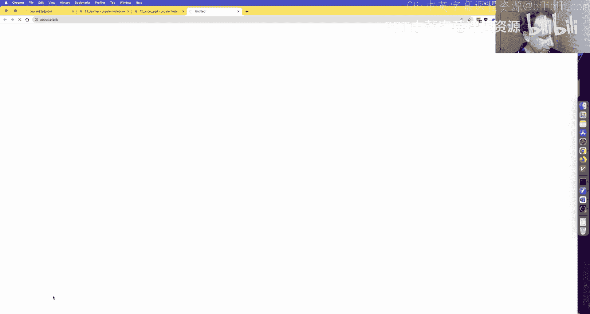

嗯。Which。

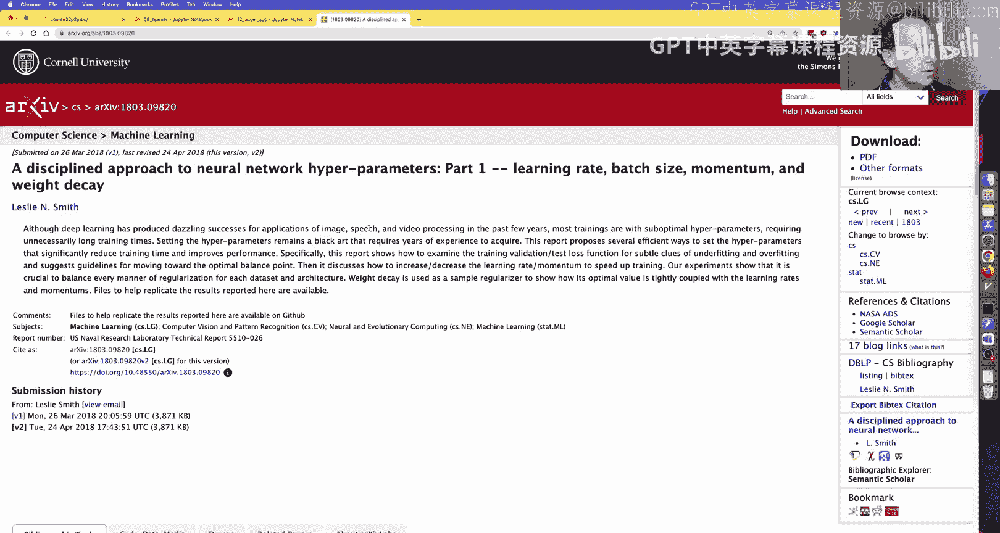

Not sure It ever got published， actually。um。And one cycle training is， well， let's take a look at it。

So we can just replace our scheduler。With。One cycle learning rate scheduler， so it's in P torch。

 and of course， if it wasn't in Ptorrch， we could very easily just write our own。

I'm got to make it a batch scheduler， and we're going to train this time we're got to do five epochs。

So we're going to train a bit longer and so the first thing I'll point out is Hooray。😊，We have got。

A new record for us，90。6%。 So that's great so。And then B you can see here's the plot and now look two things are being plotted and that's because I've now passed into the recorder callback。

 a plot of learning rates and also a plot of momentums and momentums it's going to grab the beters zero because remember for atom。

It's called beta 0 and beta 1。Is momentum of the gradients and the momentum of the gradient squared？

And you can see what the one cycle is doing。Is。The learning rate is starting very low and going up to high and then down again。

But the momentum is starting high and then going down and then up again。 So what's the theory here。

 Well， the the， the starting out at a low learning rate is。Particularly important。

If you have a not perfectly initialized model。U。Which。Almost everybody almost always does。

 even as though we spend a lot of time learning to initialize models， you know。

 we use a lot of models that get more complicated and。After a while， people。After a while。

 people learn or figure out how to initialize more complex models properly。 So， for example。

 this is a very， very cool paper in 2019。

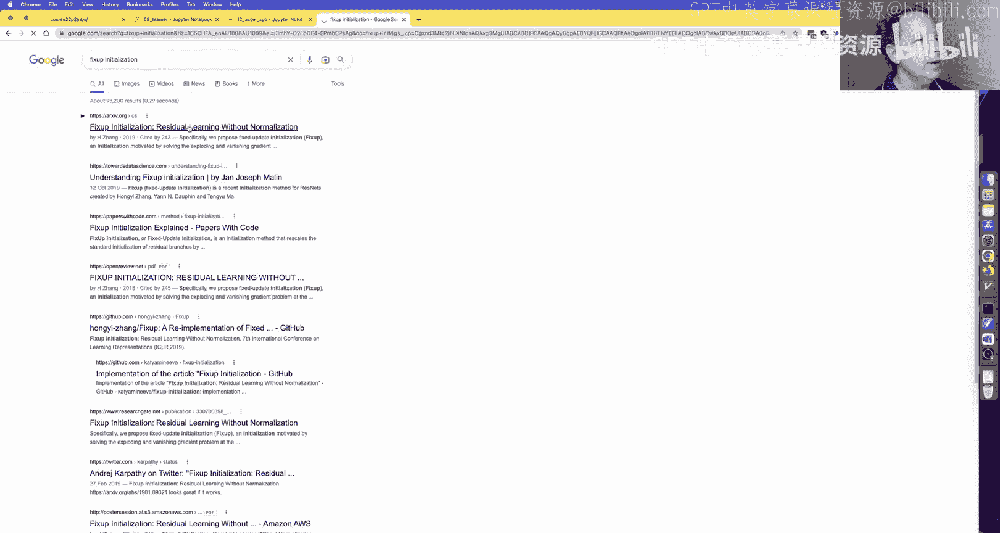

This team figured out how to initialize resnets properly we'll be looking at renets very shortly。

 and they discovered when they did， that they did not need batch Norm。

 they could train networks of 10，000 layers。And they could get state of the art performance with no batch norm。

 and there's actually been something similar。

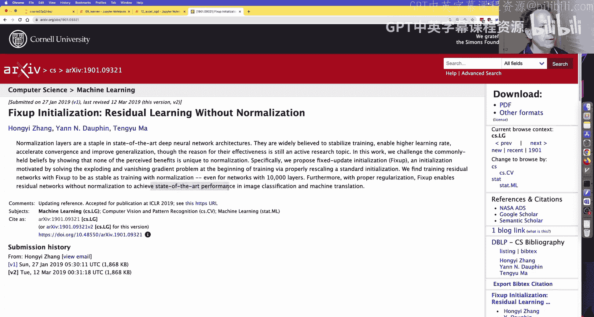

For transformers called T fix up。That does a similar kind of thing。 But anyway。

 it is quite difficult to initialize。Models correctly。

 most people fail to most people fail to realize that they generally don't need tricks like warm up and batch norm if they do initialize them correctly。

 in fact t fix up explicitly looks at this， it looks the difference between no warm up versus with warm up with their correct initialization versus with normal initialization and you can see these pictures they're showing are pretty similar actually log scale histograms of gradients they're very similar to the colour dimension plots I kind of like how colour dimension plots better in some ways because I think they're easier to read although I think there's a probably prettier。

So there you goes to Fo， there's something to inspire you if you want to try more things with our。

Courful dimension plots。 I think it's interesting that some papers are actually starting to。

Use a similar idea， I don't know if they got it from us or they came up with it independently。

 doesn't really matter。But， that so we do a warm up if our， if our if our。

Networks not quite initialized correctly， then starting at a very low learning rate means it's not going to jump off way outside the area where the weights even make sense and so then you gradually increase them as the weights move into a part of the space that does make sense。

And then during that time， while we have low learning rates。

 if they keep moving in the same direction， then with this very high momentum。

 they'll move more and more quickly。😊，But if they keep moving in different directions。

 it's just the momentum is going to kind of look at the underlying direction they're moving。😊。

And then once you have got to a good part of the weight space。

 you can use a very high learning rate and with a very high learning rate。

 you wouldn't want so much momentum。 So that's why there's low momentum during the time when there's high learning rate。

And then as we saw in our spreadsheet， which did this automatically。

 as you get closer to the optimal， you generally want to decrease the learning rate。😊。

And since we're decreasing it again， we can increase the momentum。

So you can see that starting from random weights， we've got a pretty good accuracy on fashion Mns with a totally standard convolutional neural network。

 no reates， nothing else， everything built from scratch by hand， artisanal neural network training。

 and we've got 90。6%。It a fashion emist。So， there you go。嗯。All right。

 let's take a seven minute break。And I'll see you back shortly。

I should warn you you've got a lot more to cover， so I hope you're okay with her。A long lesson today。

Okay， we're back。I just wanted to mention also something we skipped over here。

Which is this has learned callback This is more important for the people doing the live course than the recording because if you're doing the recording。

 you will have already seen this but，Since I created learner， actually， Peterappa， a Sler。

 I don't know how to pronounce your surname， sorry。

 Peter pointed out that there's actually kind of a nicer way of handling。😊。

Learner that previously we were putting the learner object itself into self dot learn in each callback。

And that meant we were using self taught learnt model and self To learn optt and self taughtt learnt all this。

 you know， all over the place， it was kind of ugly。嗯。😊，So we've modified learner this week。To。

 instead。Pass in when it calls the Ko。When in run CBs， which is what it calls learner calls。

 you might remember， is it passes the learner as a parameter to the method。

 so now the learner no longer goes through the callbacks and sets their dot learn attribute。

But instead， in your callbacks， you have to put。Lan。As a parameter in all of the。

 in all of the Cor methods。So， for example。Deevvicice C。Has it before fit。

 So now it's got come a learn here。 So now this is not self dotlin。 It's just learn。嗯。

So it does make a lot of the code less yucky to not have all this self。t learnup pre equals self。

art model， self。 learn。 batches now does learn， it also is good because you don't generally want to have both have the learner has a reference to the callbacks。

 but also the callbacks having a reference back to the learner that creates something called a cycle。

So there's a couple of benefits there， and that reminds me there's a few other little changes we've made to the code。

😊，And I want to show you a cool little trick。

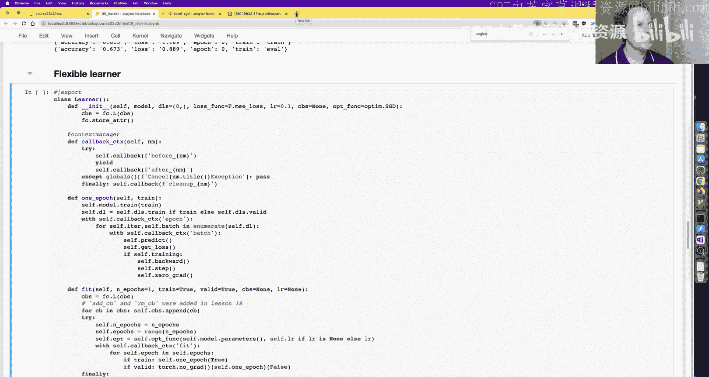

I want to show you a cool little trick for how I'm going to find quickly all of the changes that we've made to the code in the last week。

So to do that， we can go to the Co repo。And on any repo， you can add slash compareare。In Gitthub。

 And then you can compare a across。嗯。You know， all kinds of different things。

 but one of the examples I've got here is to compare across different times。

 look at the master branch now versus one day ago。So I actually want the master branch now versus seven days ago。

 so I just hit this， change this to seven。

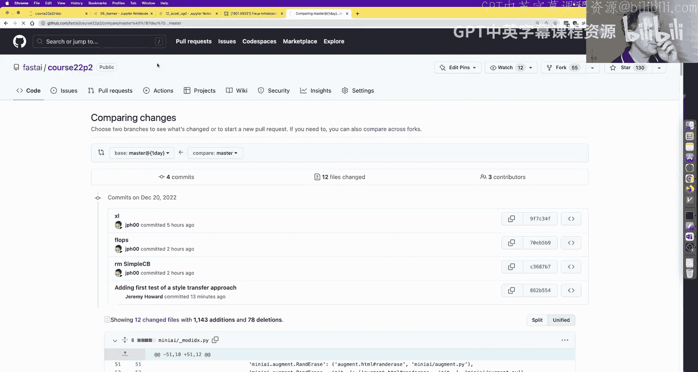

And there we go。 There's all my commits。 and I can immediately see。The changes from last week。

 And so you can basically see what are the things I had to do when I change things。 So， for example。

 you can see here all of my。Self dot learns became learns。

I added the annelia that right my augmentation。And so in Ler， I added an L find and， yes。

 I will show you that one。 That's pretty fun。So here's the changes we need to run CBs to fit。

So this is a nice way I can quickly， yeah， find out。

What I've changed since last time I make sure that I don't forget to tell you folks about any of them。

Oh， yes， clean up fit。 I have to tell you about that as well。

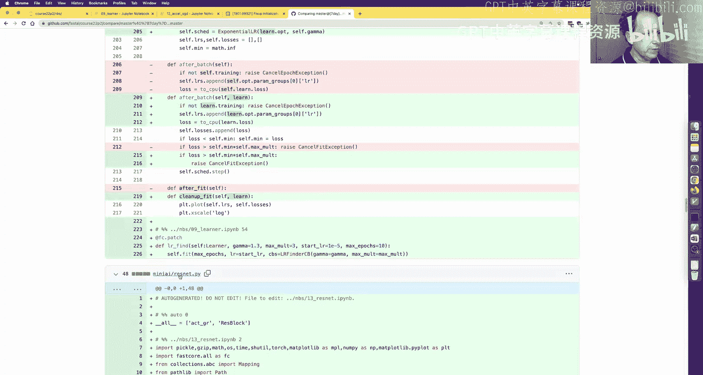

Okay。That's a useful reminder。 So the main other change to mention is that calling the learning rate finder is now easier。

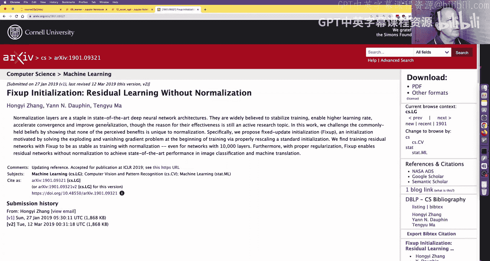

Because I added what's called a patch to the learner。

Fast course patch decorator lets you take a function。

And it will turn that function into a method of this class of whatever class you put after the colon。

So this has created a new method called LR find or learner。Lr Find。And what it does is it callss。

Self dot fit， where is a learner passing in， however， many epochs。

 you set as the maximum order to check for your learning rate finder。

 what to start the learning rate at。And then it says to use as callbacks。

The learning rate find a callback。Now this is new as well， Learn。

fit didn't used to have a callbackax。Prametera。So that's very convenient because what it does is it adds those callbacks just during the fit。

 So if you pass in callbacks。Then it goes through each one and apps it。To self dot CB Bs。

 And when it's finished fitting， it removes them again。

 So these are callbacks that are just added for the period of this one fit。

 which is what we want for a learning rate finder。 It should just be added for that one fit。So。

With this patch in place， it says this is all it's required to do the learning rate finder is now to create your learner and call do L R find and the you go bang。

 So patch is a very convenient thing。 It's one of these things， which， you know， Python has a lot of。

Kind of like folk wisdom about what isnt isn't considered pythonic or good and a lot of people really don't like。

Patching in other languages。 it's used very widely and is considered very good。 So I。

 I don't tend to have。Strong opinions either way， about what's good or what's bad。 In fact。

 instead I just to， you know， figure out what's useful in a particular situation。

 So in this situation， obviously， it's very nice to be able to add in。

This additional functionality to our class。So that's what Lr find is And then the only other thing we added to the learner this week was we added a few more parameters to fit fit used to just take the number of epochs as well as the callbacks parameter it now also has a learning rate parameter and so you've always been able to provide a learning rate to。

The constructor， but you can override the learning rate for one fit。

 so if you pass in the learning rate。It will use it if you pass it in。 and if you don't。

 it'll use the。Learning rate passed into the constructor。

And then I also added these two bullions to say， when you fit。

 do you want to do the training loop and do you want to do the validation loop， So by default。

 it'll do both。And you can see here there's just an if train， do the training loop， if valid。

 do the validation loop。I'm not even going to talk about this。

 but if you're interested in testing your understanding of decorators。

 you might want to think about why it is that I didn't have to say with Torch。nograd。

 but instead I called torch。nograd parentheses function。

 that will be a very if you can get to a point that you understand why that works and what it does。

 youll be on your way to understanding decorators better。Okay。So that is the end of Excel SJD。

Reasnets。We are up to 90 point。 what was at 3%？

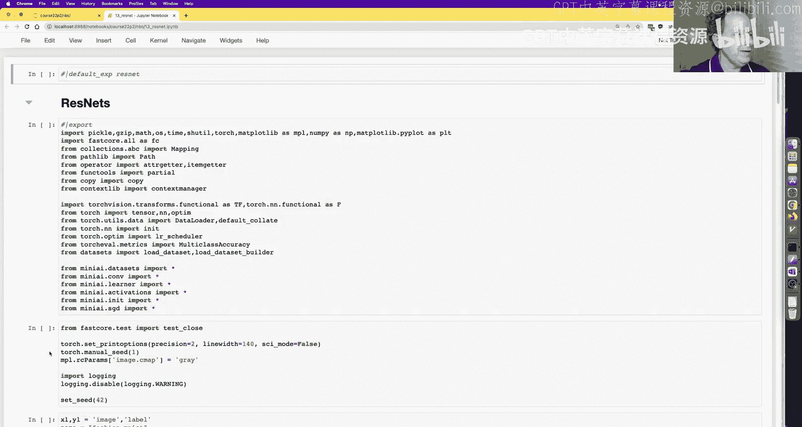

Let's keep track of this。

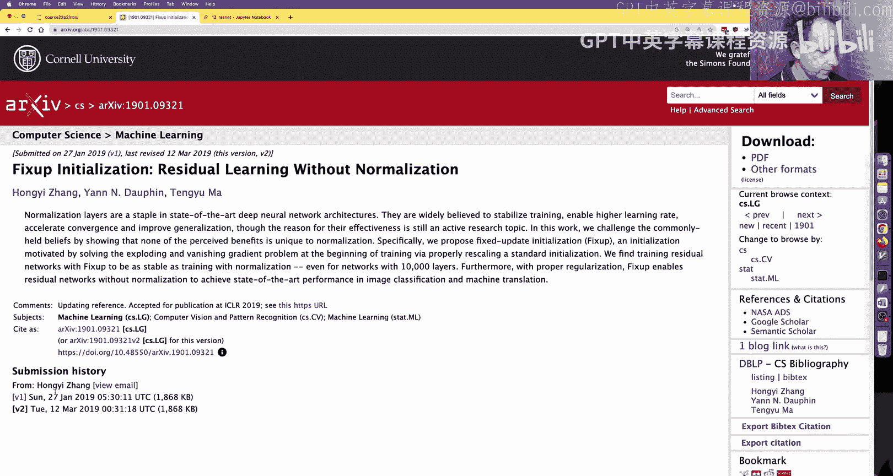

Oh yeah， 90。6% is what we're up to。Okay， so to remind you the model。Actually。

 so we're going to open 13 ResNe now。And we're going to do the usual important setup initially。

And the model that we've been using。It's the same one we've been using for a while。

Which is that it's a convolution。And an activation。And。An optimal optional batch norm。

And in our models， we were。Using batchn。And applying our weight initialization。

 the chiing weight initialization。And then we've got comms that take the channels from one to 8 to 16 to 32 to 64。

 and each one straight2。And at the end， we then do a flatten。 And so that ended up with a one by one。

 So that's been the model we've been using for a while。 So the。Number of layers is。1。😊，2。😔，th3。4our。

So four， four convolutional layers with a maximum of 64 channels in the last one。So can we beat 90。

 well about 90 and a half。90。6 can we beat 90。6%。 So before we do a resnet， I thought， well。

 let's just see if we can improve the architecture thoughtfully。

 So generally speaking more depth and more channels gives the neural net more opportunity to learn and since we're pretty good at initializing our neural nets and using batched No。

 we should be able to handle deeper。So。One thing we could do。Is we could。

 let's just remind ourselves of the。Previous version， so we can compare。Is we could have our。

Go up to 128。Prameters， now， the way wed do that。Is we could make our very first convolutional layer have a straight of one。

So that would be one that goes from。The one input channel to eight output channels， or eight filters。

 if you like。 so if we make it a straight of1， then that allows us to have one extra layer and then that one extra layer could again double the number of channels and take us up to 128。

So that would make it deeper and effectively wider as a result。

So we can do our normal batch norm 2D in our new one cycle learning rate with our scheduler。Um。

And the callbacks we're going to use is the device callback， our metrics， our progress bar。

 and our activation stats looking for general values。

And I won have you watched them train because that would be kind of boring。

 but if I do this with this deeper and eventually wider network。This is pretty amazing。

 We get up to 91。7%。 So that's like quite a big difference。 And literally。

 the only difference to our previous model is this。😊，One line of code， which allowed us to take this。

Instead of going from 1 to 64， it goes from 8 to 128。 So that's a very small change。

 but it massively improved So the error rates gone down by， you know， about over 10% cent。

 relatively speaking。In terms of the error rate。So there's a huge impact we've already had， again。

 five epochs。So now what we're going to do is we're going to make it deeper still。But。

It gets there becomes a point， so King her at our noted that there comes a point where making neural nets deeper stops working well。

 And remember this is the guy who created the initial laser that we know and love and he pointed out that。

Even with that good initialization， there comes a time where adding more layers becomes problematic。

 And he pointed out something particularly interesting。 He said。

 let's take a 20 layer neural network。 This is in a paper called deep deep residual learning for image recognition that introduced Re。

 So let's take a 20 layer。Network and train it for。A few， what's that。

 tens of thousands of iterations。And track its test error。Okay。

 and now let's do exactly the same thing on a 56 layer， otherwise identical。

 but deeper 56 layer network。And he pointed out that the 56 layer network had a worse error than the 20 layer and it wasn't just a problem of generalization because it was worse on the training set as well。

Um。Now。Insight that he had。Is。If you just set the additional 36 layers to just identity matrices。

 they would do nothing at all， and so a 56 layer network is a superet of a 20 layer network。So。

It should be， at least， as good。But it's not。 It's worse。 So clearly。

 the problem here is something about。Training it。And so。

Him and his team came up with a really clever insight， which is， can we create？A 56 layer network。

 which has the same training dynamics as a 20 layer network or even less。And they realized， yes。

 you can。What you could do。Is you could add something cold。A shortcut connection。And basically。

 the idea is that。Normally。When we have。You know， our。Inputs coming into。Our convolution。

 So let's say that's that was our inputs。 and here's our convolution， and here's our outputs。

Now if we do this 56 times， that's a lot of stacked up convolutions which are effectively matrix modifications。

 with a lot of opportunity for know gradient explosions and all that fun stuff。

So how could we make it so that we have convolutions， but。

With the training dynamics of a much shallower network。And。Here's what he did。😔，He said。

 let's actually put two cons in here。To make it twice as deep。

Because we are trying to make things deeper。But then。Let's add what's called a skip connection。

Where instead of just being out equals。 So this is con 1。 This is con of 2。

 Instead of being out equals， and there's a。You know， assume that these include activation functions。

 he callss conv。2 of con。1 of in。Right instead of just doing that。

 let's make it cov2 of cov1 of n plus。In。Now， if we initialize。These at the first。

 to have weights of。0。Then initially， this will do nothing at all。😊，It will output 0， and therefore。

 at first， it you'll just get out equals in。Which is exactly what we wanted， right， we actually want。

To for it to be as if there is no extra layers。And so this way。

 we actually end up with a network which can be deep。But also。

 at least when you start training behaves as if it's shallow。

It's called a residual connection because if we subtract in from both sides。Out。

 then we would get out minus in。Equals conv1 of cov2 within in other words。The difference between。

The end point and the starting point。Which is the residual。And so another way of thinking about it。

Is that this is。Calculating a residual。So there's a couple of ways of thinking about it。And so this。

 this thing here。Is called the Rezb or Resnetb。Okay。

 so Sam Watkins has just pointed out the confusion here， which is that this only works。

If let's put the minus in back and put it back over here。

This only works if you can add these together。Now， if conv 1 and COv2 both have the same number of channels。

As in。Or same number of filters， same number of filters。And they also have strideide1。

Then that will work fine。You'll end that that will be exactly the same output shape as the input shape。

 and you can add them together。But if they are。Not the same。Then you're in a bit of trouble。

 so what do you do？And the answer， which。Ciming her at Alwl came up with is to add a con on in as well。

But to make it as simple as possible。AndWe call this the identity con。

 it's not really an identity anymore， but we're trying to make it as simple as possible so that we do as little to mess up these training dynamics as we can and the simples as possible convolution。

Is a one by one。Filter block， a one by one kernel， I guess we should call it。1 by one kernel size。

And using that， and we can also add a stride or whatever if we want to。So let me show you the code。

So。We're going to create something called a conv block。 Okay。

 and the conv block is going to do the two cons。 That's going to be a conv block。 Okay。

 so we've got some number of input filters， some number of output filters， some stride。

 some activation。Functions， possibly a normalization and some kernel shape， some kernel size。

So the second con。Is actually going to go from output filters to output filters。

 because the first con。Is going to be from input filters to output filters。

 So by the time we get to the second column， it's going to be Nf to Nf。

The first con we will set Str one。And then the second con will have the requested straight。

 And so that way， the two cons back to back are going to overall have the requested straight。

 So this way， the combination of these two cons。It's going to's going to take us from NI to Nf in terms of the number of filters and it's going to have the stride that we requested。

So it's going to be a the con block is a sequential block consisting of a convolution followed by another convolution。

 each one with the requested kernel size。Um。And the requested activation function and the requested normalization layer。

The second conf won't have an activation function I'll explain why in a moment。

And so I mentioned that one way to。Make this as if it didn't exist。

Would be to set the convolutional weights to 0 and the biases to 0。 But actually， we would。

 we would like to have。It know correctly randomly initialized weights。 So instead。

 what we can do is if you're using batchn。We can initialize this conv 21 will be the batch norm layer。

 We can initialize the batch norm weights to 0。 Now， if you've forgotten what that means。

 go back and have a look at our implementation from scratch of batch norm。

 because the batch norm weights is the thing we multiply by。 So do you remember the batch norm， we。

We subtract the exponential moving average mean we divide by the exponential moving average standard deviation。

But then we add back the kind of the batch norms bias layer。

 and we multiply by the batch norms weights the way around， multiply by weights first。

So if we set the batch norm layerss weights to0， we're model plane by zero and so this will cause the initial con block output to be just all zeros。

And so that's going to give us what we wanted。Is that nothing's happening here。

 so we just end up with the input with this possible ID conf。So， a re block。

It's going to contain those convolutions in the convolution block we just discussed right。

 And then we're going to need this I con。So the I con。It's going to be a no op。

 so that's nothing at all。😊，If the number of channels in is equal to the number of channels out。

But otherwise， we're going to use a convolution with a kernel size of one and a straight of one。

And so， that is going to。with as little work as possible。

 change the number of filters so that they match。Also， what if the stride's not one？Well。

 if astr is2 I actually I'm actually this isn't going to work for any str。

 this suddenly works for a st 2。 if there's a strative 2。

 we will simply average using average pooling so this is just saying take the mean。

Of every set of two。Items in the grid。So。We'll just take the mean。 So we， we。

 so we basically have here。Paul。Of ID con of in， if the if the straight is2 and if the filtered number is changed。

And so that's the minimal amount of work。 So here it is。 Here is the forward pass。 We get our input。

And on the identity connection。We call pull， and if straight is1， that's a no up。

 so do nothing at all。We do ID con， and if the number of filters has not changed， that's also an up。

 So this is just the input in that situation。And then we add that to the result of the cons。

 And here's something interesting。 We then apply the activation function。😊，To the whole thing。Okay。

 so that way， I wouldn't say this is like the only way you can do it。 but this is。

 this is a way that works pretty well is to apply the activation function to the result of。

The whole the whole resNe block。And that's why I didn't add activation function to the second con。

So that's a res block。 So it's not a huge amount of。Code， right。

 And so now I've literally copied and pasted our gap model。

 but everywhere that previously we had a con， I've just replaced it with Resblock。😊，In fact。

 let's have a look。Get model。Okay， so previously。We started with con 1 to 8。

 Now we do res blocklock 1 to 8， Str 1， Str1。 Then we added con from number of filters I。

 a number filters z plus1。 Now it's res block from number of filters， number of filters Z plus1。

 Okay， so it's exactly the same。um。One change I have made， though。Is I mean。

 doesn't actually make any difference at all。 I think it's mathematically identical is previously the very last comm at the end went from the。

 you know，128 channels down to the 10 channels。Followed by Flten。

But this con is actually working on a one by one input。 So you know an alternate way。

 but I think makes it clearer is flatten first and then use a linear layer because a con on a one by one input is identical to a linear layer。

And if that doesn't immediately make sense， that's totally fine。

 but this is one of those places where you should pause and have a little stop and think about why a con v a one by one is the same and maybe go back to the Excel spreadsheet if you like or the Python from scratcht con we did because this is a very important insight。

So I think it's very useful with a more complex model like this to take a good old look at it。

To see exactly what the inputs and outputs of each layer is。

So here's a little function called print shapepe， which takes the things that a hook takes。

And we will print out。For each layer， the name of the class。

 the shape of the input and the shape of the output。 so we can get our model。

Create our learner and use our handy little hooks context manager weve built an earlier lesson and call the print shape function。

And then we will call fit for one epoch just doing the evaluation or the training。

 And if we use the single batch callback， it'll just do a single batch。

 put it pass it through and that hook will， as you see， print out。H layer。The inputs shape。

And the output shape。So you can see we're starting with an input of batch size of 1024 one channel 28 by 28 our first res block was dried 1 so we still end up with 28 by 28 but now we've got eight channels。

And then we gradually decrease the grid size to 14 to7 to4 to2 to1 as we gradually increase the number of channels。

We then flatten it， which gets rid of that one by one。Which allows us then to do linear。

It's count over the 10。And then there's some。Discussion about whether you want a batch norm at the end or not。

 I was finding it quite useful in this case。So we've got a batch norm at the end。

I think this is very useful， so I decided to create a patch。😊，For learner， called summaryum。

That would do basically exactly the same thing。But it would do it as a markdown table。Okay。

 so if we create a， if create a train learner with our model。And。Called dot summary。

 this method is now available because it's been patched that method into the learner。

And it's going to do exactly the same thing as our print。

 but it does it more prettily by using a markdown table。If it's in a notebook。

 otherwise ways it'll just print it。So fastco has a handy thing for keeping track of if you're in a notebook and in a notebook to make something marked down。

 you can just use ipyython。 displayedplayed。 markdown。😊，As you say。

And the other thing that I added as well as the input and the output is I thought。

 let's also add in the number of parameters。😊，So we can calculate that， as we've seen before。

 by suming up the number of elements。For each parameter in that module。

And so then I've kind of kept track of that as well so that at the end。

 I can also print out the total number of parameters。So， we've got a。1。2 million parameter model。

And you can see that there's very few parameters here in the input。

 Ne all the parameters are actually in the last layer。Why is that， Well。

 you might want to go back to our Excel convolutional spreadsheet to see this。 you have。A parameter。

For every input channel。You have a set of parameters。They're all going to get added up。

Okcro each of the3 by3 in the kernel。And then that's going to be done for every output filter。

 every output channel that you want。 So that's why you're going to end up with。In fact。

 let's take a look。Maybe let's create， let's just grab some particular。one。So create a model。

And so we'll just have a look at。😔，The sizes。 And so。You can see here。There is this 256。By 256。

 by3 by3。 So that's a lot of parameters。Okay， so we can call Lr find。On that。

And get a sense of what kind of learning rate to use so I chose 2 E egg2 so 。

02 this is our standard learning thing， you don't have to watch it train。

 I've just trained it and so look at this by using ResNe we've gone up from 91。7。

This just keeps getting better，92。2。And five apUs。So that's pretty nice。And， you know。

 this resnet is not。Anything fancy。s it's the simplest possible resblock， right。

 The model is literally copied and pasted from before and replaced each place it said gonev with Resblock。

But we've just been thoughtful about it， you know。Here's something very interesting。

 We can actually try lots of other res by grabbing Tim， so that's Ross Whiteman's pipetorrch image。

Model library。And if you call Tim。t list models。Star Resnet star， there's a lot。😊，Of resonances。

And I tried quite a few of them。 Now， one thing that's interesting is if you actually look at the source code。

😊，um。For Tim0， you'll see that the various different。Resnets like Ressonnet 180， Resonnet 18 D。

 Resnet 10 D， they're defined in a very nice way，du this very。Eganant configuration。

 you can see exactly what's different， so there's basically only one line of code different between each different type of resnet for the main renets。

And so what I did was， I tried。All the1 models I could find。

 And I even tried importing the underlying things and building my own resnets from those pieces。

And the best I found was the Resnet A&D。And if I train it in exactly the same way， I got to 92%。

And so the interesting thing is you'll see that's less than now 92。2。

 and it's not like I tried lots of things to get here。 This is the very first thing I tried。😊。

Where else this Resnet AD was after trying lots lots of different1 models。

And so what this shows is that the just thoughtfully designed。

Kind of basic architecture goes a very long way。 It's actually better for this problem than。

Any of the Pytorch image model models， resnets that I could find。嗯。So I think that's quite。

 quite amazing。 Actually， it's really cool， you know。

 And it shows that you can create a state of the art architecture。😊，Just by using some common sense。

 you know？So that' I hope that's， yeah， I hope that's encouraging。So anyway， so we're up to 92。2%。

We're not done yet。Because we haven't even talked about data augmentation。All right，Let's keep going。

So we're going to make everything the same as before。 but before we do data augment。

 we're going to try to improve our model even further， if we can。So I said it was kind of。

Not constructed with any great care and thought， really， Like in terms of like this resnet。

 we just took the convnet and replaced it with a resnet。

 So it's effectively twice as deep because each conv block has two convolutions， but resnets。

Train better than covnets。 So surely we could go deeper and wider still。So I thought， okay。

 how could we go。Wider。And I thought， well， let's take our model。And previously。

 we were going from8 up to 256。What if we could get up to 512。And I thought， okay， well。

 one way to do that would be to make our very first res block， not have a kernel size of 3。

 but a kernel size of 5。So that means that each grid is going to be5 by5。

 and there's going to be 25 inputs， so I think it's fair enough then to have 16 outputs。

So if I use a kernel size of 5，16 outputs， then that means if I keep doubling as before。

 I'm going to end up it。5，12。Rather than，2，56。Okay， so that's the only change I made。

Was to add case equals 5 here， and then change。To double or the。Sizes。And so if I train that。😊，W。

 look at this，93。7%。So we're getting better still。And again。

 wasn't with lots of like trying and failing and whatever it was just like saying， well。

 this just makes sense。 And the first thing I tried， it just， it just worked。 You know。

 we're just trying to use。These sensible， thoughtful approaches。Okay。

 next thing I'm going to try isn't necessarily something to make it better。

 but it's something to make our ResNe more flexible。

Our current resnet is a bit awkward in that the number of stride 2 layers has to be exactly big enough。

That the last of them。That the last of them ends up with a one by one output so you can flatten it and do the linear。

 So that's not very flexible because， you know， what if you've got something， you know。

 for different size，28 or 28 is a pretty small image。So to kind of make that necessary。

 I've created a G Model2。😊，Whi goes less far。 it has one less layer。

 so it only goes up to 256 despite starting at 16。And so because it's got one less layer。

 that means that it's going to end up at the two by two， not the one by one。So what do we do？😊，Well。

 we can do something very straightforward。😊，Which is， we can take the main。Over the two by2。

And so if we take the mean over the2 by two， that's going to give us。😊，A mean over the 2 by2。

 It's going to give our batch size by channels's output。

 which is what we can then put into a linear layer。

So this is called this ridiculously simple thing is called a global average pooling layer that's the Kaas term and pitorrch it's basically the same。

 it's called an adaptive average pooling layer but in pi torch you can cause it to have an output other than one by one。

 but nobody ever really uses it that way， so they're basically the same thing。

 this is actually a little bit more convenient than the pi torch version because you don't have to flatten it。

😊，So this is global average pooling， so you can see here after our last res block。

 which gives us a two by two output， we have global average pool。😊。

And that's just going to take the main。And then we can do the linear batch norm as usual。

So I wanted to improve my summary patch to include not only the number of parameters。

 but also the approximate number of megaflps， so flop is a floating operation per second。

 a floating point operation per second。And'm not going to promise my calculation is exactly right。

 I think the basic idea is right。 I just basically actually calculated， it's not really flops。

 actually count of the number of multiplications。 So this is not perfectly accurate， but。

It's pretty indicative， I think。 So this is the same summary I had before。

 but I had an added an extra thing， which is a flops function。😊。

Where you pass in the weight matrix and the height and the width of your grid。Now， if the。

Number of dimensions if the weight matrix is less than three then we're just doing like a linear layer or something。

 so actually just the number of elements is the number of flops because it's just a matrix multiply。

But if you're doing a convolution， so the dimension is 4。

 then you actually do that matrix multiply for everything in the height by width grid。

 so that's how I calculate this kind of flops equivalent number。😊，So。Okay， so if I run that。

On this model。We can now see our number of parameters。Compared to the ResNe model has gone from 1。

2 million。Up to 4。9 million。 And the reason why is because we've got this sum。

We've got this res block。It gets all the way up to 512。

 and the way we did this is we made that a stride one layer。

So that's why you can see here it's gone22 and it stayed at 22。

 so I wanted to make it as similar as possible with the last ones， it's got。

 you know the same 512 final number of channels。And so most of the parameters are in that last block for the reason we just discussed。

Interestingly， though。😊，It's not as clear for the megaflps， you know， it is the greatest of them。

 but know in terms of number of parameters， I think this has more parameters than the all the other ones added together by a lot。

 but that's not true of megaflps and that's because this first layer has to be done 28 by 28 times。

Where elseas this layer only has to be done two by two times。Anyway， so I tried training that。

And got pretty similar result， 92。6。And that kind of made me think， oh。

 let's fiddle around with this a little bit more to see like what kind of things would reduce the number of parameters and the megafs。

😊，The reason you care about reducing the number of parameters is that it has lower memory requirements。

 and the reason you require want to reduce the number of flops is it's less compute。So。In this case。

 what I've done here。Is I've removed？This line of code。

So if we remove the line code that takes it up to 512。

 so that means we don't have this layer anymore。And so the number of parameters has gone down from 4。

9 million down to 1。2 million。Not a huge impact on the megaflps， but a huge impact on the parameters。

 we've reduced it by like two/ thirds or three quarters or something。By getting rid of that。

And you can see that the。嗯。If we take the very first resNe block。The number of parameters is。

 you know， why is it this 5。3 megaflps， it's because although the very first one starts with just one channel。

 the first conv， remember our resnet blocks have two cons。

 so the second con is going to be a 16 by 16 by5 by5。And again。

 I'm partly doing this to show you the actual details of this architecture。

 but I'm partly showing it so that you can see how to investigate exactly what's going on in your models and I really want you to try these。

😊，So if we train that one， interestingly， even though。It's only a quarter or something of the size。

We got the same accuracy。92。7。So that's interesting。Can we make it faster？Well。At this point。

 this is the obvious place to look at is this first resnet block。

 because that's where all the megaflps are。 And as I said， the reason is because it's got two cons。

 The second one is 16 by 16。嗯。Channels， 16 channels in，16 channels out。

 and it's doing these five by5 kernels。And it's having to do it across the whole 28 by 28 grid。

 so that's the bulk of the biggest compute。😊，So what we could do is we could replace this res block。

With。Just one convolution。And if we do that， then you'll see that we've now got rid of。

The 16 by 16 by 5 by 5。 we just got the 16 by 1 by 5 by 5。

 So the number of mega flops has gone down from 18。3。To 13。3。

The number of parameters hasn't really changed at all， right。

 because the number of parameters was only6800， right So be very careful that when you see people talk about oh。

 my model has less parameters， that doesn't mean it's faster。 Okay， really doesn't I mean。

 it't doesn't mean that at all。 There's no particular relationship between parameters and speed。😊。

Even counting megaflps doesn't always work that well because it doesn't take account of the amount of things moving through memory。

U。But， it's not a bad approximation here。So here's one which has got much less megaflps and in this case。

It's about the same accuracy as well。 So I think this is really interesting。

 We've managed to build a model that has far less parameters and far less megaflps and has basically exactly the same accuracy。

 So I think that's a really important thing to keep in mind。 And remember， this is still way better。

😊，Than the Resnett，1 A D from Tim。um。So we built something that is fast， small， and accurate。

So the obvious question is， what if we train for longer？😊，And the answer is， if we train for longer。

 if we train for 208 p， I wem not going to wait for have you wait for it， the training accuracy。

Gets up to 。999。But a validation accuracy is worse， it's 0。924。

U and the reason for that is that after 20 epochs， it's seen the same picture so many times。

 it's just memorizing them。😊，And so once you start memorizing， things actually go downhill。嗯。

So we need to regularize now， something that we have claimed in the past can regularize is to use wait decay。

But here's where I'm going to point out that weight decay doesn't regularise at all if you use batchn。

And it's fascinating for years people didn't even seem to notice this and then somebody I think finally wrote a paper that pointed this out and people like。

" oh wow， that's weird。😊，But it's really obvious when you think about it。

 a batch norm layer has a single set of coefficients， which multiplies an entire layer。

So that set of coefficients could just be， the number 100。In every place。

 and that's going to multiply the entire previous weight matrix。

 you know or a convolution kernel matrix by 100。As far as weight decay is concerned。

That's not much of an impact at all， because the batchome layer has very few。Weights。

 so it doesn't really have a huge impact on weight decay。

But it massively increases the effective scale。Of the weight matrix。So batch on basically lets the。

 the。Near on at Chait。By increasing the coefficients。

 the parameters even nearly as much as it wants indirectly just by changing the batch norm layer weights。

So wait to。I's not going to save us。And that's something really important to recognize weight decay is not。

I mean。With batch no layers， I don't see the point of it at all。

 It does have some like there has been some studies of what it does and it does have some weird kind of second order effects on the learning rate。

 but I don't think you should rely on them。 You should use a scheduler for changing the learning rate rather than weird second order effects caused by weight decay。

So instead we're going to do data augmentation， which is where we're going to modify every image a little bit by random change so that it doesn't see the same image each time。

😊，So。There's not any particular reason to implement these from scratch， to be honest。

 we have implemented them all from scratch in Fast AI so you can certainly look them up if you're interested。

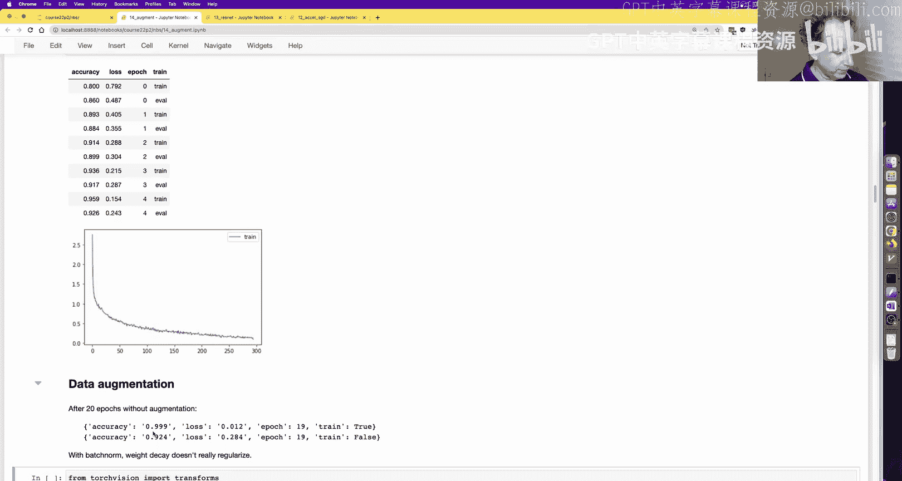

嗯。But it's actually a little bit separate to what we're meant to be learning about。

 so I'm not going to go through it。But yeah， if you're interested going into fast AI。Fsion。Ak meant。

And you'll be able to see， for example， how do we do flip？

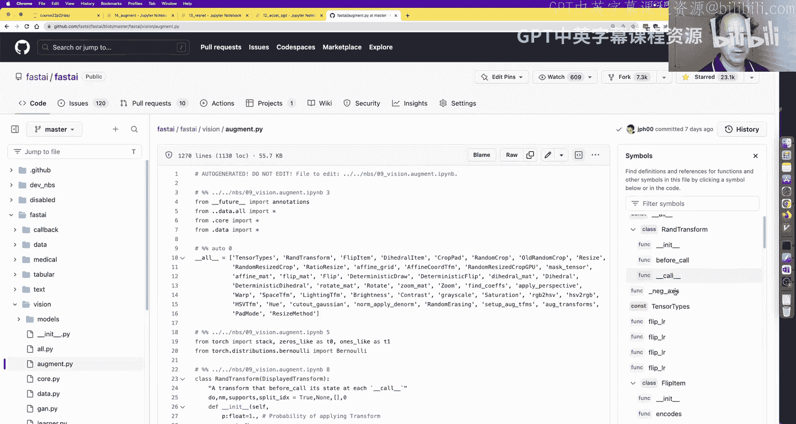

And， you know， it's just like X dot transpose。Okay， which is not。Really。Yeah。

 it's not that interesting。Yeah， how do we do cropping and padding？How do we do random crops。

 so on and so forth。 Okay， so we're just gonna actually， you know。

 fast A A have probably got the best implementation of these， but torch visions are fine。

 So we'll just use them。And so。We've created before。A batch transform Corback。

And we used it for normalization， if you remember， so what we could do。As we could create a。

Transform batch function。Which transforms the。Inputs and transforms the outputs。

Using two different functions。So that would be an augmentation Corbec。And so then you would say。

 okay， for the transform batch function， for example， in this case， we want to transform our xs。

And how do we want to transform our x's？And the answer is。We want to transform them using。

This module， which is a sequential module of first of all， doing a random crop。And then。

 a random horizontal flip。Now it seems we to randomly crop a 28 by 28 image to get a 28 by 28 image。

 but we can add padding to it， and so effectively it's going to randomly add padding on one or both sides to do this kind of random crop。

One thing I did to change the batch transform callback。Can't remember if I've mentioned this before。

 but something I've changed slightly since we first wrote it is I added this ontrain and on validateate。

So that it only does it if you said I want to do it on training and it's training。

 or I want to do it on validation and it's not training。And then this is all the code is。嗯。

So data augmentation， generally speaking， shouldn't be done on validation。

 so we said on validation false。Okay。So。What I'm going to do first of all is I'm going to use our classic single batch CB trick and fit in fit。

 even better， oh yeah fit one just doing training。😊，And what I'm going to do then is after I fit。

 I can grab the batch out of the learner。And this is a way this is quite cool， right。

 This is a way that I can see exactly what the model sees。😊，Right， so this is not relying on， on any。

You know， approximations。 remember， when we fit， it puts it in the batch that it looks at into learndo batch。

 So if we fit for a single batch， we can then grab that batch back out of it。

And we can call show images。 And so here you can see this that all。Cupp， it's added。Now。

 something you'll notice is that every single image in this batch， and I'll describe the first 16。

 and I dont want to show you 1024 has exactly the same。Orugmentation， and that makes sense， right。

 because we're applying a batch transform。Now， why is this good and why is it bad。

 It's good because this is running。On the GPU。😊，Right。

 which is great because nowadays very often it's really hard to get enough CPU to feed your fast GPU fast enough。

 particularly if you use something like Kale or coabab that are really underpowered for CPU。

 particularly kle。😊，So this way， all of our transformations。

 all of our augment is happening on the GPU。😊，嗯。On the downside。

 it means that there's a little bit less variety。 Every mini batch has the same augmentation。

 I don't think the downside matters， though， because it's going to see lots of mini batches。

 So the fact that each mini batch is going to have a different augmentation is actually all I care about。

So we can see that if we run this multiple times。You can see it's got a different augmentation in each mini batch。

mOkay。So。I decided actually， I'm just going to use one paddings， so I'm just going to do a very。

 very small amount of data augmentation。

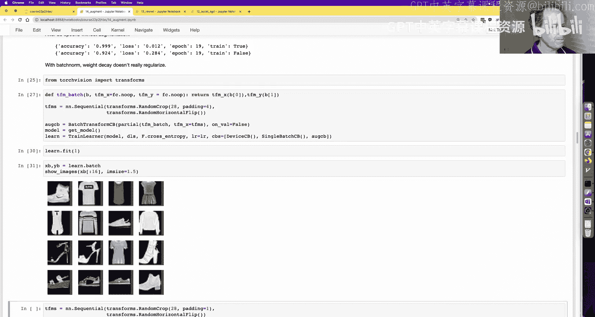

And I'm going to do 20 epochs。Using one cycle learning rate。And so。This takes quite a while to train。

 so we won't watch it， but check this out。We get two。😔，93。8。That's pretty wild。U。Yeah。

 that's pretty well。 So I actually went on Twitter， and I said to the entire world on Twitter。

You know， which if you're watching this in 2023， if Twitter doesn't exist yet。

 ask somebody to tell you about what Twitter used to be。 hopefully it still does。

Can anybody beat this？In 20 epos， you can use any model you like。

Any library you like and nobody's got anywhere close。um。So this is。

 this is pretty amazing and actually。😊，You know， when I had a look at papers with code。

There are you know， well， I mean， you can see it's right up there， right， with a kind of。

Best models that are listed certainly better than these ones and the the better models all use you know。

 250 or more epochs。 So yeah， if anybody， I'm hoping that some somebody watching this we'll find a way to beat this in 20 epochs。

 that would be really great。Because as you can see， we haven't really done anything very。Amazingly。

 weirdly clever。 It's all very， very basic。And actually， we can go even a bit further than 93。8。😊。

Just before we do， I mention that since this is actually taking a while to train now。

 I can't remember it takes like。10 to 15 seconds per。Epoch， so， you know。

 you're waiting a few minutes。 You may as well save it。

 So you can just call torch do save on a model。 and then you can load that back later。So。

 something that can。Make things even better is something called test time oration。

 I guess I should write this out properly here， test。Text test time augmentation。

Now test time augmentation actually does our batch transform callback on validation as well。

And then what we're going to do is we're actually， in this case， we're going to do just very， very。

 very simple test time augmentation， which is we're going to。

Add a batch transfer callback that runs on validate， and it's not random。

 but it actually just does a horizontal flip。Non random。 So it always does a horizontal flip。

 And so check this out。 what we're going to do is we're going to create a new callback called capture Pretz。

And after each batch， it's just going to append to a list。The predictions。

 and it's going to append to a different list。The targets。And that way。

 we can just call learn dot fit chain equals false， and it will show us。The accuracy。

 and this is just the same number that we saw before。

But then what we can do is we can call that the same thing， but this time with a different callback。

Which is with the horizontal flip Corbec。う。And that way。

 it's going to do exactly the same thing as before。

 But in every time it's going to do a horizontal flip。 And weirdly enough。

 that accuracy is slightly higher， which that's not the interesting bit。

 The interesting bit is that we've now got。Two sets of predictions。

 We've got the sets of predictions with the non flipped version。

 We've got the set of predictions with the flipped version。And what we could do。As we could。

Stack those together and take the mean。 So we're going to take the average of the flipped and unfpped predictions。

And that gives us。A better result still，94。2%。 So why is it better。

 It's because looking at the image from kind of like multiple different directions gives it more opportunities to try to understand what this is a picture of。

 And so in this case， I'm just giving it two different directions。

 which is the flipped and un flippedpped version。And then just taking their average。U。So。Yeah。

 this is like a really。Nice little trick， Sam's pointed out it's a bit like random forest。

 which is true， it's a kind of bagging that we're doing。

 we're kind of getting multiple predictions and bringing them together。And so， we can actually。So 94。

2， I think is my best。20 epoch。Result and notice I didn't have to do any additional training。

 so it still counts as a 20 epoC result。嗯。You can do test time augmentation where you do you know much wider range of different augmentations that you trained with and then you can use them at test time as well。

 you know， more crops or rotations or warps or whatever。I want to show you one of my favorite。

Data augmentation approaches， which is called random erasing。嗯。So random erasing。

 I'll show you what it's going to look like。😊，Random erasing。We're going to add a little。

 we're going to basically delete a little bit。Of each picture。

And we're going to replace it with some random Gaussian noise。Now， in this case。

 we've just got one patch。 but eventually， we're going to do more than one patch。

 So I wanted to implement this because remember， we have to implement everything from scratch。

 And this one's a bit less trivial than the。Previous transforms so we should do it from scratch and also not sure there's that many good implementations。

 Russ Whiteman's team I think has one so and it's also a very good exercise to see how to implement this from scratch。

嗯。😊，So， let's grab。A batch out of the training set。And let's just grab the first 16 images。

And so then let's grab the mean and standard deviation。Okay。

 and so what we want to do is we wanted to delete a patch。From each image。

 but rather than deleting it， deleting it would change the statistics， right if we set those order 0。

 the mean and standard deviation are now not going to be 01 anymore。

But if we replace them with exactly the same mean and standard deviation pixels that the picture has or that our data set has。

 then it won't change the statistics。 So that's why we've grabbed the mean and standard deviation and so we could then try grabbing。

 let's say we want to delete 0。2 so 20% of the height and width。

Then let's find out how big that size is， so 0。2 of the shape of the height and of the width。

 that's the size of the x and y and then the starting point we're just going to randomly grab some starting point。

Right， so with this case， we've got the starting point for x is 14。 starting point for y is 0。

 And then it's going to be a five by5 spot。 And then we're going to do a。

Gausian or normal initialization。Of our mini batch。Everything in the batch， every channel。

For this x slice， this y slice， and we've going to initialize it with this mean and standard deviation normal random noise。

 and so that's what this is。So it's just that tiny little bit of code。So you'll see。

 I don't start by writing a function。😊，I start by writing single lines of code。

That I can run independently and make sure that they all work and that I look at the pictures and make sure it's working。

Now， one thing that's wrong here is that do you see how the different， you know。

 this looks black and this looks gray。 Now first this was confusing me as to what's going on。

 what's it changed because the original images didn't look like that。

And I realize the problem is that the minimum and the maximum have changed。

 It used to be from negative 0。8 to 2。 that was the previous men and max。

Now it goes from negative 3 to 3。So the noise we've added has the same mean and standard deviation。

 but it doesn't have the same range because the pixels were not normally distributed originally。

 so normally distributed noise actually is wrong。So to fix that。

I created a new version and I'm putting in a function now。Does all the same stuff。As before。

 as I just did before， but it clamps。The random pixels to be between men and Max。

And so it's going to be exactly the same thing， but it's going to make sure that it doesn't change the the range。

 that's really important， I think。Because changing the range really impacts your activations quite a lot。

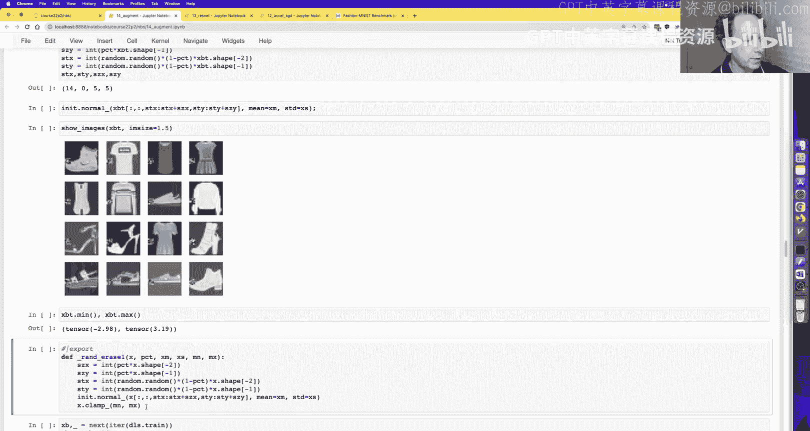

So here's what that looks like。 And so as you can see now。

 all of the backgrounds have that nice black。 and it's still giving me。Random pixels。And I can check。

 And because I've done the clamping， you know， and stuff。

 the main and standard aviation Act quite 01， but they're very very close。

So I'm going to call that good enough。 And of course。

 the inner max haven't changed because I clamped them to ensure they didn't change。

 So that's my random erasing。So that randomly erases one block。

And so I could create a random arrays which will randomly choose up to， in this case， four blocks。

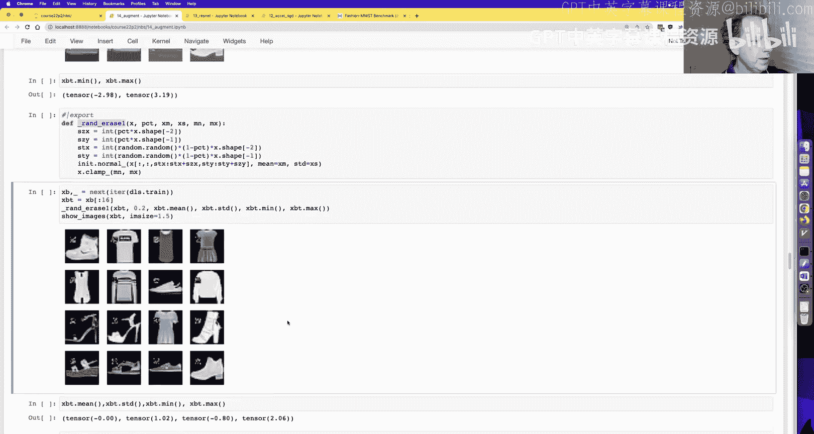

So， with that function。

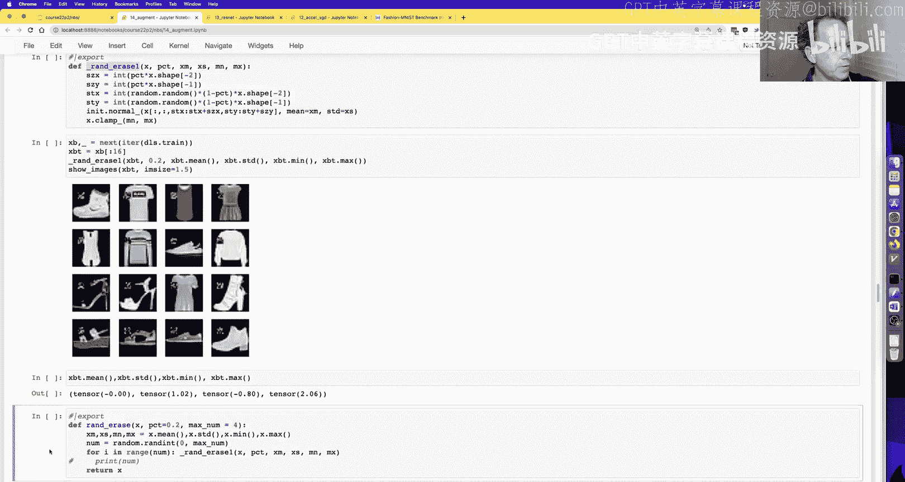

that's annoying。It happened to be zero this time。

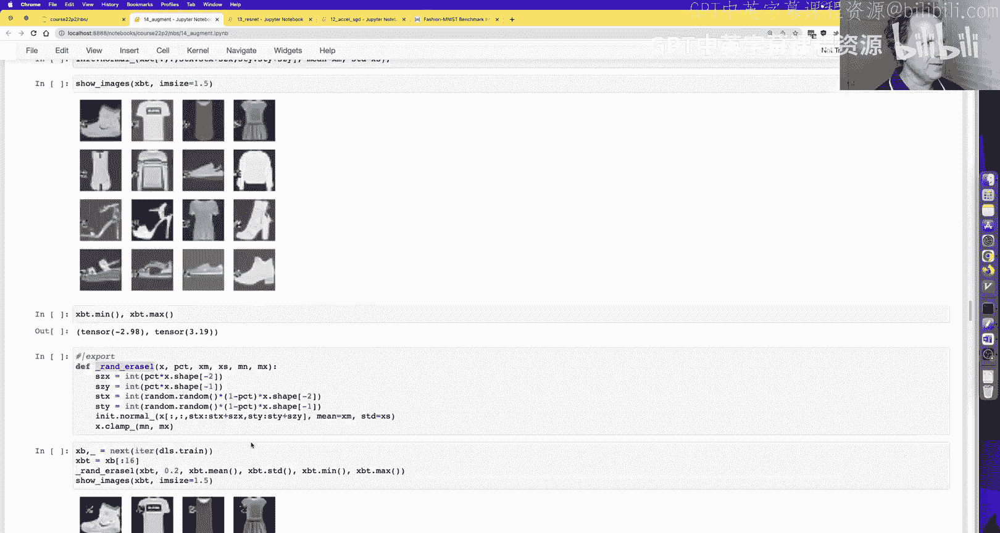

Okay， we'll just run it again。 This time， it's got three。 that's good。 So you can see it's got oh。

 maybe not 4，1，2，3，4 blocks。Okay， so that's what this data augmentation looks like。

So we can create a class to do this data augmentation， so you'll pass in what percentage。

To do in each block， what the maximum number of blocks to have is store that away。

And then in the forward， we're just going to call our random arrays function。

 passing in the input and passing in the parameters。嗯。Great， so now we can use。mRandom crop。

Random flip。 and R raise。

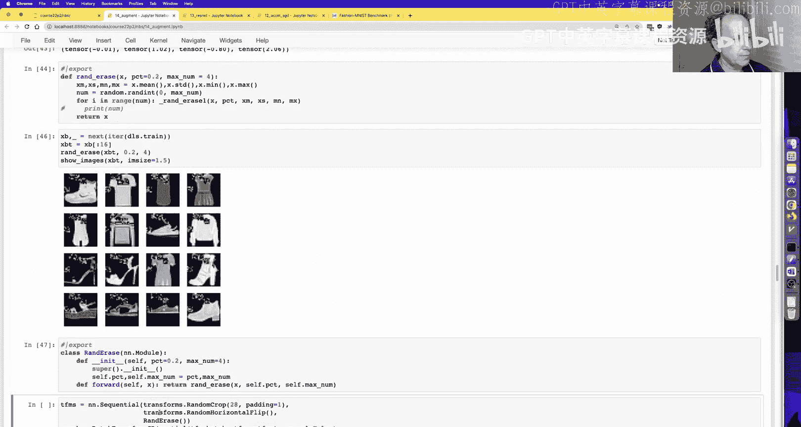

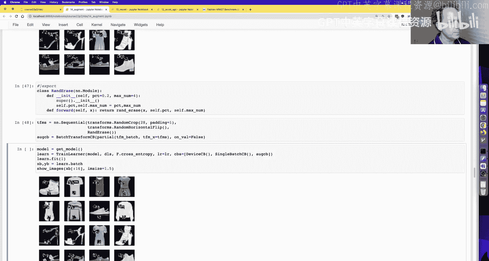

嗯。Make sure it looks okay。 And so now we're going to go all the way up to 50 epochs。😊。

And so if I run this for 50 apochs。

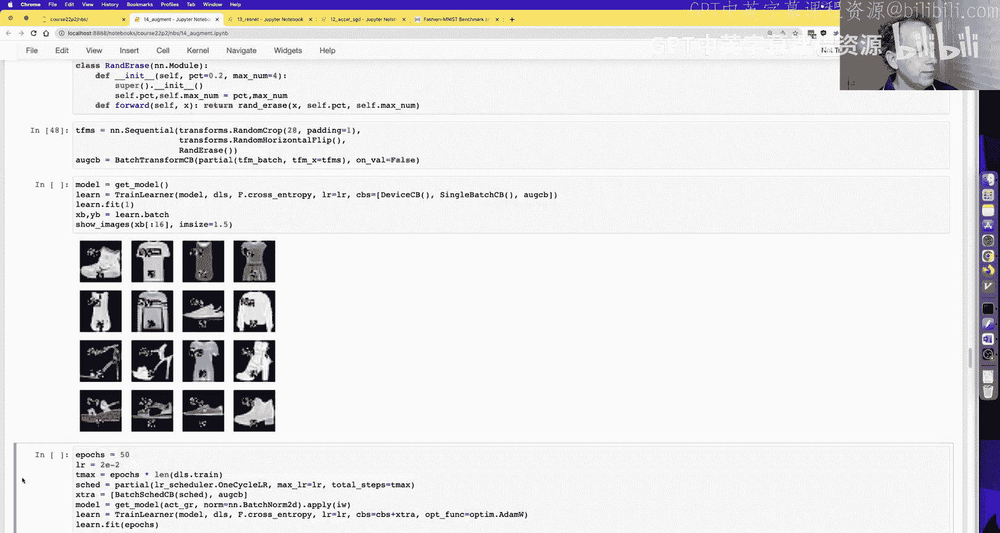

I get。94。6。Isn't that crazy？Um， so we're really right up there now， up， we're even above this one。😊。

So we're somewhere up here。And this is like stuff people write papers about from 2019 2020。Oh， look。

 here's the around we're raising。Paper，hu， that's cool。So they were way ahead of their time in 2017。

But yeah， that would have trained for a lot longer。

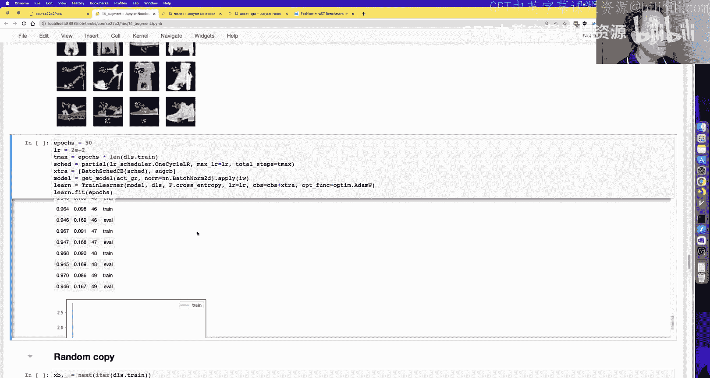

Now I was having a think。And I realized something， which is like， why like。

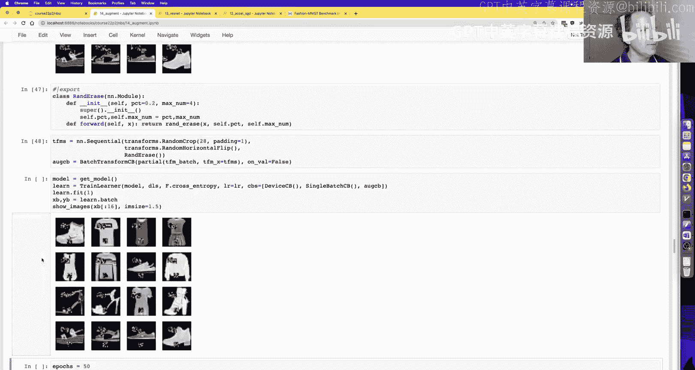

How do we actually get the correct distribution， right？ Like in some ways， it shouldn't matter。

 But I was kind of like bothered by this thing of like， well， we don't actually end up with 0，1。

 And this kind of like flping。 It all feels a bit weird。 Like， how do we actually。

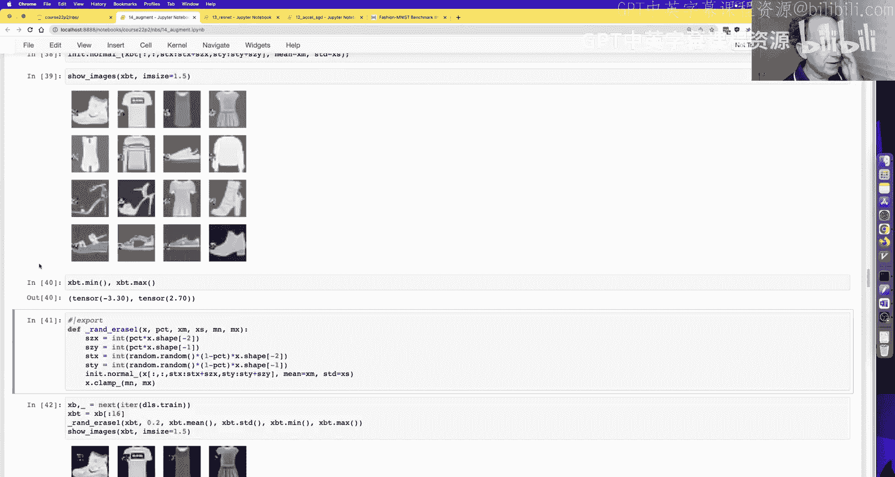

Replace these pixels with something that is guaranteed to be the correct distribution。

And I realized there's actually a very simple answer to this。

 which is we could copy another part of the picture over to here。😊，If we copy part of the picture。

 we're guaranteed to have the correct distribution of pixels。

And so it wouldn't exactly be random or raising anymore。 That would be random copying。Now。

I'm sure somebody else has invented this。 I mean， you know。

 I'm not saying this nobody's ever thought of this before。

 So if anybody knows a paper that's done this， please tell me about it but I you know， I think it's。

嗯。It's a very sensible approach and。It's very， very easy to implement。 So again。

 we're going to implement a all manually， right， so let's get our X mini batch。And let's get our。

 again， our size and again， let's get the X Y that we're going to besing。

 but this time we're not erasing their copying。 so we'll then randomly get a different X Y to copy from。

And so now it's just， instead of in it random noise。

 we just say replace this slice of the batch with this slice of the batch。And we end up with。

You know， you can see here it's kind of copied。Little bits across。

Some of them you can't really see it all and some of you can because I think some of them are black and it's replaced black。

 but I guess it's knocked off the end of this shoe， added a little bit extra here。

 a little bit extra here。 So we can now again， well turn it into a function。😊。

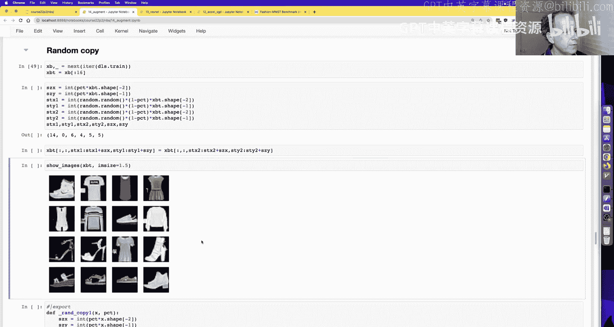

Once I've testeded it in the reple。

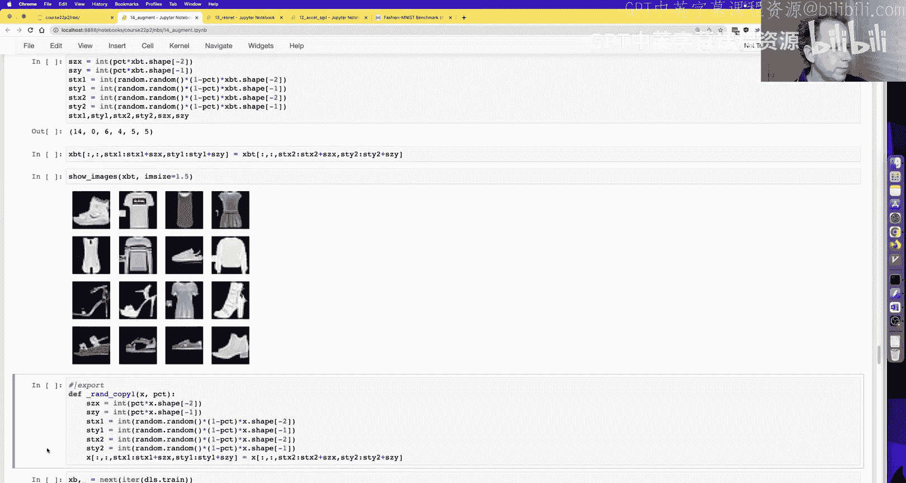

Make sure the function works and obviously this in this， this case。

 it's copying it largely from something that's largely black for a lot of them。

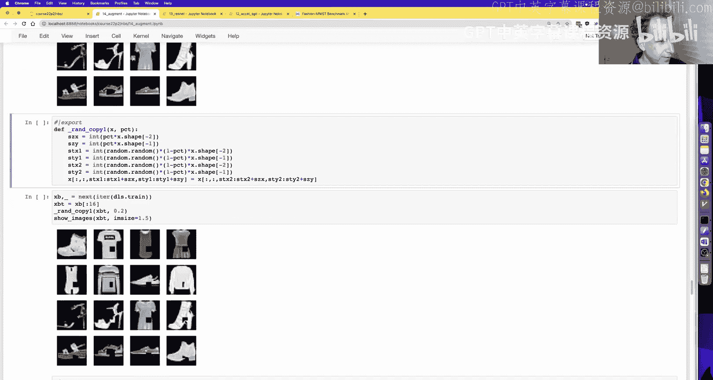

And then again， we can do the thing where we。

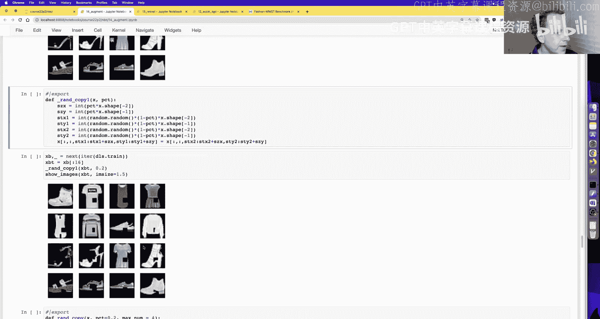

Do it multiple times。

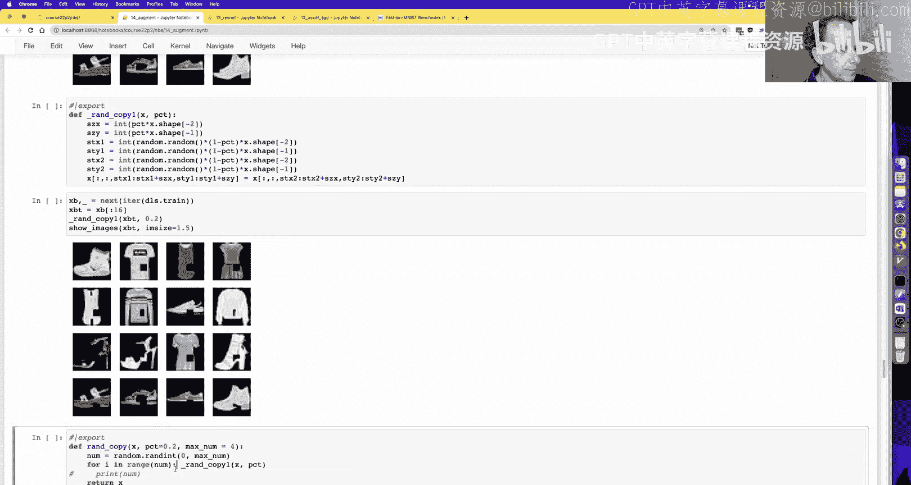

And here we go。 Now， it's got a couple of。Random copies。

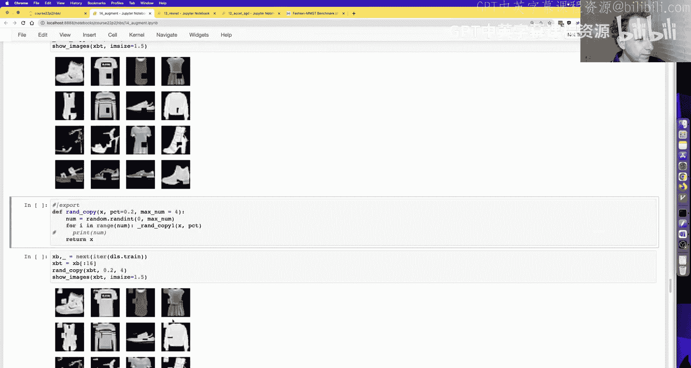

And so again， turn that into a class。

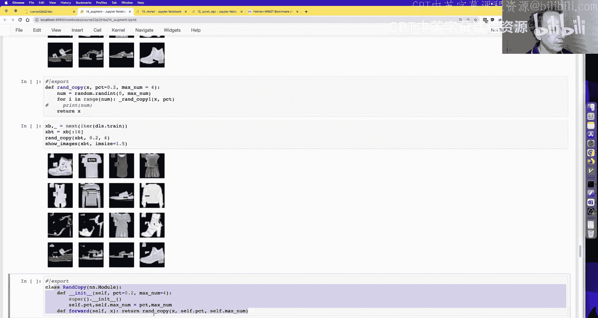

Create our transforms。And again， we okay， so again。

 we can have a look at a batch to make sure it looks sensible。

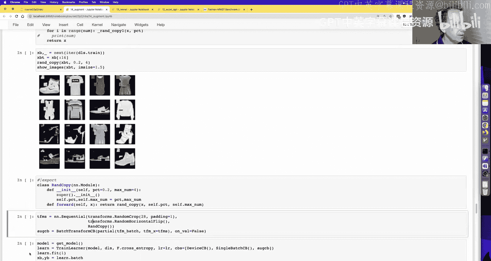

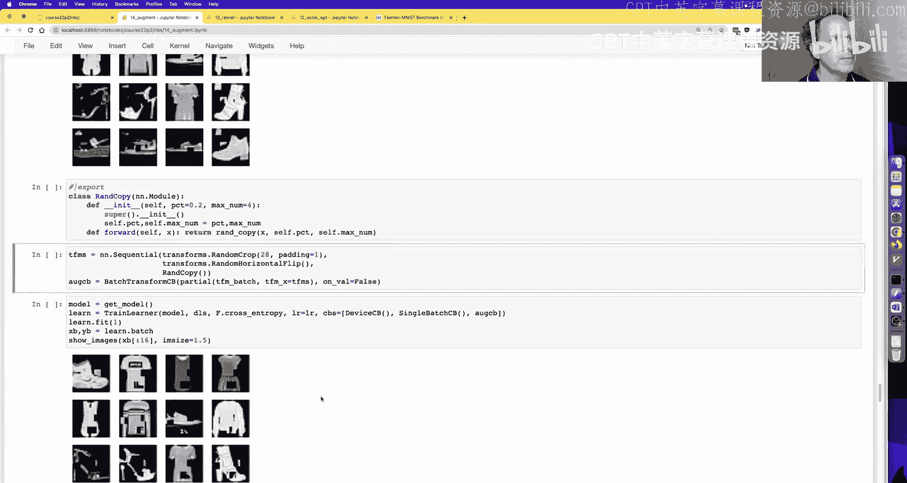

And do it just did it for 25 apochs here。And gets to。94%。Now。

 why did I do it for 25 epochs because I was trying to think about how do I beat my 50 epoch record？

Which was 94。6。 And I thought， well， what I could do is I could train。For 25 apochs。

And then I'll train a whole new model。For a different 25 epochs。

 and I'm going to put in a different learner learn2。Right， that this one is 94。1。

 So one of the models was 94。1。 One of them was 94。 Maybe you can guess what we're going to do next。

 It's a bit like test time augmentation。 But rather than that， we're going to。

Grab the predictions of our first learner。And grab the predictions of our second learner， and。

Stack them up and take them in。This is called ensembling。😊，And not surprisingly。

 the ensemble is better than either of the two individual models at 94。4， although unfortunately。

 I'm afraid to say we didn't beat our best。But it's。

A useful trick and particularly useful trick in this case I was kind of like trying something a bit interesting to see if using the exact same number of epochs。

 can I get a better result by using ensembling instead of training for longer and the answer was I couldn't maybe it's because the random copies not as good or maybe I'm using too much augmentation。

😊，W knows， but it's something that you could experiment with。

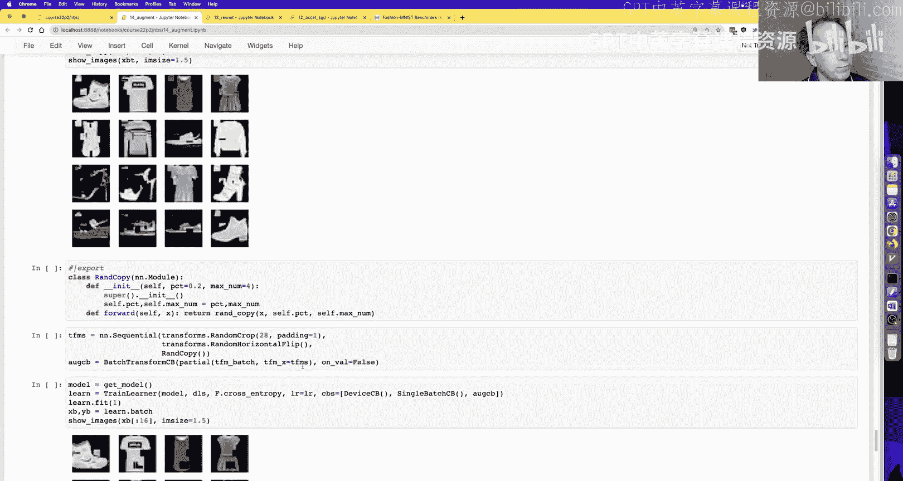

um。So Shan mentions in the chat that cut mix is similar to this。

 which is actually that's a good point I'd forgotten cut mix， but cut mix， yes。

 copies it from different images rather than from the same image。

 but yeah it's pretty much the same thing， I guess， ish。

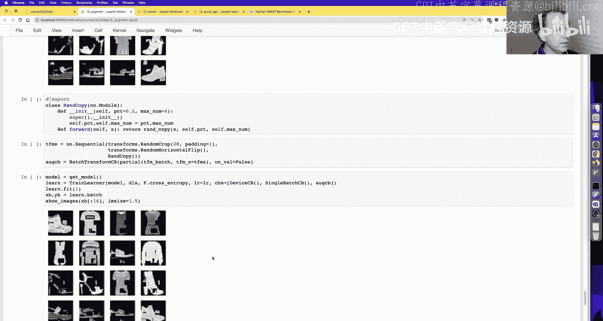

Well。嗯。Similar， yeah， pretty similar。嗯。All right， so that brings us to the end of the lesson。 And。

 you know， I am。Yeah， so pumped and excited to share this with you because， you know。

 I I don't know that this has ever been done before， you know， to be able to to go from from， I mean。

 even in our previous courses， we've never done this before， go from scratch。

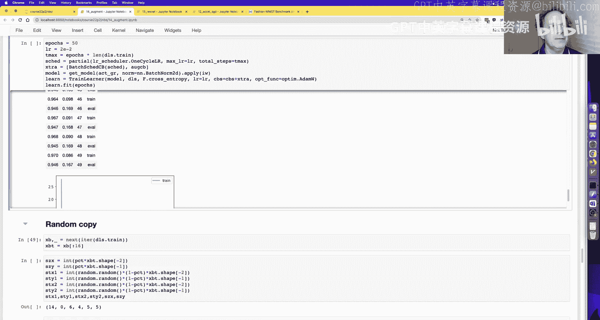

Step by step to an absolute state of the art model where we build everything ourselves and it runs。

This quickly， and we're even using our own custom ResNe and everything， you know。

 just using common sense at every stage。And so hopefully that shows that。😊，Deep learning is not。

Magic， you know， that we can actually build the pieces ourselves。And。Yeah， as you'll see。

 going up to larger data sets， absolutely nothing changes。

And so it's exactly these techniques and this is actually I do 99% of my research on very small data sets because you can iterate much more quickly。

 you can understand them much better， and I don't think there's ever been a time where I've then gone up to a bigger data and my findings。

Didn't continue to hold true。Now， homework， what I would really like you to do。😊。

Is to actually do the thing that I didn't do， which is to do the。Create your own。

And create your own schedulers。That work with Python's optimizes。嗯。So I mean。

 it's the tricky bit we'll be making sure that you understand the Pitorrch API well。

Which I've really laid out here， so study this carefully。

 so create your own cosine and kneeling scheduler from scratch。And then create your own one cycle。

ASchedulr from scratch and make sure that they work correctly。With this batch scheduler callback。

 this will be a very good。Exercise for you in， you know， hopefully。

Getting extremely frustrated as things don't work the way you hoped they would and being mystified for a while and then working through it。

 you know， using this very step by step approach， lots of experimentation， lots of exploration。

 and then figuring it out。That's， that's the journey I'm hoping you you have。

 If it's all super easy and， and you get it first go， then， you know， I。

 you'll have to find something else to do。 But yeah， I'm， I'm hoping you'll find it actually。

You know， surprisingly tricky to get it all working properly。 And in the process of doing so。

 you're going to have to do a lot of exploration and experimentation。

 But you'll realise that it requires no。Like。Prerequisite knowledge at all。Okay， so。

If it doesn't work first time， it's not because there's something that you didn't learn in graduate school if I knew you had done a PhD。

 whatever， it's just that you need to dig through。You know。

 slowly and carefully to see how it all works。And you know， then see hownate and concise。

You can get it。Then the other homework is to try and beat me， I really。

 really want people to beat me， try to beat me on the 5 epoC or the 20 epoC or the 50 epoch fashion MNs。

 ideally using many AI with things that you've added yourself。But you know。

 you can try grabbing other libraries if you like， or ideally。

 if you do grab another library and you find you can beat my approach。

 try to reimplement that library that way you are still within the spirit。Of the game。Okay。

 so in our next lesson， Jon O and Taish and I are going to be putting this all together。

To create a diffusion model from scratch。 And we're actually going to be taking a couple of lessons for this。

 not just a diffusion model， but a variety of of interesting in generative approaches。

 So we've kind of starting to come full circle。 So thank you。

So much for joining me on this very extensive journey and I look forward to hearing what you come up with。

 please do come and join us on forums。fasteraiI and share your progress。😊，Bye。

