# Jeremy《深度学习基础到稳定扩散模型｜Deep Learning Foundations to Stable Diffusion》中英 p13 Lesson 19_ Deep Learning Foundations to Stable Diffusion.zh_en -BV1Mp421S7xg_p13-

Okay， hi everybody， and this is lesson 19 with extremely special casts， Tennich and Gido， hi guys。

 how are you？😊，Hello， hey Jeremy， good to be here。And it's New Year's Eve，2022， finishing off。

2022 with a with a bang， or at least a really call lesson。Um。

And most of this lesson is going to be Tennich and Jon O。

 but I'm going to start with a quick update from the last lesson。um。

What I wanted to show you is that。and。Christopher Thomas on the forum。

What I want to show you is that Christopher Thomas on the forum came up with a better。

Winning result for our challenge， the fashion Is challenge。Which we are tracking here。And。

Be sure to check out this forum thread for the latest results。

 And he found that he was able to get better results。With dropout。Then。

Piere on the forum noticed I had a bug in my code and the bug in my code for resnets。

 Actually I won't show you。 I just tell you， is that in the res block。

 I was not passing along the batch norm parameter。 And as a result。

 all the all the results I had were without batch norm。 So then when I fixed。Batch Norm， and added。

Dropout at Christopher's suggestion I got better results still and then Christopher came up with a better dropout and got better results still for 50 epochs so let me show you the 93。

2 for5 epochs improvement I won't show the change to batch norm because that's actually that'll just be in the repo now so the batch norm is already fixed so I'm going to tell you about what dropout is。

And then show that to you。 So dropout is a simple but powerful idea where what we do with some particular probability。

 So here let's say probability is 0。1。 we randomly delete。Some activations and when I say delete。

 what I actually mean is we change them to zero。And。So one easy way to do this is to create a。

Bomial distribution object。Where the probabilities are 1 minus p。And then sample from that。

 And that will give you a0。Qu one probability so in this case。

 all is perfect I have exactly one0 and of course randomly that's not always going to be the case。

 but since I asked for 10 samples and point one of the time should be zero I so happen to get yeah exactly one of them。

😊，And so if we took a tensor like this and multiplied it by our activations。

That will set about a10th of them to 0， because multiplying by 0 gets to 0。So here's a dropout class。

So you pass it and you say what probability of dropout there is， store it away。Now。

 we're only going to do this。During training time， so at evaluation time。

 we're not going to randomly delete activations。嗯。But during training time。

 we will create our binomial distribution object。We will pass in the1 minus P probability and then you say how many binomial trials do you want to run so like how many coin tossses or dice rolls or whatever each time and says just one and this is a cool little trick if you put that one onto your accelerator you know GPU or MP or whatever it's actually going to create a binomial distribution that runs on the GPU that's a really cool trick that not many people know about and so then if I yeah sample and I make a sample exactly the same size as my input。

Then that's going to give me a bunch of ones and zeros and a tensor， the same size as my activations。

And then another cool trick is。This is going to result in activations that are， on average。

 about  one10th smaller。So if I multiply by one over。1 Midas。9 to multipplier this case by。

That then that's going to scale up。My。to undo that difference。Jeremyer， yeah。

In the line above where you have pros equals 1 minus p， should that be 1 minus self dot p？Oh。

 I absolutely should。 Thank you very much， Jenno。Not that it matters too much because yeah。

 you can always just use it and drop out at this point and I don't have used 0。1。

 which is why I didn't even see that so you can see I'm not even bothering to export this because I'm just showing how to repeat what's already available in。

In Pytorch。So yeah， thanks， Janno， that's a good fix。😊，Yeah， so if we're in evaluation mode。

 it's just going to return the original， if p equals0。

 then these are all going to be just ones anyway。So we'll be model playing by。1 divided by one。

 So there's nothing to change。 So with PS0 does does nothing in effect。Yeah， in other。

 it's going to kind of zero out some of your activations so we can the a pretty common place to add drop out is before your last linear layer。

 so that's what I've done here。Um so yeah， if I run the exact same。Epochs， I get 93。2。

 which is a very slight improvement。And so there is the reason for that is that it's not going to be able to。

Kd of memorize。The， the data or the activations。You know， because there's a little bit of randomness。

 so it's going to force it to try to identify just the actual underlying。Differences。

 there's a lot of different ways of thinking about this it's all you can almost think of it as a bagging thing。

 a bit like a random forest， you know it's each time it's giving a slightly different kind of random subset。

嗯。Yeah， but that's， that's what it does Theres a。I also added a drop 2D layer right at the start which is not particularly common I was just kind of like showing it this is also how Christopher Thomas's idea traded as well although he didn't use dropropout 2D What's the difference between in dropout 2D and dropout So this is actually something I'd like you to do to implement yourself as an exercise is to implement dropout 2D。

The difference is that with dropropout 2D。Rather than。Using x dot size。

As our tensor of ones and zeros。 So in other words， potentially dropping out every single batch。

 every single channel， every single X Y independently。 Instead， we want to drop out an entire。

Kind of grid area， all of the channels。Together， so if any of them are zero， then they're all zero。

So you can look up the docs for dropout 2D for more details about exactly what that looks like。

 but yeah， so the exercise is to try and implement that。From scratch。

And come up with a way to test it， so like actually check that it's working correctly because it's a very easy thing to think that it's working and then realize it's not。

嗯。So then， yeah， Christopher Thomas actually found that if you remove this。

Entirely and only keep this。 Then you end up with a better results for 50 epochs。

 And so he's the first to break 95 per cent， so。I feel like we should in。Some kind of。

Animation or trumpet sounds or something at this point。

 I'm not sure if I'm clever enough to do that in the video editor， but I'll see how I go。U。😊，Horay。

Okay， so that's about it for me。 Did you guys have any other things to add about drop out how to understand it or what it does or interesting things Oh。

 I did have one more thing before butt you go ahead if you've got anything to mention。

So I was gonna ask just because I think the standard is to set its like remove the dropout before you do inference。

 But I was wondering if there's anyone， you know of。

 or if it works to use it for some sort of test time augmentation。 Oh do Thank you。

 Ca I wrote a callback for that。 Did you see this or are you just like， no Okay。

 just says test time drop out callback。 nice。 So yeah， before epoch， if you're a member in learner。

 we we， we put it into。Youto。Training mode which actually what it does is it puts every individual layer into training load So that's way for the module itself we can check whether that module is in training mode。

 So what we can actually do is after that's happened。

 we can then go back in this callback and apply a Lada that says if this is a dropout。Then。B。Right。

 this is。Then。Put it in training mode all the time， including an evaluation。 And so then you can run。

Rout it multiple times， just like did for T T A。 but with this callback now。That's very。

Unlikelikely to give you a better result。mBecause it's not。

And of showing at different versions or anything like that。

 like TTA does that are kind of meant to be the same。

But what it does do is it gives you some a sense of。How。Confident。It is if， if。

 if it kind of has no idea， then。That little bit of dropouts quite often going to lead to different predictions。

 So this is a way of kind of doing some kind of confidence measure you'd have to calibrate it。Um。

 by kind of looking at things that it should be confident about and not confident about and seeing how that that that drop out。

 test time drop out。Changes。But the basic idea， it's brain used int。Medical models before。

 I wouldn't say it's totally。Popular， which is why I didn't even bother to show it being used。

 but I did just want to add it here because I think it's an interesting idea and。Maybe could be。

More used than it is， or at least more studied than it has been a lot of stuff that gets used in the medical world is less well known。

Out in the rest of the world。 So maybe that's part of the problem。Cool， al right。

 so I will stop my sharing and we're going to switch to to Nish。

 who's going to do something much more exciting， which is to show that we are now at a point where we can do。

😊，DDPM from scratch or at least everything except the model。 And so to remind you。

 DDPM doesn't have the latent V Ae thing and we're not going to do conditional So it's not going to be like we're not going to get to tell it what to draw。

嗯。And the unit model itself is the one that we're not going to do today， we're going to do that。

Next lesson but， but other than the unit， it's going to be unconditional DDPM。From scratch。

 So Tenish take it away。Okay， hi， welcome back。Sorry for the slight continuity problem。

 you may notice people look a little bit different。 That's because we had some zoom issues。 So we。

E couple of days have passed。 And we're back again。 and then。

Johnho recorded his bit before we do Tu bitit and then we're going to post them in backwards so hopefully there's not too many confusing continuity problems as a result。

😊，And it all goes smoothly， but it's time to turn it over to Tenishh to talk about。80 PM。

So we've reached a point where we have this mini AI framework and I guess it's time to now start using it to build more。

 I guess sophisticated models and as we'll see here we can start putting together a diffusion model from scratch using the mini AI library and we'll see how it makes our life a lot easier and also it would be very nice to see how you know the equations in the papers correspond to the code so I have here of course the notebook that we are that we'll be working from。

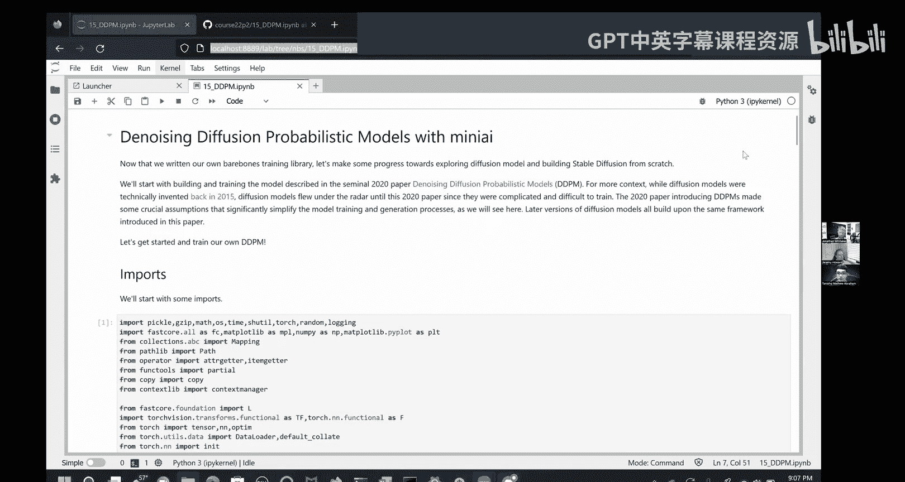

The paper which you know we have the diffusion model paper the noising diffusion probabilistic models。

 which is the paper that was published in 2020 it was one of the original diffusion model papers that set off the entire trend of diffusion models and is' a good starting point as we delve into this topic further and also I have some diagrams and drawing that I will also show later on but yeah basically let's just get started with with the code here and of course the paper so just to provide some context with this paper。

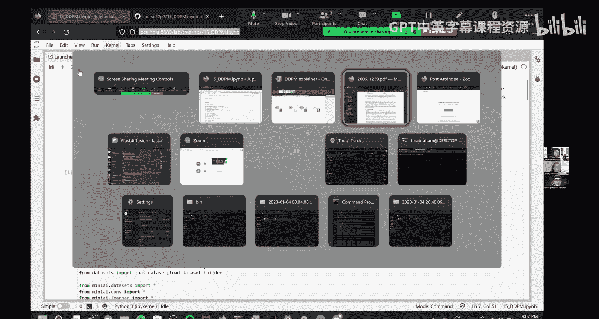

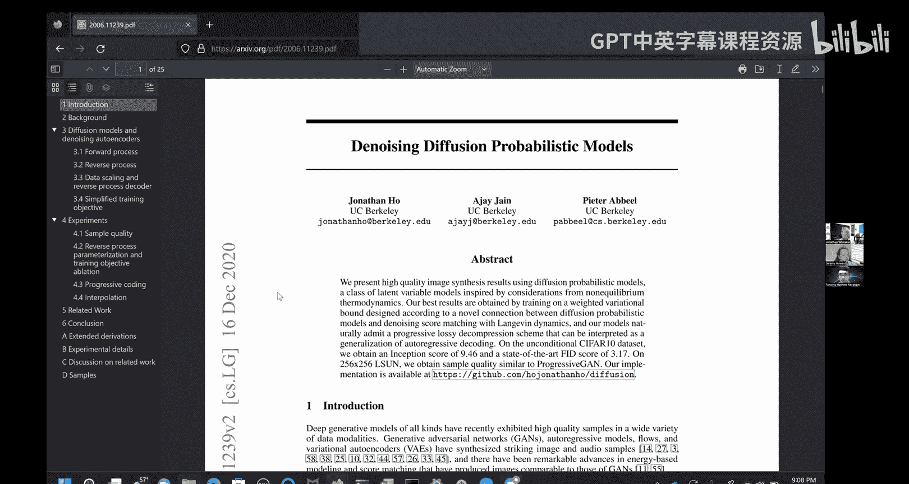

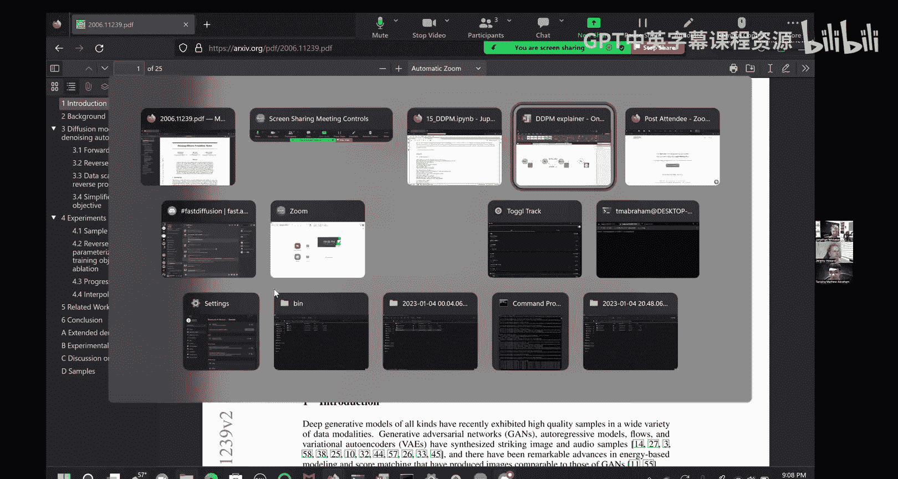

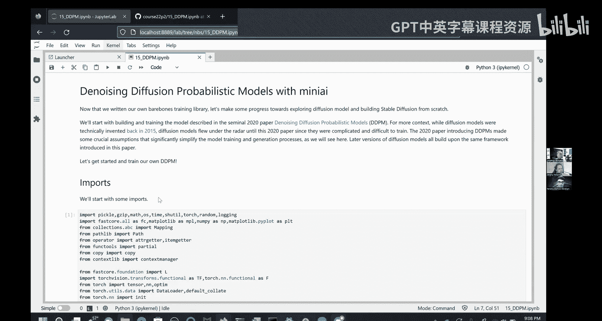

You know this paper was published from this group in UC Berkeley。

 I think a few of them have gone on now to work at Google and this is he has a big lab at UC Berkeley and so diffusion models were actually originally introduced in 2015 but this paper 2020 greatly simplifyim the diffusion models and made it a lot easier to work with and you know got these amazing results as you can see here when they trained on faces and in this case C far 10 and you know this really was very it kind of a big leap in terms of the progress of diffusion models and so just to kind of briefly provide and I guess kind of an overview if I could just mentioning which is。

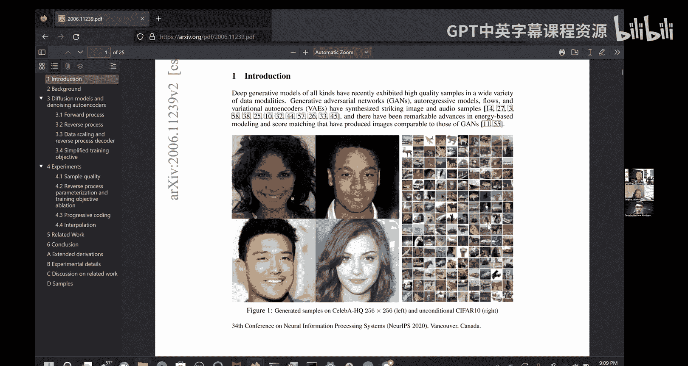

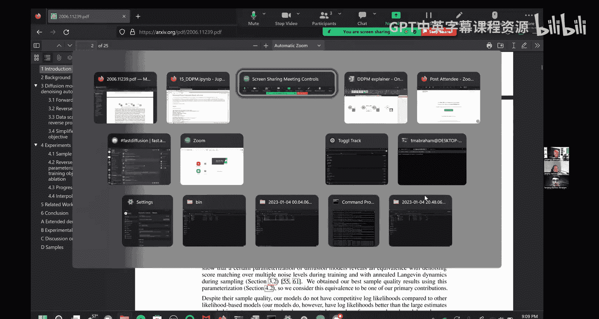

You know， when we started this course。We， you know， we talked a bit about how perhaps。

The diffusion part of diffusion models is not。Actually， all that。

 everybody's been talking about diffusion models because that's。

Particularly because that's the open source thing we have that works really well， but this week。

Actually， a model that appears to be quite a lot better than stable diffusion was released that doesn't use diffusion at all。

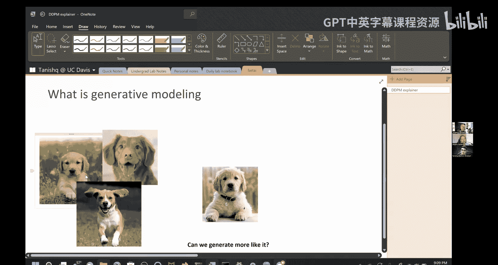

Having said that。

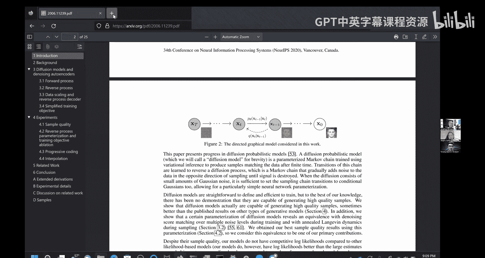

The basic。Ideas。Like most of the stuff that Tenishsh talks about today。

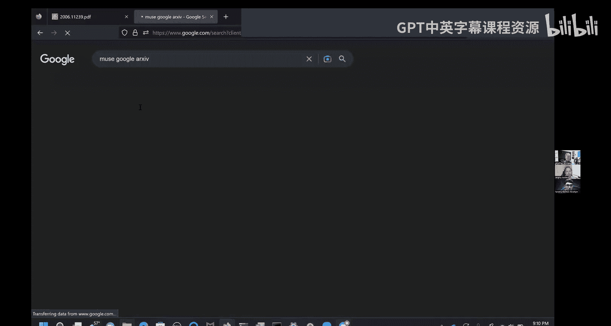

Will still appear in some kind of form， you know， but a lot of the details will be different。

 but strictly speaking， actually， yeah the。

嗯。I don't even know if I've got a word anymore for the kind of like modern generative model things we're doing So in some ways。

 when we're talking about diffusion models。You should maybe replace it in your head with some other word。

 which which is more general than includes this paper that Tenishshka is looking at here。

 Iterative refinement。 perhaps that's what yeah adelaide， that's not bad。 Iterative refinement。

I'm sure by the time people will watch this video， probably， you know。

 that somebody have decided on something。 we will。 We will keep our course website up to date。

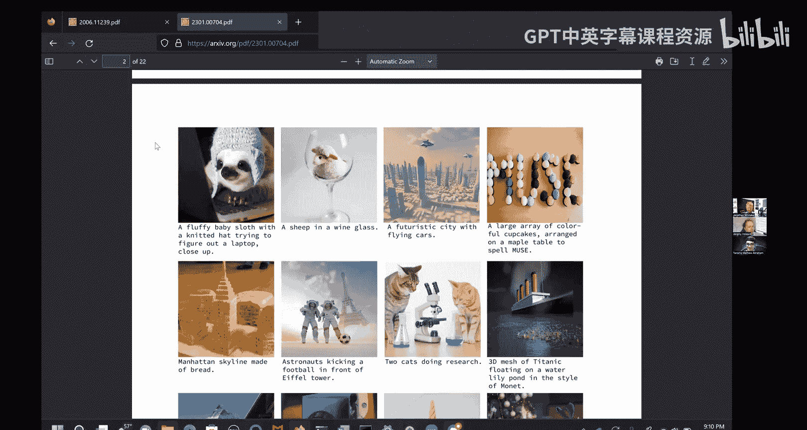

就这。Yeah， yeah， this is the paper that Ro Jeremyerem was talking about。 And yeah， every week。

 there seems to be another state of the art model。 So， but yeah， like driving said。

 a lot of the principles are the same， but you， the details can be different for each paper。

 but yeah， and just to， I just want to again also。Like Jeremy Mu kind of zoom back a little bit and kind of talk about a little bit about what。

You know， I just kind of provide a review of what we're trying to do to here， right。

 So let me just right here。 Yeah， so with。With a。task we were try to in this case we're trying to do image generation。

 Of course it could be other forms of generation like text generation or whatever And the general idea is that of course we have some you know data points you know in this case we have some images of dogs and we want to produce more like these the data points that were given so in this case maybe the dog image generation or something like this And so the overall idea that a lot of these approaches take for。

It is， you know， for some sort of generative modeling task is they have they try to not like here。

 they try to there oh maybe it might。Yeah， bomb， yeah， so let me use it in a bit。He he of X。

 which is our。Which is basically this sort of likelihood。Icle。S Cap here。Like we could。

Of of data point x， of x。 So let's say x is some image。

Then P of X tells us like what is the probability that you would see that image in real life and like if we can take like a simpler example which may be easier to think about of like a one dimensional data point like hype for example and if we were to like a height。

 of course we know like we have a data distribution that's kind of a bell curve and you know you have maybe some。

 you know。Mean height， which is like something like 5，9。

510 I guess5 feet10 inches or something like that or5 feet，9 inches， whatever。

 And then of course we have somewhere that' like you have some more unlikely points。

 but that is still possible like for example， we have7 feet or where you have something that moving9 is like which is like you know like three feet or something of this heres the X axis is height and the y axis is the probability of some random person you meet being that tall。

Exactly so you know you you know the yeah that this is basically the probability and so of course you have this serve peak which is where you know you have higher probability and so those are the sorts of you know values that you would see more often so this is this is our what we would call our P of x。

And like the important part about P of X is that you can use this now to sample new valuess if you know what P of x is or if you have some sort of information about P of X。

 So for example， here you can think of like if you were to like say maybe have some let's say you have some game and you have some a human characters in the game and you just want to randomly generate a height for this human character you know you could you wouldn't want to of course select a random height between three and 7 that's kind of uniformly distributed。

 you would instead maybe want to you would want to have the height dependent on this sort of function where you would more likely sample values you know in the middle。

 and less likely sample these sort of extreme points So it's dependent on this function P of x。

 So having some information about P of X will allow you to sample more data points and so that's kind of the overall goal of。

Of modeling is to get some information about P of X that then allows us to sample new points and you know create new generations。

 So that's kind of a high level kind of。Description of what we're trying to do when we're doing generative modeling and of course there are many different approaches。

 we have our F scans which you know used to be the common method back in the day before diffusia models you know we have BEs which I think we'll probably we talk a little bit more about that later as well we'll be talking about both of those techniques later yeah。

Yeah and so there are many different other techniques。

 there are also some niche techniques that are out there as well。

 but of course now the popular one is are these diffusion models or you know。

 as we talked about maybe a better termrb by be he of refinement or whenever you know。

 whenever the term ends to be。But yeah， so there are many different techniques and。Yeah， so。

Let's just so this is kind of the general diagram that shows what diffussion models are。

 And if we can look at the paper here， which let's pull up the paper， yeah， you see here。

 this is the the sort of they call it a directed graphical model。

 It's a very complicated term is just kind of showing what's going on in in this。

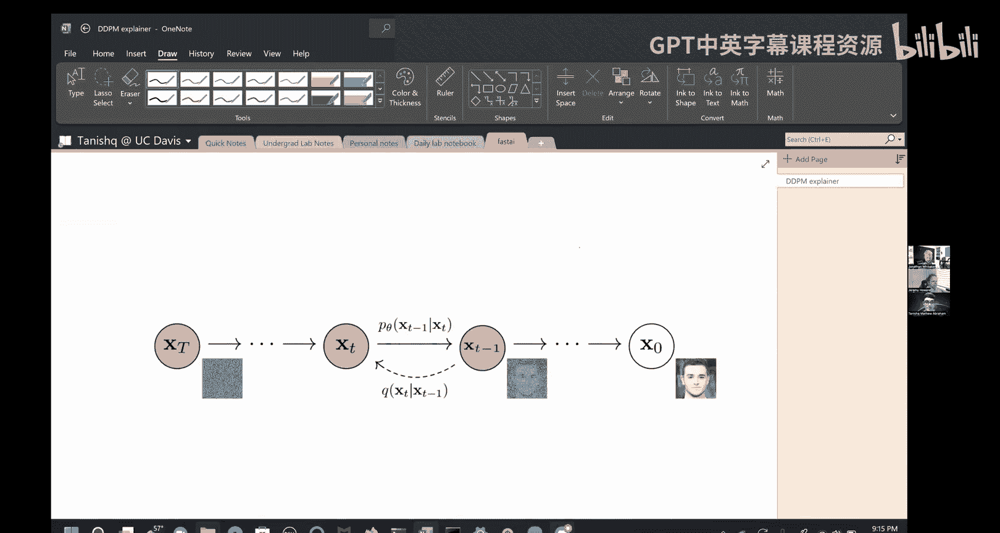

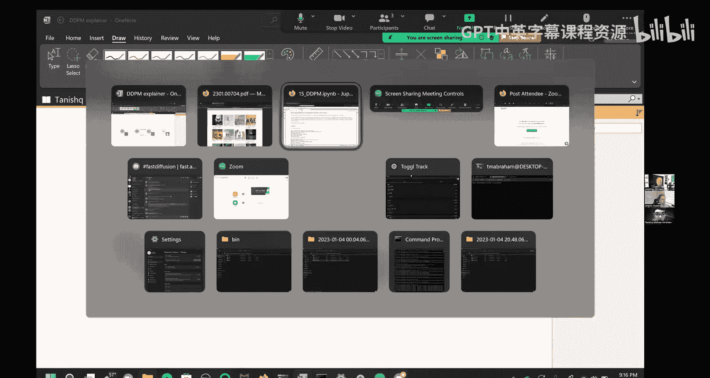

You know， in this process and you there's just a lot of complicated math here。

 but we'll highlight some of the key variables and equations here So basically the idea is that。

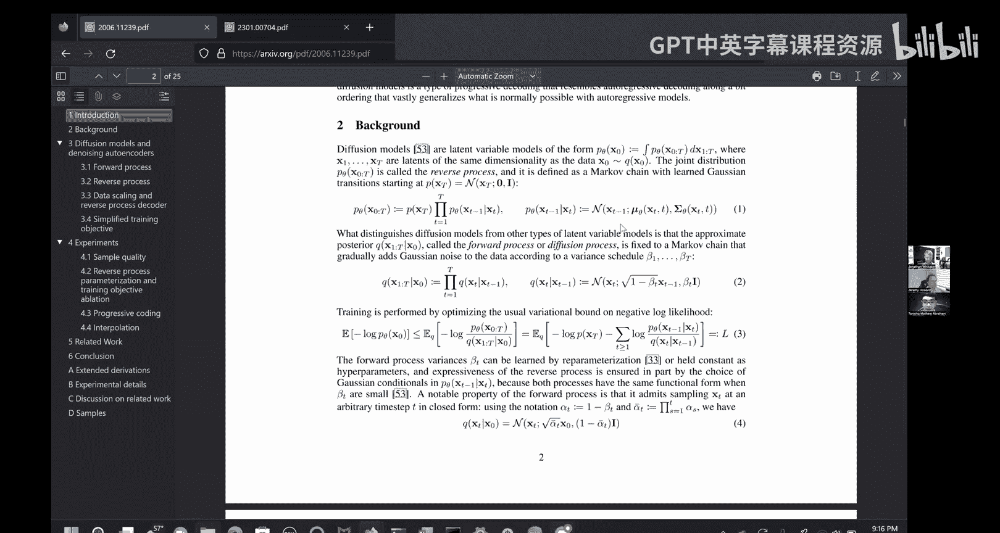

Okay， so let's see here so we so this is like， so this is an image that we want to generate right and。

And soO x0 is basically you know these are actually the samples that we want。

 so if we want to X0 is what we've want to generate and you know。These would be yeah。

 but these are images。And and we start out with pure noise。

 that's the that's what X X uppercase T pure。Noise。

And the the whole idea is that we have two processes。

 we have this process where we're going from pure noises to our。Image。

 and we have this possible thing from our image to pure node。

 So the process will be going from upper image to pure noises。 This is called the forward process。

What word， sorry， my my typing is though my handwriting is not so good in it so hopefully it's。

Clear enough， let me know if it's not till we have the forward process。

 which is mostly just used for our cr。 Then we also have our reverse process。

So this is the reverse process。Should I go right up here， rib verse。

Pros so this is a bit of a summary， I guess， of what。You and Wasin talked about in lesson。

9ine B what。And just it's just mostly to highlight now what what are the different variables as we look at the the code and see。

 you know the different variables in the code and okay， so we'll be focusing today on the code。

 but the code will be referring to things by name and those names won't make sense very much and unless we。

Say the。What they used for the meth？And I won't dive too much into the math。

 I just wanted to focus on these sorts of variables and equations that we see in code。

So basically the general idea is that you know we do these in multiple different steps， you know。

 we have here from time step zero all the way to time time steps uppercase T and so there's some fixed number of steps but then we have this intermediate process where we're going you know from some particular yeahs some particular time step yeah。

 we have this time step。A lower T tea but some noisy image。And。

And and yes we're transitioning between these two different noisy images。

 So we have this what is sometimes called it transition。 we have this one here。

 This is like sometimes called it transition kernel or yeah。

 whatever it is it basically is just telling us you know how do we go from you know one in this case we're going from a less noisy image to a more noisy image and then going backwards is going from a more noisy image to a less noisy image。

 So let's look at the equations here So the forward direction trivial easily to make it something more noisy just start a bit more nois to it and the reverse direction is incredibly difficult。

 which is to particularly to go from the far left the far right is strictly speaking impossible because none of that。

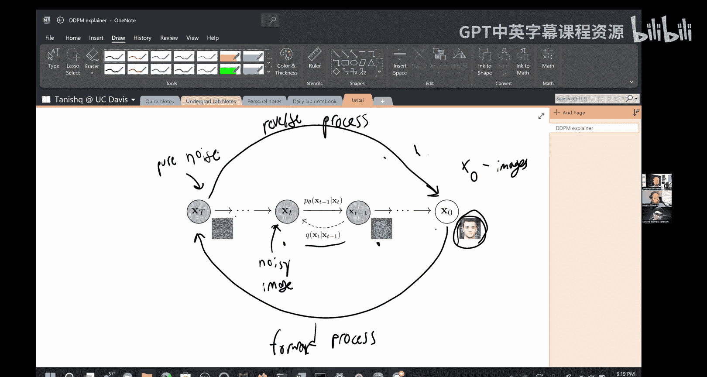

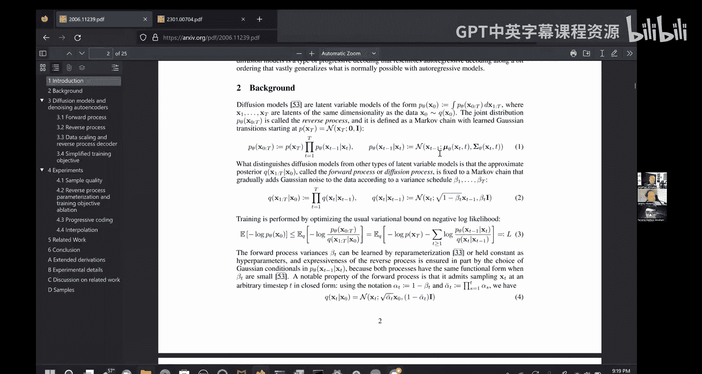

Person's face exists any more that somewhere in between。

 you can certainly go from something that's partially noisy to less noisy。By a learned model。Exactly。

 and that's like what I'm going to write down right now in terms of in terms of I guess the symbols and the map。

 So yeah， basically that I'm just trying to pull out the just to write down the equations here So we have let me in a bit on。

😊。

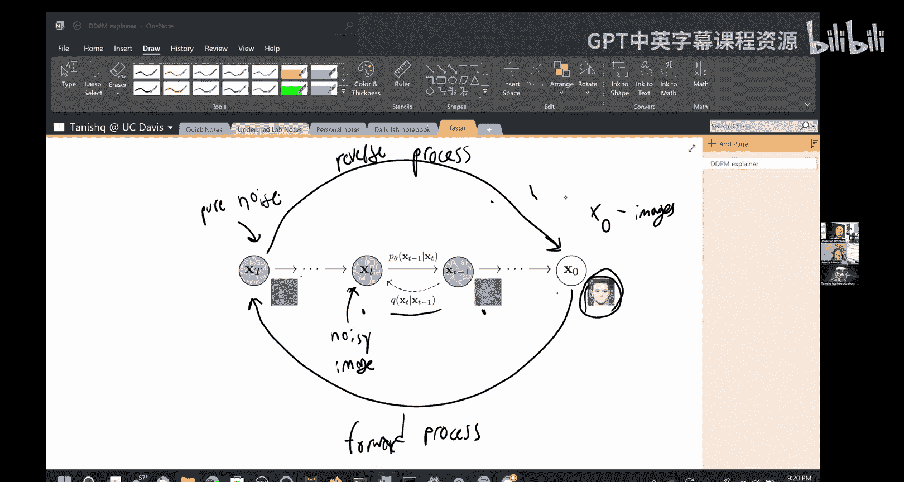

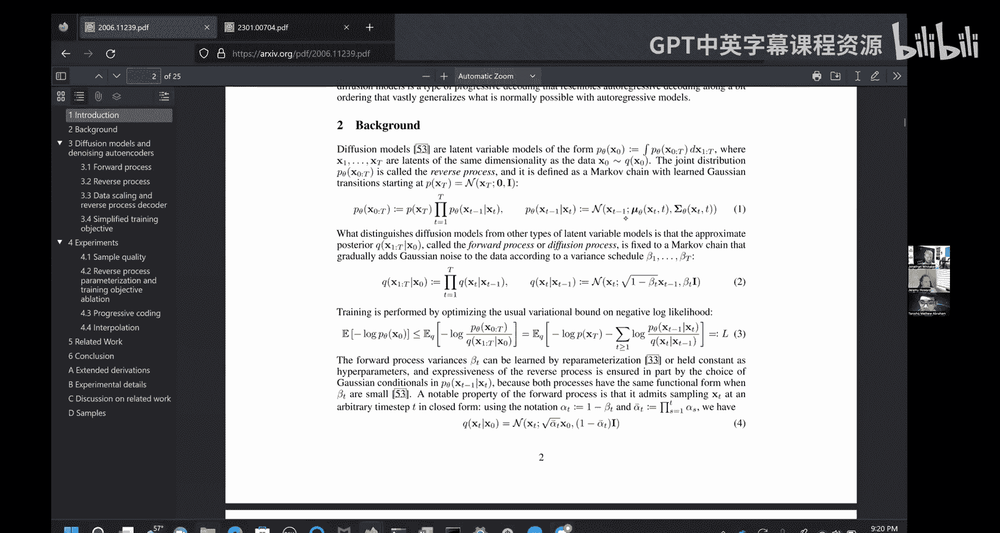

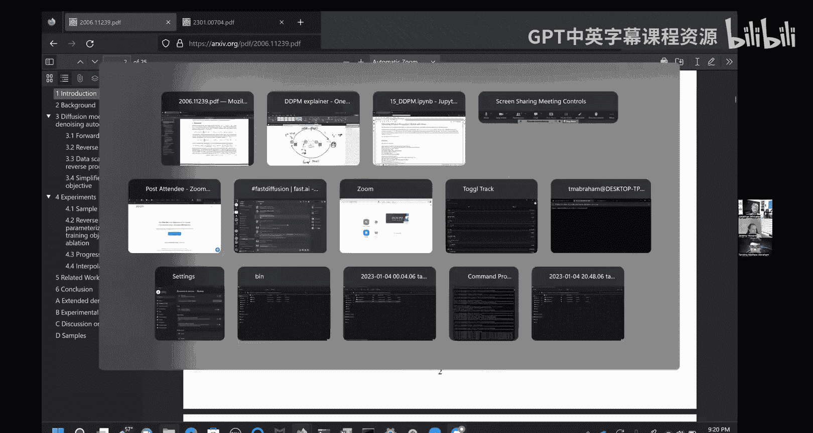

Yes， so we have。But our two oops， see him。Q of。Xs T， X T minus1。Um，Or actually， you know what。

 maybe it's just better if I。

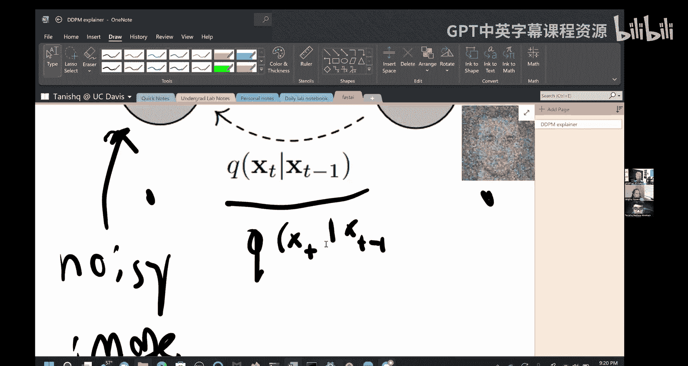

Just snipped。Yeah， it's a snippet from here。 So the one that is going from our。

The one that is going from our forward process。

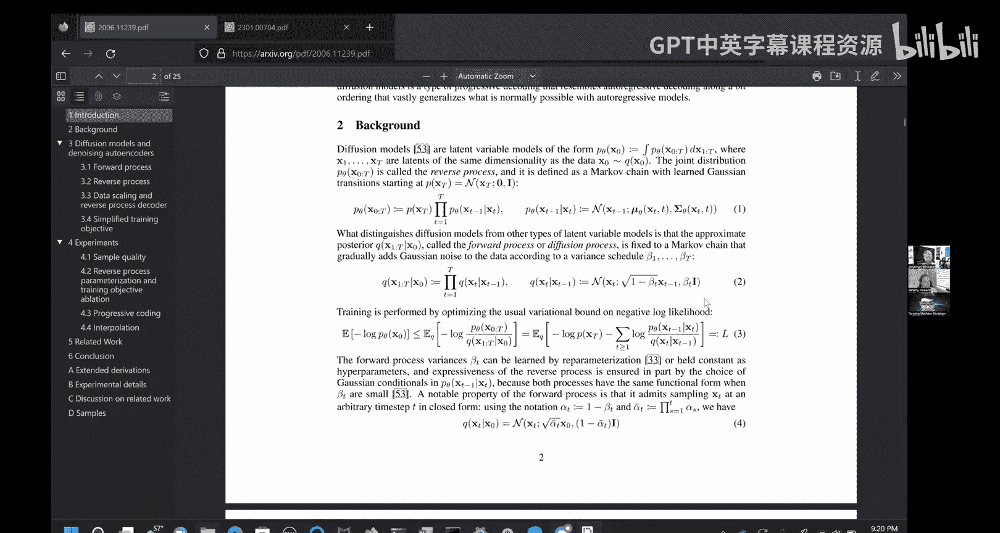

Is this this equation here？So I'll just make that a little smaller for you guys。 just so right there。

 So that is going on and basically to， to explain， we have this。We have this sort of。

Scr a little bit of maybe a little bit confusing not here。

 but basically this is referring to a normal distribution or Gaussian distribution and this is just saying okay this is a Gaussian distribution that's describing this particular variable so it's just saying okay you know n is our of a normal or Gaussian distribution and it's representing this variable x of T or x sorry xt and then we have here is is the mean。

And this is the variance。So just to again clarify it I think we've talked about this before as well。

 But like， you know， this is， you know， this is， of course a bad drawing of a Gaussian。 But you know。

 our mean is just our mean is just， you know， this， you know。

 the the middle point here as the mean and the variance just kind of describes the the sort of spread of。

Of the of the Gausian distribution。 So if you think about this little further， you have this beta。

 which is at one of the important variables that kind of describes the diffusion process beta at T so you'll see the beta t in the code and basically beta t increases as t increases。

 So basically your beta t will be greater then your beta t minus1。

 So if you think about that a little bit more carefully， you can see that okay so。

At t minus1 at this time point here。And then you're going to the next time point。

 you're going to increase your beta t。 so you're increasing the variance。

 but then you have this one minus beta t and take the square root of that and multiply it by x t minus1。

 So as your T is increasing， this term actually decreases So your mean is actually decreasing and you're getting less of the original image because the original image is clearly to be part。

Of X T -1。 So as you and just to let you know English。Just let you know we can't see your pointer。

So if you want to point at things， you would need to highlight them more clnting。Yeah， so I' yeah。

 I'll just。U， let's see again。Or yeah， basically I mean It particularly point anything in specific。

 I was just saying that yeah， basically if we have our x of t here as the time step increases you know you're getting less contribution from x x t minus1 and so that means your mean is going towards zero and so you're gonna to have a mean of0 and the variance keeps increasing and basically just how a Gausta distribution and you lose any contribution from the original image。

 as your time step increases so that's why when we start out from x of0 and go all the way to our x of t here。

 this becomes pure noise it's because we're doing this iterative process where we keep adding noise。

 we lose that contribution from the original image and that leads to that leads to the image having pure noise at the end of the process。

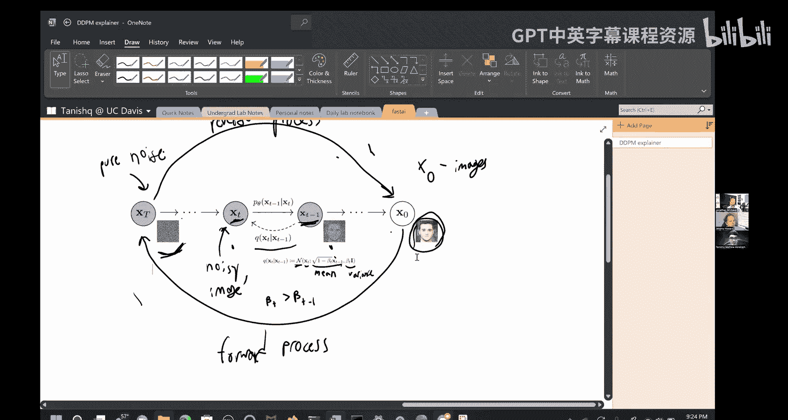

So just just something I find useful here is to。

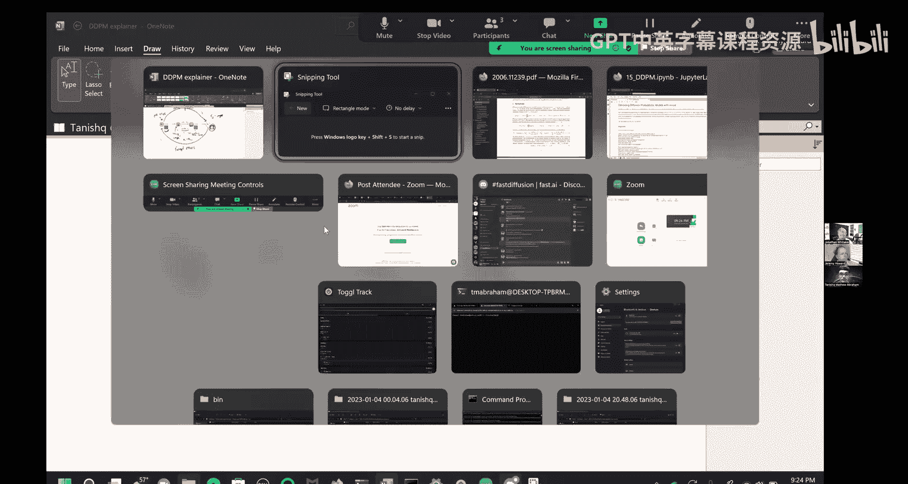

Consider one extreme， which is that is to consider。X1， so at x1。The main is going to be。

Why root 1 minus beta t times x n， the reason that's interesting is x n is the original image。

So we're taking the original image and at this point。1 minus Bta t will be。Pretty close to one。

 So at x 1， we're going to have something that's the mean is very close to the image。

 and the variance will be very small。 And so that's why we will have a。

Image that just has a tiny bit of noise。Right， right。

And then another thing that sometimes is' easier to write out is sometimes you can write out in this case。

 you can write out two above x。T directly。Because these are all independent in terms of likeq of x T is only dependent of x t minus-1 and then x t -1 is only dependent on x t minus-2。

 and you kind of you can is just independent all each of these steps are independent。

 So based on you know the different laws of probability。 you can get your Q above X t in close form。

 So yeah， that's what's shown here。 Q of X t did in your original image。

 So this is also another way of kind of seeing this more clearly where you can see。

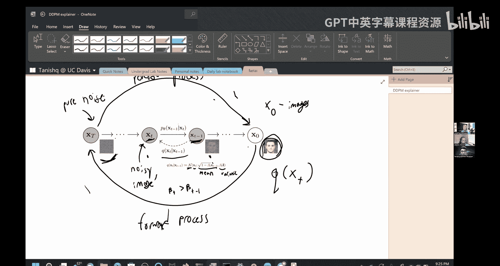

You can see that。

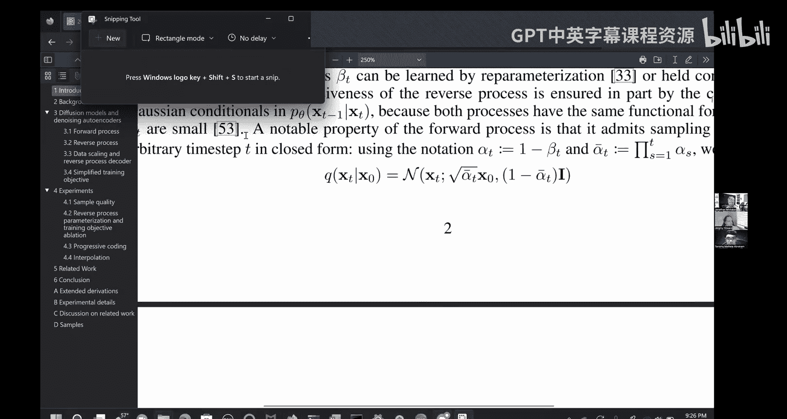

OnAnyway， some gle back here。 Yeah， so this is another way to see here more directly。 So this is。

 of course， our clean。Image。And this is our work。just keep that all clear， our noisy。没 know。

And so you can also see again now alpha bar T is dependent on beta t， basically it's like。

1 minus like the cumulative this is， I mean， we'll see the code for it， I guess。 So might be yes。

 yes， So it might be clear to see that result。 this is alpha bar T or something like this。

 but basically， basically， the idea is that alpha bar T。Alpha bar P。Is going to be。Again。

 less this is one is going to be less than alpha of bar team minus is1。

So basically alpha this keeps decreasing right this decreases as time step increases and on the other hand。

 this is going to be increasing as time step increases。

 so again you can see the contribution from the original image decreases as time step increases while the noise you as shown by the durians is increasing while you know the time of increased。

Anyway， so that hopefully clifies the forward process and then the reverse process is this basically a neural network as we as Jeremy had mentioned。

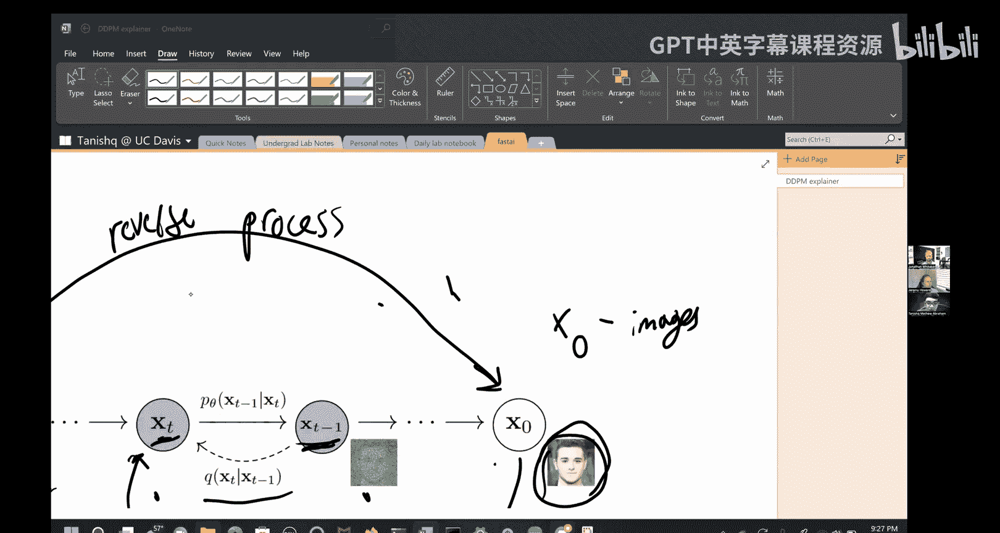

And yet， I listen。Scrchshot this thats。

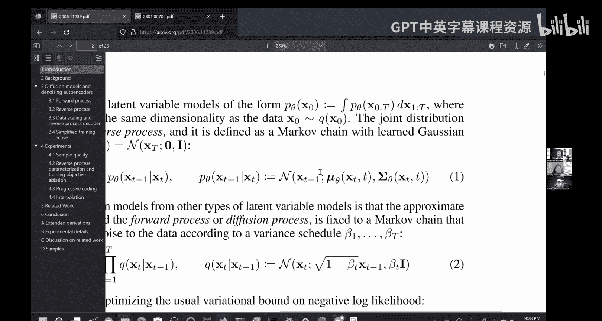

Said he， hete this。That's yes， is our this is our reverse process and basically the idea is well。

This is a neural network， and this is also a neural network Ne role。Network。

And we learned it during the training of the model。

 but the the nice thing about this particular diffusion model paper that made it so simple was actually we completely。

Ignore this and actually set it to our instance just based on him you know。

 we can't say what you're pointing at， so I think it's important to mention what this is here。

This this term here。 so this one we just kind of ignored and it's just a constant。Baah， dependent。

Bond beta G。So you only have one neural network that you need to frame。

 which is basically referring to this mean。And。And the nice thing about this diffusion model process is that it also unique para pricess mean into this easier form where you do a lot of complicated math which will not get into here。

 but basically you get this kind of simplified training objective where let's see here。

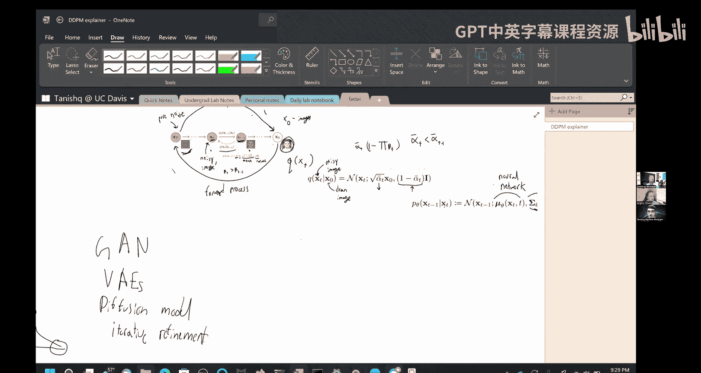

Yeah， you see the simplified training objective， you instead have this epsilon beta function and。

Let me just screenshot that again。

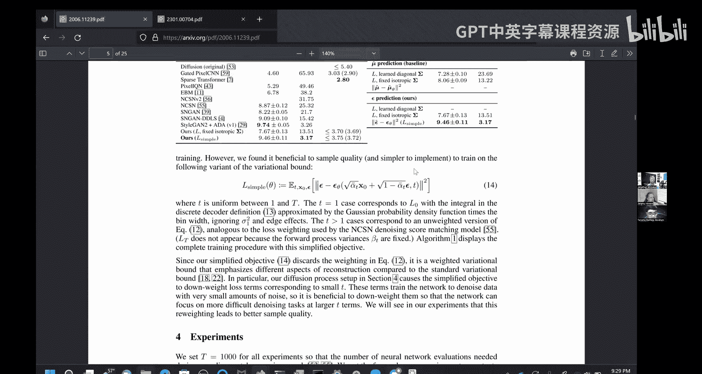

Something shot。This is our loss function that we train， and we have this epsilon beta function。

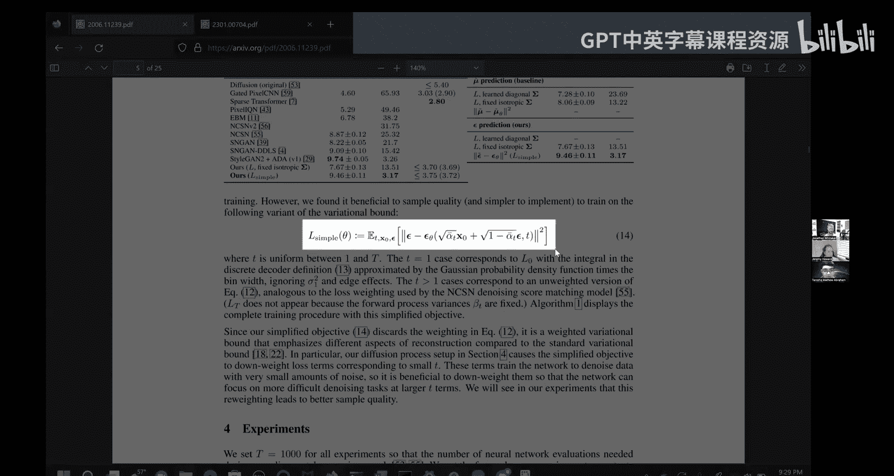

And you can see it's a very simple loss function， right， This is just a。

If you just write this down This is just an MSC loss and we have this Epsil datata function here that is already I mean。

 to folks like failure here are less May， it might not be obvious that it's a simple thing because it looks quite complicated to me but once we see it encode it'll。

It'll be simple。Yes， yes。 basically you're just doing like and you'll yeah you'll see an in how how it blue is。

 but this is like just an MSC loss。 So we've seen MSC loss before。

 but you'll see how yeah this is basically MSC So the nice So just to kind of take a step back again。

 what is this epsilon data because this is like a new thing that like seems a little bit confusing。

Basically， Epsilon。You can see here， basically， yeah， absolutely。This here。

Is saying this is actually。equivalentquient。To this equation here。These two are co。

 This is just another way of saying that because basically it's saying。X of that's x of T。

So this is giving x of T and it just in a different way。 But epsilon is actually。

This normal distribution with a meanta 0 and a variance of1。

 and then you have all these scaling terms that you know changes the mean to be the same as as this equation that we have over here So that's this is our x of t and so what epsilon is it's actually the noise that we're adding to our image to make it into a noisy image and what this neural network is doing is trying to predict that noise。

So what this is actually doing is this is actually a noise predictor and is predicting the noise。

In the image。And why is that important？Basically， the general idea is like if we were to think about our。

Our distribution of data， let's just think about it in a 2D space。Just here， you know。

 each data points here represents an image and that they're in this blob area。

 which represents the distribution， so this is。In distribution。And this is out of the distribution。

Out of distribution。And basically， the idea is that， okay， if we take an image and。We want to。

 we want to generate some random image if we were to take a random data point。

 it would most likely be noisy images， right， so if we take some random data point。

 it would be more you know the way to generate a data point， it's going to be just noise。

 but we want to you know keep adjusting this data point to make it look more like an image from your distribution。

 that's kind of the whole idea of this iterative process that we're doing in our diffusion model。

 So the way to get that information is actually to take images from your data set and actually add noise to it。

 So that's what we try to do this process， So we have an image here and we add noise to it。

And then what we do is we try to plan a neural network to predicting the noise and by predicting the noise and subtracting it out。

 we are going back to the distribution， so adding the noise takes you away from the distribution and then predicting the noise brings you back the distribution。

 so then if we know different at any given point in you this space， how much noise to remove。

That gift tells you how to。Keep going towards the data distribution and get a point that lies within the distribution。

So that's why we have noise prediction and that's the importance of doing this noise prediction is to be able to then do this iterative processor where we can start out at random point。

 which would be phrase example pure noise and keep predicting and removing that noise and walking towards the data distribution。

Yeah okay。Okay， so yeah， let's get started with the code。And so here we， of course。

 have our imports and we're going to load our data set。 We're going to work with。

Our fashion amnesty set， which is what we've been working with for a while already and。Yeah。

 this is just basically the similar code that we've seen from before in terms of lowering the data set。

And then we have our model so we remove the noise from an image so what our model is going to take in is it's going to take in the previous image。

 the noisy image and predict the noise so the shapes of the input and the output are the same they're going to be the shape of an image so what we use is we use a unit neural network which peaks in kind of the input image and and we do see your pointer now by the way。

 so feel free to point to things。Yeah， so yeah， it takes an input image。And in this case， a unit。

It full purpose， but therefore， they can also be used for any sort of image to image task where we're going from an input image and then outputting some other image of some sort and we' new architecture which we haven't learnt about yet and we will be learning about in the next lesson but broadly speaking those gray arrows going from left to right a lot like very much like resnet skip connections but they're being used in a different way。

 everything else is stuff that we've。Sa before。Um so it's basically we can pretend those don't exist for now。

 it's， it's， it's a neural network that。The output is the same size or a similar size。To the input。

 and therefore， you can use it to learn how to go from one。Image to a different image。Yeah， so on。

Yeah， so that's where the unit is and yeah， like Ja said we'll talk about them more the sort of units that are used for diffusion models also tend to have some additional tricks which again we talk about them later on as well。

 but yeah， we'll just for the time being we will just import a unit from the diffusers library which is the Hu and face library for diffusion models。

 so they have a unit implementation and we'll just be using that for now。嗯。And so， yeah， of course。

 strictly speaking， we're cheating at this point because we're using something we haven't written from scratch。

 but were we're only cheating temporarily because we will be writing it from scratch。Yeah。And yeah。

 so and then of course， we're working with one channel images or fashion emmunist images or one channel images。

 So we just have to specify that。 And then， of course。

 the channels of the different blocks within the unit are also specified。

And then let's go into the training process so。So basically the general idea， of course。

 is we want to train with this MSE loss what we do is we select a random time step and then we add noise to our image based on that time step so of course if we have a very high time step we're adding a lot of noise if we have a a lower time step they we're adding very little noise so we're going to randomly choose a time step and then yeah when we add the noise accordingly to the image and then we pass it the noisy image to a model as well as the time step and we are trying to predict the amount of noise that was in the image and we predict with the MSE loss so I have some pictures of some of these variables I could share if that would be useful。

嗯。So I have a version so I think Tennik is sharing notebook number 15。

 is that right and I've got here notebook number 17 and so I took Tnik's notebook and just as I was starting to understand it I'd like to draw pictures for myself to understand what's going on so I took the things which are in Tennik's plus。

And just put them into a cell。 So I just copied and pasted them， although I replaced there。

Great letters with。English written out versions。 And then I just plotted them to see what they look like。

 So in class， he has this thing called beta。Which is just。Lin space。 So that's just literally a line。

So beta， there's going to be a thousand of them， and they're just going to be equally spaced from。01。

02。And then。There's something called Sigma。Which is the square root of that。

 So that's what sigmas look going to look like。And then， he's also got。Alpha bar。Which is。

A cumulative product of。1 minus this。And there's what alpha bar looks like。

So you can see here as as Tishsh was describing earlier。That。When t is higher。

 that says is T the x axis theta is higher。And when T is higher。Alpha bar。Is lullah。 So， yeah。

 So if you want to remind yourself。 So each of these。Things， beta， sigma， alpha bar， there each。

They've each got 1 thousand0 things in them。 And this is the shape。Of those thousand things。

 So this is the。嗯。嗯。Amount of variance， I guess， added at each step。 This is the square root of that。

 So it's the， the standard deviation added at each step and。Then if we do one minus that， it's， it's。

 it's just you know， the exact opposite。 and then。This is what happens if you multiply them all together up to that point。

 and the reason you do that is because if you add noise to something。

 you add noise to something that you add noise to something that you add noise to something。

 then you have to multiply together all that amount of noise to say how much noise。

You would get so yeah， that was in my pictures。If that's helpful。Yep，ep。

 good to see the diagram or see how it。Yeah the actual values and how it changes over time， so yeah。

Let's see here， say。Yeah， so like Jeremy was showing we have our lens space for our beta in this case we're using kind of more of the with Greek letters so you can see the Greek letters that you know we see in the paper as well as now we have it here in the code as well and you know we have our lens space from our minimum value to our maximum value and we have a some number of steps so the number of time steps So here we use 1 thousand time steps but that can depend on the type model that you're training and that's one of the parameters of your model or hyper parameters of your model and this is the callback you've got here this callback is going to be used to。

To set up the data， I guess， so that you're going to be using this to add。

The noise so that the models then got there。The data that we're trying to get it to learn to then dennoice。

Yeah， so the callback of course makes a life lot easier in terms of yeah setting up everything and you know still being able to use I guess the mini AI learner with maybe some of these more complicated and maybe a little bit more unique training loops。

 so yeah in this case we're just able to use the callback and in order to you know send out the data。

 the data， I guess the batch that we are passing into our learner I just wanted to mention when you first did this you wrote out the Greek letters in English。

 alpha and beta and so forth and。At least for my brain。

 I was finding it difficult to read because they were literally going off the edge of the page。

 and I couldn't see it all at once。 And so weave。Did a search in a place to replace it with the actual Greek letters。

 I still don't know howo。Fail about it。 like the it's。

I find it I'm finding it easier to read because I can see it all at once and I it to scroll and I don't get it overwhelmed。

 but when I need to edit the code。um。I kind of just gender to copy and past the Greek letters。

 which is why we use the actual word data in the。Init in the init parameter list so that somebody using this never has to。

Type a Greek letter。 But I don't know Janno or Tennish。

 if you had any thoughts served over the last week or two， since we made that change about whether。

You guys like having the Greek letters in there， or。Or not。I could for this demo in particular。

 I don't know that I do this in my code。 but because we're looking back and forth between the paper and the。

Implement here， I think it works。 in this case， just fine。Yeah， I agree。

 I think it it's good for like， yeah， when you be here trying of steady something or try to implement something。

 having the Greek letters is very useful to。Be able to。

 I guess match the math more falsely and it's just easy just to like pick the equation and put it into code or you know white ver looking at the code and try to match to the equation。

 So I think for like yeah， educational purpose I I tend to like I guess the Greek letters So yeah。

Yeah， so， you know， we have our initialization where we're just defining all these variables。

We'll get to the predict in just a moment。 But first， I just want to go over the before batch where。

Wever setting up our bash to pass into the model。 So remember that the model is taking in our noisy image and the time step。

 So and and of course， the target is the actual amount of noise that we are adding to the image。

 So basically we generate that noise。 that's with epsilon is that target So epsilon is the amount of noise is not the amount of is the additional noise。

Yes， Epsilon is the actual noise that we're adding and that's the target as well because our model is a noise predicting model it's predicting the noise in the image and so our target should be the noise during trick that we're adding to the image during training so we have our epsilon and you which's generating it with this random fox is you know the normal random normal distribution with a mean of zero variance of one so that's what that's doing and you know adding the appropriate shape and and device。

Then。The batch that we get originally will contain the clean images right these are the original images from our data set。

 so that's x0。And then what we want to do is we want to add and I guess so we have our alpha bar and we have a random time step that we select and then we just simply follow that equation。

 which again I'll just show in just a moment that equation you can make a tiny bit easier to read。

 I think if you were to double click on that first alpha bar underscore T cut it and then paste it sorry in the xt equals torch dot square root。

 take the thing inside the square root。Double the it and pasted over the top of the word torch。

That would be a little bit easier to read。 I seem idiot。And then you'll do the same for the next one。

Let see。Os。Every we deal。Well wouldnt any those parentheses， yeahep。Yeah， so basically。

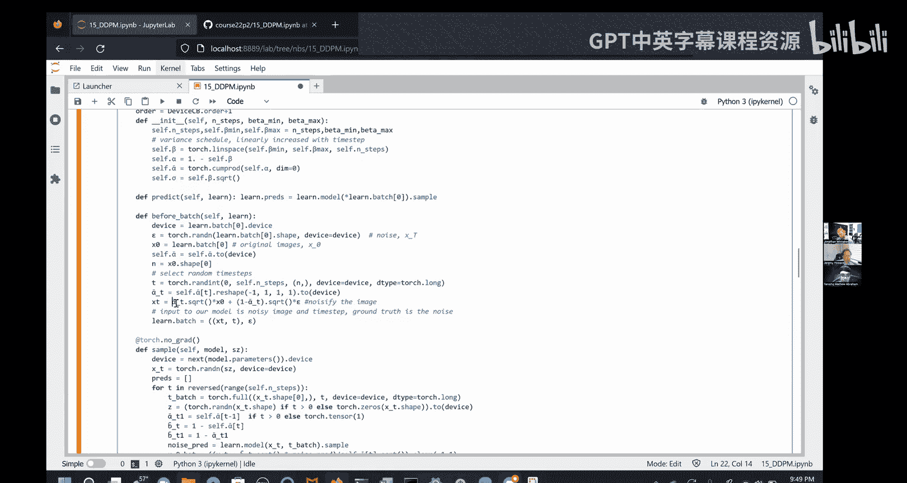

Yeah， so yeah， I guess let's just pull up the equation。

 so let's see there's then so there's there's a section in the paper that has the nice algorithm。

 Let's see if I can find it， No no here。

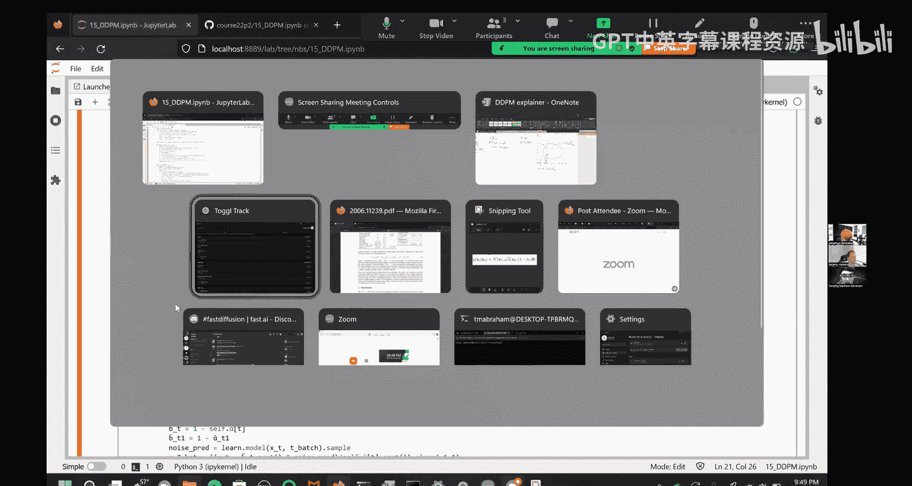

Oh it is， I think， earlier。Yes， train， ba。Right， so this we're just following these sort of。

Training steps here， right where you know we we select a clean image that we take from our data set that this fancy kind of equation here is just saying take an image from your data set。

Take a random time step you know， between this range。

Then this is our epsilon that we're getting just you say get get some epsilon value。

 and then we have our our equation for x of t right is this is the equation here。

 you can see that here is a square root of alpha bar t x0 plus1 squared root of 1 minus alpha bar t times epsilon。

 so that's the same equation that we have right here。

Right and then what we need to do is we need to pass this into our model so we have X T and T so we set up our batch accordingly。

 so this is the two things that we pass into our model and of course we also have our target which is our epsilon and so that's what this is showing here we passed in our x of t as well as our t here right and we pass that into a model the model is represented here as epsilon theta and theta is often used to represent like this is a neural network with some parameters and the parameters are represented by theta so epsilon theta is just represented our noise predicting model so this is our neural network so we have passed in our x of T and our t into our neural network and we are comparing it to our target here。

 which is the actual epsilon and so that's what were doing here we our batch where we have our x of t and t and epsilon and then here we have our prediction function and because we actually have I guess in this case。

We have two things that are in a Tfold that we need to pass into our model so we just kind of you know get those elements from our TupL with this yeah we get the elements from the TupL pass it into the model and then hugging face half its own API in terms of getting the output so you need to call doc sample in order to get the predictions from your model so if we just do that and then we do yeah we have La dot pretz and you know that's what's going to be used later then remember're trying to do our loss function calculation。

AndSo the just， so， I， it's just worth looking at that a little bit more since we haven't quite seen something like this before。

 And it's something which。I'm not aware of any other framework that would let you do this。

 You I'll literally replace how prediction works。 So many AI is kind of really fun for this。

 So because you're inherited from train C B， train C has。Predict you don't to find。

 and you've defined find new version。 So it's not going to use the train C version any。

 It's going to use your version。And what you're doing is instead of passing learn dot batch 0 to the model。

Your， you've got a star in front of it。So the key thing is that star is going to， you know。

 and is we we know actually learneddo batchch 0 has two things in it， because that learneddo batch。

That you showed at the end of the before batch method it has two things in1。0。

 so the star will unpack them and send each one of those as a separate argument。

 So our model needs to take two things， which the diffusers unit does take two things。

So that's the main interesting point and then something I。Finded a bit awkward， honestly about。

A lot of。Haring face stuff including diffusers is that generally their models don't just return the result。

 but they put it inside some name and so that's what happens here。

 they put it in something inside them and called sample。

 So that's why Tuniche added dot sample at the end of the predict because of this。

Somewhat awkward thing， which hugging face like to do for some reason。 But yeah， now that， you know。

 I mean， this is something that people。Often gets stuck on I see on kle and stuff like that。

 It's like， how on earth do I use these models because they take things in weird forms and they give back things with weird forms。

Well， this is hell， you know， if you inher it from transcb， you can change predict。

To do whatever you want， which I think is。Quite sweet。Yep。So yeah。

 that's the the training loop and then of course you have your regular training loop that's implemented in many AI where you are going to have。

Yeah， you have your loss function calculation。And yet the。Predictions learned out pres and of course。

 the target is our learned do batch one， which is our epsilon。

 So you know we have those and we pass it into the lost function and Cals the loss function and does the back proagation So I'll just go over that we'll get back to the sampling in just a moment。

 but just to show the the training loop So most of this is copied from our I think it's 14 augment Note broke the way you've got the Tax and the shed。

The only thing I think you've added here is the。Da0 PM calledback right。Yes。

 the D climate trans loss function。Yes， so basically we。

 we have to initialize our DPM callback with the appropriate arguments to like the number of time steps and the minimum。

beta and maximum beta。And then yeah， and then of course， we're using an MSc loss as we talked about。

And it just becomes a regular train loop and everything else is run before。 Yeah。

 we have your scheduler， your progress bar， all that we've seen before。

 I think it's really cool that we're using basically the same code to。😊，Train a diffusion model。

 as we've used to train a classifier just with， yeah， an extra Corback。Yeah， yeah， yeah。

 I think callbacks are very powerful for being， you know， if we're allowing us to do such things。

 it's like pretty。You can take all this coded now you have a diffusion trading loop and we can just call learn about fit and yeah。

 they can see got it nice。😊，I have training loop， nice lot curve， we can save our mom。torch。

 saving functionality to be able to save our model， and we could load it in。

But now that we have our trained model， then the question is what can we do to use it to sample you know the data set so the basic idea of course was that you know we have。

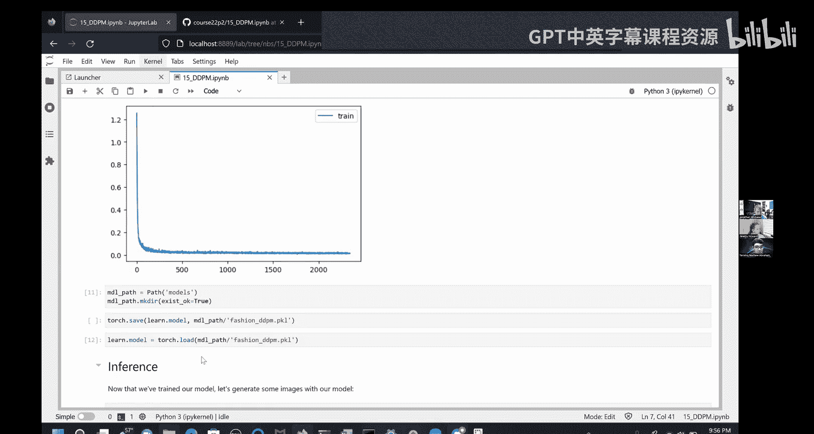

Yes。He ha。

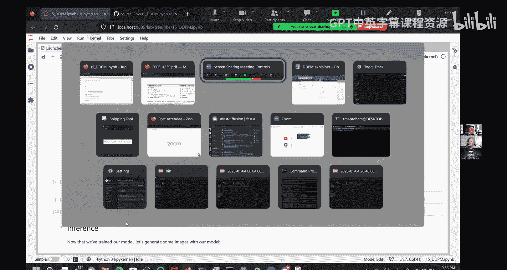

Like basically over here， right， we have let's see here okay health。

We have a basic idea is that we start out with a random data point and of course that's not what I need within the distribution and first。

 but now we've learned。How to move， Fran。You know， one point towards the data distribution。

 that's what our noise prediction predicting function does。 It basically tells you how you know。

 in what direction and how much to。So the basic idea is that yeah。

ll guess I'll start from maybe a new drawing here again， we have。It distribution is。

 and we have a random point and we use our noise predicting model that we have trained to tell us which direction move。

 So it tells us some direction on。Or I guess let's zach。other area like， Okay， so like here。 Okay。

 so it tells some direction to move at first， that direction is not going be like you cannot follow that direction all the way to get the correct data point because basically what we were doing is we're trying to reverse the path that we were following when we were adding noise。

 So like because we had originally data point And we kept adding noise to the data point and maybe you know。

 it followed some path like this on and we wanted to reverse that path to get to。

So our noise predicting function will give us an original direction， which， you know would be。

 you know some， you know kind of it's going to be kind of tangential to the actual path at that location。

 So what we would do is， you know， we would maybe follow that data plan all the way towards。You know。

Which is to keep following that data point。You know we're going to try to predict the fully dennoed image by following this noise prediction。

 but our fully dennoed image is also not going to be a real image。

 so what we so let me I'll show an example of that over here in the paper on where they show this a little bit more carefully let's here。

So x0 yeah， so basically you can see the different date。You can see the different date points here。

 really， it's not going to look anything like a real image， so you can see all these points。

 you know， it doesn't look anything。😊，That me we would do is。

We actually had a little bit of noise back to it。And we start。

 we have a new point where then we should maybe estimate a better get a better estimate of which direction to move。

Follow that all the way again， we follow on your point。And that I get add back a little bit of noise。

 you get a new estimate， you make a new estimate of， you know。

 this noise prediction and removing the noise， you know。

 fall out all again completely and add a little bit of noise again to the image。

Bur onto dimension So that's kind of what we're showing here is but a lot like SGD with SGD。

 we don't take the gradient and jump all the way。 We use a learning rate to go some of the way because each of those estimates of where we want to go。

You know， not that great， but we just do it slowly。Its accurate。 And at the end of the day。

 thats yeah， that's what we're doing with this noise prediction。

 we are predicting this sort of gradient of this P of x。 but of course。

 we need to keep making estimates of that gradient as we're progressing so we have to keep evaluating our our noise prediction function to get updated and better estimates of our gradient in order to finally converge onto our image。

 So and then you can see that here you know， we have this maybe this fully predicted the noise image which at the beginning。

 does anything like a real image， but then as we continue throughout the sound like boss。

 we finally converge on some that looks like an actual image again。

 these are Cpar 10 image it is in still a little bit maybe unclear about how realistic these images these very small images look。

 but that's kind of the general principle I would say， And so that's what I can show in the code。

Bond this idea of。We're going to start out。Basically， with a random image， right。

 and the surrounding image is going to be like a pure noise image。

 And it's not going to be part of the data distribution。 You know。

 this is not anything like a real image It's just a random image。 And so this is going to be our x。

 I guess x uppercase T right？ That's what we start out with。

 And we want to go from x uppercase T all the way to x0。

 So what we do is we go through each of the time steps and。

create we have to put it in this sort of batch format because that's what our our neural network expects。

 so we just have to format it appropriately。And we'll get to Z in just a moment。

 I'll explain that in just a moment， but if of course species should say it have similar。

Wech bar alpha bar beta bar， which is getting those variables that we we affect beta bar because we couldn't figure out how to type it so we used be bar instead。

Yes， yes， so yeah， yeah， yeah， weve weren't able to get paid bar to work， I guess。But anyway。

 at each step， what we're trying to do is we try to predict what direction we need to go。

 And that direction is given by our noise predicting model。 right。

 So what we do is we pass in X of T and our current time step into our model。

 And we get this noise prediction。 and that's the direction that we need to move in。 So basically。

 we take X of T。 We first attempt to completely remove the noise。 right， That's what this is doing。

 That's what Xel hat is。 That's completely removing the noise。And of course， as we said。

 that estimate at the beginning won't be very accurate and so now what we do is be have some coefficients here where we have a coefficient of how much that we keep of this estimate of our deno image and how much of the originally noisy image we keep。

And on top of that， we' going to add in some additional noise。So that's what we do here。We have x 0。

 that。And。And so， then we multiply but's coefficient and we have x of T。

 We multiply by some coefficient， and we also add some additional noise。 That's what the Z is。

 It's just，s basically a weighted average of of the。The two。Plus， imagineagin is。

And then the whole idea is that our as we get closer and closer to a time step equals to zero。

Our estimate of。X0 will be more and more accurate， so our X coefficient will get。Both as we're。

 you know， increasing our， you know， going through the process and then our X T coefficient will get closer and closer to 0。

 So basically we're going to be waiting more and more of the x0 hat estimate and less and less of the X T as we're getting closer and closer to our final time scale。

 And so at the end of the day， we will have our。Estimated generated image。

 so that's kind of an overview of the sampling process。So yeah。So yeah。

 as basically the way I implemented it here was I had this sample function that's part of our our。

Call back and it will take in the model and the the the kind of shape that you want for your。

Images that you're producing。 So like if you want to specify how many images you produce， you know。

 that's gonna to be part of your back size or whatever。 And you able to see that in a moment。

 But yeah， it's just part of the callback。 So then we basically have our D of a callback。

 and then we could just call the。The sample method of our DPM callback and we pass in our model and then here you can see we're going to produce。

 for example， 16 images， and it just has to be a one channel image of shape 32 by 32 and we get our samples。

And one thing I forgot to note was that I am collecting each of the time step this effects of T so look the predictions here you can see that there are a thousand of them we want the last one because that is our final generation so if we want the last one and that's whatner said。

Yeah， and this it all been become a long way since8 Epm。

 so this is like slower and less great than it。Could be， but。Considering that except for unit。

 we've done this from scratch it all it from matrix multiplication。I think those are pretty decent。

Yeah and they're only trained for about five epochs it took like just you know maybe like four minutes to train this model something like that it's pretty quick and this is what we get with very little training and it's yeah pretty decent and you can see course some clear shirts and shoes and hands and whatever else so yeah and you can see fabric it it's got texture and let's have back holes and。

嗯， yeah。You doesn to compare， like， we did generative modelling。

In the first time we did part2 back in the days when I God Vaass go and Gan was just new。

 which was actually created by the same guy that created Pytorch or one of the two guys Sueth。

 and we trained for hours and hours and hours and。Got things that I'm not sure were any better than than this。

 so things have come a long way。Yeah， no。三。And of course。Then yeah， so we can see then like how this。

Sampling progresses over time over the multiple time steps on so that's what I'm showing here because I collect it during the sampling process we are collecting at each time step what that estimate looks like on。

And you can kind of see here。 And so this is an estimate of like the noisy image over over the time steps of oops in。

 I guess it had pause。 yeah， you can kind of see， but you'll notice that actually， so we actually。

 what we did is like okay， so we we selected the image which is like the9 image。

 So that's that's this image here。 So we're looking at this image particularly here。

 And we're going over， yeah， we just have a function here that's showing that I。😊。

9 step during the sampling process of that image。 and we're just getting the images and。

What we are doing is we're only showing basically from time step 800 to 10000 and here we're just。

 we're just having it like where it's like， okay， we' be looking at like maybe every five steps and I'm going from 800 or2 night。

And no doubt this time it would make it a little bit visually easier to see the transition。

 but what you'll notice is I didn't start all the way from0， I started from 800。

 and the reason we do that is because actually between 0 and 800。

 there's very little change in terms of like it's just mostly a noisy image。And it turns out。

 yeah as I make a note of this here， it's actually a limitation of the noise schedule that is used in the original DDp on paper and especially when applied to some of these smaller images when we're working with images of like size 32 by 32 or whatever and so there are some other papers like the improved DP on paper that propose other sorts of noise schedules and what I been by noise schedule is basically how beta is defined basically so know we had this definition of torch。

 lens space for our beta but people have different ways of defining beta that lead to properties。

 so you know things like that people have come up with different improvements and those sorts of improvements work well when we're working these smaller images and basically the point is like if we are working from 0 to 800 and it's just mostly just noise that entire time we're not actually making full use of all this time steps so it would be nice we could actually。

full use of those kind of steps and actually have it do something during that time period so all these there are some papers that examine this a little bit more carefully and it would be kind of interesting for maybe some of you folks to also look at these papers and see if you can try to implement you know those sorts of models。

With this notebook as a starting point and it should be a fairly simple change in terms of like noise schedule or something like that。

 so so I actually think you know this is the start of our next。Journey， you know。

 which is our previous journey was。You know， going from。

Being totally rubbish at fashion em classification to being really good at it。

I heard to say now we're like a little bit rubbish at doing fashion emmunist generation。And yeah。

 I think you know。We should all now work from here。

Over the next few lessons and so forth and people you know trying things at home。

And all of us trying to make。Better and better。Generative models， you know。

 initially a fashion amnesst and hopefully we'll get to the point where we're so good at that that we're like。

 oh this is too easy and then we'll。Pick something harder。Yeah， and eventually， that'll take us to。

Stable diffusion and beyond， I imagine。Yeah。That's cool。 I got some stuff to show you guys。嗯。

If you're interested I。Tried to better understand what was going on inishk's notebook and tried doing it in a thousand different ways and also see if I could just start to make it a bit faster。

And。So that's what's in notebook 17。Which I will share。So we've already seen the start of Note 17。

 Well， one thing I did just do is just drew a picture for myself， partly。

 just to remind myself what they what the real ones look like and they definitely have more。Detail。

And the samples that Tishche was showing。But they're not， you know， they're just 28 by 28。 I mean。

 they're not super amazing images and they're just black or white。

 So even if we're fantastic at this，re they're never going to look。😊，Great。

 because we're using a small， simple data set， as you always should when you're。

Doing any kind of R And D or experiments， you should always use a small and simple data set up until you're so good at it that it's not challenging any more。

嗯。And even then， when you're exploring new ideas， you should explore them on small simple data sets first。

 Yeah， so after I drew the various things， what I like to do is one thing I found challenging about working with your class to niche because I find when stuff is inside a class。

 It's harder for me to explore。 So I've copied and pasted it the and the。Before batch。

 contents on my hand。Called up no if I。And so one of the things it's fun to do that is it it forces you to figure out what are the actual parameters to it。

 And so now that I， rather than putting it that that fast， now that I've got all of my。😊，You know。

 various things to do with。 So these are the three parameters to the DDPM callbacks in it。

 So then these things we can calculate from that。 So with those， then actually all we need is。Yeah。

 what's the。Image that we're going to noisify。😊，And then what's the what's the alpha bar。

 which I mean， we we can get from here， but its what be more general if you can pass in your alpha bar。

 So yeah， this is just copying and posting。From the class。

 But the nice thing is then I could experiment with it so I can call No aify on my first 25 images。

And with， with a random tea。Each one's got a different random T。 And so I can print out the T。

 And then I can actually use those as titles。 And so this lets me， I thought this is quite nice。

 I might actually rerun this because actually none of these look like anything because as it turns out。

 in this particular case， all of the T's are。😊，Over 200。 And as Tenishche mentioned。

 once you're over 200， it's almost impossible to see anything。

 So let me just rerun this and see if we get a better。um。There we go。 There's a better one。

 So with a tea of 7。Right， so remember T N。See cost naught is the pure image。 So table 7。

 it's just a slightly specky image。 and by 67， it's a pretty bad image。 And by 94。

 it's very hard to see what it is at all。嗯。And by2 only three。Maybe I can see a pair。

 And some not sure I can see anything。So。Yeah， by the way， there's a handy little。 So we。

 I think we've a at map before in in the course， there's an extended version of map in Fast core。

 And one of the nice things is you can pass it a string。

 And it basically just calls this format string。 If you pass it a string rather than a function。

 And so this is gonna stringify everything using its representations。 This is how I got the。

Titles out of it， just by the way。So yeah， I found this useful to be able to draw a picture of of everything。

 And then I wanted to， yeah， look at what what， what else， what else can I do。

 So then I took nuts you won't be surprised to see。

 I took the sample method and turned that into a function。

And I actually decided to pass everything that it needs。 even， I mean。

 you could actually calculate pretty much all of these。

 but I thought since I've kept told them before， it just past them in。

 this is all copied and pasted from Genenik's version。 And so that means the callback now is tiny。

Because before batch is just noify and the sample method just calls a sample function。Now。

 what I did do is I decided just to， yeah， I wanted to try like as many different ways of doing this as possible。

Parttly is an exercise to help everybody body like。

See all the different ways we can work with our framework， you know。

 so I decided not to inherit from train C， but I instead I inherited from Corback。

 so that means I can't use a Tenish'niy trick。Over placing preempt。So instead。

 I now need some way to pass in。The two parts of the first gentleman of the tuple。

Add separate things to the model， and return the sample。So how else could we do that。

 Well what we could do is we could actually inherit from unit TD model。

Which is what Tuishsha use directly in 2D model， and we can replace the model。

And so we could replace specifically the forward function。 That's the thing that gets called。

 and we could just call the original forward function。But rather than passing an X or passing ta X。

And rather， returning that will return that dot sample。Okay， so if we do that。

 then we don't need the train C B anymore， and we don't need the predict。

 And so if you're not working with something as beautifully flexible as。Many AI。

 you can always do thisll to make to replace your model so that it has the interface that you need it to have。

So now， again， we did the same as to niche Ca of create the callback。

 And now when we create the model， what we use our unit plus， which we just created。

I wanted to see if I could make things faster， I tried dividing all of Tnich's channels by two。

 and I found it worked just as well。One thing I noticed is that it uses group normm in the unit。

 which we have briefly learned about before and in group normm it splits the channels up into a certain number of groups and I need to make sure that those groups had more than one thing in so you can actually pass in how many groups do you want to use in the。

Nmalization， so that's what this is for。You you're got to be a little bit careful these things I didn't think of it at first。

 and I ended up。 I think the num groups might have been 3032。

And I got an error saying you can't split 16 things into 32 groups。

But it also made me realise actually if an intons maybe you probably had 32 in the first with 32 groups and maybe the group norm wouldn't have been working as well。

 so theyre little subtle things to look out for。So now that we're not using anything inherited from Tra CB。

 that means we either need to use Tra C itself or just use our train learner。

And that everything else is the same as what Chishk had。So then I wanted to look at。

The results of noify here， and we've seen this trick before， which is we call fit。

But don't call the training part of the it and use the single batch C B callback that we created way back when we first created learner。

And now， learneddo batch will contain。The the tuple of taples， which we can then use that trick。

To show。So， I mean， obviously， we'd expect it to look the same as before， but it's nice。

 I always like to draw pictures of everything all along the way because it's very， very off I mean I。

😊，The first six to seven times I do when I thing I do it wrong。Given that I know that。

 I as well draw a picture to try and see how it's wrong until it's fixed。

 it also tells me when I it's not wrong。Isn't there a show back function now that does something similar？

嗯。Yes， you wrote that show image batch， didn't you。 I can't quite remember。 Yeah。

 we should remind ourselves。How that worked。 Thats a good point。Thanks for a reminder。 Okay。

 so then I'll just go ahead and do the same thingish did and but then the next thing I looked at was I looked at the。

 you know， how am I going to make this train faster， I want a bigger。

 I want a higher a learning rate。嗯。And I realized oddly enough。

 the diffusers code does not initialize anything at all if they use the defaults。

Which just goes to show like even， you know， the， the experts at a hugging face that don't necessarily real think like。

 oh， maybe the。Ply torch defaults， aunt。You know， perfect for my model。

 of course they're not because they depend on what activation function do you have and what re box do you have and so forth。

So。I wasn't exactly sure how to initialize it partly by chatting to Ka Crrowawley。

 who's the author of Kateate diffusion and partly by looking at papers and partly by thinking about。

My own experience， I ended up doing a few things。 One is。

 I did do the thing that we talked about a while ago， which is to take every second。

Convolutional layer and0 it out。 You could do the same thing with using batch norm。

 which is what we tried。 And since we've got quite a deep network， you know。

 that seemed like it might。 You know， it helps basically by having the。The the non Id。

Plf in the resnets do nothing at first， so they can't cause problems。U。

We haven't talked about orthogonalized weights before， and we probably won't。

 because you would need to take our。um。Computational linear algebra course to learn about that。

 which is a great course。 Rachel Thomas did a fantastic job of it， I highly recommend it。

 but I don't want to make it a prerequisite， but Tat mentioned she thought that well using orthogonal weights for the down samples was a good idea。

U。And then。Or the app blocks， they also set the second cons to0 and something Ka mentioned she found useful。

 which is also from。I think it's from the the D while Google paper is to also zero out the weights of basically the very last layer。

And so it's going to start by predicting zero。As the noise， which is， you know。

 something that can't hurt。So that was that's how I initialized awaits so call in at DDPM on my model。

Something that I found made a huge difference is I replaced the normal atom optimizer with one that has an epsilon of 1 in ne 5。

 the default I think is1 ineg8。And so to remind you。This is we is we when we divide by the。

Out of exponentially weighted moving average of the squared gradients， when we divide by that。

 if that's a very， very small number。嗯。Then， it makes the。Effective learning rate huge。

 And so we add this to it to make it not too huge。 And it's nearly always a good idea to make this bigger than the default。

 I don't know why the defaults so small。 And I found until I did this any time I tried to use a reasonably large learning rate somewherewhere around the middle of the one cycle training。

 it would explode。So that makes a big difference。So this way。Yeah， I could train， I could get 0。016。

After5 apos。And then sampling， so looks so pretty similar。 we got some pretty nice textures， I think。

So then I was thinking， how to make it faster。So one way we can make it faster is we can take advantage of。

Something called mixed precision so currently。😊，We're using 32 B floating point values。

That's the defaults and also known a single precision。

 and GPUs are pretty fast at doing 32 bit floating point values， but they're much， much， much。

 much faster at doing 16 bit floating point values。So 16 bit flood point values。

Aren't able to represent a very， you know， wide range of numbers or much precision at the difference between numbers。

 and so they're quite。Difficult to use， but if you can。

 you've get a huge benefit because modern GPUs， modern NviDdia GPUs specifically have special units that do matrix multiplies of 16 bit values extremely quickly。

嗯。You can't just cast everything to 16 B because then you there's not enough precision。

To calculate gradients and stuff properly。 So we have to use something called mixed precision。嗯。

Depending on how。Enthusiasastic， I'm feeling。I guess we ought to do this from scratch as well。

 we'll we'll see we do have an implementation from scratch because we actually implemented this before。

NVDdia implemented it in an earlier version of Fast AI。嗯。Anyway， we'll see。

 so but basically the idea is that we use 32 bit for things where we need 32 bit and we use 16 bit for things we use 16 bit。

 So that's what we're going to do is we're going to use this mixed precision。

 but for now we're going to use N videos。

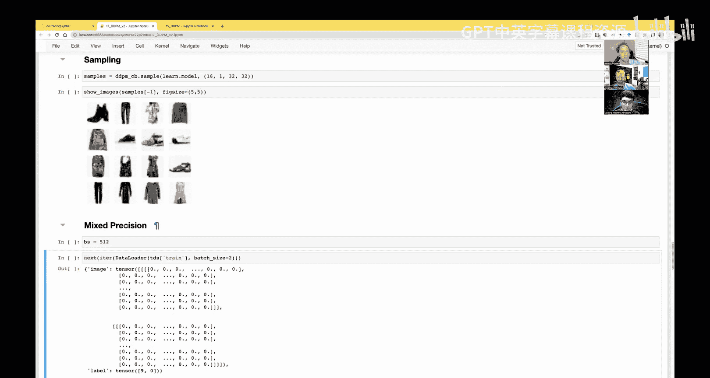

You don't semi automatic or fairly automatic code to do that for us。Actually。

 we had a slight change of plan at this point when we realized。

This lesson was going be over three hours in length， and we should actually split it into two。

 So we're going wrap up this lesson here， and we're gonna。

Come back and implement this mixed precision thing in less than 20。So we'll see you then。

