# Jeremy《深度学习基础到稳定扩散模型｜Deep Learning Foundations to Stable Diffusion》中英 p14 Lesson 20_ Deep Learning Foundations to Stable Diffusion.zh_en -BV1Mp421S7xg_p14-

Hi and welcome to lesson 20 In the last lesson we were about to learn about implementing mixed precision training。

 Let's dive into it。So to and I get it。Fddle with other things just because I want to really experiment。

 I just love fiddling around。 So one thing I wanted to do is I wanted to get rid of the D DDPMB entirely。

 We made it pretty small here， but I wanted to remove it。So much as Geneishka said。

 isn't it great that Corbacks make everything so cool。

 I wanted to show we can actually make things so cool without Corbacks at all。And so to do that。

 I realized what we could do is we could put noise aify。😊，Inside a clayian function。

So the col function， if you remember back to our datas notebook。

 which was going back to Note 5 and you've probably forgotten that by now。

 so go and reread that to remind yourself。It's the function that runs to take all of the， you know。

 you've basically each kind of row of data， you know will be a separate tuple and then it hits the collation function and the colian function turns that into。

Tensors you know， one tensor representing the independent variable。

 one tensor representing the dependent variable， something like that。

And the default collation function is called， not surprisingly， default collate。

 So if our collation function calls that。On our batch and then grabs the X part。

 which is it's always been the same for the last two things。

 that's the image because we use because data sets uses dictionaries。

 So we're going to grab the image。Then we can call noa Phi。On that collated batch。

 then that's exactly the same thing as Tennis before batch did。 right。

 because before batch is operating on the thing that came out of the default collect function。

 So we could just do it in a collect function。 So if we do it here， and then we create a。

DDPM data loader function， which just creates a data loader from some data set that we pass in with some batch size with that collection function。

Then we can create our dealsls， not using data loaders dot from， what's called data loaders dot from。

DD， but instead of that， the original you know the plane in it that we created for data loaders and again you should go back and remind yourself of this you just pass in the data loaders for training and test so there's our two data loaders。

So with that， we don't need a DPM CObec anymore。Allright， so now that we've you know and again。

 this isn this is not required for mixed precision。

 This is just because I wanted to experiment and flex our muscles a little bit of trying things out。

 So here's our mixed precision callback。And this is a training Kbec。And basically。

 if you Google for Ptorrch mixed precision。You'll see that the dos。

Show the typical mixed precision basically says with。Auttocast device equals Kuda type equals S 16。

Get your predictions， and call your loss。So。Again， remind yourself if you've forgotten that this is called a context manager and context managers。

 when they start， call something called Dun to enter and when they finish。

 they call something called Dununder exit。 So we could therefore put。The torchdot auto cast。

Into an attribute and called done to enter before the batch begins。

And then after we've calculated the loss， we want to finish。That context manager， So after loss。

We call order cost down exit， and so I had to add this。So you'll find now in the 09 ladder。

That there's a section called updated version since the lesson。Where I've added。

An after predict an after loss and after backward and an after step。

 And that means that a Corback can now insert code at any point of the training loop。

And so we haven't used all of those different things。嗯。Here， but we certainly do want， yeah。

 after loss， we to be able to do that。And then。Yeah。

 this is just code that has to be run according to the playtorrch docs。

 so instead of calling lost dot backwards， you have to call scalar dot scale or lost do backward。

So we replace our backward in the train callback， there's something called scalar dot scale lost up backward。

And then it says that finally， when you do the step， you don't call optimizer dotstep。

 you call Scalar dotstep， optimizer scalar dot update。So we've replaced step with Scala dot step。

 scalar dot update。So that does all of the things in here and the nice thing is now that this exists。

 we don't have to think about any of that， we can add mixed precision to anything。

Which is really nice。And so we now， as you'll see， CBs no longer has a DPM。

But we do have the mixed precision。And that's a train callback。 So we just need a normal learner。

 not a train learner。 And we initialize our DPM。 Now to get benefit from mixed position。

 you need to do quite a bit at a time。 You know， your GPU needs to be busy And on something as small as fashion Mist。

 it's not easy to keep a GPU busy。 So that's why I've increased the batch size by four times。Now。

That means that H Apoch。It's going to have four times less batches because they're bigger。

 and that means it's got four times less opportunities to update。

And that's going to be a problem because if I want to have as good a result as Ten Cad and as I've had here。

In。Less time as the whole purpose of this is to is to do it in less time。 Then I'm going to need to。

 you know。Increase the learning rate。And maybe also increase the epochs。

 so I increase the epochs up to8 from 5， and I increase the learning rate up to 1 a neck2。嗯。And。Yeah。

 I found I could train it fine with that once I used the proper initialization and most importantly。

 use the optimization function that has epsilon of one in Ng5。And so this trains。

 even though it's doing more epochs， this trains about twice as fast。um。And gets the same result。And。

Did that make sense so far？Yeah， it was great， Co now the good news is actually we don't even need to write all this。

😊，U。Because there's a nice library from Hugingfaceace originally created by Sil。

 who used to work with me at Fast AI and went to Hugingface and kept on doing awesome work。

 and he started this project called Accccelerator， which he now。

Works on with another fast AI alum name Zachria and accelerates a library that provides a inputode accelerator that does things to accelerate your training loops and one of the things it does is mixed precision training。

And it basically handles these things for you。It also lets you train on multiple GPs。

 it also lets you train on TpUus。 so by adding a train C subclass that。

Will allow us to use accelerate that means we can now hopefully use TPUs and multi GPU training and all that kind of thing。

So。The accelerate docs show that what you have to do to use accelerate is to create an accelerator。

Tell it what kind of mixed precision you want to use。

 so we're going to use 16 bit floating point FP16。And then you have to basically call Acccator dot prepare and you pass in your model。

 your optimizer。And your training and validation， data noticeers。

And it returns you back model an optimizer and trading and validation data loads。

 But they've been wrapped up and accelerate and accelerate is going to now do all the things we saw you have to do。

Autoomatically。And that's why that's almost all the code we need。

 The only other thing we need is it didn't。 We didn't make tell how to like change our loss function to use accelerate。

 So we actually have to change backward。 That's why we inherit from train C。

 to change backward to not call loss do backward but self dot accelerate backward。 and pass in loss。

Okay， and then I had another idea of something I wanted to do， which is， I like the idea that no a I。

 I've copied No a fire here。 but rather than returning a couple of tuples， I just returned a tuple。

With three things。I think this is neatta， to me。 I would like to just have three things in the topple。

 I don't want to have to modify my model。 I don't want to have to modify my training callback。

 I don't want to do anything。Tricky， I don't even want to have a custom colation function。嗯。Sorry。

 I want to have a cluster col function， but I want I don't want to have a modified model。

So I'm going to go back to using a unit 3D model。So how can we use a unit 2D model when we've now got three things？

And what I did in my modified。Lda， just underneath it。So， actually， what I did was I modified。

Train Cb。To add one parameter， which has number of inputs。And so this tells you。How many。

Inputs are there to the model。And only you would expect one input。But our model has two inputs。

 So here we say。um。呃。Okay， so accelerate CB is a train CB so when we call it。

 we say we're going to have two inputs。And so what that's going to do。😊。

Is it just going to remember how many you asked for。 And so when you call predict。

 it's not going to pass land do batch 0。It's going to call star loan dotbach。

Coll and self do9 inputs。And ditto， when you call the loss function， it's going to be the rest。

 So its star land up batch soft dot at imp onwards。 So this way you can have。1，2，3，4，5 inputs，1，2，3。

4，5 outputs， whatever you like。 And it's just up to you then to make sure that your model and your loss function take the number of parameters。

 So the loss function is gonna， first of all， take your。Cres。And then， yeah， however， of any。

Non inputs， you have。So that way， yeah， we now don't need。嗯。

To replace anything except that we did need to do the thing to make sure that we get the dot sample out。

 So I just had a little this is the whole DPMB callback now D PMMB2。

 So after the predictions are done。Replace them with the dot sample。Right， so that's。Nice and easy。

 you know， so we end up with quite a bit of pieces， but they're all very decoupled， you know so。

With mini AI， you know， with and with accelerate C or whatever。

 because we should export these actually so into a。Nice module。Well， if you had all those， then。

 yeah， you wouldn't have accelerate C B。 The only thing you would need would be the。

 would be the noify and the。Cian function。 And this tiny callback。And then， yeah。

 he's our learner and fit。 And we get the same。Result， as usual。

And this takes basically an identical amount of time because at this point I'm not using multi GPU or GPPU or whatever I'm just using mixed precision。

So this is just a。A short cut。For this it is not a huge shortcut。

 The main purpose of it really is to allow us to use other types of accelerators or multiple accelerators or whatever。

So I'll look at those later。Does that make sense so far？Yeah， yeah。

 X is really powerful and pretty amazing。 Yeah， it is。 And I know like a lot of。😊，Yeah， like。

 I know Ka Carlson uses it in all her k diffusion code， for example， Yeah， it's used a lot。

Out there in the real world， y。嗯。I've got one more thing I just want to mention briefly。

Just a sneaky trick。 I haven't even bothered trading anything with itcause it's just a sneaky trick。

 but sometimes。Thinking about。Speade。Loading the data is the slow bit and so particularly if you use Kagle。

 for example on Kaggle you get two GPUs， which is amazing。

 but you're trying to get two CPUUs which is crazy so it's really hard to like take advantage of them because the amount of time it takes to like open a PNG or a JPEG。

You know， your your GP is sitting around and waiting for you。 So there's a if if if you're you know。

If your data loading and transformation process is slow and it's difficult to keep your GPUs busy。

There's a trick you can do。Which is you could create a new data loader。Plus。

Which wraps your existing data loader。And it replace under Ed Now under Ed is the thing that gets called when you use a full loop right or when you use next Ed。

 it calls this。And when you call this， you just go through the data loader as per usual。

 So that's what Dun It would normally do。 But then you also go through I from 0 to。But he felt， too。

And then， you spit out。The match。And what this is going to do is it's going to go through the data loader and spit out the batch twice。

Um， why is that interesting because it means every epoch is going to be twice as long？

but it's going to only load and augment the data。As often as one epoch。

 but it's going to give you two epochs worth of updates。

And basically there's no reason to have a whole new batch every time， you know。

 looking at the same batch two or three or four times at a row is totally fine。

And what happens in practice is you look at that batch。 You do an update。

Get 20 part of the weight space。 Look at exactly the same batch and find out now where to go in the in。

 in the weight space。 It's still， yeah， basically equally。Useful。

So I just wanted to add this little sticky trick here， particularly because。

If we start doing more stuff on kck or， we'll probably want not。

Surprise all the Caglers with how fast hourum。Many AI solutions are and they'll be like。

 how is that possible， we'll be like， oh， we're using our， you know， two GPs sex to accelerate。

 asking him about how do we use the two GPUs and like， oh， and we're， you know， use， you know。

 getting our loading， flying through， using Mo DiL， I think it' would be pretty sweet。😊。

So that's that。Nice。Yeah， it's great to see the various different ways that we can use ManI to do to do the same thing。

 I guess， or， you know， however you feel like doing it or whatever works best for you can I'd be curious to see if other people find other ways to in Im show there's so many different ways to。

😊，To handle this problem， I think it's an interesting。Interesting problem to solve。 And I think for。

For homework it be useful for people to。Yet， run， run some of their own experiments。

 maybe either use these techniques on other data sets or。

See if you can come up with other variants of these approaches。

Or come up with some different noise schedules。The try。嗯。It would all be useful。

 Any other thoughts of？Exercises， people portray。Yeah， I mean。

 getting away with less than 1000 steps。 Yeah， less than 1000 steps happening in the final 200。

 So why not just train with only 200 steps。 Yeah， less steps would be good。Yeah。

 because the sampling is actually pretty slow， so。That's a good point。Yeah。Yeah， yeah。

 I was gonna see something traveler in terms of like， yeah， many。

 I guess work with less number of steps。 you know， you would have to adjust the noise schedule appropriately and you have to。

I guess there's maybe a little bit more thought into some of these things or， you know。

 another aspect is like。When you're selecting the time step during training， right now we select it。

Randomly kind of uniformly， each time step pass equal probability of being selected。

 maybe different probabilities are better， and some papers do analyze that more carefully。

 So that's another thing to play around with as well。That's almost kind of like。

I guess there are almost two ways of doing the same thing in a sense， right。

 if you change that mapping from T to beta。then。You could reduce tea and have different beers would kind of give you a similar result。

As changing the probabilities of the teas， I think。yeah， I I， I think I think they's definitely。

 they're both， they're kind of similar， but potentially something complementary happening there as well。

 And I think those could be some interesting experiments to study that and。Also。That and sort of。

noiseise levels that you do choose affect the sort of behavior of。

Of the sampling process and of course what features you focus on and so maybe as people play around with that。

 maybe they'll start to to notice how using yeah different noise levels or you this different noise schedules effect maybe some of the features that you see in in the final image and that could be something very interesting to to study as well。

诶。Well， let me also say it's been really fun doing something bit different。

 which is doing a lesson with you guys rather than all on my lonesome。

 I I hope we can do this again because I've really enjoyed it。😊，Yeah。

 was so of course now we're you know， strictly speaking in in the in the recording we'll next up see Jon O。

 who's actually already recorded his thanks to the Zoo mess up。

 but stick around So I've already seen it John O's thing is amazing So you definitely don't want to miss that hellello everyone so today depending on the order that this ends up happening you've probably seen Denise DDPM implementation where we're taking the default training callback and doing some more interesting things with preparing the data for the learner or interpreting the results。

😊，So in these two notebooks that I'm going to show， we're going to be doing something similar。

 just exploring like what else can we do besides just the classic kind of classification model where we have some inputs and a label and what else can we do with this mini AI setup that we have。

And so in the first one， we're gonna approach a kind of classic。

AI art approach called style transfer and so the idea here is that we're going to want to somehow create an artistic combination of two images where we have the structure and layout of one image and the style of another so we'll look at how we do that and then we'll also talk along the way in terms of like why is this actually useful beyond just making pretty pictures。

So to start with， I've got a couple of URLs for images。

 you're welcome to go and slip on your own as well and definitely recommend trying this notebook with some different ones just to see what effects you can get。

And we're going to download the image and load it up as a tensor。

 so we have here a three channel image， 256 by 256 pixels and so this is the kind of base image that we're going to start working with。

😊，So before we talk about styles or anything， let's just think what is our goal here。

 right wed like we'd like to do some sort of training or optimization we'd like to get to a point where we can match some aspect of this image。

And so maybe a good place to start is to just try and do well。

 can we start from a random image and optimize it until it matches pixel for pixelix exactly。

 And it's gonna help us get this。 Yeah， one thing that might be helpful is if you type style transfer deep learning into Google images。

 you could maybe show some examples。

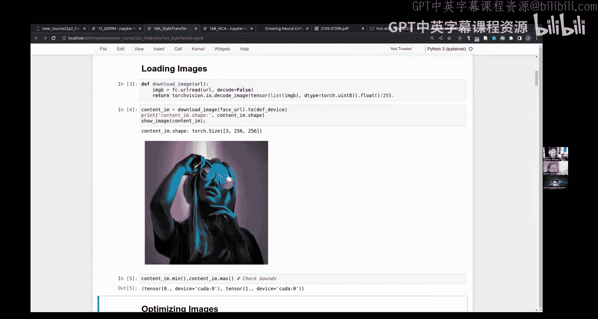

So that people will see what they're got。

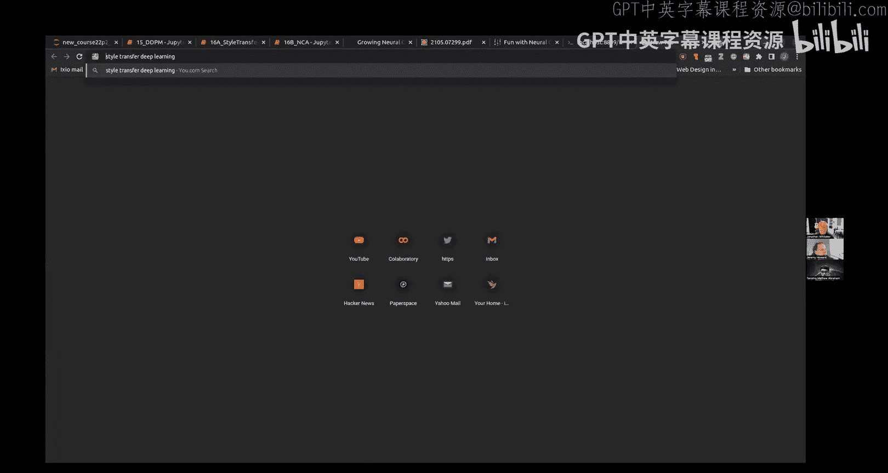

Yeah， that's a very good point。 So let's see this is a good one here we've got the Mona Lisaa as our base but we've managed to apply somehow some different artistic styles to that same bass structure。

 So we have the great way byaki we have Streidebe and go some sort of kinsky or something。 Yeah。

 so this is our end goal to be able to take the overall structure and layout of one image and the style from some different reference image。

 And in fact， this was the first ever， I think fast AI generative modeling lesson doctor at style transfer。

 it's been around for a few years it's kind of a classic technique and it's really I think a lot of the students When we first did it found it extremely useful。

😊，A way of better understanding。Like， you know， flexing their deep learning muscles。

 understanding what's going on and also created some relief。Interesting new approaches。

 So I Ill hopefully we'll see the same thing again。

 Maybe some students will be able to show some really interesting。Results from this。Yeah。

 and I mean today we're gonna to focus on kind of the classic approach but I know one of the previous students from FI did a whole different way of doing that style loss that we'll maybe post in the forums or you know I've got some comparisons that we can look at So yeah。

 definitely a fruitful field still and I think after the initial hype of like everyone was excited about style transfer apps and things I' know five years ago I feel like there's still some things to explore there3 point a very creative and fun little and diversion in the deep learning world。

Okay so our first step in getting to that point is being able to opt an image And so up until now we've been optimizing like the weights of a neural network and but now you want to go to something a bit more simple and we just want to optimize the raw pixels of an image Do manage if scroll up a bit the previous code just so we can help a look at it so there's a couple of interesting points about this code here is know we're not we're not cheating well not really so we're so yeah we've seen how to download things in the network before so we're using fast straight URL read because we're allowed to。

And then I think we decided we weren't going to write our own Jpeg Pza， so。

Torch Vission actually has a pretty good one which a lot of people don't realize exists and a lot of people tend to use PL。

 but actually torchssion has a more performant option。

And it's actually quite difficult to find any examples of how to。😊，Use it like this。That's it。

Here's some code you can borrow。Yeah and actually Google load image from a URL and Pytoch one of the examples we're going to use PIL and that's what I've done historically is use the requestquests library to download the URL and then feed that into PIL's image dot open function so yeah that was fun when I was working with Jeremy on this notebook like that's how I was doing it it itss way with breaking the rules and let's see if we can do this directly into a tensor without this intermediate step of loading it with pillow。

Cool， okay， so how are we going to do this image optimization。 Well。

 first thing is we don't really have a data set of lots of training examples。

 We just have a single like target and a single thing we're optimizing。

And so we've built this length dataset here which is just going to follow the Pythch like dataset standard。

 we're going to tell it how to get a particular item and what our length is but in this case we're just always going to return00 we're not actually going to care about the results from this dataset we just want something that we can pass to the learner to do some number of training iterations so we create like a fake dummy data with 100 items and then we create our data loaders from that and that's going to give us a way to train for some number of steps without really caring about what this data is so does that fake make sense。

Yeah， so just to clarify the reason we're doing this。

 so basically the idea is we're going to start with that photo you downloaded。嗯。

And I guess you're going to be downloading another photo。

 So that photo is going to be like the the content we're going to try to make a continue to look like that lady and then we're going to try to change the style so that the style looks like the style of some other picture。

And the way we're going to be doing that is by doing an optimization loop with like SGD or whatever。

But so the idea is that each step of that， we're going to be moving the style。Somehow。

 of the image closer and closer to， to one of those images you downloaded。

 So it's not that we're going to be looping through lots of different images。

 but we're just going to be looping through。Through steps of a optimization。L， said the idea。Exactly。

 and so yeah， we can we can create this data load and then in terms of the actual like model that we're optimizing and passing to the learner and we've created this tensor model class。

 which just has whatever tensor we pass in as its parameter。

 So there's no actual neural network necessarily， we're just going to pass in a random image or or some image shaped thing set of numbers that we can then optimize。

 So just in case people have forgotten that so to remind people when you put something in an N end or parameter。

 it doesn't change it in any way， it's just a normal tensor。

 but it's stored inside the module as being something as being a tensor to optimize So what you're doing here。

 Jonno， I guess is to say I'm not actually optimizing a model at all。 I'm optimizing。An image。

The pixels of an image directly。Exactly， and because it's in a parameter。

 if we look at our our model， we can see that， for example， model dot T。It does require grad。Right。

 because that's already set up because this N and dot module is going to look for any parameters。

 And if our optimizer is looking at。Let's look at the shape of the parameterss。

And so this is the shape of the parameters that we're optimizing。

 This is just that tensor that we passed in the same shape as our image。

 and this is what's going to be optimized if we pass this into any sort of learner fit method。 Okay。

 so this model does have a thing being passed forward， which is X。

 which we're ignoring and I guess that's just because our learner passes something in。

 So we're making life a bit easier for ourselves by making the model look。

The way our learner expects。Yeah， and we could everything like train CB or something if we wanted to。

 but this seems like a nice。Nice way to do it。Yeah， so I mean， this is the way I've done it。

 if you do want to use transCB， you can set it up with a custom predict method that is just going to call the model forward method with no practice。

And if you want likewise just calling the loss function on just the predictions。

 but if you want to skip this because we take this argument x equals 0 and never use it that should also work without this callback so either way is fine this is a nice approach if you have something that you're using an existing model which expects some number of parameters or something yeah you can just modify that training callback but we almost don't need to in this case。

Okay， so let's see well let's put this in a learner。 Let's optimize it with some loss function。

 Oh just to clarify， I get it。 So the the get loss you had to change because normally we pass a target to the loss function now we yeah。

 this our grids and then lend our batch and again， we could Im batch we could。

Avoid we could remove that as well if we wanted to by having our loss function take a target that we then ignore。

Yeah yeah exactly and so both both other approaches。

 I like this because it's we' gonna kind of be building on this idea of modifying the training callback in the DDM example and the other examples。

 but in this case， it's just these like two lines change this is how we get our model predictions we just call the forward method which returns this image that we're optimizing and we're going evaluate this according to some loss function that just takes in an image。

And。So for our first loss function， we are just going to use the mean square error between the image that we are generating like this output of our model and that content image that's our like target。

RightSo we're going to set up our model， started up with a random image like this above。

 we're going to create a learner。With a dummy day loader for 100 steps。

While a loss function is going to be this means good error loss function。

 set learning rate and an optimizer function。Their default would probably also work。

And if we run this， something's going to happen。 Our loss is going to go from an non0 number to close to0。

 And we can look at the final result。 like if we call learned up model and show that as an image versus the actual image。

 we'll see that they look pretty much identical。 Yeah。

 So just to clarify this is like a pointless example。

 But what we did was started with that noisy image she showed above。

 And then we used S GD to make those pixels get closer and closer to。The lady in the sunglasses， not。

 you know， not for a particular purpose， but just to show that we can turn noisy pixels into something else by having it follow。

A loss function。 and this loss function was just like， make the pixels look as much as possible。

 like that lady in the samela。Exactly and so in this case it's a very simple loss。

 there's like a one direction that you update so it's almost trivial to solve。

 but it still helps us get like the framework in place。

 but just seeing this final result is not very inive because you almost think well that I get a bug in my code that I just duplicated the image how do I know this is actually doing what we expect and so before we even move on to any more complicated loss functions I thought it was important to have some sort of more obvious way of doing progress so I've created a little logging call back here that is just after every batch？

😊，It's going to store the output as an image。 And then I guess after every 10 batches here by default。

 Oh yes， yeah， so sorry， so we can set how often it's gonna update。

 and then every 10 iterations or 50 iterations， whatever we set the log every argument to。

 it's going store that in a list。 And then after the training is done after fetch。

 we just gonna show those images。 And so everything else the same as before。

 but passing in this extra logging call back， it's gonna give us the。Kind of progress。

 And so now you can see， okay， there is actually something happening We starting from this noise after a few iterations already。

 most of it is gone。 and by the end of this process， it looks exactly like the content image。

 So I really like this because what you've basically done here is you've now already got all the。

Calling an infrastructure in place you need。To basically create。A really wide variety of。

Interesting outputs that could either be artistic or。Or like， you know。

 they could be more like image reconstruction， super resolution， colorization， whatever。

 And you just have to modify。The loss function。 endurere。You know， and I really like the way youve。

Created the absolute easiest possible first and fully checked it。 And before you start。

Doing the fancy stuff and now you kind of I guess feel really comfortable doing the fancy stuff because you know。

 that's all。In place。Yeah， exactly。 And we know that we're gonna see some tracking。

 So hopefully it'll be like visually obvious if things are going wrong and we know exactly what we need to modify if we can now express some desired property。

 it's more interesting than just like meansqua error to a target image then we quickly have everything in place to optimize。

 And so this is not really fun So like okay， let's think about what other loss functions we could do。

 maybe we wanted to match image， but also have a particular overall color maybe we want some some more complicated thing。

 And so towards that， like towards starting to get a more richer like measure of what this output image looks like。

 we're going talk about extracting features from a pretrain network。

 And this is kind of like the core idea of this notebook is that we have these big convolutional neural networks。

 this one is a much older architecture a relatively simple compared to some of the big dense net and so on used today。

 It's actually a bottle like our。😊，Preri resnet fashion emist model is basically almost the same as Vgg16。

Yeah， yeah， exactly。um And so were feeding in an image and then we have these like convolutional layers down sampling convolution。

 you know， down sampling with max pooling up until some final prediction Oh but the can I just point something out？

😊，There's one big difference here， which is that 7 by 7 by 512， if you can point at that。

 normally nowadays and in our models we tried， you know using an adaptive or global polling to get down to 1 by1 by 512。

 theGG16 does something which is very unusual by today's standards。

 which is it just flattens that out。Into a 1 by1 by4096。

 which actually might be a really interesting feature of EG G。

 and I've always felt like people might want to consider training。

Yet our resnets and stuff without the global pooling and instead do the flattening。

The reason we don't do the flattening nowadays is that that very last linear layer that goes from 1 by  one by 4896 to  one by  one by 100。

 because this is an image net model is's going to need。A lawfully big weight matrix。

 you've got a 4096 by 1 thousand0 weight matrix as a result of which this is actually。

Horrifically memory intensive for a reasonably poor performing model by modern standards。 But yeah。

 I think that doing that actually also has some， some benefits potentially as well。Yeah。

And in this case， we are not even really interested in the classification side。

 we are more excited about the capacity of this to extract different features。

 and so the idea here and maybe I should pull up。This classic article looking at like what do。

Neural networks learn and trying to visualize some of these features。

 This is something we've mentioned before with these big pretrained networks is that the early layers tend to pick up on very simple features。

 edges and shapes and textures。 and those get mixed together into more complicated textures。

 And by the way， this is just trying to visualize like what what kind of input maximally activates a particular like output on each of these layers。

 And so it's a great way to see like what kinds of things that's learning。

 And so you can see as we move deeper and deeper into the into the network。

 we've getting more and more complicated like hierarchical features。

 Now we should mentioned So we've looked at the Ziller and Fergus paper before that which is an earlier version doing something like this to see what kind of features were available。

 So we're linked to this。😊，Distill paper from the forum in the course lesson page because it's actually a more modern and fancy version kind of of the same thing。

Yeah also note the names here， all of these people are worth following Krista's amazing work on interpretability and Alexander Advventev will see in the second notebook that I look at today doing all sorts of other cool stuff as well。

AndAnyway， so we want to think about like let's extract the outputs of these layers in the hope that they give us a representation of our image that's richer than just the raw pixels so we can list the idea being there that if we had another。

 if we were able to change our image to have the same features at those of those various like types that you were just showing us that then it would like have。

Similar textures or similar。Yeah， higherigh level concepts or whatever exactly So if you think of this like 14 by 14 feature map over here。

 maybe it's capturing that there's you know an eye in the top left and some hair on the top right。

 these kind of abstract things and if you change the like if you change the brightness of the image it's unlikely that it's going to change what features are stored there because the networks's learned to be somewhat invariant to these like rough transformations a bit of noise。

 a bit of changing texture early on is not going to affect the fact that it still thinks this looks like a dog and a few layers before that that it still thinks that part looks like a nose and that part looks like an ear maybe the more interesting bits then for what you're doing of those earlier layers where it's gonna be like there's a whole bunch of kind of diagonal lines here or there's a kind of a loopy bit here because then yeah if you if you replicate those you're going to get similar。

Texttures without changing the semantics。Exactly， yeah so I mean I guess let's load the model and look at what the layers are and then in the next section we can try and see what kinds of images work when we optimize towards different layers in there So this is the network we have revolutions。

 re， max pooling all of this we should be familiar with by now and it's all just in one big in and dot sequential this doesn't have the head so we said dot features if you did this without you'd have then this is like the features subnetwork that's everything up until some point and then you have the flattening and the classification which we kind of just throwing away so this is the body of the network and we're going to try and tag into various layers here and extract the outputs。

But before we do that， there's one more bit of admin we need to handle This was trained on a normalized version of imagenet right where you took the dataset set me in the dataset set standard deviation and you use that to normalize your images So if we want to match what the data look like during training。

 we need to match that normalization step and we've done this on grayscale images where we just subtract the mean divide by the standard deviation and but with three channel images these RGB images we can't get away with just saying let's subtract our mean from our image and divide by the standard deviation you're going to get an error。

It's going to pop up and this is because we now need to think about broadcasting and these shapes a little bit more carefully than we can with just a scale of value。

So if we look at the mean here， we just have three values， right one for each channel。

 the red green and blue channels， whereas our content image has three channels and then 256 by 256 will you know spatial dimensions。

So if we try and say content image you divided by the mean or minus the mean it's going to go from right to left and find the first non-united axis so anything with the size greater than one and it's going to try and line those up and in this case the three in the 256 those are going to match and so we're going to get an error more perniciously if the shape did happen to match that might still not be what you're intended So what we'd like is to have these three channels map to the three channels of our image and then somehow expand those values out across the two other dimensions and the way we do that is we just add two additional dimensions on the right for our image net domain mean and you could also do the unsqueezze minus-1 that unsezed minus-1 but this is these kind of synax we using in this course and now our shapes are going to match because we're going to go from right to left if it's a unit dimension size1 we're going to expand it out to match the other tensor。

And if it's a non neededed dimension， then the shapes have to match。

 and that looks like it's the case。 And so now with this reshaping operation。

We can write a little normalized function， which we can then apply to our content image and I'm just checking them in in the Mac to make sure that this roughly makes sense we could check the mean as well to make sure that the mean is somewhat close to error。

Okay， in this case， less maybe because it's a darker image than average。

 but at least we are doing the operation， it seems like the math is correct and now the shade in the channel wise main would be interesting。

Oh yes， so that would be the mean over the dimensions。1 and2， I think。

I think you got to tapple one come or2。Yes， I I wasn't sure which way were under。 Yeah。

 I always could forget。嘿嘿。Okay， so our blue channel is brighter than the others and if we go back and look at our image。

Um， I could maybe believe that the magenttra is going to be blue and and red and the face is going to be just blue。

Yeah okay， so that seems to be working we can double check because now that we've implemented ourselves Torchvision。

 transforms has a normalized function that you can pass the meaning instead standard deviation to and it's going to handle making sure that the devices match that the shapes match etc and you can see if we check them in a max it's exactly the same just a little bit of reassurance that our function is doing the same thing as this normalized transform。

I appreciate you not cheating though implementing that， Janno。 Thank you。And you welcome。

 gotta follow the rules。 Go to follow Okay， so that bit of admin out the way we can finally say how do we extract the features from this network And now if you remember the previous lesson on hooks。

 that might be something that brings to mind， I'm gonna leave that as an exercise for the reader and what we're gonna do is we're just going to normalize our input。

😊，And then we're going run through the layers one by one in this sequential stack。

 we're going to pass R x through that layer。 And then if we're in one of the target layers。

 which we can specify， we're going to store the opposite of that layer。

 And I I remember if I've used the term features before or not So apologies if I have。

 But just to clarify here when we say features， we just mean。The activations of。Of a layer。

 And in this case， Jonno has picked out two particular layerss 18 and 25。UYeah， I just want to。

 I mean， I'm not sure it matters in this particular case。

 but there's a bit of a gotcha you've got here at Jodo， which is you should change that。

Default 18 come of 25 from a list to a tuple and the reason for that is that when you use a mutable type like a list in a python default parameter it does this really weird thing but it actually keeps it around and if you change it at all later than it actually kind of modifies your function。

 so I would suggest yeah， never using a list as a default parameter because at some point it will。

Create the weirdest bug you've ever had。 I speak。 I say this experience。 Yeah， yeah。

 that sounds like something that that was hard one。 All right， I'll， I'll change that。

 And by the time you see the notebook that change should be there。 All right。

 So this is one way to do it， Just manually running through the layers 1 by one up until whatever the latest layer we're interested in is。

 but you could do this just as easily by adding hooks to the specific layers and then just feeding your data through the whole network at once and relying on the hooks to store those intermediate。

 Yeah， so let's make that homework。 actually， not just an exercise you can do。 But yeah， I want。

 let's make sure everybody does that。 use the one of the hooks。😊。

Callbacks we had or the hooks context managers we had。

 or you can use the register forward hook Pytorch directly。Yeah。And so what we get out here。

 we're feeding in an image that's 256 by 256 and the first layer that we're looking at is this one here and so it's getting halved to 128 then to 64 these ones are just different because it's a different starting size and then to 32 by 32 by 512 and so those are the features that we're talking about for that layer 18 it's this thing of shape 512 by 32 by 32 for every kind of spatial location in that 32 by 32 grid we have the output from 512 different filters and so those are going to be the features that we're talking about So there being the channels in a single convolution。

Yeah。Okay， so what's the point of this well like I said we hoping that we can capture different things at different layers and so to kind of first get a feel for this this like what if we just compared these feature maps we can institute what what I'm calling a content loss or you might see it as a perceptual loss and we're going to focus on a couple of later layers again make sure that this is。

😊，The as I've learned， and what we're going to do is we're going to pass in a target image。

 in this case， our content image， and we're going to calculate those features in those target layers。

and then。In the。嗯。In the forward method， when we're comparing to our inputs。

 we're going to calculate the features of our inputs and we're going to do the mean squared error between those and our target features。

😊，So maybe there's a bad way of explaining it， but the I can maybe read it back to you to make sure you understand that so okay。

 so this is a loss function you've created。 it hast done the core method。

 which means you can pretend that it's a function。 It's a callable in in Python language。Your。

 your forward。Y， it' so yeah， in in a module would call it forward。

 But in normal Python we just used under call， it's taking one input。

 which is the way you set up your， your image training call back earlier。

 It's just gonna to pass in the input， which is this is the。Image as it's been optimized to so far。

 so initially it's going to be that random noise。And then the loss you're calculating is the mean squared error of how far away is this？

Input image from the target image the main square error for each of the。Layers。

8 type by default 18 and 25。And so you're literally actually， it's a bit weird。

 you're actually calling a different neural network。Cap features actually call the neural network。

 but not。Because that's the model we're optimizing， but because it's actually。

The loss function is how far away。大 we。Yeah， so that's the lost fashion。 And so if we， so if you。

 so if we with SGD optimize that loss function， you're not going to get the same pixels。

 you're going to get。I don't even know what this are going to look like you're going get some pixels。

 which have the same。Activations of those features。Yeah， and so if we run that， we see。

You can see the sort of shape of our person there。But it definitely doesn't match on like a colour and style basis。

 So 18 and 25， remind us how。Tpe they are in this scheme of things。

So these are right fairly close towards the end Okay。

 so I guess colour often doesn't have much of a semantic kind of property。

 so that's probably why it doesn't care much about colour because it's still going to be an eyeball。

 whether it's green or blue or or brown。Yeah， there's something else I should mentioned， which is。

R aren。Constraining are tensor that we optimizing to be in the same bounds as a normal image。

And so some of these will also be less than zero or greater than one as kind of like almost hacking the neural network to get the same features at those deep layers by passing in something that it's never seen during training and so for display we're clipping it to the same balance as an image。

 but you might want to have either some sort of sigmoid function or some other way that you'd clamp your your tensor model and to have outputs that are like within the allowed range for good point Also it's interesting to note the background hasn't changed much。

 and I guess the reason for that would be that the VGG model you're using in the lost function was trained on imagenet and imagenet is specifically about recognizing generally as as a single big object like a dog or a boat or whatever So it's not going to care about the background in the background probably isn't going to have much in the way of features at all。

 which is why。Hasn't really changed the background。Yan。Exactly， and so， I mean。

 this is kind of interesting to see how little it looks like the image。 while， at the same time。

 still being like K P squint， you can recognize it。 but we can also try passing in。

Earlier layers right and comparing comparing on this earlier layers and see that we get a completely different result because now we're optimizing to some image that is a lot closer to the original it still doesn't look exactly the same and so there's a few things that I thought were worth noting just potentially of interest one is that we're looking into these really layers which might mean for example。

 that if you're looking at the very early layers you're missing out on some kinds of features that was one of my guesses as to why this didn't have as dark or darks as the input image and then also we still have this thing where we might be going out of bounds to get the same kinds of features so yeah you can see how by looking at really deep layers we really don't care about the color or texture at all。

 we just getting like some glassesy bits and nosy bits there by looking at the earlier layers we have much more rigid adherence to the sort of lowerle features as well and so this is nice it gives you a very tunenable way to compare to images。

So you can say do I care that they match exactly on pixels， then I could use meantu error。

 but do I care quite a lot about the exact match then I can use maybe some early layers。

 but do I only care about like the overall semantics in that case I can go to some deeper layers and you can experiment with if I remember correctly this is also something like the kind of technique that Zeler and Fergus and the distorttilled up pub papers use to like just identify like what do filters look look at which is like you can optimize an image to try and maximize。

A particular filter， for example， that would be a similar loss function to the one you've builtt here。

 And that would show you， yeah， what theyre， what they're looking at。Yeah。

 and that would be a really fun little project actually。

 so do it where you you calculate these feature maps and then just pick one of those 512。😊。

Features and optimize the image to maximize that activation。By default， you might get quite a noisy。

 weird result， like I almost an adversarial input， and so what these feature visualization people do is they add things like augmentations。

And so that you're optimizing an image that even under some augmentations still activates that that feature。

 But yeah， that might be a good one to play with。Cool， okay。

 so we have a lot of our infrastructure in place， we know how to optimize an image。

 we know how to extract features from this neural network and be saying this is great for comparing at these different kind of types of feature how similar the two images are。

😊，The final piece that we need for our full style transfer artistic application is to say I'd like to keep the structure of this image。

 but I'd like to have the style come from a different image and you might think。

 oh well that's easy We just look at the early layers like like you shown us。

 but there's a problem which is that these feature maps by default。

We feed in our image and we get these feature maps。They have a spatial component， right。

 we said we at a 32 by 32 by 512。Fe map out。 And each of those。

Los in that 32 by 32 grid are going to correspond to some part of the input image。

 And so if we just said let's do mean square error for the activations from some early layers。

 what we'd be saying is I want the same types of feature like the same style， same textures。

And I want them in the same location。Right， and so we can't just get like Van Gogh brushstrokes。

 We're gonna to try and have the same colors in the same place and the same textures in the same place。

 And so we're going to get something that just matches our image。

 What we'd like is something that has the same colors and textures， but doesn't。

 but they might be in different parts theme。 So we want to get rid of this spatial aspect。

 just not when we when we're saying to it， for example。

 give it to us in the style of Van Gogh starry night。We're not saying。In this part of the image。

 there should be something with this texture， but we're saying that the kinds of textures that are used anywhere in that image should also appear in in our version。

 but not necessarily in the same place。Exactly。And so the solution that Zler Vken proposed is this thing called a gram matrix。

 so what we want is some measure of what kinds of styles are present without worrying about where they are and so there's always a trouble trying to represent more than two dimensional things on a 2D grid but what I've done here is I've made our feature map right where we have our height in our width that might be 32 by 32 and some number of features but instead of having those be like a third dimension I've just represented those features as these little colored dots。

And so what we're going to do with a gram matrix is we're going to flatten out our spatial dimension so we're going to reshape this so that we have the width times the height so that like the spatial location on one axis and the feature dimension on the other so each of these rows is like this is the location here there's no yellow dot so we get a error there's no green so we get a error there is a red and a blue so we get ones so we've kind of flattened out this feature map into a 2D thing and then instead of caring about the spatial dimension at all all we care about is which features do we have in general which types of features and do they occur with each other。

And so we're going to get effectively the dot products of this row with itself。

And then this row with the next row and this row with the next row。

 we're saying like for these feature vectors。😊，How correlated are they with each other。

Right and so we'll see this in code just now'll check。😊。

I think you might have said and I might have misheard you。

 but just I just want to make sure you got the the the the citation here。

 right so this this idea came from， I don't know if it was first invented in the Gas et Al。

Pa neural algorithm or test of artistic style。Yeah， yeah， I mean， I Gas， that's the style transfer1。

 Cyder and Ferguson is the feature visualization1。 Yeah， sorry you got this switch。 Thanks。

 thanks Jeremy。 Okay， so we are ending up with this kind of like this gram matrix this correlation of features。

 And the way you can read this in this example is to say， okay， there are seven reds， right。

 red with red， there's seven in total。 And if you go and count them。 there's seven there。

 And then if I look at any other one in this row。 like here。

 there's only one red that occurs alongside a green， right， this is the only。😊。

Location where there's one red cell and one green cell。

 There's three reds that occur with the yellow。 there there and there。

 And so this grand matrix here has no spatial component at all。

 It's just the feature dimension by the feature dimension。 but it has a measure of how common。

These features are like what's an uncommon one here？Then。Yeah。

 maybe there's only three greens in total， right？And all of them occur with alongside a yellow。

 one of them occurs alongside red， one of them occurs alongside of blue。 Yeah。

 so this is exactly what we want。 This is some measure of what features are present。

Where if they occur together with other features， often， that's， that's a useful thing。

 But it doesn't have the spatial component。 You've gotten rid of that。 And， This is the first。

Clear explanation I've ever seen of how a grey matrix works。 This is such a cool picture。

 I also want to maybe you can open up the original paper because I'd also start like to encourage people to look at the original paper because this is something we're trying to practice at this point is is reading papers and so hopefully you can take。

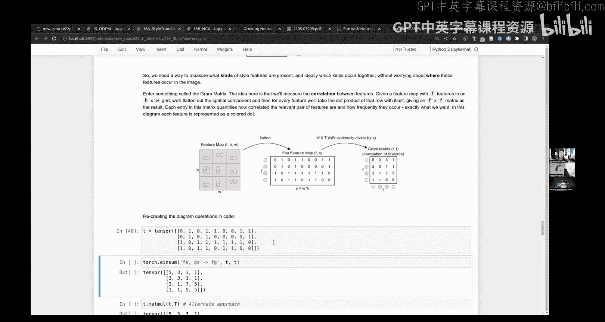

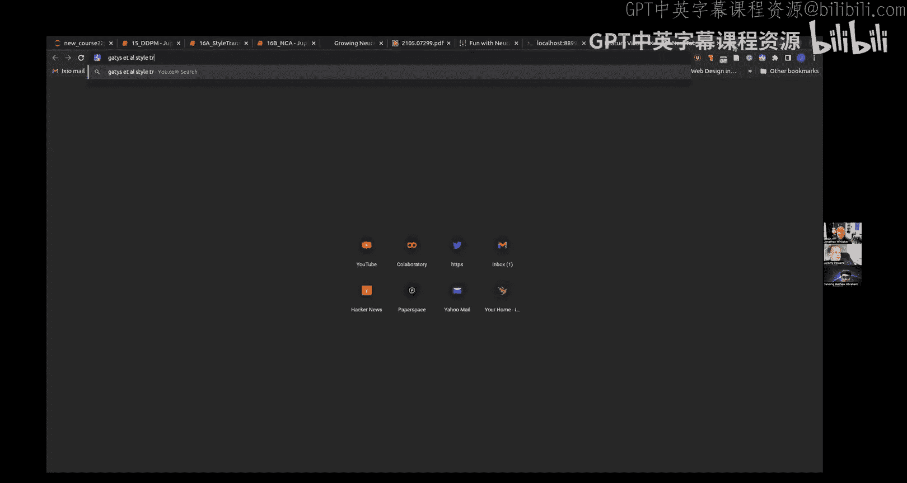

Johnno's fantastic explanation。And。Yeah， and bring it back to。Understanding the paperu。Well。

That's crazy that it's put it so far down。😊。

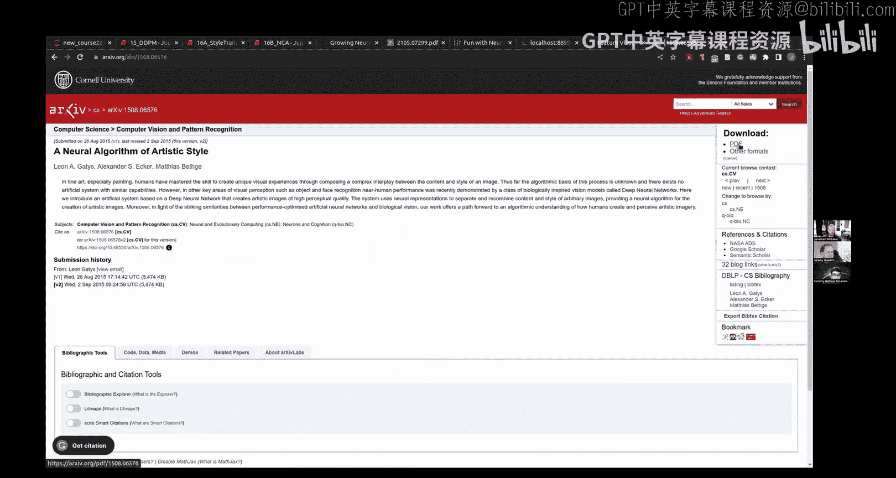

Oh yeah， it's a different search engine that I'm trying out that has some air magic。

 but they use Bing for their actual searching， which that's not。Let's y。And。Yeah。

 so we can quickly check the paper I don't know if I've actually read this paper as horrific as that sounds。

 not horrific at all as it was a while ago， but I I think it's yeah it's got some nice pictures and。

😊，Yeah， I'm going to zoom in a bit。Oh， good idea。Okay， the example is great examples。Yeah。

 not for Kandinsky。Sorry about the doorbell。嗯。Okay， yeah。

 the gra matrix in a product between the vectorized feature map。

So those kinds of wordings kind of put me for a while the way I explained gra matrices when I had to deal with them at all was to say it's magic that measures with。

 you know what features are there without worrying about where they are and left it at that。

But it is worth yeah， trying to decode this back。 They talk about which layers they're looking into and in intensivetensorflow。

 they have names， we just using the index。Okay， yeah。

 so it doesn't really explain how the gra matrix works。

 but it's something that people use historically in some other contexts as well and for the same kind of measure。

Nowadays， actually。Hightorrch has named parameters。 and I don't know if they've updated Vg G yet。

 but you can name。

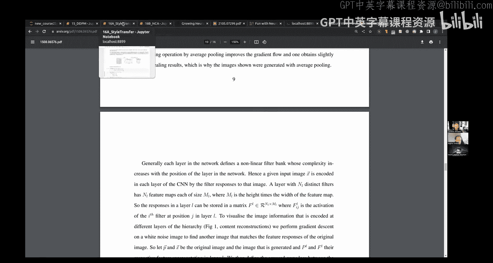

Lay as of a sequential model as well。Liang。Okay， so just quickly。

 I wanted to implement this diagram and code I should mention these are these are like 0 or1 for simplicity。

 but you could have like obviously different size activations and things The correlation idea is still going to be there。

 just not as easy to represent visually。And so we're going to do it with an ein sum because it makes it easy to add later the bash dimension and so on。

 but I wanted to also highlight that this is just this matrix multiplied with its own transpose。

And you're gonna to get the same result。 So yeah that's that's our gra matrix calculation。

 there's no magic involved there as much as it might seem like it。

 And so we can now use this like can we create this measure and then can when you look later at things like。

Word toveck， I think it's got some similarities， this idea of kind of conce of features。

 and it also reminds me of the。The clip loss similar idea of， like， basically it。Dt product。

 But in this case， with itself， I we've seen。How covariance is basically that。As well。

 so this idea of kind of like multiplying with your own transpose is a really common。

Mathematicical technique。 we've come across。Three or four times were rang in this course。Yeah。

 and it comes up all over the place， even。Yeah， you'll see that in in like protein folding stuff as well。

 they they have a big。The variance metrics for like So the difference in each case is like yeah。

 the difference in each case is the matrix that we're multiplying by its own transs。

 So for covariance， the matrix is the matrix of differences to the mean， for example， and yeah。

 in this case， the matrix is this flattened。Pay cheering。Cool。

 so I have here the calculatedcut grams function that's going do exactly that operation we did above。

 But we're gonna add some scaling。 And the reason we're adding the scaling is that we have this feature map and we might pass in images of different sizes。

 And so what this gives us is the absolute like。😊，You can see there's a relation to the number of spatial locations here。

 and so by scaling by this with times height， we're going to get like a relative measure as opposed to like an absolute measure。

 it just means that the comparisons are going to be valid even for images of different sizes。

And that's the only extra。Complexity here， but we have a channels by Hy width image in and we're going to pass in oh sorry this is like channels being the like number of features。

 we're going to pass it in。And。Two versions of that right because it's the same image in both times。

 but we're going to map this down to just the features by features。

 but you can't repeat variables in Einstein so that's why it's C and D。 And if we run this。

On our style image， you can see I'm targeting five different layers and for each one。

 the first layer has 64 features。 And so we get a 64 by 64 gram matrix。

 The second one has 128 features。 we can 12 by 128 gram matrix。

 So this is doing it seems like what we want there's a because this is a list we can。

Use this atrog method， which I Well actually it's's， it's a， it's a， it's a fast call capital L。

 not a list。 a list Oh sorry， yeah。magicag list and so I like to think about Yeah so either works Okay。

 so let's use this as a as a loss just like with the content lost before we're going to take in a target image which is going to be our style we're going to calculate these gram matrices for that and then when we get in an input to our function we're going to calculate the gram matrices for that and do the mean square error between the gram matrices So these are the no spatial component just what features are there comparing the two to make sure that they ideally have the same kinds of features and the same kinds of correlations between features。

😊，So so we can set that up， we can evaluate it on our image。

 so our content image at the moment has quite a high loss when we compare it to our style image and that means that the our content image doesn't look anything like a spider web in terms of its textures and whatever。

Aap。So we're going to set up an optimization thing here one difference is that at the moment I'm starting from the content image itself rather than optimizing from random noise you can choose either way for style transfer it's quite nice to use the content image as a starting point and so you can see at the beginning it just looks like our content image。

But as we do more and more steps， we maintain the structure because we're still using the content loss as one component of our loss function。

But now we also have more and more of this style because of the early layers we're evaluating the that that style loss and you can see this doesn't have the same layout as our spider web。

But it has the same kinds of textures and the same， you know， types of structure there。

 And so we can check out the final result and you can see it's done ostensibly what our goal is。

 It's taken one image and it's done it in the style of another。And to me， this is quite satisfying。

 Yeah， and it's actually like done it in a particularly clever way because like， look at her arm。

 you know， her arm has the spider web nicely laid out on it。 And she's almost like。😊。

Picking it out with her fingers。And her face， you know。

 which is kind of like quite an important or very important in terms of like。Object recognition。

 The model didn't want to mess with the face。Much at all。

 So it's kept the the spider webs from that like， I think it's。The more you look at it。

 the more impressive it is。 in how it's managed to find a way to add。Spider webbs。

 without messing up the。The overall kind of semantics of the image。Yeah yeah。

 so this is really fun to play with if you've been running the notebook with the demo images。

 please like right now go and find your own pictures。

 make sure you're not stealing someone's licensed work。

 but there's lots of creative commons images out there and try ba together。

 do it at a a larger size you know get some higher resolution style loss going and then there's so much that you can experiment with so for example you can change the content loss to focus on maybe an earlier layer as well you can start from a random image instead of the content image or you can start from the style image and optimize towards the content image you can change how you scale these two components of the loss function you can change how long you train for what you're learning it is all of this is up for grabs in terms of yeah what you can optimize on what you can explore and you get different results with different scalings and different focus layers so there's a whole lot of fun and experimentation to be done。

In terms of finding a set of parameters that gives you like a pleasing result for a given style content pair and for a given effect that you want on the output。

And。Yeah on that note， I wanted to like one of the really interesting things about this is just how well WGG works as a network。

 even though it's a very old network， but I think it's also worth playing around with other networks as well I think there's definitely some special properties of VGG that allow to do well for style transfer and there are a few papers on that and there are also some papers that explore how we can use maybe other networks for style transfer that maintain maybe some of these nice properties of VGG So I think that could be interesting to explore some of these papers and of course we have this very nice framework that allows us to easily plug and play different networks and try that aspect out as well。

Yeah， and in particular， I think。Tacking a conv next or a resnet or something in replacing its head with a Pg G head。

Would be。An interesting thing to try。Yeah。Thenish on the like experimentation version。

 one of the things that when we were developing this， I said to Jeremy was like。

 a you' doing all this work， setting up these callbacks and things， you know。

 isn't it nicer to just have like， here's my image that I'm optimizing， set up an optr。

 set up my loss function and do this optimization loop。 And the answer is that it is。😊。

Theoretically easier when you just want to do this once。

 like and that's why you see in a tutorial or something。You keep this as minimal as possible。

 you just want to show what style loss is。 but as soon as you say， okay。

 I'd like to try this again but adding a different layer。

 So maybe let me do another cell and then you copying and pasting every bunch know and then you say oh let me add some progress stuff so images you know it gets messy really quickly as soon as you want to save images for a video and you want to mess with a loss function and you want to do some sort of a kneeling on your learning rate。

 each of these things is gonna to grow this loop into something messier and messier Yeah and so I thought it was fun like I was very quickly a convert to being able to experiment with a completely new version with yeah minimal lines of code。

 minimal changes and having everything in its own piece like the image logging or you wanted to make a little movie。

 showing the progress that goes in a separate callback you want to tweak the model。

 just tweak one thing all the other infrastructure can stay the same yeah。

 so that was pretty cool I mean。😊，One answer， right like it's yeah。

 use the right layer of abstraction。For what you're doing at the right time。

 like something I actually think did pull。Do too much of when they use the fast AI library。

Jumping straight into data blocks， for example， even though。

They know they might be working on a slightly more custom thing where data blocks there isn't a data block already written for them and so then step white is like oh write a data block that's not at all easy and do you actually want to be focusing on building your model so I kind of say to peoplela like you know go go down a layer of abstraction。

Now， I will say。I don't very often start at the very lowest level of attraction。

 so something like the very last thing that you showed Jonno， just because in my experience。

I'm not good enough to do that right。 And so like most of the time I yeah。

 I'll forget0 grad or I'll I'll just mess up something。

 especially if I want to like have it run reasonably quickly by using like， you know。

 F P16 mixed precision or。You know， or I'll be like now I've gotta like think about how to put a metrics in so they can see its's trading properly。

 and I always mess that up and so。I don't often go to that level， but I do like。

W it often start at a reasonably low level。 And I think with many AI now， we all have this。

Tll where we fully understand all the layers。 and there aren't that many。And。Yeah。

 you could like write your own train C B or whatever。

 And at least you've got something that makes sure， for example， that oh okay。

 you remember to use Torch do nograd here and you remember to put it in you know put it in a vowel mode there。

 let you know， those things will be done correctly and you'll be able to easily run a learning rate finder and easily have it run on Kuder and。

Giddo or whatever deviceise you on。 So I think gito， hopefully， this is a good。

Place for people now to。Have a framework that they can call their own， you know？

And Jesus not sure as the motives， makes sense。The other nice thing is， of course。

 like there are multiple ways of doing the same thing。

 And it's like whatever way maybe works better for you。 you can implement that。 Like， for example。

 Jonathan showed with the image opt callback。 you know。

 you could implement that in different ways And whichever one I guess is easier for you to understand or easier for you to work with。

 you can implement it that way。 And yeah， mini AI is flexible in in multiple ways。

 So that' that's that's the especially one thing I really enjoy about it。 Yeah。

 and this is one extreme of like weirdness， I think。

 which is like Jon is like using mini AI for something that。😊。

We never really considered making it for， which's just like it's not even。

Woping through yeah data it's just looping through mos So you know。

 this is about as weird as it's gonna get， I guess yeah well。

 the next notebook is about as weird as it's gonna get great so before we move on to what we're gonna to do next is use this kind of style loss in even funkiier way train a different kind of thing but before we do that。

 I did want to just call our like using these pretrain networks as very smart feature extractors is pretty powerful and unlike the kind of crazy example that we're gonna look at just now they also have very bad uses So if you're doing like a super resolution or even something like diffusion adding in a perceptual loss or even a style loss to your target image it can improve things we've played around with using perceptual loss for diffusion or even during like say you want to generate an image that matches a face and some kind of image to image thing with stable diffusion maybe you have an extra guidance function that makes sure that structurally。

😊，But maybe a text reveal doesn't， maybe you want to pass in a style image and have that guide to the diffusion process to be a particular style without having to say you in the style of it's very starry Night yeah and for all sorts of like image to image tasks。

 this percept this idea of like using the features from a network like VGG。

 it does actually have lots of practical uses apart from just this artistic and fiddling。Okay。

 so speaking of artistic crdling we're going to look at something a little bit more niche now called neural cellular autometer and sort of try and spend about half an hour on this before we move on to the next section and so this is off the beaten track it's a really fun domain of。

😊，Yeah， like combining a lot of different fields， all of which I'm quite excited about。

 And so you may be familiar with like kind of classic cellular automata and so if you look at Conroy's game of life。

😊。

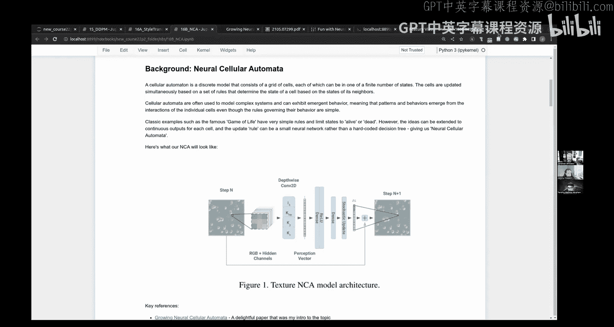

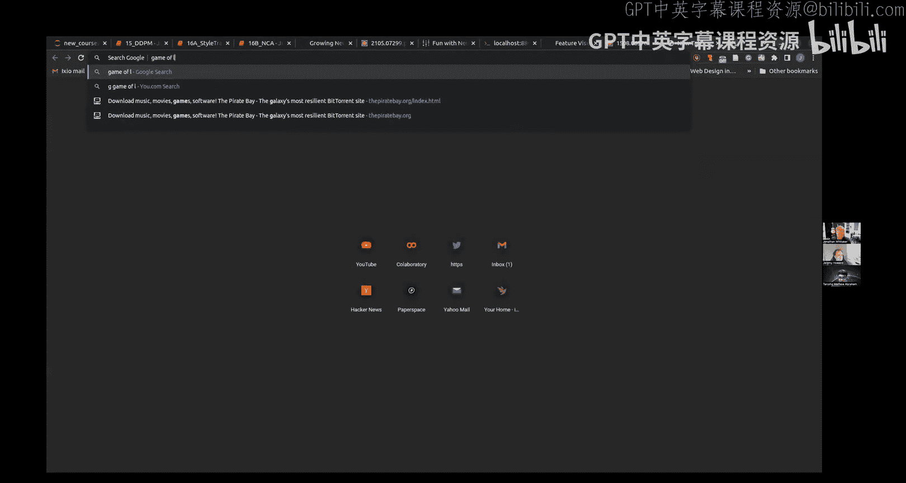

Oops， this spelled it。 But you， you've probably seen this kind of classic。

Conways game of life I life here when I was a kid。😊，Yeah。

 so the idea here is that you have all of these independent cells and each cell can only see its neighbors and you have some sort of update rule right that says that if a cell has three neighbors。

 it's going to remain the same state for the next one if it has。

Only one neighbor it's going to die in the next iteration。

 And so this is a really cool example of like a。A distributed system a self-organ system where there's no like global communication or anything each cell can only look at its immediate neighbors and typically the rules are really small and simple and so we can use these to model these complex systems it's very much inspired by biology where we actually do have。

😊，Huge， you know， arrangements of cells， each of which is only seeing its neighbour like sensing chemicals and the in the bloodstream next to it and so on。

 And yet somehow they're able to coordinate together。

 I watched to really recall her the casack video the other day about ants。

 And I didn't know this before Maybe everybody else does。

 But ants like huge ant colonies were organized by like having little chemical signals that the ants around can smell and。

Yeah， it can like organize the entire massive ant colony just using that I thought it was crazy。

 but it sounds really similar。Yeah， yeah， and you can do。So I do my tangent。

You could do very similar things where you have， yeah， like the trails。

 chemical trails being left are just like pixel values in some grid and your ants are just little tiny agents that have some rules so I should probably link this here。

 but this is exactly that kind of system right each little tiny dots。

 which almost too small to see is leaving behind these different trails and then that determines the behavior。

 The difference between this and what we're going to do today is that so just to clarify。

 I think you've taught me before that like actual slime mods kind of do this right they're another example Yes。

Yeah， yeah， exactly there's some limited signaling each one is like oh I'm by food and then after that that signal is going to propagate and anything that's moving is going to follow And so yeah。

 if you play with this kind of simulation， you often get patterns that look exactly like emergent patterns in nature like ants moving to food or you know corals coordinating and that sort of thing So it's a very biological it's bio field。

😊，The difference with our cellular autometerta is that they're gonna be there's nothing moving each each like grid cell has its own little agent。

 And so there's no like wandering around。 It's just each individual cell looking at its neighbors and then updating。

 And just to clarify， when you say agent that can be really simple。 Like I don't really remember。

 but I vague remember that Conway's gain of life， it's kind of like。

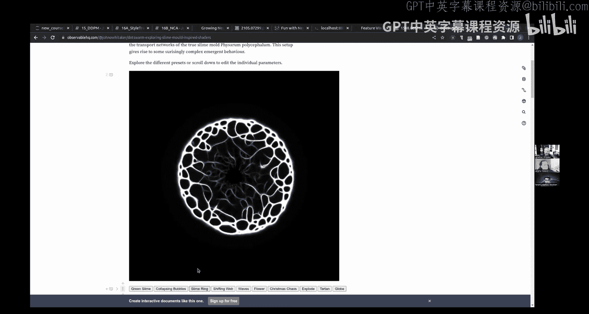

A single kind of if statement is like if theres。I don't know what is the two cells around you get another one or something。

 Yeah yeah， if there's two or three nearby， you stay alive in the next one。

 if you're overcrowded with four or five or there's no one near you with zero or one neighbors then you're going die So very。

 very simple rule but what we're going to do today is replace that hardcoded if statement with a neural network and in particular very small neural network so I should start with the paper that inspired me to like even begin looking at this so this is by Alexanderand Moventf and a team with them at Google Bra and they built these neural cellular automatas so this is a pixel grid every pixel is a studied automata that's looking at its neighbors and they can't see the global structure at all and it starts out with a single black pixel in the middle。

And if you run this simulation， you can see it builds this little lizard structure。

 It's a little emoji。 So that wild to me that that a bunch of pixels that only know about their neighbor。

Can actually create。Such a large and sophisticated image。Yeah， they can self assemble into this。

 And what's more。 the way that they train them， they are robust。 They're able to repair damage。

 And so there's no， it's not perfect， but there's no global signaling， no。

 no little agent shared knows what the full picture looks like。

 It doesn't know where in the picture it is。 All that knows that if neighbors have certain values。

 And so it's gonna update self to， to match those values。 And so you can see it does seem like。

Something that ought to have a lot of。Use in the real world， with lake。I don't know， like。

Having a bunch of drones working together when they can't contact。

 you know or some kind of central based， I'm thinking about like work that some Australian folks have been involved in where they were doing like subterranean automated subterranean rescue operations and they've let you literally can't communicate through thousands of metres of rock stuff like that。

Yeah。Yeah， so this idea of like self organizing systems。

 there's a lot of promise for like nanotechnology and and things like that that can do pretty amazing things。

 This is the blog post that's linked。 Yeah， the future of artificial intelligence is self organizing and self assembling。

 Oh。 and definitely， yeah。😊，That's a pattern that's worked really well in nature， right。

 like lots of lucidively coordinated cells coming together and talking about deep learning is is quite a miracle。

 And so I think yeah， that's an interesting pattern too。😊，To explore。Okay。

 so how do we train something like this， how how on earth do you set up your structure so that you can get something that not only builds out an image or builds out something like a texture。

 but then is robust and able to maintain that and keep it going。So。

The the sort of base is that we're going to set up a neural network with some learnable weights that's going to apply our little update rule。

And this is just going to be a little dense MLP。We can get our inputs。

 which is just the neighborhood of the cell and they sometimes have like additional channels that aren't shown that the agents can use this communication with with their neighbors so we can we can set this up in code we'll be able to get our neighbors using maybe convolution or some other method Latin those out and feed them through a little NLP and take our outputs and use that as our updates and has to clarify something that I missed originally is this is not a simplified picture of it This is it like that that three like it's literally three by three you're only allowed to see those things right next to you。

Or they can be in a different channel， exactly。 and this paper has this additional step of like cells being alive or dead。

 but we're going to do one that doesn't even have that。 So it's it's even simpler than this diagram。

Okay so to train this what we could do is we could start from our initial state。

 apply our network over some number of steps， look at the final output and compare it to our targets and calculate on loss and you might think okay well that's pretty cool we can maybe do that and if you run this you do indeed get something that after some number of steps and learn to grow into something that looks like your target image but there's this problem which is that you're applying some number of steps and then you're applying your loss after that but that doesn't guarantee that it's going to be stable I think it' my phone stable longer term and so we need some additional way to say okay I don't just want to grow into this image I'd like to then maintain that shape once I have it。

And the solution that this paper proposes。Is to have a pool of training examples， right。

 And we'll see this encode code just now。 So the idea here is that sometimes we'll start from a random state。

And we'll apply some number of updates， we'll apply our loss function and update our network。

 and then most of the time we'll take that final output and we'll put it back into the pool to be used again as a starting point for another round of training。

And so this means that the network might see the initial state and have to produce the lizard。

Or it might see a li that's already been produced。 and after some number of steps that still needs to look like that lizard。

 And so this is adding like an additional constraint that says even after much more steps。

 we'd still like you to look like this final output。And so yeah。

 it's also nice because like I mentioned here， initially the model ends up in various incorrect states that don't look like a lizard。

 but also don't look like the starting point and it then has to learn to correct those as well so we get this nice additional robustness from this in addition and you can see here now they have a thing that is able to grow into the lizard and then maintain that structure kind of indefinitely。

😊，And in this paper， they do this final step where they sometimes。

Chop off half of the image as additional like augmentation。

 So you could have like a bunch of drones or something that like can only see the ones nearby and they don't have GPS or something。

 And no crust of wind could come along and set them off path and they still reconfigure themselves。

Yeah， yeah， exactly half of them go flying in run out of a battery， that's fine。So very。

 very cool paper。 but you can see this kind of training is a little bit more complicated than oh。

 we just have a network and some target outputs and we optimize it。

 So we're not going follow that paper exactly， although it should be fairly easy to tweak what we have to match that。

 we're instead going to go for a slightly different one by the same authors where they train even smaller networks to match textures。

 And so you can imagine our style loss is going to come in useful here。

 we'd like to produce a texture without necessarily worrying about the。😊。

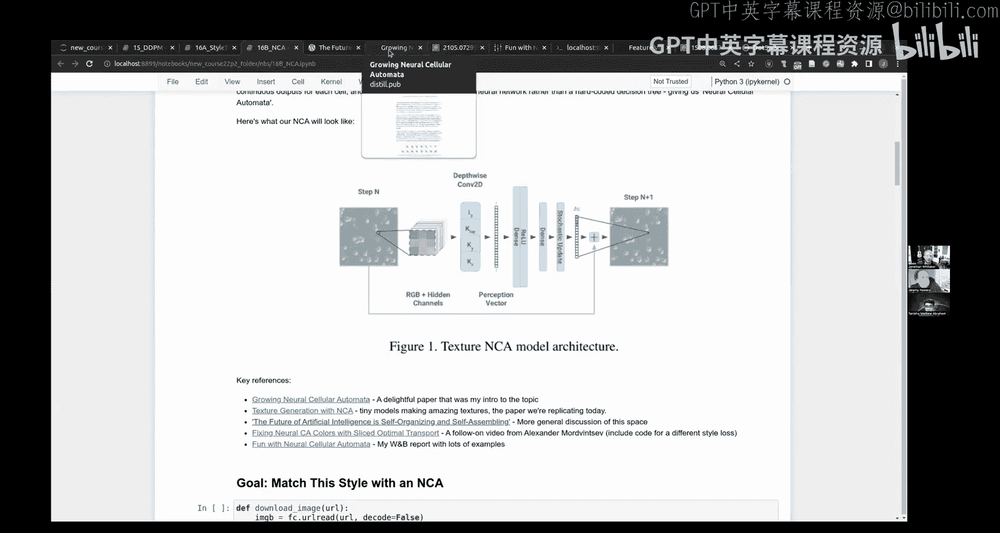

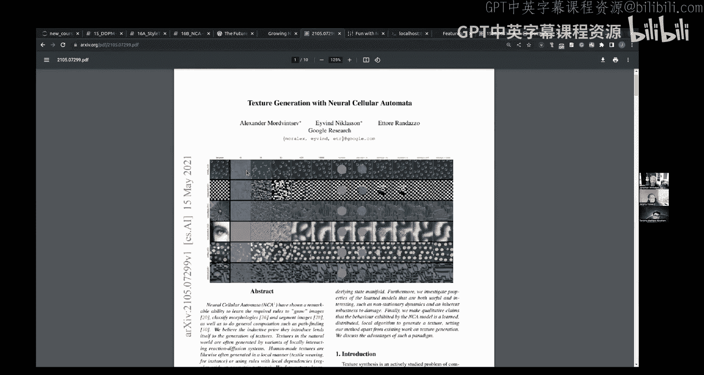

Overall structure， we just want per style And so the same sort of idea， the same sort of training。

 we're gonna start from random。 and then after some number of steps。

 we'd like it to look like our target style image and in fact there actually use a spider whip。

 which add notice just until now and that's for something that makes a texture to or texture in this case。

 is' something you you can tile nicely except Yes， yeah and so that tiling is gonna to come almost for free So we're gonna have our input。

 we're gonna look at our neighbors we're gonna feed that through a network and produce an output and every cell is going to do the same rule which will work fine by default。

 if we set this up without thinking about tiling at all。

 except that at the edges when we do like say a convolution to get our neighbors。

 we need to think about what happens for the neighbors of the cells on the edge。

 which ones should those be and by default those will just be paing of zero and so those cells in the edge A。

 they'll know they're on the edge and B they won't necessarily have any communication with the other side if we want this a tile what we' gonna do is。

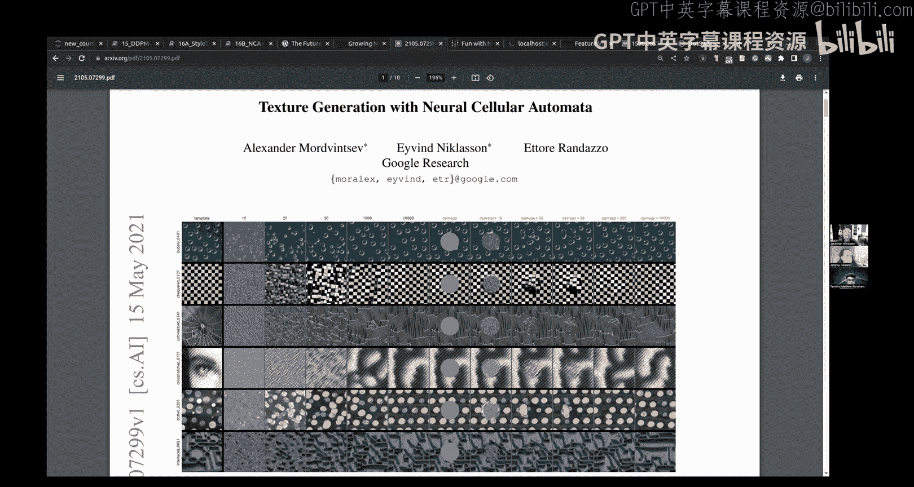

We're going to set our padding mode to circular where in other words。

 the neighbors of this top right cell are going to be these cells next to it here and these cells down in the bottom corner and then for free。

 we're going to get tiling。Okay， so enough waffle， let's get into code。

 we can download our style image ups。 youll do my inputs。😊。

This is going to be our target style image and again feel free to experiment with your own please we're going to set up a style loss just like we did in lesson 17 a the difference being that we're going have a batch dimension to our inputs to this calculate grams function which I didn't do in the style transfer example because you're always dealing with a single image everything else is going to be pretty much the same so we can set up our style loss with the target image and then we can feed in a new image or in this case a batch of images and we're going to get back loss。

So we're setting up our evaluation， we would like after some number of steps are output to look like a spider way。

Okay， let's define our model and here I'm making a very small model with only four channels and our hidden number of hidden neurons in the brain is just going to be8。

You can increase these something I would inclined to do People might want to play with in style loss to target is you're giving that all the layers the same weight that a nice addition would be to have a vector of weights you could pass in and experiment with that。

Definitely all right， so the the world in which these cellular tomata are going to live is going to be a grid。

 we're going to have some number of them if we call this function， number of channels and a size。

 you could make it non square if you can about that。😊，For our perception in this little diagram here。

 we're going to use some hard coded filters。And you could have these be learned， right。

 there would be additional weights in the neural network。

 The reason they're hard coded is because the people who were working with behind this paper。

 they wanted to keep the parameter accounts really low literally like a few hundred parameters total。

 And also they were kind of inspired by。 That's crazy。 like a reaping。😊。

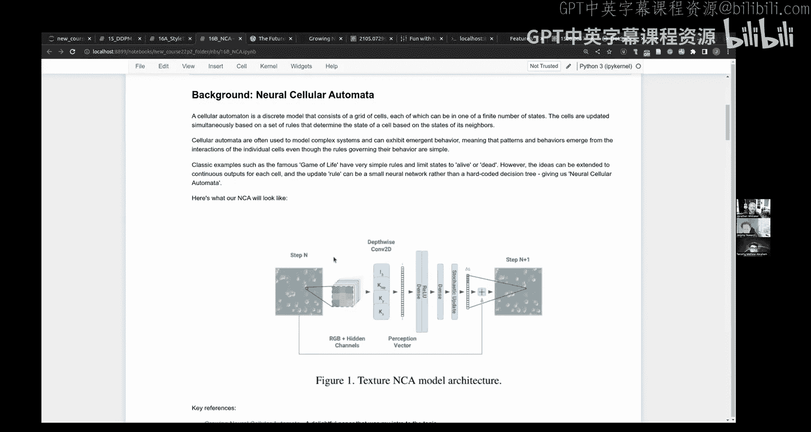

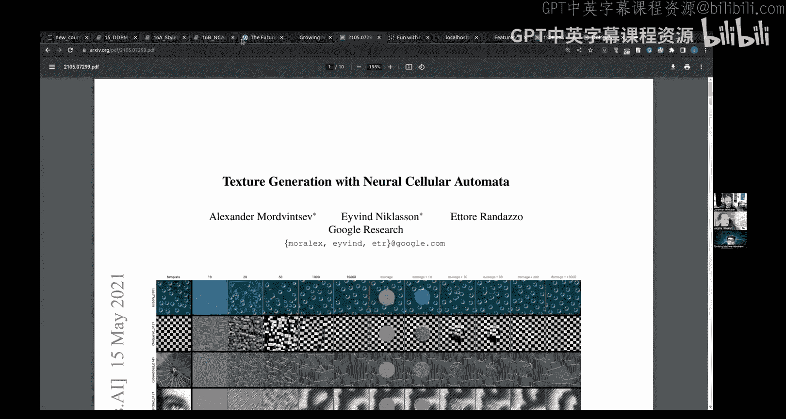

Even now that old fashioned emest models were had。Quite a few million parameters。 Yeah， so this is。

 yeah， this is a totally I shouldn' have admit。 that's one of the coolest things about these systems is they。

 they really can do a lot with very little parameters。😊。

And so these filters that we just going to hard code are going to be the identity。

 right just looking at itself， and then a couple that looking at gradients。

 again inspired by biology where even simple cells can sense gradients of chemical concentration。😊。

So we're going to have these filters， we're going to have a way to apply these filters individually just to help people understand that that first one。

 for example， that's a three by three， it's been kind of like visually flattened out。

 but if you were have kind of lay it out you could see it's a identity matrix。Yep， anyway。

 so you can see these filters this one is going to sense a horizontal gradient。

This one is going to sense a vertical gradient and the final one is called a sobel filter。Yeah。

 so we've got some hard coded filters， we're going to apply them individually to each channel of the input and rather than having a kernel that has separate weights for each each channel on the input and so we can make a grid。

We can apply our the I have machine。 I didn't know circular was a padding mode before。

 So that just as the thing you said， where it's about basically going to。

Circle around and kind of copy， copy in the thing from the other side when you reach the edge。 Yeah。

 Yeah， and this is very useful for avoiding it issues on the edges with those。

 you'll see a lot of a lot of limitationsations just deal with the fact that they have slightly weird pixels around the edge and they don't really look into it。

 This is one way to deal with that。Yeah， okay， so we can make a grid。

 we can apply our filters to get our model inputs， and this is going to be 16 inputs right because we have four channels and four filters。

 16 inputs， that's going to be the input to our little brain and we have this for every location in the grid。

So now， how do we implement that little neural network that we saw。

 The way it's shown in the diagrams is the dense linear network。 And we can set that up。

 We have a linear layer with。Number of channels by four。

 which is the number of filters as its number of inputs， some hidden number of neurons， we have a re。

 and then we have a second linear layer with outputting one output per channel as the update。

And so if we wanted to use this as our brain， what we'd have to do is we'd have to deal with this these extra dimensions so we take our batch by channel by hide and width。

 were going map the batch and the height and the width all to one dimension and the channels to the second dimension So now we have like a big grid of 16 inputs and lots out example we've seen inops to rearrange before so let's like put yeah a bit of a book map to come back to teach people about that in and maybe in the middle okay yeah。

Very， very useful function， but it is a little complicated because we have to rearrange our inputs into something that has just 16 features。

 feed that through the linear layer and then rearrange the outputs back to match the shape of our grid。

 So you can totally do that。 and you can see what parameters we have on our brain We have an 8 by 16 inputs and eight biases for the first layer and then we just have a four by8 weight matrix for the second linear layer and I've said bias equals false because we're having these networks proposing update and if we want them to be stable the update is usually going be zero or close to it。

 and so there's no need for the bias and we want to keep the number of parameters as low as possible that's kind of the name of the game And so that's why we setting in bias equals false。

Okay， so this is one way to implement this。 It's not particularly fast。 We have to do the re shaping。

 and then we' feedinging these examples through the linear layer。 we can cheat by using convolution。

 So this might seem like， wait， there isn't this a linear layer were going apply。

This linear network on top of each。Set of inputs， but we can do that by having a filter size of one。

 a kernel size of one in our convolutional layer。 So I have 16 input channels in my model input here。

And I'm going to have eight upper channels from this first convolutional layer。

 and my kernel size is going to be one by one。And then I have ready。

 and then I have another one by one convolutional layer。

And so we can see this gives me the right shape output and if I look at the parameters。

 my first convolutional layer has 8 by 16 by one by one parameters in its filters and so maybe spend a little bit of time convincing yourself that these two are doing the same operation Yeah。

 this stuff is used in cheating I mean this is quite elegant and yeah in languages like AL actually there's an operation called sling which is basically the same idea it's this idea of like applying some computation over a grid。

Yeah， and I should mention that convolutions are very efficient。

 all of our GPUs and things are set up for this kind of operation。😊。

And what makes neuralcellular thermoma quite exciting is that because we're doing this convolution you have an operation for every pixel that we're applying right。

 there' just looking at the neighborhood of producing an output。

 there's no global thing that we need to handle and so this is actually exactly what GPUs were designed for they're designed for running some operation for every pixel on your screen to render graphics or show you your video game or make your website scroll nice and slick and so we can take advantage of that kind of built in bias of the hardware from doing lots of little operations in parallel to make these go really really fast and we'll show I'll show you just now we can run these real time in the browser which is quite satisfying。

😊，Okay， so now that we have all that infrastructure in place， I'm just going to put it into a class。

 my simple CA is my cellular autometerta， we have our little brain。😊。

To convolutional layers and value， optionally， we can set the weights of the second layer to0 again because we want to start by being very conservative in terms of what updates we we produce。

Not necessarily necessary， but it does help the training。 And then in our forward part。

 I would be inclined。 I don't know if it matters， but I would be inclined to put that。

 I would be inclined to do。You know， an end do in it。

I constantstant zero or put that in a no grad like often。

Initializing things without no grad can cause problems。Okay， and I'll look into that。😊。

In the forward method， we're going to apply our filters to get our model inputs and they got do data do0。

 Okay， so that's that's fine。Yeah， I think this is the built in the bulletin method。 All right Oh。

 it's the dot data， which is the thing that makes it。 Yeah。

 you don't need torch do't know grad because you've got dot data so。Yeah， it's all good。Co， okay。

 And so the forward is is applying the filters。 it's feedinging it through the first convolutional layer。

 then the ready， then the second layer。And then it doing this final step which again goes back to the original paper somewhere in here they mentioned that they are inspired by biology and one thing that you don't have in a biological system is some sort of global clock where everything updates at exactly the same second it's much more random and organic each one is almost independent and so to mirror that what we do here is we create a random update mask。

And if you go in， let's just actually write this arts。嗯。

Let's just make make a a seller check that this is is what we're doing。

 So I'm going to just go the H W is one。Just to visualize。Upd rate。There we go。 Y。

 so this is creating this random mask， somes errors and some ones。

 according to what our update rate is。 and this is going to determine whether we apply this update to our original input or not。

 This is my who。Yeah， it's like dropod Ex。 And why this is nice if you imagine we start from a perfectly uniform grid。

 and then every cell is running the exact same rule。 after one update。

 we will still have a perfectly uniform grid。 there's no way for there to be any randomness。

 And so we can never like break out of that whereas once we add this random updates。

 or a subset of cells are going to be updated。 and now there's some differences。

 they have different neighborhoods and things。 And so then we get this like added randomness in。

 And this is very much like in a biological system， no cell is going to be identical。

 So that's a little bit of additional complexity。 but again。

 inspired by nature and inspired by paper。😊，With all of this in place we can do our training and we're going to use the same dummy data idea as before。

 we are going to have a progress callback which is a lot of code but it's all just basically sitting around for doing some plotting and I'm not going to spend too much time on that。

And then the fun stuff is going to happen in our training callback and so now we are actually getting deep into the weeds we modify our prediction function。

 this is much more complicated than just feeding a batch of data through our model。😊。

We are setting up a pool。Of grids， right， 256 examples。

 and these are all going to start out as you know， just uniform errors。

But every time we call predicts， we're going to pick some random samples from that pool。

We are occasionally going to reset those samples to the initial state。

And then we can apply the model a number of times and it's worth thinking here。

 if were applying this model 50 steps， this is like a 50 layer deep model all of a sudden。

 And so we start to get something that model rather than self don't land that model。Oh， yes。

 because I already have learned。😊，niceice。Yeah， so we've got to just be aware that by applying this a large number of times。

 we could get something like gradient exploding and things like that。

 which we'll deal with a little bit later， and but we apply the model a large number of steps。

Then we put those final outputs back in the pool for the next round of training and we store our predictions。

 these are the outputs after we've applied a number of steps。And in the loss。

 we're going to use a style loss。Saying does this match the style of my target image。

 and we're going to add an overflow loss that penalizes it if the values are out of bound just to try to change learn here too。

Yes， thank you。IThink I read this before we changed the note because I've got the go back there。

 I my about I more soft learned up Pre。 clamp。In the overflow lost one。 Yes， thank you。There occur。

 And yeah， so get loss is doing a style loss plus this overflow loss just to keep things from growing exponential out of bounds。

 again， something that's quite likely to happen when you're applying a large number of steps。

 And so we really want to penalise that。And the final thing is in Learndar backward。

 I've added a technique that probably going to be quite useful in some other places as well。

 called gradient normalization。😊，And so we're just running through the parameters of our model。

And we are normalizing them。And this means that even if they're really， really tiny， really。

 really large at the end of that multiple number of update steps， and this kind of a hack to。

Ring this back into control。let's put a bookmark let's put a bookmark to come back to that as well in more detail and I guess that before fit。

 maybe we don't need anymore more。Oh right， because this is now a default。 Okay， Oh。

 so I should have said this running before we started talking。

 It is going to take a little while but you can see my progress score back here is scatter ploting the loss。

 And the reason I'm， you'll see in the。When me call back here， I'm setting the Y limits to。And。

The the minimum of the initial set of losses is just because the overflow loss is sometimes so much larger than the rest of the loss ones that you get this really like bad scaling。

 So using a log scaling and clipping the balance tends to help just like visualize what's actually important。

 like the overall trend。 I guess the last but not just not run。

 we can then we can see it without you running it。 Oh right， Yeah， yeah。

 so you can see the outputs here。 So what I'm visualizing is that the examples that we've drawn from the pool every time we're drawing in this case I've got a fixed batch size that should probably be an argument。

But you can take a look at them and kind of compare them to the style license see initially。

 they don't really look too similar。After some training。

 we get some definite like webbbby tenddencies。And we can take this model and then apply it to like a random grid。

And logged the images you know every1 hundred0 steps or whatever。

 and you can see that starting from this random position。

 it quite quickly you know builds this pattern， it doesn't look perfect despite a webby。

 but in its defense this model has 168 parameters。😊，AndAnd it tiles。

 that and is like the magic of these models is that even with very few parameters。

 they're able to do something pretty impressive。And if you would like。

 go back up to where we define number of channels and number of layers if you give it more channels to work with 8 or 16 and more hidden neurons。

 32 or 64， you still have a tiny model， but it's able to capture some some much nicer so I would say please on the forums。

 try some larger sizes I'll also maybe post some results。

And just to give you a little preview of what's possible。So I did a project before using mini AI。

 so the code' is a little messy and hacky。 but what I did was I logged the study low tometerta well。

 maybe I should show this。

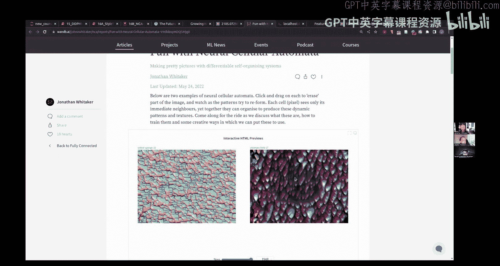

We this is way outside of the bounds for this course。

 but you can write something called a fragment shader in Web G out。

 So this is designed to run in the browser。 It's a little program that runs once for every pixel。

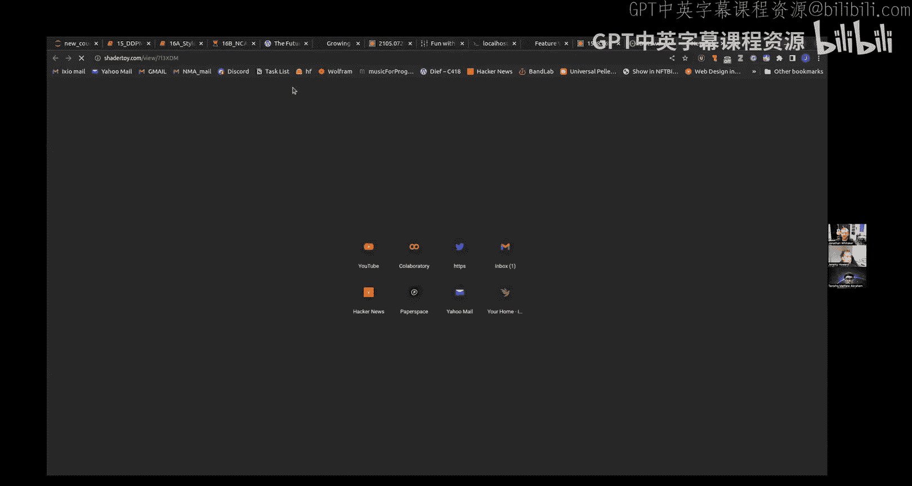

And so you can see here I have the weights of my neural network。

 I have sampling the neighborhood of each cell， we have our filters， we have our activation function。

 this is in a language called GLSL we're running through the layers of our network and proposing our updates and this one here I just had more I think more hidden neurons more channels and optimized with a slightly different loss function so it was a style loss plus clip to the prompt I think dragon scales or glowing dragon scales。

And you can see this is running in real real time or near real time because I'm recording and it's interactive you can click to kind of like zero out the grid and then see it like rebuild within that。

😊，And so in a similar way in this weight biases report。

 I'm logging these kind of interactive HTML previews。 we've got some。Videos and。

Just logging the grids from the different things and so you can see these are still pretty small as far as these networks go。

 I think they only have four channels because I'm working with RGBA shaders。😊。

But quite fun to see what you can do with these and if you click the right style images and train for a bit longer and use a few more channels。

 you can do some really fun stuff and you can get really creative applying them at different scales or I did some messing around with video which again is just like messing with the inputs to different cells to try and get some some cool patternss so yeah to me this is a really exciting fun amazing niche yeah I don't know if there's too many practical applications at this stage。

 but I'm already thinking of denoisising cellular automata and stylizing or image restoration cellular automata and you can really have a lot of fun with this structure and I also thought it was just a good demo of like how far can we push what you can do with the training call back to have this like pool training and you know really normalization and all these extra things added in very。

 very different from here's a batch of images and a batch of labels So I hope you found that interesting I was actually。

😊。

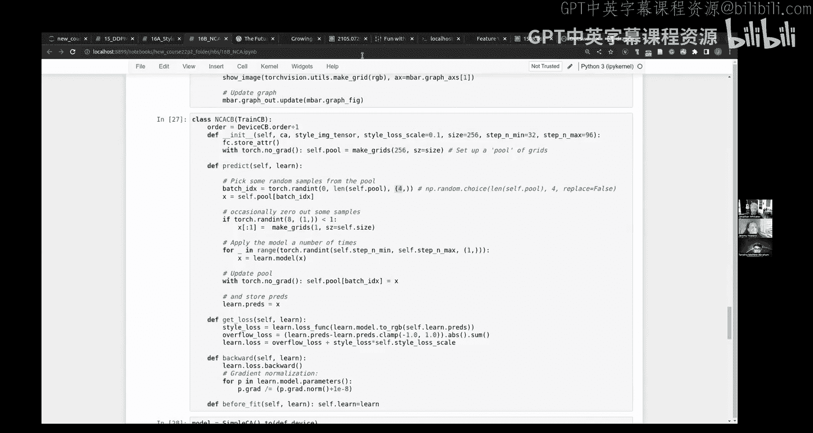

And then Jeremy， if you have any questions or follow up No， that's amazing。 Thank you so much。

 I actually have to go but。😊，That's just one of the coolest things I've seen。

