# Jeremy《深度学习基础到稳定扩散模型｜Deep Learning Foundations to Stable Diffusion》中英 p15 Lesson 21_ Deep Learning Foundations to Stable Diffusion.zh_en -BV1Mp421S7xg_p15-

Hello， Jon O， hello Tennish， are you guys ready for lesson 21？😊，Readep， I'm excited。

 I don't know what I would have said if you had said no， so good。

I'm actually particularly excited because I had a little bit of a peak preview of something that Jonno has been working on。

😊，Which I think， is a super cool。Demo of what's possible with very little code with mini AI。

 So let me turn it over to Jon。Great， thanks， Jeremy yeah。

 so as you'll see when it's back to Jeremy to talk through some of the experiments and things we've been doing。

 we've been using the fashion Ms data set to at a really small scale and really rapidly try out these different ideas and see some maybe nuances or things that we'd like to explore further and so as you were doing that I started to think that maybe it was about time to explore just ramping up the level like seeing if we can go to the next like slightly larger data set slightly harder difficulty just to double check that these ideas still hold for longer training runs and and yeah different more difficult data That's a really good idea because I feel like。

😊，Pretty confident that the learnings from fashion emmness are are going move across Latin most of the time these things seem too。

 but。Sometimes they don't， and it can be very hard to predict。 So this seems like a very。

A very wise choice。Yeah and so we'll keep wrapping up but as a next step， one above fashion NN。

 I thought I'd look at this data called C 10 and so C 10 data is a very popular data set originally for things like image classification but also now for all of this any paper and generative modeling it's kind of like the smallest data that you'll see in these papers and so yeah。

 if you look at the classification results for example。

 pretty much every classification paper since they started tracking has reported results on C 10 as well as their larger data sense and likewise with image generation very very popular of the recent diffusion papers will usually report C 10 add then maybe imagenet and then whatever large massive data set they're training on。

we， we were， we were somewhat notable in 2018 for managing to train。 So for C far 10。

94% classification is kind of the benchmark。 So there was a competition a few years ago where we managed to get to that point at a cost of like。

26 cents worth of AWS time， I think， which。W a big global competition， so。I actually hate CF 10。

 but we had some real fun with it a few years ago。😊，Yeah， and it's good。

 It's a nice test for' quickly testing things up， but we'll talk about why we also like us as a group。

 don't like it at all and we'll pretty soon move on to something and better。😊。

So one of the things you'll notice in this notebook。

 I'm basically using all of the same code that Jeremy is going to be looking at and explaining。

 so I won't go into too much， but the data sets also on Hi and face so we can load it just like we did。

 the fashion M nest。AndThe images are three channel rather than single channel。 So then。

The shape of the data is slightly different to what we've been working with。that's weird。Yeah。

 so we have instead of a single channel image， we have a three channel， red， green and blue image。

 And this is what a batch of data looks like。 And you've got 32 images in your batch。

 So that's batch by channel by by width Yeah， batch to I channel by height and width。

 I was a little ob by 32 by 32 is that yeah， it's fine I got it now。 batch I ski the arbitrary。

 So if we plot these。One of the things if you look at this， Okay。

 I can see these are different classes。 Like， I know this is an airplane， a frog， an airplane。

 but it's actually a puzzle， an airplane on the cover， a bird， a horse， car。 That one， you squint。

 You can tell it's a dare， But only if you really know what you're looking for。

 And so when we started to talk about generating these images。

 this is actually quite frustrating like this。If I generated this。

 I'd say this might be the model doing really a bad job。 And but it's actually that this is a boat。

 This is a dog。 It's just that this is what the data looks like。

 And I've actually got something that can help you out our show later today。

 which is for something like this， it's really actually hard to see whether it's good because the images are bad。

 it can be helpful to have a。😊，Metric the generator can see how good samples are。

 so I'll be showing a metric for that later today。Yeah。

 and and that that'll be great and I hope to have like automated。 But anyway。

 I just wanted to flag like for visually inspecting these that's not great。

 And so we don't really like Cva10 because it's hard to tell and but still a good。

 a good one to test with。😊，So the noiseify and everything I'm following what Jeremy is gonna to be showing exactly。

 the code works without any changes because we're adding random noise in the same shape as our data。

 So even though our data data now has three channels the noise of I function still fine if we try and visualize the noise images because we're adding noise in the red pink blue channels and some of that quite extreme values。

 yeah it looks slightly different looks all crazy RGB but you can see for example。

 this frog doesn't have as much noise and it's vaguely visible but it is it' it's a many impossible task to look at this until what image is hiding out all of that noise So I think this is really neat that you could use the samefi。

嗯。Yeah， and it， it still， it still works thanks to it's not just that that shape thing。

 but I guess just thanks to kind of。Pie tor is broadcast t kind of stuff。

 this often happens and can kind of change the dimensions of things and it just keeps working。

Exactly， and we've been paying attention to those broadcasting rules and the right dimensions and so on。

Cool， so I'm gonna to use the same sort of approach to learning the unit except that now obviously I need to specify three input channels and three upper channels'ca we're working with three channel images。

 but I did want to explore for this demo like， okay。

 how could I maybe justify wanting to do this kind of experiment tracking thing that I'll talk about。

 And so I'm bumping up the size of the model substantially I've gone from this is the default settings that we were using for fashion MNest。

 but the diffuss default unit has what many20 times as many parameters 274 million versus 15 billion。

😊，So if you're going to try a larger model， we're going to try some log their training and so I could just do the same training that we've always done just in the notebook set up。

A learner with progress C to kind of plot the losstractor metrics。But yeah， I don't know about you。

 but once it's beyond a few minutes training， I quickly to get a patient and I have to wait for it to finish before we can sample。

 So I'm doing the DPM sample that I have to， I actually interrupted the training to say I just want to get a look at what it looks like initially and to plot some samples。

 And again， the sampling function works without any modification that I'd passing in my size to be a three channel image。

 Yeah， and so this is like we could do it like this。 But at some point。

 I would like to a keep track of what experiments I've tried。😊，And B be able to see things as。

 as it's going over time， including like， I would love to see what the samples look like if you generated after the first epo after the second epo。

 And so that's where my like the little callback that I've been playing with comes。

 just for4 you do that I just mention， like， I mean， there are。😊，Simple ways， you could。Do that。

 right， Like yeah one popular way a lot of people do is that they'll save some sample images as files。

 every epoch or two。Or we could like attend the way that we have a updatingating plot。

As we train with fast progress， we could have an updating。Sa of。嗯。Example images。

 So there's a few ways we could。We could solve that。 That wouldn't handle the。

Tracking that you mentioned of like looking over time at how different changes have improved things or made them worse。

 whatever that would I guess would require you kind of like。

Saving multiple versions of a notebook or keeping some kind of research journal or something。

Am made it， fiddly。It is。 and all of that's doable。

 but I also find like I'm a little bit lazy sometimes maybe I don't write down what I'm trying。

 or yeah， I've saved unled members 37 notebook books。 So yeah。

 the idea that I wanted to show here is just that there are lots of other solutions for this kind of experiment tracking and logging And one that I really like is called weights and biases and so I'll explain what's going on in the covid here but I'm running a training with this additional weights of biases callback And what it's doing is it it's allowing me to log whatever I'd like and so I can log samples at switch to a website here called W and pay AI。

 so that's where your。😊，Yeah， Corbeck is sending information to。Yeah。

 so weights and biases accounts are free for personal and academic use and it's very。

 very like I don't think I know England， it's for weights and biases。

 but it's a very nice service you sign in and you log in on your computer or you get a little authenticification token and then you're able to log these experiments and you can log into different projects。

😊，And what it gives you is for each experiment anything that you call waitbies。

log at any step in the training， that's getting logged and sent to their server and stored somewhere where you can wait like access it and display it。

 they have these plots that you can you know visualize easily and you can also share them very easily and like these reports that integrate this data sort of interactively。

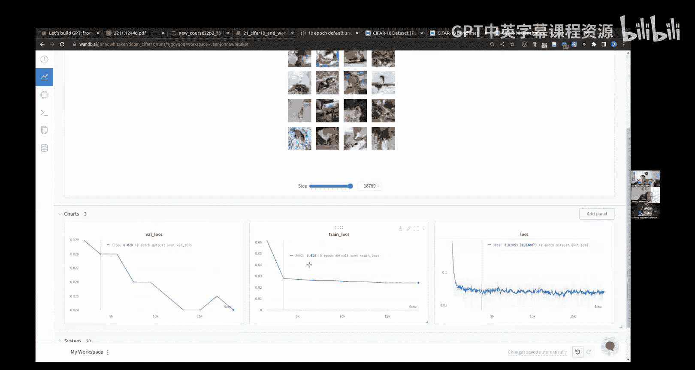

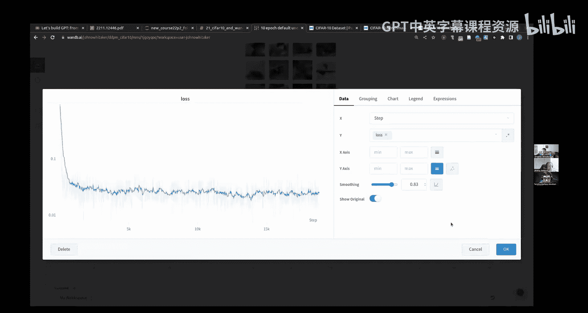

And why that's nice is that later， like you can go and look at。

 So this is not the project that I'm looking to。 You can log multiple runs with different settingss。

And for each of those you have all of these things that you've tracked like your training loss and validation。

 but you can also track your learning rate to you in a learning rate schedule and you can save your model as an artifact and it'll get saved on their server so you can see exactly what run and produce what model and it logs the codeVID if you said that to you can save save code equals true and then it creates a copy of your whole Python environment。

 what libraries were installed， what code you ran， so being able to come back later and say， oh。

 these images here， these look really good， I can go back and see， oh that was this experiment here。

 I can check what settings I used。

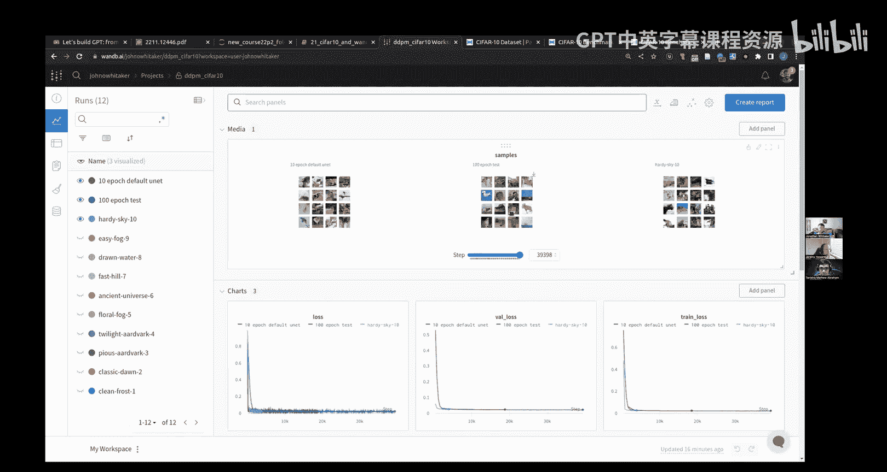

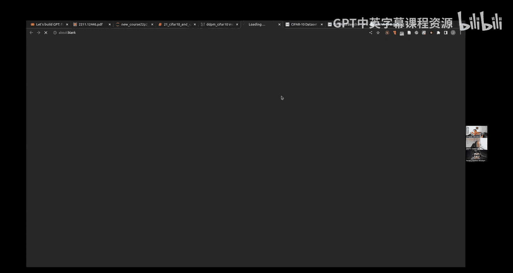

In the in the initialization， you could log whatever configuration details you'd like in any comments。

And。And yeah， it's， it's， there's， there's other frameworks for this and。Yeah， in some ways。

 it's kind of additional when I was first saw with some biases， it felt a bit weird to me actually。

Sending your information off to an external website because， I mean。

 before weights and biases existed， the most popular way to do this was something called Tensor board。

 which Google provides， which is。Actually， a lot like this。

 but it's a little server that runs on your。On your computer and so like when you log things it just puts it into this sort of database on your computer。

 which is。Totally fine。But I guess actually， there are some benefits to。

Having somebody else run this service， you know， instead of running your own little tensor board or whatever server。

 you know， one is that。You can have multiple people working on a project collaborating。

 so I've done that before where we will each be sending like different sets of hyperparmeters and then we they'll end up in the same place。

Or if you want to be really antisocial， you know， you can interrupt your romantic dinner and look at your phone to see how your training's going。

 So like， yeah， I'm not gonna to say it's like。

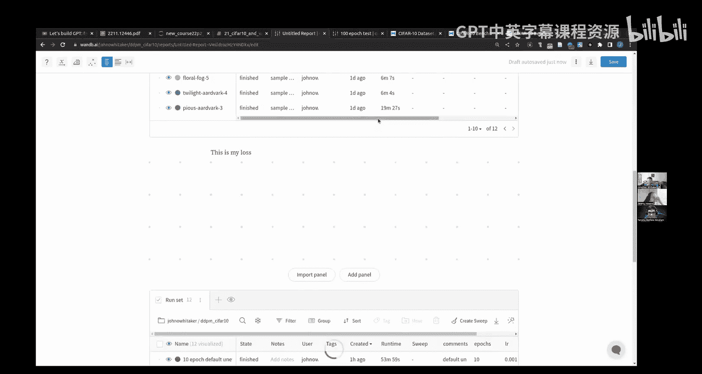

Well is the best approach to doing things， but I think there's definitely benefits to using this kind of service and it looks like you're showing us that you can also create。

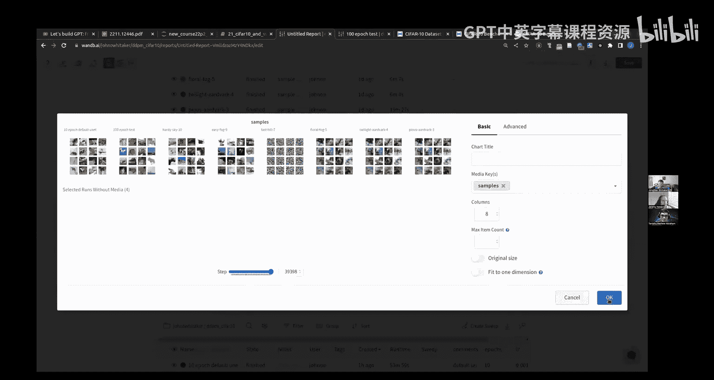

Reports for sharing this， which is also pretty nifty。

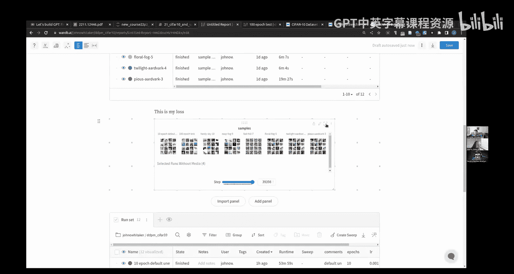

Yeah， yeah。 So I like for a a working with。

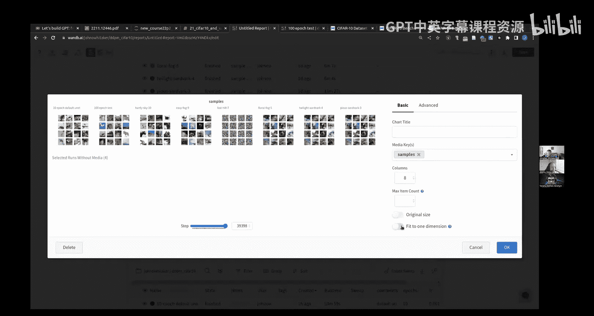

Working with other people or like you wantna， you want to show somebody the the final results and being able to。

 yeah， like pull together the results from some different runs or。Just say， oh， look， by the way。

 But here's a， here's a set of examples from my two most recent。And things track to different steps。

 What do you think of this。And yeah， being able to have this like place where everyone can go and make can inspect the different loss curves for any run。

 they could say， oh， you know， what were the， what was the batch size for that s go look at the。

Info there。 Okay， I didn't log it， but I logged how many epochs and the learning rate。 So yeah。

 it I I find it quite nice， especially in a team， or if you're doing lots and lots of experiments to be able to like have this permanent record that somebody else deals with and may house the storage and the tracking。

😊，Yeah， it'， it's quite nice。 And wait， this is sort the code。 you had to right。 That's amazing。😊。

Yeah， so this is using the callback system。 the way weights and bias works is that you start a。

 you start an experiment with this1 D B dot in it and you can specify any like configurational settings that you used there。

 And then anything you need to log is10 B dot lock and you pass in whatever the name of your value is log in the loss and then the value And once you' done1 D B dot finish and that syncs everything up and says it server。

 this is wild the way you've。😊，Inherited from metric C B。

 And you replaced that underscore log that we previously were used to allow fast progress to do the logging。

 and you've replaced it to allow weights and biases to the logging。 So yeah， it's really sweet。Yeah。

 yeah。 and so this is using the callback system。 I wanted to do the things that metric Cv normally does。

 which is tracking different metrics that you pass in。 So this will still do that。

 And I just offload to the super like the original metric C method for things like the after batch。

But in addition to that， I'd also like to log the weights and biases。 And so before I fit。

 I initialized the experiments， every batch I'm going to load the loss。After every epoch。

 the default entries callback is going to。Acccumulate the metrics and so on。

 And then it's going to call this underscore log function。

 So I chose to modify that to say I'm going to log my loss training。

 I'm going to log my validation loss if I'm doing validation and I'd like to log some samples waits and biases is quite flexible in in terms of what you can log you can create images or videos or audio whatever but it also takes a map upload figure and so I'm generate its samples and plotting them with show image and splitting back that map figure which I can then log and that becomes these pretty pictures that you can see over time like every every time that log function runs。

 which is after every epoch you can go in and see what the images look like。 So。

Make your code even simpler in the future。 if we had to show images。

 maybe it could have like an optional return fake parameter that returns the figure。

 And then we could replace those four lines of code with one， I suspect， Yeah， Yeah， and I mean。

 this， just sort of through this together。 It's， it's quite early still。

 You could also what I've done in the past is usually just create a PL image。 where you can。

 you know， make a grid or overlay a text or whatever else you'd like and then just log that as1 D B dot image。

AndOtherwise， like apart from that， I'm just passing in this callback as an extra callback to。

My set of callbacks for the learner instead of a metric callback and so when I call that do fit。

 I still get my little progress bar， I still get this printed art version because my log function still also print those metrics just for debugging but instead of having to like watch the progress in the notebook I can set this running disconnect from the server go ahead the and they I and check on my phone or whatever what do the circle look like and okay cool there。

Starting to look like less than random nonsense， but still not necessarily recognizable。

 Maybe we need to train for longer。 That can be the next experiment。

 What I should probably do next is think of some extra metrics。

 But Jeremy is going to talk about that。 So for now。

 that's pretty much all I had to show is just to say， yeah， it's worth as you move to these longer。

 you know，10 minutes，1 hour，10 hours， these experiments。

 It's worth setting up a bit of infrastructure for yourself so that you know what were the settings I used。

 And maybe you saving the models So you have the artifact as results。 And yeah。

 I like this wait advice approach， but there's lots of others。

 The main the main thing is that you're doing something to track these experiments beyond just。

You know creating pretty different versions of your notebook I love it one thing I was gonna note that I don't know if many people know like weights and biases can also save the exact code that you used to run that for that run so like if you make any changes to your code and then you know which version of your code you use for this particular experiment so then you can figure out exactly what code you use it's all completely reproducible and so I love weights and biases。

 all these different features it has and I use weights and biases all the time for my own research like almost daily like I had put it run just last night and took on it today morning so it's like I use it all the time for my own research yeah like I use it especially to just know like this run had this particular config and then yeah the models go straight into weights and biases and then if I want to run a model on the test set I literally actually take it off of weights and biases like download for weights and biases and write it on the test set so I use it all the time and also just having the ability to have everything reproducible and know exactly。

what you were doing it's very convenient instead of having to like manually track it in some sort of like。

 I guess a big Excel sheet or some sort of journal or something like that， sometimes this is。

 you know， this is a lot more convenient I feel so yeah。

 lest we get into too much feeling from weights and biases I'm going to put a slightly alternative point of view。

Which is， I don't use it or any experiment tracking framework myself， which is not to say。

Maybe I could get some benefits by doing so。 But I family intentionally don't， because I。

Don't want to make it easy for myself to try 1 thousand0 different hyperparameter or do kind of like。

It all directed， you know， sampling of things。 I like to be very。Like directed， you know。

 And so that's， that's kind of the the， the， the workflow I'm looking for is one that allows that to happen。

 right constantly going back and refactoring and thinking。

 what did I learn and how do I change things from here and never kind of doing like。

17 learning rates and six architectures and whatever。Now， obviously that's。

Not something that Johnno is doing at the moment。I don't it's so easy for him to。 get all。

 if you went up to， I can only a script that just does 100 runs with different models and different。

 Yeah， And then I can look at my w verses and say filter by the best loss。 Yeah。

 which is very tempting。 So I would say to people like， yeah。

 definitely be aware that these tools exist。 And I definitely agree that。As we do this。

 which is early 2023 weights and biases is。By far the best one I've seen。

 it has by far the best integration with fast AI， and as of today， if shadowau's pushed yet。

 it has by far the best integration with many AI。U。

I think glossso fast AI is the best library for using with weights and biases it works in both ways。

So yeah， but don't， no， it's there。 consider using it， but also consider not。Going crazy on。

On experiments， because。You'll， I think experiments have their place really， but also。

Thereforefully thought out hypotheses testing them。

 changing your code is over the approach that I thinks best。Well， thank you， John， I think that's。

Bossom。嗯。I got some fun stuff to share， as well。At at least I think it's fun。

And what I wanted to share is like。Well， the first of all， I should say。We had said。We all had set。

That we were going to look at units this week。We are not going to look at units this week。

 but we have good reason。😊，Which is that。We had said， we're going to go from。

Foundations to stable diffusion。 Well that was also a lie because we're actually going beyond stable diffusion。

And and so we're actually going to start showing today some new research directions I'm going to describe the process that I'm using at the moment to investigate some new research directions and we're also going to be looking at some other people's research directions that have gone beyond stable diffusion over the past few months。

So we will get to。Us， but we haven't quite finished。You know， as it turns out。

 the trading and sampling yet。Now。One challenge that。I was having。

 as I started experimenting with new things， was。Start getting to the point where actually the generated images looked。

Pretty good， and。It felt like。You know， almost like。Being a parent， you know。

 each time a new set of images would come out， I would want to convince myself that these were the most beautiful。

um。And so I， yeah， I and， and like when they're crap， it's obvious， they're crap， you know。

 but when they studies look pretty good， it's very easy to convince yourself you're improving。

 So I wanted to， you know， have a metric， which could。Tell me how good they were。Now， unfortunately。

There is no such metric。There's no metric。 that actually says。

Do these images would these images look to a human being like pictures of clothes？

Because only talking to a person can do that。 But there are some metrics which give you。

At approximation of that。 And as it turns out， these metrics are not actually。han。

They're not actually a replacement for。Human beings looking at things。But they are useful。Addition。

So， and I certainly found them useful， so I'm going to show you。The two most common。 Well。

 there's really the one most common metric， which is called F I D fit。

 And I'm going to show another one called K I D or kit。So。Let me describe and show how they work。

 And I'm going demonstrate them using。The model we changed in the last lesson。It was in 80pm。2。

And you might remember， we trained one with mixed precision。

And we saved it as fashion DPM MP I mixed position。Okay， so this is all the usual imports and stuff。

 this is all the usual stuff。But there's a slight difference this time。

 which is that we're going to try to get the fit for a model we've already trained。

 so basically to get the model we've already trained to get its fed， we can just torchload it。

right and then up code to pop it on the GPU。 So I'm going to call that the S model。

 which is the model for samples， the samples model。

 And this is just to copy it and past to DBPM from the last time So that's fair sampling。

 So we're going to do sampling from that model。And。So once we've sampled from the model。

 we're then going to try and calculate this score called the fit。Now。

What the fit is going to do is it's not going to say how good are these images， It's going to say。

How similar are they to。Real images。And so the way we're going to do that is we're going to actually look specifically at for the images that we generated in these samples。

We're going to look at。Some statistics of some of the activations。So what we're going to do。

 we've generated these。We've generated these samples。And we're going to create a new data load。

Which contains no training batches， and it contains one validation batch， which contains the samples。

 It doesn't actually matter what the dependent variable is。

 So I just put in the same dependent variable that we already already had。

And then what we're going to do is we're going to use that to extract。Some。Features from a model。

 Now， what do we mean by that？ So if you remember back to。Notbook 14。

We created this thing called summary。And summary shows us at different blocks。Of our。Model。

There are various different output shapes right in this case。

 it's a batch size of 1024 And so after the first block， we had 16 channels，28 by 28。

 and then we had 32 channels 48 by 14 and so forth until at the just before the final linear layer we had。

Though we had the 1024 batches and we had 512 channels with no height and width。Now。

The idea of fit and kid is that the distribution of these 512 channels。For a real image。

Has a particular， kind of like signature。It looks a particular way。

 And so what we're going to do is we're going to take our samples。 We're going to run it through。

A model that's learnt to predict。You know， fashion classes。And we're going to grab。This layer， right。

 And then we're going to average it across a batch， right， to get 512。

Numbers and those are going to represent the main of each of those。Channels。

 so those channels might represent， for example， you know the。Does it have a pointed color。

 Does it have。You know， smooth fabric Does it have sharp hills and so forth， right and。

You could recognize that something is probably not。A normal fashion image。 If it says， oh， yes。

 it's got sharp heels and。flowlowing fabric。Its like， oh。

 that doesn't sound like anything we recognize right。 So there are certain kind of like。

Seets of means of these activations that that don't make sense。

So pet Smith that this is a metric for。It's not a metric for an individual image necessarily。

 but it's across a whole lot of images。 So if I generate a bunch of fashion images。

 and I want to say， does this look like a bunch of fashion images， If I look at the meat。

 like maybe X percent have this feature and X have that feature。 So if I'm looking at those means。

 as like comparing the distribution within all these images I generated。

 do roughly the same amount have shot colors as those in。Yeah， that's a that's a very good point。

 too。 Yeah， and it's actually going to get even more sophisticated than that。

 But let's just start at that level， which is this features dot B。

 So the basic idea here is that we're going to take our samples。

And we're going to pass them through a pretrained model that is learnt to predict。

What type of fashion something is。And of course， we train some of those in this。

Notebook and specifically we trained a nice 20 epoch1 in the data Oration section。Wwhichch had a 94。

3% accuracy， and so if we pass our samples through this model。We would expect to get some you know。

 useful features。One thing that I found made this bit complicated， though。

 is that this model was trained using data。That had gone through this。

Transformation of subtracting the mean and dividing by the standard deviation。And that's not。

What we're creating in our samples。 And so generally speaking， samples in most of。

These kind of decisionion models tend to be between negative 1 and1。

So I actually added a new section to the very bottom of this notebook。Which simply。

Replaces the transform with something that goes from negative one to one。

And just create those state noticeus and then trains。A something that can classify fashion。

 And I save this as。Not data orbit but data or2。 So this is just exactly the same as before。

 but it's a fashion classifier where the inputs are expected to treated minus1 and1。Having said that。

 it turns out that our。Images。Our samples are not between -1 and1。But actually。

 if you go back and you look at DDPM2。We just use TF do to 10， sir。

 and that actually makes images that are between 0 and1。So actually， that's a bug。Okay。

 so our images。Have a bug， which is thick between 0 and 1。 So we'll look at fixing that in a moment。

 But for now， we're just trying to get the fit of our existing model。 So let's do that。

So what we need to do is we need to take the output。Of our model。 And we need to。Model play by2。

 so that'll be between 0 and 2 andtract1， so that'll change our samples to be between minus1 and 1 and we can now pass them through our pre trained fashion classifier。

Okay， so now how do we get that the output of that pooling layer because that's actually what we want to remind here。

We want the output of。This layer。嗯。So just to kind of flex our。You know， pie toch muscles。

 I'm going to show a couple of ways to do it。So we're going to load the model I just trained the data ac3 model。

And what we could do is， of course， we could use bulk。And we have a hooks callbe。

So we could just create a function。Which just depends。The output so very straightforward。Okay。

 because that's what we want。 we want the output and specifically it's。

So we've got these are all sequentials so we can just go through and go 0，1，2，3，4。

 and5 the layer that we want。Okay， and so that's the module。That we went to hook。

So once we've hooked that， we can pass that as a quaback。And we can， then。

It's a bit weird calling fear I suppose because we're saying train equals false。

 but we're just basically capturing。This is just to put make one batch go through。

And grab the outputs so this means now in our hook there's now going to be thing called out P because we put it there。

And we can grab， for example， few of those to have a look。 And yet here， we've got a 64 by 5，12。

Set a features。Okay， so that's one way we can do it。

Another way we could do it is that actually sequential models。

Are what's called in Python collections。 They have certain。

A certain API that they're expected to support and out of something a collection can do like a list is you can call Dell。

To delete something。So we can delete。This layer and。This layer and be left with just these layers。

 And once we do that， that means we can just call capture pretz because now they don't have the last two layers。

 so we can just delete。Theres 8 and 7 core capture pres。

 And my nice thing about this is it's going to give us the entire。10000 images in the test set。

So that's what I ended up deciding to do， there's lots of other ways I played around with which worked。

 but I decided to these two as being two good， pretty good techniques。Okay， so now we've got。

What do a thousand real images look like？At the end of the pullinging layer。

 so now we need to do the same for our sample。So we'll load up our fashion DDPMmp。We'll call sample。

 let's just grab 256 images for now。Make them go between minus1 and 1。Make sure they look okay。

And as I described before， credit data loaders where the validation set just has one batch which contains our samples。

And call capture Pritz。Okay， so。嗯。That's going to give us。

Our features and the reason why is because we're passing the sample too。Mddle and muddle is the。

A classifier。Okay， which we've deleted the last two layers from。So that's going to give us。

Our 256 by 512。 so now we can get the means。Now。That's not， really。

Enough to tell us whether something is looks like real images。U。So maybe I should draw here。😔，So we。

 we started out with our。P batch。Of 256。256。And our channels。Of 5，12。And we squished them。

By taking their maine。Though it's now just 256。A vector so this is the。Sorry probably going around。

When he squished them this way。5，12。Because this is the main。For H。Channel。

And we did exactly the same thing for the much bigger。You know， full set of real images。

 so this is our samples。And this is our real。But when we squish it。It was 10000。9 5，12。Weette， again。

5，12。嗯。So we could now compare these two。Right， but， you know。

 you could absolutely have some samples that don't look anything like images， but have。

Similar averages。For each channel。So we do a second thing， which is we create a。Covariance metrics。

Now， if you've forgotten what this is， you should go back to our previous lesson where we looked at it。

 but just remind you a conveyance matrix。Says。In this case， we do it across the channels。

 it's going to be 5 to 12。By 5，12。So it's going to take each of these columns。And it says。In H。

 So to his So 1，1。Basically， it says， what's the difference between。

It basicallyically it's saying what's the difference between each row。

 each element here and the mean of the whole column？Multiply by。

The exactly the same thing for a different column。 Now on the diagonal， it's the same column twice。

 So that means that these in the diagonal。It's just the variance。Right。But more interestingly。

 the ones in the offt diagonal， like here。Is actually saying。

 what's the relationship between column 1 and column 2 right？

 So if column 1 and column 2 are uncorrelated。Then this would be0。Right， if they were identical。

 right， then it would be the same as。The variance in here。So's how correlated are they。

And why is this interesting， Well， if we do the same exactly the same thing for the reels。

 that's going to give us another 5，12 by 512。And it's going to say things like。

 so let's say this first column was kind of like that it all doesn't have pointy heels。Rightright。

 and sorry， heels spell。 And the second one might be， does it have flowing fabric。

And this is where we say， okay， if generally speaking。

 you would expect these to be negatively correlated。Right so。Over here in the reels。

 this is properly going to have a negative。Where else if over here it was like zero or even worse if it's positive。

 it'd be like， oh those are probably not real because it's very unlikely you're going to have images that have both where pointy heels are positively associated with a flooring fabric。

😊，So we're basically looking for to。Data sets where their covariance matrices are kind of the same。

 and their means。Her also。Tied of the same。嗯。All right。So there are。😔，Ways of。Compareing these。

 you know， basically comparing。Two sets of data to say， are they， you know。

 from the same distribution and you can broadly think of it as being logo。

 do they have pretty similar covariance matrices， So they have pretty similar mean vectors。

And so this is basically what。It the fresh A inception distance。Does。Does that make sense so far。

 guys。Yes， it's， it's really he's striking you know how strong the the similarity is to when we're talking about like the style loss and the kinds of thing。

 how do the types of features that occurred together without worrying about like which items in the data you do the same thing the cr matrices or whatever Yeah。

 Yeah yeah。Now。The particular way of comparing so okay。

 so I've got the meetingss and I've got the covariances for my samples。嗯。

And I've actually just created this little celp stats， right， So I I always。

 I'm showing you how I build things， not just things that are built， right。

 So I always create things step by step and check their shapes， right， And then I。

Haste them into our or merge the cells， copypy the cells and merge them into functions。

 So here's something that gets the means and the covariance。Mattrix。

So then I basically do I call that。Both for my sample features and for my features of the actual data set or the test set in the dataset。

嗯。Now what Id now do with that if they they have those features。

 I can calculate the thing called the F a inception distance， which is here。And basically。

 what happens is we。Multiply together the two covariance matrices。

And that's now going to make them like bigger。Right。

 so we now need to basically scale that down again。 Now， if we were working with。嗯。You know。

 non matrices。You know， if you kind of like multiply two things together。

Then to kind of bring it back down to the original scale， you know。

 you could kind of like take the square root， right。 So particularly if it was by itself。

 you talk the square root， you get back to the original。

 And so we need to do exactly the same thing to。Re normalmalize these matrices。

 The problem is that we've got。Marices。And we need to take。The matrix square root。 Now。

 the matrix square root， you might not have come across this before， but it exists。

 And it's the thing where。The matrix square root of the matrix A times itself is a。

Now I'm going to slightly cheap because。We've used the float square root before。

 and we did not re implementple it from scratch because it's in the Python Standard Library。

 and also， it wouldn't be particularly interesting。

 But basically the way you can calculate the float square root from scratch is by using。

There's lots of ways。 but， you know， the classic way that you might have done it in Tco is to use Newton's method。

 which is where you basically can solve if you're trying to calculate， you know， a equals。um。

T root X。Then you're basically saying。A squared equals x。

 which means you're saying a squared minus x equals 0。And。

That's an equation that you can solve and you can solve it by basically taking the derivative and taking a step all the derivative a bunch of times。

嗯。You can basically do the same thing to calculate the metric square root。And so。Here it is。

It's the Newton method， but because it's for HC， it's slightly more complicated。

 so it's a short method， and I'm not going to go through it。

 but it's basically the same deal all you go through。Up2。1und0 iterations。

 And you basically do something like traveling along that kind of derivative。And then he said， okay。

 well。The result。Times itself。What to equal。The original matrix。

 So let's attract the matrix times itself in the original matrix and see whether the absolute value is small。

 And if it is， we've calculated it。 Okay， so that's basically how we do a matrix square root。

 So we do that's that。 And so now that we have strictly speaking informative from scratch。

 we're allowed to use the one that already exists。Ietoch doesn't have one， sadly。

 So we have to use the one sip pi sipai dot me。U。So this is basically going to give us a measure of。

Similarity between the two covariance matrices。And then。We。

 here's the measure of similarity between the two。Maine myrease， which is just the summers great As。

And then basically， for reasons that interesting。 but it's just normalising。

 we subtract what's called the trace， which is the sum of the diagonal elements。

 and we subtract two times the trace of the。This thing。

And that's called the fresh A inception distance。 So a bit hand wavy on the math because I don't think it's particularly relevant to anything。

 but it gives you a number。Which represents how similar。Is。You know。

 this for the samples to this for some real data。Now。It's weird。

 It's called freshhe inception distance when we've done nothing to do with inception。

 While the reason why is that people do not normally use。

The Fast do AI part2 custom fashioned MnNIS dataorg2。peor。They normally use a more famous model。

They normally use the inception model， which was an imagenet winning model from Google Brain from a few years ago。

There's no reason whatsoever that。Inception is。A good model to use for this just happens to be the one which the original paper used。

 And as a result， everybody now uses that。Not because they shape。

 but because you want to be able to compare your results with other paper's results。

Perhaps we actually don't。 We actually want to compare our results from our other results。

 and we're going to get a much more。😊，Accurate。Metric。

 if we use a model that's good specifically at recognizingogni fashion。

So that's why we're using this。 So very， very few people bother to use this， most people just。

Hip install Python， feed or whatever it's called and use inception but it's actually better to use now unless you're comparing to papers。

 it's better to use a model that you've trained on your data and you know is good at that。

So I guess this is not a。Fed its a。Well maybe fit now stands to fashion no fashion emist。

I don't know what it stands for something。😊，I wanted to bring up two other caveats of FID。

 especially when like in papers is like the other thing is that FID is dependent on the number of samples that you use。

 so as the number of samples they use for measuring FID you know it's more accurate if you use more samples and it's less accurate if you use less samples so that actually biased so if you use less samples。

 it's too high specifically。Yeah， so in papers you'll see them report how many samples they used and so even then comparing to other papers and comparing between different models and different things。

 you want to make sure that you're comparing with the same amount of samples otherwise you know it might just be high because they just use less number of samples or something like this so you want to make sure that's comparable and then the other thing that is you know because I guess is a kind of a side effect of using the inception network in these papers is the fact that all of these are at size 299 by 299。

 which is like the size that the inception model was trained。

 so actually when you're applying this inception network for measuring this distance you're going to be resizing your images to 299 by 299 which in you different cases that that may not you know make much sense so like in our case we're working with 32 by 3 or 32 by 32 or 28 by 28 images is a very small images if we resize it 299。

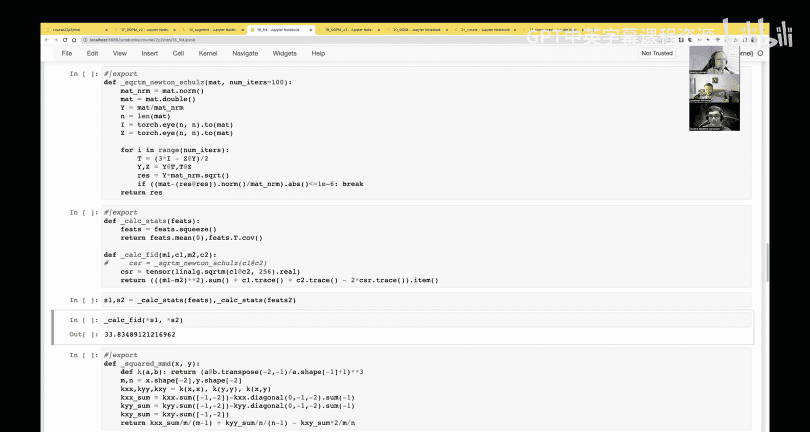

Or in other cases， this is now kind of an issue with some of these latest models you have these large 512 by512 or 1024 by 1024 images and then you' you know kind of shrinking these images to 299 by 299 and you're losing a lot of that detail and quality in those images so actually it's kind of become a problem with some of these latest papers when you look at the FiID scores and how they're comparing them and then visually when you see them you can kind of notice oh yeah these are much better images but the FiID score doesn't capture that as well because you're actually using these much smaller images so there are a bunch of different caveats and so FiID you know it's very good for like yeah it's nice and simple and automated for this sort of comparison but you have to be aware of all these different caveats of this metric as well So excellent segue because we're going to look at exactly those two things right now and in fact there is a metric。

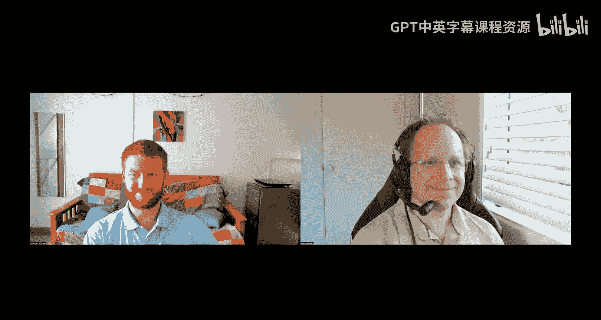

That compares the two distributions in a way that is not biased。

 So it's not necessarily higher or lower if you use more or less samples。

 And it's called the K I D or kid。 which is the kernel inception distance。 It's actually。

Significantly simpler to calculate than the fresh A inception distance。And basically。

 what you do is you create a bunch of。Broups， a bunch of partitions。

And you go through each of those partitions and you grab a few of your a'es at a time and a few of your Y's at a time。

 And then you calculate something called the。MmD。哎呀。Which is here， which is basically the again。

 the details don't really matter。 we basically do。A matrix product。

And we actually take the cube of it。 This is this K is the kernel。 And we basically do that for。

The first sample by its compared to itself， the second compared to itself。

 and the first compared to the second。And we then normalize them in various ways， and。

Add the two with themselves together and subtract with the other one。

And this one actually does not use the。Stats it doesn't use the means and covariance metrics it uses the features directly。

嗯。Ha ha， and。The actual final result is basically the main。

Of this calculated across different little batches。Yeah， again， the math doesn't really。😊。

Matter as to， you know exactly why all these out exactly what they are。

 but that it's going to give you again， a measure of the similarity of these two distributions。um。

At first I was confused just to wait， well people weren't using this because people don't tend to use this and it doesn't have this a nasty bias problem and now that I've been using it for a while I know why。

 which is that it has a very high variance， which means when I call it multiple times with just like samples with different random seedss。

 I get very different。Values and so I actually haven't found this used all。Heto。嗯。

So we left in the situation， which is， yeah， we don't actually have a good unbiased metric。

 And I think that's。The truth of where we are is best practices。And even if we did。

 all I would tell you is like。How similar distributions are to each other。

 It doesn't actually tell you whether they look any good， really。 So that's why。

Or pretty much all good papers， they have a section on human testing。

 but I've definitely found this very useful。For me for like comparing fashion images。

 which particularly like humans are good at looking at like faces at a reasonably high resolution and be like。

 oh， that eye looks kind of weird， but we'd not look at good at looking at 28 by 28 fashion images。

 So it's particularly helpful for stuff that our brains aren't good out。

So I' basically wrapped this up into a class which I called image Eval for evaluating images。😊。

And so what you're going to do is you're going to pass in。A pre trained model for a classifier。And。

Your data loaders， which is the thing that we're going to use to。To basically calculate the。

 the real images。 So that's going to be。You know， the data notice that were in this learn so the real images。

嗯。And so what it's going to do in this class then again。

 this is just copy and pasting the previous lines of code and putting into a class。

 this is going to be then something that we call capture Pres on。Toook get hour。

Fatatures for the real images。And then we can also calculate the stats for the real images。

And so then we can co fit。By calling Calcfi， which is the thing we already had passing in the stats for the real images and cat feathered stats for the features from our samples。

Where the features， are the thing that we've seen before we pass in our samples。

Any random Y value at spine。 So I just have a single tensor there and call capture Pretz so we can now create an image if our mob。

Object passing in our fifier， passing in our data loaders with the real data。

Any other callbacks you want？And if we call Fied takes about a quarter of a second， and 33。

9 is the F。Her our samples。So something that I think， okay， then kid。

 kidss very going to be a very different scale， it's on 。

05 so kids are generally much smaller than fits。Som mainly going to be looking at fits and so here's what happens if we call Fi。

On sample 0 and then sample 50 and then sample 100 and so forth， all about 900。

And then we also do samples 975，990999。And so you can see over time， our samples， if it's improved。

 So that's a good little test。 There's something curious about the fact that they stopped improving about here。

 So that's interesting。 I have not seen anybody plot this graph before。

 I don't know if John O or Tuishk， if you guys have。 I feel like it's something people should be。

Looking at because it's really telling you。Is your sampling。Making consistent improvements。

And to clarify this is like the predicted deno sample at the different stages during sampling right Yes exactly if I was to stop something now and just go straight to the predicted X error。

 what would the fit be？So I just want to check or check how samples yeah， we pre set。

 we add the eggs not hat at each time， yep。Yep， exactly。

Same for KiD and I was hoping that they would look the same and they do。

 so that's encouraging that Kied and feared at basically measuring the same thing。

And then something else that I haven't seen people do。

 but I think a very good idea is to take the F of an actual batch of data。Okay。

 and so that tells us how good we could get。Now that's a bit unfair because I think the different sizes。

 our data。Is 5， 12 for our sample is 256， but anyway it it's a pretty huge difference。And then yeah。

 the second thing that Tuishsha talked about， which I thought I'd actually show is what does it take to use？

You know to get a real fit。There's the inception network。

 so I didn't particularly feel like a rement in the inception network。 So I guess I'm cheating here。

 I'm just gonna to grab it from。I torch fit。But there's absolutely no reason to study the inception networks because it's totally obsolete at this point。

And as Trisha mentioned it at once。299 by 299 images。

 which actually you can just call Res input to have that done for you。

 it also expects three channel images。So what I did is I fed a wrappper。For for an inception。

 V3 model that when you call forward。It takes your。嗯。Your。Batch and replicates。The channel。

Three times。So that's basically creating a。3 channel version of a black and white image just by replicating it three times。

A。So with that wrapping and again， this is good like flexing of your pytorrch muscles to you know。

 try to make sure you can replicate this。That you can yeah， get that inception model working on your。

Fashioned emminist samples。And yeah， then from there， we can just pass that to our image Eve instead。

And so on our samples that gets the 63。8 and on a real batch of data， it gets 27。9。

 And like I find this like。A good sign that this is much less effective than our real fashioned Ms classifierca like that's only it。

 you know。Differenceive。A ratio of three or so。You know， the fact that our。Fed for real data。

 using a real classifier was 6。6。 I think that's pretty encouraging， you know。诶。Yeah。

 so that is that and。We now have a fit， or specifically， we now have an image Eve。Plus。

Did you guys have any？Questions or comments about that before we keep going。No， said。

 I've began that。Pretty much every other Fijii reported is going to be。You know， set up for C4 10。

 tiny 32 by 32 pixels resized up to 299 and Vter section that was hanged on an image not C。 you know。

 yeah bearing in mind that once again， this is a slightly weird metric and even things like the types of image like the image resizing algorithms and pyth intensivesorflow might be slightly different or you know。

 if you saved your images as Jpegs and then reloaded them， your fit might be twice as bad。

 Yeah it x a big difference。Yeah， and so just to just reiterate what what what this will like the takeaway from all of this that I get is that it's really useful everything's the same like using the same backbone modela。

 using the same approach， the same number of samples， then you can compare its apples to apples。Yeah。

 but yeah for one set of experiments after the f might be good because of the way everythings set up and for another that might be terrible So it're going to compare exactly to a paper or whatever is that easy So I'm going maybe the approach is that like if you're doing your own experiments you know these sorts of metrics are good but then if you're going to compare to other models it's best to rely on human human studies if you're comparing to other models and that yeah I think that's kind of the the sort of approach or mindset that we should be having when it comes to this or both you know。

 but yeah， so we're gonna say this is gonna be very useful for us and we're just going be using。

The same。Pretty much all the time we're going to use the same number of samples and we're going to use the same fashion MN specific classifier。

So。The first thing I wanted to do was fix our bug and to remind you the bug was that we。

Had we were feeding into our unit in DDPM V2 and the original DPM。Aageages that goes from 0 to1。And。

Yeah that' that's wrong。's nobody does that。 everybody feeds in images that are from minus1 to one。

 so that's very easy to fix。😊，You just drew me just to ask like what why why is that a bug what's why it's a bug I mean it's like everybody knows it's a bugca that's what everybody does like I've never seen anybody do anything else and it's very easy to fix so I fixed it by adding this to。

Did E PMM V2。Noray ran it。And it didn't work。 but it was。嗯。And this was the start of。

Yet all a few horrible days of pain， because like when you。You know。

Fix a bug and it makes things worse that generally suggests there's some other bug somewhere else that somehow has offset your first bug and so I had to go。

 you know I basically went back through every other notebook。Bed every cell， and。

I did find at least one bug elsewhere， which is that we hadn't been shuffling our training sets the whole time。

 So I fixed that， but it's got absolutely nothing to do with this。

 And I ended up going through everything from scratch three times re runningning every three and three times。

 checking every intermediate output three times。 So days of。

Yet all depressing and annoying work and made no progress at all。At which point I then asked。

Johno's question to myself。More carefully and provided a less flip response to myself， which was。

Well， I don't know why everybody does this。Actually。

So I asked anishhkin John O I couldn't Pedro and like， have you guys seen。E he。Math， papers。

 whatever。That's based on。This particular。In foot wch。And yeah， you guys are both like， no。

 I I haven't。 It's just， just when everybody does。 So at that point。It raised the possibility that。

 like， O， maybe。Maybe what everybody does is not the right thing to do and。

Is there any reason to believe it is the right thing to do have given that it seemed like fixing the bug made it worse？

Maybe not。 And then， but that is like， well。Okay， we are pretty confident from everything we've learned and discussed that having centerd data is better than uncented data。

 so having data that go from zero to1。Clearly seems weird。

 so maybe the issue is not that we've changed the centre。

 but that we've scaled it down so rather than having a range of two， it's got a range of one。

So at that point。You know， I did something very simple。Which was I。Did this I subtracted 。5。 So now。

 rather than going from nughaught to 1， it goes from -。5 to 。5。 And so the the theory here then was。

 okay， if。Our hypothesis is correct， which is that the negative one to one range has no。

Foundational reason for being and we've accidentally hit on something which is that a range of one is better than a range of two。

 and this should be better still because this is a range of one and it's sented properly。

And so this is DDPMV3。And I ran that。 And yes， it， it， it appeared to be better。

 And this was great because now I've got fit。I was able to run fit on DDPMV2 and on DDPMV3 and it was dramatically。

 dramatically， dramatically better。嗯。And in fact， I was running a lot of other experiments at the time。

Which we will talk about soon。 And like all of my experiments are totally fallen apart when I fix the bug。

 And once I。Did this。All the things that I thought weren't working suddenly started working。So。

 you know， this is often the case， I guess， is that。Bags can out。You know。Accidental discoveries。

 And the trick is always to be。You know。Therefore， enough to recognize when that's happened。

 You know， this is。Some people might remember the story。 This is how the noble gases were discovered。

 A chemistry experiment went wrong and left behind some strange bubbles at the bottom of the test tube。

 and。Most people were just below her， whoops， bubbles。But。

People who are careful enough actually went， no， there shouldn't be bubbles there。

 Let's test them carefully。 It's like they don't react。 They can。 most people would be like， oh。

That didn't work。 The reaction failed， but。You know， if you're really careful， you'll be like， oh。

 maybe the fact they don't react is the interesting thing。😊，So yes。Being Kevin。

 wasn affair for the Jeremy。 When you say things like it didn't work or it was worse When you first showed us this thing。

 I kind of said。The images looked fine。 The F was slightly worse。 but it was okay。

 And if he trained it longer， it eventually got better mostly。

 like there were some things that samplingling occasionally went wrong。

 one image in 100 or something like that。 Yes， but it was like。

 this isn't like everything completely fell apart。 No， it was just the choice。

 performance was slightly worse than expected。 And if you were doing the。Run and gun。

 try a bunch of things。As I go well， I just doubled my training time and set a few runs going and looked at the weights and biases starts later and oh。

 that seems like it's better enough， but just needed to train for longer and we have infinite GPUs and lots of money yes。

😊，you would notice this， So I yeah， it wasn't like， you know。Yeah。

 the fact that you picked up on it showed that you had this like deep intuition for where it should be at this stage training versus where it was。

 what the samples strip looked like what they were。 And you had the fit as well to say， like， oh。

 okay， I would have expected a fit of 9。 And I'm getting 14。 What's what's up here。

 And that was enough to start asking these questions。 And Muju all started to think。

You know where this came。 Yeah， I mean， definitely I， I， I， I drive people crazy that I work with。

 I don't know why you guys aren't crazy yet， but with this kind of like。No。

 I need to know exactly why， you know， this is not exactly what we expected。 But yeah。

 this is why to， to find the， you know， when something's mysterious and weird。

 it means that there's something you didn't understand。

 and that's an opportunity to learn something new。So that's what we did。😊。

And so that was quite exciting because yeah， going 。5 to 。5 made the fit better still。😊。

And there's definitely in， yeah， I moved from this frame of mind of from like。Yetlow。

 total depression。 Oh。Man， I still remember when I spoke to Joddo， I was just。

Is so upset and then'll suddenly like， oh my gosh， we're actually under something。😊。

Started experimenting more。 and， you know， a bit more confidence at this point， I guess。

 And one thing I started looking at was our。Our schedule， you know， you know。

 we'd always been copying and pasting this。Standard again， said stuff。

 And I started questioning everything I was， why why is this the standard like why are these numbers here。

You know， and。I don't see any particular reason why those numbers were there and。

I thought well we should maybe experiment with them so to make it easier。

 I create little function that would return。A schedule。 Now。

 you could create a new class or a schedule， but something that's really cool is there's a thing in clothing called simple namespace。

 which is a lot like astruct in C， Basically lets you wrap up a little。

Bunch of keys and values as if it's an object。So okay to this little simple namespace which contains our alphas。

 our alpha bars， and our sigmas。For our normal beta max X 。02 in space， this is what we always do。

And then， yeah， there's another paper which mentions an alternative approach。

 which is cosine and cosine schedule， which is where you basically set alpha bar equal to。

PmT has a fraction of big T。Times pi over 2 cosine of that。

Squared And if you make that your alpha bar， you can then basically reverse back out to calculate what alpha must have been。

 And so we can create a schedule for this cosine schedule as well。And。Yeah。

 this cosine sketch all is。I think pretty recognized as beinged。Better。Than this linear schedule。

And so I thought， okay， it would be interesting to look at how they。Compare。And。In fact， really。

 all that matters is the alpha bar。 The the alpha bar is， you know， the the total amount of。

Noise that you're adding。 So indeed E PM when we do no aify。You know， it's， it's alphabe。

That we're actually using the amount of the image and minus。 it the。 exactly Mo Yeah， yeah。

 So I just printed those out。 lot of those。For the normal linear schedule and this cosine schedule。

 And you can really see the linear schedule。It really sucks badly。 It's， it's got a lot of。

Time steps。Where it's basically about 0。And。You know， that's。

Something we can't really do anything with。You know， whereas the cosine schedule。

It's really nice and smooth。And there's not many steps， which are nearly 0 or nearly one。

So I thought so I was kind of inclinedfed with try using the coastine schedule， but then I thought。

 well。It would be easier enough to get rid of this big flat bit。

 I'd just increase by just decreasing be max。 that would be another thing we can do。So I tried oh。

 sorry first of all， I should mention that the other thing that's really important is the slope of these curves because that's how much things are stepping during the sampling process。

 And so here's the slope of thelin and the cosine。 And you can see the cosine slope。 really nice。

 right， you you have。This nice smooth curve where thelenia is just a disaster。So yeah。

 if I change betam x to 0。01。That actually gets you nearly the same curve as the cosine。U。

So I thought that was very interesting it kind of made me think like why on earth？

Does everybody always use 0。02 as a default， And so we actually talk to。Robin。

 who was one of the two lead authors on the stable diffusion paper and actually talked about Al all of these things and he said。

  oh yeah we noticed not exactly this， but we experimented with everything and we noticed that when we decreased beta max we got better results and so actually stable diffusion uses beta max of 0。

012。I think that might have。 I think that might be a little bit higher than they should have picked。

 but it's certainly a lot better than the normal default。

 So it was interesting talking to Robin to see like all of these kinds of experiments and like。

Things that we tried out。They had been there as well， and noticed the same things。

That the inputs range as well。 They have this magical factor of018 or2 whatever。

 they scale the latentens by。 And if you ask why they're， oh yeah。

 we wanted delay this to be a like roughly uniform rangeroid ever。 But that's also like that's。

Reducing the range of your inputs to。 I think exactly they we independently discover and they independently discovered this。

 this idea。 Yeah， exactly。嗯。Yeah， exactly。 So we'll be talking more about like。

What's actually going on with that。Maybe next lesson。Anyway， so here's the curves as well。

 they're also pretty close。 So at this point I was kind of thinking， well。

 I'd like to like change as little as possible， so I'm going to keep using a linear schedule but I'm just going to change beta max to 0。

01。For my next you know， version of GDPPM， so that's what I've got here。

 linear our schedule beta max 。01。And so that I wouldn't really have to change of my code。

 I'd end up to just put those in the same variable names that I've always used。

So their noise a fire is exactly the same as the noise has been。

So now I just repeat everything that I've done before。😊，So that would I。Show a batch of data。

I can already see that there's。You know， more actually recognizable images。

 which I think is very encouraging previously that like almost all of there had been pure noise。

 which is not a good sign。So okay， so now I just train it exactly the same as GDPpMV2。嗯。

And so save this as fashion D PMM3。 Oh， and then the other things I've done here is， you know。

 this this out worked pretty well。 I actually decided let's keep going even further。

 so I actually doubled all of my channels。From before and I also increased the number of epochs by3。

Because things are going so well as like how well could they go。

 so we've got a bigger model trained for longer， it's only it takes a few minutes。嗯。

That's what the 25 here is the number of epochs， so the sample is exactly the same as it always has been。

So。Create 512 samples。And here they are。 And they definitely look to me。You know。Great， like that。

 I am not sure I could recognize whether these are real samples or。Generated samples。But luckily。

 we know， we can test them。So we can load up our data or too。To make the last chair li。

Pass that to I Val。And get a fit for our samples。At its eight。

And then I chose 512 for a reason' because that's our batch size so then I can compare that like with like for the F for the actual data。

And at 6。6。 So this is like hugely exciting to me。 We've got down to a fi that is nearly as good as。

Real images。So I feel like this is。You know， in terms of image quality。For a small， unconditional。

Sampling。I feel like we're done。You know， pretty much。And so at this point， I was like， okay， well。

 can we make it faster？😊，You know， at the same quality。

 And I just wanted to experiment with a few things， like really obvious ideas。 And in particular。

 I thought。We're calling this。A thousand times。Which means we're calling。

This a thousand times just running the model。And that's slow。

And most of the time you just move a tiny bit， so the model is pretty much the same。It， you know。

 the the noise being predicted is pretty much the same。 So I just did something really obvious。

 or I put it really obvious， which is I decided， let's only call the model。Every third time。You know。

 and maybe also just the last 50 to help but phone tune。 I don't know if that's necessary。

 other than that it's exactly the same。 So now this is basically three times faster。And。Yes。

 samples look basically the same， so the the is 9。78 versus 8。1。

 and this is like within the normal variance of the so I don't know like you'd have to run this a few times or use bigger samples。

 but。This is basically saying like， yeah， you probably don't need to。Call the model a thousand times。

I did something else slightly weird， which is I basically said， like， oh。

 let's create a differentmic。Schedule for how often we call the model。

Which as I credit this thing called sample out， it basically said。

When you're for the first few time steps， just do it every 10 and then for the next few， every 9。

 and then the next few， every8 and so forth。 and just for the last hundred， do it every one。

So that makes it even faster。Sample short code。You know， it's definitely worse though now， you know。

 but it's still not bad。So。Yeah， I kind of felt like， all right。

 this is encouraging and it's this stuff before we fixed the。😊。

My as one to one thing was those looked really bad， you know。

 that's why I was thinking my code is full of bugs。So at this point， I'm thinking， okay。

 we can create extremely high quality samples using DDPM。😊，What's the like。You know。

 best paper out there for doing it faster and the most popular paper for doing it faster is。Dady。

 I am。So I thought we might switch to this next。So we're now at the point where we're not actually going to retrain our model at all if you noticed。

With these different sampling approaches， I didn't retrain the model at all。 but to think， okay。

 we've got a model。The model knows how to estimate the noise in an image。

 How do we use that to call it multiple times to。De noiseise using。Iterative refinement。

As Chinano calls it。And so diddy I am。Is a。The other way of doing that。

So what we're going to do good。 I'm going to show you how I。Built。My own DD A am from scratch， and。

I kind of chatd， which is I。There's already an existing one in diffuses。

So I decided I will use that first。Make sure everything works。

 and then I'll try and re implementple it from scratch myself。

Um so that's kind of like when there's an existing thing that works， you know。

 that's what I like to do and it's been really good。😊，To have my own D A M from scratch。

 Because now I can modify it， you know， and I've made it much more。

Concise code in the diffuses version。So。Now， we had created this。Class code unit。Wch。

Asked the tuple of x's through as individual parameters and returned to the dot sample。

 but not surprisingly， the given that this comes from diffuseers and we want to use the diffuser schedulers the diffuses。

Skechedtchless。Assume this has not happened it wants the X， you know。

 as a tuple and it expects to find a thing called dot sample， so here's something crazy。When we save。

This thing。His pickle。It doesn't really know anything about the code， right。

 It just knows that it's from a class。Called unit。So we can actually lie。We can say， oh， yeah。

 that cast called you in it。😊，It's actually the same as a Gi 2D model with no other changes。

And Python doesn't know or care。 right。 So this we can now load up this model。

And it's going to use this unit。Okay， so this is where it's useful to understand how Python works behind the scenes。

 right it's it's it's a very simple。Priorcom language。So we've now got a model which we've trained。

 but it's not， it's just gonna， you know， use the do sample on whatever that means we can use it directly with the。

Theifffuse schedulers。 So we'll start by actually repeating what we already know how to do just use a DDPM scheduler so we have to tell it what beta we used。

The train。And so we can grab some random data。And so we could say， okay。

 we're going to start at time step 9，9，9。So let's create a batch of data。And then， predict the noise。

And then this is the way the diffuss thing works is you call scheduler。tstep。And that's the thing。

 which does。And。Those lines。That's the thing that calculates X T， given noise。So that's what Schula。

t step does， so that's why you pass in Xt and the time step and the noise。

And that's going to give you a deal。😊，Se and so I ran that as usual first cell by cell to make sure I understood how it work。

 I then copied those cells and merged them together and chuck them in a loop。

So this is now going to go through all the time steps。Heres a progress bar to see how we're going。

Get the noise。Cal step and a pent。 So this is just DPM， but using diffuses and not surprisingly。

It consists us。You know， basically the same results as you， nice results。

 very nice results that we got from our own DPM。And so we can now use the same code we've used before to create create our image evaluator。

And。I decided， yeah， we're now going to go right up to 2048 images at a time。

So it's now this is the size I found it's big enough that it's recently stable。And so。

We're now down to 3。7 through our F， Where else the data itself has a fed of 1。9。 So again。

 it's showing that our8 PM is。Basically。Very nearlyy。

Unrecognisably different from real data using its distribution of those activations。

So then we can switch to DDIM。😊，By the Saint8， I am Sula。And so with DD I am。

 you can see I don't want to do all thousand steps。 I just want to do 333 steps so every third。

So that's basically a bit like。嗯。A bit like。This sample skip of doing every third at DD I am。

 as we'll see， does it in a spotter way。嗯。And so， his。Exactly the same code basically as before。

 but I put it into a little function。 so I can basically pass in my model， the size， the scheduleula。

And then there's a parameter called id， which is basically how much noise to add。

So just add all the noise。um。And so this is now going to take three times this three times faster。

And yeah， the fit's basically the same。Though that's encouraging， they weren't out of 200 steps。

 fits basically the same。100 steps。 And at this point， O， the fits getting worse。嗯。And then。

50 steps where still。25 steps Well still， it's interesting， like when you get down to 25 steps， like。

 what does it look like， And you can see that they're kind of like， they're too smooth。You know。

 they don't have interesting。You know， fabric swells so much or buckles or mogos or patterns as much。

 you know， as the。These ones， they've got a lot more texture to them。

So that's kind of what tends to happen。 Sa can still like。Get。Something out pretty fast。 But that's。

 that's kind of how they suffer。So okay， so how does DDEIM work？B Da， I am。 It's nice。 It's actually。

😊，In my opinion， it makes things a lot easier。Then。80 PMm。

So there's basically an equation from the paper， which。tenniko explained shortly。嗯。

But basically what you do is I've actually grabbed the sample function。Pro明。From here。

And I split it out into two bits。One bit is the bit that says what are the time steps creates that random starting point。

Liip through。😔，Finds what my current A bar is。 gets the noise。And then。

Basically does the same as shed dot step it calls some function。Right。

 and then that's been pulled out。 So this allows me to now create my own。Different steps。

 so I a DDIM step。And basically。All I did was I。Bock this equation。

And I turned it into code actually this one is a second equation from the paper。Now。

 it's a bit confusing， which is that the notation here is different。 DDPM。

 what it calls alphapha bar， this paper calls alpha。So you've got a lookout for that。

 so basically you'll see I basically go I've got here X Xt。Minus okay。

1 minus alpha bar is we' tend to call that beta bar， so beta bar do square root。Times noise。

 is this is the neural net， so this here is the noise。Okay。And。Here I've got。😔，My next Xt。

Is oh sorry， yes， here's my A bar T1 square root。Times。This。

 and you can see here it says predicted x n。 So here's my predicted x n plus。B aboutti won。

Minus Sigma squared， square root。Again， here's noise。 And that's the same thing as here。Okay。

 and then plus a bit of random noise， which we only do if you're not at the last tip。So， yeah。

 so I can call that。 So I just did it for。So I'd rather than say 100 steps。

 I said skip every skip 10 steps， so do 10 steps at a time， so it's basically going to be 100 steps。

And so you can see here， actually， this has happened to do a bit better for my hundred steps。

 It's not bad at all。嗯。So， yeah， I mean， this is Spain。Getting to this point。

 it's been a bit of a lifesaver， to be honest， because， you know， I can now。Run a， you know。

 a2 batch of 2048 samples。 I can sample them in under a minute。Which doesn't feel painful。

 And so I'm， you， I' now at a point where I can actually get a pretty good。Measure of how I'm doing。

Been a pretty reasonable。A matter of time。And I can， you know。Easly compare it。And I' got to admit。

 you know， the difference between a fed of 5 and 8 and 11， I can't necessarily tell the difference。

 So for fashion， I think。Fid is better than my eyes。For this， as long as I use a consistent。

 sample says。So。Yeah， Taish， did you want to talk a bit about？You know。

 the ideas of why we do this or where it comes from or what the notation means。

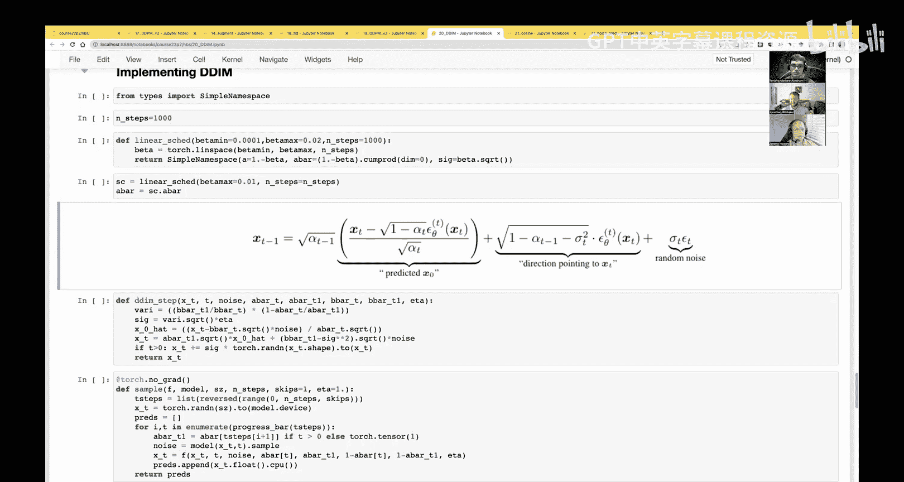

Can I say a little bit before we do that， which is just that what you have the ver， which is like。

A screenshot from the paper and then the code that as closely as possible tries to follow that like the difference that makes for people is is huge like I I've got a little research team thatm I'm doing some you know contract work with。

 and the fact that like it's called Al in the Deedin paper and Al that elsewhere。

 and then in my code that they were copyping and pastcing from it was called A and B for Al and B done。

And。It's like you can get things kind of working by copyping and pastcing millions of things。

 And it's all just sort of kind of works。 But just spend in their time to literally take two screenshots from the equation 14 and 16 from the paper and put them in there and rewrite the code so that it you know。

 with some comments and things to say， like this is what this is， this that part from the equation。

 it like。You know， the the look of pain on their face when I said oh， by the way。

 Did you notice that like it's called alpha there and alpha by there。 they was like， yes。

 how good they do that。 you know， it's just like， you could just tell how many hours have been spent。

 you know， like grinding ten and saying what's wrong here and doing notebooks Yeah。

 and building this stuff in notebooks is such a good idea。 like we're doing mid AI because the。

 you know， the next engineer to come along and。😊，Work on that。Can see the equation right there。

 And you can add。Crows and stuff。 So I think， you know， Nvy dev。

Works particularly well for this kind of development。Yeah。Pex，channer。Yeah。

 before before before I dive about this， I just borrow to briefly in the context of all of these differing notations I recently created this meme which I thought was was relevant in terms of like each paper basically has a different diffusion model of the notation so it's just like this but they all try to cover up with their own universal notation and it's just just keeps proliferating it's just really we should all use it they know。

😊，Yes， exactly we need to we implement diffusion balls and APplLs of right so yeah。

 the paper that were that you know Jeremy had implemented was this denoising diffusion implicit model paper and。

😊，If you look at the paper again， you can see like the notation could be again a little bit intimidating。

 but when we walk through it we'll see it's not too bad actually， so I'll just bring up I guess。

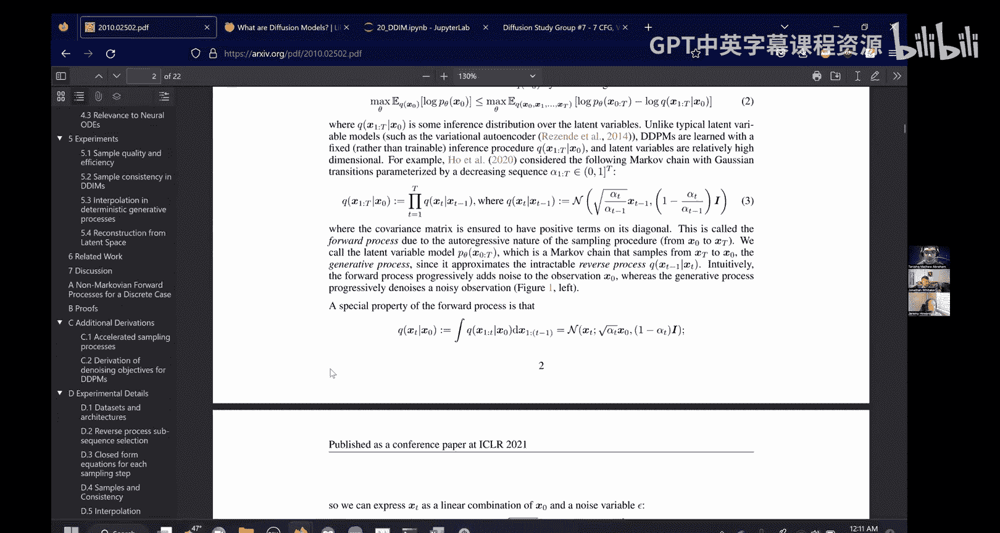

Some of the important equations and also comparing and contrasting you DDPM and the notation of DDPM and the equations will it DIM not only is it not too bad。

 I actually discovered its。Making life a lot。The DD IM notation and equations are a lot easier to work with than DPM。

 So I found。My life is better since I discovered DDIM Yes， yes。

 I think a lot of people prefer to use DDIM as well yeah so yeah。

 basically in let's see here so we're yeah so in both in both DDIM and in in both DDIM and DDPM we have this same sort of equation。

 this equation is exactly the same this is telling us the predicted the predicted。😊。

deno image so we predict our but basically we predict the you can see my porter right yeah just want to confirm by the way。

 so we put the little the little double headed arrow in the top right does that if you click that to you get more room for us to see what's going on double headed arrow just about yeah。

Yes， okay， that works much better， yeah。😊，So we have our。

Pdicted noise so our model is predicting the noise in the image it is also passed in the time step but this is just emitted it basically kind of is given in the Xt but you know our model also takes in the time step and so it's predicting the noise in this XT our noisy image and we are trying to remove the noise that's what this one this whole term here is remove the noise so because our noise that we're predicting is unit variance noise so we have to scale the variance of our noise appropriately to remove it from our noisy image so we have to scale the noise and subtracted out of the original image and that's how we would get our our predicted theno image has derived this one before by looking at the equation for Xt in the noise of。

系。Function and rearranging it to solve for xn。 And that's what you Yes Yes that's basically what this is that's basically what this is。

 so basically the idea is okay instead of yeah noiseifying it where were starting out with x0 and some noise and get an Xt we're doing the opposite where we have some noise and we have xt So how can we get x0 So that's what this equation is So that's the predicted x0 or our you know predicted clean image and this equation is the same for both DDpm and DDM。

 but these distributions are what's different between DDpm and DDIM So we have these distribution which tells us okay so if we have xt。

 which is our current noisy image and x0 which is our clean image can we find out what some sort of intermediate noisy image is in that process and that's xt minus-1 so we。

Have a distribution for that and so that tells us how to get such an image and so this is in the DDPM paper they divide some distribution and explain the math behind it but yeah basically they have some equation so you know you have again a Gaussian distribution with some sort of mean and variance but it's again some form of you have this sort of interpolation between your original clean image and your noisy image and that gives you your intermediate less slightly less noisy image so that's what this is giving given a clean image and a noisy image your slightly less noisy image and so the sampling procedure that we do with DDPM basically is predict the no predict the x0 and then plug it into this distribution to give you your。

Slightly less noisy image， so maybe it's worth。Drawing that out。 So like， if we had， let's say。

 Psalm sort of。Like I don't know， I'm just making stuff sort of I don't know。

 maybe a lot some sort of better yeah， some sort of u so then in this case I'm showing a one dimensional example let's say you have some sort of。

pointin so it's kind of a one dimensional example that's still in the sort of 2D space。

 but let's say you have some a point on this it represents an actual image that you want to sample from right so this is you know where your distribution of actual images would lie and you want to estimate this so when this sort of algorithm that we've been seeing here says that okay。

 if we take some。Random point， this is some random point that we choose you know when we start out and what we did is we learned this function。

 the score function to take us to this manifold， but it's only going to be accurate in some space so it's going to be accurate you know it's only it would be accurate in some area so we get an estimate of the score function and it tells us the direction to move in and it's going to give us the direction to predict our our denois image right so basically like let's say。

Lets let's say you actually your score function， sorry， say you。

So let's say your score function is actually in reality some curve okay。

 so it's in in reality some curve that points to your oops so it points here so that's your score function and you know' the value here that's why score function basically means your gradient yeah。

Yes， yes， it's a gradient。 So you know， we are again doing some form of， in this case。

 I guess you would say grade ascent because you're not really minimizing this score。

 you're maximizing it。 you want sorry you're maximizing your your the likelihood of that data point being an actual data point you want to go towards it。

 So yourre you're doing the sort gradient ascent process So you're following the graded to get to that So。

So when we estimate。Epsilon beta and predict our noise what we're doing is we're getting the score value here and then so we can you know follow that and we follow it to some point。

And being kind of exaggerating here， but this point will not represent our。X the0 hat。两个。

So yeah our X are hat so and and in reality， you know。

 that's not maybe that's not going to be some point that is an actual point it wouldn't be next to the distribution。

 so you know it's it's not going to be a very good estimate of a clean image at the beginning。But。

 you know， we only have that estimate at the beginning at this point。

 and we have to follow it all the way to to some。Place， so this is where we follow it to。

And then we want to find some sort of X。T minus1。So that's what our next point is。

 and so that's what our second distribution tells us and it basically takes us all the way。

 takes us all the way back to maybe some point here。

And now we can reestimate the score function or yeah our graded over there。

 you know do this prediction of noise。And you know it may be more accurate of a score function and maybe we go somewhere here and then we reestimate and get another point and then we follow it。

 and so that's kind of this iterative process where we're trying to follow this the score function to your point and in order to do so we first have to estimate our x0 hat and then。

And then。Basically add back some noise and to get， you know a little bit get a new estimate and keep falling and add back a little bit more noise and keep estimating。

 So that's what we're really here in these two steps we have our X0 hat and then we have this distribution and that's how we do with regular DPM and it's that again that's the maybe where this sort of。

Breaking it up in two steps is a little bit clearer and I don't think the DDPM paper really clarifies that really talks about it too much。

 but the DDM paper also really hammers that point home I think and especially in in their update equation the other so that's the DDPM but then with DD I am。

So before I go ahead， you did again， just the one thing is that you look at your prediction。

 use that to make a step， but you also add back some additional noise that's always fixed again。

 there's no parameter to control how much extra noise you add back at each step。Right。

 exactly so os so yeah so when you're let's see here yeah so yeah。

 basically you won't be exactly at this point you could be you know you're in that general vicinity you know adding that noise also helps with you know you don't want to fall into you know specific modes where it's like oh you know this is the most likely data point you want to add some noise where you can like explore other data points as well so yeah there's some you know the noise also can help and that's something you really can't control with DDPM and this is something that DDI am explore a little bit further is it terms of the noise and even trying to get rid of the noise altogether and DDIM。

So with the DDIM paper。The main difference is literally this one equation that's all all really it is in terms of changing this distribution where you predict the less noisy。

Equation， the less noisy sorry， the less noisy image and basically as you can see。

It's just you have this additional parameter now， which is sigma and the sigma controls how much noise like we were just mentioning is when we part of this process and you can actually for example。

 if you want you could said sigma to zero and then you can see here now you have a variance that would be zero and so this becomes a completely deterministic process so if you want this could be completely deterministic。

So that's one aspect of it。And then， yeah， so the opposite。

The other something right the reason its called DDIM is just not DDPM because it's like not probabilistic anymore it can be made deterministic so the Hi name was changed for that reason but the other thing is like you would think that you've kind of changed the model altogether with a new distribution altogether and so you think oh wouldn't you have to like train a different model for this purpose but it turns out the math works out where the same model objective would work well with this distribution as well in fact I think that's what they were setting out from the very beginninggetting is what kind of other models can we get with the same objective and so this is what they are able to do is you can make some we can have this new parameter that introduced that you can introduce in this case kind of controlling the stochasticity of of the model and and it still can you can still。

Use the same exact trained model that you had so what this means is that this actually is just a new sampling algorithm and not anything new with the training itself and this is just yeah just like we talked about a new way of sampling the model and then so yeah this is how you know given given now this equation。

Then you can rewrite your xt minus one term and again we're doing the same sort of thing where we split it up into predicting the x0 and then adding back to go back to your X Xxt and also if you need to add a little bit of noise back in like Jonathan was saying。

You can you can do so you have this extra term here and the sigma controls controls that term and again。

 like we said， you have to be again looking at the DDIM equation versus the DDPM equation。

 you have to be careful of the alphas here are' referring to alpha bars in the DDPM equation so that's the other caveat so yeah。

And this you have this a sigma T set to this particular value will give you back DPM。

 so sometimes instead。Instead， they will write basically。Jeremy mentioned this sort of， I guess。Eta。

 which is equal to basically。

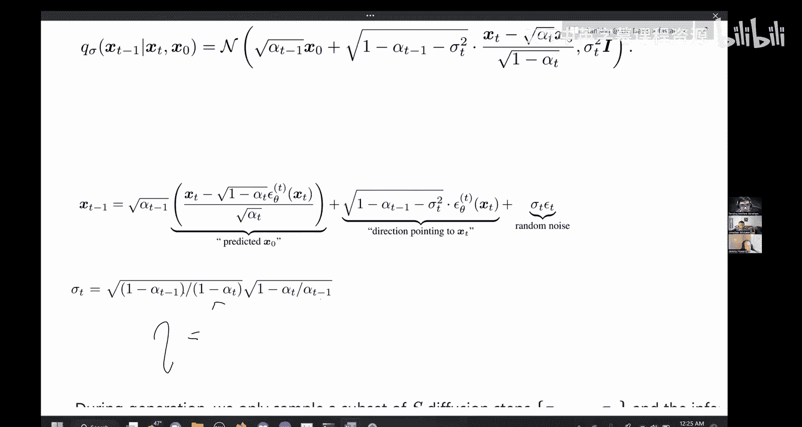

Yeah， so it's just basically Ata is Sigma is equal to。Eta times this coefficient。So sorry。

 let me just go back and。

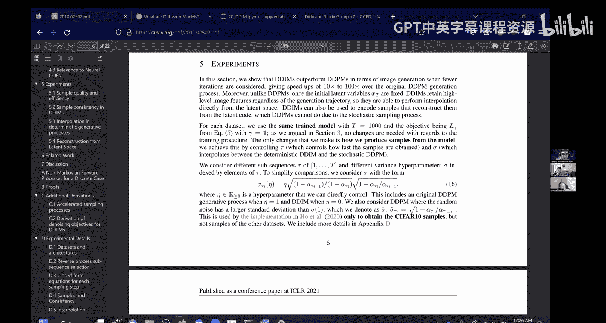

So， but in reality， so basically， yeah， in reality， you take， I'm right， what， okay？

You have Eta here so it's like yeah this is where EA would go。

 so if it's one it becomes regular DDPM benefits zero of course that's a determinative case。

 so this is the Eta that you know all these APIs and in the code that we have also the code that Jeremy was showing they have Eta equals to one which of course which they say is corresponding to regular DDPM this is actually where the EA would go in the equation。

So finally they not it's like yeah， you could pass in sigma。

 right like if if you weren't trying to match it in previous you could just oh， well。

 we have this parameter sigma that controls the amount of noise。

 so let's just take sigma scale as an argument。 but for convenience。

 they say let's create this new thing Eta where0 means sigma is equals0。

 which if you look at the equation that works。 one means we match the the amount of noise that's in like familiar DDpm And so they that gives you like a nice slice you could say Eta equals 2 or8 equals 0。

7 or whatever。 and but its it's like got a mean unit of one equals the same as this previous reference work。

 Well it's also convenient because it's sigma t， which is to say。😊，Different time steps。

Unless you choose8 equals zero， in which case it doesn't matter。

 different time steps probably want different amounts of noise and so here heres a reasonable way of earth scaling that noise。

Then the last thing of importance， which is， of course。

 one of the reasons that we were exploring this is the first place is to be able to do this sort of rapid sampling so。

The basic idea here is that you can define a similar distribution。Where again。

 the math works out similarly where now you have， let's say you have some subset of diffusion steps so in this case you use this tau wearable So for example。

 if if you yeah you say let's say subset of diffusion steps So if it's like 10 diffusion steps。

 then tau 1 would just be0 then tau2 would be 10 you know you just keep going all the way up to say1000。

 but you've only got sorry tau 2 would be 100 and then you go all the way up to 1000 and so you get you know these you'd get 10 diffusion steps so that's what they're referring to when they have this I guess these tau variableable here and so you can do this sorts of similar equation and similar derivation to show that this。

This distribution here again。Meets this sort of objective that you use for training and you can now use this for a faster sampling where basically all you have to do is you have to just select the appropriate alpha bar and sorry this one I've written out so this one actually the alpha bar is you know the regular alpha bar that we' were talking about but basically sorry it's a little bit confusing fit between different notations。

 but basically you have this distribution and then you just have to select the appropriate alpha bars and it follows the math the same in terms of you have appropriate sampling process so。

Yeah， and I guess that's it makes it a lot simpler in terms of doing this。

I guess accelerated sampling， yeah， I guess。U， would any other note。

 maybe other comments that maybe you guys had or was this well， u yeah， the case for May？

Is that in this equation。We just have one。We only need one parameter。

 which is the alpha bar or alpha， depending which notation is had everything else been calculated from that。

And so， we don't have the。What DT PMM calls the alpha or beta anymore。

 And that's more convenient for doing this kind of。Small a number of steps。

Because we can just jump straight。From time step to alphabe。

And we can also then as particularly convenient with the cosine schedule because you can。

That let the inverse of the cosine schedule function。

 which means you can also go from an alpha bar to a T。 So it's really easy to like say like， oh。

 what would alpha bar be。10 times steps previously to this one。 you know， it's just。

 you could just call a function。 We don't need， Yeah， we don't need anything else。

 And it's actually the original。Both signs schedule your paper。Has to fuss around with various like。

A。Kind of epsilon style， small numbers that they add to things to avoid getting weird numerical problems。

 And so yeah， when we only deal with alpha bar。Or that stuff also goes away。So yeah。

 so looking if you， you know， looking at the DDIM code。You know。

 it's simpler code with less parameters。Then our DpM code。

And of course it's dramatically faster and it's also more flexible because we've got this either thing we can play with。

😊，Yes， yeah， that's the other thing It's like this idea of like yeah controlling stochasticity。

 I think that's something that's interesting to explore and we've been exploring that a bit now and I think we'll continue to explore that in terms of deterministic versus stochasticity so yeah also it's worth talking about this the sigma in the middle equation you've got there so you've got the sigma T entityity adding the random noise and intuitively it makes sense that if you're adding random noise there。

 you would need to have less you want to move less back towards Xt， which is your noisy image。😊。

So that's why and， you know， you've got the one minus alpha t minus1 minus sigma squared。

 and then you're taking the square root of that。 So basically that's just sigma。

 the square root of the squared。 So you're subtracting sigma t。

From the direction pointed to X T and adding it to the random noise or vice versa。 So yes， the。

 you know that。Everything's there。As for a reason。You know， yes， and the predicted x0。

That entire equation， we've derived previously。And it remains the same in pretty much any diffusion moral methodology Well as long as you'll use we'll be talking about actually some places where it's going to change probably next week。

 Well， yeah， I guess there's no feeling where you'll particularly noise， yes。Yes， yes。

 if you're predicting the noise yes， it'll be yeah。

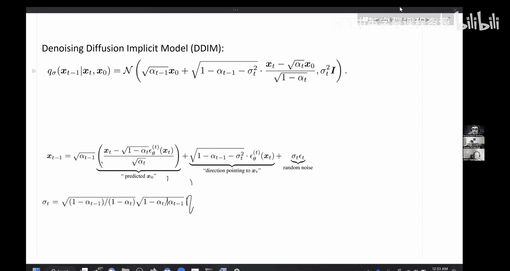

So I think you we'll probably， yeah， let's wrap it up here。

So that we leave ourselves plenty of time to cover the kind of new research directions next lesson more in more detail。

 but I mention， like in terms of where we're at。Just like we hit a kind of like， okay。

 we can really predict。Blasses for fashion ems a few weeks ago。

Where I think we're there now and like， we can do stable diffusion。Sampling and units。

 except for the unit architecture for unconditional generation。 Now。

 we basically can do fashion emist。Almost so it's unrecognisably different to the real samples。

 And DD IM is the scheduler that the original stable diffusion paper used。 So yeah， you know。

 we're actually about to go。Beyond。Stable diffusion or hour。Sam playing and unit trading now。

 So I think we've， yeah， definitely meeting our。Stretch goals so far。And all from scratch。

Worth whites and biases experiment looking。😀呵对对呵。😊，And you know， if you wanted to have fun。

 there's no reason you couldn't like。Have a little callback that instead logs things into a SQL like database and then you could write a little。

Rront end to show your experiments， you know， that would be fun as well。Yeah， I mean。

 you could do all sorts。 send you a text message when the loss gets good up ha。Yeah。All right。 Well。

 thanks， guys。 That was really fun。Thanks， everybody。All right。Bye okay， talk too later。

 then we're back。