# Jeremy《深度学习基础到稳定扩散模型｜Deep Learning Foundations to Stable Diffusion》中英 p16 Lesson 22_ Deep Learning Foundations to Stable Diffusion.zh_en -BV1Mp421S7xg_p16-

All right， Hi gang。 And here we are in lesson 21， joined by the legends themselves。

 Chano and Tenniche。Hello。Hello。And today。😊，You'll be shocked to hear。That。

We are going to look at a Jupipyter notebook。Amazing right we're going to look at Note 22。

 this is a pretty quick。😊，Just， you know。Improvement， pretty simple。 improvement to our。and。

DDPN slash DD IM implementation for fashion Mist and。

This is all the same so far that what I've done is I've。I've made some。One quite significant change。

 and some of the changes we'll be making today are all about making life simpler。

And they're kind of reflecting。The way the papers have been taking things。

 and it's interesting to see how that the papers have not only made things better。

 that made things simpler。And so what if the。Things that I've noticed in recent papers is that there's no longer。

A concept of， of N steps， which is something we've always had before。

 And always bothered me a bit this， this。Capital T thing。You know， this T over T。

 it's basically saying this is time step number， say 500 out of 1000。 so it's time step 0。5。

Why don't just call it 0。5。嗯。And the answer is， well， we can。

 So we talked last time about the cosine scheduler。

 we didn't end up using it because I came up with an idea which was hit。Simpler and nearly the same。

 which is just to change our beta max。 But in this next。

 or kind of say let let's use the cosine scheduler。 But let's try to get rid of the。

End steps thing and the capital T thing。So， here is abarrigan。And now I've got rid of the capital T。

So now I'm going to assume that your time step is between0 and 1 and it basically represents。

What percentage of the way through the diffusion process are you。

Sas hero would be all noise than one would be。Or， no， sorry the way we around。

0 would be all clean and one would be all noise。 So what how far through the forward diffusion process。

U。So other than that， this is exactly the same equation we've already seen。

 and I realized something else which is kind of fun， which is you can take the inverse of that。So。

 you can calculate。嗯。T， so we would basically。嗯。First， take the square roof。And we would then。

Tect the inverse cause。And we would， then。Divide by two over pi。Or times pay over to。So we can both。

 so it's interesting now we don't the the alpha bar is not something we look up。It a。

List is something we calculate with a function from a float。 And so， yeah， interestingly。

 that means we can also calculate T from an alphabet。So noiseify has changed a little。Now。

 when we get the alpha bar through our time step， we don't look it up。 We just call it。

 call the function。And now the time step。Is a random float。Aed 0 and one。Actually between 0 and。999。

hi。Actually， I'm sure there's a function I could have chosen to do。

Alo in this range village flap took so was lazy could be bothered looking it up。Other than that。

 no fire is exactly the same。That so with returning the。Xt。😔，The time step， which is now afloat。

And the noise， that's the thing we're going to try and predict dependent pen variable this top will error is our inputs to the model。

嗯。All right， so。Here is what that looks like。 So now when we look at our input to our unit trading process。

You can see， you know， we've got a T of 。05。 So 5% of the way through the forward diffusion process。

 it looks like this and 65% through it looks like this。

So now the now now the time step and basically the process is are more of a kind of a continuous time step and a continuous process rather before we were having these discrete time steps here。

 we could it's just any random value that could be between zero and1 I think yeah that that's also something which out this more convenient。

 you know， to have， yeah， it is can be have function to call。Yeah， I find this。

Life life a little bit easier。So the models the same， the callbacks are the same。

 the fitting process is the same。嗯。And so something which is kind of fun is that we could now。Can。

 when we do now， create little de noiseise function。So we can take。You know。

 this batch of data that we generated， the noiseified data， so here it is again。嗯。

And we can denoyise it。😊，So we know the T for each element， obviously。

 so remember t is different for each element now。嗯。

And we can therefore calculate the alpha bar for each element。And then， we can just。

Undo the noification to get the denoed version。And so if we do that。Here's what we get。

 And so this is great， right， It shows you what actually happens when we run。😊。

A single step of the model on varyingly。Partially noised images。

 And this is something you don't see very oftenca I guess not many people are working in these kind of interactive notebook environments。

 where it's really easy to do this kind of thing。 But I think this is really helpful to get a sense of like。

Okay， if you're 25% of the way through the forward diffusion process。

This is what it looks like when you undo that。If you're 95% of the way through it。

 this is what happens when you undo that。😊，USo you can see here it's basically like， oh。

 I don't really know what the hell's going on， so leasts a noisy。Mess。Yeah。

 I guess my feeling from looking at this is。I'm impressed， you know， like this 45% noise thing。

 It looks all no to me。It's found。For the longslaved top。嗯。And yeah。

 it's actually pretty close to the real 1。 I looked it up。

 might see it later is a little bit of a more of a pattern here。

 but it even gets a sense of the pattern。 So it shows you how， yeah， impressive this is。

 So this is 35%。 You can kind of see there's a shoe there。 but it's really picked up the shoe nicely。

 So it's， these are very impressive。Models in one's tip。Where my opinion。嗯。So okay。

 so sampling is basically the same。Except now， rather than creating starting with。

Using the range function to create our time steps， we use L space to create our time steps so at time steps。

Start at， you know， if we did 100， it would be 0。999。And they end at0。

 And then they're just linearly spaced with this number of steps。So other than that， you know。

 a by we now。Calculate， and the next a bar is going to be。Whatever the character step is。Minus。

Wite over steps， are if you' doing 100 steps， then you'd be -。01。So this is just stepping through。

Lenly。嗯。And yeah， that' that's actually it for changes。So if we just do DDIM for 100 steps。You know。

 that works really well。 We get a fit of three。Which is actually。

Quite a bit better than we had on 100 steps for our previous TDA And。

 So this test definitely seems like a good。Samplings， sling， sampling approach。

 And I know John is going to talk a bit more shortly about。You know。

 some of the things that can make better sampling approaches， but yeah， definitely。

They can see it making a difference here。Did you guys have anything you wanted to say about this before we move on？

No， but it is a nice transition towards some of the other things we'll be looking at to start thinking about how do we frame this。

 And it's it's also good like the idea。 So the original DPM paper has this1 thousand time steps and a lot of people follow that but the idea that you don't have to be bound to that。

 And maybe it is worth breaking that convention。 I know Tenish made that meme about you know。

 this 15 competing different standards fornotation but yeah。

 sometimes it's helpful to reframe it okay， time goes from0 to1 that can simplify some things may complicates others。

 but yeah， it's nice to think how you can reframe stuff something。 Yeah and in fact。

 where we were ahead today by the time you get to note。😊，23。We will see。I think you know。

 even simpler notation and yeah， simpler notation generally comes。

 I think what happens is over time people。Understand better。 What's the essence。

Of the problem and the approach and then that gets reflected in the notation。um。So， okay。

 so the next one I I wanted to share is something which。Is an idea we've been working on for a while。

Added some new research。 So partly， I guess this is an interesting like insight into how。

We do research。So this is 22 noise pre。And the basic idea of this was， well， actually。

 I'm going to take you through it to see what the basic idea is。

 So what I'm going to do is I'm going to create， okay， so fashion Enist as before。

 but I'm going to create a different kind of model。

 I'm not going to create a model that predicts the noise。Given。The noise image and T。 Instead。

 I'm going to try to create a model， which predicts T。Given the noise image。

 So why did I want to do that， Well， partly well entirely， because I was curious。

 I felt like when I looked at something like。This。I thought it was pretty obvious。

Roughly how much noise each image had。And so I thought， why are we passing？Noise。

 when we call the model， why are we passing in the noise image and the amount of noise or the tea。

Given that I would have thought the model could figure out how much noise there is。

 So I would have to check my。Contention， which is that the model could figure out how much noise there is。

 So I thought， okay， well， let's create a model that would try and figure out how much noise there is。

So， so I created a different noise of file now and this noise of I。Gras an alpha bar T。Randomly。嗯。

And。um。It's just a random number between 0 and1。 but you don't want one per。Ies him in the batch。

And so then after just randomly grabbing an alpha bar t with that noise of a in the usual way。

 but now our independent variable is the noise image and the dependent variable is alpha bar t and so we're going to try to create a model that can predict alpha bar t given a noise image。

Okay， so everything else is the same as usual。And so we can exceed example you've got other bar t do squeeze dot log it Oh yeah。

 that's true。 So the alpha bar T goes between Norton  one。So we've got a choice like having。

 we don't have to do anything， but you know， normally if you've got same between0 and1。

 you might consider putting a sigmoid at the end of your model。

But I felt like the difference between 0。999 and 。99。Is very significant， you know。

 So if we do log it， then it it we don't need the signaloid at the end anymore。 it on， you know。

 it'll naturally cover the full range of kind of。Though you don't want to be centered at zero。

 it'll cover the normal kind of range of numbers， and it also will treat equal ratios as equally important at both ends of the spectrum。

So。That was why hypothesis was that using loget would be better。 I did test it。

 and it was actually very dramatically better。 So without this loget here。

 my model didn't work well at all。 And so this is like an example of where。

Thinking about these details is really important because if you， if I hadn't have done this。

 then I would have come away from this bit of research thinking like， oh， I was wrong。

 We can't predict noise， noise a out。Yeah， so thanks for pointing that out， Johnny。Yeah。

 so that's why in this example of a mini batch， you can see that the numbers are。

Can be negative or positive， so0 would represent noise alpha bar of 0。5。So here 3。

05 is not very noise at all。Where else。Negative 1， it's pretty noisy。So the idea is that， yeah。

 given this image， you would have to try to predict 3。05。So。嗯。

So one thing I was kind of curious about is like and it's always useful to know is like what's the baseline。

 like what counts as good？😊，You know'ca often people will say to me like， oh。

 I created a model and the MSC was 2。6 and I'd be like， well， is that good， well。

 it's the best I can do， but is it good like or is it is it better than random or is it better than predicting the average？

😊，So in this case， I was just like， okay， well， what if we just predicted actually this is slightly out of date。

 I should have said zero here。Rather than 0。5， but if mind close enough。

 So this is before I did the loget thing。嗯。So I basically was looking at like， what's the？You know。

Loss， if you just always predicted a constant， which， as I said， you have put 0 here。

Haven't updated it。 And so it's like， oh， that would give you。A loss of 3。5。

Or another way to do it is you could just。Cap， just put MS A here and then look at the MSA loss between 。

5 and。Your various just a single mini batch， which we yeah， any batch of alphabas。Lologins。Yeah， so。

 you know， we wanted to get middle， if we're getting something that's about three。

 then we basically haven't done any better than。😊，Then random。 And so this case， this model。

It doesn't actually have anything to learn。 It always returns the same thing。

 So we can just call fit with trade equals false just to find the loss。

 So this it just a couple of ways of getting。Quickly， finding a loss for a baseline， naive model。嗯。

One thing that thankfully， Ptorch will warn you about is if you try to use MSE。And。

Your inputs and targets have different shapes。 It will broadcast and give you probably not the result you would expect。

 and it will give you a warning。 So one way to avoid that is just to use。Dot flattened on H。嗯。

So this kind of flattened MSC is useful。To avoid both。

 avoid warning and also avoid getting weird errors or where say weird results。

So we use that for our loss， so the model is the model that we always use， so it's kind of nice。

 we just use our same mode model。Nothing changes。hamm。

Even though we were doing something totally different。嗯。Oh， well， okay。 that's not quite true。

 One The difference is that our output， we just have one output now。

 because this is now a regression model。 It's just trying to predict a single number。

And so our learner now uses MSA as a loss。Everything else is the same as usual。

 so we could go ahead and trade it。 and you can see， okay。

 the loss is already much better than three。 So we're definitely learning something。

And we end up with a 。075。Mean square error。 That's pretty good。 considering， you know。

 there's a pretty wide range of numbers we're trying to predict here。嗯。

So I I' got to save that as noise prediction。On sigma， So save that model。 And so we can take a look。

At how it's doing。By grabing our one batch of noise temperatures。Putting it through our。T model。

 actually it's really an alpha bar model that never mind call it a T model。

And then we can take a look to see what it's predicted for each one。

And we can compare it to the actual for each one。 And so you can see here it said， oh。

 I think this is about 0。91。And actually， it is。91 said， oh， here it looks like about 。36。 And yeah。

 it is actually 0。36。 So， you know， you can see overall，72， it's actually 0。

72 below0 or it's actually right。 This one's。02 off。 But yeah， my hypothesis was correct。

 which is that。We we can predict the thing that we were putting in manually as input。

There's a couple of reasons I was interested in checking this out。 you know， the first was just like。

 well。No， wouldn't it be simpler。If we weren't passing in the TH time。

 you know why why not not passing in the TH time， but it also felt like it would open up。

A wider range of to of how we can do sampling。The idea of doing sampling。

By like precisely controlling the amount of noise that you try to remove each time。

And that assuming you can remove exactly that amount of noise each time fails。Limited to me。嗯。

So I want to try to remove this constraint。so having， yeah built this model， I thought， okay。

 well you know， which is basically like， okay， I think we don't need to pass T in let's try it。

So what I then did is I replicated the 22 cosine notebook I just copied it， past it in here。

But I made。A couple of changes， The first is that no ifify。Doesn't return tea any more。

 So there's no way to cheat。 We don't know what tea is。嗯。And so that means that the unit。

Now it doesn't have t， so it's actually going to pass zero。Every time。So it has no ability to learn。

From T because it doesn't get T， so it just doesn't really matter what we pass in。

 we could have changed the unit。😊，To like remove the conditioning on tea。 But for research。

 this is just as good， you know， for finding， for finding out。

 And it's good to be lazy when doing research， there's no point doing something a fancy way when you can do it a quick and easy way before you even know if it's going to work。

So yeah， that's the only change so we can then train the model and we can check the loss so the loss here is 0。

034。嗯。And previously， it was 。033。 So interestingly， you know， maybe。It's a tiny bit was。At。

That that， you know？But it's pretty very close。Okay， so we'll save that model。And then， for sampling。

I have got exactly the same DTIM's tip。As usual。And by sampling is exactly the same as usual。

 except now。When I call the model， I have no t to pass in。So it is passing。Yes。嗯。I mean。

 I still know T because I'm still using the usual sampling approach。

 but I'm not passing it to the model。😊，And yeah， we can sample。 And what happens is。Actually。

 pretty cabbage。22 is our fit。嗯。And as you can see here。You know。

 some of the images are still really noisy。So it totally failed。And so that's。

Always a little discouraging when you think something's going to work and it doesn't。

But my reaction to that is like， if I think something's going to work and it doesn't， is to think。

 well， I'm just gonna have to do a better job of it。 You know， I I， it ought to work。So。

 I tried something。Different。Which is I thought， like， okay。Since it we're up passing in the T。🤢。

Then we're basically saying like how much noise should you be removing？It doesn't do exactly。

 so it might remove a little bit more noise than we want or a little bit less noise than we want。

 And we know from the you know， testing we did。That sometimes it's out by a leg。 in this case。

 point02。 And I guess if you're out consistently， sometimes it's。Yeah。

 I've got to end up not removing all the noise。So the change I made was to the DDAM step。嗯。

It is here。And。Let me just copy this and get rid of the。

I entereded out sections just to make it a bit easier to read。I came。So the DDAM step。

 this is the normal DDAM step okay and so step 1 is the same。

 so don't worry about that because it's the same as we've seen before。

 but what I did was I actually used my T model。So I passed the noise image into my T model。

 which is actually an alpha bar model to cavet the predicted alpha bar。

And this is remember the predicted alpha bar for each image because we know from here that sometimes so sometimes it did a pretty good job right。

 but sometimes it didn't， So I felt like， okay， we did a predicted alpha bar for each image。um。

What I've then discovered is。Sometimes that could be like。

Really too low So what I wanted to make sure was it wasn't too crazy。

 So I then found the median for a mini batch of all the predicted alpha bars。

 and I clamped it to not be too far away from the median。U。

And so then what I did when I did my exnt hat is rather than using。Alpha bar T。

I used the estimated alpha bar T for each image。Planbed to be not too far away the media。

And so this way it was updating it based on the amount of noise that actually seems to be left behind。

 rather than the assumedstmed amount of noise that should be left behind。You know。

 if we assume it's removed the correct amount。And then everything else is the same。So。

When I did that。S， whoa。Made all the difference。 And here it is。

They are beautiful pieces of clothing。So 3。88。Pass。3。2。That's possibly twice enough。

 Like I'd have to run it a few times。 You know， my guess is maybe it's a tiny bit worse。

 but it's pretty close。 that like this definitely。Gives me some encouragement that。You know。

 given though this is like something I just did in a couple of days whereas else the kind of the with tea approaches have been developed since 2015 and we're now in 2023。

I， you know， I would expect it's quite likely that these kind of like。No， no tea approaches could。

Eventually， surpass。The tea based approaches。um。And like one thing that definitely makes me think that there room to improve is if I plot。

😊，The the th or the kid。Or each sample during the reverse diffusion process。

 it actually gets worse for a while。 but wait， okay， well， that's。That's a bad sign。

 I have no idea why it's happening， but it's a sign that。Yeah， if we could improve each step。

 then one would assume we could get better than 3。8， so。😊，Yeah， to， Coard， have any。

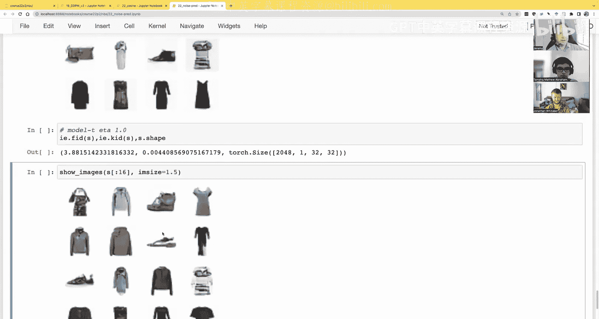

Thoughts about that。Or questions or comments， Sir。嗯。

Maybe to just like to highlight that the research process a little bit。

 it wasn't like this linear thing of like， oh， here has this issue not performing me as well as we thought。

 Oh， here's the fix。 We just scrap this side puzzle。You know。

 this was like multiple days of like discussing and like Jeremy saying。

 like you know telling my hair out， Do you guys have any ideas。 And oh， what about this。

 And oh and it just in the tea paper， they do this campping。 Maybe that'll help。 you know。

 so there's a lot of back and forth。 And also a lot of like you saw that code that was commented out there Prince X T dot X do max alpha bar pre。

 know， just like seeing oh okay， you， my average prediction is about what I'd expect。

 But sometimes the middle of the max goes you know2，38，1650 to told me and infinity。 know。

 like one or two little badd that would just skyrocket out。 yeah。

 and so that kind of like debugging and exploring and printing things our additional discussions about this idea。

 I kind of said to you guys before lesson。One of part 2。

 I said like it feels to me like we shouldn't need the tea thing。 And so it's actually been like。

Bumleg away in the background fur。The months。and I guess I mean。

 we should also mention we have tried this like a friend of ours trained a no T version stable diffusion for us and we did the same sort of thing I trained a pretty pad tea predictor and it sort of generate samples So we're not like focusing on that large scale stuff yet but it is fun to like every night and again got this idea from fashion and In we are you know trying these out on some bigger models and seeing okay this does seem like maybe it'll work and to down the line that future plan is to say that it's actually you know spend the time training a proper model and see yeah。

 see how well that does if its just you say a friend of ours， we can be more specific。

 It's Robert one of the two lead authors of the stable diffusion paper yeah actually has been fine tuning a realt stable diffusion model。

um。Which is without tea and is looking super encouraging， so。Yeah， that'll be fun to。

To play with with this new， you know we'll have to train a tea predictor for that。See how it looks。

Yeahep。All right， so I guess the other area we've been talking about kind of doing some research on is this weird thing that came up over the last few weeks where。

Our bug in the DDPM implementation， where we accidentally weren't doing it from。

-1 to1 for the import range。It turned out that actually being from -1 to1 wasn't a very good idea anyway。

And so we ended up centering it as being and from0。5 to 。5。

 And Juto and Tunish have managed to actually find。A paper， well。

 I see find a paper paper has come out in the last 24 hours。Which has。嗯。

Coincidentally cast some light on this and has also cited a paper that we weren't aware of。

 which was not released in the last 24 hours。 So John， are you going to tell us a bit about that。

Yeah， and as sure I can do that。So it's funny this was such perfect timing because I actually got up early this morning planning to run with the different input scalings and the cosignine schedule that Jeremy was showing and some of the other schedulers will look at。

 I thought it might be nice for the lesson to have a little plot of like what is the F with these different software and input scalings but it was going be a lot of work not looking forward to doing the groundwork and then Tish send me this paper which AK had just tweeted out because he reviews anything that comes up on archive every day on the importance of noise scheduling for diffusion models this is by a researcher at the Google Bra team who's also done a really cool recent paper on something called a recurrent interface network outside of the script of this lesson that also worth checking out yeah so this paper they're hoping to study this noise scheduling and the strategies that you take for that and they want to show that number one those scheduling is crucial for performance and the optimal one depends on the tasks。

😊，When increasing the image size， the noise scheduling that you want changes and scaling the input data by some factor is a good strategy for for working with this and that's the we've been talking about right？

😊，Yeah， that's what we've been doing where we set oh do we scale from minus0。5 to。

5 or minus1 to 1 or do we normalize and so they demonstrate the effectiveness by training a really good high resolution model on image met So class condition model and yeah。

 amazing samples they'll struggle one later。😊，So I really like this paper it's very like short and concise and it just gets all the information across and so they introduced us here we have this noing process on noise of I function where we have squared of something times x plus square root of1 minus that's something times the noise and here they use gamma gamma of t which is often used for the continuous time case So instead of the alpha bar and the beta bar schedule for 1000 times stepss there'll be some function gamma of t that tells you what your alpha bar should okay so that's how alpha function is actually called a bar but it's the same thing Yeah same same thing takes in a time set from 0 to 1 and then that's used to noise the image。

😊，Interestingly， what they're showing here actually is something that we had。Discovered。

 and I had been complaining about that。My D T A Ms with an eater of less than one weren working。

 which is to say， when I added extra noise to the image。It wasn't working。

 And what they're showing here is like， oh yeah， du。

 if you use a smaller image then adding extra noise is probably not a good idea。Yeah。

 and so they use a lot of reference in this paper to like information be destroyed and signal to noise ratios and that's really helpful for thinking about because it's not something that's obvious。

 but at 64 by 64 pixels adjacent pixels might have much less in common versus the same amount of noise added at a much higher resolution。

 the noise kind of averages out and you can still see a lot of the image so yeah that's one thing they highlight is that the same noise level for different image sizes might have it might be a harder or easier task。

And so they investigate some strategies for this， they look at the different noise schedule functions。

 so we've seen the original version from the DDDM paper we've seen the cosine schedule and we've seen I think we might look at for the next thing that Jamie is going to show us a sigmoid based schedule so they show the continuous time versions of that and they plot how you can change various parameters to get these different。

Gmma functions or in our case the alpha barn wherere were starting at all an image。

 no noise at t equals0 moving to all noise no image at t equals1。

 but the path that you take is going to be different for these different classes of functions and parameters and the signal to noise ratio that's what this or the no signal to noise ratio is going to change over that time as well and so that's one of the knobs we can tweak me saying our diffusion model is in training that well we think it might be related to the noise schedule and so on one of the things you can do is try different noise schedules either changing the parameters in one class of noise schedule or switching from etheia to a cosine to a sigmoid and then the second strategy is kind of what we were doing in those experiments which is just to add some scaling factor to x to0 Well we're example。

Yeah， well we we were accidentally using B of 0。5。Exactly and so that's the second dial that you can tweak is to say keeping your noise schedule fixed。

 maybe you just scale x0， which is going to change the ratio of signal to noise。

 And that's what I figures four in C there is what we were accidentally doing。😊，Yes， yeah， exactly。

 And so see if we can get to。😊，Oh yeah so that again changes the signal to noise for different scaling as you get so let's find so they have a compound。

 they have a strategy that combines some of those things and this is the important part they do their experiments and so they have a nice table of investigating different schedules。

 cosan schedules and sigmoid schedules and in bold are the best results and you can see for 64 by 64 images versus 128256 the best schedule is not necessarily always the same。

And so that's like important finding number one， depending on what your data looks like。

 using a different notice schedule might be optimal， there's no one true best schedule。

 there's no one value of you know， beta min and beta max that's just magically the best。

Likewise for this input scaling at different sizes with whatever schedules they tested and different venue were kind of optimal。

And so。Yeah， it's just a really great illustration， I guess。

 that this is another design choice that's。Implicit or explicitly part of your diffusion model training and sampling is how are you dealing with this。

 this noise schedule， what schedule are following， what scaling are you doing of your inputs。

And by using this thinking and doing these experiments and they come up with a kind of rule of thumb for how to scale the image based on image size。

 they show that they can as they increase the resolution。

 they can still maintain really good performance where previously it wass quite hard to train a really large resolution pixel space model and they're able to do that they get some advantage from their fancy recurrent interface network but still and it's kind of cool that they can say look we get state of the art high quality 512 by 5 and call or 102fold or 1024 samples on class conditioned imagenet and using this approach to really like consider how well we train how many steps do we need to take one of the other things in this table is that they compare to previous approaches we used you know a third of the training steps for the same other settings and we get better performance just because we've chosen of that input scaling better。

And yeah， so that's the paper， really， really nice。

 great work to the the team and that was written got up。

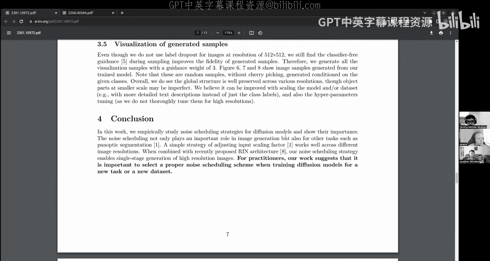

In the morning， and thought。😔，it's gonna be a hassle trading all these different models。

 I need to train for different input scalings and different。Sampling approaches。

 I just look at Twitter first and then you looked at Twitter and was and there was a paper saying like。

 hey， we just did a bunch of experiments for different noise schedules and input scaling。Yeah。

 does your life always work that way each other， It seems quite blessed。ItYeah。

 it's very lucky like that。 Yeah， and if you wait long enough， someone else will do it。😊。

That's why it shows that the time when the AK starts posting on Twitter。

 it's like my favorite hour of the day wait for all the papers to be posted。嗯。Yeah， well。

 thank you for that。 And so。嗯。So let me。Switch to Note 23。😔。

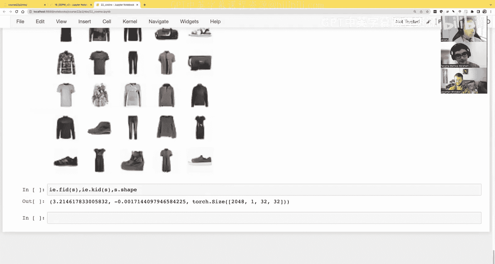

Because this notebook is actually。Largely an implementation of some ideas from this paper that。

Everybody tends to just careas， unfair because there's other people。but I will do it anyway。

 Car us paper。嗯。And the reason we're going to look at this is because。In this paper， the。Auths。

Actually， take a much more explicit lookok at the question of。Input scaling。Their approach was， not。

 apparently。To accidentally put a bug in their code and then take it out and find it worked worse and then just put it back in again。

 Their approach was actually to think， how should things be。

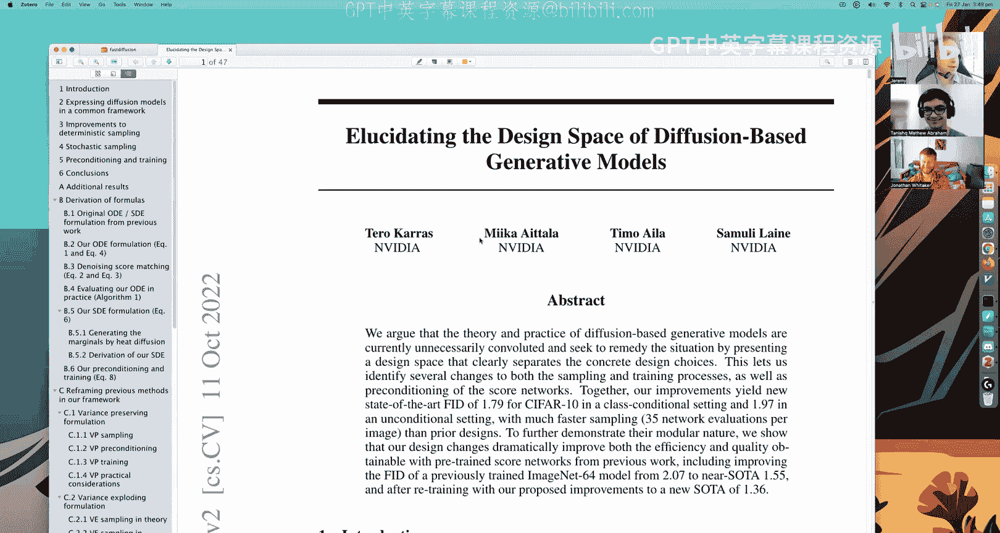

So that's an interesting approach to doing things。 And I guess it works for them。 So that's fine。

 I think our smoke is more exciting。 No， exactly our approach is much more fun because you never quite know what's going to happen。

😊，嗯。And so yeah， in in their approach， they actually tried to say like， okay。

 given all the things that are coming into our model。How can we have them all nicely balanced。

So we will skip back and forth between the notebook and the paper。嗯。

So the start of this is all the same， except now we are actually going to do it。-1 to1。

 because we're not going to rely on accidental bug any more。

 but instead ofre going to rely on the careas papers。Carefully designed。Scaling， I say that。

 except that I。Put it back in the yesterday notebook as well。😊。

One of the things that's in the Kaas paper is what is the standard deviation of the actual data？

Which I calculated for a batch。However。This used to say minus 。5， I used to do the 。5 to 。5 thing。

 and so this is actually the standard deviation of the data before I when it was still 0。5。

So this is actually half the real standard deviation。For reasons I don't yet understand。

This is giving me better scaled results， so this actually should be 0。66。😊。

So there's still a bug here and the bug still seems to work better。

 so we've still got some mysteries involved。 So we're going to leave this。

 so it's actually yeah it's actually not 。33。 it's actually 0。66。Okay， so the basic idea。um。

Of this packet， actually， I'll come back。嗯。Well， you have a little think。Yeah， okay。

 and I was' going to start here。 The basic idea of this paper is to say。You know what， sometimes。

Maybe。Addreicting the noise。Is a bad idea。And so like you can either try and predict the noise or you can try and predict the clean image and。

Each of those can be a better idea in different situations。

 if you are given something which is nearly pure noise。You know。

 the model is given something that is nearly pure noise and is then asked to predict the noise。😊。

That's basically a waste of time， because the all thingss noise。嗯。If you do the opposite。

 which is you try to get it predict the clean image。 Well。

 then if you give it a clean image that's nearly clean and try to predict the clean image。

 that's nearly a waste of time as well。 So you want something which is like。

 regardless of how noisy the image is， you want it to be kind of like an equally difficult problem to solve。

And so what cares do？Is they。嗯。They basically。Use this new thing called C skipip， which is a number。

Which is basically saying， like， you know what we should do for the training target is not just predict the noise all the time。

Not just predict the clean image all the time， but predict。And of aert version of one or the other。

 depending on how noisy it is。 So here why。Is the。Plain image。And N is the noise。So， y plus n。

Is the noise image。And so， if C skip was 0。Then， we would be predicting。The clean image。

And if C skip was1， we would be predicting y minus why we would be predicting the noise。

And so you can decide by picking a different C skip。

 whether you're predicting the clean image or the noise。 And so。

 as you can see from where they've written it， they make this a function。

 They make it a function of sigma。 Now， this is where we've got to a point now where we've kind of got a fairly。

A much simpler notation。 there's no more alpha bars， no more alphas， no more bes， no more beta bars。

 There's just a single thing called sigma。 Unfortunately。

 Sigma is the same thing as alpha bar used to be， right， So we've simplified it。

 but we've also made things more confusing by using existing symbol for something totally different。

So this is alphabe。Okay， so there's going to be a function。😊，That says。

 depending on how much noise there is。We'll either predict the noise or we'll predict the clean image。

 or we'll predict something between the two。So in the paper， they showed this。This chart。

Where they basically said， like， okay， let's look at the loss to see how good are we with a trained model。

At predicting。嗯。When。Sigma is really low， so when there's very small alpha bar。

Or when sigma is in the middle or when sigma is really high。And they basically said。

 you know what when it's nearly all noise or nearly no noise。You know。

We are basically not able to do anything at all。You know， we're basically good at doing things。

When there's a medium a amount of noise。So when deciding， okay， what。

 what sigmas are we going to send to this thing， the first thing we need to do is to figure out some sigmas and they said。

 okay， well， let's。Pick a distribution of sigmas that matches this red curve here。as you can see。

And so this is a normally distributed curve where this is。On a log scale。

So this is actually a loggno curve。So to get the smas that they're going to use。

 they picked a normally distributed random a number。And then they exc it。And this is called a log。

 normal distribution。And so they used a mean of 1。2。And a standard deviation of 1。2。

So that means that about one third of the time。They're going to be getting a number of thats bigger than 0 here。

And8 of the0 is1。So about one third of the time， they're going to be picking。

Sigmas that are bigger than one。 and so。Here's a histogram， I drew。

Of the sigmas that we're going to be using。And so， it's nearly always。You know， less than five。

 And but sometimes it's way out here。And so it's quite hard to read these histograms。

 So this really nice library called Seabornourne， which is built on top of mapplotlibb。

 has some more sophisticated。And often nicer looking plots。

 And one of them they have is called a KDE plot， which is a kernel density plot。 It's a histogram。

 but it's smooth。Okay， and so I clipped it at 10 so that you could see it better so you can basically see that the vast majority at the time。

 it's going to be somewhere， you know， about 0。4 or 0。5， but sometimes it's going to be really big。

So。Our noise if I is going to pick a sigma。Using。That。Locked normal distribution。

And then we're going to get the noise as usual。But now we're going to calculate。Say skipip。Right。

 because we're going to do that thing we just saw。 we're going to。

Find something between the plain image。And。The noise input。 So what do we use for C skip。

We calculate it。Here。And say， whatt we do。As we say。

 what's the total amount of variance at some level of sigma？Well， it's gonna be。Sigma squared。

 at's the definition of the variance of the noise。 But we also have the sigma of the data itself。

So if we add those two together。We'll at the total variance。And so what the Kais paper said to do。

Is to。Do the variance of the data divided by the total variance and use that for C skipip。

So that means that if your total variance is really big， so in other words， it's got a lot of noise。

Then seak's going to be really small。So if you've got a lot of noise。

Then this bit here will be really small。So that means if there's a lot of noise。

Try to predict the original image。that makes sense， because predicting the noise would be too easy。

If there's hardly any noise。Then this will be total variance will be really small。Right。

 so C skip will be really big and so if's if there's hardly any noise， then。😊。

Try to predict the noise。And so that's basically what this C skip。Does。

 so it's a kind of slightly weird idea is that our the our the target。

 the thing we're trying to do actually is not。The input image， sorry the original image。

 it's not the noise， but it's somewhere between the two。

 and I've found the easiest way to understand that is to draw a picture of it。

So here is some examples of noise input， right， with various amounts of with various sigmas。

 Remember sigma is alphabe。 right So here's an example。With very little noise，06。

 And so in this case， the target。Is。Predict the noise。 right， So that's the hard thing to do。

 is predict the noise。Where else here's an example， 4。53， which is nearly all noise。

So for nearly all noise， that target is。Predict the image。

And then for something which is a little bit between the two， like here，0。64。

 the target is predict some of the noise and some of the image。So， that's the idea。Of Paris。 And so。

What this does is it's making the you know， problem to be solved by the unit。Equally difficult。

 regardless of what Sipa is。It doesn't solve our input scaling problem。 It solves our kind of。

Difficulty scaling problem。To solve the input scaling problem， they'd do it。

I just want to make one quick note。And so like this sort of idea of like is also interpolating between the noise and the image is this similar to what's called the B objective as well So there's also a similar kind of it's yeah it's very quite similar to what carrael has but that's also now been used in a lot of different models like for example。

 staple diffusion 2。0 was trained with this sort of B objective so people are using this sort of this sort of methodology and getting good results and yeah so it's it's an actual practical thing that people are doing so yeah just want to make a note of that yeah as is the case of basically。

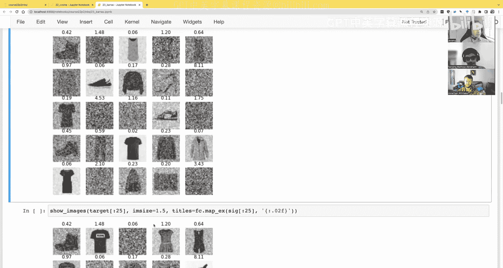

All papers created by Nvidia researchers， of which this is one。 it flies under the radar。

 and everybody ignores it。 The V objective paper came from the senior author was Jim Sallomons。

 which is Google， right。Yeah， and so anything from Google and open AI， everybody listens to。 So yeah。

 although Kas， I think has done the more。Complete version of this， and in fact。

 the objective in was almost like。Mentioned him passing in the distillation paper。 But yeah。

 that's the one that everybody has ended up looking at。 But I think this is the more。 Yeah。

 I think late， I think what happened with the with the V objective is see not many people paid attention to。

 I think folks like cat and Robin and these sorts of folks were actually paying attention to that V objective in the Google brain paper。

 So， but then also this paper did a much more principled analysis of this sort of thing。 So yeah。

 I think it's very interesting how， yeah， sometimes even these sort of side notes in in papers that maybe people don't pay much attention to。

 They can actually be quite important。 Yeah， yeah， so。

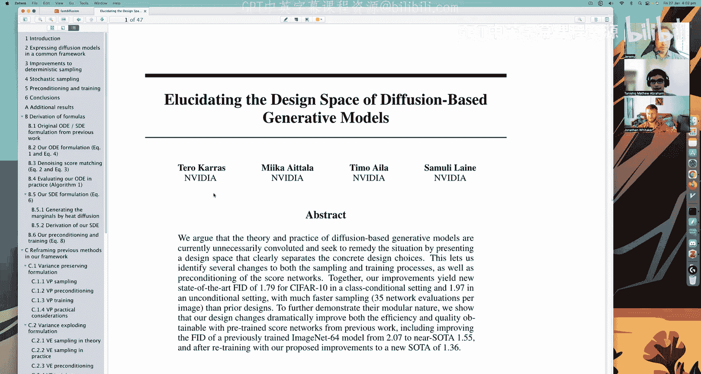

Okay， so the noise input as usual is the input image plus the noise times the sigma then and then as we discussed。

 we decide how to kind of decide what our target is。

 but then we actually take that noise input and we scale it up or down。By this number。And the target。

We also scale up or down。By this number。 And those are both calculated in this。Bing as well。

 So here's see out。And here's C in。 Now， I just wanted to show one example of where these numbers come from。

 because for a while， they all seem pretty mysterious to me。

 and I felt like I'd never been smart enough to understand them。

 particularly because they were explained in the mathematical appendix of this paper。

 whichrs the bits I don't understand。

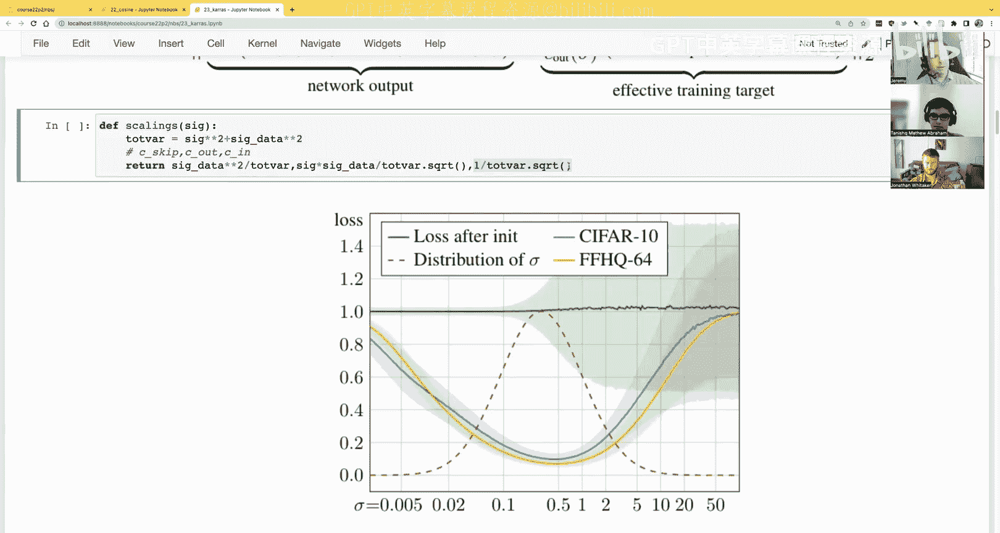

Until I actually try to， and then it tends to turn out they're not so bad after all。

 which was certainly case here。嗯。Uh whichhich if it was up， it was B something。

 I think so that thatd be be6， I think that that weren't about you。So an Appendix B6。

Which does look pretty terrifying。But if if you actually look at， for example。

 what we're just looking at， C in。It's like， how do they calculate。 So C in is this now。This is。

The variance of the noise。 This is the variance of the data add them together to get the total variance square roots。

 the standard deviation total standard deviation。 So's just the inverse of the total standard deviation。

 which is。

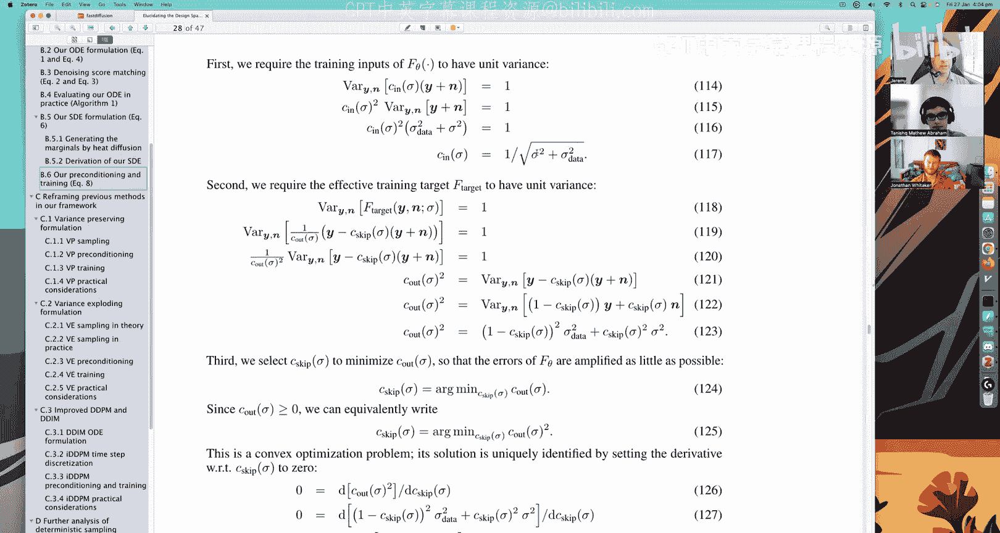

What we have here， Where does that come from， Well， they just said， you know what。

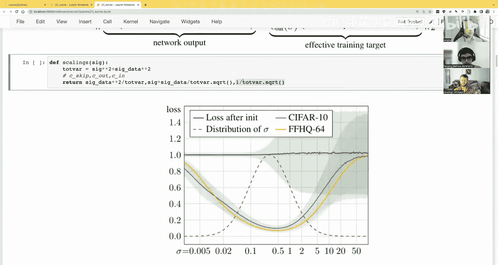

嗯。The imports for a model should have unit variance。Now， we know that。We've， we've done that today。

In this course， so they said， we're right。 So well the inputs to the model。😊，Is。

The clean data plus the noise。Times some number we're going to calculate， and we want that to be one。

Okay， so the variance of。The plain。TheImage plus the noise is equal to the variance of the clean images。

Plus， the variance of the noise。Okay， so if we want。😊，That to be if we want variance to be1。

 then divide both sides by this。And take the square root。

And that tells us t our modplayer has to be won over this。That's it。 So it's like， literally。

You know， classicals mathth。Am。The only bitt you have to know is that the variance。

Of two things added together is the variance of the two things added together。

Which is not rocket science either。 And in this context like why we want to do this when we looked at those sigmas that you are ploting like the distribution。

 you've got some that are fairly low， but you've also got somewhere。

 the standard deviation sigma is like 40。 Right， So the variance is super high。 Yes。

 And so we don't want to feed something with standard deviation 40 into our model。

 you would like it to be closer to unit variance。 And So we're thinking， okay， well。

 if you divide by。

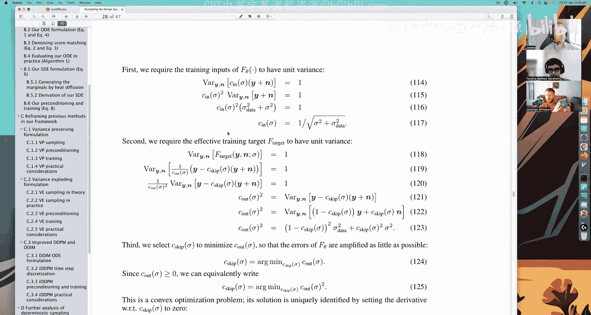

Roughly 40 that would get it down。 but then we've also got some extra variances from our data just like。

Yes exactly what do you into the data of a little bit？We want to， you know。

 scale back down by that to get unit variance。 Yeah， no， I mean。

 I love this paper because it's basically just doing what we spent。Weeks doing of like。

 I feel like everything that we've done that's improved every model has always been one thing。

 riches。Can we get。Mean zero variance one inputs to our model and for all of our activations。And。

And then the only other thing is include enough compute by adding enough layers and enough activations。

 Those two things seem to be all that matters。Basically， well。

 I guess resnets added an extra cool little thing to that， which is to make it to， you know， make it。

Even smoother by giving us kind of like identity path。So yeah， basically trying to make things as。

Smooth as， as possible and as as equal everywhere as possible。 So， yeah， this is what they've done。

 So they did that for the inputs。 And then they've also done it。For the outputs and for the outputs。

 you know， it's basically。The same idea， you know， they have basically the same kind of analysis to show that。

And so with this。So now， yeah， we basically we've got our noise input。嗯。We've got the。You know。

 kind of linear version somewhere between x naught and the noise input。

 we've got the scaling of the output and we've got the scaling of the input。

 So now for the inputs to our model， we're going to have the scaled noise。We're going have the sigma。

And we're going to have the target。Which is somewhere between the image and the noise。And so， yeah。

 so I I've。You know never seen anybody draw a picture of this before。

 so it was really cool when you know being in a notebook being able to see like oh that's what they're doing you know。

 so yeah have a good look at this notebook to see exactly what's going on because I think it gives you really good intuition around what problem it's trying to solve。

😊，So then I actually checked the noise import has a standard deviation of1， that means not zero。

 and of course why would it be we didn't do anything， you know。

 the only thing Kas cared about was having the variance one。

We could easily adjust the input and output to have a mean zero as well。

 and that's something I think we or somebody should try because I think it does seem to help a bit as we saw with that generalized value stuff we did。

But it's less important than the variance and so same with the target as we've got the one and yeah。

 this is where if I change this to the correct value which is 0。66。

 then actually it's slightly further away from one。Both here and here quite a lot further away。

 and maybe that's because actually the the data is， well。

 we know the data is not Gaussian distributed。 Pel data definitely isn't Gaussian distributed， so。

This bug turned out better。Okay， so the units the same， the initializations the same。

 this is all the same。Train it for a while。 All。 We can't compare the losses， right。

 because our target's different， so。um。But what we can do is we can create a D noise that just takes the。

pam。Thing that， as per usual， the thing we had in noyify。Right， and so for xs。

 I've got to multiply by C out and then add C skip by noise input。

Here it is multip by C out at noise1 points Okay， so we can de noise。am。Let's grab our。

Sigmas from the actual batch we had， let's calculate C skipy out and C in or the sigmas in our mini batch。

Let's use the model to predict the target。Given the dst input and the sigmas。And then。Dano it。

And so here's our noise import， which we've already seen。 And here's our。Predictions。

 and these are absolutely remarkable， in my opinion。嗯。Yeah， like this one here， I can barely see it。

 you know， it's really found is， look at the shirt。 there's the shirt here。

 It's actually really findingening the little thing on the front。

 And let me show you here said what it should look like。Right right。

And in cases where the signalma is pretty high， like here。You can see it's really like saying like。

 I don't know， maybe it's shoes， but it could be something else。 Is it shoes。 Yeah， it wasn't shoes。

 but at least it's kind of got the。You know， the bulk of the pixels in the right spot。Yeah。

 something like this one is 4。5 has no idea what it is。 It's like， oh， maybe it's shoes。

 maybe it's pants。It don't content that it is shoes。Yeah， so I think that's。

Fascinating how well it can do。And then the other thing I did。

 which I thought was fun was I just created， so I just you did a sigma of 80。

 which is actually what they do when they're doing sampling from pure noise。

 that's what they consider the pure noise level。So I just created some pur noise。

And they noticedd it。Just for one step。 And so here's what happens when you denoyise it for one step。

 And you can see。It's kind of overlaid all the possibilities is like I can see a pair of shoes here。

 a pair of pants here top here。And sometimes， it's kind of like。

More confident that the noise is actually a pair of pants。

 and sometimes it's more confident that it's actually shoes。

 If you I really get a sense of how like from pure noise， it starts to make a call about like。

What this noise is actually covering up。And this is also the bit which I feel is like。

I'm the least convinced about when it comes to diffusion models， this。

 this first step of going from like pure noise to something。And like。

 try to have a good mix of all the possible some things I'm。I duno。 It feels a bit hand wavy to me。

 It clearly works quite well， but I'm not sure if it's like getting the fool。Range of possibilities。

 And I feel like some of the papers we're starting to see are starting to say like， you know what。

 maybe this is not quite the right approach then maybe later in the course we'll look at some of the ones that look at。

What we call VQ models and tokenized stuff。 Anyway， I thought this is pretty interesting。

To see these pictures， which I don't think。Yeah， I've never seen any pictures like this before。

 So I think this is a fun result from doing all this stuff in notebooks step by step。Okay。

 so sampling。So one of the nice things with this is the sampling becomes much。Mauch， much simpler。

And so。And I should mention a lot of the。Oode that I'm using， particularly in the sampling section。

 is heavily inspired by， and some of it's actually copied and pasted from Cat's K diffusion repo。

 which is， I think I mentioned before is some of the nicest。

Generative modeling code or maybe the nicest generative modeling code of everc。It's really great。嗯。

So before we talk about the actual sampling， the first thing we need to talk about is。

What sigma do we use at each reverse time step， And in the past， we've always。

 well nearly always done something which I think as always felt is sketchy as or hell。

 which is we've just linearly gone down the sigmas or the alpha bars or the T's。

 So here when we sampling in the previous notebook， we used Ly space。So I only felt like that was。

Questionable， and I felt like at the start， you probably like it was just noise anyway。 So who cared。

 Who cares， So I。Indeed PM V38 experimented with something that I thought intuitively made more sense。

 to't know if you remember this one。 but I actually said， oh。

 let's for the first hundred times steps。 let's actually only run the model every 10 times and then for the next00。

 let's run it9 times the next 100， let's run it every eight times。 So basically at the start。

Be much less careful。And so， Kas actually。Ran a whole bunch of experiments。 And they said， yeah。

 you know what。 at the start of training， you know， you can start with a high sigma。

That then makes step to a much lower sigma in the next step and then a much lower sigma in the next step。

 And then the longer the more you train， step by smaller and smaller steps so that youd spend a lot more time fine tuning carefully at the end and not very much time at the start。

 now。This has its own problems。😊，And in fact， a paper just came out today。

 which we probably won't talk about today， but maybe another time， which talked about the。

 the problems is that in these very early steps， this is the bit where you're trained to。

Create a composition that makes sense。 T for fashioned emnest。 we don't have much composing to do。

 It's just a。Piece of clothing。 But if you are trying to do an astronaut riding a horse， you know。

You've got to think about how those pieces fit together。And this is where that happens。

 and so I do worry that with the cares approach is what it's not giving that maybe enough time。

But as I've said， that's really the same as this step that whole piece feels a bit。Wg。To me。

But aside from that， I think this bes a lot of sense， which is that， yeah， the sampling。

 you should jump， you know， by big steps early on and small steps later on and make sure that the the the fine details。

But just so。 So that's what this function does。 I it creates this。Lo now， it's this， this。

 this schedule of， of。Reverse diffusion sigma steps。

 It's a better of a weird function and that it's the， the w root of sigma。Where row is 7。

 So the seventh root of sigma。I basically what it's scaling on。

 but the answer to why it's that is because they tried it and it turned out to work pretty well。

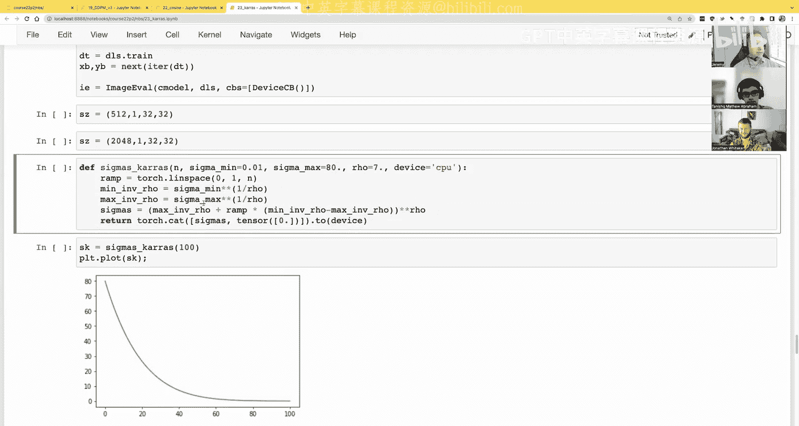

嗯。But。Do you guys remember where this was？This is the truncation error analysis， D1。That， Mary。

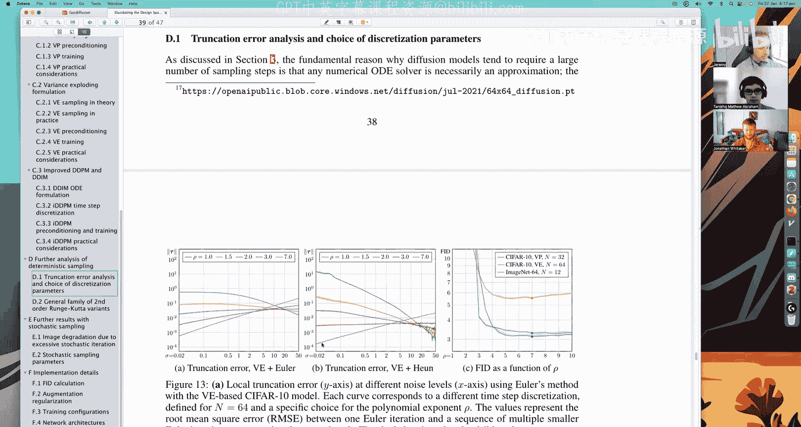

So。This image here。嗯。So thanks Rich anice for remind me where this is shows Fi。As a function of row。

 Sos basically what。The what route are we taking。 And they basically sound like if you take the fifth route up。

 it seems to work。 well， basically。So yeah， so that's a perfectly good way to do things is just to try things and see what works。

And you'll notice they tried things just like we love on small data sets， not as small as uss。

 because we're the king of small data sets， but small a so far1 the image net 64。

That's the way to do things。 I saw like。I might have even been the CEO of Hing Face the other day tweets something saying only people with huge amounts of GPUs can do research now。

 and I think it totally misunderstands how research has done， which is research has done on。

Very small data sets， that's the actual research。And then when you're old Dan used。

Stta it up at the end。I think we're kind of pushing the envelope in terms of like， yeah how。

How much can you do and。Yeah， it we like。Recovered this kind of mean， substantive path of。

Diffusion models history step by step， showing every improvement and seeing clear improvements across all the papers using nothing but fashion Mest。

 running on a single GPU in like 15 minutes of training or something per model， so。Yeah。

 definitely don't be。I said models。Anyway， okay， so this is the sigmma we're going to jump to。

 so the denoing is going to involve calculating the C skipps C out and C in and calling our model。

With the C in scaled data and the sigma and then scaling it with C out and then doing the C skip Okay。

 so that's just undoing the noiserly。So check this out， this is all that's required。

To do one step of denoizing for the simplest kind of scheduler， which sorry。

 the simplest kind of sampler， which is called Euler。So we basically say， okay， what's the sigma？

At time step I。What's the sigma 2 at time step I， And now when I' talking about time step。

 I'm really talking about like the step from。Thisis function， right。 So this is this is a has bit。

Sampling， step， yeah。Okay， so then。Daate noise。Ising the function。And then we say， okay， well。

Just send back whatever you were given。Plus， move a little bit in the direction of the deno image。

 So the direction is x minus deno。 So that's the noise。 that's the gradient。

 as we discussed right back in the first lesson of this part。 So we'll take the noise。

If we're divide by sigma， we get a slope， it's how much noise is there per sigma。

And then the amount that we're stepping is sigma 2 minus sigma 1， so take that slope。

And multipate the change。 right， So that's the distance to travel。Towards the noise。

But this fraction， it know all you could also think of it。This way。

 and I know this is a very obvious algebraic change， but if we move this。Over here。

You could also think of this as being， oh， of the total amount of noise。

The change in sigma we're doing。 What percentage is that。 Okay， well， that's the amount。

We should step。 right so there's two ways of thinking about the same thing。So I can， this is just。

Gto， high school math。嗯。um。B initially， my seven year old daughter has done all these things。

 It's plus minus divided times。But。So we're going to need to do this once per。Sampling step。So。

 here's a thing called。😔，Sample。Which does that。 And it's going to go through each。Sampling step。

Call our sampler， which initially we're going to do sample Euler。Right with that information。

Add it to our list of results。And do it again。So that's it， that's all the sampling is。And of course。

 we need to grab our list of Sigmas to start with。So I think that's pretty cool and at the very start we need to create our pure noise image。

And so the amount of noise we start with is got a sigma of 80。Okay。

 so if we call sample using sample Euler。And we get back some very nice looking images。

And believe it or not， our F is。1。98， so this extremely simple sampler。3 lines of code。Plus。A loop。

Has given us a。Theiered of 1。98， which is clearly。You know， substantially better。

Then our coastline now。We can then prove it from there。So one potential improvement is to。

 you might have noticed we added no new noise at all， right， this is a deterministic scheduler。

 right There's no RAand anywhere here。So we can do some important ancestral boiler sampler。Which。

Thus， added。Rand。Right， so we basically do the denoing in the usual way。

 But then we also add some Rand。 And so what we do need to make sure is given that we're adding a certain amount of randomness。

 we need to remove that amount of randomness。From the step that we take。

So they won't go into the details， but basically there's。Our way， you know， our way of calculating。

How much near randomness and how much。Just going back in the existing direction。 Do we Do we do。

And so。There's the amount in the existing direction。

 and there's the amount in the new random direction。 And you can just pass in Eda。

 which is just going to。Now when we pass it into here， is going to。Scale that。

So if we scale it by half。So basically half， half of it is new noise and half of it is going in the direction that we thought we should go。

That makes it better still。Again， with 100 steps。And just make sure I'm comparing to the same yep 100 steps。

 okay， so that's fair like with like。Okay， so that's adding a bit of extra noise。Now then。

TheSomething that I think we might have mentioned back in the first lesson of this part。

It is something called Hune's method。

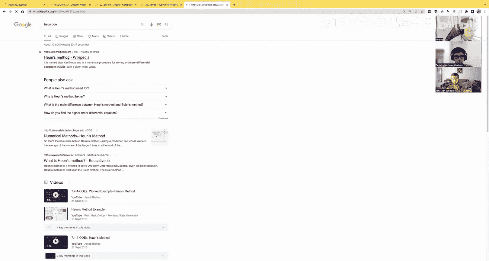

And Hune's method does's something which we can pictorially see here to decide where to go。

 which is basically we say， okay， where are we？Right now， what's the you know， at our current point。

 what's the direction。 So we take the tangent line。

 the slope right that's basically oil it does is it takes the slope。 So it's oh， here's a slope。

 you know， okay， and so。嗯。If we take that slope。And that would take us to a new spot。

And then at that new spot。We can then calculate。A slope at the news spot， as well。

And at the news plot， the slope is。Something else。So that's it here right。And then you say like。

 okay， well let's。Go halfway between the two。And that's actually follow that mine And so basically it's saying like。

 okay， each of these slopes is going to be inaccurate。

 but what we could do is calculate the slope of where we are。

 the slope of where we're going and then go halfway between the two。It's。

I actually find it easier to look at in code， personally。

I just going to delete a whole bunch of stuff that's totally irrelevant to this conversation。

So take a look at this compared to Euler。So here's our Oo right。

 so we're going to do the same first line exactly the same。😊，Then the denoising is exactly the same。

And then this step here is exactly the same， I've actually done it in multiple steps for no particular reason。

嗯。And then say， okay， well， if this is the last step， then we're done。

 so actually the last step is oil。But then。What we do is we then say， well。

 that's okay for an oiluler step， this is where we'd go。m， well。

What does that look like if we dennoise it？ So this calls the model a second time， right。

 and where would that take us。If we took an oiler step there。And so here。

 if we took another step there， what's the slope？And so what we then do is we say， oh， okay， well。

 it's just just like in the picture。😊，Let's take the average。Okay， so。Let's take the average。

And then use that。The step， so that's all the Hu。Sampler does as it just takes the average of the slope where we're at and the slope where the Euler methodic would have taken us。

UAnd so if we now so notice that it called the model twice。For a single step， so to be fair。

 since we've been taking 100 steps with Oola， we should take 50 steps with Hune。😊，G。

 it's going to call the model twice。And still， that is now， whoa， we beat one。

 which is pretty amazing。😊，嗯。And so we could keep going， check this out。 we can even go out to 20。

 This is actually doing 40 model evaluations and this is better than our best Eer。😊。

Just pretty crazy。Now， something which you might have noticed is kind of weird about this or kind of silly about this is where Cat were calling the model twice。

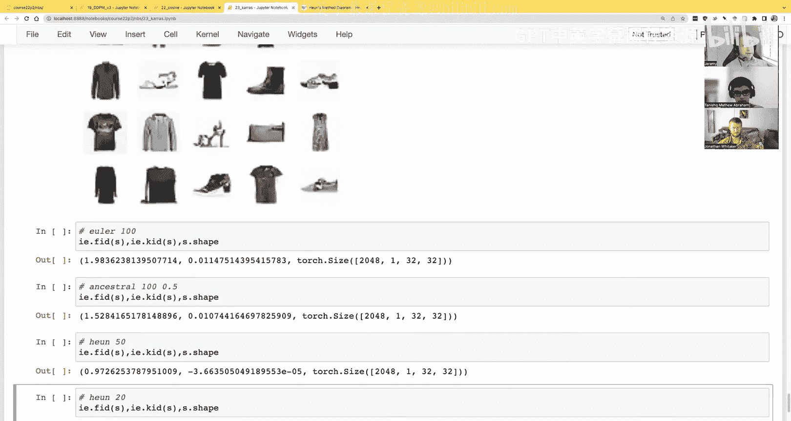

Just in order to average them。But we already have two model results， like without calling it twice。

 because we could have just looked at the previous time step。

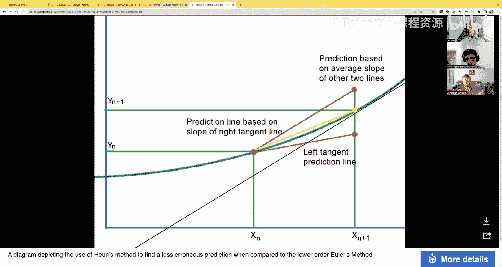

And so something called the LMS sampler does that instead。Tom。And so the LMS sampler。

 if I call it with 20， it actually literally does 20 evaluations and actually it。Bates Euler。

With 100 evaluations。 And so Alas， I won't go into the details too much。

 It didn't actually fit into my little sampling very well。

 So basically largely copied and posted the cat's code。

 But the key thing it does is look it gets the current sig Sigma。 It does the denoisising。

 It calculates the slope。At it stores a slope。And a list。Right， and then。It grabs。

The first one from the list。 So it's kind of keeping a list of up to。This cases four at a time。

And so then uses up to the lust for to basically。Yes。Out of the curvature of this。

 and take the next step。So that's pretty smart。And。Yeah， so you know。

 I think if you wanted to do super fast sampling。It seems like a pretty good way to do it。

 And I think Jono， you're telling me that。Or maybe it the Petro it was saying。Yet currently。

 people have started to move away that this was very popular。

 but people started to move towards a new sampler， which is a bit similar called it。

TPm plus plus simpler， something like that。Yeah。Yeah， yeah， yeah。But I think it's the same idea。

 I think it kind of keeps a。As said pick a list of recent results and use that。

I'll have to check it more pleasantly。 with the look code。 Yeah， that similar idea。 It's like。

 if it's done more than one step then it's using。S mystery took Yeah， next thing。 Yeah。

 this this history， anything doesn't make a huge amount of sense， I guess from that perspective。

I mean still works very well。 this makes more sense。 So then， you know。

 we can compare if we use an actual mini batch of data。They got about 。5， so。Yeah。

 I feel like this is。Quite。It， you know， stunning。Result。The cat。Close to very close to real data。

This in terms of fit。You know， really with。40 model evaluations。And the entire， you know， the。

 you know， the but nearly the entire thing here is。By making sure we've got unit variance， inputs。

 unit variance， outputs and kind of。Equally difficult problems to solve in our loss fact。Yeah。

 thus having that different schedule for sampling that's completely unrelated to the training schedule。

 I think that was one of the big things with Carsitels paper was they also could apply this to like。

 oh， existing diffusion models that have been trained by other paperspers。

 We can use our sampler and in fewer steps get better results without any of the other changes And yeah。

 I mean， they do a little bit of rearranging equations to get the other papers versions into their C skip C and C outs framework。

But then yeah it's really nice that these ideas can be applied to so for example。

 I think stable diffusion， especially version1 was trained， DDPM style training， epsilon objective。

 whatever， but you can now get these different samplers and different sampling schedules and things like that and use that to sample it and do it in in 1520 steps and get pretty nice samples。

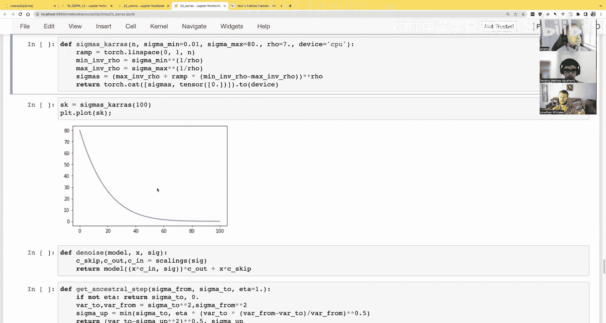

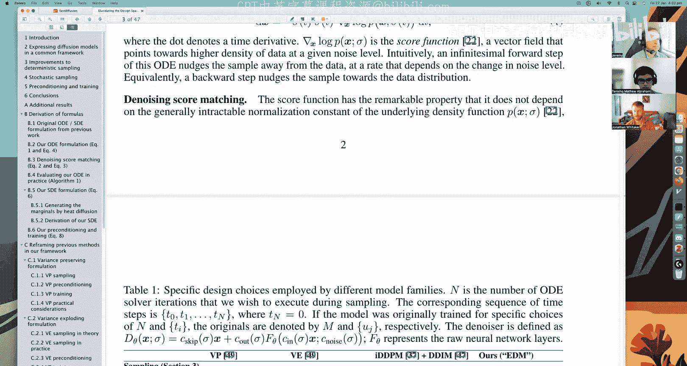

Yeah， you know， and， and another nice thing about this paper is。第。You know， in fact， it's。

 it's the name of the paper elu elucidating the design space of。Diffusion based models。You know。

 they looked various different papers and approaches and trying of said， like， oh， you know what。

 These are all doing the same thing。When we kind of。Aramateurize things in this way。

 And if you fill in these parameters， you get this paper and these parameters， you get that paper。

 you know， And then so we found a better set of parameters。嗯。Which。It was very nice。To code。Because。

Did I really actually ended up simplifying things。A whole lot。

 And so if you look through the notebook carefully， which I hope everybody will。嗯。You'll see。

You know that the code is。Really， the air and simple compared to。Previous， all the previous ones。

 in my opinion， like I feel like every。Notebook we've done from DDPM onwards the code's got。

Easier to understand。And the results interested。And just to again clarify like how this connects with some of the previous papers that we've looked at like for example。

 with the DDIM， the deterministic， that's again this sort the term Germanministic approach that's similar to the oiler method sampler that we were just looking at which was completely deterministic and then some of something like the oiluler ancestral that we were looking at is similar to the standard DDPM approach with that was kind of a more stochastic approach。

 so again there's just all this sorts of connections that then kind of nice to see again the sorts of connections between the different papers and how they changed it how they could be expressed in this common framework。

Yeah。Next to Nsh。嗯。So we definitely now are at the point where we can show you the unit next time。

And so I think we're。Unless any of us come up with interesting， new insights on。And the the。

Unconditional diffusion， sampling， training and sampling process。

 we you know might be putting that aside for a while。

 and instead we're going to be looking at trading a good quality unit。

From scratch and we're going to look at a different data set to do that。

As we're starting to scale things up a bit as John I mentioned in the last lesson。

 so we're going to be using a 64 by 64 pixel。Imagenet subset。Called tiny image net。

 So we'll start looking at some three channel。Images， so I'm sure we're all sick of looking at。

Black and white shoes。 So now we get to look at。呃。Tft dwellings and trolley buses and koala bears。

 And yeah。200 different things， So that'll be nice。嗯。Yeah， al right。 Well， thank you， Jodo。

 Thank you， Tani。 That was fun， as always。 And yeah， and。😊，Next time will be lesson 22。

Bye listen to2。 This was listen 22。 Oh， no way。 Okay， You're right。 By。Let's say yeah， goodbye bye。

