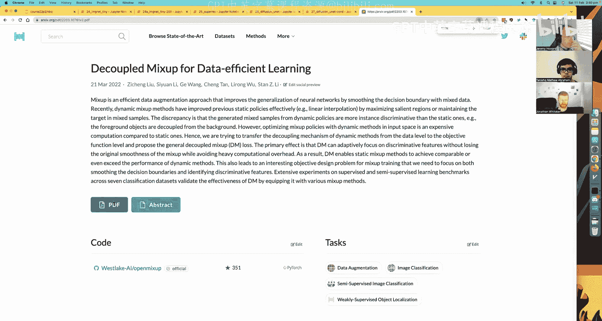
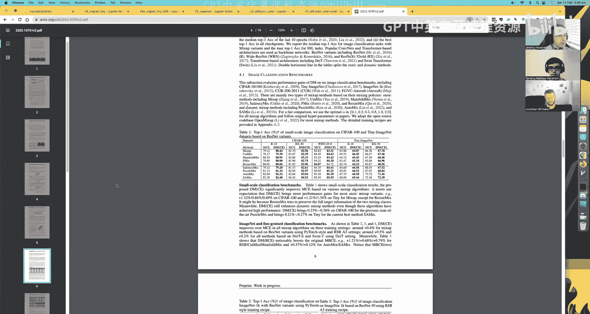
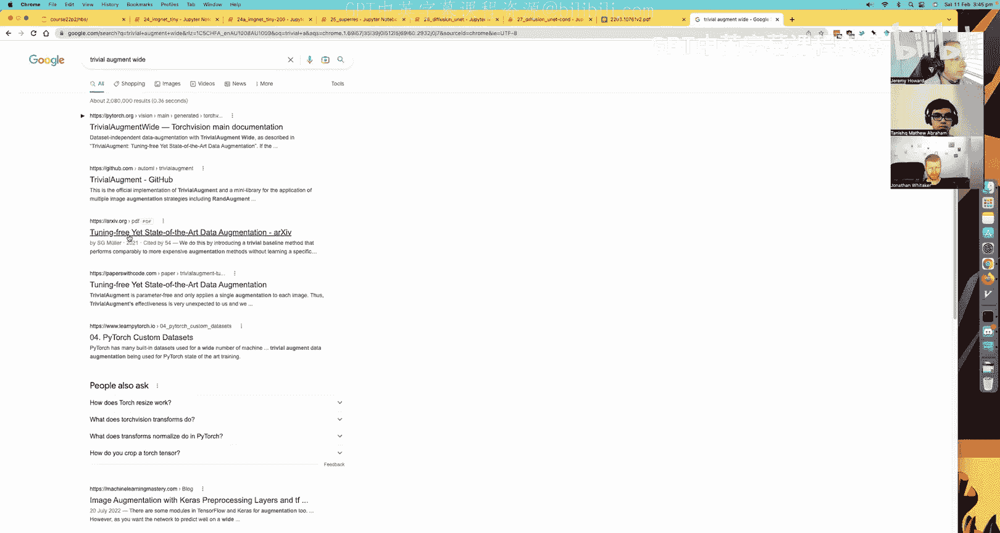
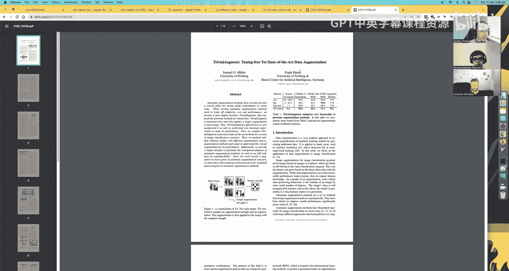
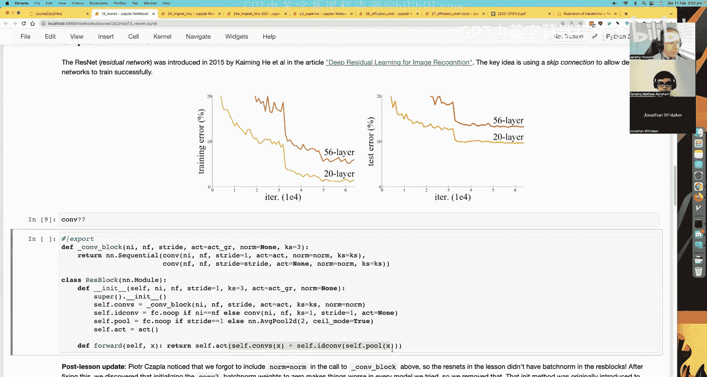
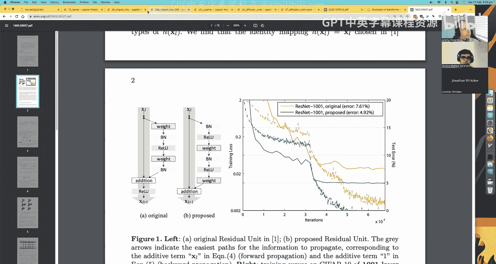
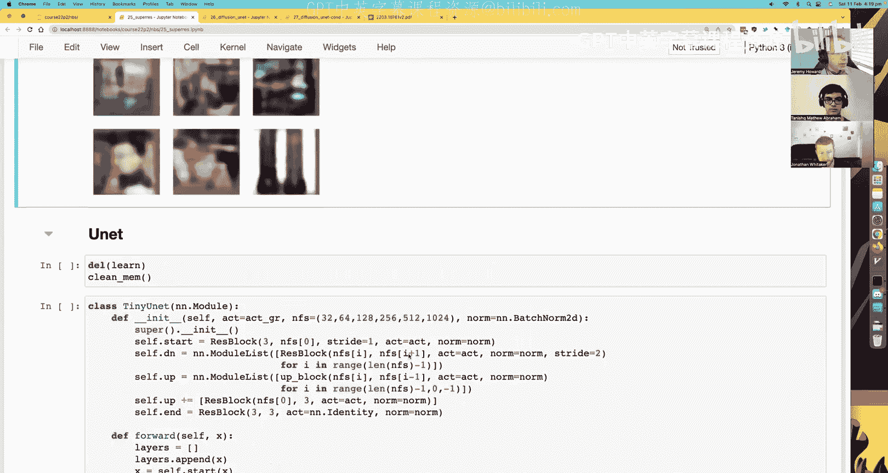
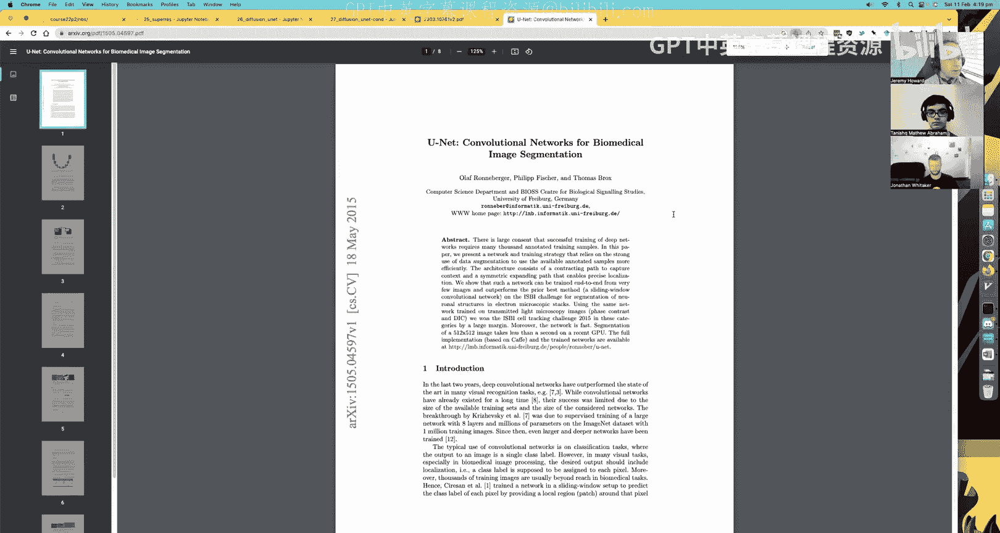
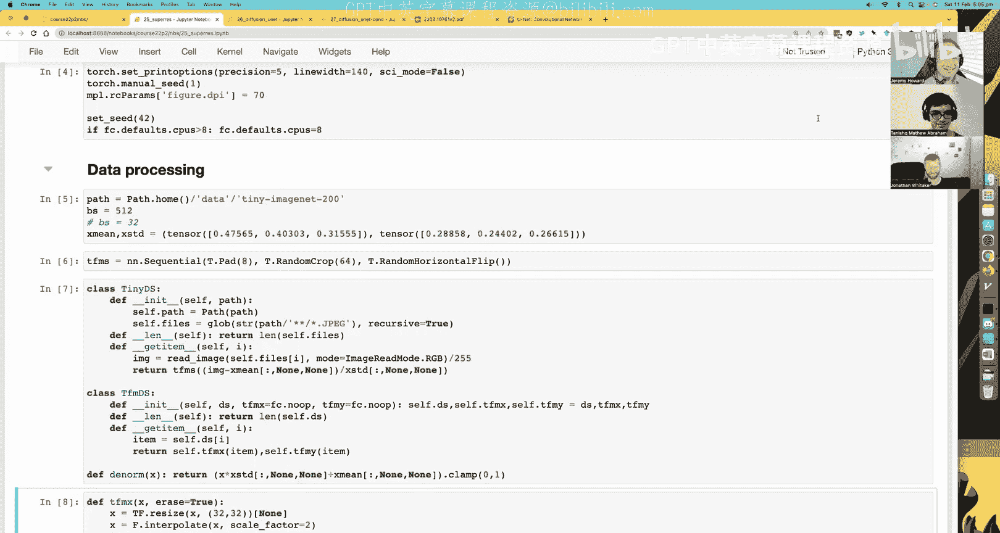

# Jeremy《深度学习基础到稳定扩散模型｜Deep Learning Foundations to Stable Diffusion》中英 p17 Lesson 23_ Deep Learning Foundations to Stable Diffusion.zh_en -BV1Mp421S7xg_p17-

Hi everybody， today we are covering lesson 23 and we're here with Jan O Antonishsh。

 how are you guys both doing？Doing well， excited for another lecture， for adolescent lesson。Yeah。

 likewise。Great。Shamefully have to start with admitting to a bug。Which。Actually is rather well。

 I don't know， it kind of messed up things in a sense， but I'm kind of。

 I think it's really interesting actually what happened。😊，The the bag。It was in Note 23。

 the Cars notebook， and it's about measuring the FID。So to recall， FID measures how similar。

A bunch of samples are from a model to a bunch of samples of real images and that similarity is defined in this kind of like some kind of distance between the distributions。

Of the features in a classifier or some kind of model。So that means that to get fed， we have to。

L a model。And we have to pass it。Data loaders so that it can calculate what the samples look like from real images。

Now， the problem is that the data load is always passing。

Actually had images that the pixels were between negative 0。5 and positive 0。5。

 but you might recall this model that I trained has pixels between negative  one and one。

So what this。Image eval class would have seen and specifically this this C model。

 which we are putting， which we are getting the features from it it would have seen a whole bunch of。

Unusually low contrast images。So they wouldn't really have looked like many things in the data set because they in fact。

 in the data set， I think， particularly for fashion Mnesist things are pretty consistently。

You know normal in terms of going all the way from zero to one or negative one to one。

 I guess zero to 255 in the original。嗯。And so as a result。

 I think what would have happened is that the features。

That came out of this but have been kind of weird and they might not have necessarily consistently said oh。

 these are t shirt features and these are。Shoe features， but they would have said， oh。

 this is a weird， low cast， low contrast image feature。And so then。

The shame continues in that I added another bug on top of this bug。

 which is when I then did the sampling。系。Didn't。I didn't multiply by two and the data that I trained it on was actually the same data loaders or that well the specifically the same transform。

 the same noise if I transform。嗯。Well， where did it come from， it's the same。Yeah。

 the same transform I， not noiseer I， the same transform I which yeah previously was point from 0 negative 。

5 to 0。5 so I trained the model using this restricted input space as well and therefore it was spitting out things that were between negative 0。

5 and 0。5。And so the FID then said， wow， these are so similar。

 the samples are consistently spitting out features of low contrast things and all of the real samples are low contrast things。

 So those are really similar。 and that's how we got really。

Low numbers so those lung numbers are wrong。 So I was a bit surprised。

 I guess that that the ks model was doing so much better and it certainly had made me a big believer in the Kaas model。

 but actually it's not doing so much better。 So once we fix that the FDs are actually around。😊，fi。6。

5。And the reels are two and a half。诶。So to compare。

We were getting some pretty good results in cosine。 So cosine， yeah， we were getting three。😊。

For depending on。How many steps we were doing DDAM？

So the result of this is that this somewhat odd situation where the cosine model。Where we。嗯。

Scaled it accidentally to be negative 0。5 to 0。5。And then。嗯。Post sampling multipplay by2。

 so we're not cheating like the caras one used to be is working better than caras。

 which yeah is a surprise。To me because I was thinking Caros was kind of like。In theory。

Optimally scaling things， but I guess the truth is it was scaling things to unit variants。

 but there's nothing particularly to say that's optimally scaling things and so empirically we've found。

Kind of accidentally。A better way。To scale things。 And also our。Depenent variable is different。

 you know， our dependent variable is not that caras， you know， C mix combination。

 but our dependent variable is just。The the noise， the zero， one noise， you know。

 the noise before it's multiplied by alphabe。Okay， so that's the bug。嗯。Anyway。

 I promised last time we would stop looking at fashion M for a while， so let's move on。

To tiny image net so。And the reason we're going to do this is because we want to。

 I want to show an example of we've got to tra create units today。

 and I wanted to show an example of a nice unit we can create that combines a lot of the ideas we've been looking at。

 it's going to be a super resolution。You and doing super resolution on fashion emist isn't going to be very interesting because the maximum training size we have is 28 by 28 so。

So I thought we'd go a little bit bigger than that to tiny image net， which is 64 by 64。😊，嗯。

I found it quite difficult actually to find。Tiny image net data。

 but eventually I discovered that it's still on the Stanford servers where it was originally created。

 it's just not linked to anywhere。So we'll try to if this disappears。

 we will keep our forum and website up to date with other places to find it。Anyway。

 so for now we can。Grab the URL from there and。Unpack it so SUT is a very handy little library inside the Python Standard Library and one of the things it has is a very handy unpack archives which handles it fails。

And it's going to put it in our data trajectory。So I， yeah， just you know。

 there's a few different ways we could process this and I thought we might experiment some things。

 but I thought， yeah but it wouldn't be a bad idea to。Try doing things。

The reasonably kind of manual way is to see， you know。

 what that looks like and often this is the easiest way to do things because。You know。

 that's a very well defined set of steps right so step one is to create a data set so a data set is just literally something that has a length。

And that you can index into it， so it has to have these two things to find。

You don't have to inherit from anything， you just have to define these two things。

Broadly speaking in Python， you generally don't have to inherit from things。

 you just have to provide the methods that are expected。U。So our data set。

Is in a directory called tiny imageage Ne 200 and then there's a train directory and a valve directory for the trading and the validation set and then the train directory。

 this is pretty classic normal thing each category。So this is a category。Has images in。

A separate folder。And specifically， they're an images subfold。

 so what I wanted to do was to just grab start with grab all of the files in。

Hath slash train or the image files， so the Python Standard Library has a Gob。Function。

 which searches recursively if asked to。For everything that matches this， well， this。

Spificationation so this specification is path slash star。

jpeg and then this star star here I don't know why we need to do it twice it's a bit weird that you also need that to be recursive so to be recursive you both have to say recursive true here and also put star star before the slash here so it's going to give us a list of all files inside path train。

U。And so then if we index into that training data set with zero。

 that will call get item passing an i of zero。And so we will then return a tople one is。

The thing in soft dot files I。Which is this file。 and then the label for it and the label is。That。

So it's the parents' parents name。Parents， parents。Name。And so that's the name。Okay。

 so there's a data set that returns two strings when you index into it a couple of two strings。

 the first is the name of the image file the so the path of the image file and the second is the。

Name of the。Category it's in these weird names are called word net categories。

 They're like codes that indicate。Concepts basically in English。

So one of the reasons I actually used。This particular data set is because it's going to force us to。

Do some more data processing， which I think is good practice。And that's because weirdly。

 in the validation set， although it's in tiny image net 200 slash vowel， which is the not weird part。

 The weird part is that they are not then in。Subdirectories organized by label。Instead。

 there is a separate。ValAnnotations。text file。Which looks like this， so it says for each file name。

What category is it？It's also got the bounding box of whereabouts that is。

 but we're not going to be using that today。So I decided to create a dictionary。

That would tell us for each。快我。What category is it in？

So that means that I want to create a in this case here I'm doing something exactly like a list comprehension。

 but because it's not in square brackets， it's a generator comprehension， so it'll generate。

They kind of stream out the the results and we're going to go through each line in。This file。

And we're going to。Split on tab。So that's going to give us this and then this and then this and then we're to go to graph of first two。

And if you basically past a。List of lists or list of tuples or whatever to d。

 it will create a dictionary。Using these pairs as key values。So if we have a look。There it is。

So that's quite a nice， neat way。To do it。And if you're not sure， you can just click type deck。

 type Open brackets， and then hit shiftft tab a couple of times and it'll show you the various options。

And you can see here I'm doing dict iterable because my generator is iterable and it says， oh。

 that's exactly as if you created a dictionary and then gone4 Kv in iterable Dk equals V。

So there's a nice little trick， okay？嗯。Now。We need a data set。That works just like tiny data set。

 but the get items are going to label things differently。So I just inherited from tiny data。

 so that means we don't need to do in it or then again and then get item again it's going to turn the oh file。

this time the label will not be the parent parent name but。

We will look up in the Annotations dictionary。The name of the file。And so that works。

We can check the length works。So then a fairly generally useful thing that I thought well then create is something that lets us transform。

Any data set。So here's a class you can pass it to data set。

And you can pass it a transformation for the X or the independent variable and you can pass it a transformation for the Y。

 and both of them default to know up that is no operation so it just doesn't change it at all。

So a transform data set， the length of it。Is just the length of the original data set。

But when we call get item， it'll grab the tuple。From the data set we passed in。

And it will return that tuple， but with transform X and transform Y applied to it。

Does that make sense so far？对。嗯。Okay。So I don't like working with these N030 things。

 but the data set luckily has a WordNe IDs file。In it。嗯。So if I just opened it up。Oh。

 sorry this one actually is not quite going to help us。

 This is just a list of all of the word net Is that they have images for。

 We could have actually got this by simply grabbing。By listing this directory。

 it would have told us all the Is， but they've got they've also got just a。

The text file containing all of them， so we can see that there are。300 categories。ok。嗯。

And that's useful because we're going to want to change n0，3，0。

 etca into an int and the way we can change it into an int。Is by simply saying， oh， we'll call。

 we'll call this one0 and this one，1 and so forth。 right， So they're kind of the。

Ent to string or I D to string version of this is literally this list。 So 0 will be that that。

But the string to int version， where you do this all the time is basically enumerate。

 so that gives us the index and the value for everything in the list。

So those are going to be their keys and values， but actually we're going to invert it to become value column key。

And that's what drew to ID will be。 So note here that we have a dictionary comprehension。

 you can tell because it's got curly brackets。And a colonlon。

 and so here's our dictionary comprehension。 so we could have used that。For this as well。

 we could have done a dictionary comprehension。Instead， but yeah。

 so there's lots of ways of doing things， none of them's any better or worse than any other。Okay。

 so that's the the those word tag or whatever do we have the the names for for them or is that something certainly get the names I'm going to get to。

Yes， shortly， there's a words not text， so yeah。Allright。

 I grabbed one batch of data and grabbed its mean and standard deviation。

 and so then I've just copied and pasted them in here。Fhenomealizing。

So my transform X is going to be I'm going to read the image。Um， if you read it as RGB。

 that's going to force it to be three channels because actually some of them are only one channel。

Divided by 255， it'll be between0 and1， and then we will normalize。And then for our Ys。

 we will go through Ste ID to get the ID and just use that as our tensor。So。It's， you know。

 doing it manually is actually pretty straightforward。

 right because now we just pass those to our TFM Ds， our transformed data。And we can check that。

You know， you can see。Y i。Is a tense server， but we can look at that particularly's。Value and Xi。His。

An image tenses， sir。With straight channels。So channel by hype by widths has his novel for Pyage。

So you're showing images， it's nice to denormalize them， so that's just deormalizing and so if we。

Show the image that we just grabbed it' say water jug， I guess。All right。

 so now we can create a data loader for our training set， so that's going to now。Transformed。

Training data set。And passing batch size， his son has to be shuffled。嗯。

Not sure why I put numb work as equals zero there。Generally8's pretty good if you've got at least a cause。

Yeah， so we can now grab an X batch and a Y batch。And take a look at a deormalized image from there。

 so there we've got a nice little kitdie cat。So I think this is already looking better than fashion Amnesest。

Yeah， so this is thing。Words dot text that they've also provided。

 and this is actually a list of the entire。嗯。Wordnet hierarchy。

So the top of the hierarchy is entity and one of the entity types is a physical entity or an abstract entity。

😊，Entities can be things。And so forth， so this is how wordnet is。😊，Yeah。

Handled so this is quite a big file， actually。😊，So， if we go through each。

Item of that file and again， split on tabs。嗯。Because。Split on tabs。

 that's what back slash T means is going to give us the wordNe ID and then the name of it。

So now we can go through。All of those。They call them sunsets。

And if the key is in our list of the 200 that we want， we'll keep it。And。

we don't really want like causal agent comma， cause comma， causal agency。

 the first one generally seems to be the most normal， so I just split on comma。Andrupt the first one。

U。All right， so that's so we could then go through our wide batch and just。

Turn each of those numbers into strings and then look at each of those up in our syn sets and join them up。

And then use those as titles to see our Egyptian cat and our cliff， guacamole。

It's a monarch butterfly。And so forth。And you can see that this is going to be quite tricky because like a cliff versus a cliff dwelling。

 for instance， could be quite。😊，You know， complicated。

I have a feeling for this day intentionally like 100 or。😊，Um。

Cate might have come from the normal image net and I think they might have then picked 100 that are designed to be particularly difficult or something if memory serves correctly。

嗯。All right， so then we could define a transform batch function with the same basic idea。

And that's just going to， yeah， transform the x and the y in a batch。诶。Oh yes。

 we're about to use that I should move that down a bit because we're not quite there yet。 Okay。

 so before that we can create our data loaders We created a get Dls back in an earlier lesson which simply turns that into a data loader and that into a data loader and this one gets shuffled and that one doesn't and so forth Oh I see this is where we do well none workers cool。

嗯。All right， So then。Oh， yeah。 So then we want to add our data augmentation。

 So I I noticed that training a。Tiny image net model。 I mean。

 it's it's a much harder thing to do than fashion Mnst。U。And。

Overfitting was actually a real challenge。😊，And I guess。It's because 64 by 64 isn't that many pixels。

诶。So yeah， so I found I really needed data augment to make much progress at all。Now。

Very common data augmentation is called random resize crop。

 which is basically to pick like one area inside and then zoom into it and make that your image。

But for such low resolution images， that tends to work really poorly。

Because it's going to introduce a lot of kind of blurring artifacts。So instead for small images。

 I think it's better too。Add a bit of padding around them。

And then randomly pick a 64 by 64 area from that padded area， so it's just going to shift them。

Slightly， it's not a lot of augmentation， but it's something。

And then we'll do our random horizontal flips， and then we'll use that random array thing that we created earlier。

诶。This is just something I was experimenting with。So yeah。

 so now we can use that batch transform callback。Using transform batch passing in those transforms。

So with torch vision transform， so this capital T is torch vision transforms。

 yeah because these are all。Nn dot modules， you can pass them to Nn。

sequential to just have each of them called one at a time in a row。There's nothing magic about this。

 it's just doing function composition we could easily create our own。

In fact also the transform stock compose。It does the same thing。 Yeah， I' was going to say。

 so we've got a fast。Fastco dot compose， which as you can see。

 basically it just says for f in funks x equals f of x。嗯。Yeah， I don't know is there is there's a。

 yeah， torch。Borch visionion compose， I think might be kind of the old way to do it， I that right。

 I'm not sure I have a feeling maybe this is considered the better way now because it's kind of scriptable。

I'm not。Promising that， though。But yeah， that's basically the same thing。Okay， so yeah。

 we can now create a model as usual。嗯。Okay， so basically I copied the get model with dropout get drop model from our earlier。

Tiny sorry， our earlier fashion emist stuff。Um。And I， yeah， started with。Cnel size five convolution。

And then， yeah， a bunch of wrist blocks。诶。嗯。Yeah， so this is all what we've used to seeing before。

And so we can take a look in this case， as it quite often seems to be the case。

 we accidentally end up with no random asing， let's run it again。嗯。

Really doesn't want to do random raising。 Here we go。 So there we can see it。 So yeah。

 there's this very small border you can hardly see sometimes and a bit of random raising。

 and it's been done。You know， all of the batch is being transformed or augmented in the same way。U。

Which is kind of okay， it's certainly faster。It can be a bit of a problem if you have like。

One batch that has lots and lots and lots of augmentation being done to it， and it could be like。

Really hard to recognize。 and that could。Or is the loss to be a lot in that batch。

 And if you're been training for ages， that could。Kind of jump you out of the。嗯。

You know the smooth part of the loss surface that's the one downside of this。

 so I'm not going to say it's always a good idea to do augment at batch level but it can certainly speed things up。

A lot if you don't have heaps of CPUs。诶。All right。You can use that summary thing we created。

 there's your model。嗯。And yeah， because we're increasing the doubling the number of channels as we're decreasing in the grid size。

 a number of megaflps per layer is constant， that's a pretty good sign that we're using compute throughout。

So yeah， then we can train it with Adam W。Mix precision。And our。Organations。

 so I then did the learning rate finder。And trained it for 25 epochs。And got。Nearly 60%。

 59% and yeah， this took quite a while actually to get close to 60% I've got to admit it and you can see。

The training sets already up to 91， so we're kind of on the verge of overfitting。诶。Okay。

 so then I thought， all right。How do we do。Better。And I wanted to of have a sense of like how much better could we get。

 and I kind of tend to like to look at papers with code， which is a site that shows。

Papers with their code and also like how good a results did they get。

 So this is the the image classification or tiny image net。

 and at first I was like pretty disheartened to see all these like 90% plus things。

 But as I looked at the。😊，Papers， I realized something。

 well the first thing is I noticed that these ticks here。

Represent extra training data so these are actually。

Three trained models that are only fine tuned on tiny image net， so that's a total ch。

And then I looked more closely at this one and actually these are also using pre-train data so papers with code is actually incorrect and so the first ones I could see which I could clearly kind of replicate and make sense of was this one so the highest one that I'm confident of is is 72%。

嗯。And so then。I kind of wanted to get a sense of her right how。

You know。How how much work is there to get from like 60% to 70% and how good is this？

诶。So I opened up the paper。And so here's tiny image net。

And they've got like basically this paper turns out to be about a new type of mix up data augment this is the normal kind of mix up and this is their special kind of mix up and on a resNe 18 yeah I see they're getting like 6364 or 65 with various different types of mix up and kind of 64 or 65 for their special one and then if they use much bigger models than we're using they can get up to 66 is so that kind of made think okay this classifier is。

Not。Not bad， but there's clearly room to improve it and I can't help myself， I always have to try to。

Do better so this is a good opportunity to learn about a trick that is used in real resnets。

Which is in a real renet， We don't just say。嗯。How many filters or channels or activations per layer？

And then just go through and do her。You know， try to con of。H time。But instead。嗯。You can also say。

A number of。Resbs。系。Her kind of down sampling layer， so this would say do three res blocks。

And you know then downs samplele or downs samplele and then do three res blocks or something like that or'll do three res blocks the first of which or the last of which is a down sample and then two res blocks with a down sample and then two res blocks of a down sample so this has got a total of one。

 two， three， four， five down samples。But it's got rather than having one，2，3，4。

5 res blocks it's going to have three，4，5，6，7，8，9 res block。

 so it's nearly twice as deep and so the way we do that is we just replace the places it was saying res block with res_ blocks。

And that's just a sequential。Which goes through。😔，The number of。Fox。And creates a re block。

And you can do it a couple of ways in this case。I said， if it's the last。One， then make it straight2。

 otherwise straight one。 So it's going to be。Down sampling at the end of each set of res blocks。

So that's the only thing I changed， I changed Resblock to Resb and passed in。The number of blocks。

 which is this。Okay， so。So the number of megaphps is now 7，10。Ih， which is。More than double， right？

Should should have more opportunity to learn stuff， which also could be more opportunity to overfit。

嗯。So again， we do L find。And yeah， so I just did 25 e plugs。

 and I didn't actually add more augmentation。嗯。Okay， and that got up to nearly 62。😊。

So that was a good improvement。嗯。And， you know， interestingly。It's not overfitting more。

 it's actually if anything or less， which you know， there's something about it's。

Ability to actually learn this， which is。Slowbbing it down or something。嗯。So I thought， yeah。

 it' would be nice to train it for longer。So I decided to add。More。Augmentation。And to do that。

 I decided to use something called trivial augmentug。Which is not a very well known。Approach。

 but it deserves to be。嗯。

And it comes from Frank Huutter's lab， Frank Hutter is somebody who consistently creates extremely。

Practical useful improvements with much less of the。Nonsense that we often see from。

Some of the huge well funded labs and so this one's kind of a bit of a reaction to some previous approaches such as one called auto augment one called R augment they might have both come from Google brain I'm not quite sure where they kind of used lots of like。

You know， many， many thousands of TPU hours to like optimize。

how every image is you know or how how each set of images is is augmented and yeah what these guys did is they said。

 well what if we don't do that but we just randomly pick a different augmentation for each image。嗯。

And that's what they did， they they just said。TheA one is the procedure， pick an augmentation。

 pick an amount。Do it。I feel like they're almost kind of like。

Trying to make a point about writing this algorithm here。😊，嗯。嗯。Yeah。

 and they basically find this is at least as good or often better。😊，Actually。

 then the incredibly resource intensive ones， the incredibly resource intensive ones also kind of require a different version for every data set。

 which is why they describe this as tuning free。So rather nicely， and surprisingly for me。

 it's actually built into paytorrch。嗯。So if we go to Pytorrch's website and get a trivi augment wide。

嗯。Yeah， they show you some examples of trivial oil meantwide。We can create our own as well。Now。

 the thing is， I found that doing this at a batch level worked poorly。

And I think the reason is what I described earlier， I think sometimes it will pick。

A really challenging augmentation to see on， you know， and at all。

Totally don't mess up the loss function and if every single image in the batch is like that then it all。

Shooted off into the。Distant parts of the of the。Wight area。

Which is a good excuse for me to show how to do augmentations on a per item level。嗯。Now。嗯。

These actually require， or some of them require having a PL image。

 the Python imagingaging library image。Not a ten。So I had to change things around。😊。

So we have to import image from PL。嗯。And we have to change our。T from X now。

 and we're going to do the augmentations in there instead for the training set。

So for the training set。We're going to say one fact for both so we're going to pass in something is do you want to do augments so for the training set we're going to pass allg equals true and for the validation set we won't。

So yeah， we so image。 open is how you create a PL image object。And then if we wanted augmentations。

 then。Do these augmentations。And then convert it into a tensor。

So torch visionion has a do ten so we can then call。

And then we can normalize it and actually I decided just to use torch fis。

 normalize the mint eithers fine or this one works well。And then again， if you want augmentation。

 then do your round arrays。And if you remember， our round array was designed to kind of use。

0ero1 distributed Gaussian noise， so you want that to happen after  normalization。

So that's why I do this order。So， yeah， so now we don't need to use the。Batch Trim thing。

 we're just doing it all directly in the data set So you can see， you know。

 you can do data augmentation。In very simple。wayays without almost any framework help here in fact we're really not we're not doing any and nothing's coming from a framework really it's just yeah it's just this little TfM DSs we made。

And so now yeah， we just pass that into our data loaders， get Dl。

 and we don't need any augmentation callback。嗯。All right， so now。We can keep improving things。

By doing something called pre activation resonancesonates。So if we go back to our original resNe。

You might recall。😔，That the way we did it。We have this con block， which consists two convolutions。

E a row。The second one has no activation and to remind you what conV is。Is that we。First of all。

 do a conv and then optionally we do a normalization and then optionally we do our activation function。

嗯。So。We end up and then the second of those has act equals none。

 so basically what this is saying is go convolution， norm activation， convolution norm。

That's what self。com is。And then this is the identity path。

 so this does nothing at all if there's no down samplingling or no change of channels。

And then we apply the activation function， the fine activation function to the whole thing。

So that was how the original res block was designed， which is kind of a bit of an accident because I。

To be honest， when I wrote that， I didn't bother looking at the paper I just did whatever seemed reasonable in my head。

But yeah， then looking into it further， I looked at this slightly later paper by the same author of the Resnet paper Coming her。

And。嗯。Himming her at Al Dr， you know this。This version here on the left， as you can see。

 it's con normm value， conv normm。Add。Really。And yeah， he basically pointed out。Yeah， you know what。

 maybe that's not great because the value is being applied to the addition。

 so there isn't actually really an identity path at all。

So wouldn't it be nice if we could have a pure identity path？And so to do that。

 he proposed reordering things to go Nomrehan Nomhan。Addd。

And so this is called a pre act or pre activationivation res block。嗯。

So that means I had to redefine conv。To do norm， then act and then conf。😔。

So my sequential now has the activation in both places。嗯。And so yeah， other than that， oh。

 and then of course， there's no activation happening in the Res blocklock because it's all happening in the cons。

😊，Does that make sense？That makes sense， yeah cool。

So this is now the this is exactly the same except we now need to have an activation and a batch norm after all those blocks because previously it finished with an activation a norm and an activation now it starts with them so we have to put these。

At the end， it also means we can't start with a res block anymore because if we started with a res block。

 then it would have an activation function at the start， which would throw away half of our data。

 which would be a bad idea。So you've got to be a very careful with some of the details， but yeah。

 so now you can see that each。Amage is getting its own augmentation。 And so this one's been shared。

 looks like it's a door or something， because it's very hard to tell what the hell it is。

 It's been shared。 This one's been。Moved。looksSo this one's also being shared。😔。

And you can also see they've got different amounts of random arrays on them。嗯。So yeah。

 so I thought I' trade change training that for 50 epochs。And。That got us to 65%， which。嗯。Is。

You know， as good as nearly as good as the。You know。

 normal mix up things they getting even on a reson 50s， this is really good。嗯。

So I won't spend time on this， but Ill just mentioned I was kind of curious like I mean。

 one of the things I should mention also is they trained all these for 400 epos。

So I was kind of curious what would happen if we trained it a bit longer。

 I wasn't patient enough to train it for 400 epochs， but I thought I could do。200 epochs。

 so I just duplicated that last one。But made it 200 epos。And。That got us to 67 and a half。Wch。Yeah。

 is。Better than any of their， nonspecial。Ex ups。So I think it just goes to show you can get you know genuinely state of the art results so if we use their special mixup that would be interesting to try as well see if we can match their results there。

 but you know we've built all this from scratch we didn't do the data augmentation from scratch because it's not very interesting but。

Yeah， that wasnt that。嗯。So I think that's really cool。

So I know that you did some other experiments with the preactivation， right？Yeah。😊，Right。

 when I saw that when I saw the。Rereactivation success， I was quite enthusiastic about it。

 so I actually thought like， oh， maybe I should go back and actually use it everywhere。😊，嗯。

But for but weirdly enough， I think it's weird like it was worse for fashion Mnsestt and worse for like。

Less data augmentation。I mean， maybe it's not that weird， but because。😊。

The idea of when her et Al introduced it， they said this is to train deeper models， you know。

 there's a more pure identity path。And so with that more pure identity path that。

That should kind of let the gradients flow through it more easily， and so there should be a smoother。

Surface， weight surface， lost surface。So yeah， I guess it makes sense that you don't really see the benefits on less deep models the bit I'm surprised to you the elaborate because like it seems like that should be that that sort of justification should be true for smaller models。

 right or Yeah， it does， but smaller models。嗯。Are going to have a less bumpy surface anyway。

 they've just got less dimensions to be bumpy on and。There's less more importantly。

 they're less deep， so there's less room for gradients to explode exponentially。

So they're not as sensitive， but yeah I。I can see why。They don't necessarily help as much。

 but I don't have any idea why they were worse and they were quite consistently worse。Yeah。Yeah。

 I find it quite interesting too。Yeah。Yeah， it's quite curious。

And it's interesting that when we do these like。😊，Experiments on things that nowadays are considered pretty fundamental and foundational you kind of。

All the time， discover things that nobody seems to have noticed or written about or there's plenty of room to。

As a kind of a more experimental researcher to do experiments and then go you're like， oh。

 that's interesting and then try and figure out what's going on。Yeah。

I think a lot of researchers go in the opposite direction and they try to start with like theoretical assumptions and then test them。

But when I think about it， I feel like maybe a lot of the more successful folks in terms of people who build stuff that actually get used are more experimental first。

 maybe。😊，Okay， so。嗯。Shall we have a five minute break？Since we're kind of on the hour。Sure。All right。

 so let's now look at Note 25。😊，Supereds I've just。Oopied a few things from the previous notebook。

 and transforms and。At data sets at de norm。And our Tri and batch。And our tiem X。

Let me sure we using Tin batchch yeah。😔，We're not even using Tin batch。

 let's get rid of that because that's just confusing。Okay， so it looks like we're doing the per。诶。

Let's figure this out。 So what are we doing here， So we've got。Weve got our two data sets。All right。

 so the goal of this is we're going to do super resolution， not classificationification。

 so let's talk about what that means。😊，What we're going to do is the independent variable。

Will be scaled down to a 32 by 32 pixel。Image and the dependent variable will be the original image。

嗯。And so to do。😮，Random crop。Within a padded image and random flips。

Both the independent and the dependent variable needs to have had exactly the same random cropping and exactly the same flipping otherwise。

You can't say oh， this is how you do super res to go from the 32 by 32 to the 64 by 64 because it might be like oh it has to be flipped around and moved around so yes so for this kind of image reconstruction task。

😊，It's important to make sure that your augmentation is done the same way on the independent the dependent variable。

 so that's why we've put it into our data and so this is something people often get confused about and they don't know how to do it but it's actually pretty straightforward if we do it this way we just put it straight in the data。

And it doesn't require any framework fanness。嗯。Now， then what I did do。

Is I then added random erasing。Just to the training set。

And the reason for that is I wanted to make the super resolution task a bit more difficult。

Which means sometimes it doesn't just do super resolution。

 but it also has to like replace some of the deleted pixels with proper pixels and so it gives it a little bit more to do。

 you know， which can be quite helpful it's kind of it's a a data augmentation technique and also something to give it like。

More of an opportunity to learn what the pictures really look like。嗯。Okay。

 so with that in case that though these are going to do the。Padding random cropping and flipping。

 the training set will also add random erasing and then we create data loaders from those。

Would it make sense to use the trivial augment here？The trivialvi augment， did you say yeah？Maybe。

Yeah， I particularly see a reason not to if if if， well， only if you found that。😊，诶。

Overfitting was a problem and if you did do it you would do it to both independent and dependent variables so yeah here you can see an example the independent variables some of the in this case all of them actually has some random arrays the dependent doesn't so it has to figure out how to replace that with that。

And you can also see。That this is very blocky。And this is less blocky that's because this has being gone down to 32 by 32 pixels and this one's still at the 64 by 64 so in fact once you go down that far the cat's lost its eyes entirely so it's going to be quite challenging it's lost its lines entirely so super resolution is quite a good task to try to get a model to learn what pictures look like because it has to yeah figure out like how to draw an eye and how to draw cat whiskers and things like that。

Were you gonna say something Jonno， say。Oh I was just going to point out that the data sets are also simpler because you don't have to load the labels so there's no difference between the train and the validation knowledge just finding all the images good point yeah because the the label you know is actually a dependent variable is just the picture。

嗯。And so。Okay， so because TFM Ds， TfMDs has a TFM X。

Which is only applied to the independent variable。The independent variable has applied to it this pair of ress to  32 by 32。

And then interpolate。And what that actually does is it ends up still with a 64 by 64 image。

 but the pixels in that image。Arl， like doubled up。

And so that means that it's still doing super resolution。

 but it's not actually going from 32 by 32 to by 64 by 64。

 but it's just going from the 64 by 64 where all of the pixels are like two by two pixels and it's just a little bit easier because that way。

😊，We could certainly create a unit that。It goeses from 32 to 64。

 but if you have the input and output image the same size， it can make code a little bit simpler。

I originally started doing it by。😊，Not doing this interpolate thing and then I decided I was just getting a little bit confusing and there's no reason not to do it this way。

 frankly。嗯。Okay， so that's our task and the idea is that then。If it does a good job of this。

 you know， you could pass 64 by 64 images into it and hopefully it might turn them into 128 by 128 images。

 particularly if you trained it on a few different resolutions that you'd expect it to get pretty good at。

We'd all resizing things to a bunch of different resolutions and you could even call it multiple times。

Um。But anyway， for this， I was just kind of doing it to demonstrate。

 but we have in previous courses trained。You know， bigger ones for long go with larger images and they actually do one of the interesting things is they tend to not only do super resolution。

 but they often make the images look better。Because。The kind of the pixels it fills in。

 it kind of fills in with like。What that image looks like on average。

 which tends to kind of like average out。Impmerfections。

 so often these super resolution models actually improve image quality as well， funnily enough。Okay。

 so let's consider。The dumb way to do things we've seen a kind of a dumb way to do things before which is an auto encoder so gowin with low expectations here because we've done an auto encoder before and it was so bad it actually inspired us to create the learner if you remember so that was back in notebook 8。

And so basically， what we're going to do is we're going to have a model。😊。

Which looks a lot like previous models。 It starts with a re block kernel size 5。

 and then it's got a bunch of。Resbs a2。😔，But then we're going to have an equal number of。Uppl。

Now what an up block is going to do？😊，I it's going to sequentially， first of all。

 it's going to do an up sampling nearest 2D， which is actually identical。To this。

RightSo it's going to just double all the pixels。And then we're going to pass that through our res block。

So it's basically a red block with like。A straight of a half， if you' like， you know。

 it's it's it's it's undoing a straight too， it's up sampling rather than down sampling。Okay， so。😊。

And then we'll have an extra re block at the end to get it down to three channels。

 which is what we need。嗯。Okay so we can do our learning rate finder on that。And。

I just train it pretty briefly for five apos so this model is basically trying to take the image that we start then kind of really squeeze it into。

 I guess a small representation and then trying to bring that small representation back up to then the full super resolution exactly right T N and we could have done it。

Without any of the straight two， you know， I guess we could have just had a whole bunch of straight one layers。

There's a few reasons not to do it that way， though。

 one is obviously just the computation requirements are very high because the convolution has to。

Scan over the image。And so when you keep it at 64 by 64， that's a lot of scanning Another is that。

You're never kind of forcing it to learn。Higher level abstractions by recognizing how to kind of like。

You know， use more channels on a smaller grid size to represent it。Um， so yeah。

 it's like the same reason that we in in classifiers， we don't leave it at Str one the whole time。

 you know， you end up with something that's inefficient and generally not as good。Exactly， yep。

 thanks for clarifying to Nsh。😊，Okay， so the loss goes down and the loss function I'm using is just MSC here。

 right， so it's how similar is each pixel to the pixel it's meant to be。

And so then I can call capture pres to get their predictions and the targets and the inputs or probabilities。

 targets and inputs I can't quite remember now。So here's our input images。

So they're pretty low resolution。And oh dear， here's our predicted images。So pretty terrible。

So why is that well？Basically。It's kind of like the problem we had with our earlier auto encoder。

 it's really difficult to。😊，Go from like a two by two or4 by4 or whatever image。

Into a 64 by 64 image， you know， we're asking it to do something that's just really challenging。

 and so that would require a。A much bigger model trained for a much longer amount of time。

 I'm sure it's possible。嗯。And in fact， you know， latent diffusion， as we've talked about。

 has a model that kind of does exactly that。嗯。But in our case。

 there's no need to make it so complicated we can actually do something。Dramatically easier。

Which is we can。Create a unit。

So units were originally developed in 2015。

And they originally developed for。Medical imaging。But they've been used very， very widely。

Sense and I was involved in medical imaging at the time they came out and certainly they quite quickly got recognized in medical imaging they took a little bit longer to get recognized elsewhere。

 but nowadays they're pretty universal。😊，And they are used to stable diffusion。And basically。

Some of the details don't matter here， this is like the original paper。😊。

So let's focus on the kind of the broad idea This thing here is called the we're going to call it the down sampling path。

 So in this case， they started with。572 by57，2 images。

It looks like they started with one channel images。And then they， you know。

 as we've seen then they took them down to 284 by 284 by 128 and then down to 140 by 140 by 256 and then down to 68 by 68 by 5 12。

 32 by 32 by 1024 so here's this downs path right and then the app sampling path is exactly what we've seen before right so we。

Up sample and have some， I mean in the original thing they didn't use Resnets or resb。

 they just use cons， but the idea is the same。嗯。But the trick is these extra things across here。

 these errors， which is。Copy and crop what we can do。😊，Is we can take， so I'll do the up sampling。

We've got a 512 by 5 to12 here sorry a 512 channel thing here。

 we can ups samplele to a 512 channel thing。We can then put it through a con to make it into it。256。

Channel thing。And then what we can do is we can copy across。

The activations from here now they actually do things in a slightly weird way where they're downs they had 136 pixels by 136 and over here they have 104 by 104 so they crop out the scent bit that's because of just kind of like the slightly weird way they did they basically won't padding things nowadays we don't have to worry about that that cropping so what we do is we literally copy over。

です。These activations and we then either concatenate or add and you can see in this case they're concatenating see how there's the white bit and the blue bit so。

They have concatenated the two lots together， so actually I think what they did here is they went from a 52 by 52 by 512 to a 104 by 104 by 256 and I think that's what this little blue rectangle here is and then they had another。

coied out the 104 by 104 by 256 and then put the two together to get a 104 by 104 by 512。And so this。

😊，These activations。Half are from the upsling。And half are from the down sampling。

From earlier in this whole process。And it might be easiest to understand why that's interesting when we get all the way back up to the top。

Where we've got this， sir。39 three by two3，9，2 by392 thing。The thing we're copying across now。Is。

Just two convolutions away from the original image， so like for super resolution， for example。

We want it to look a lot like the original image， so in this case we're actually going to have an entire copy of almost something very much like the original image。

That we can include in these final convolutions。And so Didto here we have you know。

 something that's kind of like the somewhat downsled version we can use here and the more downsled version we can use here。

Yeah， that's， that's how the U。 Do either of you guys have anything to add like things that you found this helpful to understand or。

Anything surprising。I guess it's shaping fascinatingnating thing these days。

 a lot of people tend to just add。 so you've got the。You know。

 the outputs from the down layer are the same shape。

 the inputs full corresponding like up block and then they just kind of add the yeah。

 particularly for super resolution adding might make more sense than concatenating because you're like literally saying like oh。

 this little two by two bit is basically the right pixel but it just have to be slightly modified on the edges。

Yeah， it also makes me think of like a boosting sort of thing where。

If you think about like the fact that a lot of information from the original images being passed all the way across at that highest S connection。

 then the rest of the network can be effectively producing an update to that rather than having to recreate the whole image or to put it another way。

 it's like a resnet， but the a skip connections right but the skip connections are like。

Jumping from the start to the end and a bit after the start to a bit before the end。

And I guess a resonance' is a bit like boosting too。嗯，对。

Yeah I mean kind good thing so yeah basically like I think compared to like the nois on code where like we saw like the results were like even worse than I guess the original image here I guess the worse it could be is basically limit you know I guess it just like sort oftu behind the the re and how that works so yeah I mean it could be worse if these comms at the end are incapable of undoing what these comms did。

 which is like one argument for maybe why there should also be a connection from here over to here and maybe a few more comms after that。

 which is something I'm kind of interested in and not enough people do in my opinion。😊。

Another thing to consider is that they've only got two cons down here， but at this point。

You have the benefit of only being a 28 by 28， you know。

 why not do more computation at this point if you know， so there's a couple of。正识。

Sometimes people consider， but maybe not enough。So let me try to remember what I did。

So in my unit here。So we've got the down sampling path。Which is a list of。Rs blocks。Now。

 a module list is just like a sequential except it doesn't actually do anything。

 So then in the forward we have to go through the down path and。W x equals L x。Each time。

So it's basically yeah， a sequential that doesn't issue do anything and so the up path is exactly the same as we saw before it's a bunch of up blockss。

😊，And then like we saw before， the final one is going to have to go to three channel。嗯。😊，But now。

 for our forward。What we're going to do is we're going to keep track of。

Since we're going to be copying this over here and copying this over here， we have to save it。

Dry the down sampling path。We're going to save it in a。Something called layerss。

So I actually decided to do the little trick I mentioned， which is to save the very first input。

So I saved the very first input。I then put it through the very first whereas block。

And then we go through each。In the downward path。嗯。

AndThere's actually no need at all there to be an IL here doesn't have to be enumerated because we don't use I。

Okay， so we go do through the downward path， so for this L for layer。

 so for each layer in the downward path。Apppend the activations so that again。

 as we go through each one， we're going to be able to copy them over by saving them for later。

And then call thelay。Okay， so how many layers have we got， there's n layers that we stored away。😊。

So now we're going to go through the upsling path and again we're going to call each one。

 but before we do we're going to actually do the thing that John O mentioned。

 which is rather than concatenating unless we're back at unless this is the very first layer because the very first upsampling layer there's nothing to copy。

Okay。😊，So notice it's the very first up sampling layer， it's just add。The saved activations。And then。

 call the la。And then right at the very end。😊，We'll add back the very first layer。

And then pass it through the very last。Reestt plug。诶。All right。

Maybe that last one should be concatenated， I'm not sure anyhow， this is what I did。嗯。Now。

 the next thing that。I wondered about was like， how to。

Iialize this and basically what I wanted to do is I wanted to initialize this so that when it's when it's untrained。

It the output of the model would be identical to the input。

Because like a reasonable starting point for like what does this look like， so yeah。

 what does this look like？Following super resolution would be this。You know。

 that's a reasonable starting point。So I just created this little zero weights thing。

 which zeros out the weights and biases of a layer。All， so I created the model。And then I said， okay。

嗯。Let's look at the very end of the upsling path。And we'll call that the。Last resnet。

And so let's zero out。The very last convolutions。And also the ID connection。 And so that means that。

Whatever it does for all this， at the very end。It's going to have。嗯。Nothing in there。

 this will be zero， so that meanss that this will be E quarter layers zero。

And then that means we also want to make sure that this doesn't change anything。

So then we can just zero out。The whites there。That's probably not quite right， is it？嗯。

I guess I should have actually set those to like an identity matrix， maybe I'll try to do that later。

 but at least it's something that'll be very easy for it to。

I have a question Jeremy yeah this this Sarah weights I see a lot of people do a thing where they instead like multiply by one e minus3 or 1 e minus4 to make the weights really small but not completely zero and I don't have a good intuition whether it's like。

You know， in some sense， having everything set to zero。

Fs off some warnings that maybe this is going be like perfectly balanced on some saddle point or it's not going to have any signal to work with yeah its very small but not quite there random weights might be better Yeah do you have an for that I think so or not so much intuition but more empirical like oh both I don't。

I don't think it's an issue and I think it comes from like a lot of people's PhD supervisors and stuff。

 you know come from back in an era when they were doing like linear regression with one layer or whatever and in those cases。

 yeah all the weights are the same。Then no learning can happen because every weight update is identical。

 but in this case all the previous weights are different so there's。

They all have different gradients and there's definitely nothing to worry about。I mean。

 multiplying it by a small number would work too， like's not a problem that。Yeah。

 setting it to zeros and honestly I。😊，I have to stop myself from， I mean not that's a problem。

 but I just。I always have this natural inclination to not want to set them to zeroes because of years of being told not to。

There's no reason that should be a problem。All right。

I just I was just like and like that unit code is very concise and it's very very it's interesting to see the basic ideas you a very simple and Oh yeah to see that I guess yeah yeah it's helpful I think to just get it into a little bit of code isn't that yeah。

😊，Pex。That's very simple code， too。Okay， so we do a lot of fine and then we。Train。

And you can see previously our loss even after five epochs。There's 207。And in this case。

 our loss after one epoch。Is 086， so it's obviously much easier。And we end up at 073。Okay。

So we can take a look。Is our inputs？And there's our outputs。

 so it's actually better rather than dramatically worse now， so that's good。Yeah。

 some it's actually an not bad at all， I would say。嗯。This car definitely looks like。

 I think it's like a little over smoothed， you know， I think you could say。

 So if we look at the the other guy's eyes， kids eyes still aren't great。Like in the original。

 he's actually got proper pupils。So yeah， it's definitely not。Re created the original， but。You know。

 given limited compute and limited data。Like， the basic idea is。Not bad。

I do worry that the poor koala， like it， it didn't have eyes here， but like。

It ought to have known there should be eyes in a sense， and it didn't create any。

And maybe it should have done a better job on the eyes。😊，My feeling is。

And this is a pretty common way of thinking about this is that when you use mean square error。

 MSc as your loss function on these kinds of models。

You tend to get rather blurry results because if the model's not sure what to do。

 it's just going to predict kind of the average， you know。

So one good way to fix that is to use perceptual loss。And。

I think it was Jonno who taught us about perceptual loss。

 wasn't it when we did the sta transfer stuff？So perceptual loss is this idea that we could look。

 it's kind of similar as well to the the F idea we could look at the。

Some intermediate layer of a pre trained model and try to make sure that。

Our output images have the same。Fats as the real。Images and in this case， it ought to be saying like。

 the real image， you know， if we went to kind of midway through a renet。

 it should be saying like there should be an eye here。You know， and in this case。

 this would not represent an eye very well。 so that would should give it some useful。

Feedback to improve how it draws an eye here。嗯。So that's the basic idea。So to do perceptual loss。

 we need a classifier model。So I just used the little。

 I don't know why I used the little 25 epoch one， I guess maybe that's all I had trained when at that time。

So she's little 25 apoC model。😊，So then yeah， just grab a batchache validation set and then we can just try it out by。

Calling the classifier model。And here I'm doing it。In FP 16， just keeping my memory use down of。😔。

I don't think this do half would be necessary since I got autocast， anyway， never mind。Okay。

 this is the same code we had before for the S sets。So here is our。Images。诶。So what we've got here。😔。

Hello。Just looking at some of them， they're a bit weird aren't they， I mean koala's fine。

 you I wouldn't have picked this as a parking me。I wouldn't have picked this as a bow tie。So yeah。

 so basically what this is doing here is it's。Showing us the predictions。

So the predictions are not amazing。嗯。Trolley Bas， that looks right。U。This is weird。

 It's called this one a neck brace and this one a basketball that's looks more like a neck brace。

 labbrador retriever。 it's got right。 The tractor it's got right centeds right mushrooms right。

 There probably un'tmshed punching bags。 Okay， so you know。

 you can see our classifiedifier it's okay， but it's not amazing。

 I think this was one with like a 60% accuracy。😊，Um。

 but the important thing is it's like it's got enough features to be able to like do an okay job。😊。

I have no idea what this is， so I'm pretty sure it's not a goose。Okay， so the model。😊。

The model was a very simple， just a bunch of re blocks。U。three。4our， five。

 and then at the end we've got our pooling， flattened dropout linear batchnu。嗯。So。We don't need。😔。

Yeah， so what we're going to do is just to keep things simple， we're just going to grab。

I think the end of the。3， re block。And so a simple way to do that is we'll just go from range four to the end of the model。

And delete those layers。 So if we do that。And then look at the model again。

You can now see I've got zero， one。2，3。And that's it。So this model is going to， yeah， return。

Kind of the activations after the fourth。Rsb。So for perual losses as I think we talked about。

 you could like pick a couple of different places like there's various ways to do it this is just。

The simplest I didn't even have to use hooks or anything， we can just call C model and in fact。

 if we do it。So just to take a look at this looks like and again， we're going to use。

Mixed precision here， we can grab our wide batch as before put it through our classifier model。

And so now that we've done。This， this is now going to give us those intermediate level features。

So the features， what's the shape of them， it's batch size， one or2 four。

By the number of channels of that layer， by the height and width of that layer。

 so these are8 by8 by 256 features we're going to be using for the perceptual loss。

And so when I was doing this， I kind of wanted to like check whether things were vaguely looking reasonable。

 so I would expected that these。😊，Paaches。From the actual Y。Should be similar to if I。嗯。

Heres our model。So something then I did， I thought， okay， if we took that model that we trained。

 then we would hope that the features。Were at least of the same sign。

From you know from the result of the model then they are in the real images so this is just me comparing that and it's like oh yeah they are generally the same science so this is just little checks that I was doing along the way and then I also thought I kind of look at the MSc loss along the way。

Yeah。There's no need to keep all those in there it was just stuff I was kind of doing to like debug as I went would not even debug to like identify ahead of time as if any problems so now we can calculate create our loss function。

So。Our loss function is going to be the MSC loss just like before between the input and the target。

 which is just all that's being passed in here。Plus， the MSA loss。

Between the features we get out of C model。And the features we get from the actual。There's。It's咩。

And the features we get from the actual target image， and so the features we can calculate。

For the target image， now the target image we're not going to be modifying that at all。

 so we do that bit with no gradient。But we do want to be able to modify the thing that's generating our input at the model we're trying to actually optimize so we do have gradient for that so in each case we're calling the classifier model one on the target and one on the input and so those are giving us our features。

Now then we add them together。😊，But there。Not particularly similar。Nmerically。

 like they're very different scales and we wouldn't want it to focus entirely on one or the other。

So I just ran it for epoch or two checked what the losses were looked like and I noticed that the feature loss was about 10 times bigger。

 so my very hacky way was just to divide it by 10。Um， but honestly。

 like that detail doesn't tend to matter very much in my opinion。

 which there's nothing wrong with doing in a rather hacky way。嗯。

There are papers which suggest more elegant ways to handle it。

 which isn't a bad idea to save a you a bit of time if you're doing a lot of messing around this。

Jeremmy， I't know if you know it， but the the new。VAE decoder from stability AI for the stable diffusion auto encodecoder。

 they its some with just mean square error and some with mean grid error combined with the perceptual loss and they had a scaling factor of you know times 0。

1 so exactly same providing the perceptual so the answer is 0。1 that's see officially。

And Andrea Pay says that the correct learning rate to use is always4 and egg3。

 so we're getting all this sorted out now， that's good。All right， so for my unit。

 we're going to do the same stuff as before in terms of。Initializing it。Do our LR find？

Train it for 20 epochs and obviously the loss is not comparable because this is lost now incorporates the perceptual loss as well。

Ances is one of the challenges with these things is like， is it better or worse。

 Well we're just trying to have to take a look and compare， I guess， and maybe I should copy over。

Our previous models images。So， we can compare。😔，Okay， there's our inputs。There's our outputs。

And yeah， look， he's got pupils now， which he didn't used to have。

Coalles Jo doesn't quite have eyeballs。 but like， it's definitely less。Itll out of focusy looking。嗯。

So yeah some sort of flipping that's going on yeah so there's there's some of them are going to be flipped because this is copied from earlier so yeah there's flipping and cropping going on so they won't be identical。

嗯。诶。Yeah， you can also see like the background。Like it's all just blurred before。

 or else now it's got texture。Which。If we look at the real， the real has texture， you know？Yeah。

 clearly the perceptual loss has improved matters。Quite significantly。嗯。

There's an interesting thing here which is that there's not really any metric we can use now right because if we did mean squ error。

 the one that's trained on mean error would probably do better but visually it looks worse if we use like an FiID。

 well that's based on the features of the pretrained network So that would probably be bias by the one that's trained using those features。

 the perceptual loss and so you get back to this very old school thing of like well actually how we choosing is just looking and evaluating and when you speak to someone like Jason Antic who's made a whole career out of you image restoration and super resolution and colorization that is like a big part of his process even now is still like。

Looking at a bunch of images to decide whether something is better rather than relying on these Yes some PhD student yelled at me on Twitter a few weeks ago for like saying like look this cool thing our student made look how they look better and he was like don't you know there's rigorous ways to measure these things this is not a rigorous approach at all just like。

PHD students， man。They got all the answers。He can't have a human looking at a picture and deciding if they like it or not。

 that's insane。😊，Well， I'm a PhD student and I agree Bill that we should be looking at so yeah okay some PhD students are better than others' that's fair enough。

😊，系了。What's this？Oh， right， okay。So talking of cheating。😊，Let's do that。嗯。

So we're going to do something which。Is。系 of。Fast AI's favorite trick and has been since we first launched。

 which is gradually unfreeezing pretrain networks。嗯。So。In a sense。

 it seems a bit funny to initialize all of this down path。Randomly。

Because we already have a model that's perfectly capable of doing something useful on tiny image net images。

Which is this？so。Yeah， what if we took our unit？😮，right。And。Or the model dot start， which remind you。

😔，Is the res block right at the front？Why don't we use the actual？Whites。Of the pre train model。

And then for each of the bits in the down sampling path。Why don't we use the actual weights？

That we used from that as well。 And so this is a useful way to understand how we can。Copy over。

Whites， which is that Eddie。Part of a module， an NN dot module is itself anN dot module。

 an NN dot module has a state D， which is a thing you can then call load state D to put it somewhere else。

 so this is going to fill in the whole res block called Model dot start with the whole res block。

 which is P Model 0。So here's how we can copy across yeah that starting one and then all the down blocks are going to have the rest of it。

 so this is basically going to copy into our model rather than having random weights we're going to have all the weights from。

A prey trade model。嗯。And then， since there。They're good at doing something。

 they're not good at doing super resolution， but they're good at doing something。

Why don't we assume that they're good at doing super resolution， so turn off requires grad。

And so what that means if we now train， it's not going to update any of the parameters in the down block。

I guess I should have actually done model。start require gra as false too now I think about it。

And so this is the classic fine tune approach from Fast AI， the library， we're going to do one epoC。

Of。Just。The upsling path。And that gets us to a loss of 255。 Now our loss function hasn't changed。

 so that's totally comparable。So previously I won E park with 385。And in fact。

 after one epoch with frozen weights for the down path we've beaten。This now。This is in a sense。

 totally cheating， but in a sense， it's totally not。

 it's totally cheating because the thing we're trying to do。😊，Is to。Generate。For the perceptual loss。

 intermediate layer activations， which are the same as。This。

And so we're literally using that to create intermediate layer activations。😊，So。Obviously。

 that's going to work。😊，But why is it okay to be cheating？😊，Well。

 because that's actually what we want， like to be able to do super resolution。

 we need something that can like。I recognize there's an eye here。

 so we already has something that know that there's an eye there and in fact。😊，Interestingly。

 this thing trained a lot more quickly。Thenhan this thing。

And it turns out it's better at super resolutionolution。Than that thing。

 even as though it wasn't trained to do super resolution， and I think that's because the the signal。

 which is just like。What is this is a really simple signal to use。So yeah。

 so we do that and then we can basically go through and set requires gras true again and so the basic idea being here that。

Yeah， when you've got a bunch of random weights， which is the whole up sampling path and a bunch of pretrained weights。

 the downsampling path， don't start then fine tuning the whole thing。

Because at the start it's going to be crap， you know， and so just train the random weights。

For at least an epoch and then set everything to unfrozen。

And then we'll do our 20 epochs on the whole thing。And so we go from 255 to 249。27，1，9，8。

So it's improved a lot。So to clarify with the。With using these weights and comparing that to the perceptual loss。

 the perceptual loss is looking at the up sample the super resolution image as well as we're incorporating the weights that's for the down sampling path and so that's looking at I guess the original downgraded version of image although we are just adding them so if you have zeros in the up sampling path that it's going to be the same so it is very easy for it to get the correct。

Activations in the upsling path。And then， yeah， I mean。

Then it's kind of a bit weird because it goes all the way back to the top。

 creates the image and then goes into the class C model， the classifier again。😊，嗯。

But I think it's going to create basically the same activations。

It's a bit confusing and weird so yeah， I mean it's not totally cheating， but it's。

It's certainly an much easier problem to solve。对。Okay， so let's get our。Results again。

 so there's our inputs。Yeah， so that's looking pretty impressive so the kid。Has a， you know， yeah。

 definitely looks。Pretty reasonable now。嗯。Car looks pretty reasonable。

We still don't have eyes for the kala， such as life。

 but definitely the background textures look way better。诶。

The candy store looks less much me than it did。Medicine looks a lot better than it did。

 so yeah it's really。I think it looks great。Okay， so then we can get better still。

This is not part of the original unit。You know。Making better models is often about like working with squeeze in more computation。

Give it opportunities to do things。 And like there's nothing particularly that says that this downs thing is exactly the right thing you need here right。

 it's being used for two things。 One is this conv and one is this conv。

But those are two different things。 and so it's kind of having to like learn to squeeze both purposes into one thing。

 So I had this idea。Probably， I'm sure lots of people have had this idea。

 but whatever I had this idea， which is why don't we put some res blocks in here？

Which are called cross connectionsions。Or cross cons。

 so I decided that a cross con is going to be just a res block。F by cotton。

And so the unit I just copied and pasted， but now as well as the downs， I've also got crosses。

And so the crosses across cons。So now。Rather than just adding the layer， I add the cross cong。

 applied to the layer。诶。Yeah， I really should have added a crosscon for this one as well Now I think about it。

 this is probably the one that wants it the most。Oh well， never mind， another time。😊，Okay。

 so now yeah， again， we can definitely compare loss functions。 So this is 1，9，8。

 So everything else was the same。So I did the same thing of because you know。

 the down sampling is the same so we can still。Copy in the state D。Requires grad。And。It's better。

1 a nine， quite a lot better really because you know， this is these are hard to get improvements。

So if we can notice anything。Hey， look。It's got an eye， just。Yeah。So how about that？At this point。

 it's almost quite difficult to see whether it's an improvement or not。

I fact there's a bit of an eye on the koala， I think is encouraging。没有。So that's。Superez。诶。Oh， man。

The bad news is we're out of time。Okay。😊，We didn't promise to do diffusion unit this lesson。

We built a unit we built a unit， Yes， we did and it's and we did super resolution with it and it looks pretty good。

So。嗯。I got to admit， I haven't thought about like exercises for people to do what would be useful things for people to try with like maybe they could create a unit。

😊，They could try and learn about segmentation， could a unit for segmentation or。Oh， you know。

 can there are a couples where you I was just gonna to say there are a couple of ways we said oh。

 should have tried this should have tried that。 I think that's obviously yeah， basically。

 I think that's obviously next step I'm gonna say style transfer is a good idea to do。

 I think with a unit。 So style transfer， you can actually set up a loss function so that you can create a unit that learns to create images that look like Van Gogh。

 you know， for example。😊，It's a totally different approach， it's a tricky one。

I think think when I was playing with that， it almost。

Hoped to not have the skip connections at the highest resolutions。 Otherwise。

 it just really wants to copy the input and modify it slightly。 interestingesting。

 Maybe doing where Pat rather would be better there， too。Oh， yes， that's a good point， yeah。Cool。

 well， we'll put some stuff up on the website about， yeah， you know。

 ideas and I'm sure some students hopefully by the time you watch this will have some。

Ideas on the forum are things they've tried to。Yeah， right， yeah。

 the colorization is nice because it's colorization right the transform is just there。😊。

To gray scale and back Oh yes and then that's yeah， that's a really actually okay。

 so there's all kinds of decreification you could do isn't there so if you want to keep it a bit more simple。

Yes。Rather than doing。These two lines of code。You could。嗯。Yeah， just turn it into black and white。

That's a great point。嗯。Or you could delete。The center。

 every time you know to create like a something that learns how to。

Fill in or maybe delete the left hand side and that way that would lead then something that you can give it a photo in it all inventor。

😊，A little bit more to the left。 Yeah， and then you could keep running it。Genator panorama。

Another one you could do would be to like in memory or something save it as a really highly compressed JPEG。

And so then you would， it would be something that would learn to remove JpeG artifacts。

 which then for your like。Old photos that you saved with crappy JPg compression， you could。

Bring them back to life。You could probably do like yeah。

 you could do like I guess drawing to painting or something like this by taking some paintings and then like passing it through some sort of edge detection and using that as you're starting point sounds interesting Oh what about watermark removal you could you know use PL or whatever to draw。

Watermarks， text， whatever over the top， which is quite useful for a lake。You know。

 radiology images and stuff sometimes have personally identifiable information written on them and you can dislike like。

Learn to delete it。Yeah， okay。 so lots of things people can do。 That's awesome。

 thanks for your ideas。 Basically any image to image task。sipper。All right。

 or just bake the super Res better。😊，Try it on full image net， if you like。嗯。

If you've got lots of hard drive space。Thanks， Jenno， thanks todayh。Say it next time， we'll see。

