# Jeremy《深度学习基础到稳定扩散模型｜Deep Learning Foundations to Stable Diffusion》中英 p18 Lesson 24_ Deep Learning Foundations to Stable Diffusion.zh_en -BV1Mp421S7xg_p18-

Hi， we are here for lesson 24 and once again it's becoming a bit of a tradition now we're joined by Jonno and Tnish。

 which is always a pleasure， hi Jonno， hi Tenniche。Hello。So you guys have a great lesson， yeah。

 you guys looking forward to finally actually completing。Stable diffusion。

 at least the unconditional， stable diffusion。 Well， I should say， no， even conditional。

 So conditional stable diffusion， except for the。Cl a bit from scratch。

 we should be able to finish today time permitting exciting that is exciting， Yeah all right。😊。

Let's do it。Jump in anytime。You've got things to talk about so we're going to start。

With a very hopefully named 26 diffusion unit。嗯。

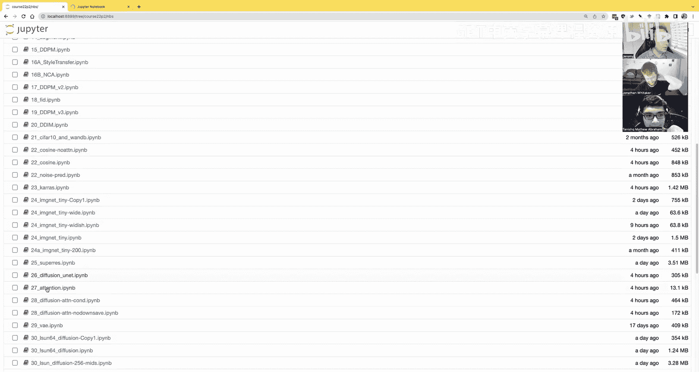

And what we're going to do in 26 diffusion unit is to do unconditional。

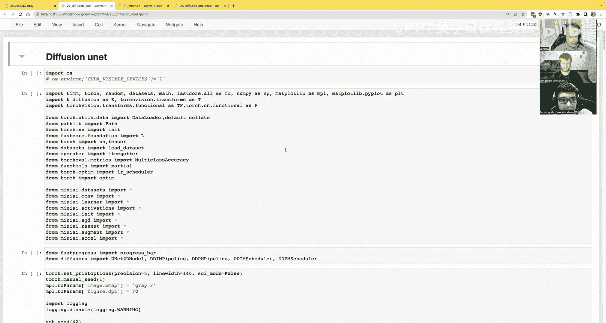

Diffusion from scratch。 And there's not really too many new pieces。 if I remember correctly。 So all。

 you know， all the stuff at the start， we've。

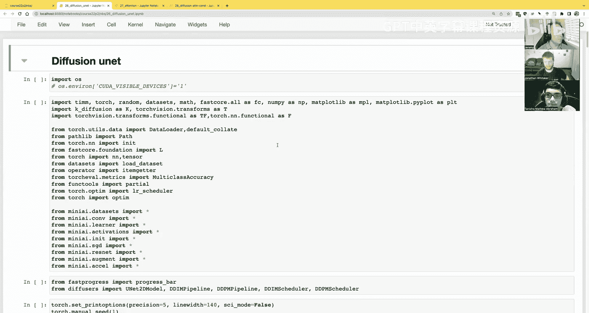

We've already seen。And so when I wrote this， it was before I had noticed that the Kaas approach was doing less well than the regular cosine schedule approach。

 so I'm still using Kaas noiseify， but this is all the same as from the。The Cars notebook。

 which was 23。嗯。Okay， so。We can now create。A unit。That is based on。What diffusers has。

 which is in turn based on。Lots of other prior art， I mean the code's not at all based on it。

 but the basic the structure is going to be the same as as what you'll get into fuss。嗯。

The convolution we're going to use is the same as the final kind of convolution we used for tiny image net。

 which is what's called the pre activation convolution。

 so the convolution itself happens at the end and the normalization and activation happen first so this is a pre act convolution。

So， then I've got a。Unit resnet block。 So I kind of wrote this before I actually did the。

React version of tiny image net。 So I suspect this is actually the same。

Qute possibly exactly the same as the tiny image net one so maybe this is nothing specific about this for you that this is just really a preact con and a preact resnet block so we've got the two comms as per usual and the identity con now there is one difference though to what we've seen before for Resnet blocks which is that this Resnet block has no option to do downsampling no option to do ast。

嗯。This is always dried one。Which is our default。So the reason for that。😊。

Is that when we get to the thing that strings a bunch of them together。

 which will be called down block， this is where you have the option to add down sampling And if you do add down sampling。

 we're going to add a stride to convolution after the res block and that's because this is how。

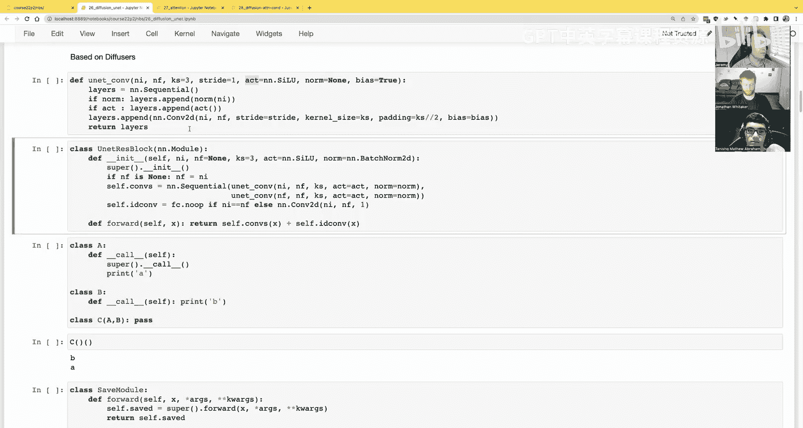

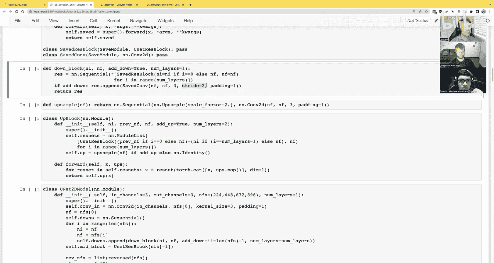

Yeah， diffusers and stable diffusion does it。嗯。I haven't studied this closely to Ni John or I don't know if I do if you have no like where this idea came from or why。

 I'd be curious， you know the difference is that normally we'd have average pooling here in this connection。

But yeah， there's different approach is what？What we're using a lot of the a lot of the history of the diffusers unconditional unit is to be compatible with the DDPM weights that were released and some following work from that and I know like then improved DDPM and these others like they all kind of built on that same sort of unit structure even though it's slightly unconventional if you're coming from like a normal computer vision background Okay and do you recall where the DDPM architecture came from because like some of the ideas came from some of the。

And。Units， but I don't know if DD PMM。 Yeah， they had something called。

Efficient unit that was inspired by some prior work that yeah I can't remember the like the lineage anyway yeah just into it the fu one that's since become you know like you can add in parameters to control some of this stuff but yeah we shouldn't assume that this is the optimal approach I suppose but oh yeah I will dig into the history and try and find out how much like what ablation studies have been done So for those of you haven't heard of ablation studies that's where you'd like try you know a bunch of different ways of doing things and score which one works better and which one works less well and kind of create a table of all of those options。

And so， where。You can't find ablation studies for something you're interested in often that means that。

 you know， maybe not many other options were tried because researchers don't have time to try everything。

Okay， now the unit， if we go back to the unit that we used for super resolution。

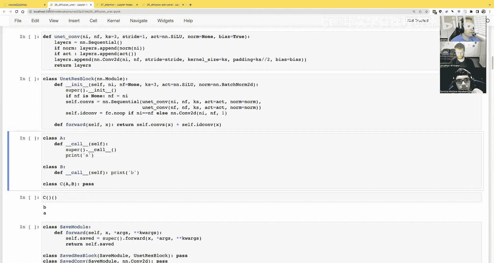

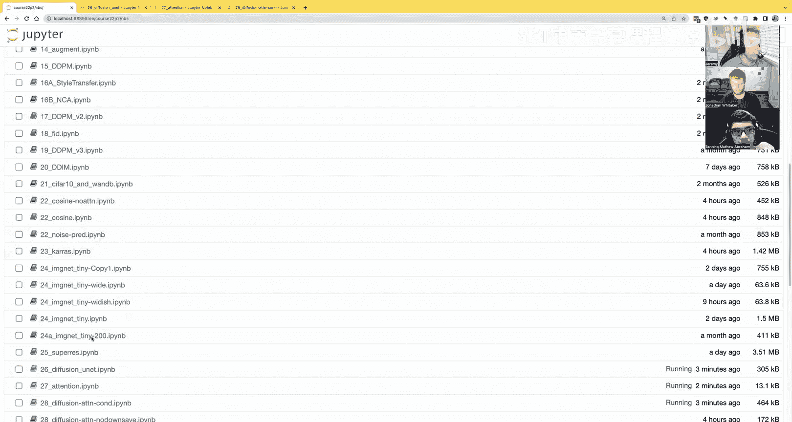

We'll just go back to our most basic version。😔。

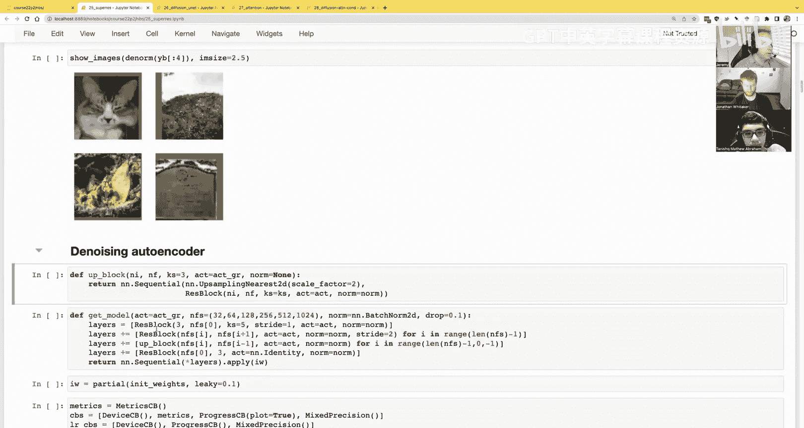

嗯。What we did as we went down through the layers in the down samplingling section。We stored。嗯。

The activations。At each point。Into a list called layersers。

And then as we went through the up sampling。We added those downsampling layers back into the upsling activations。

So that's the kind of basic structure of a unit you don't have to add you can also concatenate and actually concatenating is what is's think it's more common nowadays and I think of the original unit might have been concatenating although for super resolution just adding seems pretty sensible so we're going to concatenate but what we're going to do is we're going to try to we're going to kind of exercise our python muscles a little bit to try to see interesting ways to make some of this sort at all easier to。

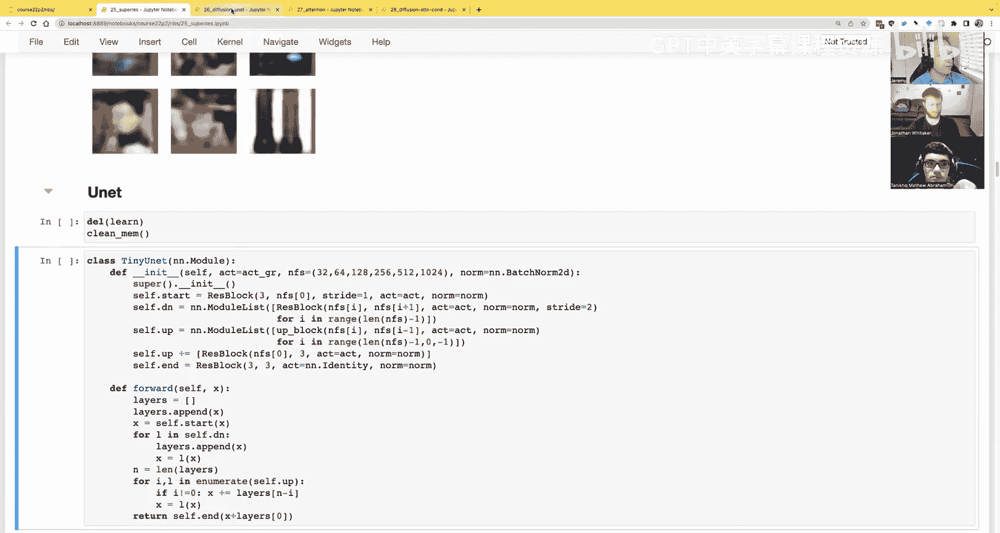

turnurn different down sampling backbones into units and you also use that as an opportunity to learn a bit more python。

 so what we're going to do is we're going to create something called。A saved rez book。

And a saved convolution。 And so our down our down blocks。

 So these are our res blocks containing a certain number of re block layers。

Followed by this optional Str2 conv， we're going to use saved res blocks and saved cons and what these are going to do is going to be the same as a normal convolution and the same as a normal res block same as a normal unit res block。

But they're going to remember。The activations and the reason for that is that later on in the unit。

 we're going to go through and grab those saved activations all at once into a big list。

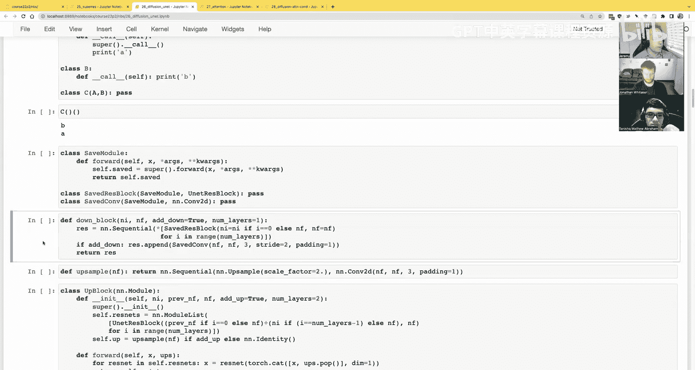

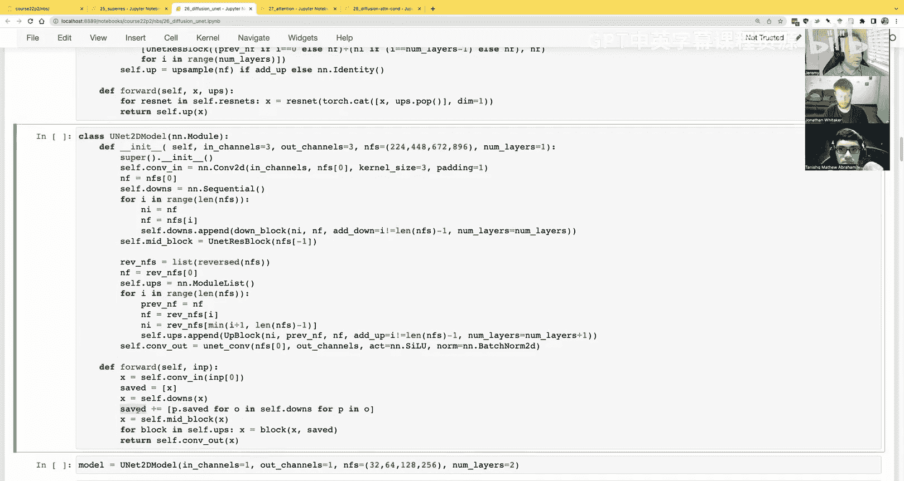

So。So then yeah we basically don't have to kind of think about it and so to do that we create a class called a save module and all save module does is it calls forward to grab the ResB or conN results。

And stores that。Before returning it。Now， that's weird because hopefully you know by now that super。

Calls the thing in the parent class， but Sa module doesn't have a parent class。

So this is what's called a mix in。

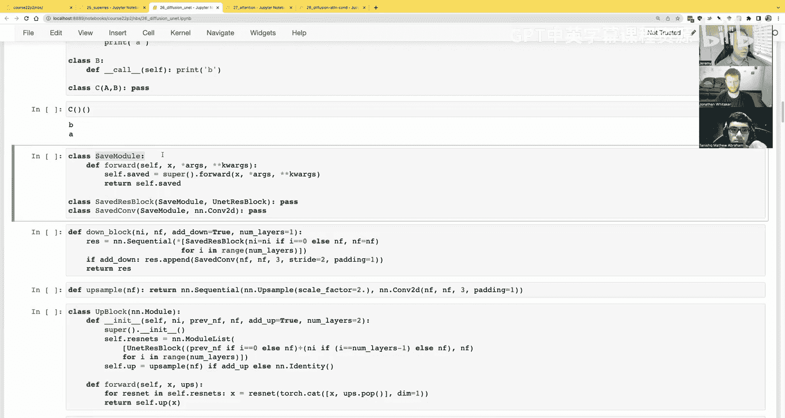

And。It's using something called multiple inheritance。嗯。And mix ins are。

As it describes here， it's a design pattern， which is to say it's not。

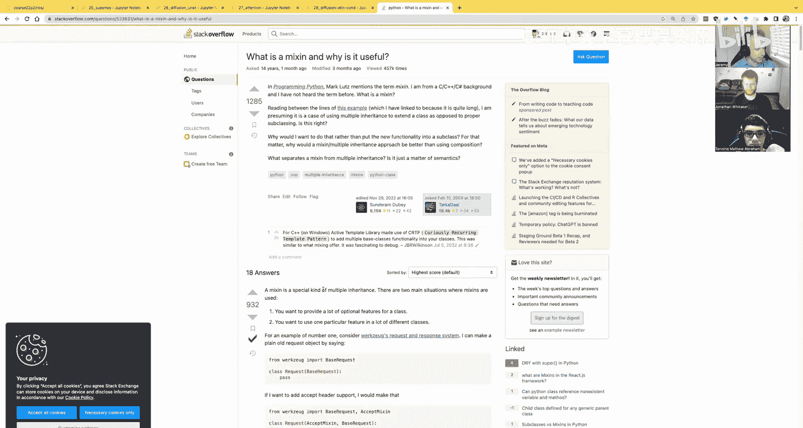

Particularly a part of Python per se， It's a design pattern that uses multiple inheritance。

 Now what multiple inheritance is。Is where you can say， oh。

 this class could save Resboch inherits from。Two things， save module and。Unit re block。

And what that does is it means that all of the methods in both of these will end up in here。

Now that would be simple enough， except we've got a bit of a confusion here。

 which is that unit Re blocklock contains forward and save module contains forward。

 so it's all very well just combining the methods from both of them。

 but what if they have the same method。And the answer is that。The one you list first。

Can call when it calls forward。It's actually calling forward in。The later one。

And that's why it's a mix and it's mixing this functionality into this functionality。

 so it's a unit res blocklock where we've customized forward。

 so it causes the existing forward and also saves it。😊，Okay。

 so you see mix ins quite a lot in the Python standard library， for example， the basic HtTP staff。

 the basic some of the basic thread stuff， you know， with networking users。

Multiple inheritance using this mix in pattern。 So with this approach。

 then the actual implementation of saved res block is nothing at all。

 So past means don't do anything。 So this is just literally just a class， which has no in nothing。

 no。Implementation of its own other than just to be a mixed in of these two classes。

So a Sa convolution is an NN。com2D with the Sa module mixed in。哦。

So what's going to happen now is that we can。Call a saved re block just like a unit re block and a saved conf just like an N。

com of 2D。Um。But that object is going to end up with the activations insides the dot saved attribute。

So now a downsling block is just a sequential。Of saved rest blocks。As per usual， the very first one。

Is going to have the number of in channels to start with， and it would always have number N F。

 the number of filters output and then after that。The inputs will be E also equal to Nf because the first ones change the number of channels。

Then we'll do that for however many layers we have。And then at the end of that process。

 as we discussed， we will add to that sequential。A saved conf。

With Dr2 to do the down sampling if requested， so we're going to end up with a single end end up sequential for a down block。

嗯。And then an up block。Is going to look very similar。But instead of using ann。com2D with a 2。

 up sampling will be done with a sequence of an upsling layer and so literally all that does is it just duplicates every pixel four times into little2 by2 grid。

That's all an up sampling layer does， nothing clever and then follow that by a strideide one convolution so that allows it to。

You know， adjust some of those pixels as if necessary with a simple three by three con。

So that's pretty similar。To us try2 down sampling， this is kind of the rough equivalent for up sampling。

嗯。There are other ways of doing upse。 This is just the one that's stable diffusion。Does。

So an up block looks a lot like a down block， except that now。So as before。

 we're going to create a bunch of。Unit Res box， these are not saved Res box。

 of course we want to use the safe results in the upsling path of the unit so we just use normal res box。

But what we're going to do now is as we go through each resnet。They're going to call it。

Not just on our activations， but we're going to concatenate that with。

Whatever was stored during the down sampling path， so this is going to be a list of all of the things stored in the down sampling path it'll be passed to the up lock and so dot pop will grab the last one off that list。

And concatenate it with the activations and pass that to the resnet。So we need to know how many。

Filters there were how many activations there were in the down sampling path。

 so that's stored here this the previous number of filters in the down sampling path and so the res block。

We to add those in。In addition to。The normal number。So that's what's going to happen there。嗯。

And so yeah， do that for each layer as before and then at the end。Add an up samplingling layer。

If it's been requested， said Sepoleon。Okay， so that's the upsling block。

 does that all make sense so far？

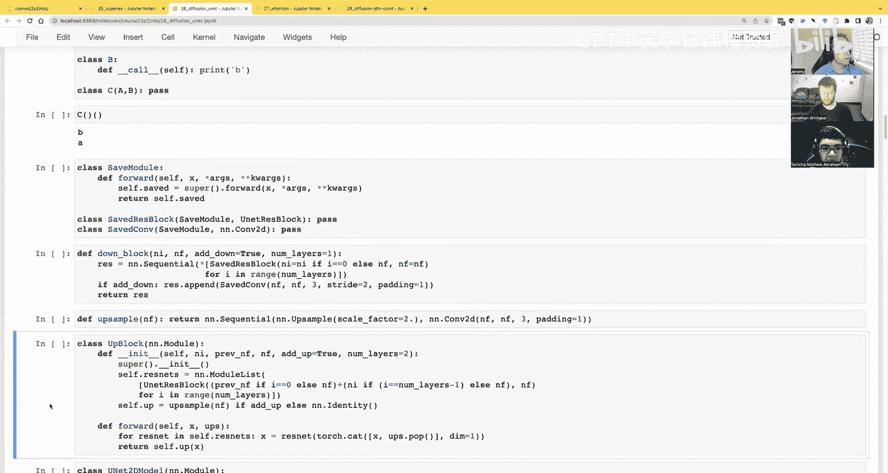

Yeah， looks good， okay。Okay， so the unit now is going to look。

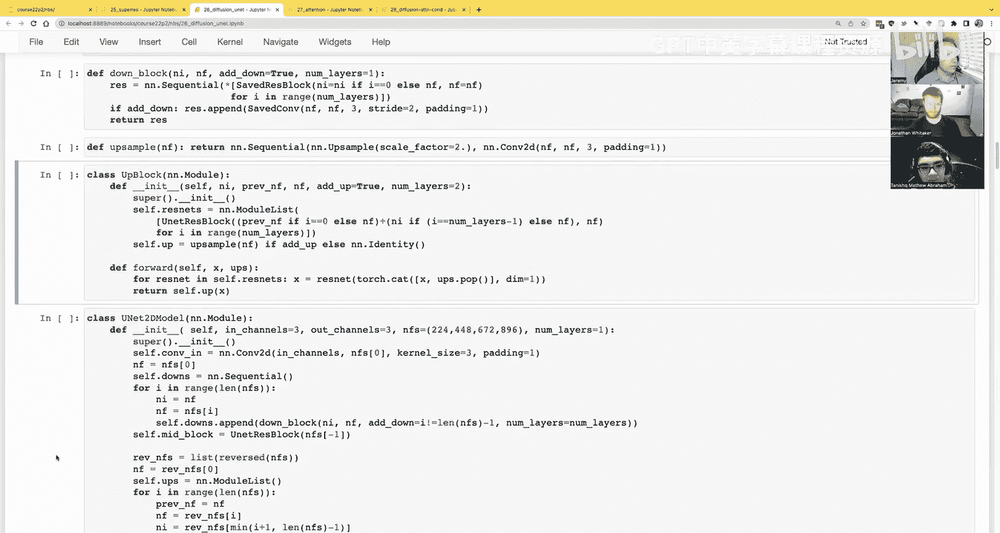

A lot like our previous unit。

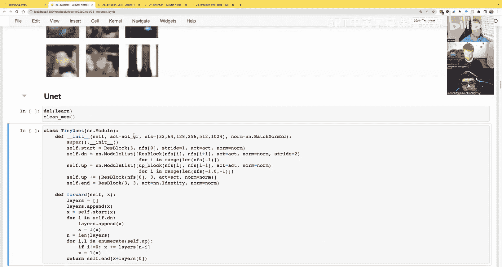

嗯。We're going to start out as we tend to with a convolution。

To now allow us to create a few more channels。And so we're passing to our unit。

That's just you know how many channels are in your image and how many channels are in your output image。

 so if for normal normal four color images that'll be 33。

 how many filters are there for each of those resonnet blocks up blockss and down blocks you've got。

And in the down sampling， how many layers are there in each block？

So we go from the comm will go from in channel， so it' would be 3 to Nf0。

 which this is the number of filters in the stable diffusion model。They're pretty big， as you see。

 by default。And so that's the number of channels we would create。Which is like。Very redundant in the。

This is a three by three con， so it only contains three by three by three channels equals 27 inputs。

And 224 outputs。 So it's not。You know， doing computation， useful computation in a sense。

 it's just giving it more space to work with down down the line， which。

I don't think that makes sense， but I haven't played with it enough to be。Sure。

 normally we would do like。You know， like a few res blocks or something at this level to more gradually increase it because this feels like a lot of wasted effort。

 but yeah， haven't studied that closely enough to be sure。So Jamie just to tweet。

 this is the default， I think the default settings for the unconditional unit in diffusers but the stable diffusion unit actually has even more channels it has 32640 and then 1280。

1280 Co thanks for clarifying and it's yeah the unconditional one which is what we're doing right now。

That's a great point。Okay， so then we， yeah， we go through all of our number of filters。

And actually the first res block。Contains 224 to 224。

 So that's why it's kind of keeping track of this stuff。

 And then the second red block is 224 to 448 and then 448 to 672 and then 672 to 896。

 So that's why we're just going have to keep track of these things。So yeah， we add。

 so we have a sequential for our down blocks and we just add a down block。

The very last one doesn't have down samplingling。Which makes sense， because the very last one。

 there's nothing after it， so no point down sampling other than that， they all have down sampling。

And then we have one more re block in the middle。😊，And which。

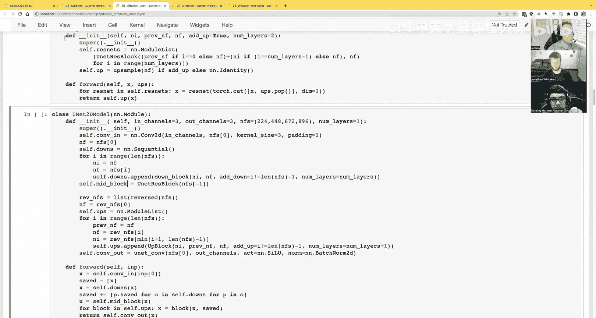

Is that the same as what we did？😔，Okay， so we didn't have a middle res block in our original unit here。

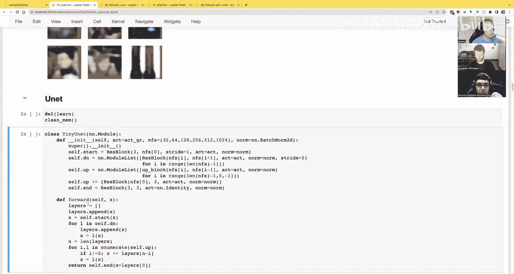

嗯。

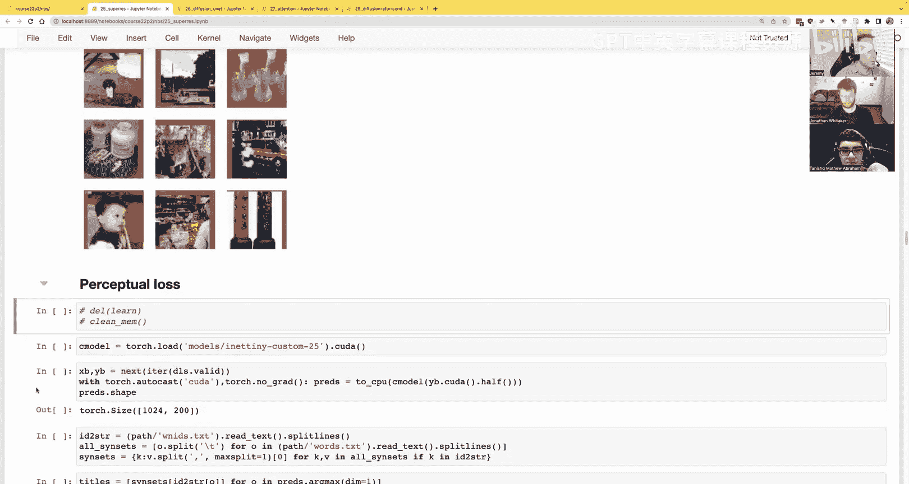

What about this one do we have any mid blocks No so we haven't done Okay， but I mean。

 it's just another res block that you do after the down sampling。

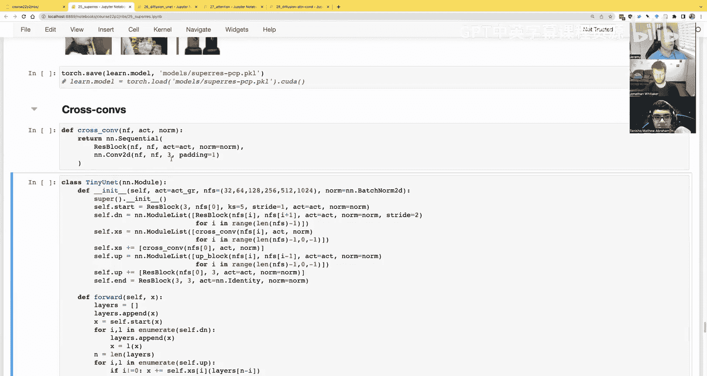

And then we go through the reversed list of filters and go through those and adding app blocks。

And then one convolution at the end to turn it from。224 channels to three channels。Okay。

 and so the forward then is going to store in saved。

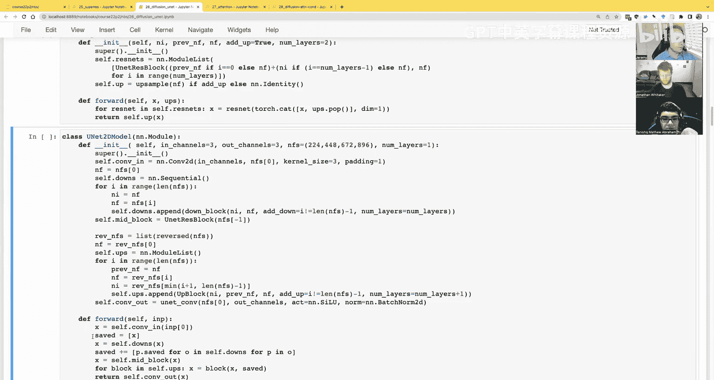

Or the layers， just like we did。Back with this unit。

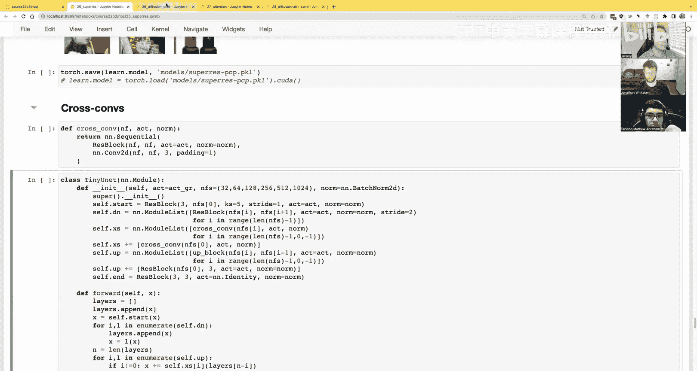

But we don't really have to do it explicitly now we just call the sequential model。

And thanks to our automatic saving， each of those now will we can just go through each of those。

And grab their dot saved。So that's handy。We then call that mid blocklock。

 which is just another red block and then same thing okay now through the apps and what we do is we just passed in those saved。

Right， and just and remember， it's going to pop in that。Each time。And then the comm at the end。

So that's， yeah， that's it。 That's our。

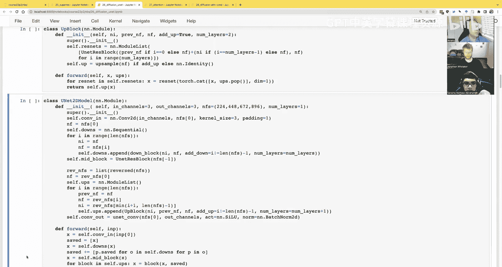

Andconal。Model， it's not quite the same as the diffuss unconditional model because it doesn't have attention。

 which is something we're going to add。嗯。Next。But other than that， this is the same。

 So let's for because we're doing a simpler problem。

 which is fashion Mnist we' use less channels than the default。

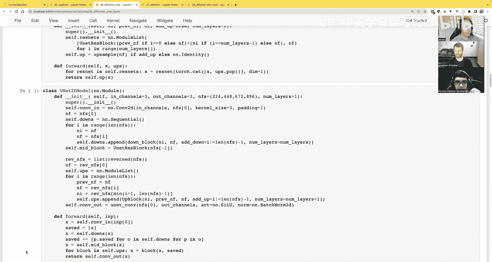

Using two layers per block is standard。

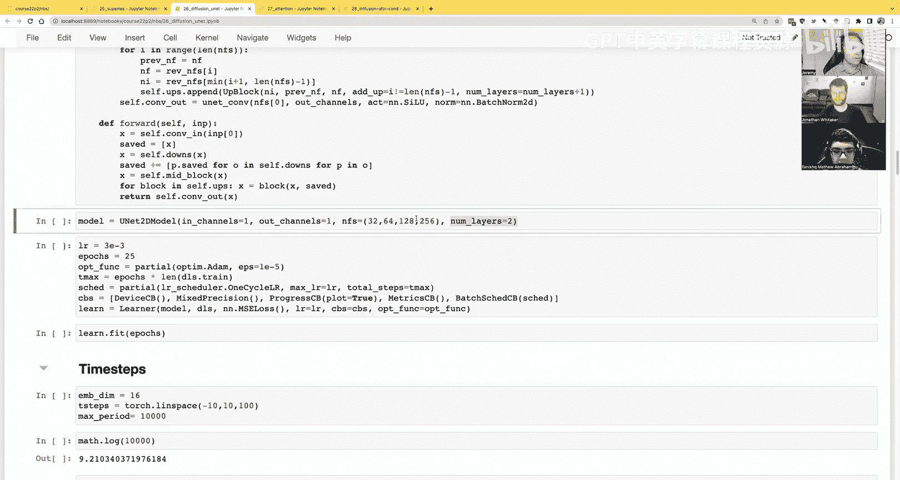

One thing to note though is that in the up sampling blocks， it actually is going to be three layers。

 nu layers plus one， and the reason for that is that the way stable diffusion and diffuss do it is that even the output of the down sampling。

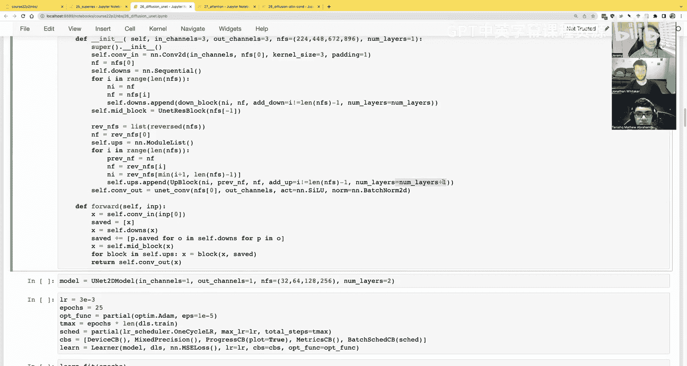

Is also saved， So if you have nu layers equals2， then there' will be two res blocks saving things here and one con saving things here。

 so you'll have three saved。

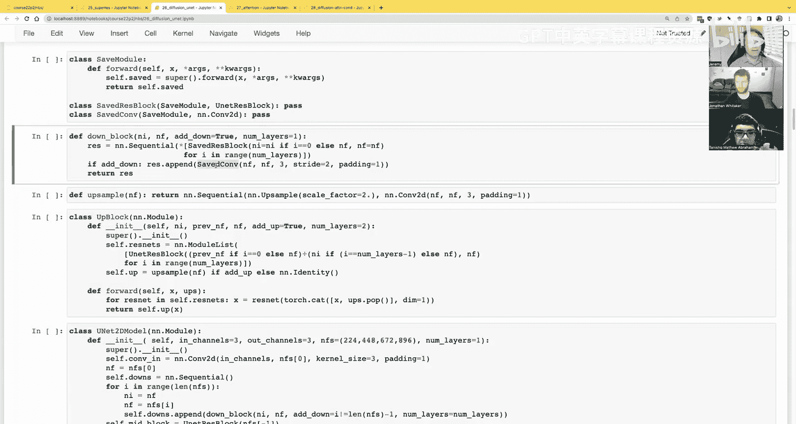

Ccroross connections。 So that's why there's。An extra plus one here。

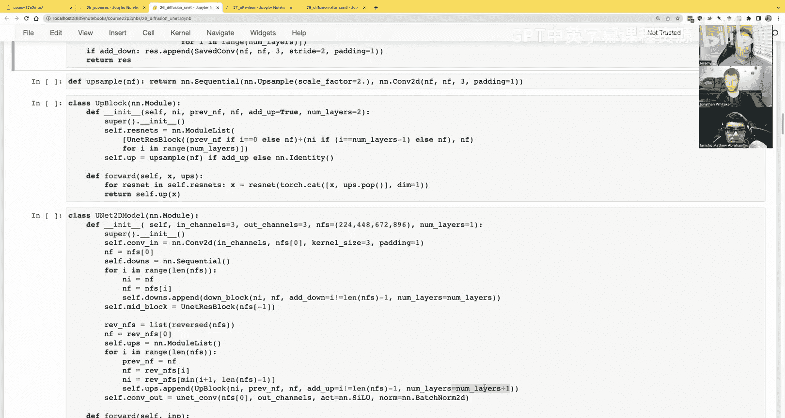

Okay， and then we can just train it using mini AI。As per usual。

 I didn't save it after I last trained it， sorry about that， so just me it trained。

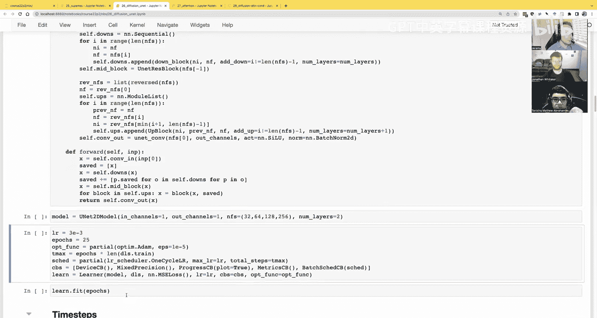

Um。Okay， now。That oh， okay， No， that is actually missing something else important。

 as well as attention。 The other thing that's missing is that thing that we discovered is pretty important。

 which is the time embedding。

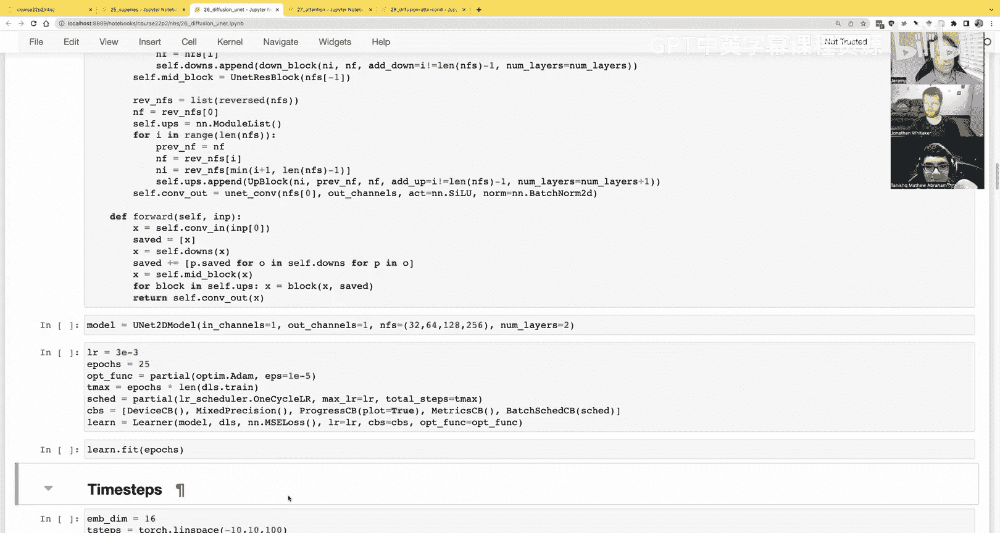

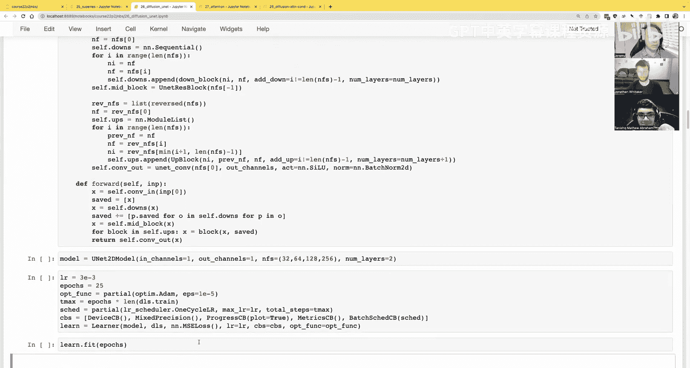

so we already know that sampling doesn't work particularly well without time embedding。

 so I didn't even bother sampling this， I didn't want to add all this stuff necessary to make that work a bit better。

thought let's just go ahead and do time embedding。So time embedding， there's a few ways to do it。

 and the way it's done in stable diffusion is what's called sinusoidal embeddings。The basic idea。

 maybe we'll skip ahead of it。The basic idea is that we're going to create a res block with embeddings where forward is not just going to get the activations。

 but it's also going to get。T。Whi is a vector that represents the embeddings of each time step。

 so I'll actually be it， it'll be a matrix because it's through everything in the batch。

 but for one element of the batch， it's a vector。And it's an embedding in exactly the same way as when we did NLP。

 each token had an embedding， and so the word the would have an embedding and the word John O would have an embedding and the word Tenishche would have an embedding。

 although Tenishche would probably actually be multiple tokens until his famous enough that he's mentioned in nearly every piece of literature。

 at which point Tenishsh will get his own token， I expect。That's how you know when you've made it。嗯。

So the time embedding will be the same T of， you know， time step zero will have a particular vector。

 time step one will have a particular vector and so forth。

Or actually you know we're doing caras so actually they're not time step one。

 two three there's they're actually sigmas， you know。

 so they're continuous but same idea a specific value of sigma。

 which is actually what t is going to be slightly confusingly well have a specific embedding now。

We want。Two values of sigma or t， which are very close to each other， should have similar。

Embbeddings and if they're different to each other， they should have different embeddings。嗯。嗯。

So how do we make that happen， you know， and also make sure there's a lot of variety of the embeddings across all the possibilities？

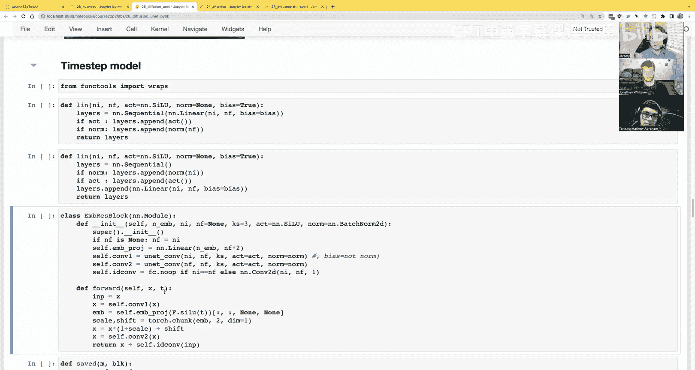

So the way we do that is with these sinusoidal time steps， so let's have a look at how they work。

So you first have to decide how big do you want your embeddings to be， just like we do at NLP。

That it is the word the， is it represented by eight floats or 16 floats or 400 floats or whatever？

Let's just assume it's 16 for now。So let's say we're just looking at a bunch of time steps which is between negative 10 and 10 and we're just to 100 of them。

 I mean we don't actually have negative sigmas or t so it doesn't exactly make sense。

 but it doesn't matter it you know shows you the idea。嗯。And so then we say like， okay。

 what's the largest？Time step you could have with the largest sigma that you could have。

Interestingly， every single model I found， every single model I found uses 10，000 for this。

Even though that number actually comes from the NLP transformers literature and it's based on the idea of like okayK what's the maximum sequence length we support。

 you could have up to 10，000 things in a you know。in a document or whatever in a sequence。

 but we don't actually have a sigmas that go up to 10。

000 so I'm using the number that's used in real life in stable diffusion and all the other models。

 but it's interestingly this that here purely far as I can tell as a historical accident because this is like the maximum sequenced length that NLP transformers people thought they would need to support。

Okay， now。What we're then going to do is we're going to be then doing。

E to the power of a bunch of things。And so that's going to be our exponent and so our exponent is going to be equal to log of the period。

 which is about nine。Times。The numbers between nugh and one。8 of them。

Because we've got we said we want 16。 So you'll see why we want eight8 of them and not 16 in a moment。

 but basically here are the8。Exponents we're going to use。So then not surprisingly。

 we do E to the power of that。Okay， so we do either of the power of that， each of these eight things。

And we've also got。The actual time steps， so imagine these are the actual time steps we have in our batch。

 so there's a batch of 100。And they contain this range of sigmas or time steps。

So to create our embeddings， what we do is we do a。Add a product。Of the exponent。

x and the time steps， this is step one。And so this is using a broadcasting trick we've seen before。

 we had a unit access。And x is0 here。And add a unit sorry sorry an access1 here and add a unit access access on access0 here。

 So if we multiply those together， then it's going to broadcast。This one across this axis。

And this one across this axis， So we end up with a 100 by8。 So it's basically you know。

 a Cartesian product all the possible combinations of time step and exponent multiplied together。

And so here is like， you know， a few of those different exponents for a few different。Vals。嗯。Okay。

 so。That's not very interesting。Yet we haven't yet reached something where each time step is similar to each next door time step。

 you know， over here。You know， these embeddings look very different to each other and over here they're very similar。

 so what we then do。Is we take the sign。And the cosine。Of those。So that is 100 by8。

 and that is 100 by8， and that gives us 100 by 16。嗯。So we can catnate those together。

And so that's a little bit hard to wrap your head around， so let's take a look。😊。

So the across the 100 time steps or 100 sigmas。This one here is the first sine wave。

And then this one here。😔，Is the second sine wave and this one here is the third。😔。

And this one here is the fourth and the fifth。😔，So you can see as you go up to higher。Higher numbers。

You're basically， you know， stretching the sine wave out。And then once you get up to。Index 8。

You're back up to the same frequency as this blue one because now we're starting the cosine rather than sine and cosine is identical to sine。

 it's just shifted across a tiny bit so you can see these two light blue lines are the same。

And these two orange lines are the same。 They just shifted across， ands say lines， so curves。嗯。

So when we concatenate those all together， we can actually draw a picture of it。

And so this picture is 100 pixels across。And 16 pixels。Top to bottom。

And so if you picked out a particular point， so for example， in the middle here， for t equals0。

Bltic micro zero。One column is an embedding。 so the bright represents higher numbers and the dark represents lower numbers。

And so you can see every column。Looks different。Even as though they're columns next to each other。

look similar。So that's called a time step embedding。And this is definitely something you want to。

Experiment with， right。Really I've tried to do the plots I thought are useful to understand this。

 but。And Chinano and Tunisch also had ideas about plots for these， you know which we've shown。

But you know， the only way to really understand them is to experiment。

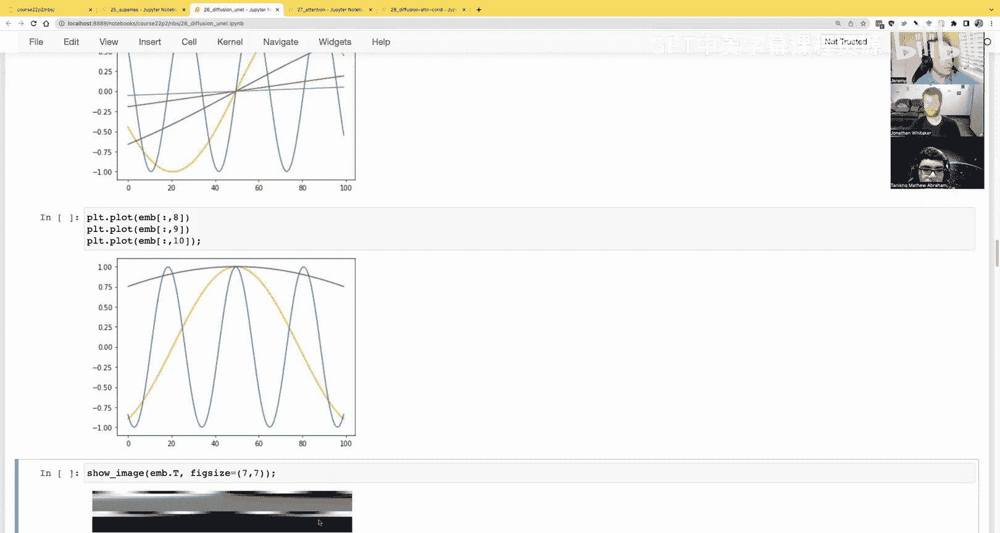

So then we can put that all into a function where you just say， okay， well how many times sorry。

 what are the time steps？How many embedding dimensions do you want， What's the maximum period。

 And then all I did was I just copied and pasted the previous cells and merged them together。嗯。

So you can see there's our outer product。And there's our cat of c and cause。诶。

If you end up with a if you have an odd numberumbed embedding dimension。

 you have to pad it to make it even don't worry about that So here's something that now you can pass in the number of sorry the actual time steps or sigmas and the number of embedding dimensions and you will get back。

Something like this。It won't be a nice curve because your time steps in a batch won't all be next to each other。

 it is the same idea。

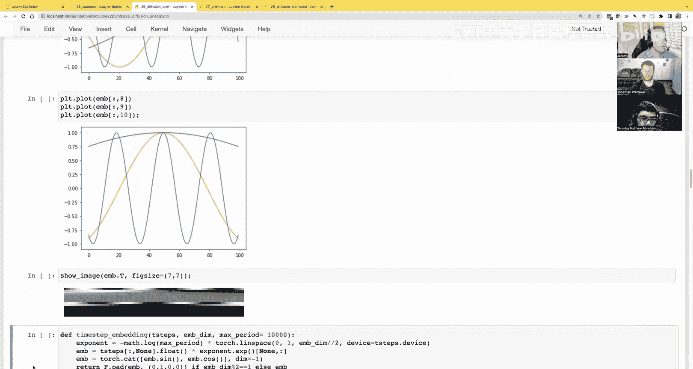

And I can call anything on that little visualization there which goes back to your comment about the max period being super high you said like okay adjacent ones are somewhat similar because that's what we want but there is some change but if you look all of this first 100。

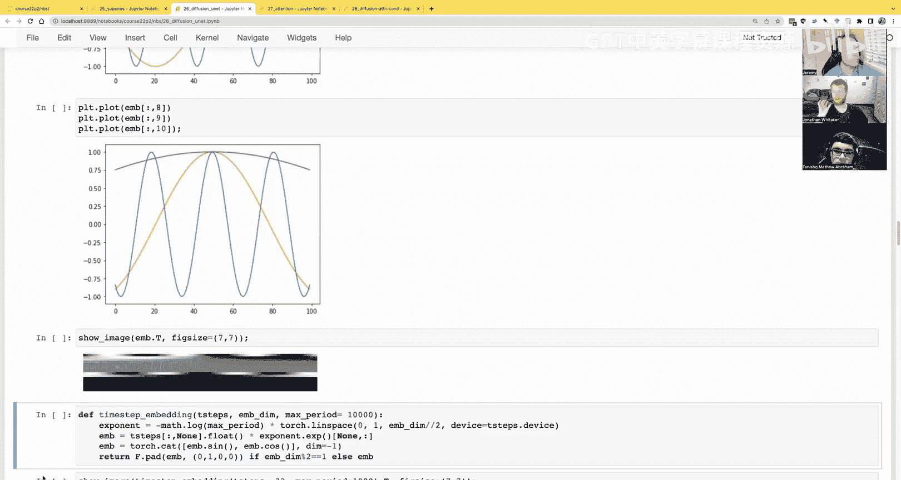

Some just like the half of the embeddings look like they don't really change at all。

 and that's because。50 to100 on a scale of like 0 to 10000 you want those to be quite similar because there's a so very early in this like super long sequence that these are designed for Yeah so here actually we've got wasted space Yeah so here we've got a better period of 1 thousand0 instead know changing the figure size we can see it better and it's using up a bit more of the space yeah。

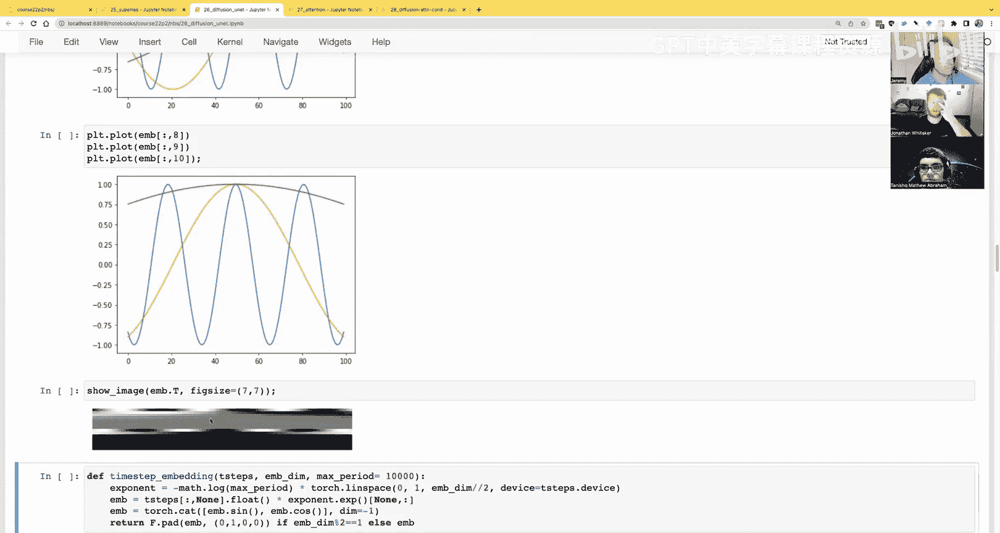

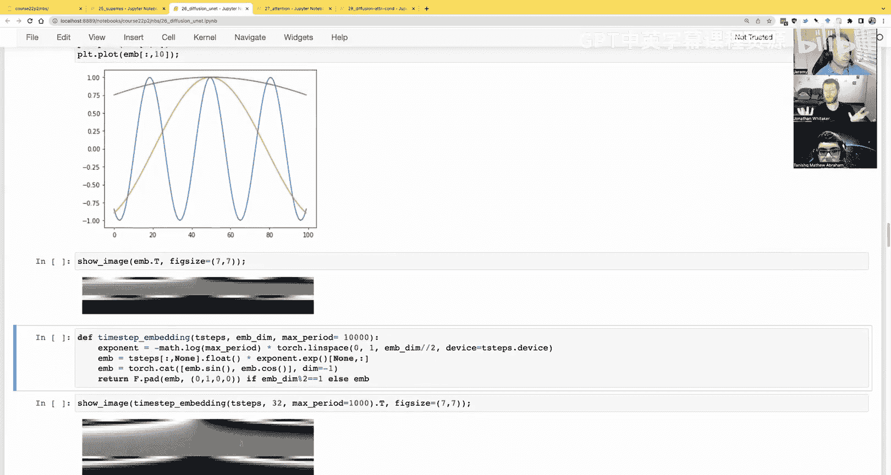

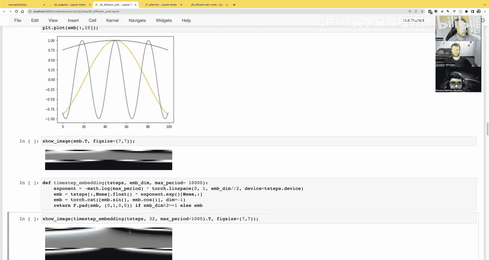

Or go to max period of 10。Um。And it's actually now this is， yeah， using it much better。Yeah。

 so like based on， you know， what you're saying， Jonno。

 I agree like it seems like it would be a lot richer。To use。

These time step embeddings with a suitable max period or maybe you just wouldn't need as many embedding dimensions。

 I guess if you did use something very wasteful like this， but you used lots of embedding dimensions。

 then it's going to still capture some useful ones。

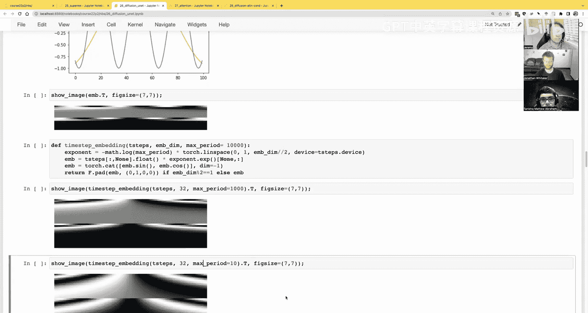

Yeah， thanks， Janno， so yeah。

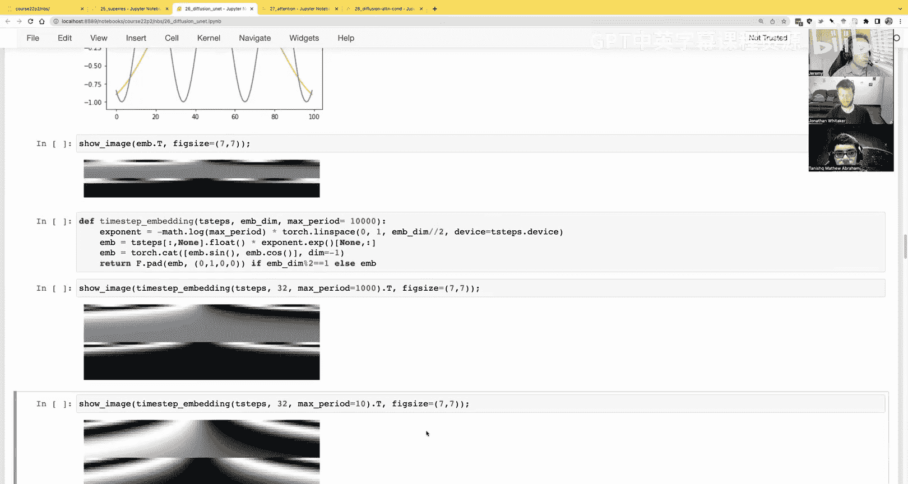

Yeah， so this is one of these interesting little insights about things that are buried deep in code。

 which I'm not sure anybody。

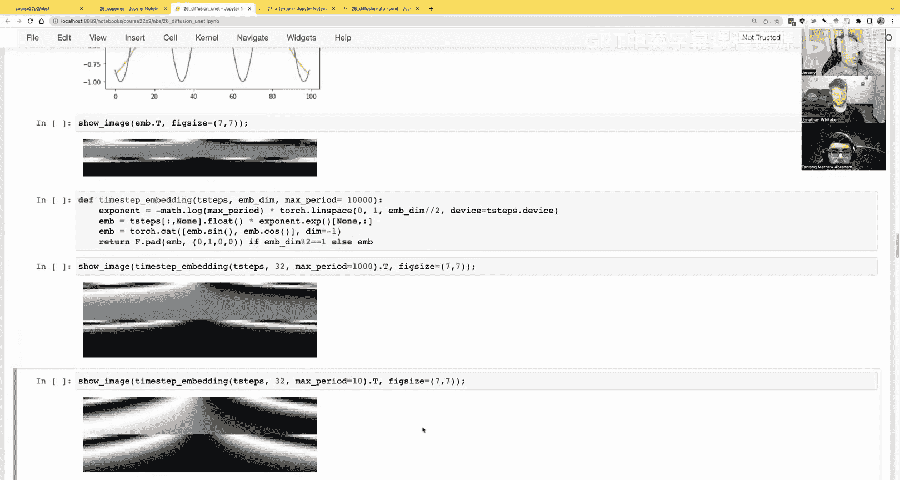

Probably much look there。Okay， so let's do a unit with time step embedding in it。

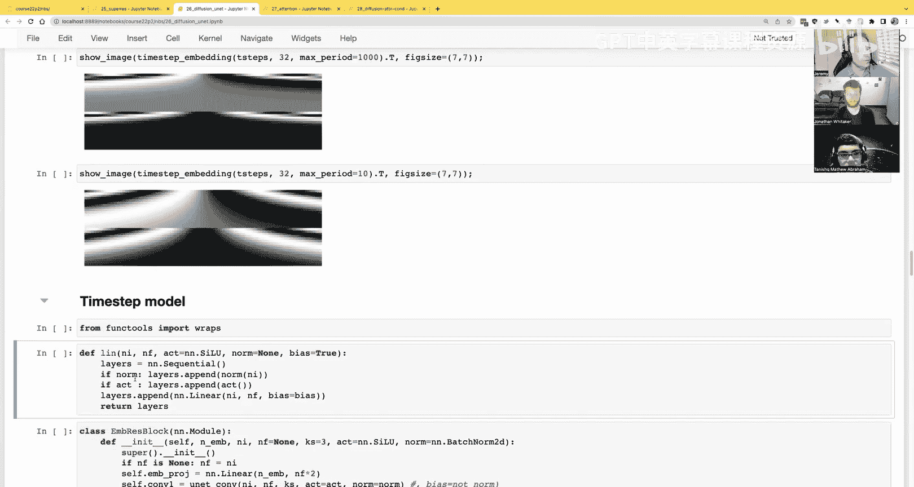

So。What do you do once you've got like this column？

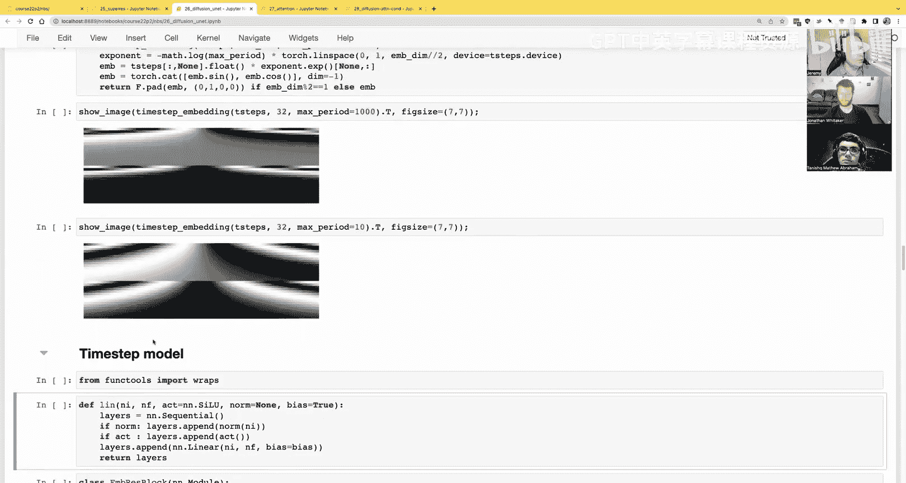

You know， embeddings for for each e of a batch， what do you do with it？

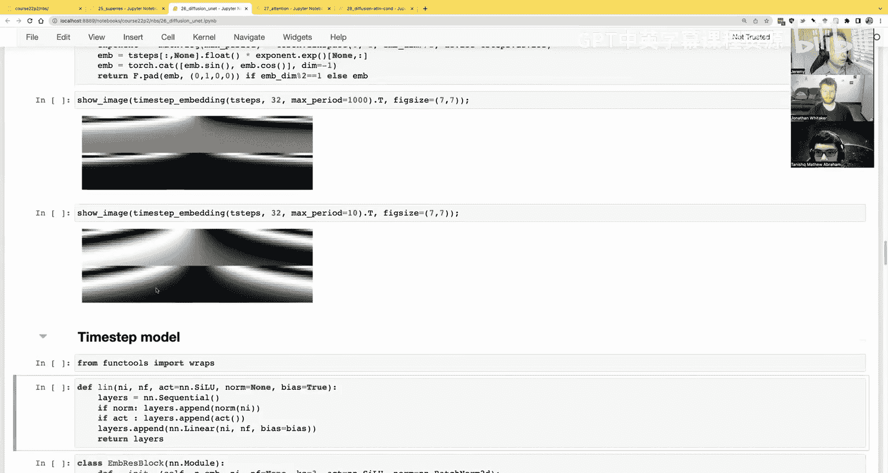

Well， there's a few things you can do with it。 what stable diffusion does， I think is correct。

 I'm not promising I remember all these details right。

 is that they make their embedding dimension length。

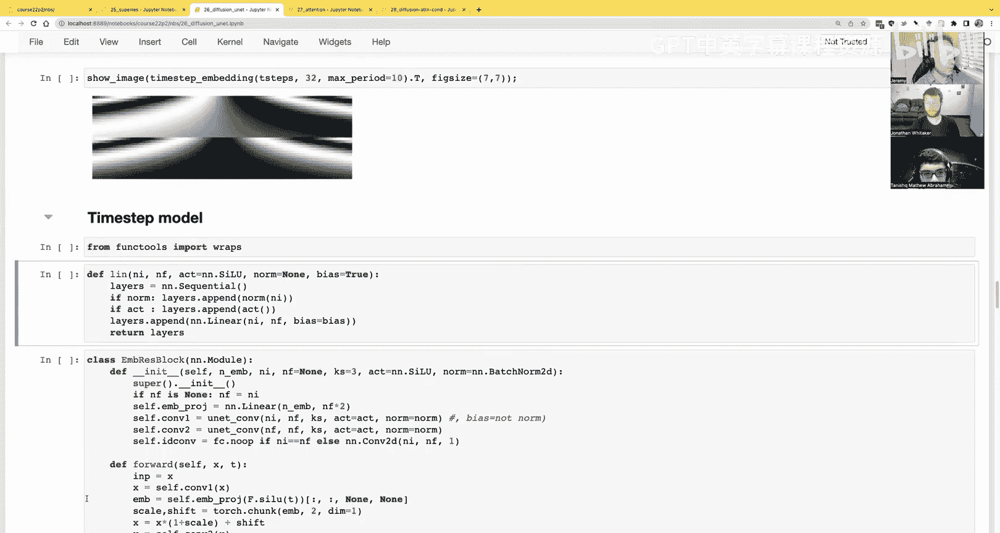

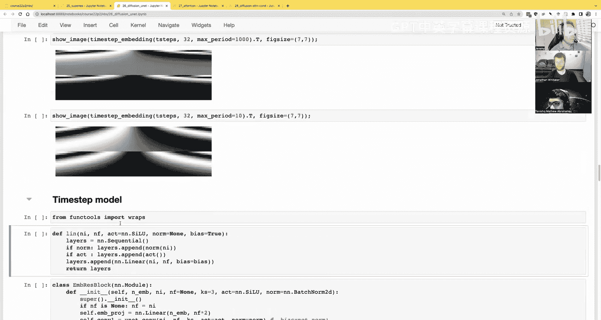

Whyice as big。As the。Number of activations。And what they then do is we can use chunk to take that and split it into two separate variables so that just literally just the opposite of concatetnate fits it into two separate variables。

And one of them is added。To the activations， and one of them is multiplied by the activations。

 So this is a scale。And a shift。We don't just grab the embeddings as is though。

 because each layer might want to do each re block might want to do different things with them。

So we have a embedding projection。Which is just a linear layer， which allows them to be projected。

So it's projected from the number of embeddings to two times the number of filters so that that torch dot chunk works。

We also have an activation function called CliU， this is the activation function that's used in stable diffusion。

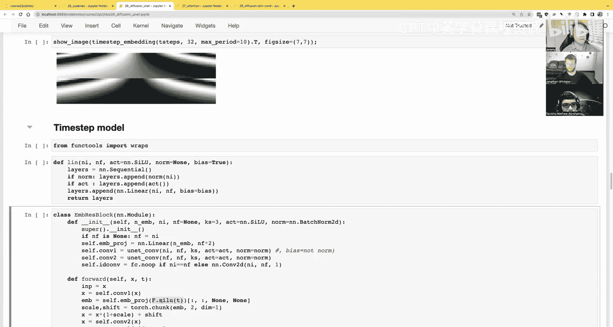

I don't think the details are particularly important， but it looks basically like。嗯。

A rectified linear with a slight cury bit。And also known as Swish， also known as Swisish。嗯。

And it's just equal to x times sigmoid x。诶。And yeah。

 I think it's like activation functions don't make a huge difference， but it all。

They can make things train a little better or a little faster and Swwish has been something that's worked pretty well so people a lot of people using Swwish or still you。

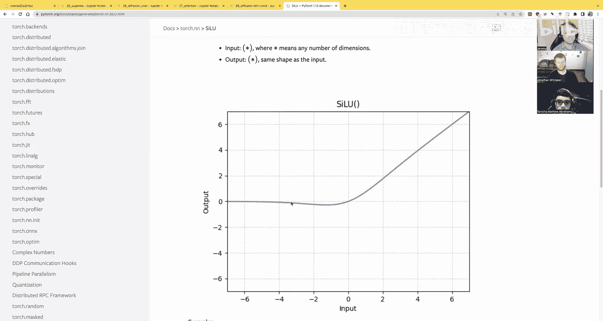

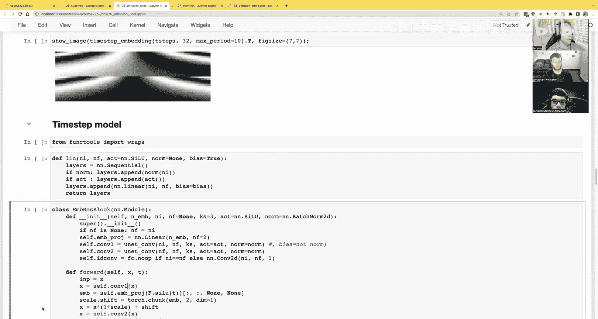

I always call it Swwish but I think Cliu was actually where it was originally or the Gau paper which had Cu was where it originally was kind of invented and maybe people didn't quite notice and that another people called it Swish and everybody called it Swish and then people were like wait。

 that wasn't the original paper so。😊，I guess I should try to call it C。Okay， so yeah。

 other than that， a it's just a normal res block。 So we do our first con。

Then we do our embedding projection of the activation function of time steps and so that's going to be applied to every channel sorry to every pixel height and width。

 so that's why we have to add unit axes on the height and width that it's going to cause it to broadcast across those two axes。

Do our chunk do the scale and shift， then we're ready for the second conv。

 and then we add it to the input。With a。Additional con one Str one con if necessary。

 as we've done before， if we have to change the number of channels。Okay。Yeah。

 because I like exercising our Python mu muscles， I decided to use a second approach now。

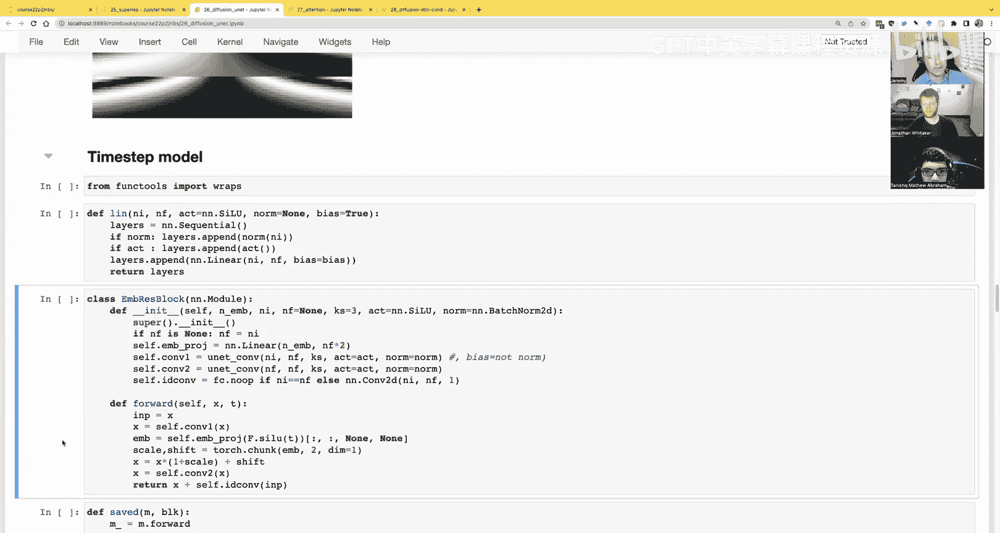

ForThe down block and the up lock， I'm not saying which one's better or worse。

 we're not going to use。Multipful inheritance anymore。 but instead， we're going to use。

Was not even a decorator it's a function which takes a function what we're going to do now is we're going to use one of 2 DD and ms block directly。

 but we're going to pass them to a function called saved the function called saved is something which is going to take as input a callable。

Which could be a function or a module or whatever， so in this case， it's a module。

Takes an ems block or a con of 2D and it returns。A callable。

The coable it returns is identical to the coll that's passed into it， except that it saves。

The result saves the activations。 Sas the result of the function。 Where does it save it。

 It's going to save it into a list in。The second argument you passed to it。Which is the block。

So the save function。You're going to pass it the module。

 we're going to grab the forward from it and store that away to remember what it was。

And then the function that we want to replace it with will it underscore F。

GoGo going to take some arguments and some keyword arguments。

 well basically it's just going to call the original modules do forward。

Passing in the arguments and keyword arguments。And we're then going to。

Store the result in something called the saved attribute。Inside here。

And then we have to return the result。So then we're going to replace the modules forward method with this function。

And return the module So that module's now been yeah， I said callable actually， it can't be callable。

 it has to specifically be a module because with the forward that we're changing。

This at wraps is just something which automatically it's from the Python standard Library。

 it' going to copy in the documentation and everything from the original forward so that it all。

Looks like nothing's changed。嗯。Now where does this saved come from。

 I realized now actually we could make this easier and automate it。

 but I forgot didn't think of this at the time， so we have to create the saved。

Here in the down block。It actually would have made more sense。

 I think here for it to have said if the saved attributetropy doesn't exist， then create it。

Which would look like this， if not has aure。L comea saved。Block dot saved because if you do this。

Then you wouldn't need。This anymore， anyway， I didn't think of that at the time， so let's pretend。

That's not what we do， okay。So， yeah， now the。The downsampling conv and the resnets。

Both contain saved versions of modules。We don't have to do anything to make that work。

 we just have to call them。We can't use sequentials anymore because we have to pass in the time step to the reates as well。

It would be easy enough to create your own sequential。For things with time steps。

 which passes them along。诶。But that's not what we're doing here。嗯。Yeah。

 maybe it makes sense for sequential to always pass along all the extra arguments。

 but I don't think that's how they work。Yeah， so our up block is basically exactly the same as before。

 except we're now using embers blocks instead。

Just like before we're going to concatenate。So that's all the same So okay， so a unit model。

With time embeddings。

诶。Is going to look if we look at the forward。The thing we're passing into it now is a tuple containing the activations and the time steps。

all sigmas in our case， so split them out。And what we're going to do。😔。

Is we're going to call that time step embedding function we wrote。Saying， okay。

 these are the time steps and the number of time step embeddings we want。

Is equal to however many we asked for， and we're just going to set it equal to that。

First number of filters。That's all that happens there。And then。

We want to give the model the ability then to do whatever it wants with those to make those work the way it wants to。

 and the easiest smallest way to do that is to create a tiny little MLP。

So we create a tiny little MLP， which is going to take the time step embeddings and return the actual embeddings to pass into the resNe box。

 So tiny little MLP is just。Eenia嚟啊。With。sThinking here。嗯。😊，咩啊咧啊。😔，That's interesting。Okay。

By linear layer by default has an activation function。

 I'm pretty sure we should have act equals none here should be a linear layer and then an activation and then a linear layer。

 So I think I've got a bug， which we will need to try rerunning。Yeah。Okay。

It won't be the end of the world it dispens all the negatives。Will be lost。Yeah。

Mix it only half as useful。

That's not great。Okay， and these are the kind of things like you， you know， as you can see。

 you got to be super careful of like。😊，Where do you have activation functions。

 Where do you have batch nos。Is it pre activation， is it post activation？It trains。

Even if you make that mistake and in this case， it's probably not too much performance。

 but often it's like， oh， you've done something where you accidentally zero it out， you know。

 all except the last few channels of your。Like output a block or something like that and。

And it work tries anyway it does the best it uses what it can yeah but yeah yeah it makes it very difficult make sure you're yeah。

 you're not giving it those handicas。 Yeah， it's not like making a cr app or something and you know that it's not working because it crashes or because like it doesn't show the username or。

Whatever。Instead， you just get like slightly less good results。

 But since you haven't done it correctly in the first place， you don't know。

 it's a less good results。 Yeah， there's not really great ways to do this。

 It's really nice if you can have a。😊，Existing model to compare to or something like that。

which is where cagle competitions work really well， actually， if somebody's like got a cackle result。

 then you know that's a really good baseline and you can check whether yours is。Is as good as theirs。

All right so yeah that's what this m NLP is for so the down yeah the down and upbox are the same as before the convalout is the same as before so yeah so we grab our time step embedding so that's just that outer product pass through this sinusoid all the sinine and cosine we then pass that through the MLP。

嗯。And then。We call our down sampling， passing in those embeddings each time。Now。

 it's kind of interesting that we pass in the embeddings every time in the sense I don't exactly know why we don't just pass them in at the start and in fact in NLP。

 these kinds of embeddings I think are generally just passed into the start。

So this is kind of a curious difference。And I don't know why it's， you know。

 if there's been a studies or whatever。Do you guys know are there like any popular diffusy or generative models with time embeddings that don't pass them in or is this pretty。

Universal。Some of the fancier architectures， like。I think we're current interface networks and stuff just passing the conditioning。

嗯。Yeah。I'm actually not sure。 Yeah。 Maybe they do still do it like at every stage。

 I think some of them just take everything all at once up upfront and then do stack of transformer blocks or something like that。

 So I don't know if it's universal， but it definitely seems like all the unit style ones have this。

The time step been been going in little bit we should try some abls to see， yeah， if it matters。

 I mean。it doesn't matter too much either way， but yeah。

 if you didn't need it at every step then it would。Maybe save you a bit of compute。Potentially。Yeah。

 so now the up sampling， you're passing in the activations。

 the time step embeddings and those in that list of saved activations。So yeah。

 now we have a non attention stable diffusion unit。

诶 so。We can train that。嗯。And we can sample from it。

Using the same， I just copied and pasted all the stuff from the Kas notebook that we had。

And there we have it， This is our first。Diffusion。

From scratch。And the so we wrote every piece of code for this diffusion model Yeah。

 I believe so I mean， obviously in terms of the optimized code of implementations of stuff， no。

 but yeah， we've we've written out version。

We've written our version of everything here， I believe a big milestone。 I think so。 yeah。

 and these feds are about the same as the feds that we get。

From the stable diffusion one， they're not particularly higher or lower。 They bounce around a bit。

 So it's a little hard to compare。 but yeah， they're basically the same。 Yeah， so that's。

That， that is an exciting step and。

嗯。그。Okay， yeah， that's probably a good time to have a five minute break。😊，Yeah， so yeah， okay。

 let's have a five minute break。Okay， normally I would say we're back， but only some of us are back。

 John O。Jo's internet and electricity in Zbabwe is not the most reliable thing and he seems to disappear。

 but we expect him to reappear at some point， so we'll kick on Judos。And hope that。

Zimbabwe's infrastructure sorts itself yeah。All right， so。We're going to talk about attention。

 We're going to talk about attention for a few reasons。 Reason number one， very pragmatic。

 We said that we would replicate stable diffusion and the stable diffusion unit has attention in it。

So we would be lying if we didn't do attention。Um， number two。😊。

Myten is one of the two basic building blocks of transformers。

 a transformer layer is attention attached to a one layer MLP。

 we already know how to create a one layer or one hidden layer MLP。

So once we learn how to do attention， we'll know how to。When I how to create transformformer books。嗯。

So those are two good reasons。U。I'm not including a reason which is our model is going to look a lot better with attention because I actually haven't had any success seeing any。

Diffusion models I've trained work better with attention， so just to set your expectations。

 we are going to get it all working， but regardless of whether a user implementation of attention or the diffus is one。

 it's not actually making it better。U that might be because we need to use better types of attention than what diffuseus has or it might be because it's just a very subtle difference that you only see on。

Bigger images， I'm not sure that's something with Jo。

Trying to figure out this is all pretty new and not many people have done kind of the diffus the kind of ablation studies necessary to figure these things out。

So。Yeah， so that's just life。Anyway， so there's lots good reasons to know about attention。

 we'll certainly be using it a lot once we do an LP。

 which we'll be coming to pretty shortly pretty soon。

And it looks like Chinano is reappearing as well， so that's good。okay， so。Let's talk about attention。

嗯。The basic idea of attention。Is that we have。

嗯。Um you know， an image。And we're going to be sliding a convolution kernel。Across that image。Right。

 and and obviously we've got channels。As well of filters。And so this also has that， okay。And as we。

Bring it across， we might be you know， we're trying to figure out like what。

What activations do we need to create to eventually， you know？Correctly create outputs。but。

The correct。Answer as to what's here may depend on something that's way over here。

And or something that's way over here。So for example。😊。

If it's a cute little bunny rabbit and this is where。Its ear is， you know？

And there might be two different types of bunny rabbit that have different shaped ears where would be really nice。

To be able to see over here。What its other ear looks like。For instance。

With just convolutions that's challenging， it's not impossible。

 we've talked in part one about the receptive field and as you get deeper and deeper in a convnet the receptive field gets bigger and bigger。

But it's， you know at higher up it probably can't see the other ear at all。

 so it can't put it into those kind of more texture level layers and later on， you know。

Even though this might be in the receptive field of here。Most of the weight， you know。

 the vast majority of the activations it's using is the stuff immediately around it。

So what attention does is it lets you。Take a weighted average of other pixels。Around the image。

 regardless of how far away they are。And so in this case， for example。

 we might be interested in bringing in at least a few of the channels of these pixels over here。Um。

 the way that。Attention is done in stable diffusion is。Pretty hacky。And。Known to be suboptimal。

but it's what we're going to implement because we're implementing stable diffusion and time permitting maybe we'll look at some other options later。

 but the kind of attention we're going to be doing is 1D attention and it was a tension that was developed for NLP。

And NLP is sequences one dimensional sequences of tokens。So to do attention stable diffusion style。

 we're going to take this image and we're going to flatten out。The pixels。

So we've got all these pixels we're going to take this row。And put it here。

And then we're going to take this row， we're going to put it here。

So it's just going to flatten the whole thing out。Into one big vector of all the pixels of row 1。

 and then all the pixels of row2 and then all the pixels of row3。

 or maybe it's column one column to columnary， I can't remember it's rowwise or column wise。

 but it's flattened out any。嗯。And then。It's actually for each image， it's actually。You know。

 a matrix， which I'm going going to draw it a little bit 3D。

Because we've got the channel dimension as well。So this is going to be the number across this way is going to be equal to the height times the width。

And then the number this way。Is going to be the number of channels。嗯。Okay， so how do we decide？Yeah。

 which， you know， bring in these other。Pixels Well what we do is we basically create a weighted average。

Of all of these pixels。So maybe these ones get a bit of a negative weight。

And these ones get a bit of a positive weight。And， you know。

 these get a white kind of somewhere in between。And so we're going to have a weighted average and so basically each pixel。

 so let's say we're doing this pixel here right now is going to equal its original pixel plus。

 so it's called it x plus。The weighted average。 So the sum across them maybe this is like x。i。Plus。

 the sum of。嗯。Over all the other pixels。So， from0 to。The height time to width。mSome white。Times。

H pixel。嗯。The whites。They're going to sum to one。And so that way， the， you know， the pixel value。

S all。Isn't going to change Well that's not actually quite true it's going to end up potentially twice as big I guess because it's being added to the original pixel so attention itself is not with the x plus。

 but the way it's done in stable diffusion at least is it' is that the attention is added to the original pixel so yeah now I think about it。

I'm not need to think about how this is being scaled anyhow。So the big question is what？

Val is to use for the weights。And the way that we calculate those。Is we do a we do a matrix product。

And so our。U。Or a particular pixel。We've got。You know， the number of channels。For that one pixel。嗯。

And what we do is we can。Compare that。To all of that number of channels。😔，For all the other pixels。

So we've got kind of this is pixel， let's say， x1。And then we've got pixel number x2。All right。

 all those channels， we can take the dot product。Between those two things。And that will tell us。

How similar。第啊。And so one way of doing this would be to say like， okay。

 well let's take that dot product for every pair of pixels and that's very easy dot product to do。

Because that's just what the matrix product is equal to。 So if we've got。H W by C。

 and then model play it by its transpose。H by w。nice。Oh， sorry。

So it said transpose and then totally failed to do transpose。嗯。Multiply by its transpose。Yeah。

That will give us an H by W by H by W matrix。So each pixel or the pixels are down here and for each pixel as long as these。

Add up to one， then we've got a weight for each pixel， and it's easy to make these add up to one。

 We could just take this matrix multiplication。And take the syigmoid。Over the last dimension。

And that makes sorry， not sigmoid。Man， it's wrong with me。Soft mix， right？

And take the soft max over the last dimension。And that will give me something that adds。

The sum equals one。Okay， now the thing is。It's not just that we want to find the places where。

They look the same where the channels are basically the same。

 but we want to find the places where they're like。

Similar in some particular way you know and so some particular set of channels similar in one to some different set of channels in another and so you know in this case we may be looking for the pointy earriness activations。

 you know which actually represented by， you know， this this and this you know and we want to just find those。

So the way we do that is before we do this matrix product。We first。

Put our matrix through a projection。嗯。So we just basically put our matrix through a matrix multiplication。

This one， so it's the same matrix right， but we put it through two different projections and so that lets it pick two different kind of sets of channels to focus on or not focus on before it decides。

 you know， oh this pixel similar to this pixel in the way we care about。

And then actually we don't even just modelply it then by the original pixels we also put that through a different projection as well。

 so there's these different projections or than projection1 projection 2 and projection 3 and that gives it the ability to say like oh I want to compare these channels and you know these channels to these channels to find similarity and based on similarity then want to pick out these channels。

Right both positive and negative weight， so that's why there's these three different。Projections。

 and so the projections are called。系。Here。And V， those are the projections。

 and so they're all being passed。The same。Matris。 and because they're all being past the same matrix。

 we call this。Self attention。Okay， Jon O nichesh know this is， I know you guys know this really well。

 but you also know it's really confusing。 Did you have any。You to add， change and anything else。Yeah。

 I like that you introduced this without resorting to the。Let's think of this as queries at all。

 which I think is yeah， yeah， because we've noted any more confusing than these actually yeah。

 these are actually short for key。Quary。And value， even though I personally don't find those useful concepts。

Yeah。You'll note on the scaling， you said oh， so we said it so that the weights sum to1 and so then we'd need to worry about like are we doubling the scale of x but because of that P3 AkaA V。

 that projection that can learn to oh yeah scale。🎼This thing that's added to X appropriately and so it's not like just doubling the size of eggs it's increasing it a little bit。

 which is why we scatter normalization in between all of these attention areas but it's not like。

As bad as it might be because we have that V prediction。Yeah。That's a good point。嗯。

And if this is if P3 or it's actually， you know， the V matrix projection is。Initialized。

Such that it would have a man of 0。And on average， you know。

 it should start out by not messing with our scale。Okay， so yeah， I guess。

I find it easier to think in terms of code。So let's look at the code。 you know。

 there's actually not much code。I think you've got a bit of background noise， too， Jon， maybe。Yes。

 that's much better， thank you。U， so。So in terms of code there's you know this is one of these things getting everything exactly right and it's not just right I wanted to get it identical to the stable diffusion so we can say we've made it identical stable diffusion I've actually imported the attention block from diffusers so we can compare and it is so nice when you've got an existing version of something to compare to to make sure you're getting the same results。

So we're going to start off by saying let's say we've got a 16 by 16 pixel image and this is some deeper level of activations。

 it's got 32 channels with a batch size of 64 so NCHW I'm just going to use random numbers for now。

 but this has the you know reasonable dimensions for an activation inside of batch size 64 CNN or diffusion model or unit whatever。

Okay， so the first thing we have to do。is to flatten these out because as I said in 1D attention。

 this is just ignored， so it's easy to flatten things out。

 you just say dot view and you pass in the dimensions of the in this case the three dimensions be 1 which is 64。

 32 and everything else minus1 means everything else。

So x dot shape column 2 in this case is you know obviously it'd be easier just to type 64 or 32。

 but I'm trying to create something that I can paste into a function later so as general。

 so that's the first two elements， 6432 and then the star just inserts them directly in here。

 so 64 32 minus1， so there's 16 by 16。Now then again。

 because this is all stolen from the NLP world in the NLP world， things are have。

They call this sequence， so I'm going to call this sequence by which were height by width sequence comes before channel。

 which is often called D or dimension， so we then transpose those last two。Dimenssions。

So we've now got batch by sequence 16 by 16。By channel or dimension。

So they didn' only call this NSD sequence dimension。Okay， so we've got 32。Channels。

So we now need three different projections that go from 32 channels in to 32 channels out so that's just a linear layer Okay and just remember a linear layer is just a matrix multiply plus a bias。

So there's three of them。😊，And so they're all going to be randomly initialised to different random numbers we're're going to call them。

SK， Sq， Sv。And so we can then they just call them all。

 so we can then pass the exact same thing into three or three because we're doing self attention to get back our。

Keys， queries and values。Or K Q and V， I just think of them as K Q and V because they're not really。

Ks queries and values to me。So then we have to do the matrix model play by the transpose。

And so then for every one of the 64 items in the batch。

For every one of the 256 pixels there are now 256 weights。

 so at least there would be if we're done softm， which we haven't yet so we can now put that into a self attention as as Jon O mentioned。

 we want to make sure that we normalize things so we can proper a normalization here。

 we talked about group norm back when we talked about batch norm so group norm is just。Batch norm。

 which has been split into a bunch of sets of channels。嗯。诶。Okay， so then。

We are going to create our KQV， yep， John。I was just going to ask。

 should those be just bias equals false so that they're only a matrix multiplied to like strictly match the traditional implementation？

No， because。Okay， they also do it that way。Yeah， they have bias in their attention books。Go。Okay。

 so we've got our Qk and V self do Q softtk dot V being our projections。

And so to do 2D self attention， we need to find the NCHW from our shape。We can do our normalization。

 we then do our flattening as discussed， we then transpose the last two dimensions。

 we then create our QKV by doing the projections。And we then do a matrix modelplay now we've got to be a bit careful now because as a result of that matrix multiplay we've changed the scale by modelplaying and adding all those things together。

So if we then simply divide by the square root of the number of filters。

 it turns out thats you can convince yourself of this if you wish to。

 but that's going to return it to the original scale， we can now do the softmax。

Across the last dimension。And then modelpplay each of them by V。

 so using matrix modelplay to do them all in one go。嗯。We didn't mention。

 but we then do one final projection again just to give it the opportunity to map things， you know。

 to some different scale， you know， shifted also if necessary。

Transpose the last two back to where they started from and then resha it back to where it started from and then add it。

 remember I said it's going to be x plus add it back to the original。

 So this is actually kind of self attention。ResNe style， if you like diffusers。

 if I correctly does include the x plus in theirs， but some implementations， like for example。

 Pytorrch implementation doesn't。Okay， so that's a self attention module and all you need to do is tell it how many channels to do attention on。

Um so， and you need to tell it that because that's what we need for our。

Four different projections and our group on。And us to。Um。I guess strictly speaking。

 it doesn't have to be stored here。 You could calculate it here。 but， either way， its fine。 Okay。

 so if we create a self attention layer， we can then call it on our。

It all randomly generated numbers。And。It doesn't change the shape because we transpose it back and reshape it back。

 but we can see that's basically worked， we can see it creates some numbers。

 How do we know if they're right？Well， we could create a diffuse's attention block。

That will randomly generate a QKV projection。Sorry。

 actually they call something else they call a query key value， projection attention and Grn。

We call it QKv progenome， they're the same things， and so then we can just zip those。Tuples together。

 So that's going to take each pair of first pair， second pair， third pair， and copy。

The white and the bias。From their attention block。Sorry from our attention block to the diffusers attention block and then we can check that they give the same value。

 which you can see they do So this shows us that our attention block is the same as the diffuses attention block。

 which is nice。嗯。Here's a trick， which。😔，Neither diffuseers nor Pytorch used for reasons I don't understand。

Which is that we don't actually need three separate attention three separate projections here。

 we could create one projection from NI to N times 3 that's basically doing three projections so we could call this QKV。

And so that gives us 64 by 256 by 96 instead of。64 by 256 by 32。

Because it's the three sets and then we can use chunk， which we saw earlier。

So split that into three separate variables along the last dimension to get us our Q K the。

And we can then do the same thing。 Q at Q dot transpo， et cetera。

 So here's another version of attention。Where we just have one。Projection for QKV。And we。

Chunk of fire into separate Q K and V， and this does the same thing， which just a bit more concise。

And should be faster as well， at least if you're not using some kind of XLA compiler or ONX or Triton or whatever for normal Pytorrch。

 this should be faster because it's doing less back and forth between the CPU and the GPU。嗯。

All right， so that's basic self attention。This is not what's done。Basically， ever， however， because。

 in fact。

The kind of question of like， well， which？Pixels do I care about？

Depends on which channels you're referring to， you know， because like。The ones which are about like。

 oh。What colour is its ear， as opposed to how pointy is its ear might depend more on like what。

You know， is this bunny in the shade or in the sun and so maybe you know。

 you may kind of want to look at its body over here to decide what color to make them rather than how pointy to make it and so。

Yeah， different， different channels need to bring in information。From different parts of the picture。

 depending on which channel we're talking about。And so the way we do that。😊。

Is with multi headed attention and multi headed attention actually turns out to be really simple and conceptually。

 it's also really simple。 What we do is we say let's come back to when we look at C here and let's。

Split them。Into four separate。Vects1。2。😔，3，4。Let's split them， right， and let's do。The whole。

 you know。

Dot product thing on just。You know， his's the first。

Part with the first part and then do the whole dot product part with the second part。

With a second pot。And so forth， right， so we're just going to do it separately。😊。

Separate matrix modelpllies for different groups of channels。嗯。

And the reason we do that is it then allows。Yeah， different。Parts。

 different sets of channels to pull in different parts of the image。And so， these different。

Groups。Ical。Heads。And I don't know why。But they are。Does that seem reasonable？

Anything to add to that。It's maybe with thinking about why with just a single head specifically the softm starts to come into play because you know we set oh it's like a weighted sum just able to bring in information from different parts and whatever else but with softm what tends to happen is whatever weight is highest。

 gets scaled up quite dramatically and so it's like almost like，Focused on just that one thing。

 And then yeah， like as you said， Jeremy， like different channels might want to refer to different things and。

You know， just having this one like single weight。That's across all the channels means that。

That signal is going to be like focused on maybe only one or two things as opposed to being able to bring in lots of different kinds of information based on the different channels right you're pointing I was going to mention the same thing actually。

That's a good point。 So， so you're mentioning the second interesting， important point about softm。

 you know，1 is that。It creates something that adds to one。

 But point 2 is that because of its etherthers， it tends to highlight。One thing very strongly。 Yes。

 So if we had single headeded attention， your point， guys， I guess。

 is that you're saying it would end up basically picking nearly all one pixel， which would not be。

Very interesting， okay， awesome。Oh， I see where everything's got thick。

 I've accidentally tended into a marker， right。

Okay， so Moty headed attention， I'll come back to the details of how it's implemented in terms of but I'm just going to mention the basic idea。

This is multi headeded attention， and this is identical。To before。

 except I've just stored one more thing， which is how many heads do you want？

And then the forward is actually nearly all the same。 So this is identical， identical， identical。

 this is new。Identical。Identical， identical。New identical， identical。

 so there's just two new lines of code， which might be surprising that that's all we needed to make this work。

And they're also pretty wacky， interesting new lines of code to look at conceptually what these two lines of code do。

Is they first they do the projection。Right， and then。嗯。They嗯。They basically take。The number of heads。

 so we're going to do four heads。 we've got 32 channels， four heads。

 so each head's going to contain eight channels。And they basically。

Grab we've got to keep it as being eight channels， not as 32 channels。

 and we're going to make each batch four times bigger。Because the images in a batch don't。

Combined with each other at all， they're totally separate， so instead of having one image。Containing。

嗯。32 channels。 We're going to turn that into four images containing eight channels。

And that's actually all we need， right， Because remember， I told you that。Each group of channels。

 each head。We want to have nothing to do with each other。

So if we literally turn them into different images。

Then they can't have anything to do with each other because batches don't react to each other at all。

So rear these rearrange this rearrange。 and Ill explain how this works in a moment。

 but it's basically saying。Think of the channel dimension as being of。H groups of D and rearrange it。

 So instead the batch channel is n groups of H。And the channels is now just D。

 so that would be eight。Instead of。4our by8 and then we do everything else exactly the same way as usual。

But now。That the channels of events split into groups of H to groups of four。And then after that。

Okay well we were thinking of the batches as being of size n by H and let's now think of the channels as being of size H by D that's what these rearranges do so let me explain how these work in the diffusers code I've can't remember if I duplicated it or just inspired by it they've got things called heads to batch and batch to heads which do exactly these things。

And so for heads to batch， they say， okay， you've got 64 per batch。By 256 pixels by 32 channels。

 Okay， let's reshape it。So you've got 64 images by 256 pixels by four heads by the rest。

So that would be。呃。32 over eight。Channels。So it's split it out into a separate dimension。

And then if we transpo these two dimensions， it'll then be n by4， so n by heads， by s by minus1。

 and so then we can reshape。So those first two dimensions get combined into one。

So that's what heads to batch does and batch to heads does the exact opposite right。

 reshapes to bring the batch back to here and then heads by SL by D and then transpose it back again and reshape it back again so that the heads gets it。

嗯。So this is kind of how to do it using just traditional paytorrch。Methods that we've seen before。

 but I wanted to show you guys this new Ih library called Eops。

Inspired as it suggests by Einstein's summation notation。

 but it's absolutely not Einstein's summation notation it's something different and the main thing it has is this thing called rearrange。

And rearrange is kind of like a nifty。Rethinking of Einstein's summation notation as a。

Hencecer rearrangement notation。And so。We've got a tensor cord T we created earlier， 64 by 256 by 32。

 and what Aops rearrange does is you pass it this specifications string that says， turn this。Into。

This。Okay， this。Says that I have a rank three tensor， three dimensions， three axes。

Containing the first dimension is of length n。The second dimension is of length S。

 the third dimension is in parentheses， is of length h times D。Where H is8。Okay。

 and then I want you to just move things around so， so that nothing is like broken， you know。

 so everything's shifted correctly into the right spots。😊，So that we now have each each batch。

Is now instead N。Times 8 N times H。 that sequence length is the same。

And D is now the number of channels，Previous the number of channels was H by D。 Now it's D。

 so the number of channels has been reduced by a factor of8。And you can see it here。

 it's turned T from something of 64 by 256 by 32 into something of size。64 times8。By 2，56。

By 32 divided by 8。And so this is like really nice because。You know， a。

 this one line of code to me is clearer and easier and I liked writing it better than。

These lines of code， but were as particularly nice as when I had to go the opposite direction。😊，I。

 literally。Took this。 cut it。Put it here and put the arrow in the middle， like it's literally。

Backwards。which is really nice right because we're just rearranging it in the other order and so if we rearrange it in the other order。

 we take our 512 by 256 by4 thing that we just created and end up with a 64 by 256 by 32 thing which。

😊，We started with， and we can confirm that the end thing equals。

Or every element equals the first thing。So that shows me that my rearrangement has returned It original。

Correctly。Yeah。Yeah， I' already headed attention I've already shown you。

 it's the same thing as before， but。😊，Pulling everything out into the batch through each head and then pulling the heads back into the channels。

So we can do Moy headed attention with 32 channels and four heads。And check that all looks okay。

So pietorrch has that all built in， it's called NN multi add attention。Be very careful。

 be more careful than me， in fact， because I keep forgetting that it actually expects the batch to be the second dimension。

So make sure you write batch first equals true to make batch the first dimension and that way it'll。

Be the same as。Diffuss， I mean， it might not be identical， but the same。

 it should be almost the same。The same idea and to make it selfat you've got to pass in three things right so the three things will all be the same for selfat this is the thing that's going to be passed through the Q projection the K projection and the V projection and you can pass different things to those if you pass different things to those you'll get something called cross attention rather than self attention which。

I'm not sure we're going to talk about until we do it in NLP。

Just on the rearrange thing I know like if you've been doing pure Pyth and you used to like you really know what transpose and you know reshape and whatever do。

 then it' can be a little bit weird to see this new notation。

 but once you get into it it's really really nice and if you look at the self attention multi headeded implementation there you've got do view and dot transpose and reshape it's it's quite fun practice like if you're just saying oh this anops thing looks really useful like taking an existing implementation like this and say oh maybe instead of like。

Can I do it instead of reshape or whatever， can I start replacing these individual operations with the equivalent like rearrange call and then checking at the outputs are the same like that's what what helped it like click for me was oh okay。

 like I can start to express if it's just transpose。

 then that's a rearrange with the last two channels。Yeah if I wanted to that you know。

 I only just started using this， and I've obviously had many years of using re shape transpose。

 et cea in。Piano。Tenssorflow， care， pietorch， APL。And I would say， within。10 minutes， I was like， oh。

 I like this much better， you know， like it's。F for me， at least it didn't take too long to be。

Convinced it's not part of pipe torture or anything， you've got a pip install it by the way。

And it seems to be becoming super popular now， at least in the kind of diffusion research crowd。

 everybody seems to be using ohops， suddenly， even though it's been around for a few years and actually put in a。

Issue there， I'd asked them to add in Einstein's summ notation as well， which they've now done。

 So it's kind of like your one place for everything。 which is great。 And it also works across。

Tensorflow and。OtherOther libraries as well， just nice。Okay， so we can now add that to our。Unit。

So this is basically a copy of the previous notebook。

 except what I've now done is I've I did this at the point where it's like， oh yeah。

 it turns out the cosine。Scheduling is better so I'm back to cosine schedule now this is copyied from the cosine schedule book and we're still doing the minus 0。

5 thing because we love it。嗯。And so this time I actually decided to export stuff into a mini AI dot di fusion。

So since at this point I still feel things are working pretty well and so I renamed Unicom to precon since it's a bit name time step embedding has been exported。

Pop samples been exported。

This is like， a preact。Linear version exported。

I tried using an end that Modi had attention， and it didn't work very well for some reason。

So I haven't figured out why that is yet。So I'm using。Yeah。

 this self attention which we just talked about。Al he had self attention。UYou know。

 u the just the scale， we have to divide the number of channels by the number of heads because。

The effective number of heads is， you know， divided across N heads。嗯。

And instead of specifying NH C you specify attention channels。

 so if you have like 32 N I 32 attention channels is8 then you calculate yeah here we've got4 that's what diffusers does I think it's not what N N Mo head attention does。

And actually， I think N divided by N divided by attention chance is actually just equal to attention chance。

So I could have just put that probably。😊，Anyway， doesn't mind yeah， so okay。

 so that's all copied in from the previous one。 The only thing that's different here is I haven't got the。

Dot view minus one thing here。 So this is a 1 d self attention and then 2 d self attention just adds the dot view。

Before we call forward， and then。Dont reshape it back again。诶。So yeah。

 so we've got 1 D and 2 d self attention。 Okay， so now our Mres block has one extra thing you can pass in。

 which is attention channels。And so if you pass in attention channels。

 we're going to create something called self do attention。

 which is a self attention 2D layer with the right number of filters and the requested number of channels。

And so this is all identical to what we've seen before， except if we've got attention。

Then we add it oh yeah， and the attention that I did here is the non resnetti version。

 so we have to do x plus because that's more flexible you can then choose to have it or not have it this way。

Okay， so that's an em block with attention。And so now our down block。

 you have to tell it how many attention channels you want because the the res blocks need that。

 the up block， you have to know how many attention channels you want because again。

 the res blocks need that。

And so now the unit model。😊，Where does the attention go， Okay。

 we have to say how many attention channels you want。

And then you say which index block do you start adding attention？

So why don't we so then what happens is the attention is done。

嗯。

Here， we。H Resnet。Has attention。And so as we discussed。

 you just do the normal res and then the attention right and if you。嗯。What that in at the very start。

 right， let's say you've got a 256 by 256 image。

2，56 by 2，56 image。Then you're going to end up。With this matrix here。

It's going to be 256 by 3556 on one side。And 256 by 256 on the other side。And contain。However， many。

 you know， NF。Channels。That's huge。And you have to backpro it through it。

So you have to store all that to allow that prop to happen， it's going to explode your memory。

So what happens is basically nobody puts attention in the first layers。

So that's why I've added a attention start， which is like at which block do we start adding attention and it's not？

Zero for the reason we just discussed。

嗯。Another way you could do this is to say like。At what grid size should you start adding attention and so generally speaking people say when you get to 16 by 16。

That's a good time to start adding attention。Although stable diffusion add at 32 by 32。

Because remember they're using latents which we'll see very shortly。

 I guess in the next lesson so it starts at 64 by 64 and then they add attention at 32 by 32 so where' again we're replicating stable diffusion here stable diffusion uses attention start at index one so we you know when we go self dot down st a pan the down block。

Has zero attention channels， if we're not up to that。Block yet and。

Ditto on the up block except we have to count from the end for up blockss。诶。

Now I think about it that should have attention as well。

They made luck。So， that's missing。Um。Yeah， so the forward actually doesn't change at all for attention。

It's only the in。Yeah， so we can train that。And so previously， yeah， we got。Without attention。

We got to 137。And with attention。

Oh， we can't compare directly because we've changed from Ks to cosine。 we can compare the sampling。

 though。

So we're getting what， we're getting four， five， five， five。

It's very hard to tell if it's any better or not because。

嗯。

Well again， you know， our cosine schedules better， but yeah。

 when I've done kind of direct like with like I haven't managed to find。Any obvious improvements？

From adding attention。 But I mean， it's doing fine， you know，4 is great。嗯。Yeah。All right。

 so then finally， did you I want to add anything before we go onto a conditional model I was just gonna to make a note that like I guess just to clarify with it for the attention part of the motivation was certainly to do the sort of spatial mixing and kind of like yeah to get from different parts of the image and mix it but then the problem is if it's too early where you do have know the more individual pixels then the memory is very high so it seems like you have to get that balance of where you don't you kind of want it to be early so you can do some of that mixing but you don't want to be too early where then the memory usage is is too high so it seems like there is certainly kind of a balance and trying to find maybe that right place where to add attention into your network so I thought I was just thinking about that and maybe that's a point worth noting Yeah for sure there is a trick which is like what they do in for example vision transformness or the DIT that。

diffusion with transformers， which is that if you take like a8 by8 patch of the image and you flatten that all out or you run that through some like convolutional thing to turn it into a one by one by some larger number of channels but you can reduce the spatial dimension by increasing the number of channels and that gets you down to like a manageable size where you can then start doing attention as well so that's another trick is like patching where you take a patch of the image and you focus of that as some number like some embedding dimension or whatever you like to think of it that as a one by one rather than an8 by8 or a 16 by 16 and so that's how like you'll see know a 32 by 32 patch models like some of the smaller clip models or 14 by 14 patch or some of the larger like VIT classification models and things like that so that's another Yeah I guess's yeah that's mainly used when you have like a full transformer network。

And then this is one where we have that sort of incorporating the attention into convolutional networks。

 so they're suddenly I guess yeah， for different sorts of networks， different tricks， but yeah。😊。

Yeah， and I haven't decided yet if we're。

Going to look at VIT or not， maybe we should based on what you're describing。

 I was just going to mention， though， that。

Since you mentioned transformers。

We've actually now got everything we need to create a transformer。

 here's a transformer block with info embeddings and a transformer block with embeddings is exactly the same embeddings that we've seen before。

And then we add attention， as we've seen before， there a scale and shift。

And then we pass it through an MLP。

Which is just。A linear layer， an activation anomaize and a linear layer for whatever reason， this is。

 you know， Galu， which is just another activation function is what people always use in transformers。

嗯。For reasons I suspect don't quite make sense in vision everybody uses layer norm and again I was just trying to replicate an existing paper。

 but this is just a standard MLLP so if you do so in fact。

 if we get rid of the embeddings just to show you a true pure transformer，그。Okay。

 here's a pure transformer log， right， so it's just normalize attention， add。

Normalize multi do I perception John add， that's all a transformer block is。

 And then what's a transformer network， A transformer network is a sequential of transformers。

 And so in this diffusion model， I replaced my。

Bit block with a list of is going to do sequential transformer blocks。

So that is a transformer network and。

To prove it， I then oh this is another version in which I replaced that entire thing with the pietorrch。

transformformer transformformers encoder， just is called encoder。 This is just taken from Pytorch。

 And so that's。That's the encoder， and I just replaced it。

With that， so yeah， we've now built。Transformance now。Okay。

 why aren't we using them right now and why did I just say I'm not even sure if we're going to do VIT。

 which is vision transformers。 The reason is that transformers。

You know， they're doing something very interesting， right， which is。

Remember we're just doing 1D versions here， right？

Transformers are。Taking something where we've got a sequence， right。

 which which in our case is pixel all type by width， but let' call it a sequence。

And everything in that sequence has a bunch of channels or dimensions。I'm not going to draw them all。

 but you get the idea。And so for each element of that sequence， which in our case， its， you know。

 it's just some particular pixel。Right， these are just the。Fs， channels， activations。

 whatever activations， I guess。What we're doing is the we first do attention。

 which youll remember there's a projection for each so like it's mixing the channels a little bit。

 but just putting that aside， the main thing it's doing is each。Re。Is getting mixed together。

 you know， into a weighted average。And then after we do that。😊。

We put the whole thing through a multilayer perceptron。 and what the multilayer perceptron。Does。

Is it entirely looks at each pixel on its own。So let's say this one。Right， and puts that through。

我爱你啊。Activation， norm。man咩啊。Which we call an MLP。And so a transformer network is a bunch of transformer layers。

 so it's basically going。Attention， MLP。Attention， MLP。Tension， et cetera， et cetera， MLP。

 that's all it's doing。And so in other words， it's mixing together。The pixels or sequences。

 and then it's mixing together the channels， then it's mixing together the sequences and the mixing together channels and it's repeating this over and over。

Because of the projections being done。嗯。In the。Attention is not just mixing the pixels。

 but it's of it's largely mixing the pixels。And so。This。Combination is very， very， very flexible。

And it's flexible enough。That it provably can actually approximate any convolution that you can think of。

Given enough layers and enough time and learning the right parameters。嗯。

The problem is that for this to approximate a combination requires a lot。

Of data and a lot of layers and a lot of parameters and a lot of compute。So if you try to use this。

 so this is a transformer。Network， transformer architecture。 if you pass images。Into this。

They pass an image in。And try to predict， say from imagenet， the class of the image。

 So use SGD to try and。Find weights for these attention projections and MLPs。

If you do that on IageNet， you will end up with something that does indeed predict the class of each image。

 but it does it poorly。Now it doesn't do it poorly because it's not capable of approximating a convolution。

 it does it poorly because imageNe， the entire imageNe as an imageNe 1K is not big enough。

for a transformer to learn how to do this。However。If you pass it a much bigger data set。

 many times larger than imageNe 1K。Then it will learned to approximate this。Very well， and in fact。

 it'll figure out a way of doing something like convolutions that are actually better than convolutions。

And so if you then take that。So that's going to be called a vision transformer or VIT。

That's being free trained on a data set much bigger than INe and then you fine tuned on ImNet。😊。

You will end up with something that is actually better than resnet。

And the reason it's better than Resnet is because。These combinations， right？

Which together when combined， can approximate a convolution， these transformers。You know。

 convolutions are our best guess as to like a good way to kind of represent。

The calculations we should do on images， but there's actually much more sophisticated things you could do。

 you know， if you're a computer and you could figure these things out better than a human can and so a VOT actually figures out things that are even better than convolutions。

And so when you find tune imagenet using a very， you know。

 a VIT that's been pre trained on lots of data， then that's why it ends up being better then。

A resonate。嗯。That's why， you know the things I'm showing you。

Are not the things that contain transformers and diffusion because。

To make that work would require pre training on a really， really large data set for a really。

 really long amount of time。So anyway， so'。We might only come to transformers。Well。

 not in a very long time， but when we do。Do them in NLP in in vision。Maybe we'll cover them briefly。

 you know， they're very interesting to use as pre trained models。

The main thing to know about them is， yeah， a VIT。😊。

You know， which is a really a successful when when pre traineded on lots of data。

 which they all are nowadays， is a very successful architecture。

 but like literally the VIT paper says， oh， we wondered what would happen if we take a totally plain 1D transformer。

😊，You know， and convert it and use convert， make it work on images with as few changes as possible。

So everything we've learn。😊，About。Attention today and MLPs applies directly because they haven't changed anything。

 And so one of the things you might realize that means is that you can't use。

A VIT that was trained on 224 by 224 pixel images。On 128 by 128 pixel images because， you know。

 all of these self attention things。Of the wrong size， you know。And specifically。

 the problem is actually actually it's not really the attention， let me take that back。

The all of the。the。Position embeddings are the wrong size。 And so actually， that's something I sorry。

 I forgot to mention is that in transformers。

The first thing you do is you always take。Your you know these pixels and you add to them。

A positional embedding。And that's done， I mean， they can be done lots of different ways。

 but the most popular way is identical to what we did for the time step embedding at the sinusoid at all。

Ebedding and so that's specific。You know， to。How many。How many pixels there are in your image。

 So yeah， that's an example of one of the things that makes V I Ts a little tricky anyway。

 but hopefully， yeah， you get the idea that we've got all the。

Pieces。

That we need。嗯。

ok。So， with that。Discussion， I think that's officially taken us over time。

 So maybe we should do the conditional。

Next time。Do you know what actually it's tiny， let's just quickly do it now。You guys got time。Yeah。

 okay， so let's just， yeah， let's finish by doing a conditional model so for a conditional model。😊。

Um， we're going to basically say， I want something where I can say draw me the number， oh sorry。

 draw me a shirt or draw me some pants or draw me some sandals。

So we're going to pick one of the 10 fashion emist classes and。

And create an image of a particular class。To do that。😊，嗯。

We need to know what plus each thing is now we only know what plus each thing is because it's the Y label。

Which。Way back in the beginning of time。We set。Okay， it's just called the label。

So that tells you what category it is。So we're going to change our collation function。

 So we call noiser fires per usual that gives us our noise image， our time step and our noise。嗯。

But we're also going to then add to that topple。What kind of fashion item is this？

And so the first tuple will be noise image noise and label。

 and then the dependent variable as per usual is the noise。

And so what's going to happen now when we call our Un， which is now a conditioned unit model？

If the input is now going to contain。Not just the activations and the time step。

 but it's also going to contain the label Okay that label will be a number between zero and9。

So how do we convert the number between zero and9 into a vector which represents that number。

 well we know exactly how to do that。And end on embedding Okay， so we did that lots in part one。

So let's make it exactly。嗯。You know， the same size。As our。Time embedding。 So in number of。

Number of activations in the embedding。It's going to be the same as our time step embedding。

And so that's convenience。 So now in the forward， we'd do our time step embedding as usual。😊。

We'll pass the labels into our conditioned embedding。

The time embedding we all put through the embe layerP in before。

 and then we're just going to add them together。That's it， right。

 so this now represents a combination of the time and the fashion item plus。

And then everything else is identical。In in both parts。So all we've added is。This one thing。

 and then we just literally sum it up so we've now got a joint embedding representing two things。

And then， yeah， and then we train it。😊，嗯。And， you know， interestingly， it looks like the loss。

 well it ends up a about the same， but it's you know， you don't often see 0。031， you know。

 it's it's it is a bit easier for it to do a conditional embedding model because you're telling it what it is。

Just makes it a bit easier So then to do。Conditional sampling。You have to pass in what？

Type of thing do you want？Of from these labels。Um。And so then we。Create a。Vectctor。

Just containing that number repeated。However many times they are on the batch。And we pass it。

To our model so our model has now learn how to dennoise something of type C and so now if we say like。

 oh trust me， this noise contains is a noise image of type C。

 it should hopefully dennoise it into something of type C。That that's all there is to it。Magic there。

So yeah that's all we have to do to change the sampling。

 so like we didn't have to change DDAM step at all。

Right literally all we did was we added this one line of code and we added it there so now we can say okay。

 let's say。Plus ID0， which is T shirt top。So we'll pass that to sample。

And there we go， what everything looks like T shirts and tops。

嗯。Yeah。

Yeah， okay， I'm glad we didn't leave that to our next time because it's。We can now say。

We have successfully replicated。Everything in stable diffusion。

Except for being able to create all sentences， which is what we do with clip。

Getting really close yes， well， except the it requires all of it Lp so we'll I guess we'll。

We might do that next or depending on how research goes。Yeah。All right。

 we still need the latent diffusion part。Oh， good point， light。 Okay。

 we'll definitely do that next time。

So let's see。 yeah， so to a VIE。And latent diffusion。W whichch isn't enough for one lesson。

 so maybe some of the research I'm doing will end up in the next lesson as well。

Yes， okay， thanks to the reminder， although we've already kind of done auto encoders。

 so Vs are going to be pretty。Pretty easy。嗯。Well， thank you Ta Ni and Jonno。 fantastic comments。

 As always， Gla your Internet slash power reappeared， Jonno。😊，Back up。Yeah。对。All right， thanks gang。

 cool， thanks， that was great。