# Jeremy《深度学习基础到稳定扩散模型｜Deep Learning Foundations to Stable Diffusion》中英 p19 Lesson 25_ Deep Learning Foundations to Stable Diffusion.zh_en -BV1Mp421S7xg_p19-

Hi everybody and welcome to the last lesson of part two Greetings， John O and Greings toniche。

 how are you guys doing？Good thanks doing well excited for the last lesson it's been an interesting fun journey yeah I should explain。

We're not quite completing all of stable diffusion in this part of the course。

 there's going to be one piece left for the next part of the course which is the clip embeddings and that's because C is NLP and so the next part of the course we will be looking at。

NLP， so we will end up ining stable diffusion from scratch。

 but we're going to have to have a significant diversion。 And what we thought was。

Given everything that's happened with。GPT for and stuff since we started this course。

 we thought it makes more sense to delve into that quite deeply more more。

 more soon and delay clip as a result。 So hopefully people have feel comfortable with that decision。

 but I think we'll have a lot of。Yeah， exciting and L material。Coming up， so that's the rough plant。

All right。I think what we might do is maybe start by looking at a really interesting and quite successful application of pixel level diffusion by applying it not to pixels that represent an image that pixels that represent a sound which is pretty crazy so maybe Jon Oh oh of course it's going to be Jonno he does the crazy stuff which is great so Jonno show you your crazy and crazily successful approach to diffusion for pixels of sounds please sure thing。

😀Yeah。😊，Right so this is going be a little bit of show and tell most of the code in the notebook is just copied and pasted from I think notebook 30 but we're going be trying to generate something other than just images so specifically I'm going to be loading up a data set of bird calls these are just like short samples of I think10 different classes of birds calling and so we need to understand like okay well this is a totally different domain right this is audio if you look at the data like let's look at an example of the data this is coming from a huggingface data so that that line of code we' download it automatically if you haven't got it before right。

Yeah， yeah so this will download it into a cache and then sort of handle Now a you created this data set right did you is this already a data you found somewhere else or you made it or this is a subset that I made from a much larger data set of longer call recordings from an open website called Xenocanto so they collect all of these sound recordings from people they have experts who help identify what birds are calling and so all I did was find the audio peaks like where is there most likely to be a bird call and clip。

Around those just to get a smaller data set of things where is actually something happening。

Not a particularly amazing data set in terms of like the recordings have a lot of background noise and stuff。

 but a fun， small audio one to play with。Yeah， and so when we talk about audio you've got a microphone somewhere it's reading like a pressure level essentially in the air with these sound waves and it's doing that some number of times per second so we have a sample rate and in this case the data has a sample rate of 32000 samples per second so every second the waveform that's being approximated is lots of little up across up across up across kind of。

Things， basically right。Yeah， and so that's great for， you know， capturing the audio。

 but it's not so good for modeling because we now have。😊，30。

000 values per second in this one big1D array and so yeah you can try and find models that can work with that kind of data。

 but what we're going to do is a little hack and we're instead going to use something called a spectrogram。

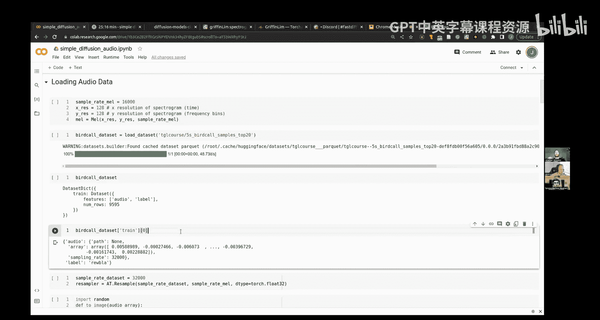

So illustrate the original data is the main issue， it's it's it's too big and slow to work with it's it's too big。

 but also you have some like some sound waves are at。

100 hertz right so they're they're going up and down 100 times a second and some are at 1000 and some are at 10000。

 And often there's background noise that can have extremely high frequency components。

 And so if youre looking just at the waveform。There's lots and not of change second second。

 And there's some very long range dependencies of like， oh。' generallyer high here。

 it's generally low there and so it can be quite hard to capture those patterns and so part of it is it's just a lot of samples to deal with。

But part of it also is that。It's not like an image where you can just do like convolution and things nearby each other tend to be related or something like that it's quite tricky to disentangle what's going on and so we have this idea of something called a spectrogram。

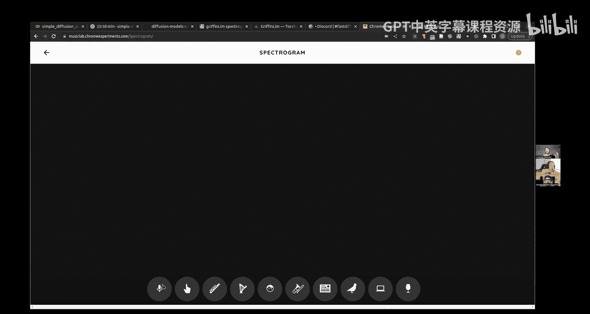

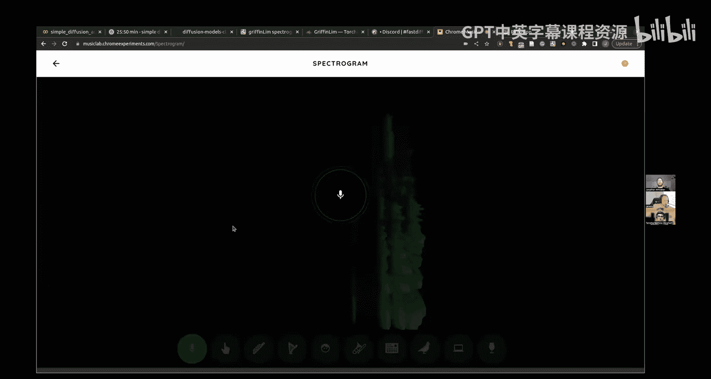

This is a fancy 3D visualization， but it's basically just taking that audio and mapping time on one axis so you can see as time goes by。

 we're moving along the X axis。And then on the Y axis is frequency。

 And so the peaks here show like intensity at different frequencies。 And so if I make a pure note。😊。

You can see that that is being mapped in the frequency domain。

 but when I'm talking there's lots and lots of peaks and that's because our voices tend to produce a lot of overtones so if I go e you can see there's a main note but there's also these subsequent notes if I play something like a chord。

😊，Yeah。You can see this you know maybe three main peaks and then each of those have these harmonics as well。

 so it captures a lot of information about the signal and so we're going to turn our audio data into something like this where even just visually if I'm a bird。

You can see this really nice spatial pattern and the hope is if we can generate that and then if we can find some way to turn it back into audio。

😊。

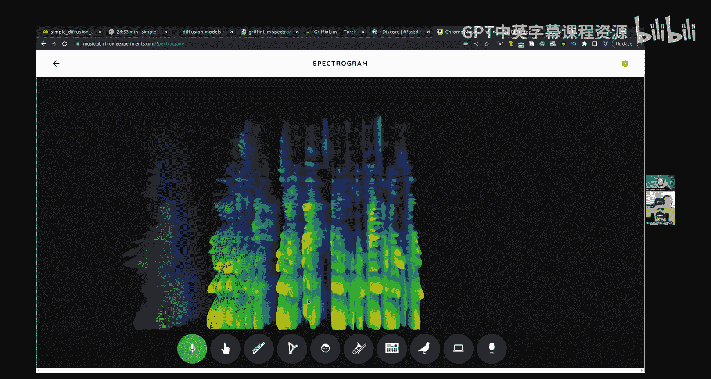

AndThen well be off to the races。And so， yeah， that's what I'm doing in this notebook。 We have。

 I'm leaning on the。Diffusers do pipelines。 audioio diffusion。

mal class and so within the realm of spectraltroograms there's a few different ways you can do it。

 so this is from the torch audio docs but this notebook is from the hugging face diffusion models class So we had that waveform that's those raw samples and we'd like to convert that into what they call the frequency domain。

hi is things like these spectrograms and so you can do a normal normal spectrogram。

 a power spectrogram or something like that， but we often use something called a Mel spectrogram which is exactly the same it's actually probably what's being visualized here and it's something that's designed to map。

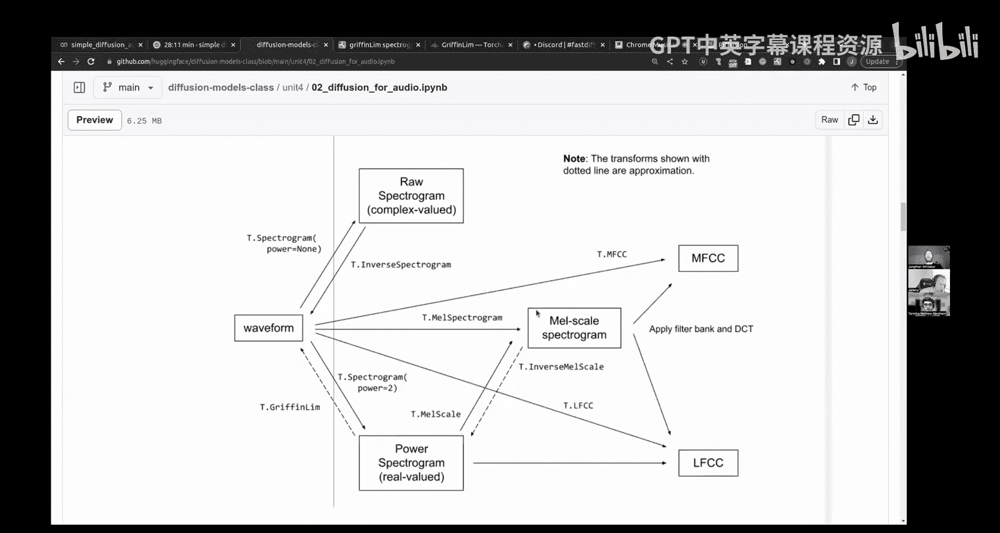

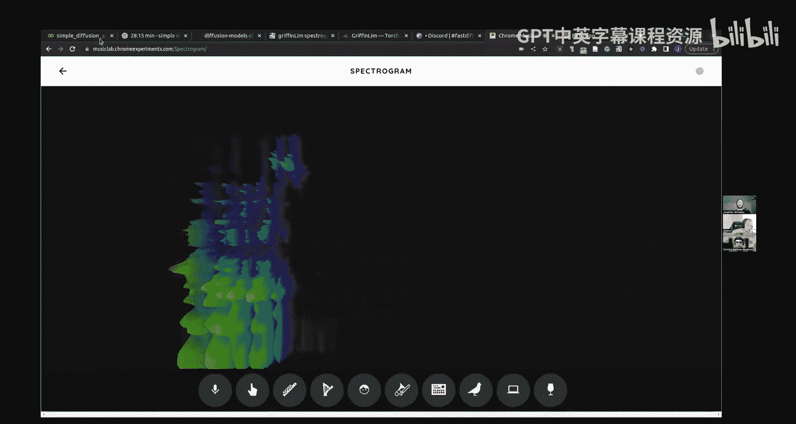

🎼The like the the frequency range is into a range that's。

Like tied to what human hearing is based on and so rather than trying to capture all frequencies from you know 0 hertz to 40。

000 hertz， a lot of which we can't even hear， it focuses in on the range of values that we tend to be interested in as humans and also it does like a transformation into kind of like a log space so that the intensities like highs and lows correspond to loud and quiet for human hearing so it's very tuned for the types of audio information that we actually might care about rather than you know tens of thousands of kilohertz that only bats can hear。

Okay， so we're going to rely on a class to abstract this away。

 but it's going to basically give us a transformation from waveform to spectrogram。

 and then it's also going to help us go from spectrogram back to waveform。

And so let me show you my data I have this two image function it's going to take the audio array it's going to use the ME class to handle turning that into spectrograms and the class also does things like it splits it up into chunks based on you can set like a desired resolution I'd like 128 by 128 spectrogram it says okay great I know how many I know you need 128 frequency bins for the frequency access and 128 steps on the time axis so it kind of handles that converting and resizing and then it gives us these audio slice to image so that's taking a chunk of audio and turning it into the spectrogram and it also has the inverse so our data set is fairly simple we just referencing our original audio dataset but we're calling that two image function and then we're turning it into a tensor and we're mapping it to minus 0。

5 and 0。Five similarly to what we've done with like the grayscale images in the past。

So if you look at a sample from that data， we now have instead of an audio waveform of 32，000 or 64。

000 of it two seconds samples， we now have this 128 by 128。

Pixel spectrogram which looks like this and it's just it's gray scale so this is just matpot lips colors but we can test out going from the spectrogram back to audio using the image to audio function that the ME class has and that should give us。

Sounds kind of like birds。 Now， this isn't perfect because the spectrogram shows the intensity at different frequencies。

 but with audio， you've also got to worry about something called the phase。

 And so this image to audio function is actually behind the scenes doing。

A kind of iterative approximation with something called the Griffin Ly algorithm so'm not going to try and describe that here。

 but it's just it's approximating it's guessing what the phase should be it's creating a spectrogram is's comparing that to the original it's updating that is doing the sort of like iterative very similar to like an optimization thing to try and generate an audio signal that would produce this spectrogram which we're trying to invert So just to clarify that so。

My understanding， what you're saying is that the spectrogram is。

A losssy conversion of the sound into an image。😔，And specifically it's lossy because it tells you the kind of intensity at each point。

 but it's not it's kind of like is it like the difference between between a sine wave and a cosine wave like they're just shifted in different ways we don't know how much it's shifted so coming back to the sound you do have to get that that shifting the phase correct and so it's trying to guess something and it's sounds like it's not doing a great guess from the。

T you the original audio is also not that amazing。 but yes， the the spectrogram back to audio task。

 this， these dotted lines are like highlighting。 this was， yeah， it's an approximation。

 And there are deep learning methods now that can do that。😊。

AndBe or at least that sound metallic quality because you can train a model somehow to go from this image like representation back to a。

An audio signal。But we just use the approximation for this notebook。Okay。

 so now that we can represent our data as like a gray scale 128， 128 pixel image。

 everything else becomes very much the same as the previous diffusion models examples。

 we're going to use this noise a I function to add different amounts of noise so we can see now we have our spectrograms but with varying amounts of noise added。

😊，We can create a simple diffusion model and just copying and pasting the results。

 but with one extra layer， just with very few channels to go from 128 to 64 to 32 to 8 to6 I。

16 by 8 to 8。 no attention just。I think pretty much copied and pasted from notebook 30 and train it for。

 in this case，15 epochs， it took about Oh， this is interesting。 you're using。Simple diffusion。Yes。

 so specifically this is the simple diffusion model that you， I think you've already introduced。

 maybe not。😊，I think we briefly looked at it so let's remind ourselves of what it does here。Okay。

 yeah， so we have some number of down blocks with a specified number of channels。

And then the key insight from simple diffusion was that you often want to concentrate the computes in the sort of middle at the low resolution。

 so that's these these mid blocks and they transformers。Yes， yeah。

 and so we can stack some number of those and then the corresponding up path and this is a unit so we're passing in the features from the down path as we go through those up blockss。

And so we're going to go take in。Image and time step。 We can embed the time step。 We're going to。

Go through our down blocks and saving the results。 We're going go through the mid blocks。

 There we go through the mid blocks。 Yeah， before that， you've also got the。Ebedding。Of the。

Locationations at self。la is the loanable embeddings using scale and shift to remember。Right。

 so this is preparing it to go through the transformer blocks by adding some learnable embeddings cool。

All right， and then we're reshaping it to be effectively a sequenced since that's how we had written our transformer to have expect a 1D sequence of embeddings and so once you've gone through those mid blocks we reshape it back and then we go through the up blocks passing in and also are saved。

Outputs from the down path。Yeah， so it's nice， it's a nice model you can really control how much parameters and compute you're doing just by setting like what are the number of features or channels at each of those down block stages and how many mid blocks are you going to stack？

And so if you want to scale the up， it's quite easy to say and you just add more mid blockslock。

 maybe I'll add more channels。To to the dominantpaths。

And there's a very easy mouse to tweak together get a larger or smaller model Fun fun thought you know is simple diffusion only came out a couple of months ago and I don't think I think ours might be the first。

Publicly available code。For， I don't think the authors release the code。

 I suspect this is probably the first time maybe it's ever been used to generate audio before。

Possibly yeah I guess I know a couple of people who've at least privately done their implementations when I asked the author of he is releasing code he said but it's simple。

 it's just a Russian transformer blocks you can get yourself I'll release it eventually no maybe maybe not I'm'll done it align them but they were like oh you can see the pseudocode it's pretty easy。

😊，Yeah， it is pretty easy。Yeah， cool， so trains the loss goes down as we hope sampling is exactly the same as generating images normally and that's going to give us the spectrograms。

 so I'm using deedem sampling with 100 steps and to actually listen to these samples。

 we then are just going to use that image to audio function again to take our grayscale image and in this case actually it expects a PIL image so I first converted it to PIL and then turn that back into audio。

And so you can play some of the generated samples。Yeah。Wow。That's cool。 I don't know that I could。

Guaranteee what bird is making in these calls and some of them are better than others。

 like some of them。Yep。Yeah。Well， some of the original samples sound like that so。Exactly， yeah。

 so yeah that's generating them and fake bird calls with with spectralgramm diffusion there's projects that do this on music so the refusion projects。

😊。

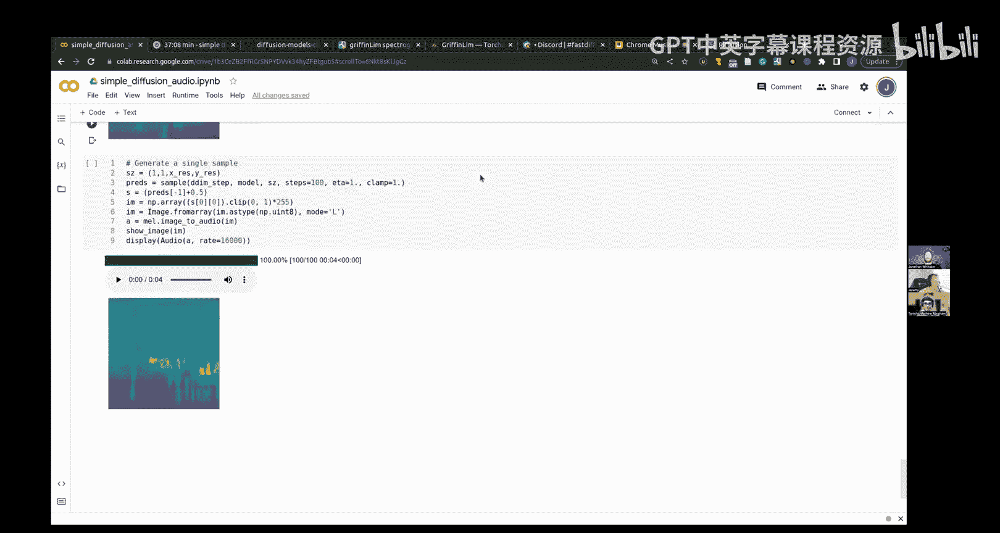

🎼Ands such is one text。And yeah， there's there's various other like pretrain models that do。

Diffusion on spectrograms to produce。You know， music clips or voice or whatever。

I may have frozen refusion is actually this stable diffusion model that's fine tuned specifically for for the spectrogram generation。

 which is which I find very impressive， it's like a model that was originallyly for you know text to images instead can also generate these spectrograms I guess there's still some useful information in you know this sort of text to image model that kind of generalizes or you can still be used for text to audio so I found that a very interesting impressive application as well also refusion is an awesome name。

😊，Indeed， it is， yeah。Cool， I guess， since it's a latent model that leads us on to the next topic where I was just gonna say we've got a natural segue there。

 Yes， so we're if we want to。😊，We replicate refusion， then we'll need latent。😔。

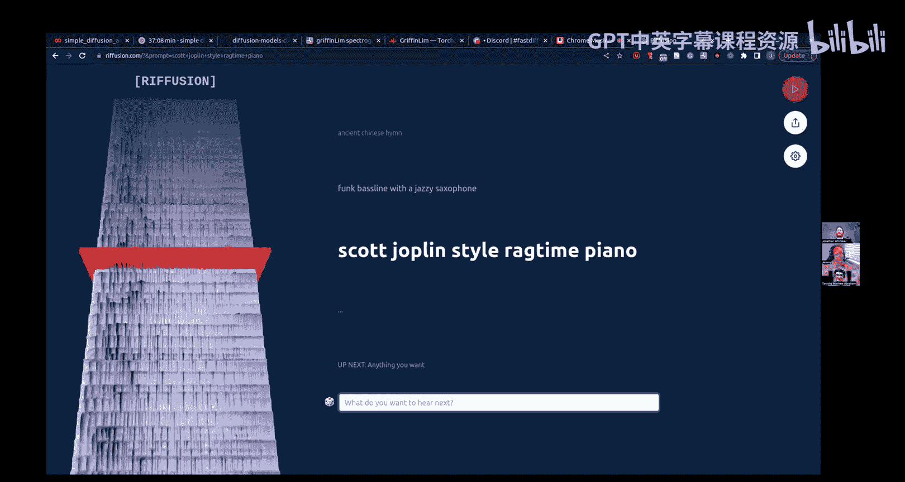

Yeah， so the final non NLP part of stable diffusion is this ability to use the more compressed representation。

Coed by a VAE called latetntens instead of pixels。So we're going to start today by creating a VAE。

 taking a look at how it works。So to remind you as we learned back in the first lesson of this part of part two。

The VAE model converts the。256 by 256 pixelix，3 channel。Into a is it 64 by 64 by4？

It'll be 32 if it's 256 it's 512 to 6 Oh 51264， Okay， so do a 32 by 32 by four。

 so dramatically smaller， which makes life so much easier。😊，嗯。Which is， is really nice。

Having said that， you know， simple diffusion。😊，Does the。First， you know， few， in fact， you know。

 all the downsling pretty quickly and all the hard work happens。You know， at a 16 by 16 anyway。

 so maybe it's， you know with simple diffusion it's not。As bigcca deal old as it used to be。

 but it's still， you know， it's very handy， particularly because for us folks with more normal amounts of compute。

 we can take advantage of all that hard work that the stability。

AI computers did for us by creating the stable diffusion VAE。So that's what we're going to do today。

 but first of all， we're going to create our own。😊，嗯。So。

Let's do a VE using fashion Mns so the first or the first stuff is just the the normal one thing I am going to do for this simple example though is I'm going to flatten the fashion emnt pixels into a vector。

To make it as simple as possible。嗯。Okay， so we're going to end up with vectors of length 784 because 28 by 28。

 784。We're going to create a single hidden layer MLP with。400。Hidden。And then 200 outputs。

So here's a linear layer， so it's a sequential containing a linear and then an optimal activation function then an optional normalization。

We'll update in it weights so that we initialize linear layers as well。So before we create a VaE。

 which is a variational auto encoder we'll create a normal auto encodecor we've done this once before and we didn't have any luck in fact we were so unsuccessful that we decided to。

Go back and create a loaner and come back a few weeks later once we knew what we were doing so here we are we're back。

 we think we know what we're doing。So we're just going to recreate an auto encoder just like we did some lessons ago。

 so there's going to be an encoder which is a sequential which goes from our 768 inputs to our 400 hidden and then a linear layer with our 400 hidden and then an output layer from the 400 hidden to the 200。

Outputs of the encoder， so there we got our latent。And then the decoder。😊。

We'll go from those 200 latents to our 400 hidden， have our hidden layer and then come back to our。

768 inputs。嗯。All right so。We can optimize that in years way using atom。And we do it for 20 epoCs。

 runs pretty quickly because it's quite a small data set and quite a small model。嗯。

And so what we can then do。I we can grab a batch of our X who actually grabbed the batch of X earlier。

嗯。W back here。So I've got a batch of images。And we can put it through our model。

Pop it back on the CPU。And we can then have a look at our original mini batch。

And we have to reshape it to 28 by 28 because we previously had flattened it。

 so there's our original and then we can look at the result after putting it through our model。

And there it is， and as you can see， it's you know。

 very roughly regenerated and so this is not a massive compression。

 it's compressing it from 768 to 200。And it's also not doing an amazing job of recreating the original details。

 but you know this is the simplest possible autoencor so it's doing， you know。

 it's a lot better than our previous attempt， so that's good。

So what we could now do is we could just generate some noise。

And then we're not even going to do diffusion。 we're just going to go and say like， okay。

 we've got a decoder， so let's just decode that noise。And see what it creates。And the answer is not。

Any great， I mean， I could kind of recognize that might be the start of a shoe。

Maybe thiss is sort of a bag， I don't know， but it's not doing anything amazing。

So we have not successfully created an image generator here。

 but there's a very simple step we can do to make something that's more like an image generator。

The problem is that。These 200。The vector of length 200 we'reating。

There's no particular reason that things that are not in the data set are going to create。

Items of clothing。We haven't done anything to try to make that happen。

 We've already tried to make this work for things in the data set， you know and。Therefore。

 when we just randomly generate。A bunch of， you know， a vector of length。

200 or 16 vectors of length 200 in this case。 and then decode them。

 There's no particular reason to think that they're going to create something that's。

Recognizable as clothing。So。The way a VAE tries to fix this。

Whereas by we've got the exact same encoder as before， except it just missing its final layer。

Its final layer has been moved over to here， I'll explain why there's two of them in a moment。

 so we've got the inputs to hidden， the hidden to hidden and then the hidden to latentence。

 the decoder is identical。Okay， latentance to hidden， hidden to hidden， hidden to inputs。

And then just as before， we call the encoder。嗯。But we do something a little bit weird next。

 which is that we actually have two separate。Final layers， we've got one chord mu。

For the final of the encoder。And one called LV， which stands for log varianceance。

So our encoder has two different final layers， so we're going to call both of them。Okay。

 so we've now got two。Encoded。200 long lots of latentance， what do we do with him？

What we do is we use them。😔，To generate random numbers。And the random numbers have a mean of mure。

So when you take a round01， so this creates01 random numbers， it means zero standard deviation one。

So if we add mu to it， then youll have a main of mu。App。And if you multiply the random numbers by。

Half of log variance e to the power of that。So given this log of variance。

 this is going to give you standard deviation。So this is going to give you a standard deviation of e to the half Lv and a mean of mu y the half it doesn't matter too much。

 but if you think about it standard deviation is the square root so the variance is squared so when you take the log you can move that。

That。Half into the modplication because of the log。Trick， that's why。

Weve just got the half here instead of the square root， which would be to the power above。嗯。

So this is just， yeah， this is just the standard deviation。

 So we've got the standard deviation times normally distributed random noise plus mu。

 So we end up with。Normally distributed。Numbers， we're going to have 200 of them for each elementman of the batch。

Where they have a standard deviation of the result of。This final layer。And a variance。

Which is the result of log variance with the result of this final error。And then finally。

 we passed that。Through the decoder as usual， I'll explain why we pass back three things。

 but for now I'll just worry about the fact we pass back the result of the decoder So what this is going to do is it's going to generate the the result of calling encode。

Is going to be。😔，A little bit random， on average。You know。

 it's still generating exactly the same as before， which is the result of a sequential model with。

You know， MLLP with one hidden layer。But it's also going to add some randomness around that， right。

 So this here's the bit which is exactly the same as before。

 This is the same as calling encode code before。 but then here's the bit that adds some randomness。

To it。And the amount of randomness is also。Itself random。Okay。

 so then that gets run through the decoder。😊，Okay， so if Wayne now just。Oh， you know， train that。

Right using the result of the decoder and using I think we didn't use MSE loss。

 we used binary cross entropy loss， which we've seen before。

 so if you've forgotten you should definitely go back and rewatch that are really part one or we've done a bit of it in part two as well binary cross entropy loss。

嗯。With logggatts means that you don't have to worry about doing the soft Mac。

 it does the softm for you。So if we just optimize this using BCE now。You would expect， and it would。

 I believe I haven't checked that it would basically take this final this layer here and turn these all into zeros。

As a result of which it would have no variance at all。And therefore it would behave exactly the same。

As the。A previous order of encoder does that sound reasonable to you guys Yeah okay so that wouldn't help at all because what we actually want is we want some variants and the reason we want some variants is we actually want to have it generate some latetnts which are not exactly our data they're around our data but not exactly our data and then when it generates lants that are around our data we want them to decode。

To our to the same thing， we want them to decode to the correct image and so as a result。

 if we can train that。Something that it does include some variation。

And still dedes back to the original image then we've created a much more robust model。

 and then that's something that we would help then that we would hope then when we say， okay。

 well now des a noise that it's going to decode to something。Better than this。

 So that's the idea of a Ve。 So how do we get it to create。嗯。A log variance。

Which doesn't just go to zero。Well， we have a second loss term， it's called the KL divergence loss。

 we've got a here called KLD loss and what we're going to do is our VAE loss is going to take the braining across entropy。

Between the。Actual decoded bit so that's input zero。And the target。

so that's this is exactly the same as before is this binary cross entropy and we're going to add it to this KLD loss。

 KL dirgence Now KL divergence， the details don't matter terribly much What's important is when we look at the KLD loss。

 it's getting past the input and the targets。But if you look。

 it's not actually using the targets at all。So if we pull out the the input into it three pieces。

 which is our predicted image， our mu and our log variance， we don't use this either。

 So the B CE loss only uses the predicted image and the actual image。

 the K divergence loss only uses。Mux and log variance。

And all it does is it returns a number which says for each item in the batch is mu close to zero。

And is log variance close to one。How does it do that？😊，For me， it's very easy。Newscrad。

So if if mu is close to0， then minimizing mu squared does exactly that right， If mu is one。

 then mu squared is1， if mu is minus-1， mu squared is1， If mu is 0， mu squared is 0。

 that's the lowest you can get。😊，For a squid。Um。Okay， so we've got a。Muse squared piece here。

And we've got a dot mean， so we're just taking， that's just basically taking the mean of all the muse。

😊，And then there's another piece， which is we've got log variance。Minus。

Aid to the power of v varianceians。So if we look at that。

 so let's just grab a bunch of numbers between Neg3 and three and do number minus e to the power of that number。

And that is going to pop in the  one plus in the 0。

5 times as well they matter much and you can see that's got a minimum at zero。

So when that's a minimum of zero。😊，Either the power of that， which is what we're going to be using。

It's actually half times a to the pair of that， but that's okay is what we're going to be using。😊。

In our got forward method。That's going to be。8 to the power of zero， which is going to be 1。

So this is going to be minimized。😔，Where log variance X equals。one。So therefore。

 this whole piece here will be minimized when mu is 0 and。LV is also。

Zero and so therefore LV either the power of LV is one。Now， the reason that it's specifically。

This form is basically because there's a specific。Mathematical thing called the KL divergence。

 which compares how similar to distributions are， and so a normal distribution can be fully characterized by its mean and its variance。

 and so this is actually more precisely calculating the similarity。

It's specifically the kl divergence between the actual mu and Lv that we have and a distribution with a mean zero and a variance of one。

But you can see hopefully why conceptually we have this。

Mu dotP2 and where we have this Lv dot X Lv minus Lv。t X here。嗯。So that is our。Be loss。

 did you guys have anything to add to any of。That description。

So maybe to highlight that the objective of this is to say rather than having it so that the exact point that an input is encoded to decodes back to that input。

 we're saying number one， the space around that point should also de to that input because we're going to tra and force some variance and number two。

 the overall variance should be like，Yeah， the overall space that it uses should be roughly zero mean and。

Unit and variance right so instead of able to like map each input to like an arbitrary point and then decode only that exact point to an input。

 we're now mapping them to like a restricted range and we saying that not just each point。

 but its surroundings as well should also decode back to something that looks like that image and that's trying to like condition this latent space to be much nicer so that any arbitrary point within that range will hopefully map to something useful。

 which is a harder problem to solve right so we would expect given that this is exactly the same architecture we would expect its ability to actually decode。

Would be worse than our previous attempt。Because it's a harder problem that we're trying to solve。

 which is just we've got random numbers in there as well now。

 but we're hoping that this ability to generate images will improve。Thanks， Jonno， okay。

 so I actually asked。Bing about this， which is just this is more of an example of like， I think for。

 you know， now that we've got GPT4 and Bing and stuff that I find they're pretty good at answering questions。

That like I wanted to explain to students what would happen if the variance of the lates was very low or what if they were very high so why do we want them to be one and I thought like oh gosh。

 this is hard to explain so maybe。Bing can help so I actually thought it was pretty good so I just say what Bing said so Bing says if the variances of the latents are very well low then the encoder distribution would be very peaked and concentrated around the mean so that was the thing we were describing earlier if we had trained this without the KLD loss at all right it would probably make the variance zero and so therefore that latent space would be less diverse and expressive and limit the ability of the decoder to reconstruct the data accurately make it harder to generate new data that's different from the training data。

Which is exactly what we're trying to do。And if the variance is very high。

Then the encoder would be very spread out and diffuse， it would be more。

 the latent would be more noisy and random。嗯。Make it easier to generate new data that's unrealistic or nonsensical Okay。

 so that's why we want it to be exactly at a particular point。So when we train this。

 we can just pass the AE loss as our loss function。

 but it'd be nice to see how well it's going at reconstructing the original image and how it's going at creating。

Zero1 distribution data separately。What I ended up doing was creating just a really simple thing called funk metric。

 which I derived from the capital M mean plus in the torch。

Just trying to find it here from the torch eval dot metrics。

So they've already got something that can just calculate means so obviously this stuff's all very simple and we've created our own metrics class ourselves back a while ago but since we' were using Torch EVvalL。

 I thought this is useful to see how we can create one a custom metric where you can pass in some function to call before it calculates them in。

So if you call。😔，So you might remember that the way Torch Eval works is it has this thing called Up。

 which gets past the input and the targets， so I add to the weighted sum。

The result of claw some function。On the input and the targets。嗯。

So we want two kind of new metrics one is the。We're going to print it out as KLD。

 which is a funk metric on KLD loss， the one which we printed as BCE。

 which is a funk metric on BCE loss。And so the actual， when we call the learner。

 the loss function we'll use is VE loss。😊，But we're going to pass in as。metricttris。嗯。

This list of additional metrics to print out， so it's just going to print them out。And in some ways。

 it's a little inefficient because it's going to calculate KLD loss twice and BCE lost twice one to printed it out and one to go into the。

You know， actual loss function， but it doesn't take long for that bit， so I think that's fine。

So now when we call Learndo fit， you can see it's printing them all out。

 so the BCE that we got last time was 0。26。And so this time， yeah， it's not as good， it's 0。

31 because it's a harder problem and it's got random randomness in it。U。

And you can see here that the BCE and KLD are pretty similar scale when it starts。

 that's a good sign if they weren't， you know， I could always in the loss function。

Sca one of them up or down。But they're pretty similar to start with， so that's fine。

So we trained this for a while and then we can use exactly the same code for sampling as before。

And yeah， as we suspected， its ability to decode is worse。

So it's actually not capturing the LEE at all， in fact， and the shoes got very blurry。

But the hope is that when we call it on noise， called the decoder on random noise。

 that's much better we're getting， it's not amazing but we are getting some recognizable shapes so。

You know， VEes are。You know。Not generally going to get you as good a results as。Diffusion models are。

 although actually if you train really good ones through really long time。

 they can be pretty impressive， but yeah， even in this extremely simple quick case。

 we've got something that can generate。Recognizable。Items of clothing。😊。

Did you guys want to add anything before we move on to the stable diffusion VAE？Okay。So。This， yeah。

 so this VE is。Very crappy and as we mentioned， like one of the one of the key reasons to use the VE is actually that you can benefit from all the。

Compute time that somebody else has put into training。A good  VAE。

Maybe just also like one one thing when we say good V E。

The one that we've trained here is good at generating because it maps down to this like one20 dimensional vector and then back。

In a very useful way and like if you look at VAE for generating they'll often have a pretty small dimension in the middle and it'll just be like this vector that gets mapped back up and so VAE that's good for generating is slightly different to one that's good for compressing and like the stable diffusion one we'll see has this like spatial component still it doesn't map it down to a single vector it maps it down to 64 by 64 or whatever。

😊，I think that's smaller than the original， but for generating。

 we can't just put random noise in there and hope like a cohesive image will come out。

So it's less good as a generator， but it is good because it has this like compression and reconstruction ability。

Cool， yeah， so let's take a look。😊，Now。嗯。So demonstrate this。

 we want to move to a more difficult task because we want to show off how using latent's Low doth stuff we couldn't do well before。

So the more difficult task we're going to do is generating bigger images and specifically generate images of bedrooms。

Using the El Sun bedrooms data set， So El Sun is a really nice。Data set。Which。Has。Many， many。

 many millions of images across 10 scene categories and 20 object categories。

And so very it's very rare for people to use of the object categories to be honest but people quite often use the same categories they're a little more than little can be extremely slow to download that the website they come from is very often down so what I did was I put a subset of 20% of them onto AWS they kindly provide some free data set hosting for our students。

And also the original L signss in a slightly complicated form since they've got an LMDB database and so I turned them into just normal images in folders。

 so you can yeah download them directly from from the AWS dataset site that they provided for us。

So I'm just using fast ch to save it and then using Python's SHU tool to unpack the G zipped tar file。

嗯。Okay， so that's given us once that runs， which is going to take。A long time and you know if。嗯。

It might be even more reliable just to do this in the shell with Wget or area 2C or something。

Then doing it through Python， so this will work， but if it's taking a long time or whatever。

 maybe just to delete it and do it in the shell instead。嗯。Okay， so then。I thought， all right。

 how do we turn these into？Ltens。Well， we could create a data set。In the usual ways。

 it's going to have a length。So we're going to grab all the files， so Glob is a built into Python。

 which we'll search for in this case。Star dot Jpeg。 And if you've got star star slash。

 that's going to search recursively as long as you pass recursive。 So we're going to search for。

All of the。JPEG files inside our data slash bedroom folder。So that's what this is going to do。

 it's going to put them all into the files。Attribute。And so then when we get an item， the I item。😊。

It will find the I file。It will read that image， so this is Pi Tor's read image it。

The fastest way to read a JPEG image， people often use PO。

 but it's quite hard to find a really well optimized。

PAL version that's really compiled fast whereas else the paytorrch torch vision team have。

Created a very， very fast。Read image， so that's why I'm using theirs。

And if you pass in imageread mode。gb， it'll automatically turn any one channel black and white images into three channel images for you or if there are four channel images with transparency it'll turn those so this is a nice way to make sure they're all the same and then this turns it into floats from not to one。

And these images are generally very close to 256 by 256 pixels。

 so I just crop out the top 250 pixel by 256 bit because I didn't really care that much。

And we do need them to all the same size in order that we can then pass them to the VAE stable diffusion VAE decoder as a batch otherwise it's going to take forever。

So I can create a data loader。It's going to go through a bunch of them at a time。So 64 at a time。

And use however many CPUs I have as the number of workers， it's going to do it in parallel。

And so the parallel bit is the bit that's actually reading the JPGs。

hi is otherwise its going to be pretty slow so if we grab a batch here it is is what it looks like okay generally speaking they're just bedrooms although we've got one pretty risky situation in the bedroom。

 but on the on the whole they're not not safe for work because is the first time I've actually seen an actual bedroom scene taking place as it were。

嗯。All right， so as you can see， this mini batch of。

 if I described the first 16 images has three channels and 256 by 256 pixels。嗯。So that's。

How big that is for 16 images， so that's。7，2，8， when they say， three point。😔，One， four， five million。

Flights。To represent this。Okay， so as we learned in the first lesson of part two， we can grab。

An auto encoder。Directly using diffusers using from pretrained。We can pop it onto our GPU。

And importantly， we don't have to say with。Borch do no grad any more。 if we pass requires grad false。

 And remember this neat trick and pietorch if it ends in an underscore。

 it actually changes the thing that you're calling in place。

 So this is going to stop it from computing gradients。

 which would take a lot of time and a lot of memory otherwise。So let's test it out， let's encode。

Now many batch。And so just like Johnoe was saying， this has now made it much smaller it's got。

 just in our 16 batch of 16， it's now a four channel 32 by 32。

So if we can compare the previous size to the new size， it's 48 times smaller。

So that's 48 times less memory it's going to need。And it's also going to be a lot less compute for a convolution to go across that image。

So it's no good unless we can turn it back into the original image。😊。

So let's just have a look at what it looks like first now it's a four channel image so we can't naturally look at it。

 but what I could do is just grab the first three channels。

And then they're not going to be between naught and one So if I just dot sigmoid now they're between naught and one and so you can see that our you know。

 riskque bedroom scene， you can still recognize it right or this。Bedroom， this bed here。

 you can still recognize it， so there's still that kind of like the basic geometry is' still clearly there。

But it' yeah， it's clearly changed it a lot。As well。So importantly。

 we can calldecode on this 48 times smaller。Tensor。And it's really， I think， absolutely remarkable。

How good it is。Can't tell the difference。诶。To the original。Maybe if I zoom in a bit。

Her face is a bit blurry， was her face always a bit blurry？😔，It' was always a bit blurary。😔，First。

 second， third。P。Oh， hang on。Did that used to look like a proper N D Yeah， okay。

 so you can see this used say there clearly there's an N D here。

And now you can't see those letters so so and this is actually a classic thing that's known for this particular VAE is it some。

Not able to。Regenerate writing correctly at small font sizes。I think it's also pretty。

 it's like I think we hear that the faces are already pretty low resolution resolution。

 but if you were at a higher resolution， the faces also would probably not。😊。

Be converted appropriately yeah cool。But overall， yeah， it's done a great job。

A couple of other things I wanted to note was like so like you mentioned like a 40 I guess a factor of 48 decrease oftentimes people will refer to mostly at the spatial resolution so since it's going from 256 by 256 to 32 by 32 so that's like a factor of8 so there sometimes you'll note like I think it's like F8 or something like this they'll note the spatial resolution so sometimes you may see that written out like that and of course and the other thing is is an eight squared decrease in the number of。

😊，Pixels， which is interesting， right， right？And then the other thing I wanted to note was that the VAE is also trained with with a perceptual loss objective。

 as well as technically like like a discriminator again objective I don't know if you were going to go into that Yeah later right now so yeah。

 so perceptual loss we've。We've already discussed right。

 so the VAE is going to you know when they trained it。So I think this was trained by Comfis， right。

 the， you know， Robburn and。I'm gang。And used stabilitybil。

AI donated compute for that and they went to be clear actually no the VAE was actually trained separately and it's actually a train on the open images data set and it was just this VAE that they trained by themselves on you know a small subset of data but because the VAE is so powerful it's actually able to be applied to all these other data sets as well Okay great yeah so they so they would have had a KL diversion loss and they would have either had an MSC or BCE loss。

 I think it might have been an MSE loss they also had a perceptual loss which is the thing we learned about when we talked about super resolution which is where。

When they compared the output images to the original images， they would have run that through。

A you know， image net trained or similar classifier and confirmed that the activations they got through that model were similar。

And then the final bit is as Tuishia was mentioning， is the adversarial loss。

 which is also known as agan loss。So again is a generative adversarial network。And the the G loss。

 what it does is it grabs it is's actually。More specifically， what's called a patch wise， patch wise。

Gan loss。 And what it does is it takes like。A little section of an image， right and。

What they've done is they train， it's let's just simplify it for a moment and imagine that they've pre trained a classifier right。

 where they've basically got something that you can pass it a real you know。

 patch from a bedroom scene。And a。And a fake patch。From a bedroom， s。And they both go into。😔，The the。

What's called the discriminator？And this is just a normal， you know， resnet or whatever。

Which basically outputs。Something that either says，Yep。The image is real。

Or nope the image is fake so sorry I said it passes in two things you just that was wrong you just pass in one thing and it returns either it's real or it's fake and specifically it's going to give you something like the probability。

That it's real。There is another version I don't think it's what they use pass into and it tells you which one's relative。

 do you remember to niche because it a relativistic G or a normal G？

I think it's a normal one yeah so the realtistic scan is when you pass in two images and it says which is more real the one we think that we if you remember correctly they use is a regulargan which just tells you the probability。

😊，that it's real and so you can just train that by passing in real images and fake images and having it learn to classify which ones are real and which ones are fake so now that once you've got that model trained then as you train your G you pass in the patches you know of each image into the discriminator。

Just's call D here。Right and it's going to spit out。

The probability that that's real and so if it's bat out， you know。0。

1 or something then you're like oh dear that's terrible our VAE is spitting out pictures of of bedrooms where the patches of it are easily recognized as not real but the good news is that's going to generate derivatives right and so those derivatives then it's going to tell you how to change the pixels of the original。

Genrated image to make it trick the can。Better。And so what it'll do is it'll then use those derivatives as per usual。

to update our VAE and the VAE in this case is going to be called a generator right that's the thing that's generating the pixels and so the generator gets updated to be better and better at tricking the discriminator。

And after a while， what's going to happen is the generator is going to get so good that the discriminator gets fooled every time right and so then at that point you can you can fine tune the discriminator better by putting in your better generated images。

😊，RightAnd then once your discriminator learns again how to recognise the difference between real and fake。

 you can then use it to。😊，Traight the generator and so this is kind of ping ponging back and forth between the discriminator and the generator。

😊，Back when Gs were first created。You know。People were finding them very difficult to train and actually a method we。

Developed at fast AI， I don't know if we were the first to do it or not。

 was this idea of kind of pre training a。A generator just using perceptual loss and then pre training a discriminator to be able to fool the generator and then ping ping backwards and forwards between them after that。

Basically， whenever the discriminator got too good， start using the generator。

 any time the generator got too good， start using the discriminator， nowadays that's pretty standard。

 I think， to do it this way。And so yeah， this G loss。

 which is basically saying penalize for failing to fool the discriminator。Is called an adversarial。

Adversarial。😔，Lo。To maybe motivate why， why you do this。

 if you just did it with like a means squ error or even a perceptual loss。

With such a high compression ratio the VAEes tend to like produce a fairly blurry output because it's not sure whether there's texture or not you know in this image or the edges on like super well defined find where they'll be because it's going from like one four dimensional thing up to like this whole patch of the image and so it tends to be a little bit blurry and hazy because it's kind of hedging its bes whereas that's something that the discriminator can quite easily pick up oh like it's blurry must be fake you know and so then its having the discriminator that is adversarial loss is just kind of saying like even if you're not sure exactly where this texture goes。

 rather go with the sharper looking texture that looks real then with some blurry thing that's going to maximize your MSc and so it tricks it into。

Kind of faking this higher resolution looking sharper output。Yeah， and。

I'm not sure if we're going to come back and like train our own and at some point。

 but if you're you know， interested in。Training your own GN or over call it agan， right I mean？

Nowadays。We never really just use again we have an adversarial loss as part of a training process。

 so if you want to learn how to use adversarial loss like in detail and see the code the 2019 fast AI course lesson7 part one has a walkthrough so we have sample code there and you know。

 yeah maybe given time we'll come back to it。Okay， so。Quite often people will call the VAE encoder。

When they're training a model which to me makes no sense right because the encoded version of an image never changes unless you're using data augmentation and want to do augmentation on so do you know encode augmented images。

 I think it makes a lot more sense to just do a single run through your whole training set and encode everything once。

So naturally the question is then well why do you save that because I it's going to be a lot of RAM if you put this leave it in RA and also you you know as soon as you restart your computer we've lost all that work。

There's a very nifty file format you can use called a memory mapped Nmpy file。

 which is what I'm going to use to save our latent。

 a memory mapped NumpyI file is basically what happens is you take the memory in RAM that NI would normally be using。

And you literally like。copy it。Onto the hard disk basically that's what they mean by memory map there's a mapping between the memory and RA and the memory and hard disk and if you change one it changes the other and vice versa they're kind of two ways of seeing the same thing and so if you and so if you create a memory map。

Numppy array， then when you modify it， it's actually modifying it。On disc。

 but thanks to the magic of your operating system。It's using all kinds of beautiful caching and stuff to not make that slower than using a normal numpay array and it's going to be very clever at。

嗯。It doesn't have to store at all in Ram it only stores the bits in RamM that you need at the moment or that you've used recently it's really niftier kind of caching and stuff so that's kind of。

It's like magic， but it's using your operating system to do that magic for you。

So we're going to create a memory mapped file。Using n。mmap。

And so it's going to be stored somewhere on your disk， right， so we're just going to put it here。

And we're going to say， okay， so create a memory map file in this place。

 it's going to contain 32 bit floats。So write the file。And the shape of this array is going to be。

The size of our data set， so 303，125 images and each one is4 by 32 by 32。Okay。

 so that's our memory mapped file。And so now we're going to go through our data loader。

One mini batch or 24 at a time。And we're going to VAE encode。That mini batch。

And then we're going to grab。The mains。From its latent， right， we don nott want random numbers。

 we want the actual。You know， the midpoints， that means。So this is using the diffusers。

Version of that。P。So pop that onto the CPU after we're done。

 and so that's going to be mini batch of size 64。As ptorrch。

 let's turn that into nuy because Pytorrch doesn't have a memory mapped thing as far as I'm aware。

 but nuumpy does。 And so now that we've got this memory mapped array called a。

Then everything from initially from zero。Up to。😔，64 what 6？Yeah，0 to 64， not including the 64。

 that whole subpart of the is going to be set to the encoded version。

 So it's we're just it looks like we're just changing it。😊，In memory。

But because this is a magic memory map file， it's actually going to save it to disk as well。

So yeah that's it amazingly enough， that's all you need to create a memory mapped nuy array of our latents where you're done you actually have to call dot flush and that's just something that says like anything that's just in cash at the moment。

 make sure it's actually written to disk。U。And then I delete it because I just want to make sure that then I read it back。

Correctly， so that's only going to happen once if the path doesn't exist。And then after that。

 this whole thing will be skipped and instead we're going to callmp。mmap again。😊，With ampath。

 but this time and the same data type and the same shape， this time we're going to read it。

 mods R means read it。And so let's check it， let's just grab the first 16 latents。That we read。

And decode them。And there they are。 Okay， so this is like。😊，Not a very。😔，Well known technique。

 I would say sadly， but it's a really good one。Um， you might be wondering like， well。

 what about like compression， like shouldn't you be zipping them or something like that。

 but actually remember。These latents are already the whole point is they're highly compressed。

 so generally speaking zipping latents。From a good VE VaE doesn't do much。Um， because they're like。

 they kind of almost look a bit random numbersish。😊，Okay。

 so we've now saved our entire Els Sun bedroom， what's a 20% subset， the bit that I've。

Provided now latetance。So we can now run it through。 and this is the nice thing。

 We can use exactly the same process from here on in as usual。 Okay。

 so we've got the noify of our usual collated version now the。Lightens are。

Much higher than one standard deviation， so if we're about divided by five that takes it back to a standard deviation at about one。

Um， I think in the paper they use like 0。18 or something， but。This is close enough。

To make it a unit standard deviation。嗯。So we can split it into a training and a validation set。

 so just grab the first 90% for the training set and the last 10% for the validation set。

 so those are our data sets。We use a batch size of 128 so now we can use our data loaders class we created with the get DLs we created。

 so these are all things we've created ourselves with the training set， the validation set。

 the batch size。And akylation function。So。Yeah， it's kind of nice， it's amazing， you know。

 how easy it is like you know， a data set。😊，Has the same interface as an nuy array or a list or whatever。

 So we can literally just use the nuy array directly as a data set， which I think is really neat。

 this is why it's useful to know about these like。Foundational concepts because you don't have to start thinking like。

 oh， I wonder if there's some torch vision thing to use memap nu files or something that's like， oh。

 wait。They already do provide a data set interface。 I don't have to do anything。 I just use them。

So that's pretty magical。So we can test that now by grabbing。A batch。

 And so this is being noiseified。 And so here we can see our。

Noiseified images and so here's something crazy is that we can actually decode。Noise ofified images。

And so， you know， his， I guess this one wasn't noified much because it's recognizable bedroom。

And this is what happens when you just decode random noise。Something in between。

So I think that's pretty fun。Yeah， this next bit is all just copied from our previous notebook。

 create a model， initialize。Trained for a while， so this took me a few hours on a single GPU everything I'm doing is on a single GPU and literally nothing in this course。

 other than the stable diffusion stuff itself is trained on more than one GPU。

The loss is much higher than usual。😊，And that's not surprising because it's trying to generate latent pixels。

 which where like it's it's it's much more precise as to exactly what it wants， you know。

 there's not like。Lots of pixels where the ones next door are really next to each other really similar or the whole background looks the same or if a lot of that stuff it's been compressed out。

 it's a more difficult thing to predict latent pixels。

So now we can sample from it in exactly the same way that we always have using DDAM。

But now we need to make sure that we。Decode it because the thing that it's predicted that it's sampled。

latentens because the thing that we asked it to learn to predict a latentance。

And so now we can take a look and we have。Bedrooms。啊啊。And some of them look pretty good。

 I think this one looks pretty good。😊，I think this one looks pretty good。

That but I don't have any idea what it is。mAnd this one like。Clearly there's bedroomy bits。

 but there's something， I don't know， there's weird bits。Um。

So the fact that we're able to create 256 but 256 pixel。

Images where at least some of them look quite good。In a couple of hours。

 I can't remember how long it took to train， but it's a small number of hours and a single GPU It something that was not。

Previously possible。And we're in a sense， we're totally cheating because we're using the stable diffusion VAE to do a lot of the hard work for us。

But that's fine， you know， because that VAE knows how to create all kinds of natural images and drawings and portraits and oil paintings or whatever so。

😊，You can， I think， work in that latent space。Quite comfortably。Yeah。

You guys have anything you wanted to add about that Oh actually Taish can know you've trained this for longer I only trained it for 25 epochs how long did you how many hours did you train it for because you did you did100 epochs right Yes。

 I did 100 epochs I didn't keep trying exactly but I think it was about 15 hours on that。

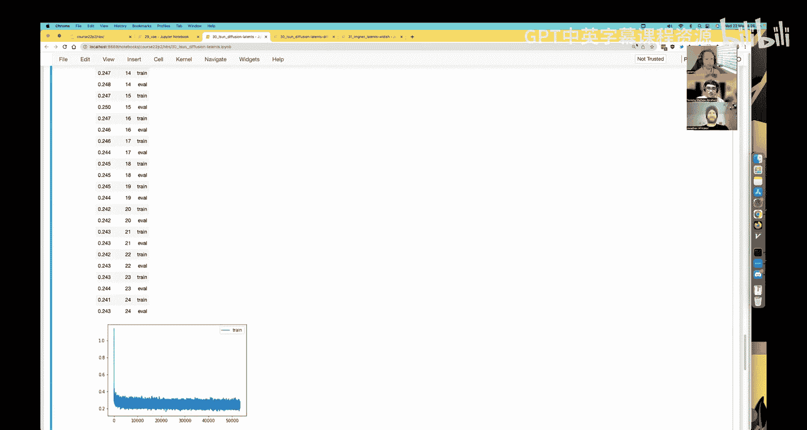

On A 100， Okay，'s basically a single A 100， yeah。I argue， I mean， the results yeah。

 I'll show it it's it's。It's。Yeah， its it's， I guess maybe slightly better， but you know。

 I guess you can。see no， it is definitely slightly better。

 the good ones are certainly slightly better。😊，Yeah， yeah。

 like the bottom left whites better than any of mine， I think。

So it's possible maybe at this point we just may to use more data。

 I guess because I guess we were using a 20% subset so maybe having more of that data to provide more diversity or something like that。

 maybe that might yeah or maybe。Have you tried doing the diffusers one for 100？No， I'm using Okay。

 I'll code here Yeah， so I've got，um all right， so I'll share my screen if you want to stop sharing yours。

😊。

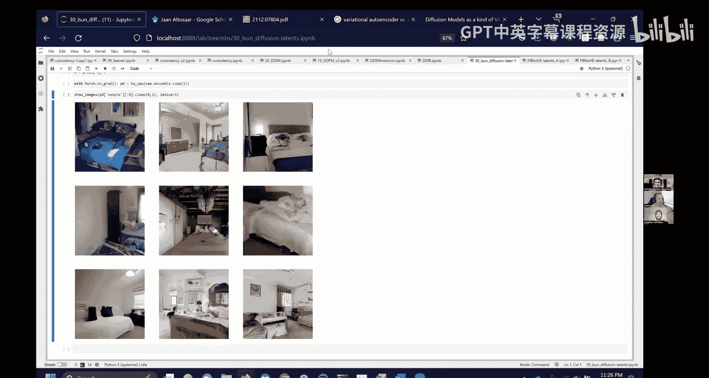

嗯。So， I do have。If we get around to this， maybe we can add the results back to this notebook because I do have a version that uses diffuseers。

 so everything else is identical。25 epochs except for the model。For the previous1， I was using our。

Our own MNe model， we have to change the channels now to four。

And a number of filters I think I might have increased a a bit。So then I tried using， yeah the。

Diffuss unit。Just with whatever their defaults were。And so I got， what did I get here。

243 with diffusers I got。A little bit better， 239。嗯。And。Yeah。

 I don't know if they're obviously better or not like this is a bit weird it's a bit weird。嗯。

I think like actually。Another thing we could try maybe is do 100 epochs but use the diffusers number of channels and stuff that they used for because I think the defaults that they use actually for diffusers is not the same as stable diffusion so maybe we could try stable diffusion matched unit for 100 epochs and。

If we get any nice results， maybe we can post them into the bottom to show people。Yeah。Yeah， cool。

Yeah， did you guys have anything else to add？At this point。😔，All right。

So I'll just mention one more thought in terms of like a bit of an interesting project people could play with。

I don't know if this is too crazy， I don't think it's been done before， but my thought was like。

There was a huge difference in our super resolution。

 do you remember a huge difference in our super resolution results when we used a pretrain model？

And when we used。Perceptual loss， but particularly when we use the pretrain model。

I thought we could use a pre train model， but we would need a pre trained latent model， right。

 we would want something where our。You know， downs backbone。Was pretrained muddle on latentens。

And so I just want to just show you what I've done and you guys you know。

 if anybody watching wanted to try taking this further。

 I've just done the first bit for you to give you a sense。

 which is I've pre-trained an image net model， not tiny image net but a full image net model on latentence as a classifier and if you use this as a backbone。

 you know， and also try maybe some of the other tricks that we found helpful like having resnets on the cross connections。

 these are things that I don't think anybody's done before I I't know the scientific literature is vast and I might have missed it but I've not come across anybody do these tricks before。

So obviously like we're。😊，One of the interesting parts of this。

 which is designed to be challenging is that we're using bigger data sets now。

 but they're data sets that you can absolutely like。Run on a single GPU， you know。

A few tens of gigabytes， which fits on。Any modern hard drive easily so these like are good tests of your ability to kind of like move things around and。

If you're somewhere that doesn't have access to a decent internet connection or whatever this might be out of the question in which case don't worry about it。

 but if you can， yes， try this because it's good practice。

 I think to make sure you can use these larger data sets。So imageNe itself。

 you can actually grab from Kagle nowadays。😊，So they call it the object localization challenge。

 but actually this contains the full。Image net data set well。

 the version that's used for the image net competition。

So I think people generally call that image net one case。

You just have to accept the terms because that has like some distribution terms yeah exactly so you've got to kind of sign in and then join the competition and then yeah accept the terms so you can then download the data set or you can also download it from hugging face。

嗯。It'll be in a somewhat different format。But that'll work as well。

 So I think I grabbed my version from from Kale so on kle， you know。

 it's just a zip file you on zipper and it creates and。IL SVRC。Dirreory。

 which I think is what they called the competition。

 yeah image that large scale visual recognition challenge。Okay， so then inside there。

 there is a data and inside there there is a CS lock and that's actually where that's where actually everything is going to be。

😊，So just like before I wanted to turn these all into latentence。

 so I created in that directory I created a latent subdirectory and this time partly just to demonstrate how these things work on it in a slightly different way。

Okay， so again， we're going to create our pre trained VAE， pop it on the GPU。

 turn off gradients for it， and I'm going to create a data set。Now。

 one thing that's a bit weird about this is that because this is really。Quite a big。

Data set like it's got 1。3 million files， the thing where we go Gob。

Star star slash star dot JPg takes a few seconds， you know。

 and particularly if you're doing this on like。You know an AWS file system or something it can take really quite a long time on mine not only took like three seconds but I don't want to wait three seconds so you know a common trick for these kind of big things is to create a cache which is literally just a list of the files so that's what this this is so I decided that Z pickle means a G zipped pickle so what I do is if if if the cache exists we just G zip dot open。

The files。If it doesn't， we use Gb exactly like before to find all the files and then we also。

Save a G zipip file containing pickle dotdump files so pickle。

tdump is what we use in Python to take basically any Python object list of dictionaries and dictionary of lists whatever you like and save them and it's super fast right and I use G zipip with compressed level one to basically be like compress it pretty well but pretty fast so。

This is a really nice way to。Create a little cache of that。

So this is the same as always and so our get item is going to grab the file。It's going to read it in。

 turn it into a float and what I did here was， you know， I'm doing a little bit lazy。

 but I just decided to scent a crop。😔，The middle you all。

 so let's say it was a 300 by 400 file it's going to center crop the middle 300 by 300 section and then resize it to 256 by 256。

So they' all be the same size。So yeah， we can now， oh。

 I managed to create the VU twice to meet that one。So I can now just confirm。

 I can grab a batch from that data loader， encode it。

And here it is and then decode it again and here it is。

 so the first category must have been computer or something So here's， as you can see。

 the V is doing a good job。Of decoding pictures of computers。

So I can do something really very similar to what we did before if we haven't got that destination directory yet created go through our data loader encode a batch and this time I'm not using a mempped file I'm actually going to save separate Ny files for each one so go through each element of the batch each item。

So I'm going to save it into the destination directory。

 which is the latent directory and I'm going to give it exactly the same path。😊。

As the original one contained because it contains the， you know。

The folder of like what what the label is。UMake sure that the directory exists that we're saving it to and save。

That just is a nuy file， this is another way to do it。

 so this is going to be a separate nuy file for each item。Does that make sense so far。Okay， cool。

So I could create a thing called a Ny data set， which is exactly the same as our images data set。

But to get an item we don't have to use， you know， open a JPG anymore。

 we just call MP do So this is a nice way to like take something you've already got and change it slightly。

So it's going to return the let this new map file， Jeremy just that of interest， sorry。

Where did you do this versus the memory mapped file。

 was it just to show a different way just to show a different way， yeah？Yeah。

 absolutely no particularly good reason， honestly。Um yeah， I like to kind of like。

Demonstrate different approaches and I think it's good for people's Python coding if you。

Make sure you understand what all the lines of code do and yeah。

 they both they both work fine actually。Ands partly always also forward to my own experimental interest it's like。

 oh， which one seems to kind of feel better。嗯。Yeah， all right。

 so create out training and validation data sets by grabbing all the NI files inside the training and validation folders。

And。Then I'm going to just create a training data loader and the training data set just to see what the mean and standard deviation is on the channel dimension。

 so this is every dimension except channel what I mean over。And so there it is。

 and as you can see there， the main and standard deviation are not close to zero and1。

So we're going to store away that mean standard deviation。

Such that we then we've seen transform data set before this is just applying a transform to a data set we're going to apply。

The normalization transform in the past we've we've used our own normalization that Torch vision has one as well so this is just demonstrating how to just use Torch visions version。

 but it's literally just subtracting the mean and dividing by the standard deviation。Okay。

We're also going to apply some data orientation。We're going to use the same trick we've used before for images that are very small。

 which is we're going to add a little bit of padding。

And then randomly crop our original image size from that。

 So it's just like shifting it slightly each time。And we're also going to use our random erasing and it's nice because we did it all with broadcasting。

 this is going to apply equally well to a four channel image as it is。😊。

To three or I think we did originally for one。嗯。Now。You know。

 I don't think anybody as far as I know has built classifiers from latents before。

 so like I didn't even know if this is going to work。😊。

So I visualized it so so we could a tiffm X and a tiffM Y So for TffM X。

 you can optionally add augmentation and if you do then apply the augmentation transforms Now this is going to be applied one image at a time。

 but our augmentation transform， some of them expect a batch so we create a extra unit axis on the front to be a batch of one and then remove it again。

And then T and y， very much like we've seen before， we're going to turn those。Palf names into IDs。

So there's our validation and training transform datas。So so that we can look at our results。

 we needed a denormalization。So let's create our data loaders。And grab mini batches。And show us。

 And so I was very pleased to see that the random arrays works actually extremely nicely。

 So you can see you get these kind of like weird。😊，Patches， you know？We had patches。

 but it's still they're still recognizable So this is this is like something I very。

 very often do is to answer like oh， was this like thing I'm doing in computer vision reasonable is like well can my human brain recognize it So if I couldn't recognize this was a drilling platform myself。

Then I shouldn't expect a computer to be able to do it or that this is a compass or whatever。

I'm so glad they've got otters so cute and you can see the cropping it's done has also been fine like it's a little bit of a fuzzy edge。

 but basically like it's not destroying。The image at all this still recognizable。

It's also a good example here of how difficult like this problem is。

 like the fact that this is seashore， I would have called this Surers， you know。

 but maybe surfers is not an imagenet category but。嗯。Yeah。Okay， this could be food。

 but it it's a refrigerator。Okay， so our augmentation seems to be working well， so then I yeah。

 basically I've just copied and pasted， you know。😊。

Basic pieces here and I kind of wanted to have it all in one place just to remind myself of exactly what it is。

 so this is the pre activationivation version of convolutions。

 The reason for that is if I want this to be a backbone for a diffusion model or a unit then I remember that we found that pre activationivation works best for units so therefore our backbone needs to be trained with pre activationivation so we've got a pre activationivation con。

Got a rest block。 rest blocks。Model with dropouts， this is what copied from previous。Um。

 so I decided like I wanted to try to， you know， use the basic trick that we learn about from simple diffusion of trying to put。

Most of our work in the later layers， so the first layer just says one block。Then， two blocks。

And then four blocks， and then I figured that we might then delete these final blocks see maybe you're going to just end up being the classification。

 this might end up being our pre trained backbone。Well， maybe we hate them， I don't know， you know。

 it's like。As I said， this isn't been done before， so anyway。

 I try to design it in a way that we've got some。You know we can mess around a little bit with how many of these we we keep and so also I try to use very few channels in the first blocks。

And so I jump up for the channels that are aware the work's going to do， I jump from 128 to 5 to 12。

So that's why I designed it this way， you know I haven't even taken it any further than this。

 so I don't know if it's going to be a useful backbone or not。

 I didn't even know if this is going to be possible to classify。😊。

It seemed very likely it was possible to classify even based on the fact that you can still kind of recognize it almost。

Like I could probably recognize it's a computer， maybe。So I thought it was going to be possible。

 but yeah， this is all new。😊，So that was the model I created and then I yeah。

 trained it for 40 epochs。And you can see。After。One apocket is already 25% accurate。

And that's it recognizing which one of1 thousand0 categories is it？

So I thought that was pretty amazing。And so， after 40 apochs。I ended up at 66%。

 which is really quite fantastic because a resnet 34。

Is kind of like 73 or 74% accuracy when trained for quite a lot longer。嗯。You know， so to me。

 this is extremely encouraging that， you know， this is a really。

Pretty good resnet at recognizing images。From their latent representations without any。

Decoding or whatever， so from here。😊，You know， if you want to， you guys could try， yeah。

 building a better。Bedroom diffusion model or whatever you like， that's not be bedrooms actually。

One of our colleagues， Molly， I'm going to find it。So one of our colleagues， Molly actually used the。

Do you guys remember was it the celeb faces that she used？😔。

So there's a celeb A HQ data set that consists of。Images of faces of。

Celebrities and so what Molly did was she basically， yeah， used this exact notebook。

But is this faces data set instead and， this one's really pretty good， isn't it， you know？

This one's really pretty good they certainly look like celebrities that's for sure so yeah you could try this data set or whatever but yeah try yeah maybe try it with the pretrained backbone try it with resonance on the cross connections try you know with all the tricks we used in superez try it with perceptual loss some folks we spoke to about the perceptual loss think it won't help。

With latetntance because the underlying VAE was already trained with perceptual loss but we should try。

 you know or you guys should try all these things yeah so be sure to check out the forum as well to see what other people have already tried here because it's a whole new world but it's just an example of the kind of like fun research ideas I guess we can play with。

Yeah， what do you guys think about this are you like。😊。

Surprised that we're able to quickly get this kind of accuracy from latent or do you think this is a useful research path。

 what are your thoughts？Yeah yeah I think it's very interesting go ahead can say the la are already like a slightly compressed retro representation of an image right so it makes sense that that's a useful thing to train on 66% I think Alexnet is like 63% or something like that so。

😊。

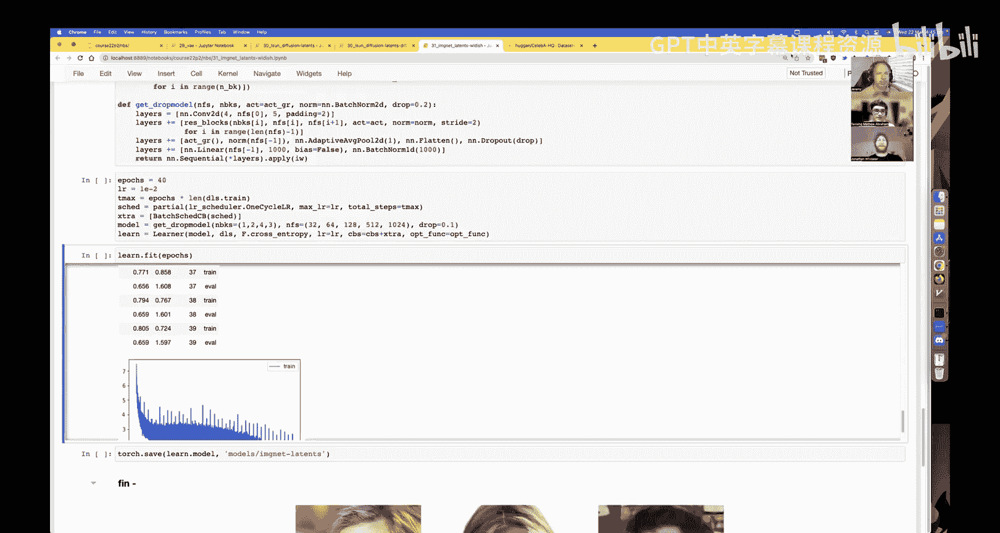

You know， we were already at the state of the art， but eight years ago。

 would know it might be more like 10 years ago， I know the time passes quickly。😊，Yeah。

 yeah I guess next year， yeah， next year it is 10 years ago。 but yeah。

 I'm kind of curious with the pretraining， the whole the whole value for me for like using a pretrain network was someone else has done lots and months of compute on Inet to learn some features and I'm gonna use that So it's kind of funny to be like oh well let's pretrain for ourselves and then try and use that I'm curious whether like how best you would allocate that compute。

 whether you should if you've got 10 hours of GPU just do 10 hours of training versus like five hours of pretraining and five hours of training I mean。

 based on our superz。😊，Thing， the pretraining。Like was so much better so I。

 that's why I'm feeling somewhat hopeful about this direction。 Yeah Yeah。

 I'm really curious to see how it goes。😊，I guess I was gonna to say it's like yeah。

 I think there's just a lot of opportunities for I guess the latent doing stuff in the latents and like I guess maybe like yeah。

 you could I mean here your trade classifier as a backbone but you could think of like traded classifiers on other things for you guidance or things like this Of course we've done some experiments with that I know Jonno has his midu guidance approach for some of this sort of things but there are different approaches that you can play around here that know exploring it in the latent space can can make it computationally cheaper than you know having to decode it any time you want to you know like you have to look at the image and then maybe apply a classifier。

 apply some sort of guidance on the image but if you can do it directly in the latent space a lot of interesting opportunities there as well and you know now we're showing that indeed。

Yeah， yes， I'll on。Everything on latentens you can also fill existing models like that's something I've done to make a latent clip。

😊，Is just have it like try and mirror an image space clip and so for classifiers as well。

 you could like distill an imagenet classifier rather than just having the label。

 you try and like copy the logs。And then that's like an even richer signal。

 like you get more value per example so then you can create your you know your latent version of some existing image classifier or object detector or yeah。

 like multimodal model like clip。I feel like I feel funny about this because I'm like both excited about simple diffusion on the basis that it gets rid of latentance。

 but I'm also excited about latetntance on the basis of gets rid of most of the pixel。😊。

I don't know how I can be cheering for both， but somehow I am。😊，I guess may the best method win。So。

 you know， for folks that are finishing。This course， well， first of all， congratulations because。

It's been a journey。Particularly part two， it's a journey which requires a lot of patience and tenacity。

You know， if you've kind of zip through by binging on the videos， that's totally fine。

 it's a good approach， but you know， maybe go back now and。Do it more slowly and do the， you know。

 build build it yourself and really experiment。 but assuming， you know， for folks who have。

Got to the end of this and feel like， okay。I get it more or less。Yeah。

 do you guys have any sense of like what kind of things？Makes sense to do now， you know。

 where would you guys go from here？I think that great opportunities implementing papers that。

 I guess come along these days and and I think at small papers， no way。

Yeah but also at this stage I think you know we're already discussing research ideas and I think you know we're in this solid position to come up with our own research ideas and explore explore those ideas so I think that's that's a real opportunity that we we have here I will say yeah I think that's best done often collaboratively so I'll just you know mention that past AI has a discord。

😊，Whi if you've got to this point， then you're probably somebody who would benefit from from being there and yeah just pop your head in and say。

 like there's an introduction to just say hello and you don't， you know。

Maybe say what you're interested in or whatever because it's it's nice to work with others， I think。

 I mean， both Janno and Tnika only know because of the the discord and the forums and so forth so。

That would be one and we also have a。We have a generative channel so anything related to generative models that that's the place so for example。

 Bali was posting some of her experiments in that channel。

 I think there are other fast AI members posting their experiments so if you're doing anything generative model related that's a great way to also get feedback and thoughts from from the community yeah。

😊，I'd also say that like if you're at the stage where you finish this course。

 you actually understand how diffusion models work。

 you've got a good handle on what the different components and like stable diffusion are and you know how to wrangle data for training and play for these things you're so far ahead of most people who are building in this space and I've got lots lots of companies and people reaching out to me to say do you know anybody who has like more than just oh I know how to like load stable diffusion and make an image like you know someone who knows how to actually like tin with it and make it better and if you've got those skills like don't feel like oh I'm definitely not qualified to like apply or like there's lots of stuff where yeah just taking these ideas now and just simple sensible ideas that we've covered in the course that have come up and saying like oh actually maybe I could try that maybe I could play with this you know take this experimentalist approach I feel like there's actually a lot of people who would love to have you helping them build。

The million and one little stable diffusion based apps or whatever right you end working on particularly like the thing we always talk about at first AI。

 which is particularly if you can combine that with your domain expertise， you know。

 whether it be from your。Your hobbies or your work in some completely different field or whatever。

You know there'll be lots of interesting ways to combine you know you probably are one of the only people in the world right now that understand your areas of of passion or of vocation as well as these techniques so and again that's a good place to kind of。

Get on the forum or the Discord or whatever。Start having those conversations because it can be， yeah。

 it can be difficult when you're at the cutting edge， which you。Now are by definition。All right。

 well。We better go away and start。Figuring out how on earth GPT4 works。

 I don't think we're going to necessarily build the whole GP4 from scratch。

 at least not at that scale but。I'm sure we're going have some interesting things happening within LP and Jan O toish。

 thank you so much。 It's been a real pleasure。 It was nice doing things with the。😊。

With a live audience， but I've got to say I really enjoyed this。

Experience of doing stuff with you guys the last two lessons， so thank you so much。

Yeah thanks for having us this is really， really fun right。拜e。见不 by。Ya。😊。

