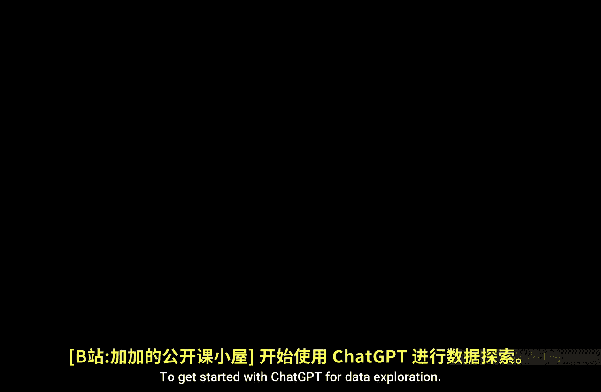
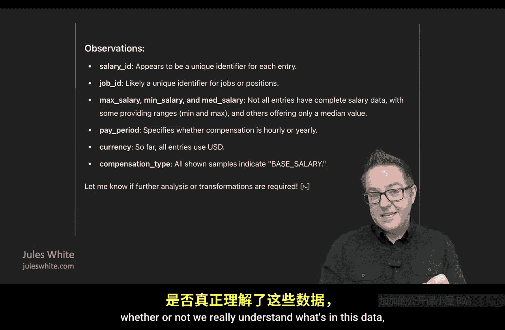

# 001：利用ChatGPT进行数据探索前的自我反思与目标设定 🎯

在本节课中，我们将学习如何利用ChatGPT进行数据探索前的准备工作。核心目标是建立对数据的共同理解，确保后续分析的准确性和有效性。

## 概述

开始使用ChatGPT进行数据探索时，首要任务是建立对所处理数据的共同理解。这听起来可能有些奇怪，但请设想一下：如果你与一位从未见过该数据的实习生合作，你首先会做什么？你会坐下来与他讨论数据，确保他理解数据内容，并解答他的疑问。ChatGPT同样从未见过你即将提供的数据，因此我们需要进行类似的“对话”来确保它正确理解数据。

## 建立共同理解的重要性

无论ChatGPT的分析能力多么强大，如果它误解了数据、遗漏了关键列或未能识别列之间的关系，它都无法成功完成我们期望的分析或探索任务。因此，我们必须从提供上下文和确保正确理解开始。

我们将通过三个步骤来深入理解数据。这个过程就像与一位即将进行分析但从未见过数据的新手坐下来，确保他跟上进度一样。

## 第一步：获取数据描述

使用ChatGPT进行这一步非常简单。我们将上传要处理的数据（通常是表格形式，包含行和列），然后要求它执行一个非常具体的任务。

**具体操作如下：**
1.  将数据以Excel文件形式上传给ChatGPT。
2.  使用提示词：`列出附件电子表格中的所有列，并显示每列的数据样本。`

这就像我们与那位实习生坐下来，对他说：“现在，告诉我所有存在的列，解释每一列是什么，并展示每一列的一些数据。”这是一种全面的方式，可以确保ChatGPT确实查看了所有列及其中的数据，从而为后续讨论奠定基础。

### 示例与观察

我使用了一个从Kaggle获取的数据集，其中包含关于LinkedIn职位描述和发布的各种有趣数据。我们用它来探索能从职位发布中学到什么。

当ChatGPT拉入所有列并显示数据样本时，我们已经开始发现一些重要信息：
*   **`max_salary`（最高薪资）**：样本中出现了`NaN`（非数字）。这表明该列可能并非严格格式化为数字，可能包含美元符号或逗号等字符，导致无法直接解析为数值。这是一个关键信息。
*   **`pay_period`（支付周期）**：旁边有“hourly”（每小时）的标注。
*   **`compensation_type`（薪酬类型）**：显示为“based salary”（基本工资）。

如果我们不花时间理解这些值的含义，可能会得到意外的结果。例如，如果要求ChatGPT对`compensation_type`进行数值分析，它将无法工作，甚至可能生成看似正确实则错误的结果。因此，我们自己的理解以及ChatGPT对数据的理解都至关重要。

### 预防数据问题与“幻觉”

另一个我们可以提前处理的问题是上传数据的格式问题。大型语言模型有一个特点：当我们提出问题或要求时，如果它们没有足够的数据来完成任务，它们倾向于“生成”答案来满足我们。这被称为“幻觉”。就像参加一场不知道答案的考试，你不会留白，而是会尝试填写内容以获得部分分数。

我们希望确保当ChatGPT无法获取数据时，它不会做出错误的举动（即产生幻觉）。因此，我们需要发现它何时无法正确读取数据。

例如，我曾上传一个较旧的Excel文件格式（`.xls`），ChatGPT在读取时遇到了困难。虽然它可能最终正确处理，但在转换过程中可能出现错误。我希望提前知道这一点。如果它加载数据失败或不完整，并且无法向我描述所有列，那么我就知道自己面临得到“幻觉”答案的风险。因此，发现这一点至关重要。

这一步看似简单，但极其重要。描述数据及其所有列。另一个重要原因是，一旦我们描述了列并将其引入对话，语言模型就会了解它们，从而有助于进行分析、建议数据探索方式等。

## 第二步：获取更多数据样本以深入理解

描述数据不仅仅是列出列名。获取多个数据样本会非常有帮助，因为仅凭列名本身不足以告诉我们数据的格式，并且不同行之间可能存在隐藏的关系，我们需要尝试揭示它们。

一个非常有效的方法是：首先让ChatGPT描述所有列，然后使用如下提示词：
`为每列再随机抽取几个数据样本，以确保你理解每列中信息的格式和类型。`

这样做的目标是提取数据，获得不止一个样本，以便看到各种不同的值。我们可以发现问题：也许99%的数据是正确的，但有一部分是错误的或格式奇怪。虽然随机样本可能无法捕获所有异常，但至少能让我们更有信心地看到可能存在的异常值。

### 深入分析样本

以`max_salary`列为例。在样本表中，我们看到一些数值，但也看到了`NaN`（非数字）。这意味着我们必须意识到存在这种可能性。因此，在要求ChatGPT执行任何任务时，都必须考虑到它可能会遇到非数字的`max_salary`值，我们可能需要进一步挖掘和理解。

此外，当ChatGPT转换或加载数据时，可能无法成功转换某些值。除非我们要求它显示数据样本以便查看和描述，否则我们不会知道这一点。

虽然在这个例子中不一定出现，但另一种可能的情况是：行中可能存在标识符。例如，描述工作类型或类别时，特别是类别，我们可能有一个类别是另一个类别的子类。因此，我们可能有一个像`parent_id`这样的列，它引用了另一行的`id`。如果我们提供了该数据的样本，ChatGPT就可以开始发现并看到这些关系。事实上，它可以相当复杂地识别这类情况。如果我们没有获取数据样本，则不太可能发现此类关系。

## 第三步：验证与纠正模型的理解

查看ChatGPT的输出，一旦我们提供了数据样本，它就会进行一些观察。这很重要。

例如，它可能指出：
*   `salary_id`似乎是每个条目的唯一标识符。
*   `job_id`可能是职位或岗位的唯一标识符。

ChatGPT本质上正在做那位实习生会做的事情：告诉我们它看到了什么。我们仔细阅读这些观察并确保它对数据的理解是正确的，这一点至关重要。

**我们的行动应该是：**
*   如果我知道`job_id`确实是唯一标识符，我应该告诉它：“是的，这是正确的。”
*   如果我在这里看到错误的内容，我应该立即跟进并纠正它。

这个过程的目标是：我正在与那位即将进行数据分析但从未见过数据的人进行对话。我希望与他们一起讨论数据。

如果你直接跳进去说“这是数据，给我展示这个图表或那个可视化”，那么出错的概率会大大增加，因为你不知道它是否正确提取了数据，是否正确理解了数据，或者是否基于命名方式产生了误解。你必须进行这种对话，以确保它对数据的理解与你的理解一致。

同样重要的是，你可能上传了错误的文件或不完整的文件，其中的数据并非你所想。这个初始步骤将帮助我们发现自己是否犯了错误或对数据存在误解，是否真正理解这些数据，以及ChatGPT是否理解数据，从而共同建立共享的理解。

## 总结

本节课中，我们一起学习了利用ChatGPT进行数据探索前的关键准备步骤：
1.  **获取数据描述**：通过上传数据并要求列出所有列及样本，建立对数据结构的初步共同理解。
2.  **深入采样**：通过获取更多随机样本，揭示数据格式、潜在异常值以及行间可能存在的隐藏关系。
3.  **验证与对齐**：仔细阅读ChatGPT的观察结果，确认或纠正其对数据的理解，确保双方认知一致，为后续准确、高效的数据分析奠定坚实基础。这个过程是避免模型“幻觉”和确保分析结果可靠的核心。