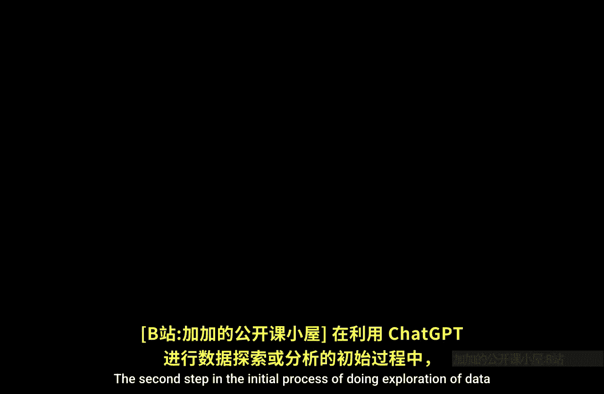
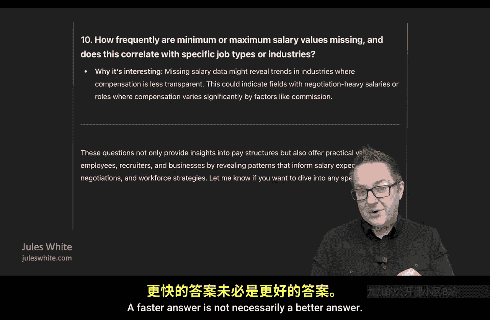

# 002：让ChatGPT生成可用Excel数据回答的问题 🔍

在本节课中，我们将要学习数据分析探索流程的第二步：内省。我们将重点介绍如何利用ChatGPT，通过生成关于数据集的可回答问题，来深入理解数据、发现潜在模式，并识别分析中的误解或盲点。

上一节我们介绍了如何让ChatGPT描述数据。本节中我们来看看如何引导它进行更深层次的思考，即对数据进行“内省”。

## 什么是数据内省？

数据内省是指审视已描述的数据，思考其中的模式、关系，并尝试将信息组合起来，以理解数据集能告诉我们什么。让AI进行数据内省的一个非常有效的方法是，让它提出能够用该数据回答的问题。

## 为什么生成问题很重要？

想象一下，你正与一位实习生或同事一起分析数据。你让他们查看数据、描述所有列和值并提供样本后，接着问：“现在，告诉我一些你能用这些数据回答的问题。”这个过程至关重要，原因如下：

以下是生成问题带来的两个核心好处：

1.  **检验理解程度**：通过AI提出的问题，我们可以判断它是否真正理解了数据。我们可以思考：**用这份数据真的能回答这个问题吗？** 如果不能，这就是一个澄清数据含义和格式的机会。
2.  **激发新视角**：AI可能会发现我们未曾注意到的东西，提出我们没想到的问题，或者指出我们未意识到的、数据能够解答的方向。这使分析过程变得协作，既能弥补我们自身分析的盲点，也能发现AI对数据的理解差距。

## 实践：让ChatGPT生成问题

使用同一份职位薪酬数据，我向ChatGPT输入了以下指令：
`请告诉我一些我们可以用这个数据集回答的有趣问题，并说明为什么它们有趣。`

它返回了以下一系列问题：

以下是ChatGPT生成的部分问题示例：

*   **最高薪和最低薪的职位是什么？它们如何按支付周期变化？**
*   **薪酬如何按最小值、最大值和中位数聚类？某些职位的最高薪与最低薪之间是否存在巨大差异？**（例如，了解同一职位在何处薪酬范围最大会非常有趣）
*   **薪酬分布在不同范围内有何差异？**
*   **薪酬类型（例如，基本工资）与薪酬范围的变异性之间是否存在关系？**
*   **哪些职位只提供了中位数薪资，哪些提供了最低-最高薪资范围？**
*   **如果存在其他货币，不同货币的薪资数据是否有明显模式？**（注意，它基于“如果存在”这个前提提问，因为它只看到了一个样本）
*   **同一职位在不同行业的薪资范围有何不同？哪些角色的薪酬范围最小和最大？**
*   **数据是否揭示了跨行业中时薪与年薪结构的趋势？**
*   **最低或最高薪资值缺失的频率如何？这是否与特定的职位类型或行业相关？**

它为我们提供了大量可以尝试用数据集回答的问题。同时，这也为我（人类分析者）提供了大量机会，去审视它提出的问题并思考：**它真的能用这些数据回答那个问题吗？**

如果答案是否定的，我可以返回并向它解释为什么其问题无法回答。通常，我会接着澄清数据集的内容，指出误解和无法回答的原因，然后要求它：“**现在，生成10个新的问题。**”

## 迭代的价值与风险防范

你可以多次迭代这个过程。问题成为快速发现数据误解的强有力工具，同时，在此过程中，我也能获得许多分析思路，本质上是在与AI协作进行头脑风暴，并自己学习数据。这是一个互利的过程。

现在，我们能否直接跳入数据集，更快地开始分析和可视化？当然可以。但我强烈建议你不要这样做，而是花时间完成这些前期步骤。

原因在于，数据分析中最糟糕的事情就是**得出了错误答案，却坚信它是正确的**。当我们过于匆忙地使用生成式AI，并假设一切都很完美，认为那些漂亮的图表必然基于现实时，就存在巨大的风险。

以下是可能发生的几种情况：

*   **重大误解**：AI可能完全误解了数据。
*   **数据幻觉**：AI可能凭空捏造了不存在的数据。
*   **细微错误**：某个值不是数字（NaN），而它的计算没有考虑到这一点，因为它不知道该值可能出现非数字情况。
*   **语义偏差**：它可能错误地解释了我的问题或列名的含义，这种细微的误解导致其产生的计算与我的真实意图不符。

这些情况在现实世界的人类协作中同样会发生。如果实习生对某列有误解，他们也可能做出看起来非常复杂、难以发现错误的分析和可视化。因此，这些细微的理解错误可能是灾难性的。

无论你是与人类还是与ChatGPT这类大语言模型协作，进行这样的对话都极其重要。你必须确保最终得到的答案是真正正确的。**世界上最糟糕的事情就是得到错误答案却以为正确。** 这就是我们这样做的原因。更快的答案不一定是更好的答案，事实上，它可能是一个灾难性的、更糟的答案。

---

本节课中我们一起学习了数据分析中“内省”阶段的核心方法：利用ChatGPT生成可回答的问题。我们探讨了这种做法如何帮助检验AI（或协作者）对数据的理解，激发新的分析视角，并通过迭代提问来澄清误解、确保分析基础的牢固。记住，在追求效率的同时，确保分析的准确性永远是第一位的。下一节，我们将基于这些生成的问题，开始探索如何用数据寻找答案。