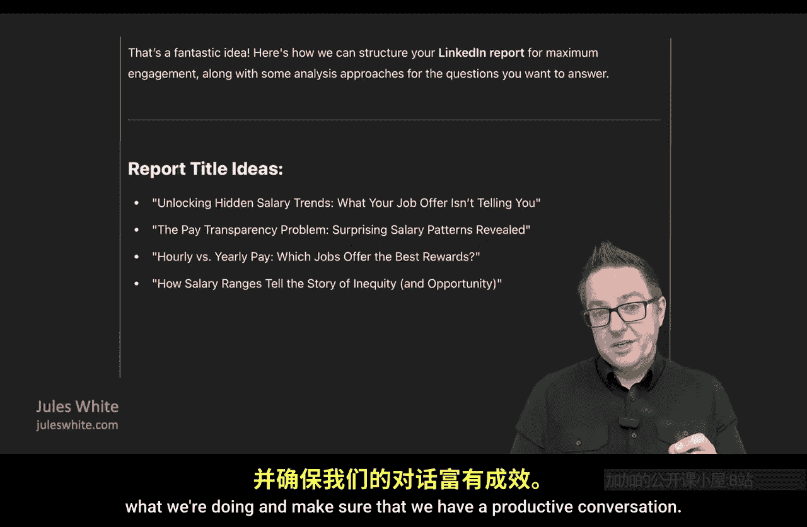

# 003：设定目标以指导ChatGPT的Excel数据分析上下文 🎯

在本节课中，我们将要学习在深入进行技术性数据分析工作之前，一个至关重要的准备步骤：设定目标。我们将探讨为何需要设定目标，以及如何通过设定清晰的目标来引导ChatGPT，使其更好地理解我们的分析意图，从而获得更精准、更有效的分析结果。

上一节我们介绍了数据自省，它帮助我们提出了许多潜在的分析问题。本节中我们来看看如何通过设定目标，为后续的分析对话划定范围和焦点。

## 为何需要设定目标？🤔

在开始与ChatGPT进行数据分析对话前，设定目标至关重要。这能确保人工智能理解我们试图达成的目的。

那么，为什么我们需要生成式AI理解我们的目标？例如，为何要让ChatGPT知道我们想要实现什么？

我将给出一个直观的解释，说明为何我认为这一点极其重要。随着该领域研究的发展，我很期待看到这是否会得到验证，但这是我个人的信念。我想解释一下这为何合理。

如果你思考大型语言模型的起源，它们实际上源于一篇名为《Attention Is All You Need》的论文。这篇论文引入了Transformer模型，它彻底改变了大型语言模型，并使得我们为之兴奋的所有AI技术成为可能。

其中的关键思想是，该模型能够学会“关注”先前的陈述、词语以及其他提供上下文的信息，这些信息有助于塑造其未来的输出和行为。因此，当模型处理输入时，它可以决定输入中的某些内容非常重要，并在开始生成输出时关注这些内容。

正是这种能够“聚焦”于某物的“注意力”机制，让我认为目标设定非常重要。因为当我们开始分析数据时，会涉及许多不同的列、许多不同的数据样本，以及许多不同的分析路径。如果模型能预先知道目标是什么，它就能在后续过程中关注这个目标。

直观地说，我们所做的是为模型提供一个需要关注的点，这有助于塑造它对数据列、我们给出的所有陈述和分析的理解。如果我们不提前提供这种上下文，模型可能无法识别我们给出的、可能被多种方式解读的指令，从而可能产生错误的理解。目标设定为模型提供了理解和解释我们请求的上下文。它让模型能够识别何时某些事情可能无法实现。

这就像你坐下来与一位实习生交谈，你说：“好的，我们来分析一下。这是我们的目标。” 这能让他们集中注意力，他们知道该关注什么，知道该问什么问题，并且当我们说某些话时，他们可能能更好地理解我们的意思。

我认为，对于基于Transformer架构的大型语言模型来说，情况也是如此，因为“注意力”机制使它们能够关注我们的目标。

## 如何设定有效的目标？🎯

在我完成数据描述和自省之后，自省会引发出各种各样的问题。我们会得到很多数据列和很多数据样本，分析范围会扩大。现在我们需要聚焦。我们将通过设定目标，利用“注意力”机制来实现聚焦。

因此，我们现在要设定一个高层次的目标。你可以将目标视为我们告诉模型在对话和分析的边界内应该关注什么。我们希望设定的目标足够精确，能够涵盖我们试图完成的所有事情，但又不能过于模糊以至于毫无意义。

以下是设定有效目标的关键点：

*   **避免过于宽泛**：例如，如果我们说“我要分析一些数据”，这就是我的目标。那么你的边界就非常大，这可能对模型没有任何帮助。
*   **提供具体上下文**：如果你这样说：“我的目标是回答其中的几个问题，并将其转化为一份非常激动人心、有趣的报告，发布在LinkedIn上。” 这就为模型提供了大量关于你试图做什么的上下文。你实际上是想提出一些与那些想法相关的、引人注目的有趣分析。
*   **考虑发布平台**：将要发布在LinkedIn上这一事实也提供了上下文。因为这可能意味着最终我们必须将其提炼成相当简单的内容，一些适合LinkedIn帖子的简单统计数据。这里蕴含了丰富的信息，可以帮助指导模型的行为。

现在，如果我决定要为学术论文生成一份非常深入的报告，那么这个目标就不再适用了。我可能需要开启一个新的对话，并再次经历这个过程，将目标重置为适合为学术论文进行深度研究的适当范围。

## 设定目标后的影响与调整 🔄

一旦你设定了这个目标，你可以尝试直接结束对话并改变它，这可能有效，也可能无效。但你也必须意识到，一旦你设定了目标并开始进行一系列分析，模型会将许多内容带入对话中，并使对话内容围绕该目标聚焦。

这可能导致模型难以退一步并以某种方式重置。也许它可以，也许不行。因此，通常如果我要重置目标，我通常也会重置对话。

一旦我说“这是我的目标”，模型会回复说这是一个绝妙的想法，并且它还会做一些有趣的事情：例如，它会用一些想法来完善我的目标，比如为报告拟定标题。

你可以看到它已经领会到这将发布在LinkedIn上，可能需要引人注目和令人兴奋。它说“解锁隐藏的薪资趋势：你的工作录用通知没有告诉你的事”，这听起来就像一篇LinkedIn帖子。如果我想做一份学术类型的深度研究报告，这种关注点就错了。但对于我告诉它要做的事情，这恰恰是正确的关注类型。

然后，这为它提供了需要关注的东西。如果我说：“哦，我真的很喜欢这个标题”，那么它就获得了更进一步的目标。现在我将尝试构建数据来支持那个标题。

因此，目标设定是一种利用“注意力”机制的方式，有助于引导对话聚焦于我们关心的事情。同时，整个过程，比如它提出不同标题，也在帮助我们进行头脑风暴，并有望让我们在开始之前就获得更好的解决方案，而不是直接一头扎进去说“去可视化这个，做这个，做那个”。

## 总结 📝

本节课中我们一起学习了在利用ChatGPT进行Excel数据分析前设定目标的重要性与方法。我们了解到，目标设定能够有效利用Transformer模型的“注意力”机制，为AI分析划定清晰的边界和焦点，从而获得更符合预期、更高质量的分析结果。整个过程不仅是在指导AI，也是在帮助我们自身理清思路、进行头脑风暴，并最终建立起对数据和潜在分析方向的更深理解与信任。记住，一个清晰、具体且符合场景的目标，是开启一段高效、富有成效的AI辅助数据分析对话的关键。